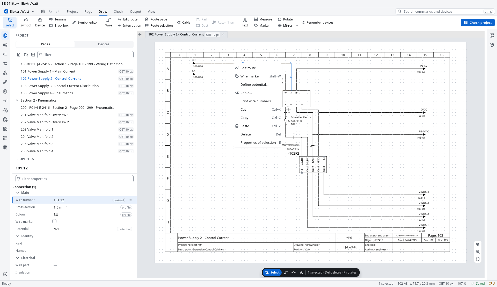
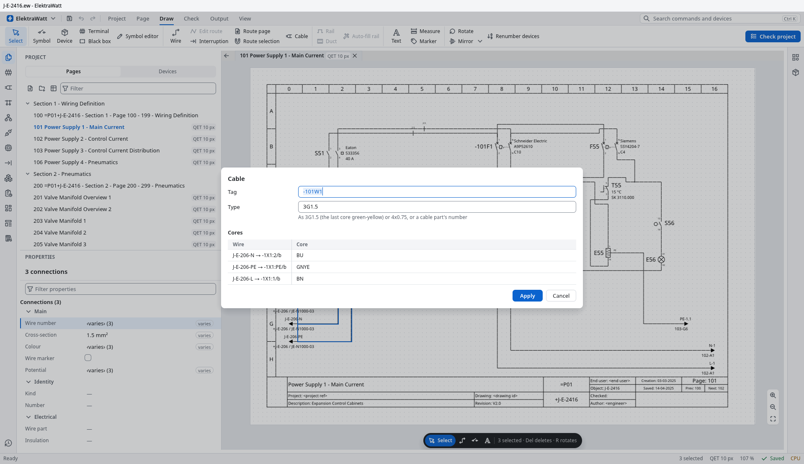
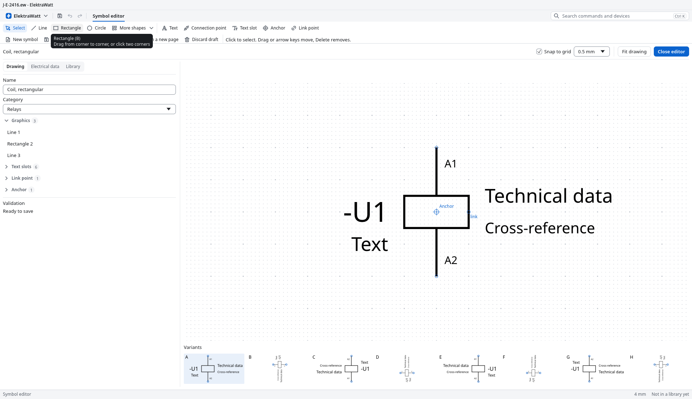
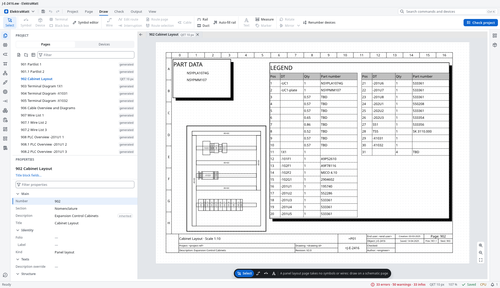
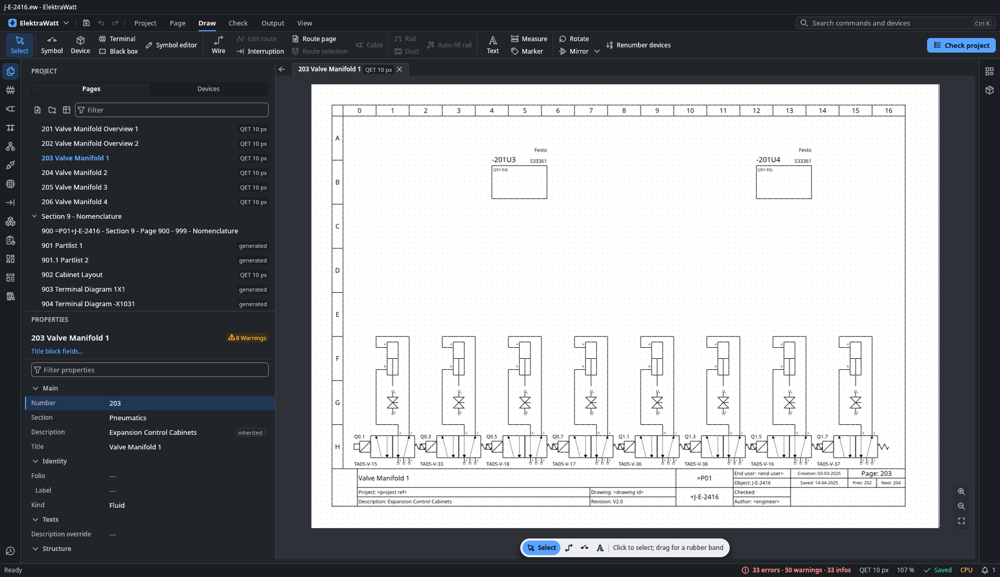

# ElektraWatt

> **Funded by [TWE-O B.V.](https://www.twe-o.nl)** All funding for ElektraWatt comes from TWE-O B.V.; the project
> has no other funders or sponsors.

ElektraWatt (EW) is an open-source, offline-first desktop application for electrical control-cabinet design, written
in Rust. It aims at the functionality of EPLAN Electric P8 class tools: schematics, devices and parts, terminals and
cables, PLC and fluid power, panel layout, reports, manufacturing outputs and checks, in a plain-text project format
that works with Git.


## Download

**[ElektraWatt 0.2.0](https://github.com/Ironkode787/ElektraWatt/releases/tag/v0.2.0)**, released on 2026-11-13, is
an early alpha for Windows 10 and 11 and for Linux on x86-64:

| File | What it is |
|---|---|
| `ElektraWatt-0.2.0-x64-user-setup.exe` | The per-user setup for Windows: the window, the `ew` command-line tool, the starter content, the sample project and the user guide; no administrator rights needed |
| `ElektraWatt-0.2.0-x86_64.AppImage` | The same for Linux (glibc 2.35 or newer, as on Ubuntu 22.04 and Debian 12) |
| `ew-0.2.0-…` (`.zip`, `.tar.gz`) | The command-line tool `ew` alone |
| `SHA256SUMS` | The checksum of every other file |

Nothing is signed yet, so Windows may warn before it runs the setup: check a download against `SHA256SUMS` first, as
the guide's [Install ElektraWatt](docs/book/src/how-to/install.md) page shows. ElektraWatt makes no network
connection of its own ([PRIVACY.md](PRIVACY.md)). The [release notes](docs/release-notes/0.2.0.md) list what changed
and what is known not to work yet.

## Screenshots

| The right-click menu | Cable… |
|---|---|
|  |  |
| **The symbol editor** | **The panel layout** |
|  |  |
| **The dark theme** | |
|  | |

The screenshots show the reference project `golden/J-E-2416.ew` at 1920 × 1080. The application drew them itself,
with its offscreen renderer (`elektrawatt --headless --visual`), the same one its window tests use.

## Status

**0.2.0 was released on 2026-11-13.** It is the fix release that followed 0.1.0 (2026-11-08): it fixes what stopped
the work when 0.1.0 was used by hand, and the owner's hands-on test of its first candidate asked for shorter ways to
things that were there but hard to find, so it also brings the right-click menu as the quick way to what fits the
thing under the pointer, forms for cables and terminals, and the other flows below. It is still an early alpha: the
[release notes](docs/release-notes/0.2.0.md), section 7, list the known limitations. The [roadmap](ROADMAP.md) lists
the milestones and [docs/plan](docs/plan/README.md) the open work.

What works today:

- **The window**, `elektrawatt`: opens a project with the page list, a zoomable canvas, navigators, table mode and a
  status bar; creates new projects through the first-run and company-standard wizards; docks panels into named
  workspaces; and edits: places devices, symbols and terminals, draws and routes wires with interruption points,
  edits properties, finds and replaces, copies and pastes, and undoes with a history. Every change is a recorded
  command.
- **The right-click menu** offers what fits the thing under the pointer first: Add terminal and Edit strip on a
  terminal, a relay's free contacts on its coil, Choose part and Edit symbol on a device, Edit route, Wire marker,
  Define potential and Cable on a wire, the partner and the direction of an interruption point, Title block fields on
  the title block. The rows of the navigators offer the same as the page; Shift+F10 opens the menu at the selection.
- **Wires, cables and potentials**: Cable… makes the selected wires a cable's cores in one form (the type as a person
  writes it, `3G1.5`; N on blue, PE on green-yellow); a wire takes its core's or its potential's cross-section and
  colour; wire markers and wire numbers print on the wires; Define potential… chooses the type from a list; a wire
  without a named potential is offered one with its reason, to accept or decline; Supply comes in here… marks the
  interruption points where the supply enters from another drawing set.
- **Terminals**: Terminal… asks for the strip, the kind, the part, how many and from which number, then places the
  row with one click.
- **The title block**: Title block fields… edits what a page's title block prints, for a project imported from
  QElectroTech too.
- **The symbol editor**: draws a symbol with its connection points and text slots on a snap grid, files it under a
  category, and checks it before saving it to a library; Edit symbol and Copy and edit open it from the browsers.
- **The 2D panel layout**: a panel layout page from New page, enclosures, rails, ducts and mounting plates, with
  placing tools and the checks that go with them.
- **QElectroTech import**: File ▸ Import… reads a `.qet` project with its title blocks, logos, tables and free
  graphics, and opens a project archive (`.ewz`).
- **The `ew` command-line tool**: import of QElectroTech projects, checks with the pre-delivery scheme, a read-only SQL
  projection, cable list, bill-of-materials and table exports, PDF/A-2b and SVG export of every page, a print set,
  applying recorded command files, revisions and verification of the derived data. Run `ew help` for the full usage.
- **Outputs**: reports (parts list, terminal and cable lists, cover tables and back-links) drawn on report pages and
  written as PDF/A-2b and SVG.
- **The reference project** `golden/J-E-2416.ew` (36 pages, anonymised) with its expected outputs, and the acceptance
  tests that check the acceptance criteria of the design against them.
- **Headless operation**: the window runs the same actions from a UI script without a display
  (`elektrawatt --headless --script <file>`), which is how the UI is tested.
- **Tests**: about 7,000 across the workspace, with determinism lints (no wall clock, no environment reads and no
  hash-ordered collections in the model, derivation, format and export paths), window tests driven by the pointer
  and the keys, property tests, a command fuzzer and the golden project as oracle.

## Building and running

The pinned toolchain in `rust-toolchain.toml` is installed automatically by rustup. Tests run with
[cargo-nextest](https://nexte.st).

```sh
cargo build --workspace --locked
cargo xtask check -p <crate>   # format, clippy, that crate's tests and the repository rules
cargo xtask check              # the same over the whole workspace, several minutes
```

To look at the reference project, work on a copy of it, because the application and the tool keep a lock and a
journal beside an open project:

```sh
cp -r golden/J-E-2416.ew /tmp/J-E-2416.ew
cargo run -p ew -- export pdf /tmp/J-E-2416.ew --out /tmp/J-E-2416.pdf
cargo run -p elektrawatt -- /tmp/J-E-2416.ew
```

The window needs a graphics adapter; without one it exits with code 3 and names the headless mode. `--no-gpu` draws
the canvas on the CPU. The user guide is built from [docs/book](docs/book) with mdBook.

## Checks

There is no continuous integration until 1.0: `cargo xtask check` is the check, and
[CONTRIBUTING.md](CONTRIBUTING.md) describes the loop. A release is built by the release workflow from a candidate
tag ([docs/release](docs/release/README.md)). Performance is deliberately not measured during development.

## Key decisions

| Topic | Decision |
|---|---|
| Language | Rust |
| Platforms | Desktop for Windows and Linux (macOS is not supported), offline-first ([ADR-0022](docs/adr/0022-platform-matrix-and-performance-budgets.md)) |
| Project format | Plain-text JSONL records in a directory, lossless on open, Git-friendly ([ADR-0010](docs/adr/0010-project-storage-jsonl-directory.md)) |
| UI toolkit | egui on wgpu with a CPU fallback for the canvas ([ADR-0014](docs/adr/0014-gui-toolkit-egui.md), [ADR-0015](docs/adr/0015-display-list-renderers-pdf.md)) |
| v1 scope | Electric P8-class schematics, PLC and I/O, fluid power, 3D panel layout, manufacturing outputs, QET/EDZ/DXF import ([vision](docs/design/00-vision-and-scope.md)) |
| Application licence | GPL-3.0-or-later |
| Format crates | MIT OR Apache-2.0 |
| Symbols and templates | CC-BY-SA-4.0, with a design exception |
| Part data and examples | CC0 |
| Documentation | CC-BY-4.0 |

The licence texts are in `LICENSES/`, indexed by [LICENSE.md](LICENSE.md); the licence set and the boundary between
the permissive and the GPL crates are in [ADR-0024](docs/adr/0024-licence-set-and-permissive-gpl-boundary.md) and
checked by `cargo xtask rules`. The architecture decision records are listed in the [ADR index](docs/adr/README.md).

## Where to start

- [Documentation map](docs/README.md): what to read for which task.
- [ADR index](docs/adr/README.md) and the [plan](docs/plan/README.md).
- The [reference project](docs/design/20-golden-project.md), which defines what the acceptance tests prove.
- [CLAUDE.md](CLAUDE.md), [.claude/orchestration.md](.claude/orchestration.md) and [.claude/agents](.claude/agents):
  the setup for AI-assisted work.

## Branches

Work happens on a working branch. `main` is fast-forwarded to it at a delivery; a release is cut from its own
branch `release/<X.Y>`.

## Funding

ElektraWatt is funded entirely by **[TWE-O B.V.](https://www.twe-o.nl)** All funding for the project comes from
TWE-O B.V.; there are no other funders, sponsors or grants.

## Contributing

See [CONTRIBUTING.md](CONTRIBUTING.md) for the workflow, the DCO, the AI-use policy and the confidentiality rules,
[CODE_OF_CONDUCT.md](CODE_OF_CONDUCT.md), [SECURITY.md](SECURITY.md) (private vulnerability reporting),
[PRIVACY.md](PRIVACY.md) (every data flow; there is no telemetry), [GOVERNANCE.md](GOVERNANCE.md) (who decides, and how a
contribution is reviewed), [ROADMAP.md](ROADMAP.md) (the milestones) and [LICENSE.md](LICENSE.md) (the licence index).
Roles, the RFC and ADR process and the AI-use policy are described in
the [open-source governance document](docs/design/19-open-source-governance.md). The repository is public: do not
include customer data, personal names or confidential material in issues or pull requests.
