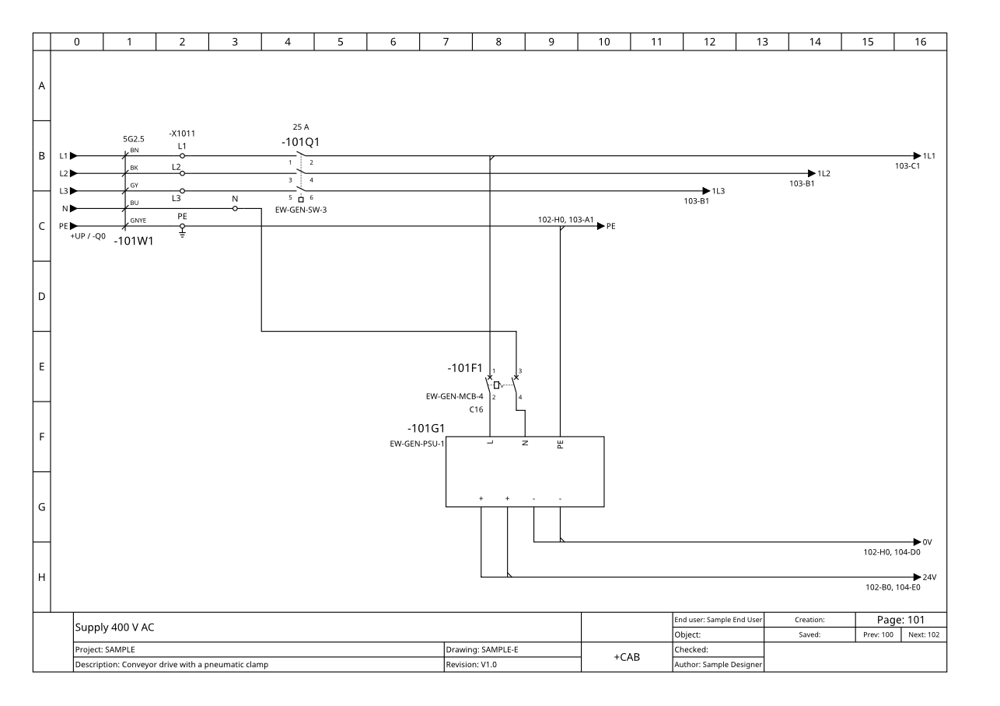
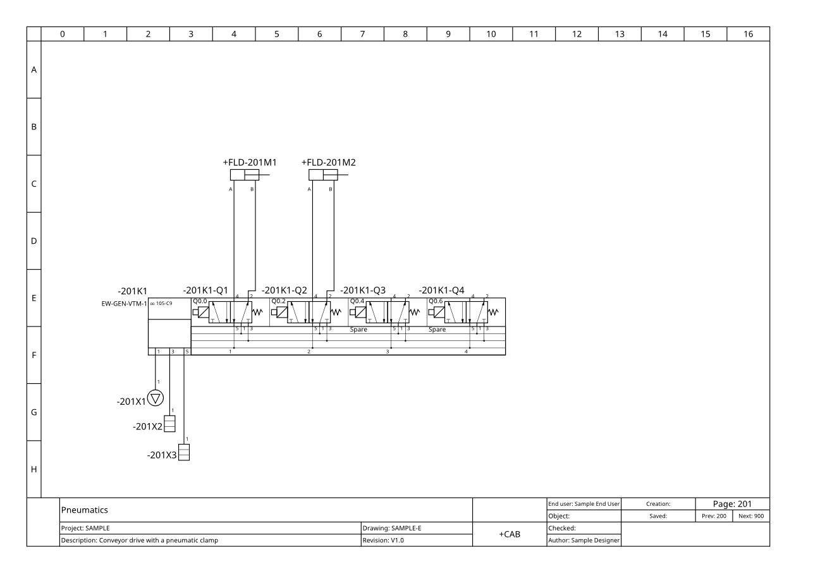
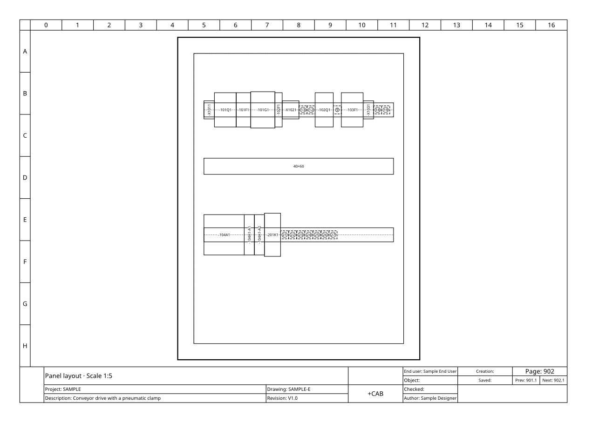
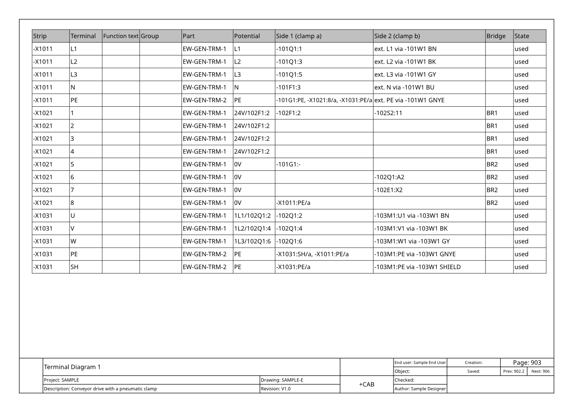
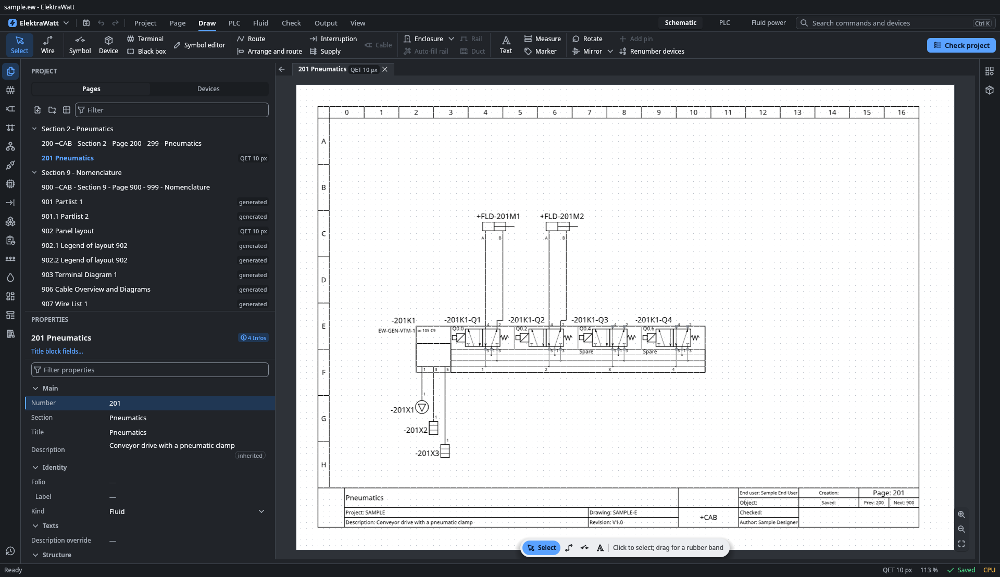

# ElektraWatt

ElektraWatt is an open-source desktop program for designing electrical control cabinets: you draw the schematic,
and the program keeps the devices, terminals, cables, PLC addresses, panel layout and lists in step with it. It
works offline, runs on Windows and Linux, and stores a project as plain text that works with Git.

> **Funded by [TWE-O B.V.](https://www.twe-o.nl)** All funding for ElektraWatt comes from TWE-O B.V.; the project
> has no other funders or sponsors.


**It is an early alpha.** The latest release is
[0.3.5](https://github.com/Ironkode787/ElektraWatt/releases/tag/v0.3.5) of 2026-11-26; the workshop's lists and
the cabinet's wire ways, 0.4.0, are in work. Use it to try things out, not yet for a job that has to be right.

## What it does

- **Schematics.** Place symbols and devices, draw wires, and let Arrange and route tidy a page. Page links,
  cross-references between a relay's coil and its contacts, wire numbers and device tags are worked out for you
  and follow every change.
- **Terminals and cables.** Add a strip's terminals in one step, turn selected wires into the cores of a cable, and
  get the terminal diagram and the cable list from the drawing.
- **Parts.** Give a device a part from the starter library, from an imported catalogue or one of your own; the
  parts list counts what the drawing uses.
- **PLC and bus.** Build a station from a CPU and its cards, let the program give the addresses, draw the cards on
  a page, and exchange tags with PLC software (AutomationML, TIA Portal tag tables, PLCopen XML).
- **Fluid power.** Draw valve terminals, cylinders and tubes on pneumatic pages that share devices with the
  electrical ones.
- **Panel layout.** Put an enclosure, rails, ducts and the devices on a mounting plate at scale, with a legend.
- **Checks.** A project check reports what is missing or contradictory, in words, with a fix where there is one.
- **Lists and output.** Parts list, terminal diagram, cable and wire lists, PLC overviews and more as pages of the
  set; the whole set as PDF/A, SVG, PNG or DXF, and the lists as CSV or XLSX.
- **Import.** QElectroTech projects, EPLAN parts and reports, DXF and PDF drawings as underlays, and parts
  catalogues.
- **Your own symbols.** A symbol editor for symbols and for the boxes of your own devices.
- **Scripting.** Everything the window does is a recorded command: the `ew` command-line tool checks, exports and
  changes a project without a window, and the window itself can run from a script.

## What comes out

The pages below are from the sample project, a small conveyor drive with a pneumatic clamp. The program drew the
sample itself, from a script of its own actions.

| | |
|---|---|
|  |  |
| **A schematic page** | **A pneumatic page** |
|  |  |
| **The panel layout** | **The terminal diagram, made from the drawing** |

## In the window

**The PLC station.** Slots, cards, addresses and where each card is drawn, with the parts you can add beside it.


**The symbol editor.** Draw a symbol, give it connection points and text fields, and see it turned and mirrored
before you save it.


**The dark theme.**



All pictures show the sample project `fixtures/sample/sample.ew` as the program in this repository draws it today,
which can be newer than the 0.3.5 download. The window pictures are 1920 × 1080 and were drawn by the program's own
offscreen renderer (`elektrawatt --headless --visual`); the pages are the output of `ew render`.

## Get it

**[ElektraWatt 0.3.5](https://github.com/Ironkode787/ElektraWatt/releases/tag/v0.3.5)** for Windows 10 and 11 and
for Linux on x86-64:

| File | What it is |
|---|---|
| `ElektraWatt-0.3.5-x64-user-setup.exe` | The per-user setup for Windows: the window, the `ew` command-line tool, the starter content, the sample project and the user guide; no administrator rights needed |
| `ElektraWatt-0.3.5-x86_64.AppImage` | The same for Linux (glibc 2.35 or newer, as on Ubuntu 22.04 and Debian 12) |
| `ew-0.3.5-…` (`.zip`, `.tar.gz`) | The command-line tool `ew` alone |
| `SHA256SUMS` | The checksum of every other file |

Nothing is signed yet, so Windows may warn before it runs the setup: check a download against `SHA256SUMS` first, as
the guide's [Install ElektraWatt](docs/book/src/how-to/install.md) page shows. ElektraWatt makes no network
connection of its own and has no telemetry ([PRIVACY.md](PRIVACY.md)). The
[release notes](docs/release-notes/0.3.5.md) list what changed and, in section 7, what is known not to work yet.

The guide's [tutorials](docs/book/src/tutorials/index.md) start from a copy of the sample project that comes with
the download.

## Where it stands

| | |
|---|---|
| **Released** | 0.3.5 (2026-11-26): schematics, terminals and cables, parts, the symbol editor, the 2D panel layout, lists and output, the PLC workspace with bus networks and the exchange with PLC software, fluid power, the imports, and Arrange and route; with 0.3.5 a copy of pages for a second installation, Move to page, a page for each PLC card, lists on your own frame, a DXF that equals the PDF, the legend as pages of its own, and terminals with two levels |
| **In work** | 0.4.0: from the schematic to the built cabinet. The production wire list with ferrules and markers, label files, assembly and cut lists; devices in the door, holes and cut-outs; wire ways through the ducts, with a length for every wire ([plan](docs/plan/m4.md)) |
| **Next** | Fluid power designed, not only drawn ([roadmap](ROADMAP.md)) |

The aim for 1.0 is the scope of the established tools of this class: schematics, PLC and I/O, fluid power, a 3D
panel layout and manufacturing outputs ([vision](docs/design/00-vision-and-scope.md)).

## Build it yourself

The pinned toolchain in `rust-toolchain.toml` is installed by rustup. Tests run with
[cargo-nextest](https://nexte.st).

```sh
cargo build --workspace --locked
cargo xtask check -p <crate>   # format, clippy, that crate's tests and the repository rules
cargo xtask check              # the same over the whole workspace, several minutes
```

To look at the sample project, work on a copy of it, because the program keeps a lock and a journal beside an open
project:

```sh
cp -r fixtures/sample/sample.ew /tmp/sample.ew
cargo run -p ew -- export pdf /tmp/sample.ew --out /tmp/sample.pdf
cargo run -p elektrawatt -- /tmp/sample.ew
```

The window needs a graphics adapter; without one it exits with code 3 and names the headless mode. `--no-gpu` draws
the canvas on the CPU. The user guide is built from [docs/book](docs/book) with mdBook.

There is no continuous integration until 1.0: `cargo xtask check` is the check, and
[CONTRIBUTING.md](CONTRIBUTING.md) describes the loop. A release is built by the release workflow from a candidate
tag ([docs/release](docs/release/README.md)).

## How it is built

| Topic | Decision |
|---|---|
| Language | Rust |
| Platforms | Desktop for Windows and Linux (macOS is not supported), offline-first ([ADR-0022](docs/adr/0022-platform-matrix-and-performance-budgets.md)) |
| Project format | Plain-text JSONL records in a directory, lossless on open, Git-friendly ([ADR-0010](docs/adr/0010-project-storage-jsonl-directory.md)) |
| UI toolkit | egui on wgpu with a CPU fallback for the canvas ([ADR-0014](docs/adr/0014-gui-toolkit-egui.md), [ADR-0015](docs/adr/0015-display-list-renderers-pdf.md)) |
| Application licence | GPL-3.0-or-later |
| Format crates | MIT OR Apache-2.0 |
| Symbols and templates | CC-BY-SA-4.0, with a design exception |
| Part data and examples | CC0 |
| Documentation | CC-BY-4.0 |

The licence texts are in `LICENSES/`, indexed by [LICENSE.md](LICENSE.md); the licence set and the boundary between
the permissive and the GPL crates are in [ADR-0024](docs/adr/0024-licence-set-and-permissive-gpl-boundary.md) and
checked by `cargo xtask rules`.

Where to read on:

- [Documentation map](docs/README.md): what to read for which task.
- [ADR index](docs/adr/README.md) for the decisions and the [plan](docs/plan/README.md) for the open work.
- [CLAUDE.md](CLAUDE.md), [.claude/orchestration.md](.claude/orchestration.md) and [.claude/agents](.claude/agents):
  the project is developed with AI assistance, and this is its setup.

Work happens on a working branch. `main` is fast-forwarded to it at a delivery; a release is cut from its own
branch `release/<X.Y>`.

## Funding

ElektraWatt is funded entirely by **[TWE-O B.V.](https://www.twe-o.nl)** All funding for the project comes from
TWE-O B.V.; there are no other funders, sponsors or grants.

## Contributing

See [CONTRIBUTING.md](CONTRIBUTING.md) for the workflow, the DCO, the AI-use policy and the confidentiality rules,
[CODE_OF_CONDUCT.md](CODE_OF_CONDUCT.md), [SECURITY.md](SECURITY.md) (private vulnerability reporting),
[PRIVACY.md](PRIVACY.md) (every data flow; there is no telemetry), [GOVERNANCE.md](GOVERNANCE.md) (who decides, and how a
contribution is reviewed), [ROADMAP.md](ROADMAP.md) (the milestones) and [LICENSE.md](LICENSE.md) (the licence index).
Roles, the RFC and ADR process and the AI-use policy are described in
the [open-source governance document](docs/design/19-open-source-governance.md). The repository is public: do not
include customer data, personal names or confidential material in issues or pull requests.
