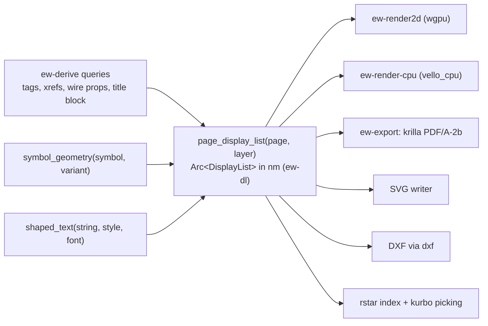

# ADR-0015: One display-list IR; wgpu canvas plus an always-built CPU renderer; krilla PDF/A-2b; PDF as print master

**Status:** Accepted · amended 2026-10-18, 2026-10-19, 2026-10-20, 2026-10-22 · **Date:** 2026-10-17 · **Deciders:** core team (chief architect, after the architecture judge panel)

## Context

- **Every output must agree exactly.** Screen, PDF, SVG, DXF, PNG and print must show the same geometry, title
  blocks and cross-reference labels (FR-OUT-018). A label such as "∞ 203-B4" or "102-A1" that wraps differently on
  paper than on screen is a defect. The frame must match the reference set's to ±0.2 mm (FR-PAG-019).
- **Some machines have no GPU.** RDP, VDI and Citrix sessions may offer no hardware adapter. wgpu's DX12 backend
  recognises WARP, but other hosts may get no adapter at all (G6). CI runners have no GPU either.
- **The reference PDF lacks navigation.** It has no bookmarks, no hyperlinks and physical page labels 1…18, so a
  viewer's "page 5" means folio 101 (D-07, D-33). Text extraction loses spaces ("SK3110.000").
- **Archival and determinism.** Customers archive PDFs, and PDF/A is the expected format. The same model must
  produce the same bytes on every platform (FR-OUT-019, NFR-REL-07).
- **Printing.** Native print stacks differ per OS; HPGL plotters are not required.
- **Ecosystem** ([Rust ecosystem](../research/rust-ecosystem.md) §3, §6.2):
  - krilla 0.8.2 supports PDF/A-1 to -4, PDF/UA-1, outlines, page labels, links and named destinations, but **not
    optional content** (C-11).
  - vello_cpu 0.3.0 is the more mature vello path.
  - lyon tessellates once for instancing.
  - parley, skrifa and harfrust form one text stack.

## Decision

1. **One IR.** The permissive `ew-dl` display list, in nm: `Path(BezPath, Stroke, Brush)`, `Glyphs(Arc<ShapedRun>)`,
   `Image`, `Instance(SymbolGeomId, Transform)` and `Group`. Items carry an optional `EntityRef` (picking,
   highlight) and a `LinkSource`/`LinkTarget` (xref to named destination). It is built by layered, memoised
   `page_display_list(page, layer)` queries; layers are frame, symbols, wires, labels and highlights, so a wire edit
   never rebuilds the title block. Amendment 2 adds the language to the key and refines the layers.
2. **Screen: wgpu.** `ew-render2d` draws inside an `egui_wgpu` paint callback on the shared device. Symbols are
   tessellated once per (symbol, variant) with lyon and drawn instanced; lines are expanded to screen width in the
   vertex shader; text comes from a glyph atlas. A backdated layer `Arc` (ADR-0002) lets the renderer keep its
   vertex buffers.
3. **CPU renderer, always built and tested.** `ew-render-cpu` (vello_cpu) renders the same IR. It is the canvas
   fallback where wgpu cannot get an adapter after DX12 WARP, and it produces CI goldens, thumbnails and banded print
   rasters. The perf gate requires ≥ 30 fps for an A4 page on it (NFR-PERF-06).
4. **One text stack** for screen and paper: parley, fontique, skrifa and harfrust with bundled fonts (default font in
   ADR-0028). `shaped_text` is memoised, so screen and PDF share glyph positions and line breaks.
5. **PDF: krilla.** PDF/A-2b by default; PDF/A-3b or -4f only when attachments are embedded (C-10). An outline from
   `page_order` and sections; a named destination per xref target and a link annotation per xref text;
   `/PageLabels` equal to the folios; subset embedded fonts and glyph runs with real spaces; optional tagged PDF
   (PDF/UA-1). **No optional-content layers in v1.**
6. **Other outputs.** An own SVG writer; DXF (AC1015, layer mapping) via dxf 0.6.2; PNG via vello_cpu.
7. **Printing.** PDF is the print master. Small per-OS adapters hand it to the OS: the xdg Print portal or CUPS on
   Linux, PDFKit on macOS, `PrintDlgEx` with banded vello_cpu rendering on Windows. Scale-to-fit stamps the scale;
   folio ranges and monochrome mode are supported; `ew print` prints from the CLI.

**Scope by release.** MVP: the wgpu canvas with the CPU fallback, PDF/A-2b with outline, links, named destinations,
page labels and XMP metadata, SVG, PNG and printing (FR-OUT-001, FR-OUT-002, FR-OUT-004 … FR-OUT-011, FR-OUT-013,
FR-OUT-014, FR-OUT-017 … FR-OUT-020, FR-OUT-022). 1.0: DXF page export (FR-OUT-015), tagged PDF (FR-OUT-012,
NFR-A11Y-05), draft stamps on unreleased revisions (FR-OUT-021) and PDF/A-3b with attachments (FR-OUT-003, Could).
Later: optional content (FR-OUT-023), DWG pages (FR-OUT-016) and 3D PDF (FR-OUT-024).

## Amendments

Amendments 1 to 4 were accepted on 2026-10-18, amendments 5 to 7 on 2026-10-19, amendments 8 and 9 on 2026-10-20, amendment 10 on 2026-10-22. The decision text above is unchanged; these entries refine it.

1. **Print adapters, PNG export and the PDF rasteriser** (2026-10-18;
   [reports, forms and output](../design/09-reports-forms-output.md), open questions 4 and 5;
   [manufacturing outputs](../design/13-manufacturing-outputs.md), open question 12;
   [interop](../design/14-interop.md), open question 10; [architecture](../design/04-architecture.md) §3). The OS
   print adapters live in a GPL crate `ew-print` with per-OS features, depending on `ew-export` and
   `ew-render-cpu`; `ew-export` depends on `ew-render-cpu` for PNG.
   The text stack and the memoised `shaped_text` query live in the GPL crate `ew-text`, below `ew-reports` and
   `ew-scene`. All three crates are GPL, so the licence layering is unaffected. The PDF rasteriser hayro 0.8.0
   becomes a runtime dependency of the migration verifier (`ew verify-migration`, MVP), of PDF underlays (1.0) and
   of the `.ewpp` wiring viewer (after a fidelity check on the golden PDF, with per-page SVG as the fallback); it
   stays a test dependency of `ew-testkit`.
2. **Display-list key and layers** (2026-10-18; [reports, forms and output](../design/09-reports-forms-output.md),
   open question 16). The query is
   `page_display_list(page, layer, lang)`: the display language is part of the key, so a per-language PDF is the
   same derivation with another key. Schematic pages have the layers frame, symbols, wires, labels, tables,
   revision and highlights. Panel-layout pages have the layers surface, carriers, placements, features and dims,
   plus frame, labels, tables and highlights.
3. **PNG determinism** (2026-10-18; [reports, forms and output](../design/09-reports-forms-output.md), open
   question 12). vello_cpu may choose different SIMD paths per
   CPU, so PNGs compare **within the dify tolerance** across platforms (FR-OUT-014, NFR-REL-07). Byte identity
   stays for PDF, SVG, XLSX, CSV, JSONL and `.ewpp`. If the performance spike (gate G-SP) finds a deterministic scalar vello_cpu mode,
   `ew render` and the CI goldens use it, and PNG returns to byte identity on the same platform.
4. **Stroke colour in the display list** (2026-10-18, core team;
   [symbols, parts and macros](../design/07-symbols-parts-macros.md) §2.3;
   [architecture](../design/04-architecture.md) §8.1). Doc 07 primitives carry a stroke colour, and wire colours
   must render, so `ew-dl`'s `Stroke` carries a `brush` (default black) beside its width, caps, joins and dash
   pattern. The IR item stays `Path(BezPath, Stroke, Brush)`; its third member is the fill brush. Lowering resolves a
   primitive's `ByLayer` colour to a concrete brush, so renderers and writers never see `ByLayer`.
5. **The PDF as built** (2026-10-19, core team; decision log ID-139, ID-140;
   [reports, forms and output](../design/09-reports-forms-output.md) §4.2, §4.3). This settles the pending
   amendment on page labels: krilla 0.8.2 writes `/PageLabels` natively, one range per page with the folio label as
   literal prefix and no numbering style, so no pdf-writer post-step is needed. The writer follows these rules:
   - **Determinism.** No wall clock and no randomness: the creation date is the caller's (FR-OUT-026's order), the
     document ID is krilla's stable hash of the caller's digest of the export input and the instance ID a hash of
     the document, and font subset tags are content hashes. Coordinates go nm → milli-pt in integers, half to
     even, before they become `f32`; rotations come from `ew-dl`'s `libm` numerics. Pages, items, fonts and
     destinations are processed in input order, every map is a `BTreeMap`, and krilla numbers objects in first-use
     order and sorts the name tree.
   - **Destinations.** Every page has its own named destination: a drawn page its page ID, a divider its section's
     ID, a generated page its `v5(block, index)`; a duplicate destination is an export error (decision log ID-163).
     A target item gets a destination only when a link of the export points at it; the first target in page order
     wins.
   - **Text.** Glyphs are subset-embedded (CID, Identity-H) with ToUnicode from the run's text: one char per glyph
     when the counts agree, otherwise the run is one cluster, until `ShapedRun` carries clusters. `.notdef`
     glyphs are dropped, as PDF/A requires.
   - **Not yet.** Link annotations use a rectangle, not QuadPoints; images are skipped until assets reach the
     scene; links out of a partial export are plain text (FR-OUT-020's remote links follow).
6. **PNG determinism per build target** (2026-10-19, project owner, delegated; decision log ID-138; refines
   amendment 3). `ew-render-cpu` runs vello_cpu on `Level::baseline()`, the portable SIMD level, so a PNG is
   byte-identical across runs and machines of one build target; across targets PNGs still compare within the dify
   tolerance. (`Level::fallback()`, the scalar path, needs a further fearless_simd feature and is not used.) The
   golden PNGs are rendered at 150 dpi (doc 20 §3.3).
7. **Page layers over a caller-filled view** (2026-10-19, core team; decision log ID-125, ID-136; refines
   amendment 2). `ew-scene` has no edge to `ew-derive`. Its layer function `page_display_list(view, layer, fonts)`
   is a pure function of a `PageView` that the caller fills with the page's records and derived texts; each layer
   reads only its own inputs, so the frame layer never sees a wire edit. The memoised
   `page_display_list(page, layer, lang)` family of amendment 2 is built by the export job in the crate that fills
   the view, with one view and one query per layer that reads only that layer's inputs, so a wire edit never
   rebuilds the title block in practice; until then the CPU renderer and the PDF writer take the layers directly.
8. **A text line may be a group of runs, one per font** (2026-10-20, project owner, delegated; decision log ID-239;
   [ADR-0028](0028-default-drawing-fonts.md) amendment 1). `ShapedRun` keeps one font per run and is unchanged.
   A line whose characters come from more than one face (the style's face and the symbol fallback) is lowered by
   `ew-scene` into one `Group` that carries the text's origin, angle, `EntityRef` and its one link source, holding
   one `Glyphs` run per face in text order; a line drawn by one face stays one run. Backends need no change, and
   the PDF embeds one subset per face. A text consumer that wants the logical text of such a line reads the
   group's runs in order; an optional "logical text" marker on `Group` is follow-up task FT-112. Per-glyph faces in
   `ShapedRun` are revisited only if the display list becomes a persisted or plugin-facing format, because only
   then would the grouping leak into a contract others depend on.
9. **An invisible path is a link and pick region; one link per listed item** (2026-10-20, project owner, delegated;
   decision log ID-267, ID-268; FT-86; [reports, forms and output](../design/09-reports-forms-output.md) §4.2). A
   `Path` item with neither stroke nor fill is valid: renderers draw nothing for it, and it serves as an invisible
   link region (with a `LinkSource`) or pick region (with an `EntityRef`). `ew-scene` uses it for a
   cross-reference text that lists several items ("∞ 3-B2, 106-G3"): such a text carries one invisible path per
   item, over that item's glyph span only (the pen travel of the text up to the item's ends, not the "∞ " prefix
   or the parentheses), after the text's own items, with the text's `EntityRef` and a `LinkSource`; a text with one
   item keeps its link on the text, and a slot value sets one kind or the other, never both. `ew-dl` and the
   backends are unchanged: `ew-export` writes one link annotation per link item over the axis-aligned box of the
   path's control points, exact at 0° and 90°; a free-angle text needs `QuadPoints` (follow-up task FT-122), and
   exact item ends from the shaped clusters replace the prefix re-shaping, which ignores kerning across the item
   boundary (FT-123). The golden PDF has 64 cross-reference link annotations and 96 named destinations.
10. **The canvas's GPU path as built** (2026-10-22, cycle 22, lead ruling the owner may reverse, applied and accepted at
    the cycle-22 design pass; decision log ID-506, ID-507, ID-539 to ID-543;
    [WP-S2.02 specification](../plan/specs/WP-S2.02-canvas-renderer.md) §3, §7). This applies the amendment that was
    pending since cycle 21. Decision 2 changes in two points, as built by part 2 of WP-S2.02:
    - **An offscreen texture instead of a paint callback.** `ew-render2d` tessellates the display list with lyon
      (fills and strokes, with the caps, joins and miter limit of `ew-dl`; dashes split first with kurbo) and draws it,
      depth-ordered, into its own 4× multisampled offscreen texture (1× where the adapter cannot), which it resolves
      into a pane-sized `Rgba8Unorm` texture. egui-wgpu requires that format for native textures and samples it as
      gamma-space colour, so authored sRGB bytes blend in gamma space exactly as the CPU renderer's u8 pipeline does
      (#0072B2 reads back within ±1). The texture is shown as an egui native texture with nearest filtering, one
      texel per physical pixel, under the overlays that both backends share.
    - **Glyphs as tessellated outlines, not an atlas.** A mesh is cached by content: a group by a 128-bit content key,
      a glyph by (font, glyph ID), tessellated from its unhinted skrifa outline in font units with a tolerance of
      em/2000. Scene preparation runs on a worker; a second preparation of the same page tessellates nothing. **Every
      group with a transform or a clip is a mesh context** (one mesh per content key, instanced), which settles the
      cycle-21 wording that named the transform only (ID-540).
    - **Translucency** is exact in paint order between instances and approximate inside one mesh (ID-541): opaque
      items are depth-tested in any order, translucent items are drawn last in paint order, and the order of
      translucent primitives inside one mesh is the mesh's own. The parity test (WP-S2.02 §8) states its bounds
      accordingly.
    - **The mapped-view rule** (from the cycle-21 audit of wgpu 30.0.1; ADR-0014's as-built note): uploads use
      `Queue::write_buffer` and `Queue::write_texture`, and the only mapped view in the renderer is the readback in
      `GpuCanvas::read_back`, held inside the scope that maps it and dropped before `unmap`.
    - **The CPU path stays the golden reference** (decision 3, amendment 6): `ew-render-cpu` is unchanged, no golden
      byte changed, `canvas.snapshot` is always a CPU image, and the GPU path is compared with the CPU canvas by a
      render-to-texture parity test under a neighbourhood tolerance, never by bytes. The backend is chosen by one
      pure function (the switch rule, architecture §8.2); on a host without an adapter the window does not open
      (exit code 3) and the CPU renderer remains the headless and fallback path. Supply chain: lyon_tessellation,
      lyon_path, lyon_geom and float_next_after are cargo-vet exemptions under ID-476's hold until FT-326 audits them
      (ID-543).

## Consequences

### Positive

- Identical geometry and text on every backend, because every backend consumes the same IR and shaped runs.
- CI renders golden PNGs and rasterises PDFs without a GPU; GPU/CPU parity is sampled.
- GPU-less RDP and VDI users keep every 2D function (NFR-PLAT-03, FR-UI-028).
- D-07 and D-33 are fixed by construction: outline, links, named destinations and folio page labels come from the
  model. Named destinations use stable v5 IDs (ADR-0004), so links survive regeneration.
- The print path is small: one PDF plus thin OS adapters.

### Negative

- Two 2D renderers to maintain, kept honest by parity tests.
- No PDF layers in v1 (FR-OUT-023 is Later). Adding them needs an upstream krilla patch or a pdf-writer post-step.
- Banded raster printing on Windows spools large jobs.
- Bundled fonts mean the reference set's Tahoma is substituted on import, which may reflow imported texts
  (ADR-0028).

## Pending amendments

The page-label amendment that was pending here (from
[reports, forms and output](../design/09-reports-forms-output.md), open question 11) is settled by amendment 5.

No amendment is pending. The GPU-path amendment that was pending from cycle 21 (decision log ID-506, ID-507) is
applied and accepted as amendment 10.

## Alternatives considered

| Alternative | Why rejected |
|---|---|
| **Separate renderers per output** | Screen and paper drift apart: the title-block and xref-label class of defects |
| **Typst for drawings** | Strong for free-form documents; EPLAN-style forms are fixed-grid pages better served by an own forms engine (ADR-0018) |
| **vello (GPU compute) as the screen renderer** | Self-described experimental for compute-capable GPUs; the IR keeps it an option once vello_gpu matures |
| **GPU-only rendering** | Fails on GPU-less hosts and in CI |
| **HPGL output for plotters** | Plotters accept PDF through the OS driver (G9) |
| **Optional content in v1** | Not supported by krilla (C-11); not needed for the golden project |

## Related

- **ADRs:** [ADR-0002](0002-derived-data-engine-ew-memo.md), [ADR-0004](0004-identity-uuidv7-uuidv5.md),
  [ADR-0005](0005-value-types-nm-dec3-mltext.md), [ADR-0013](0013-revisions-and-as-built-archive.md),
  [ADR-0014](0014-gui-toolkit-egui.md), [ADR-0016](0016-3d-renderer-wgpu-and-out-of-process-step-worker.md), [ADR-0018](0018-reports-forms-engine-and-machine-profiles.md), [ADR-0022](0022-platform-matrix-and-performance-budgets.md), [ADR-0028](0028-default-drawing-fonts.md).
- **Design:** [architecture](../design/04-architecture.md) §3, §6.4, §8.1–§8.4, §13;
  [reports, forms and output](../design/09-reports-forms-output.md) §4, §6;
  [golden project](../design/20-golden-project.md) §17.
- **Requirements:** FR-OUT-001, FR-OUT-002, FR-OUT-003, FR-OUT-004, FR-OUT-005, FR-OUT-006, FR-OUT-007, FR-OUT-008,
  FR-OUT-009, FR-OUT-010, FR-OUT-011, FR-OUT-012, FR-OUT-013, FR-OUT-014, FR-OUT-015, FR-OUT-016, FR-OUT-017,
  FR-OUT-018, FR-OUT-019, FR-OUT-020, FR-OUT-021, FR-OUT-022, FR-OUT-023, FR-OUT-024, FR-PAG-019, FR-UI-028, NFR-PLAT-02, NFR-PLAT-03, NFR-PERF-06, NFR-PERF-11, NFR-REL-07, NFR-A11Y-05.
