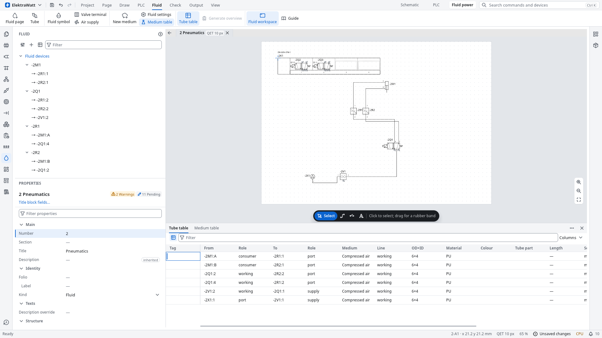

# Work in the Fluid workspace

This guide is where you look up one pneumatics job. To learn the jobs in order, follow the tutorial
[A pneumatic circuit](../tutorials/pneumatic-circuit.md) first.

EW draws pneumatic circuits on fluid pages with the ISO 1219 symbols, beside the electrical pages of the same project.
It knows which medium each tube carries, which tube runs from which port to which, and which valve each solenoid
belongs to, so the solenoid drawn on an electrical page and the valve on the fluid page are one device, and the tube
list is made from the drawing.

The Fluid workspace shows the pneumatics beside the page:

- the **Fluid** tab of the command bar at the top, with a button for each fluid job;
- the **Fluid panel** at the left: the valve terminals with their valves, every device a tube ends at with its tubes,
  and the media;
- **Properties** under it, for what is selected;
- the fluid page in the middle;
- the **Tube table** and the **Medium table** under the page.

## The words

| Word | What it is |
|---|---|
| Fluid page | A page for the circuit: the symbols are ISO 1219 and the Wire tool draws tubes. |
| Medium | What the tubes carry, such as compressed air at 6 bar. It is defined at the air supply and reaches every tube the supply feeds through the valves. |
| Tube | A line between two ports, with its line kind (working, pilot, exhaust, drain, flexible), size and material. |
| Solenoid | The coil of a valve. It belongs to the valve and is drawn on an electrical page, where it is wired. |
| Valve terminal | A manifold of valve positions, drawn as its positions; a position holds a valve or a blanking plate. |

## Open the workspace

1. Choose **Fluid power** in the workspace switch at the right of the tab row, or **Fluid workspace** on the Fluid tab.
2. **Schematic** in the switch goes back. A change you make to the layout is kept for the workspace.

## Draw a circuit

1. Choose **Fluid page** on the Fluid tab: the new-page form opens with the type **Fluid**.
2. Choose **Air supply** on the Fluid tab for the supply point and its preparation (service unit, filter, regulator,
   lubricator), or **Fluid symbol** for a valve, cylinder, flow control or any other pneumatic part: both open the
   device browser, so what you place has its part. A bare ISO 1219 symbol without a part is **Draw ▸ Place ▸ Symbol…**.
3. A symbol placed with a port facing a free port is joined to it with a tube; hold `Alt` as you click to place it
   without one. `R` before the click turns it.
4. Choose **Tube** on the Fluid tab and click from port to port. The bar under the page says the line kind and the
   project's tube, such as "Working line · tube 6/4 mm"; its **Line kind** button changes the kind for the next tubes.
   **Draw ▸ Connect ▸ Wire** draws working lines.
5. Right-click a tube to change its line kind (**Line kind: Working**, **Line kind: Pilot** and the others) or its
   medium. A flexible tube is drawn as an arc.

## The medium

1. Choose **New medium** on the Fluid tab (**Fluid ▸ New medium…**). Under **Start from** pick a usual medium, such as
   **Compressed air** (which fills the name and 6 bar), or type a name and the pressure in bar, and choose **Create**.
   Each field says under it what it changes.
2. Select the air supply and choose the medium in its **Medium** row in Properties, or right-click it and choose
   **Medium:** and the medium. While the project has no medium yet, the list offers the usual ones, such as
   **Compressed air, 6 bar**: choosing one makes it and sets it in one step.
3. Every tube the supply feeds through the valves carries it; a device's Properties show the medium each port carries,
   and say where to set it when it carries none.
4. Select a medium's row in the Medium table and press `Ctrl+Shift+H` to highlight its zones on the page, in a colour
   with a hatch pattern.

## The solenoid of a valve

1. Select a solenoid valve on its fluid page. Its Properties list each solenoid, such as **Solenoid 14**, with where it
   is drawn and the PLC output that drives it.
2. Click "draw it…" in that row, or right-click the valve and choose **Draw solenoid 14 on an electrical page…**: the
   window asks on which electrical page (or **New page…**), and that page shows with the coil on the pointer; click
   where it goes. The coil carries the valve's tag. With an electrical page in front, the entry reads **Draw solenoid
   14 on this page…** and draws there; the coil's row in the Devices list offers it too, with **Go to the valve**.
3. Wire the coil to a PLC output. The valve's menu then reads **Go to solenoid 14 at** and the place; going there
   selects the coil and names it beside it. From the coil, **Solenoid 14 of -201Q1**, or **Follow reference** (`F`)
   with the coil selected, goes back to the valve.
4. A coil placed on its own joins a valve when you type the valve's tag into the coil's **Tag**: the field asks whether
   to make it the valve's undrawn solenoid.

## Valve terminals

There are two kinds, and its Properties, its menu and its row in the Devices list say which ("Valve terminal · PLC
station on PROFIBUS DP", "Valve terminal · multipin, wired"):

- a **valve terminal with bus node** is a PLC station on the bus: its valves are driven inside it, each by the output
  its position gives, and nothing is wired per solenoid;
- a **multipin valve terminal** has a multipin plug: each solenoid is wired from a PLC output to a pin of the plug.

1. Choose **Valve terminal** on the Fluid tab and choose the terminal, such as **Valve terminal with PROFIBUS DP bus
   node, 4 valve positions, 8 outputs**; click once where its top-left corner goes. It is drawn as its positions: a supply end, then
   one numbered cell per position. An empty position is a dashed cell, a blanking plate a plate with both diagonals.
   The supply end holds the terminal's supply port 1 and exhaust ports 3 and 5 on its bottom edge: draw the air to
   port 1 there. The sub-base under the cells shows the supply and exhaust galleries that join every valve.
   The toast names the terminal and its positions; a click onto another box is refused.
   A terminal made first as a PLC station (**PLC ▸ New station…**) comes first: **Valve terminal** offers
   **Draw -104A1 here** for it, its rack's tab **Draw on a fluid page…**, and its valves stand in their cells. With
   several fluid pages **Draw on a fluid page…** asks which; without one it makes one. **Valve terminal**, **Air
   supply** and **Fluid symbol** work from any page in the same way: they go to the nearest fluid page, or make one.
2. Click an empty cell, or right-click it and choose **Fill position 2…**: the device browser opens with valves; choose
   a valve for a valve terminal, and it stands in that cell with its output. Its working ports 4 and 2 stand on the
   cell's top edge: draw the tubes to the cylinder from there. A valve put on a position in the terminal's rack or the
   PLC list stands in its cell the same way. A valve wider than a cell, such as a 5/3 valve, widens its cell: the
   terminal grows to the right, and the valves beside it move with their tubes. A valve without a symbol is not
   offered, with the reason.
   A valve drawn on another page stays there, and its cell names the place, a link to it. In a project made before
   that shows valves only by their tags, right-click the terminal and choose **Draw its valves in the valve terminal**.
3. Right-click a held cell for **Replace at position 2…**, **Empty position 2** and **Blanking plate at position 2**
   (an empty cell's device browser lists **Blanking plate** first; the check's warning on an empty position offers it
   as its fix, and **Fix all** blanks every empty position at once);
   right-click the terminal's body for every position, each under a heading such as **Position 2: empty**.
   A valve dragged onto another cell moves there; onto a held cell the two swap. A valve's **Valve position** in
   Properties moves it too. A valve whose working ports 2 and 4 lead nowhere is plugged with **Plug ports** on the
   Fluid tab (the selected valves), with the check's fix **Plug the open ports**, or one port at a time from its menu;
   **Set spare** on a valve's menu plugs its open ports with it.
4. A valve for a valve terminal dropped onto a cell takes that position on either kind of terminal, and the toast
   says which. A stand-alone valve, a coil or a cylinder dropped into the box is not taken as a position: it stays a
   device of its own, and the toast says so.
5. On a multipin terminal, right-click it on any page and choose **Draw the plug of -201K1 on an electrical page…**
   (or **Draw plug** on the Fluid tab, or the **Plug** row in its Properties): the window asks on which electrical
   page, and that page shows with the plug on the pointer; click once where it goes. With an electrical page in
   front it is drawn there. Its pins stand down both sides, and beside each pin stands the valve
   and solenoid it drives. Wire a pin to a PLC output, and the valve on the fluid page shows that output.
6. The terminal's rack (**Rack…**, a tab beside the page tabs) shows its positions as places like slots: select one
   and double-click a valve in the catalogue; its right-click menu offers **Replace valve**, **Empty the position** and
   **Blanking plate**.
   **Generate overview…** on the terminal's menu makes the overview pages of its modules and valves, previewed.

## Tubes and the tube list

1. Choose **Fluid settings** on the Fluid tab for the default tube of every line: its outer and inner diameter in mm
   and its material. A toast says what the default tube is now; it reaches the tubes drawn already.
2. Choose **Tube table** on the Fluid tab: one row per tube with its two ends, medium, line kind, size and material.
3. Type a length into **Length** (in mm, or with its unit: `2 m`, `35 cm`) or a tube part into **Tube part**;
   **Source** then says the value is manual. An empty cell goes back to the derived value.
4. To print the tube list, choose **Output ▸ Report block…** and the report **Tube list**.

The panels are described in the [panel reference](../reference/window/panels.md): Fluid, Tube table and Medium table.
