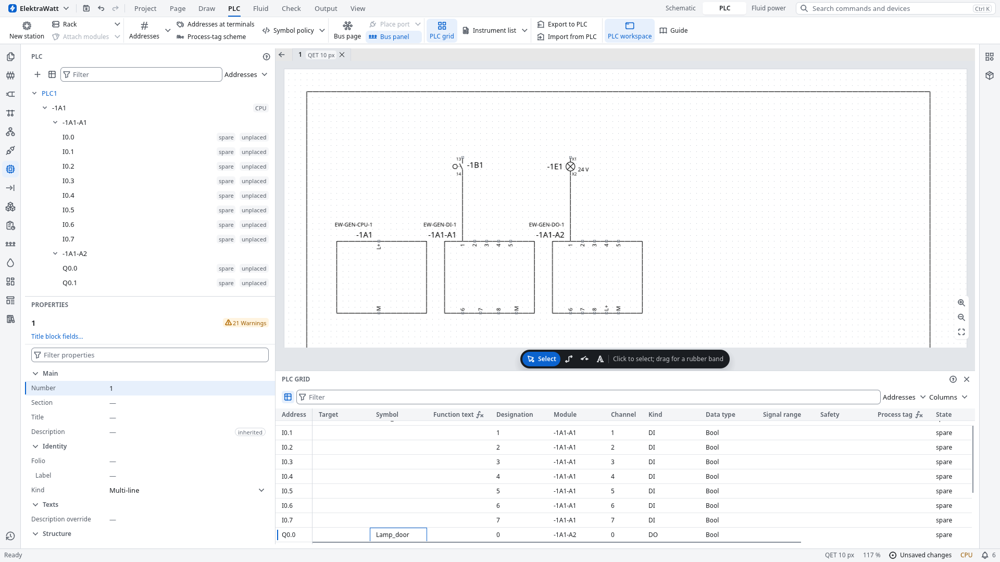
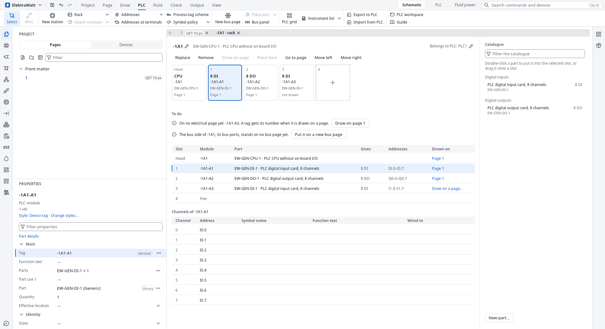

# Work in the PLC workspace

This guide is where you look up one PLC job. To learn the jobs in order, follow the tutorials
[A PLC with its modules](../tutorials/plc-station.md) and [A bus network](../tutorials/bus-network.md) first.

EW keeps the PLC hardware of a project beside its drawings: each CPU and remote I/O head with the modules in its
rack, every channel with its address, symbol and what it is wired to, and the bus networks between them. You draw the
modules on schematic pages as boxes with their pins and wire the field devices to them, as in any ECAD tool; the PLC
side knows which channel each pin is and exports it all to TIA Portal or CODESYS.

The PLC workspace shows the PLC side beside the page:

- the **PLC** tab of the command bar at the top, with a button for each PLC job;
- the **PLC panel** at the left: each PLC with its stations, their modules and each module's channels;
- **Properties** under it, for what is selected;
- the page in the middle;
- the **PLC grid** under the page: one row per channel, edited like a spreadsheet.

## The words

| Word | What it is |
|---|---|
| PLC | One controller's configuration, shown as PLC1 in the PLC panel: what a CPU and its remote stations share. |
| Station | A CPU or a remote I/O head with the modules it carries; a valve terminal with a bus node is one too. TIA Portal calls it a device in its network view. |
| Rack | The row of slots of a station. |
| Slot | A place in the rack, numbered from 1. The slot order gives the addresses. |
| Module | An I/O card in a slot (the window says module). |
| Channel | One input or output of a module, such as I0.0: one row of the PLC grid and one pin of the module's box. |
| Symbol | The PLC tag name of a channel, such as `Door_closed`, as in the PLC tag table. The drawing symbol of a device is another thing. |

## In TIA Portal you … here you …

| In TIA Portal you … | Here you … |
|---|---|
| add a CPU in the device view | choose **New station** on the PLC tab and double-click its head part in the catalogue |
| open the device view of a station | choose **Rack** on the PLC tab, or double-click the station in the PLC panel: its rack opens in a tab |
| plug modules into the rack from the catalogue | double-click a module in the rack's **Catalogue**, or drag it onto a slot |
| move a module to another slot | drag its card to the slot, or choose **Move left** or **Move right** above the rack |
| read the I/O addresses in the device overview | read the **Addresses** column of the station's rack, or the PLC grid |
| change a start address | type the address in the PLC grid, or choose **Re-address…** |
| type the PLC tags | type each channel's **Symbol** in the PLC grid |
| add an IO device in the network view | place its part on a bus-topology page |
| connect it to the subnet | draw a bus line between the sockets with **Draw ▸ Connect ▸ Wire** |
| assign an IO device to a controller | right-click it and choose **Add to** and the PLC |
| set the PROFINET device name and IP address | type them into the **Address** cell of the Bus panel's table |

The exchange of the hardware and the tags with the PLC software is at the end of this guide.

## Open the workspace

1. Choose **PLC** in the workspace switch at the right of the tab row, or **PLC workspace** on the PLC tab.
2. **Schematic** in the switch goes back. A change you make to the layout is kept for the workspace.

## Make a station

1. Choose **New station** on the PLC tab (**PLC ▸ New station…**), or **+** in the PLC panel. A tab **New station**
   opens beside the page tabs; the rest of the window keeps working.
2. Choose what it is: **PLC (CPU)**, **Remote I/O**, **Valve terminal** or **Compact device** (a hover says each in
   full), and the PLC it belongs to (a remote station: the PLC it serves), or **New PLC**.
3. Double-click its head in the **Catalogue** at the right: the CPU, the interface module of a remote station, the
   valve terminal. **New part…** under the catalogue opens the part editor set for that kind, and the part you save
   is the head when you come back.
4. Double-click each module in the catalogue: it goes into the next free slot. A click on a card selects it:
   **Remove**, **Move left** and **Move right** above the rack change it before it is made.
5. Choose **Create**: the station and its modules are made in one step, drawn on no page yet. Nothing is written
   before; closing the tab before Create asks first.
6. **To do** under the table says what is left, one line for each side of the station that is on no page of its kind
   yet: its boxes on an electrical page, its bus ports on a bus page, a valve terminal's valves on their positions on a
   fluid page. Each button goes to the page the view was opened from when it is of that kind (**Draw on page 101**),
   to a new page when the project has none (**Draw on a new electrical page**), else lists the pages of that kind and
   **New page…**. The station and its modules are drawn side by side in slot order; the bus ports and a valve
   terminal's box hang on the pointer, and a click puts them down.
7. Click the station's tag in the header, or press `F2`, to change it in place; `Enter` takes it, `Esc` leaves it. `F2`
   on a card, or a click on the tag of the card under the cursor, changes the card's tag in its row. A tag another
   device has is refused under the rack; a change that moves the cards' tags too waits for **Apply** in Properties.

A part of a station that no page draws yet has **Place here** on its row in the PLC panel and on its card's menu: on
an electrical page its box hangs on the pointer, on a bus page its bus ports, on a fluid page a valve terminal's
positions. On another page the entry is greyed with the page to open.

A station part placed straight from the device browser opens its rack in a tab at once; `Esc` goes back to the page,
and the tab stays beside it.

## Read and change a rack

Right-click the station (on the page, in the PLC panel) and choose **Rack…**, choose **Rack** on the PLC tab, or
double-click the station in the PLC panel. Its rack opens in a tab beside the page tabs:

- **The buttons above the rack** act on the selected module.
- **The rack, drawn**: one card per place, the head first, then each slot. A card says what the module gives (8 DI),
  its tag, its part number and the page it is drawn on; a free slot is an outline with a plus. A station whose part
  takes no modules, such as a valve terminal of valve positions alone, has no slots: its positions follow the head.
- **The table** under it lists the same places: slot, module, part (number and description), what it gives, its
  addresses and the page it is drawn on. A module without a part says **No part**, with **Choose part…** beside it.
- **Channels** lists the channels of the selected module: address, symbol name and what is wired to it, which is a
  link to its place on its page.
- **To do** says what is wrong or left, each in a sentence with its fix beside it: a module in a slot its part does
  not allow, a module drawn on no page, a station on no bus page.
- **The catalogue** at the right lists the parts that fit the station, by kind, under a filter. Parts that do not fit
  the selected slot are greyed and say why, as is a library part that nothing can draw yet because it has no pins,
  with what to do in the part editor.

With **Side by side**, a station's view in the other group shows the same rack, table, channels and To do; where the
room is short it leaves out the catalogue until you click in it.

To change it:

1. Click a card or a row: the module is selected as a click on a page selects a device. Properties shows it, and the
   buttons above the rack act on it: **Replace** (the parts that fit its slot), **Remove**, **Draw on page**, **Go to
   page**, **Move left** and **Move right**. A right click gives the same commands. `Delete` empties the slot, and
   the arrow keys go from slot to slot.
2. Double-click a part in the catalogue to put it into the selected free slot, else into the first free one; or drag
   it onto a slot. Dropped on a module, it replaces that module's part.
3. Drag a card onto a free slot to move it there, or onto another module to make the two change places. The
   addresses follow, and a line under the rack says so.
4. A slot the module's part does not allow is refused: the slot is outlined in red and the reason stands under the
   rack.
5. A valve terminal's positions are places like slots: select one and double-click a valve in the catalogue, or
   **Remove** to empty it.

Every step is one Undo.

## Put a module into a station

1. A module drawn on a page by itself (from the device browser or the black box) joins the project's only station,
   and its toast names the slot it got, with **Rack…**, which opens the station's rack.
2. With two stations it joins the one drawn beside it on its page; on a page without one, a window asks which station
   takes it. Without any station, its toast offers **New station…**.
3. A module that waits is listed under **Modules without a station** in the PLC panel: drag its row onto the station's
   row, or right-click the station and choose **Attach modules without a station**.

Only a module goes into a rack: a device whose part has no PLC data is refused in words.

## Wire a field device to a channel

1. Draw the device (a sensor, a lamp, a coil) on the page beside the module's box.
2. Choose **Draw ▸ Connect ▸ Wire** (`W`) and wire it to the module's pin: pin 1 is channel 0.
3. Or drag a channel's row from the PLC panel onto the device's connection point: the device is attached to the module
   and the channel bound to it in one step, which one Undo takes back.

## Addresses

1. A channel's address comes from its module's slot and the modules before it: the first input module of a station
   starts at I0.0, the first output module at Q0.0.
2. To give one channel another address, type it into its **Address** cell in the PLC grid; it keeps it, with the
   badge **manual** in the panel and a lock in the grid.
3. Right-click a module and choose **Re-address…** (or the PLC row for all its modules): the Preview tab lists each
   channel whose address moves, old and new; **Apply** makes the change in one step.
4. Right-click the PLC row and choose **Freeze addresses…** to keep every used or reserved channel's address when
   modules move later, or **Make manual addresses automatic…** to drop manual addresses that equal the automatic ones.
   The three are also under **Addresses** on the PLC tab.

## The PLC grid and the symbols

1. Choose **PLC grid** on the PLC tab (**PLC ▸ PLC grid**). Each row is a channel.
2. Click a cell and type: the designation, address, symbol, state, target, comment, data type or signal range. The
   slot cell takes a number or `<rack>.<slot>`.
3. Type into the grid's filter to narrow the rows: a word of a cell, or one of `spare`, `unplaced`, `unassigned`,
   `tbd`, `duplicate`, `safety`, `config:<name>` and `bus:<net>` (`bus:profibus-dp`). A click on a column's header
   sorts by it.
4. To have EW write the symbols, right-click the PLC row and choose **Symbol policy…**: the template of the automatic
   symbol, the PLC tag table and whether symbols must be strict IEC 61131-3 names.

## Give a bus device to a PLC

1. On a bus-topology page, a schematic page or in the Bus panel, right-click a bus device that belongs to no PLC.
2. Choose **Add to** and the PLC, or **Add to a new PLC**: it becomes a station of that PLC and its rack opens in
   a tab.

A switch or a plug takes no part in a PLC; its menu says why. A station's menu says **PLC:** and its PLC's name.

## Bus ports and nets

A bus-topology page is the network view: each device stands as one box per bus interface (PROFINET X1, PROFIBUS DP),
with a connection point per socket, and the bus lines run between the sockets. The device's power and I/O pins stay
on the schematic pages.

1. Choose **New bus page** on the PLC tab: the new-page form opens with the type **Bus topology**.
2. Place a station or another bus device from the device browser (**Draw ▸ Place ▸ Device from part…**) with two clicks
   for its box: it stands there as a box per interface, and a station's rack opens in a tab (`Esc` goes back to the
   page).
3. A station or bus device the project has already (drawn on a schematic page, or made with **New station**) goes onto
   the bus page with **Put a station on this page…**: right-click an empty spot of the page, or open the list of
   **Place port** on the PLC tab, and choose it. It stands there as a box per interface. Dragging its row from the
   PLC panel, the Bus panel or the Devices panel onto the page does the same at the drop point. Placing its part from the
   device browser, or choosing the Black box tool, on the bus page asks first: **Put -1A1 here** or **A new station**.
   One port box comes from **Place port DP** (or **Place port X1**) on the station's row in the PLC panel; **Ports not
   drawn yet** in the Bus panel lists every interface no page draws yet.
4. Draw the bus lines with **Draw ▸ Connect ▸ Wire**: the ports become one network, named for its bus, with the CPU's
   port as its controller or master.
5. Choose **Bus panel** on the PLC tab and switch it to its table. Type each node's address into its **Address** cell
   as the cell says: a PROFIBUS DP station address such as `3`, a PROFINET device name with its IP address such as
   `plc1 192.168.0.1`. The box prints it. An unmanaged switch passes the net through and takes none.
6. Select a bus line and choose **Cable** on the Draw tab: choose the cable (the ones made for that bus first), its
   length and the plug at each end with its termination, and **Apply**. The line prints the cable's tag; the cable and
   the plugs go into the parts list.

The starter parts hold a CPU with PROFINET and PROFIBUS DP, a remote I/O head, an unmanaged and a managed switch, a
PROFINET device, PROFIBUS and Ethernet cables and their plugs. Your own devices with their ports are made in the part
editor: see [Make your own PLC or bus part](own-parts.md).

## Exchange with the PLC software

1. Choose **Export to PLC** on the PLC tab (**PLC ▸ Export to PLC software…**) and pick the format: **AutomationML AR
   APC 1.4.0** (or 1.2.0) carries the stations, their modules, addresses and symbols to TIA Portal; **TIA Portal PLC
   tags (XLSX)** carries the tag table; **PLCopen XML (CODESYS)** is for CODESYS. Choose **Export**, then the file.
2. Choose **Import from PLC** on the PLC tab (**PLC ▸ Import from PLC software…**) for the file the PLC software wrote
   back. Look through its tabs: each conflict shows the side **Apply** takes, and offers the file's value where it can
   be taken. Choose **Apply**.
3. After an import, what the PLC software owns (the module starts, the symbols or the PLC data) is protected:
   right-click the PLC row and choose **Unlock module starts** (or the other group) to edit it here again.
4. Right-click the PLC row and choose **Import instrument list…** for a list of process tags and signal types (CSV or
   workbook): the Preview tab lists the spare channels it reserves.

## Settings

- **Process-tag scheme** on the PLC tab: the pattern process tags follow.
- **Addresses at terminals** on the PLC tab: each channel's address printed at the terminals on its path.
- Right-click a module and choose **Safety data…** for its F-addresses and F-watchdog time; right-click a channel and
  choose **Mode and safety…** for a multi-function port's mode and the channel's safety data.

The panels are described in the [panel reference](../reference/window/panels.md) (PLC, PLC grid, Bus), and the dialogs
in the [dialog reference](../reference/window/dialogs.md) (PLC import).
