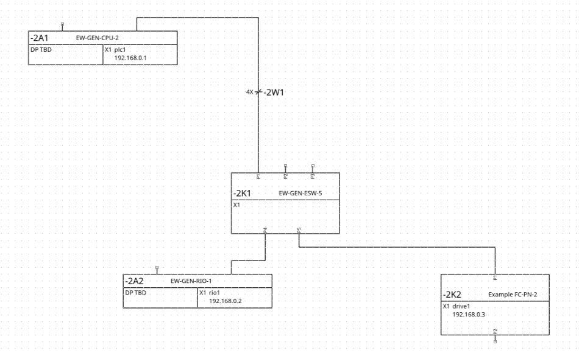

# A bus network

In this tutorial you draw a small PROFINET network on a bus-topology page: a CPU, a remote I/O station with an input
module and an unmanaged switch, all from the generic starter parts, then a frequency converter of your own that you
type into Parts. You give the nodes their names and IP addresses, set the cable and its plugs on one bus
line, and check the network. It takes about fifteen minutes.

A bus-topology page shows the network as a PLC tool's network view does: each device as one symbol with a
compartment per bus interface (PROFINET X1, PROFIBUS DP) that names it and prints its address, a socket per port,
and the bus lines between the sockets. The power and the I/O wiring of the same devices stay on the schematic pages.

## What you need

- ElektraWatt installed and started; see [Install ElektraWatt](../how-to/install.md).
- An empty folder for the project, or a place where EW may create one.

## Steps

1. Choose **File ▸ New project…** (`Ctrl+N`) and pick an empty folder named `bus-network.ew`.
   EW shows the new project's one empty page, folio 1.
2. Click the **PLC** tab and choose **New bus page**. The **Page ▸ New page…** form opens with the type **Bus topology**
   chosen: type the folio `2` and the title `Network`, and choose **Create**.
   The empty page 2 Network shows. On this page the Wire tool draws bus lines.
3. Choose **Draw ▸ Place ▸ Device from part…** (`Shift+I`), type `CPU` and choose **PLC CPU with PROFINET and
   PROFIBUS DP interfaces** (EW-GEN-CPU-2). Click near the top left of the page.
   The CPU -2A1 stands there as its bus symbol: its tag and part on top, and under them a compartment for DP and one
   for X1, each with its socket. Its rack opens in a tab beside the page's, because a CPU is a station; press `Esc` to
   go back to the page (the tab stays, for later).
4. Choose **Draw ▸ Place ▸ Device from part…** again and choose **Remote I/O head with PROFINET and PROFIBUS DP
   interfaces** (EW-GEN-RIO-1). Click low on the page, under the CPU.
   The remote I/O station -2A2 stands with its DP and X1 compartments, and its rack opens in a tab.
5. In the rack's **Catalogue**, double-click **PLC digital input card, 8 channels** (EW-GEN-DI-1), then press `Esc`
   to go back to the page.
   The station carries an input module, -2A2-A1, drawn on no page yet.
6. Choose **Draw ▸ Place ▸ Device from part…**, choose **Industrial Ethernet switch, unmanaged, 5 ports**
   (EW-GEN-ESW-5) and click between the CPU and the remote I/O station. Press `Esc`, then choose **Draw ▸ Select**.
   The switch -2K1 stands as its symbol, one compartment with its sockets P1 to P3 at the top and P4 and P5 at the
   bottom.
7. Choose **Draw ▸ Wire** (`W`). Click the socket of the CPU's X1, then P1 of the switch; click P4 of the switch,
   then the socket of the remote I/O station's X1. Choose **Draw ▸ Select**.
   The two bus lines join the CPU, the switch and the remote I/O station into one PROFINET network.
8. Choose **View ▸ Panels ▸ Navigators ▸ PLC** (the PLC button on the rail at the left).
   The PLC panel lists the PLC PLC1 with the CPU -2A1 and the remote I/O station -2A2, a head station, with its input
   module: both are stations of the same PLC.
9. Choose **Bus panel** on the PLC tab (**PLC ▸ Bus panel**) and switch it to its table with the table button left of
   its filter. Type `plc1 192.168.0.1` into the **Address** cell of the row -2A1 X1, and `rio1 192.168.0.2` into that
   of -2A2 X1.
   Each X1 compartment on the page prints its device name with the IP address under it. The switch passes the network
   through and takes no address.
10. Click the bus line between the CPU and the switch and choose **Cable** on the Draw tab.
    The Cable form opens with **EW-GEN-CBL-3 · Industrial Ethernet cable, 4 cores, shielded (PROFINET)**, the cables
    made for PROFINET first. Type `5` as the **Length (m)**, choose **EW-GEN-PLG-3 · RJ45 plug for Industrial
    Ethernet** as the plug at each end, and choose **Apply**.
    The **Tag** field proposes `-2W1`, the page's next cable tag. The toast says "Cable -2W1 carries the bus line."
    The line carries the cable's mark: its tag with its type under it, which you can move as any tag; the cable and its
    two plugs go into the parts list. The lists of cables and plugs end in **New bus cable…** and **New plug…**: a
    new part of your own for the bus opens in Parts (a cable's cores come as the bus has them) and chooses it at once.
11. Choose **Edit ▸ New part…** and, under **What is it?**, **Device drawn as a box**. Type the **Maker** `Example`,
    the **Part number** `FC-PN-2` and the **Description** `Frequency converter with PROFINET, 2 ports`. Under
    **Network ports** choose **Add interface**: it proposes the interface `X1` on **PROFINET** with the role
    **Device**; type **Ports** `2`. Choose **Save**. The toast says "Part FC-PN-2 is in the project and in My
    parts.": your next project has it too. Choose **Back**.
12. Choose **Draw ▸ Place ▸ Device from part…**, type `FC-PN-2` and click to the right of the remote I/O station.
    Press `Esc`, then choose **Draw ▸ Select**.
    The converter -2K2 stands as its symbol with X1's sockets P1 and P2.
13. Choose **Draw ▸ Wire** (`W`), click P5 of the switch, then P1 of -2K2, and choose **Draw ▸ Select**. In
    the Bus panel's table, type `drive1 192.168.0.3` into the **Address** cell of -2K2 X1.
    The converter is a node of the same network:

    

14. Choose **Check ▸ Check project** (`F7`).
    The toast says "Check: 0 errors, 0 warnings, 5 infos." The infos say that the DP addresses are still TBD (this
    network uses PROFINET only) and that no report lists the stations and the cable yet.
15. Choose **File ▸ Save** (`Ctrl+S`).
    The title bar no longer marks the project as changed.

## What you learnt

- A bus-topology page holds the network: a device stands as its bus symbol, a compartment per bus interface, and
  **Draw ▸ Wire** draws the bus lines between their sockets. A CPU or a remote I/O head is a station, with its rack.
- The Bus panel's table takes each node's address; its compartment prints it, inside the symbol, clear of the lines.
- **Cable** on a bus line sets its cable, length and plugs in one form.
- A device of your own with its ports is typed from its data sheet in Parts;
  [Make your own parts](../how-to/own-parts.md) has the whole of it.

To look up these jobs later, see [Bus ports and nets](../how-to/plc-workspace.md#bus-ports-and-nets) in the PLC guide.
The tutorial before this one, [A PLC with its modules](plc-station.md), fills a station's rack and wires its channels.
