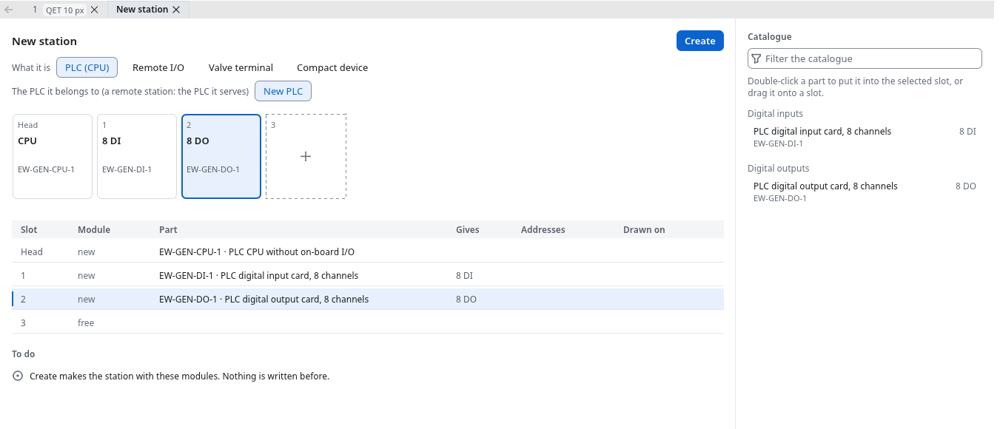

# A PLC with its modules

In this tutorial you draw a small PLC in a new project: a CPU with a digital input module and a digital output module
(the window says *module* for what you may call a card). A position switch on a door is wired to the first input and a
pilot lamp to the first output; you give both their PLC symbols, add the PLC overview page and export the hardware for
your PLC software. It takes about fifteen minutes.

Three words of the program, in the trade's meaning:

- A **station** is a CPU or a remote I/O head with the modules it carries: what TIA Portal calls a device in its
  network view.
- Its **rack** is the row of **slots** its modules sit in, numbered from 1. The slot order gives the addresses: the
  first input module starts at I0.0.
- A **symbol** here is the PLC tag name of a channel, such as `Door_closed`, as in the PLC tag table; the drawing
  symbol of a device is another thing.

## What you need

- ElektraWatt installed and started; see [Install ElektraWatt](../how-to/install.md).
- An empty folder for the project, or a place where EW may create one.

## Steps

1. Choose **File ▸ New project…** (`Ctrl+N`) and pick an empty folder named `plc-station.ew`.
   EW shows the new project's one empty page, folio 1.
2. Choose **Draw ▸ Place ▸ Device from part…** (`Shift+I`), or **Device** on the Draw tab, type `position switch`,
   choose **Position switch with one normally open contact** (EW-GEN-POS-1) and click near the top of the page, about
   a quarter from the left. Then choose **Draw ▸ Select** to put the tool away.
   The switch -1B1 is on the page, with its contact 13 at the top and 14 at the bottom.
3. Choose **Draw ▸ Place ▸ Device from part…** again, choose **Pilot lamp** (EW-GEN-LMP-1) and click to the right of
   the switch, at the same height. Choose **Draw ▸ Select**.
   The lamp -1E1 is on the page, with X1 at the top and X2 at the bottom.
4. Click the **PLC** tab of the command bar and choose **New station** (**PLC ▸ New station…** in the app menu).
   The New station dialog opens: what the station is (**PLC (CPU)** is chosen), its head part, the PLC it belongs to
   (**New PLC**), and its slots, of which slot 1 is free.
5. Open the **Head part** list and choose **EW-GEN-CPU-1 · PLC CPU without on-board I/O**.
6. Choose **Add module…** in the row of slot 1 and pick **EW-GEN-DI-1 · PLC digital input card, 8 channels**.
   Slot 1 holds the input module, giving 8 DI; slot 2 is free.
7. Choose **Add module…** in the row of slot 2 and pick **EW-GEN-DO-1 · PLC digital output card, 8 channels**.
   The rack is filled:

   

8. Choose **Create**.
   The dialog becomes the station's **Rack and slots**: the input module has the addresses I0.0–I0.7, the output
   module Q0.0–Q0.7, each marked **not drawn**, and the line under the slots says the station is made and drawn on no
   page yet. One Undo takes the whole station back.
9. Choose **Draw on page 1** (the button names the page in front; the small arrow beside it lists the others).
   The dialog closes, and the CPU -1A1 and its modules -1A1-A1 and -1A1-A2 stand on the page as boxes, side by side
   in slot order, under the switch and the lamp. Each module's pins are numbered from 1: pin 1 is channel 0.
10. Choose **Draw ▸ Connect ▸ Wire** (`W`). Click contact 14 of -1B1, then pin 1 at the top of -1A1-A1; click X2 of
    -1E1, then pin 1 at the top of -1A1-A2. Choose **Draw ▸ Select**.
    The switch is wired to the first input and the lamp to the first output. Each module's pins print their
    addresses, I0.0 at pin 1 of -1A1-A1, and the switch becomes the target of channel I0.0.
11. Choose **PLC grid** on the PLC tab (**PLC ▸ PLC grid**).
    The PLC grid opens under the page: one row per channel, I0.0 to I0.7 of the module -1A1-A1, then Q0.0 to Q0.7 of
    -1A1-A2. I0.0 is channel 0 of the input module, the pin you wired the switch to.
12. Click the **Symbol** cell of I0.0, type `Door_closed` and press `Enter`; do the same for Q0.0 with `Lamp_door`.
    The toast says "Set symbol on 1 channel." The symbols are the tag names the PLC program will use.
13. Choose **Output ▸ Report block…** (**Report** on the Page or the Output tab). Choose the report **PLC overview**,
    the first folio `2` and the title `PLC overview`, and choose **Create**.
    The toast says "Added the report block PLC overview from folio 2". Click page 2 in the Pages navigator: it lists
    every channel with its module, part, address and symbol, `Door_closed` at I0.0 and `Lamp_door` at Q0.0. EW keeps
    it up to date; you never draw it.
14. Choose **Export to PLC** on the PLC tab (**PLC ▸ Export to PLC software…**). Keep the format **AutomationML AR APC
    1.4.0**, choose **Export** and save the file as `plc-station.aml`.
    The toast says "Exported plc-station.aml: 1 station, 2 modules, 16 channels, 2 symbols." The file carries the
    station, its modules in their slots, the addresses and the symbols to TIA Portal; the format **TIA Portal PLC tags
    (XLSX)** gives the tag table alone, and **PLCopen XML** is for CODESYS.
15. Choose **File ▸ Save** (`Ctrl+S`).
    The title bar no longer marks the project as changed.

## What you learnt

- **New station** builds a station the way TIA Portal does: its head part first, then its modules slot by slot, and
  **Create** makes them all in one step. **Draw on page …** draws them all at once, bound to their pins.
- The slot order gives the addresses, and the PLC grid shows them channel by channel, where you type the symbols.
- The PLC overview is a report page, made by a report block and kept up to date by EW.
- **Export to PLC** hands the hardware and the symbols to the PLC software.

To look up one of these jobs later, see [Work in the PLC workspace](../how-to/plc-workspace.md): making and changing a
station, addresses, the PLC grid and the exchange with PLC software. The next tutorial, [A bus network](bus-network.md),
puts a station on PROFINET.
