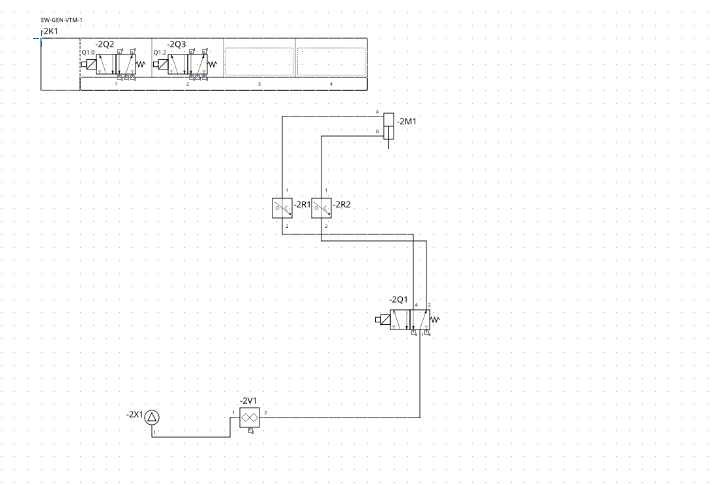

# A pneumatic circuit

In this tutorial you draw a pneumatic circuit on a fluid page: an air supply with its medium, a service unit, a 5/2
solenoid valve and a double-acting cylinder with a one-way flow control in each line, joined by tubes. You draw the
valve's solenoid on an electrical page and wire it to a PLC output, then do the same job with a valve terminal, and
read the tube list. It takes about fifteen minutes.

On a fluid page the symbols are the ISO 1219 symbols, the Wire tool draws tubes, and a valve's solenoid is not drawn
on the fluid page: it belongs to the valve and stands on an electrical page, where it is wired.

## What you need

- ElektraWatt installed and started; see [Install ElektraWatt](../how-to/install.md).
- An empty folder for the project, or a place where EW may create one.

## Steps

1. Choose **File ▸ New project…** (`Ctrl+N`) and pick an empty folder named `pneumatic-circuit.ew`.
   EW shows the new project's one empty page, folio 1, an electrical page.
2. Click the **Fluid** tab and choose **Fluid page**. The **Page ▸ New page…** form opens with the type **Fluid**
   chosen: type the folio `2` and the title `Pneumatics`, and choose **Create**.
   The empty page 2 Pneumatics shows.
3. Choose **Air supply** on the Fluid tab (**Fluid ▸ Air supply…**). The symbol browser opens at the air supply and
   its preparation: choose **air-supply** and click near the bottom left of the page. Choose **Draw ▸ Select**.
   The compressed-air supply point -2X1 is on the page, with its port 1.
4. Choose **Fluid ▸ Air supply…** again, choose **frl**, the service unit with filter, regulator and lubricator, and
   click to the right of the supply point. Choose **Draw ▸ Select**.
   The service unit -2V1 is on the page, with port 1 in, port 2 out.
5. Choose **Draw ▸ Place ▸ Device from part…** (`Shift+I`), choose **Solenoid valve 5/2, spring return**
   (EW-GEN-VLV-1) and click in the middle of the page, to the right. Choose **Draw ▸ Select**.
   The valve -2Q1 is on the page: its working ports 4 and 2 at the top, the supply port 1 and the exhausts 3 and 5 at
   the bottom, its solenoid at the left and its spring at the right.
6. Choose **Draw ▸ Place ▸ Device from part…**, choose **Cylinder double-acting, bore 32 mm, stroke 100 mm**
   (EW-GEN-CYL-1) and click near the top of the page, above the valve. Choose **Draw ▸ Select**.
   The cylinder -2M1 is on the page, with its ports A and B.
7. Choose **Draw ▸ Place ▸ Device from part…** and choose **One-way flow control valve** (EW-GEN-FCV-1). Before you
   click, choose **Draw ▸ Arrange ▸ Rotate clockwise** (`R`) to stand it upright. Hold `Alt` and click twice, side by
   side, between the cylinder and the valve and a little to the left. Choose **Draw ▸ Select**.
   The flow controls -2R1 and -2R2 stand upright, port 1 at the top. `Alt` places a symbol without joining it with a
   tube to a port it faces.
8. Choose **Draw ▸ Connect ▸ Wire** (`W`) and draw the tubes, each from one port to the other: A of -2M1 to 1 of
   -2R1, 2 of -2R1 to 4 of -2Q1; B of -2M1 to 1 of -2R2, 2 of -2R2 to 2 of -2Q1; 1 of -2X1 to 1 of -2V1, and 2 of
   -2V1 to 1 of -2Q1. Choose **Draw ▸ Select**.
   The circuit is joined: supply, service unit, valve, and the two lines to the cylinder through the flow controls.
9. Choose **New medium** on the Fluid tab (**Fluid ▸ New medium…**). Under **Start from** choose **Compressed air**,
   which fills the name and 6 bar, and choose **Create**.
   The toast says "Added the medium Compressed air."
10. Click the supply point -2X1. In Properties, open the **Medium** row and choose **Compressed air** (or right-click
    -2X1 and choose **Medium:** Compressed air).
    Properties say what -2X1 is, "Compressed-air supply point · pneumatic", and its medium comes from its port 1.
    Every tube it feeds through the valve now carries compressed air.
11. Click the valve -2Q1. In Properties the row **Solenoid 14** says "not drawn: draw it…": click it (or right-click
    the valve and choose **Draw solenoid 14 on an electrical page…**).
    Page 1 shows with the coil on the pointer, and the toast says "Click where solenoid 14 of -2Q1 goes on page 1."
12. Choose **Draw ▸ Arrange ▸ Mirror top to bottom** (`Y`), so that the coil's A1 is at the bottom, and click near
    the top of page 1, a quarter from the left. Choose **Draw ▸ Select**.
    The coil carries the valve's tag, -2Q1: it is the valve's own solenoid, not a device of its own.
13. Click the **PLC** tab and choose **New station** (**PLC ▸ New station…**). Choose the head part **EW-GEN-CPU-1**,
    **Add module…** in slot 1 with **EW-GEN-DO-1 · PLC digital output card, 8 channels**, then **Create** and **Draw
    on this page**.
    The CPU -1A1 and its output module -1A1-A1 stand under the coil. [A PLC with its modules](plc-station.md) shows
    this dialog in full.
14. Choose **Draw ▸ Connect ▸ Wire** (`W`), click A1 of the coil, then pin 1 at the top of -1A1-A1, the output Q0.0.
    Choose **Draw ▸ Select**.
    The solenoid is wired to the PLC output.
15. Click page 2 in the Pages navigator and click the valve -2Q1.
    Its row **Solenoid 14** now names the place where the coil is drawn, 1-A4.
16. Choose **Valve terminal** on the Fluid tab (**Fluid ▸ Valve terminal…**). The device browser opens at the valve
    terminals: choose **Valve terminal with bus node, 4 valve positions, 8 outputs** (EW-GEN-VTM-1) and click once
    near the top left of the page. Its rack opens; choose **Close**, then **Draw ▸ Select**.
    The valve terminal -2K1 is drawn as its positions: the supply end at the left, then four empty cells numbered 1
    to 4.
17. Click the empty cell 1. The device browser opens with valves; type `valve terminal` into its search and choose
    **Solenoid valve 5/2 for a valve terminal, spring return** (EW-GEN-VLV-3).
    The valve -2Q2 stands in cell 1 with its output, Q1.0.
18. Click the empty cell 2 and choose the same valve.
    The valve -2Q3 stands in cell 2 with Q1.2. Click the terminal: its row **Valve positions** reads "1 -2Q2 · 2 -2Q3
    · 3 empty · 4 empty". The check asks for a valve or a blanking plate in the empty cells; a right click on a cell
    offers both.

    

19. Choose **Fluid settings** on the Fluid tab (**Fluid ▸ Fluid settings…**). Type the default tube's outer diameter
    `6`, inner diameter `4`, choose the material **PU**, and confirm.
    The toast says "The default tube is 6 × 4 mm PU (polyurethane) now: every tube without one of its own takes it,
    the tubes drawn already too."
20. Choose **Tube table** on the Fluid tab (**Fluid ▸ Tube table**).
    The tube list opens under the page, one row per tube with its two ends, its medium (Compressed air), its line kind
    and its size, 6×4 PU. The length stays empty until you type it.
21. Choose **File ▸ Save** (`Ctrl+S`).
    The title bar no longer marks the project as changed.

## Two kinds of valve

A stand-alone valve, such as -2Q1, has a coil of its own: you draw it on an electrical page and wire it to a PLC
output. A valve on a valve terminal with a bus node, such as -2Q2, is driven inside the terminal, which is a PLC
station on the bus: its output is given by its position, and nothing is wired per solenoid.

## What you learnt

- A fluid page draws the circuit with ISO 1219 symbols; the Wire tool draws tubes there.
- The medium is defined once, at the air supply, and every tube it reaches carries it.
- A valve's solenoid is drawn on an electrical page from the valve, and the two know each other.
- A valve terminal is drawn as its positions; a click on a cell fills it.
- The tube table lists the tubes with their ends, medium and size; **Output ▸ Report block…** prints it as a tube list.

To look up these jobs later, see [Work in the Fluid workspace](../how-to/fluid-workspace.md).
