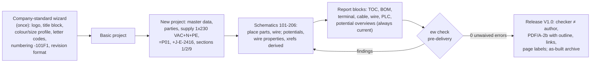

# ElektraWatt vision and scope

**Status:** Draft v0.1 · **Date:** 2026-10-17 · **Part of:** ElektraWatt design document set

**Purpose.** This document states why ElektraWatt (EW) exists, who it is for, what it must achieve and what it
deliberately leaves out. It fixes the release targets (MVP, 1.0, 1.x, Later) per capability area, so that the
requirement files ([02a](02a-requirements-core.md), [02b](02b-requirements-extended.md),
[02c](02c-nonfunctional-requirements.md)) and the feature documents assign releases consistently. It is
consistent with the accepted [architecture](04-architecture.md) and records the user decisions that are not
re-opened.

**Contents**
1. [Problem statement](#1-problem-statement)
2. [Vision](#2-vision)
3. [Goals and success criteria](#3-goals-and-success-criteria)
4. [Non-goals](#4-non-goals)
5. [Users and personas](#5-users-and-personas)
6. [Top user journeys](#6-top-user-journeys)
7. [Positioning](#7-positioning)
8. [Product principles](#8-product-principles)
9. [Scope by release](#9-scope-by-release)
10. [Constraints and assumptions](#10-constraints-and-assumptions)
11. [User decisions taken](#11-user-decisions-taken)

---

## 1. Problem statement

### 1.1 What the reference drawing set shows

The pilot user, an engineer at a Dutch panel builder, produces cabinet documentation with QElectroTech (QET)
0.100.0-dev. The reference drawing set (cabinet J-E-2416, 18 A4 folios, about 44 wires) is ordinary,
competent work, and its cross-reference engine output is correct: all 22 interruption-point pairs and all main↔aux
references agree, apart from one anchor oddity
([reference analysis](../research/reference-drawing.md), finding C13). Even so, the analysis found 42 defects
(D-01 … D-42). They are not drawing mistakes. They are **data** mistakes that the tool could not see.

| Root cause | Most telling defects | Why a graphics-first tool produces it |
|---|---|---|
| **A computed value was stored as a copy** | D-01 part list shows -4W1/-4X1, folio 3 shows -3W1/-3X1; D-05 four revision formats ("1", "V1", "V1.0", "V2.0"); D-06 folio 101 alone says "Control Cabinet Expansion"; D-10 overview of -202U2 shows 5 valves, folio 206 and the BOM show 4 | QET's model *is* the Qt scene graph: evaluated labels are stored as element text, title-block fields are overridable per folio, an overview is a second drawing |
| **A relationship was drawn instead of referenced** | D-02 layout folio 902 shows T51, schematic has T55; D-04 BOM misses -106W2 and -201U4 … -201U9, lists +JE2416-X1031 twice, has no quantity column; D-42 X1031 drawn twice | A layout symbol is another element, not the device; the BOM is one row per placed element |
| **A fact was stored as free text, not a type** | D-08 "if not indicated, standard size is to be used"; D-17 core colour "BR"; D-15 address "TBD"; D-22 0 V bonded to PE by an ordinary wire; D-30 customer vs end user | Wire colour and size are per-segment strings; no potential object, colour enum or party role exists |
| **No invariant guarded the data** | D-11 terminal without designation; D-12 "1+" ×4 and "PE" ×5 on one strip; D-34 author = checker on every page | Nothing rejects or flags them |
| **Generated outputs are missing** | D-09 no wire list, terminal, cable, PLC or potential overview, no wire numbers; D-07/D-33 PDF without bookmarks, links or folio page labels | Reports are copies of scene state; only some exist |

### 1.2 The safety finding

**D-13 (severity S):** on folio 101, thermostat **T55** and door switch **S56** are drawn **in the neutral
conductor** (F55:N → T55 → E55:N and F55:N → S56 → E56), while the live conductors of E55 and E56 come
unswitched from F55:2. With the contacts open, the heater and the lamp stay live. Single-pole switching in the
neutral is not permitted under IEC 60364-based wiring rules (NEN 1010 in the Netherlands; clause unverified). It may
also be a pole-labelling error on F55. Either way, the tool could not notice: it does not know that the conductor
leaving F55:N *is* a neutral. A tool with typed potentials derives that fact from connectivity and flags the
contact with one rule (EW-POT-013, [architecture](04-architecture.md) §14).

### 1.3 Why this matters now

- The defects cost money on the shop floor: wrong orders (D-04), ambiguous terminal wiring (D-12), a heater that
  cannot be isolated (D-13). Nothing caught them; every title block records the author as checker (D-34).
- QET is improving fast (§7.2); renumbering of placed elements, added after 0.100, might have avoided D-01. But
  device data is still a free-form bag per placed symbol, so patching symptoms does not remove the root causes.
- EPLAN solves most of this with a device-oriented model, but behind tiers, Windows only and a proprietary
  database (§7.1). Small panel builders who deliver PDFs pay for far more than they use, or stay with a drawing
  tool.

---

## 2. Vision

> **ElektraWatt lets an engineer describe a control cabinet once, as a typed and checked engineering model, and
> derives every drawing, list, machine file, PLC exchange file and 3D layout from it. The outputs are consistent by
> construction, the project is an open text format the user owns, and the tool runs offline on Windows, macOS and
> Linux, with every feature in one free edition.**

In concrete terms: renaming folio 103 to 104 updates about 25 tags, every cross-reference into 103, the TOC, the
BOM folio column and Prev/Next, in one previewed and undoable transaction. Nothing printed can disagree with
anything else printed, because nothing printed is stored as a copy.

---

## 3. Goals and success criteria

### 3.1 Goals

| Goal | Statement |
|---|---|
| GOAL-1 | **Correct by construction.** The defect classes of §1.1 are impossible or reported, never silently printed |
| GOAL-2 | **Replace QET for the pilot user** for new projects at MVP, with a near-lossless migration path for existing ones |
| GOAL-3 | **EPLAN-class breadth in one edition** by 1.0: PLC/bus/fluid, manufacturing outputs, 3D panel layout, EDZ/DXF/AML exchange |
| GOAL-4 | **Manufacturing-ready data:** wire lists, lengths, ferrules, labels and machine files that agree with the printed documentation |
| GOAL-5 | **Open and durable:** a documented, git-diffable format readable without GPL code; a 2027 project opens in 2037 with identical tags, cross-references and wire numbers |
| GOAL-6 | **Sustainable for 2–4 developers:** reuse proven components, prove correctness in CI, keep the core small |
| GOAL-7 | **Trustworthy:** offline-first, no telemetry, secure handling of received projects, signed releases |

### 3.2 Measurable success criteria

Performance figures are the G6 budgets adopted by ADR-0022 ([gaps](../research/gaps-and-corrections.md) G6), on
the baseline machine (4-core 2018+ x64 or Apple M1, 8 GB RAM, integrated GPU).

| ID | Criterion and target | Release | Measured by |
|---|---|---|---|
| SC-1 | **Golden reproduction.** From the model alone, EW regenerates the 18 folios plus report folios 903–911, and all nine acceptance criteria of [reference analysis](../research/reference-drawing.md) §4.15 pass (frame ±0.2 mm; 22 interruption-point pairs and 9 main/aux sets exact; no -4W1, no T51) | MVP (headless at M1) | Acceptance SQL/CSV runner, PDF structure tests |
| SC-2 | **Defect prevention.** No command can produce a D-nn of class S or I ([architecture](04-architecture.md) §14); `ew check --scheme pre-delivery` reports every class-C defect present in a source project (assisted D-39, D-40 excluded) | MVP (2D); 1.0 (layout, PLC, fluid) | Golden B renumber, command fuzzer, imported-defect fixture |
| SC-3 | **Pilot switch.** The pilot user completes three consecutive new production projects in EW without QET, with no hand-maintained report page, no slower than their own QET baseline on a reference-size project | MVP exit | Pilot log and timing |
| SC-4 | **QET migration.** ≥ 22 of the 24 QET example projects and every pilot project import without structural errors; cross-reference texts identical; every lenient-mode violation (D-11, D-12 …) in the migration report | MVP | QET corpus fixture |
| SC-5 | **Performance.** Frame ≤ 16 ms while editing; open S ≤ 0.5 s, M ≤ 2 s, L ≤ 5 s, XL ≤ 20 s; full check S ≤ 2 s, XL ≤ 60 s; XL peak memory ≤ 4 GB; ≥ 30 fps for an A4 page on the CPU renderer | MVP (S/M), 1.0 (L/XL) | Nightly gate, fails on > 15 % regression |
| SC-6 | **Determinism and longevity.** Byte-identical project files and PDF on all platforms; every released format fixture opens in every later build; a pinned derivation profile reproduces tags, xrefs and wire numbers after an upgrade | MVP; 1.0 (format freeze) | Shuffle-order tests, fixture corpus, per-profile goldens |
| SC-7 | **Manufacturing.** The golden `.ewpp` holds the wire list with routed lengths and ferrules; Komax and Rittal WT files load in the machine software without manual edits; printed wire list and machine file are row-identical | 1.0 | Golden 3D fixture; machine acceptance with a partner shop |
| SC-8 | **PLC exchange.** AML AR APC (CAEX 2.15) of station -201U1 (Q0.0 … Q6.7) imports into TIA Portal V21 without errors; a tag-table round trip yields no unintended differences; CODESYS accepts the PLCopen XML | 1.0 | Exchange test with real installations |
| SC-9 | **Usability.** Before M2, two EPLAN users and one QET user complete ≥ 80 % of core tasks (place, wire, terminal strip, renumber, export PDF) unassisted; repeated at 1.0 with ≥ 5 users | MVP, 1.0 | Protocol in [UX](16-ux-ui.md) |
| SC-10 | **Privacy and supply chain.** Zero outbound connections without a user action; every release has SBOM, signatures and provenance, and no known unpatched high or critical advisory | MVP | CI network sandbox, release pipeline (ADR-0023) |
| SC-11 | **Openness.** A third party reads, writes and validates an EW project with the MIT OR Apache-2.0 crates and JSON Schemas alone | MVP | Licence-boundary check, permissive-only sample reader |
| SC-12 | **Accessibility.** No meaning by colour alone; full keyboard operation; accessible names on 100 % of interactive widgets | MVP | egui_kittest |
| SC-13 | **Community.** By 1.0: ≥ 5 external contributors with merged changes; UI and docs in English, Dutch and German; ≥ 1 company basic project or library pack contributed from outside | 1.0 (Should) | Repository statistics |

---

## 4. Non-goals

These are deliberate. A feature request in one of these areas needs an explicit scope decision, not a pull request.

| Non-goal | Reason |
|---|---|
| Writing EPLAN formats (`.elk`, `.edb`) or round-tripping to EPLAN in v1 | Closed formats; EW imports EPLAN deliveries (EDZ, parts XML) only |
| Shipping, mirroring or scraping Data Portal content | Its terms restrict use to EPLAN products; EDZ import is user-initiated, local, part data only |
| PLC programming (IEC 61131-3 editing), HMI | EW exchanges I/O and tags with TIA Portal and CODESYS; it does not replace them |
| Circuit simulation, short-circuit or selectivity calculation | Not v1; supply data (REF-107) is modelled so checks can follow |
| Building installation, PCB design, wire-harness formboards | Other domains; EW is for control cabinets |
| P&ID / Preplanning, cloud apps, SaaS | Offline desktop product; P&ID is Later |
| Real-time co-editing, CRDT documents | Git plus locks in v1; the op log stays CRDT-ready |
| Telemetry or usage analytics | Confidential projects and personal data (ADR-0029) |
| A bundled AI assistant or model | MCP connects an agent of the user's choice; QET elements are never training data |
| Our own UI toolkit, B-rep kernel or incremental framework | egui, the OCCT worker and the cut-down `ew-memo` (ADR-0002, ADR-0014, ADR-0016) |
| UL 508A, NFPA 79, CSA in v1 | Later, as rule packs |
| Certification of designs | EW checks do not replace engineering verification (ADR-0030) |

---

## 5. Users and personas

The primary customer is a **small or medium panel builder or integrator** (one to twenty engineers) that delivers
PDF documentation and manufactures cabinets in its own shop. EPLAN-mandated OEM supply chains are secondary.

| Persona | Role and context | Key jobs-to-be-done | Pain today (reference evidence) |
|---|---|---|---|
| **P1 Panel-building engineer** (primary; the pilot user) | Designs schematics, selects parts, produces the drawing set and BOM, often also the layout | Start from the company standard; draw power and control circuits fast; get tags, xrefs, TOC, BOM and reports without bookkeeping; deliver a PDF the customer can navigate; revise after commissioning | Manual sync of tags, revisions and BOM (D-01, D-04, D-05); no reports beyond BOM (D-09) |
| **P2 Wireman / shop floor** | Builds the cabinet from documents and machine files | Unambiguous wire list with source, target, cross-section, colour, length and ferrule; terminal plans; labels; know what changed since the last release | Duplicate designations (D-12), free-text wire rule (D-08), no lengths (D-19) |
| **P3 PLC programmer** | Writes the PLC program in TIA Portal or CODESYS | Correct I/O list per station and module; addresses that follow the module's map; exchange tags without retyping; see spares | Odd-bit addresses of unclear validity (D-26), "TBD" station address (D-15), no PLC overview |
| **P4 Checker / approver** | Reviews before release; may be a colleague or the customer's engineer | Run the company check scheme; see findings, waivers and rule-pack versions; compare revisions; sign off under four-eyes | No recorded check (D-34), no revision history, safety finding unnoticed (D-13) |
| **P5 OSS contributor** | Rust developer adding a feature, importer, rule or report | Understand the architecture quickly; write plain query functions and commands; run golden tests locally; get reviews | Monoliths without a headless core (KiCad's multi-year API retrofit) |
| **P6 Library maintainer** | Curates symbols, parts, macros and forms for a company or the community | Import manufacturer data (EDZ, CSV); keep provenance and licences per record; lint and version libraries; publish a company basic project | QET elements are free-text bags; Data Portal content cannot be redistributed |

Secondary stakeholders: the **customer and end user** (receive PDF/A and as-built archive), **purchasing** (BOM
in XLSX), and **integrators** who script EW through the CLI or MCP.

---

## 6. Top user journeys

### J1 New project from the company template to release (MVP)

- The wizard turns company conventions into a **basic project**; the "DBU/WH 24 V" colour profile and the
  0.75 / 1.5 mm² size profile generate folio 1's tables (REF-005, D-08).
- Placing -101F1 (part A9P52610) on folio 101 instantiates its connection points; potentials L-1, N-1 and PE
  derive from connectivity, and the online check flags T55 in the neutral as soon as it is wired (D-13).
  Interruption point 24VDC-1 on folio 102 prints "103-A1" without user action.
- Release is blocked while "TBD" values, unplaced devices or author = checker remain.

### J2 Migrate a QET project (MVP)

Open the `.qet` file → the QET importer reads each project's own cross-reference formulas (`%F-%l%c`, C-15) and
emits records in lenient mode → a preview shows rendered pages and a **migration report** (a check run): duplicate
designations on +JE2416-X1031 (D-12), fixed tags S51/F55/T55/E55/S56/E56/1X1 kept as frozen tags, devices without
parts (S56, E56), the location spelling "+JE2416" vs "+J-E-2416" (D-03) → quick fixes as previewed commands →
commit. Imported pages keep their native QET grid (ADR-0027, proposed); Tahoma is substituted and the substitution
recorded (ADR-0028, proposed).

### J3 Layout and wire lengths to a production package (1.0)

Enclosure NSYPLA1074G and backplate NSYPMM107 → rails and 40x60 ducts → devices placed from the
**unplaced-devices list** (-102G1, -101F1, X1031 …), each placement bound to its device (D-02, D-32) → STEP models
through the isolated worker → collision checks → `RouteWires` previewed on a fork, then committed → ferrules by
wire-class rule → wire list, labels, terminal assembly list, Komax and Rittal WT files → `.ewpp` frozen with the
release. After a change, "wires changed since V1.0" is a derived list for the shop floor.

### J4 PLC I/O round trip with TIA Portal (1.0)

-201U1 is a PLC station, bus node and assembly; sub-bases -201U3 … -201U8 are modules with address maps →
channels Q0.0 … Q6.7 are addressed automatically and bound to valve coils with function texts (TA05-V-15,
"Spare") → AML AR APC or TIA tag XLSX export → the programmer edits symbols in TIA Portal → re-import with a diff
preview and per-channel conflicts.

### J5 Review, change and revision compare (MVP; compare 1.0)

The checker runs the company scheme and waives a finding with a reason. After commissioning, folios 101 and 106
change and V2.0 is released. Comparison with the V1.0 as-built archive yields the BOM delta, changed wires and
terminals, revision clouds and page change status (D-05).

### J6 Automated quality gate (MVP CLI; 1.0 MCP)

On every git push, CI runs `ew check --scheme pre-delivery` and `ew export pdf`; the merge driver merges
disjoint edits per record and field. An agent on `ew mcp` answers "24 V loads and total current per MICO channel"
(D-25) from the read-only SQL projection and proposes edits only as previewed, ask-first transactions.

---

## 7. Positioning

**Positioning statement.** For small and medium panel builders and integrators who deliver PDF documentation,
ElektraWatt is an open-source ECAD application with EPLAN-class engineering data, an open format, no tiers and
native builds for every desktop OS. Unlike QElectroTech, it is device- and potential-oriented; unlike EPLAN, it is
free, scriptable without licences and checkable in CI.

### 7.1 Against EPLAN

EPLAN restructured its portfolio in 2026; Electric P8 now has four tiers
([EPLAN features](../research/eplan-features.md) §1.1; tier mapping from a partner source, to be verified).

| Capability | EPLAN P8 tier required | ElektraWatt |
|---|---|---|
| Multi-line schematics, fluid, 2D mounting plates | Basic (limited to 40 pages) | MVP, no page limit |
| PLC and bus planning, ERP integration | Advanced | PLC/bus model MVP; AML/TIA/CODESYS exchange 1.0; ERP via CSV/XLSX |
| Revision management, translation, multi-user, project management | Pro | Revisions MVP; translation (XLIFF, PDF per language) 1.0; multi-user via git and locks |
| Cable-length calculation, 3D cabinet routing | Pro / separate Pro Panel product | 1.0 |
| API extensions | Premium | CLI MVP; rhai and MCP 1.0; WASM plugins and Python 1.x |
| Data Portal (> 2 million device data sets, about 500 manufacturers) | All tiers | No equivalent (see below) |
| AI assistant (Copilot, Platform 2027) | Platform | MCP for a user-chosen agent; nothing bundled |
| Linux, macOS | Not available | Supported |

**The Data Portal is EPLAN's moat**, with company macros, OEM-mandated EPLAN deliverables, 30+ mature report
types, the Rittal/Komax machine chain and a large trained user base
([OSS landscape](../research/oss-landscape.md) §6.2). EW does not replicate it. Its answer: user-initiated EDZ
import of part data the user obtained (1.0), an open parts library with per-record provenance and licence,
ECLASS/ETIM/BMEcat import (1.x) and manufacturer data partnerships. EW cannot serve customers who require native
EPLAN projects; it serves those who receive PDFs, like the pilot user's customers, and imports EPLAN deliveries.

### 7.2 Against QElectroTech

QET is EW's closest open-source peer and the pilot user's current tool. It is **moving fast**: 0.100 was released on
2026-01-25, and between then and 2026-10-09 master gained 2,253 commits and 669 merged pull requests: EDZ import (as
generic box symbols), a PLC manager, a from-to wiring list, a cable manager, renumbering of placed elements, a
headless CLI, a JavaScript API, an MCP server, deterministic saves and lasting UUIDs
([OSS landscape](../research/oss-landscape.md) §2).

Consequences for EW:
- **Drawing comfort, CLI and MCP are table stakes.** Without QET-level editing comfort the pilot will not switch
  (SC-3, SC-9).
- **EW must win on the engineering model**, which QET cannot retrofit cheaply: one device across all
  representations, derived tags, typed potentials with rule-derived wire properties, terminals and cables as
  devices, assemblies with BOM modes, managed revisions, checks on typed nets (D-13), 3D with routed lengths,
  manufacturing exports, AML exchange.
- **Migration must be near-lossless.** QET code is GPL-2.0-or-later, so parsing logic may be ported into
  `ew-import-qet` with attribution (ADR-0024). The QET element collection (CC-BY 3.0 plus an anti-ML clause) is not
  bundled; elements are converted from the user's own projects.

### 7.3 Differentiators an open-source tool can win on

| Differentiator | ElektraWatt feature |
|---|---|
| Open, git-diffable format | JSONL directory, UUID identity, JSON Schemas, permissive reader crates, semantic merge and diff (ADR-0010, ADR-0012) |
| No tiers, page limits or dongles | Every feature in one edition |
| Every desktop OS | Windows, macOS, Linux; GPU-less fallback for RDP/VDI |
| Correct by construction, gated in CI | Derived outputs, prevent rules, `ew check` exit codes, jobsets |
| Reports and rules without Rust | Read-only SQL projection (`api_v1_*`, ADR-0017), beyond EPLAN's predefined report types |
| Scripting and AI without a licence | CLI, rhai, MCP, later WASM and Python, all on one command path |
| Migration import | QET first, then EDZ, DXF, EPLAN parts XML |
| Long-term readability | Pinned derivation profiles, as-built archive with PDF/A-2b (ADR-0003, ADR-0013) |

---

## 8. Product principles

These product principles restate the architecture's principles ([architecture](04-architecture.md) §1.2) for
product decisions. When two requirements conflict, the lower-numbered principle wins.

| ID | Principle | What it means in practice |
|---|---|---|
| PR-1 | **Store intent, derive presentation** | Only human decisions are persisted; everything printed is a query. There is no "update reports" button |
| PR-2 | **Derived by default, frozen on purpose** | Tags, wire numbers, addresses and routed lengths can be frozen at release; deviations from the rule are reported |
| PR-3 | **Prevent, then detect, then document** | Invariants and prevent rules, then online checks, then the release gate; waivers are records with a reason |
| PR-4 | **One device, many representations** | Schematic, overview, fluid, topology, strip segment and panel placement reference one device |
| PR-5 | **One write path** | GUI, CLI, scripts, plugins, agents and importers edit only through commands: undoable, journalled, previewable |
| PR-6 | **Headless first** | Model, checks, reports and PDF run without a GUI; the golden PDF comes from the CLI first |
| PR-7 | **Open format, permissive bottom** | Schema, format and importer contracts are MIT OR Apache-2.0 and never depend on GPL code |
| PR-8 | **Determinism** | Same model, same bytes, same findings, on every platform |
| PR-9 | **Offline-first, zero network by default** | No traffic without a user action, no telemetry, no account |
| PR-10 | **Conventions are data** | Identifier sets, colour and size profiles, forms, rule packs, xref formats and machine profiles are versioned data |
| PR-11 | **Migration is a feature** | Lenient import, migration report as a check run, legacy tags kept as frozen tags |
| PR-12 | **Reuse, do not rebuild; prove it in CI** | No own UI toolkit or B-rep kernel; golden, oracle, fuzz and performance gates from month one |

---

## 9. Scope by release

**Release targets.** **MVP** = what the pilot user needs to stop using QET for new projects: interactive 2D
schematics reproducing the reference set, QET import, core reports, PDF, checks. **1.0** = full v1 scope: adds
PLC/bus/fluid breadth, manufacturing outputs, 3D panel, EDZ/DXF/AML exchange. **1.x** = after 1.0. **Later** =
parked. Indicatively, MVP corresponds to milestone M2 (month 6–7) and 1.0 to months 15–18
([architecture](04-architecture.md) §15.2; the plan sets dates).

| Area | MVP | 1.0 | 1.x | Later |
|---|---|---|---|---|
| **PRJ** project & structure | Master data, party roles (D-30), structured supply, IEC 81346 structure nodes (=P01, +J-E-2416), sections, company basic project | Multiple structure aspects in navigators, external project references resolved when open | Multi-project workspaces | — |
| **PAG** pages & frames | Page types, sparse folios, generated section dividers, 17 × 8 frame, Prev/Next, page navigator | Frame/form editor, A3 and other sheet sizes | — | — |
| **SYM** symbols | Starter IEC 60617 and ISO 1219 set for the golden project; QET element import; symbol editor (Should) | Full IEC 60617 and ISO 1219 library, symbol linting | Generated symbol families | — |
| **DEV** devices | Devices, functions, main/aux, black boxes, assemblies with children (valve terminal), spares | Device selection by function, aspects for all PLC and bus roles | — | — |
| **NUM** tags & numbering | Identifier sets (EN 81346-2:2009 default, IEC 81346-2:2019, IEC 60750), page-based rule -101F1, frozen tags, previewed renumber | Wire-number and terminal-numbering schemes per profile | Numbering from PLC data | — |
| **CON** connections | Explicit connections, junctions with sequence, potentials, bonds, wire properties with provenance, wire numbers | Net definitions per signal, clamp-capacity data | — | — |
| **XRF** cross-references | Star/chain interruption points, main/aux and overview xrefs, contact images, configurable format | Potential cross-reference lists | — | — |
| **TRM** terminals | Strips, terminals as devices, levels, TWIN terminals, bridges, terminal table editor | Accessories (end plates, markers) in the BOM | Terminal configurator exports | — |
| **CBL** cables | Cables and conductors with IEC 60757 colours, single-line bus cables | Lengths from routing, cable catalogue | — | — |
| **PRT** parts | Embedded part copies, company catalogue (SQLite), CSV import, manufacturer master list | EDZ part import, EPLAN parts XML, ECLASS/ETIM fields, accessories | BMEcat/ETIM import, community parts repository | Online parts service |
| **MAC** macros & templates | Window and page macros with value sets (folios 203–206 as one typical), basic project | Representation variants, placeholder objects | Rule-based project generation | — |
| **REP** reports | TOC, BOM (assembly and component modes), terminal, cable, wire, PLC, potential, structure-identifier and revision overviews; XLSX/CSV | User SQL reports with forms, embedded report blocks for all types | More report packs | — |
| **OUT** page output | PDF/A-2b with outline, links, named destinations, page labels; SVG; PNG; printing | DXF page export, tagged PDF (PDF/UA-1) option | — | PDF layers |
| **CHK** checks | Rule engine, EW-CORE/IEC81346/TERM/POT packs incl. EW-POT-013, pre-delivery scheme, waivers, quick fixes | PLC, bus, fluid, layout and EN 60204-1 packs; SQL rules | Company packs as plugins | UL 508A/NFPA 79 packs |
| **REV** revisions | Managed revisions, four-eyes release, release gate, as-built archive | Revision compare, change lists, clouds | PDF annotation import | — |
| **PLC** PLC & I/O | Stations, modules, channels, auto addresses from part maps, PLC overview | AML AR APC (CAEX 2.15) export/import, TIA tag XLSX, PLCopen XML, GSD/GSDML, safety flags | L5X, TwinCAT, more vendor profiles | TIA Openness bridge |
| **BUS** fieldbus | Bus ports, Profibus topology page, termination as property | PROFINET, IO-Link, EtherCAT structure and checks, bus reports | EtherNet/IP, AS-i | CANopen, Modbus |
| **FLU** fluid power | Pneumatic ISO 1219 symbols, ports 1–5/12/14, fluid connections | Media propagation, tube specs, tube list, fluid BOM | 3D tube routing | Hydraulics |
| **LAY** panel layout | 2D panel front bound to devices with part dimensions (folio 902), unplaced-device list | 3D cabinet, rails, ducts, STEP via worker, collision, routing, lengths, duct fill, door cut-outs, basic busbars | Bayed suites, door-swing sweep | Bent copper |
| **THM** thermal | — | Single-compartment calculation (IEC TR 60890 / IEC 61439-1 10.10), climate sizing | Multi-compartment | Forced-ventilation curves |
| **MFG** manufacturing | Wire list and terminal plans as reports | `.ewpp`, ferrules, labels, Komax/Rittal WT/generic profiles, drilling DXF, checklists, read-only wiring viewer | Wiring status logging, more machine profiles | NC formats, tablet viewer |
| **IMP** import | QET `.qet`, `.elmt`, title blocks; `ew import csv` | EDZ, DXF, EPLAN parts XML | QETZ, DWG (acadrust or ODA) | EPLAN project XML (experimental) |
| **EXP** data exchange | BOM, wire, terminal CSV/XLSX; Excel round trip of tables | AML, PLCopen XML, glTF/STL of the cabinet | EW→QET export (if requested) | EPLAN XML export |
| **UI** interface | egui shell, navigators, property grid with provenance, command palette, keymaps, accessibility, CPU fallback | PLC, Fluid, Panel 3D and Manufacturing workspaces, second monitors | — | Alternative chrome |
| **EXT** CLI, scripting, plugins | `ew` CLI (export, check, query, sql, render, import, diff, fmt), rhai formulas; headless read-only `ew mcp` (Could) | rhai automation and recorded macros, jobsets, `ew mcp` with ask-first writes | WASM plugins, Python wheel, MCP GUI live bridge | — |
| **COL** storage & collaboration | JSONL format, save protocol, lock, journal, recovery, `ew diff`; merge driver (Should) | Merge driver and integrity check (Must), format freeze | Optional local git history | Real-time co-editing |
| **I18N** project languages | `MlText` in the model, one project language | XLIFF export/import, PDF per language | Dictionary and translation memory | — |

---

## 10. Constraints and assumptions

### 10.1 Constraints

| ID | Constraint |
|---|---|
| K-1 | **Team:** 2–4 developers plus AI assistance. The spine runs as two lanes (core, output) for 12 weeks |
| K-2 | **Rust:** core and application in Rust. FFI only where justified: OCCT in an out-of-process STEP worker, bundled SQLite |
| K-3 | **Licences** (ADR-0024): application GPL-3.0-or-later with a plugin exception (wording pending, ADR-0025); a closed permissive layer; QET-derived code only in `ew-import-qet`; QET elements not merged into EW libraries |
| K-4 | **Platforms** (ADR-0022): Windows 10 22H2+ and 11 x64, macOS on Apple silicon (Intel best effort), Ubuntu 22.04+ and Debian 12+; GPU-less operation through DX12 WARP or the CPU renderer |
| K-5 | **Third-party data:** no Data Portal content shipped; EDZ import user-initiated, part data only, no macro geometry; ECLASS content not redistributed; licensed standard texts and threshold tables never shipped |
| K-6 | **Regulation:** CRA reporting obligations apply since 2026-09-11 and the rest from 2027-12-11; EW stays non-monetised with an open-source steward (ADR-0030, proposed); Machinery Regulation retention drives 10-year readability |
| K-7 | **Public repository:** no customer, end-user, project or person identifiers from the reference set in any committed file |

### 10.2 Assumptions to validate

| ID | Assumption | Validation |
|---|---|---|
| AS-1 | The pilot user's customers accept PDF documentation; no EPLAN project delivery is required | Ask the pilot (open question 2) |
| AS-2 | Project sizes follow the G6 classes (S ≤ 50 pages … XL ≤ 5,000); the reference project is S | The pilot's three largest recent projects |
| AS-3 | Projects live on SMB shares, OneDrive or git, with one editor per project at a time | Pilot interview before M1 |
| AS-4 | The pilot can supply the original `.qet` of the reference set and further projects for the corpus | Request at M0 |
| AS-5 | Komax TopConvert CSV and Rittal WT formats are obtainable through the customer channel | Pilot or partner shop |
| AS-6 | TIA Portal V21 accepts CAEX 2.15 with AR APC 1.4.0, as a real V21 export shows | Exchange test (SC-8) |
| AS-7 | English, Dutch and German cover the first user base | Community feedback after MVP |

---

## 11. User decisions taken

These decisions are binding and are not re-litigated in any design document.

| Decision | Content | Recorded in |
|---|---|---|
| Language | Rust for core and application; FFI only where justified (OCCT worker) | Brief; ADR-0016 |
| Open source | GPL-3.0-or-later app with plugin exception; MIT OR Apache-2.0 format/parser/SDK crates; CC-BY-SA-4.0 symbols and templates with design exception; CC0 project part data and examples; CC-BY-4.0 docs; DCO, no CLA | ADR-0024 |
| Team | 2–4 developers plus AI assistance | Brief |
| Platform | Cross-platform desktop, offline-first, projects as files on disk | Brief; ADR-0010, ADR-0022 |
| v1 extras | PLC/I-O integration; manufacturing outputs; 3D panel layout with routing and wire lengths; import of EPLAN (EDZ), QET and DXF/DWG | Brief; §9 |
| Letter codes | New projects default to classic single letters (EN 81346-2:2009: F, G, S, T, E, X, W, U, Q, K, M …); IEC 81346-2:2019 and IEC 60750 selectable per project | ADR-0026 |
| Migration path | QET import first, because the pilot user works in QET 0.100.0-dev | ADR-0021 |
| Public repository | Reference set used as acceptance specification, anonymised | Brief |

**Decisions still open** (owner, with a recommendation in each ADR): plugin-exception wording (ADR-0025), native
connection grid (ADR-0027: 4 mm recommended), default drawing font (ADR-0028: Noto Sans), network and crash-report
policy (ADR-0029: zero by default), legal steward, CRA role and signing identity (ADR-0030).

---

## Requirements covered

This is a scope document. It does not elaborate individual requirements. It is normative for:
- the **release column** (MVP / 1.0 / 1.x / Later) of every FR in [02a](02a-requirements-core.md) and
  [02b](02b-requirements-extended.md), per area as in §9;
- the **targets** quoted in §3.2 for the NFR areas PERF, PLAT, REL, SEC, PRIV, A11Y, LIC, DOC, COMP and UX in
  [02c](02c-nonfunctional-requirements.md).

### Proposed new requirements

To be numbered by the editors of 02a/02c if no equivalent row exists.

| Proposed ID | Requirement | Release | Priority | Source |
|---|---|---|---|---|
| FR-PRJ-nnn | The system shall provide a company-standard wizard that creates a basic project (SVG logo, title-block form, colour and size profile, identifier set, numbering scheme, structure identifiers, revision format, project languages) from which new projects inherit | MVP | Must | G13; D-03, D-05, D-06, D-08 |
| FR-IMP-nnn | A QET import shall produce a migration report as a check run that lists every lenient-mode violation and every detected reference-defect class (duplicate or empty designations, mixed tag schemes, devices without parts), each with a quick fix where one exists | MVP | Must | SC-4; D-03, D-11, D-12 |
| NFR-DOC-nn | Every release shall ship the anonymised golden project J-E-2416 (CC0) as sample project, tutorial basis and CI fixture | MVP | Must | SC-1; ADR-0024 |
| NFR-COMP-nn | The UI, documentation, licence texts and every release report shall state that EW checks do not replace engineering verification; release reports list the rule-pack versions and waivers applied | MVP | Must | ADR-0030 (PLD) |
| NFR-UX-nn | Before M2, a moderated usability test with at least two EPLAN users and one QET user shall reach ≥ 80 % unassisted completion of the core tasks; it is repeated at 1.0 with at least five users | MVP | Must | SC-9; ADR-0007 |

## Open questions

1. **Does the MVP need folio 902's 2D panel layout?** It is part of the reference set. *Recommendation:* yes, as a
   2D panel front bound to devices with part dimensions and an unplaced-devices list; 3D stays in 1.0.
2. **Must the pilot ever deliver native EPLAN projects?** *Recommendation:* assume not (AS-1), collect evidence
   during the pilot, keep EPLAN XML export at Later.
3. **Compete with QET, or coordinate?** *Recommendation:* coordinate: publish the format specification, contact
   the QET maintainers after MVP, consider an EW→QET exporter in 1.x only on demand.
4. **What is the pilot's QET baseline for SC-3?** *Recommendation:* time two reference-size projects in QET during
   M0–M1.
5. **Are the G6 size classes right?** *Recommendation:* recalibrate L/XL from the pilot's three largest projects
   before the M0 spike.
6. **Where do thermal calculation (THM) and the read-only wiring viewer live?** [Architecture](04-architecture.md)
   §3 names no crate for either. *Recommendation:* THM as queries in `ew-panel`; the viewer as a Manufacturing
   workspace of the `elektrawatt` binary reading `.ewpp`. The architecture owner should confirm.
7. **Golden A with or without D-13?** *Recommendation:* as drawn, with EW-POT-013 reported (acceptance
   criterion 8), plus a corrected variant once the pilot confirms the real wiring.
8. **UI languages at MVP?** *Recommendation:* English and Dutch at MVP, German by 1.0, via Weblate.
9. **When must the open ADRs be decided?** *Recommendation:* ADR-0025 and ADR-0030 before the first external
   contribution and the first signed release; ADR-0027 and ADR-0028 before spine lane 2 builds the symbol set
   (weeks 2–5).
10. **Headless MCP in the MVP?** QET already ships one. *Recommendation:* read-only `ew mcp` (query, SQL, checks)
    as MVP Could; ask-first writes at 1.0.
11. **North American standards?** *Recommendation:* Later; confirm the pilot has no UL 508A or NFPA 79 work.
