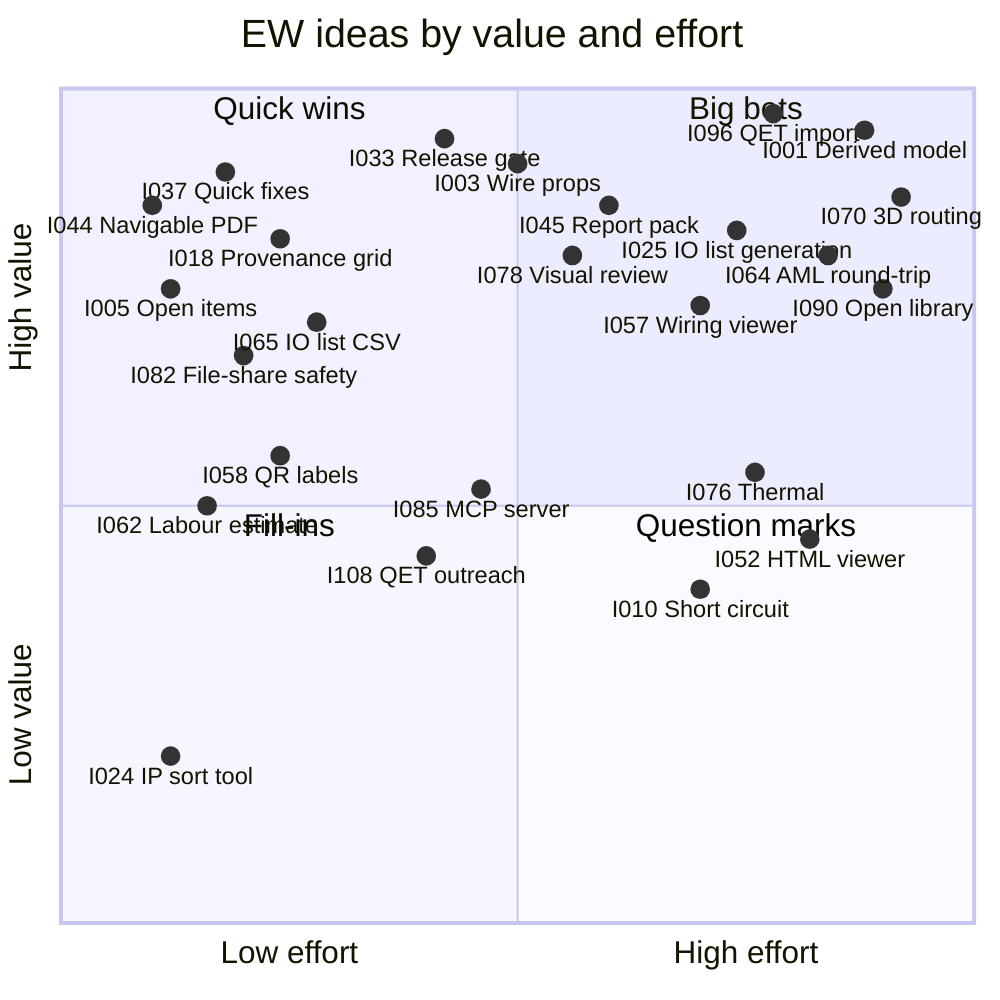

# Brainstorm: lessons, ideas and open questions

**Status:** Draft v0.1 · **Date:** 2026-10-21 (cycle 11: PQ-40 note) · **Part of:** ElektraWatt design document set

**Purpose.** This is the structured record of the ElektraWatt (EW) brainstorm. It turns the 42 defects of the
reference drawing set into product ideas, catalogues 109 candidate ideas with value, effort and a suggested release,
and marks the ten big bets. It also collects open "how might we" questions, parked ideas and the consolidated
questions for the pilot user. It feeds the requirement catalogues ([02a](02a-requirements-core.md),
[02b](02b-requirements-extended.md), [02c](02c-nonfunctional-requirements.md)); nothing here is a commitment until
it appears there, and every idea stays within the accepted [architecture](04-architecture.md).

**Contents**
1. [Conventions](#1-conventions)
2. [Lessons from the reference drawing set](#2-lessons-from-the-reference-drawing-set)
3. [Idea catalogue](#3-idea-catalogue)
4. [How might we …](#4-how-might-we-)
5. [Value/effort matrix](#5-valueeffort-matrix)
6. [Wild and parked ideas](#6-wild-and-parked-ideas)
7. [Questions for the pilot user](#7-questions-for-the-pilot-user)
8. [Requirements covered](#requirements-covered) · [Open questions](#open-questions)

---

## 1. Conventions

| Item | Meaning |
|---|---|
| `IDEA-nnn` | Stable idea ID; requirement rows in 02a/02b should cite it as their source |
| ★ | One of the ten **big bets** (§3.14) |
| **V** (value) | **H** removes a defect class of D-01 … D-42 or is a reason to switch tools; **M** clear productivity or quality gain; **L** nice to have |
| **E** (effort) | **L** ≤ 2 developer-weeks; **M** 2–8; **H** > 8 (team of 2–4 with AI assistance) |
| **Rel.** | **MVP**, **1.0**, **1.x**, **Later** as defined for the design set. Must/Should/Could is set in the requirement catalogues |
| **Area** | Requirement area the idea lands in (`FR-<AREA>`) |
| Class (§2) | Prevention class from [architecture §14](04-architecture.md#14-how-the-architecture-prevents-the-reference-defects): **S** structural, **I** invariant, **C** check, **A** assisted |

Tags, folios and part numbers come from [reference-drawing.md](../research/reference-drawing.md). Where research
notes conflict, [gaps-and-corrections.md](../research/gaps-and-corrections.md) wins.

---

## 2. Lessons from the reference drawing set

Four root causes explain all 42 defects
([reference-drawing.md §3](../research/reference-drawing.md#3-inconsistencies-and-defects-verified-and-extended)):

1. **A computed value was stored as a copy and went stale.** QElectroTech (QET) stores evaluated labels, draws
   overviews and layouts as separate elements, and the build used could not renumber placed elements.
2. **Engineering data lived in free text or graphics:** wire sizes, PLC addresses, termination, ratings, core
   colours.
3. **Nothing stood between drawing and delivery:** no checks, no release gate, no four-eyes record.
4. **The tool could not express the intent:** TWIN terminals, junction sequences, 0 V–PE bonds and the valve
   terminal's dual nature had no model.

| # | Defect class | Defects (evidence) | Preventing product idea | Class | Ideas |
|---|---|---|---|---|---|
| L1 | **Stale copies** | D-01 BOM -4W1/-4X1 vs folio 3 -3W1/-3X1. D-02 layout T51 vs T55. D-10 overview 202 shows 5 valves on -202U2, detail 206 and BOM 4. D-41 one manifold tagged from 201 and 202. D-42 X1031 tagged twice, two BOM rows | Every printed tag, overview, BOM row and layout label is a query on one device; overviews generate from assembly children; placements reference devices | S | 001, 006, 007, 028, 071 |
| L2 | **Identifier schemes, anchors** | D-03 fixed (S51), page-based (-101F1) and location-qualified (+JE2416-X1031) tags mixed; "+J-E-2416" vs "+JE2416". D-14 xref "3-B0" to an empty column. D-24 five IP names on one net (24VDC-1, 24VDC-AIR1…4). D-39 L-1/N-1 order differs on 101 and 102 | Canonical structure nodes; one numbering rule with frozen tags reported; anchor cell from the symbol's anchor policy; canonical potential name with IP aliases; IP arrange tool | S, C, A | 001, 002, 023, 024, 037 |
| L3 | **Parts and BOM** | D-04 BOM misses -106W2, -201U4…U9, 550208, 28 × 571334, NSYPLA1074G, NSYPMM107; no quantity. D-17 core colour "BR". D-18 "50hz", "15c", "Murr Elektronik". D-35 ratings ("10A C") as description. D-36 order code vs 195740 vs two parts. D-40 550208 inside the MPA section | Parts only on devices, with quantity; manufacturer master data; typed technical data; `ColourCode` enum; configured assemblies with order code and two BOM modes; configurator validation | S, C | 006, 016, 026, 029, 042, 090 |
| L4 | **Wire properties, potentials** | D-08 "if not indicated, standard size" for ~60 wires, 4 marker groups. D-16 CPX pin 3 "PE" vs FE. D-22 0 V–PE bond as a plain wire PE-0VDC. D-37 DBU/WH cited as IEC 60757 but a company convention | Potential-driven wire properties with provenance; profiles that name their basis; `Bond` entity; earth types from part pin functions | S, C | 003, 004, 018 |
| L5 | **Electrical correctness** | D-13 T55 and S56 switch the neutral (safety). D-21 1X1:PE not connected to X1032. D-23 MICO 13-14 unconnected. D-25 crossed CPX supply pairs on one 6 A channel. D-38 PE 1.5 mm² below a 2.5 mm² phase | Electrical rule pack online from day one; PE bonding through rails and plate; `unused` CP marking; load summary per channel | C | 009, 035, 036, 038 |
| L6 | **Terminals, junctions** | D-11 a "3+" terminal without designation. D-12 "1+" × 4 … "PE" × 5. D-20 dots and bevels mixed; daisy-chain order implicit | Terminal = device with levels and clamps (PT 2.5-TWIN); designation prevent rule, lenient on import; `Junction` with sequence | I, S | 007, 097 |
| L7 | **PLC and bus** | D-15 node address "TBD", termination as text "Switch to ON". D-26 only odd bits Q0.1/Q0.3 …. D-27 28 valves and the TA05-V-xx process valves untagged | Channel as hub object with part address map; typed `Tbd`; termination property; child tags; process tags | S, C | 005, 012, 027, 039, 069 |
| L8 | **Fluid** | D-28 no supply on port 1, no exhaust or silencer on 3/5, no tube sizes | Fluid ports and media on the graph engine; tube specs; `EW-FL` rules | C | 013 |
| L9 | **Panel layout** | D-32 F55, E55, E56, S56, -201U9 missing; no rails; not to scale | Layout from devices; unplaced-device check EW-LAY-001; true-scale projections | S, C | 070, 071 |
| L10 | **Document quality** | D-07 no bookmarks or links, raster logo. D-29 tag text 8.88 vs 9.62 pt. D-31 3.70 pt text (≈ 0.95 mm cap height). D-33 page labels 1…18, lost spaces ("SK3110.000") | Navigable PDF/A with `/PageLabels`; text styles per slot kind; printed-height check | S, C | 042, 044, 048 |
| L11 | **Project data, revisions, roles** | D-05 revision "1", "V1.0", "V1", "V2.0". D-06 folio 101 "Control Cabinet Expansion". D-30 "Customer" shows the end user. D-34 author = checker | Title blocks bound to project properties; one revision table; typed party roles; four-eyes release invariant | S, I | 023, 048, 084 |
| L12 | **Missing deliverables** | D-09 no wire list, terminal or cable diagram, PLC or potential overview, wire numbers. D-19 no supply cable, no cable lengths | Report blocks as derived pages (903–911); cables as devices with a length source; release gate | S, C | 005, 029, 033, 045 |

**Design maxims distilled from the lessons** (used to score the ideas below):
- *If it is printed, it is derived* (L1, L2, L11).
- *If it is engineering data, it is typed* (L3, L4, L7, L8).
- *If it leaves the building, it passed a gate* (L5, L12).
- *If the tool knows it, the tool writes the document* (L9, L10, L12).
- *Keep the user's style.* The tool let things drift; the engineer's conventions were sound. "Only if different"
  wire markers, page-based tags and the 0-based 17 × 8 frame stay (REF-008, REF-013, REF-023).

---

## 3. Idea catalogue

### 3.1 Engineering model

| ID | Idea | V | E | Rel. | Area | Rationale |
|---|---|---|---|---|---|---|
| IDEA-001 ★ | **Derived-everything device model:** tags, xrefs, TOC, BOM, title blocks, layout labels are queries; no "update reports" button | H | H | MVP | DEV | Removes class L1 by construction (ADR-0001, ADR-0006) |
| IDEA-002 | Frozen tags with a deviation report: S51, F55, T55, E55, S56, E56, 1X1 stay as drawn | H | M | MVP | NUM | House numbering kept, drift visible (D-03, REF-025, ADR-0003) |
| IDEA-003 ★ | **Potential-driven wire properties with provenance:** colour and size from profile rules ("DBU/WH 24 V", 0.75/1.5 mm²); folio 1 tables generated from the profile; markers show deviations only | H | M | MVP | CON | Fixes D-08 in the user's own drawing style (REF-008); machine-readable data for every wire |
| IDEA-004 | Explicit bonds (PELV 0 V–PE); FE vs PE from part pin functions | M | M | MVP | CON | D-16, D-22, REF-038 |
| IDEA-005 | Typed open items (`Tbd` address, node, length, part) in an open-items view | H | L | MVP | CHK | D-15, D-19, REF-094; feeds the release gate |
| IDEA-006 | Configured assemblies with derived child tags (-201U3-Q1) and BOM in assembly or component mode | H | M | MVP | DEV | D-27, D-36, D-41; the CPX/VMPA manifold is the test |
| IDEA-007 | One strip, many segments; terminals as devices with levels and clamps; junctions with connection sequence | H | M | MVP | TRM | D-11, D-12, D-20, D-42; PT 2.5-TWIN clamps distinguishable |
| IDEA-008 | Typed external connections to +J-E-206 / JE-N1000-03; live resolution when that project is open | M | M | MVP / 1.x | PRJ | REF-018 on folios 3, 101; live part per G15 |
| IDEA-009 | Load budget per potential and protective device (MICO 6 A per channel, -102G1 20 A); cover "Consumption" computed | M | M | 1.0 | CHK | D-25, G15 |
| IDEA-010 | Short-circuit and voltage-drop data along the supply path | M | H | 1.x | CHK | REF-107; [standards](../research/standards.md) Impl. 11 |
| IDEA-011 | Multilingual project texts (`MlText`); PDF per language | M | M | MVP (model) / 1.0 (XLIFF) | I18N | Retrofit is the costly path (ADR-0005, G7) |
| IDEA-012 | Process tags and field locations (TA05-V-15 in +FIELD) with target tracking from channel to field device | M | M | 1.0 | DEV | D-27, REF-064, REF-093 |
| IDEA-013 | Fluid on the same graph engine: ports 1–5/12/14, media propagation, tube specs, tube list | H | M | 1.0 | FLU | D-28; folios 203–206 become data |

### 3.2 Editing speed

| ID | Idea | V | E | Rel. | Area | Rationale |
|---|---|---|---|---|---|---|
| IDEA-014 | Command palette over every `Command`; keymaps "EW", "KiCad-like", "EPLAN-like"; "next unconnected point" | H | M | MVP | UI | Users come from three tools (G5) |
| IDEA-015 | Autoconnect as a ghost preview that creates explicit connections | H | M | MVP | CON | EPLAN speed, stable logic (ADR-0007) |
| IDEA-016 | Part-first placement: a part creates the device with unplaced functions to drag onto pages | H | M | MVP | DEV | Devices without parts (E56, S56) stop being the default |
| IDEA-017 | Table mode for every navigator: fill-down, Excel paste as one command, Excel round-trip keyed by `id` | H | M | MVP | UI | 28 channels or 30 terminals are table work |
| IDEA-018 | Property grid with provenance and "reset to derived" ("0.75 mm² · from potential 24VDC-1 via profile 'DBU/WH 24 V'") | H | L | MVP | UI | Makes derived values auditable (D-08) |
| IDEA-019 | Browser-like xref navigation: click, back/forward, hover preview | H | L | MVP | XRF | 22 IP pairs in 18 folios; real projects have hundreds |
| IDEA-020 | Preview before bulk commands (renumber, re-address, update parts, import) with tag/BOM/page diffs | H | M | MVP | NUM | The missing renumber caused D-01 ([oss-landscape](../research/oss-landscape.md) §2.4); ADR-0008 |
| IDEA-021 | Project-wide find and replace as one previewed transaction | M | M | MVP | UI | The D-18 typos are a replace job |
| IDEA-022 | Window and page macros with ID remapping and numbering on insert | H | M | MVP | MAC | The heater/thermostat/lamp group on 101 is a standard circuit |
| IDEA-023 | Company-standard wizard producing a basic project: SVG logo, title block, profiles, identifier set, numbering, revision format, languages | H | M | MVP | PRJ | Stops D-03, D-05, D-06, D-08 at the source (G13) |
| IDEA-024 | Interruption-point sort and arrange tool | L | L | 1.0 | XRF | D-39 |

### 3.3 Automation and generation

| ID | Idea | V | E | Rel. | Area | Rationale |
|---|---|---|---|---|---|---|
| IDEA-025 ★ | **Generate schematics from an I/O list:** each CSV/XLSX row (channel, typical, process tag, function text) instantiates a macro with the row as value set: pages, devices, channels, terminals in one previewed transaction | H | H | 1.0 | MAC | Folios 203–206 are one typical × 4 value sets (architecture §5.5); EPLAN offers this as Cogineer/eBUILD |
| IDEA-026 | Order-code decoder plugins: 51E-F13GCQP-D+H2GG and 32P-VGL-R-MAHAHA…-28MS → slot list → overviews, fluid pages, channels, BOM | H | H | 1.x | DEV | v1 keeps the code verbatim plus a manual slot list ([plc-bus-fluid](../research/plc-bus-fluid.md) §8.1) |
| IDEA-027 | Device-description import (GSD, GSDML; ESI in 1.x) into stations, modules, channels via a rack/slot editor | H | M | 1.0 | PLC | No manual I/O typing |
| IDEA-028 | Generated assembly front views (201/202 with "∞ 203-B4") and PLC overview (908) | H | M | MVP | DEV | D-10 cannot occur |
| IDEA-029 | Cable core assignment from the cable part (NEBU-G78W5: BK, BU, GNYE, WH, BN) | M | M | 1.0 | CBL | D-17, D-19 |
| IDEA-030 | Ferrule selection by wire class × clamp × cross-section × machine magazine, incl. twin ferrules | H | M | 1.0 | MFG | v1 brief; [panel-manufacturing](../research/panel-manufacturing.md) §7.3 |
| IDEA-031 | Instrument-list import: spare-channel pre-assignment, process-tag binding | M | M | 1.0 | PLC | The end user's TA05 list |
| IDEA-032 | Jobsets (`ew jobs run release.ewjobs`) and recorded command macros as rhai | H | L | 1.0 | EXT | Reproducible releases (architecture §10.1) |

### 3.4 Checks and quality gates

| ID | Idea | V | E | Rel. | Area | Rationale |
|---|---|---|---|---|---|---|
| IDEA-033 ★ | **Release gate in CI:** `ew check --scheme pre-delivery` must report zero unwaived errors before a release export; open items, author = checker, stale lengths block | H | M | MVP | CHK | Stops classes L3, L5, L7, L12; "CI-checked drawings" (architecture §12) |
| IDEA-034 | Online checks while drawing, message panel with jump and severity icons | H | M | MVP | CHK | Online rules are memoised queries (ADR-0019) |
| IDEA-035 | Electrical pack: N-only switching (EW-POT-013), unconnected CP unless `unused`, PE sizing, clamp capacity | H | M | MVP | CHK | D-13 is a safety defect in a delivered set; D-23, D-38, REF-086 |
| IDEA-036 | PE continuity through rails and plate, with bonding list | M | M | 1.0 | CHK | D-21; feeds IDEA-046 |
| IDEA-037 | Quick fixes as previewed commands ("rename +JE2416 → +J-E-2416", "create supply cable") | H | L | MVP | CHK | Findings with a fix get fixed |
| IDEA-038 | Waivers with reason, author, date in the release report | M | L | MVP | CHK | Strict checks, legitimate exceptions (D-25) |
| IDEA-039 | PLC address-map validation (coil 14/12 bit order) and overview-vs-detail counts | H | M | MVP | CHK | D-26, D-10; golden criterion 8 |
| IDEA-040 | Company rules in rhai or SQL over `api_v1` views | M | M | 1.0 | CHK | No Rust needed (ADR-0017, ADR-0019) |
| IDEA-041 | EN 60204-1 pack (EW-EN60204-001 … 015, after the M-01 … M-15 list of [standards](../research/standards.md) §7), licensed tables as data | M | H | 1.0 | CHK | Table values cannot be shipped |
| IDEA-042 | Data lints: rating in description, manufacturer mismatch, "50hz"/"15c", confusables, printed text height | M | L | 1.0 | CHK | D-18, D-31, D-35 |
| IDEA-043 | "Why this value?" view: provenance and dependency trail of any derived value | M | L | 1.0 | UI | GUI face of `ew query --explain` (architecture §6.8) |

### 3.5 Documentation outputs

| ID | Idea | V | E | Rel. | Area | Rationale |
|---|---|---|---|---|---|---|
| IDEA-044 | Navigable PDF/A-2b: outline, a link per xref, `/PageLabels` = folios, subset fonts, real spaces | H | L | MVP | OUT | D-07, D-33 (ADR-0015) |
| IDEA-045 | Report pack as derived pages: terminal diagrams 1X1/-X1031/-X1032, cable diagrams, wire list, PLC, potential, structure, revision overviews (903–911) | H | M | MVP | REP | D-09; spine target (architecture §15.1) |
| IDEA-046 | Verification checklists: EN 60204-1 cl. 18 (PE list, disconnect list, I/O list Q0.1 → TA05-V-15), IEC 61439 cl. 11 | M | M | 1.0 | REP | Typed by hand today |
| IDEA-047 | User reports: SQL over `api_v1` plus a form ("24 V loads per MICO channel") | M | M | 1.0 | REP | Beyond fixed report types (ADR-0018) |
| IDEA-048 | Form editor reproducing a house style to ±0.2 mm; bound fields only | H | M | MVP (engine) / 1.0 (editor) | REP | REF-096, REF-105 |
| IDEA-049 | Revision clouds and page change status from the model diff | M | M | 1.0 | REV | "What changed in V2.0?" (D-05) |
| IDEA-050 | Review export: watermark, personal metadata stripped | M | L | 1.0 | OUT | G12 |
| IDEA-051 | PDF comment import as entity-anchored comments | M | M | 1.x | COL | PDF-only customers (G15) |
| IDEA-052 | Offline interactive HTML/WASM viewer export | M | H | 1.x | OUT | eVIEW-like, no cloud |
| IDEA-053 | DXF, SVG, PNG page export with layer mapping | M | L | 1.0 | OUT | ADR-0015 |

### 3.6 Manufacturing and shop floor

| ID | Idea | V | E | Rel. | Area | Rationale |
|---|---|---|---|---|---|---|
| IDEA-054 | Open production package `.ewpp` (wires, terminals, labels, cut lists, DXF, glTF, checklists, PDF/A, status logs) with JSON Schemas | H | M | 1.0 | MFG | One documented hand-off ([panel-manufacturing](../research/panel-manufacturing.md) §8) |
| IDEA-055 | Machine profiles as TOML: Komax TopConvert CSV, Rittal WT CSV, Weidmüller WPC XLSX, generic; pre-flight checks | H | M | 1.0 | MFG | A new machine is a file, not code (ADR-0018) |
| IDEA-056 | Label sets from one engine: wire, terminal, device, cable, door; deterministic DT abbreviation | H | M | 1.0 | MFG | EN 60204-1 13.2.1 |
| IDEA-057 ★ | **Tablet wiring viewer:** work queue by bundle, 3D highlight of both CPs, schematic snippet, done/problem. Read-only in 1.0, status log and QR jump in 1.x | H | H | 1.0 / 1.x | MFG | Smart Wiring class, offline, from the open `.ewpp` |
| IDEA-058 | QR codes on wire and bundle labels; scanning opens the wire in the viewer | M | L | 1.x | MFG | No searching a 2,000-wire list |
| IDEA-059 | Nameplate QR to the as-built documentation | M | L | 1.0 | MFG | Service access for the end user |
| IDEA-060 | Rework change list: wires added, removed, changed since V1.0 | H | M | 1.0 | MFG | `diff_query` (architecture §7.8) |
| IDEA-061 | Machine feedback import (actual length, `status = cut`) | M | M | 1.x | MFG | Length calibration, traceability |
| IDEA-062 | Labour estimate from wire, ferrule, terminal and device counts and routed length, with a rate table | M | L | 1.x | REP | Builders quote before detailed engineering |
| IDEA-063 | Drilling and cut-out DXF per surface with hole tables | M | M | 1.0 | MFG | No proprietary NC needed |

### 3.7 PLC round-trip

| ID | Idea | V | E | Rel. | Area | Rationale |
|---|---|---|---|---|---|---|
| IDEA-064 ★ | **AML round-trip with TIA Portal:** CAEX 2.15, AR APC 1.4.0; stations, modules, channels, tags, `InternalLink`s; persisted GUIDs; three-way merge on re-import | H | H | 1.0 | PLC | v1 brief item 1; TIA V21 exports carry tags (C-2, C-3) |
| IDEA-065 | Generic I/O-list CSV/XLSX round-trip with stable IDs (MVP); TIA "PLC Tags" XLSX and symbol name templates (1.0) | H | L | MVP / 1.0 | PLC | The low-friction route most integrators use |
| IDEA-066 | PLCopen XML GVL export for CODESYS | M | M | 1.0 | PLC | EPLAN lacks a verified converter |
| IDEA-067 | Address ownership per project (ECAD-first or PLC-first) with conflict panel | M | M | 1.0 | PLC | No silent overwrites |
| IDEA-068 | Safety I/O data and checks (F-addresses, channel pairs); no SIL/PL calculation | M | M | 1.0 | PLC | [plc-bus-fluid](../research/plc-bus-fluid.md) Impl. 12 |
| IDEA-069 | Generated bus topology page and address list; termination checks | M | M | 1.0 | BUS | D-15, REF-061 |

### 3.8 3D panel layout

| ID | Idea | V | E | Rel. | Area | Rationale |
|---|---|---|---|---|---|---|
| IDEA-070 ★ | **3D cabinet with deterministic routing and automatic wire lengths**, committed by an explicit `RouteWires` command | H | H | 1.0 | LAY | v1 brief item 3; lengths feed wire list and machines (ADR-0003, ADR-0016) |
| IDEA-071 | Device-bound true-scale 2D plate layout (folio 902): live labels, legend, unplaced check | H | M | MVP | LAY | D-02, D-32 (Open question 2) |
| IDEA-072 | Box macros generated from part dimensions | H | L | 1.0 | LAY | 3D not blocked on vendor CAD |
| IDEA-073 | STEP import in the OCCT worker, content-hash cache, two LODs | H | H | 1.0 | LAY | ADR-0016 |
| IDEA-074 | Duct fill heat-map and fill warnings | M | M | 1.0 | LAY | 40x60 fill is a daily question |
| IDEA-075 | Collision and door-closed check; door-swing sweep in 1.x | M | M | 1.0 | LAY | Catch "door does not close" early |
| IDEA-076 | Thermal calculation from placements and climate-device sizing | M | H | 1.0 | THM | IEC 61439-1 10.10; E55/T55 sizing |
| IDEA-077 | STEP AP242 and glTF export with DT names | M | M | 1.0 | EXP | MCAD integration |

### 3.9 Collaboration and git workflows

| ID | Idea | V | E | Rel. | Area | Rationale |
|---|---|---|---|---|---|---|
| IDEA-078 ★ | **PR-style drawing review:** CI renders changed pages before/after with the CPU renderer, overlays differences, posts a change list with derived tags ("-102F1: part A9F78116 → …"); same view in-app for two commits or revisions | H | M | 1.0 | COL | Git becomes a review tool; builds on `ew render --png` and `ew diff` (architecture §7.5) |
| IDEA-079 | Semantic merge driver and textconv diff | H | M | 1.0 | COL | ADR-0012 |
| IDEA-080 | Entity-anchored review comments that survive renumbering | M | M | 1.0 | COL | Anchors are UUIDs |
| IDEA-081 | Branch-safe numbering with a post-merge renumber quick fix | M | M | 1.0 | NUM | Architecture risk 9 |
| IDEA-082 | File-share safety: lock file, read-only open, cloud-folder warning, journal recovery | H | L | MVP | COL | SMB shares are the norm (ADR-0010) |
| IDEA-083 | Local history timeline (gix) with restore and compare | M | M | 1.x | COL | History without learning git |
| IDEA-084 | Managed revisions (MVP); as-built archive and tag `ew/rev/<label>` (1.0) | H | M | MVP / 1.0 | REV | D-05, D-34 (ADR-0013) |

### 3.10 AI assistance via MCP (opt-in, ask-first)

All ideas here follow ADR-0020: MCP is off by default, reachable over stdio or localhost only, and every write is
ask-first and becomes a journalled, undoable transaction tagged `origin=mcp`. EW itself sends no project data
anywhere. User projects and QET elements are never used for model training
([oss-landscape](../research/oss-landscape.md) §2.6).

| ID | Idea | V | E | Rel. | Area | Rationale |
|---|---|---|---|---|---|---|
| IDEA-085 | Headless `ew mcp`: read tools `query`, `sql_query`, `find`, `run_checks`, `preview_command` (MVP, Could); ask-first `commit_preview` (1.0) | M | M | MVP / 1.0 | EXT | Parity with QET's MCP server |
| IDEA-086 | GUI live bridge: agent commands as ghost previews with diff; user accepts or rejects | M | M | 1.x | EXT | Ask-first made visible (G10) |
| IDEA-087 | Migration triage: agent batches QET findings into proposed quick fixes | M | L | 1.x | IMP | Hundreds of D-11/D-12-type findings |
| IDEA-088 | Datasheet-to-part drafting, flagged "AI-drafted, unverified" until approved | M | M | 1.x | PRT | Part data is the onboarding bottleneck |
| IDEA-089 | Natural-language questions via the SQL projection, SQL shown; findings explained with rule pages | M | L | 1.x | EXT | No hidden logic |

### 3.11 Ecosystem

| ID | Idea | V | E | Rel. | Area | Rationale |
|---|---|---|---|---|---|---|
| IDEA-090 ★ | **Open parts and symbol library:** per-record licence and provenance, ETIM classes, CI linter, generators, rendered previews in PRs | H | H | 1.0 (infra) / 1.x (packs) | PRT | The Data Portal is EPLAN's largest moat, and its terms forbid reuse ([oss-landscape](../research/oss-landscape.md) §6.2) |
| IDEA-091 | Manufacturer data partnerships with the makers in the reference set (Phoenix Contact, Festo, Schneider Electric, Siemens, Rittal, Murrelektronik, Eaton); outreach starts after MVP | H | M | 1.0 (Should, non-gating) | PRT | They already produce EPLAN data; the first manufacturer-reviewed pack is a 1.0 target that does not gate the release, because its timing depends on a third party |
| IDEA-092 | Own IEC 60617 / ISO 1219 symbol set (CC-BY-SA-4.0 + design exception), starting with ~40 golden symbols | H | M | MVP | SYM | QET elements cannot be bundled |
| IDEA-093 | Wholesaler catalogue import: BMEcat, ETIM xChange | M | M | 1.0 | PRT | ETIM is common at Dutch wholesalers |
| IDEA-094 | Publish permissive crates (`ew-rds`, `ew-schema`, `ew-format`, `ew-interop-api`, CAEX, GSDML) | M | M | 1.0 | EXT | No Rust crate exists for GSDML or CAEX |
| IDEA-095 | Signed WASM plugin registry (importers, exporters, rules, machine profiles, decoders) | M | M | 1.x | EXT | Home for IDEA-026 (ADR-0020) |

### 3.12 Migration from QET and EPLAN

| ID | Idea | V | E | Rel. | Area | Rationale |
|---|---|---|---|---|---|---|
| IDEA-096 ★ | **QET importer** (`.qet` 0.3–0.200, `.qetz`): folio reports → IPs, master/slave → main/aux, per-project xref formulas (`%F` vs `%f`), potentials from connectivity; re-import in place; migration report as a check run with quick fixes | H | H | MVP | IMP | The pilot user's migration path (ADR-0021, C-15) |
| IDEA-097 | Text-to-data on import: "2.5 BK" → wire overrides, "Q0.1" → channels, port numbers, "TA05-V-15" → process tags; uncertain matches for review | H | M | MVP | IMP | QET pages hold data as graphics (D-08) |
| IDEA-098 | Migration verifier: imported pages rendered and compared with the QET PDF | H | M | MVP | IMP | Proves "nothing lost"; shares IDEA-078 machinery |
| IDEA-099 | Batch migration (`ew import qet --batch`) with findings per project | M | L | 1.0 | IMP | Old projects return for retrofits |
| IDEA-100 | EDZ part-data import: 7-Zip, part data only, terms notice | H | M | 1.0 | IMP | v1 brief item 4 (C-1) |
| IDEA-101 | EPLAN XLSX/CSV report import with column mapper; EPLAN PDF/DXF pages as underlays | M | M | 1.0 | IMP | No `.elk`/`.edb` access needed |
| IDEA-102 | DXF import with a DXF→symbol wizard; DWG via acadrust or the user's ODA converter | M | M | 1.0 | IMP | C-4 |

### 3.13 Community

| ID | Idea | V | E | Rel. | Area | Rationale |
|---|---|---|---|---|---|---|
| IDEA-103 | Golden project rebuilt with every determinable defect fixed (anonymised, CC0) as tutorial and CI fixture | H | L | MVP | DOC | Best adoption tool ([golden project](20-golden-project.md)) |
| IDEA-104 | Rule page per check ID (why, clause, fix), linked from messages and F1 | M | L | MVP | DOC | Teachable checks (G13) |
| IDEA-105 | Concept guides EPLAN↔EW, QET↔EW; "from QET" migration guide | M | L | MVP | DOC | Vocabulary is the first barrier |
| IDEA-106 | Translations EN, NL, DE first (Weblate, Fluent, PO) | M | L | 1.0 | I18N | Home markets |
| IDEA-107 | Library contribution track for non-coders: templates, linter, previews | M | M | 1.0 | DOC | Libraries are QET's and KiCad's largest contribution channel |
| IDEA-108 | Outreach to QET maintainers: shared exchange subset or EW→QET export | M | M | 1.x | DOC | Allies, not targets |
| IDEA-109 | Education kit with tutorial projects for vocational schools | M | L | 1.x | DOC | Future hires learn EW first |

### 3.14 The ten big bets

| Bet | Idea | What we win | What we risk | Earliest proof |
|---|---|---|---|---|
| B1 | IDEA-001 Derived device model | Class L1 vanishes; cheap previews and diffs | Stale memos (architecture risk 1) | M1: golden PDF, oracle on |
| B2 | IDEA-003 Potential-driven wire properties | Typed data for every wire, user's style kept | Precedence surprises; provenance UI must be excellent | M1: folio 1 tables generated |
| B3 | IDEA-096 QET importer with fix-it report | The pilot user can switch | QET format drift (0.200, `.qetz`) | M2: QET corpus and pilot projects |
| B4 | IDEA-033 Release gate in CI | Defects stop at the gate | False positives make users disable checks | M2: pre-delivery scheme on golden |
| B5 | IDEA-025 Generation from I/O lists (+ IDEA-026) | Days of drawing become minutes | Macro and value-set design must be right early | M3: folios 203–206 from a 28-row CSV |
| B6 | IDEA-064 AML round-trip | ECAD and PLC in sync both ways | TIA dialect drift; few test files | M3: golden PLC data round-trips |
| B7 | IDEA-057 Wiring viewer with QR labels | Digital shop floor without server or licence | Unknown floor hardware (PQ-23) | 1.0: a test panel wired from the viewer |
| B8 | IDEA-070 3D routing and lengths | Pre-cut wires, real lengths in machine files | Largest v1 effort (routing, lengths and UI ≈ 2–3 dev-months) | M4: lengths within tolerance on a built panel |
| B9 | IDEA-078 Visual PR review | Reviewable, auditable changes | Few builders use git (PQ-26) | 1.0: CI comment on a golden PR |
| B10 | IDEA-090 Open library | Erodes the Data Portal moat | Quality and governance load | 1.0: linter and a first manufacturer pack |

**AI is not a big bet.** `ew mcp` (IDEA-085) is parity with QET. Agents add value only on top of a strong model and
checks, which B1–B4 deliver.

---

## 4. How might we …

| ID | How might we … | First thought |
|---|---|---|
| HMW-01 | … make explicit connections feel as fast as EPLAN autoconnect? | Ghost autoconnect plus ladder macros; measure at M2 (ADR-0007) |
| HMW-02 | … let the pilot user draw a new 18-folio project in a day? | Macros, value sets and I/O-list generation (IDEA-022, IDEA-025) |
| HMW-03 | … keep shop-floor values stable while the design changes? | Committed computations, frozen numbers, change lists (ADR-0003) |
| HMW-04 | … get trustworthy part data without the Data Portal? | Manufacturer packs, ETIM, user EDZ import, AI drafts with provenance |
| HMW-05 | … decode order codes without vendor cooperation? | Start from the user's configurator exports (PQ-14); decoders as plugins |
| HMW-06 | … make checks trusted rather than noise? | Few precise rules first, waivers, rule pages, false-positive tracking |
| HMW-07 | … let non-programmers write rules and reports? | rhai one-liners and SQL over `api_v1`, with golden examples |
| HMW-08 | … make git usable for engineers who never used it? | Local history, "save revision", visual compare; git underneath |
| HMW-09 | … review with customers who accept only PDF? | Review export plus PDF comment import (IDEA-050, IDEA-051) |
| HMW-10 | … help technicians without a tablet fleet? | Printed bundle sheets with QR codes; phone browser later |
| HMW-11 | … open a 2027 project identically in 2037? | Pinned derivation profiles, as-built archive (architecture §6.6, §7.8) |
| HMW-12 | … use AI without exposing confidential projects? | Local MCP, ask-first, no EW network traffic, review export |
| HMW-13 | … give small panels wire lengths without full 3D? | Estimated lengths from the 2D plate layout and duct graph, flagged `estimated` |
| HMW-14 | … mix QET-grid pages and native pages in one project? | Per-page grid indicator; previewed conversion in 1.x (ADR-0027) |
| HMW-15 | … fund the project without becoming a CRA manufacturer too early? | Steward model, grants and partnerships first (ADR-0030) |

---

## 5. Value/effort matrix

Positions follow §3 (value H ≈ 0.8–0.95, M ≈ 0.45–0.6, L ≈ 0.2; effort L ≈ 0.1–0.3, M ≈ 0.4–0.6, H ≈ 0.7–0.9),
spread slightly so labels do not overlap. A representative subset is plotted.

- **Quick wins** (cheap proofs of the model, do early): IDEA-005, -018, -019, -032, -037, -044, -065, -072, -082, -103.
- **Big bets** get staged proofs (§3.14) and a thin first slice: estimated lengths before routing (HMW-13), flat
  value sets before rules, library infrastructure before packs.
- **Question marks** (IDEA-010, -041, -052, -076) wait for evidence of demand. Thermal is in the v1 brief, so it
  ships as a single-compartment calculation with user-supplied coefficients
  ([panel-manufacturing](../research/panel-manufacturing.md) §10).

---

## 6. Wild and parked ideas

| ID | Idea | Why parked | Revisit when |
|---|---|---|---|
| PARK-01 | Real-time co-editing (CRDT, Loro) | Merges into invalid states; git and locks suffice for 2–4 engineers (ADR-0012) | Simultaneous editing becomes routine |
| PARK-02 | Cloud editor / SaaS | Offline-first; confidentiality; CRA duties | After 1.0, as a separate AGPL server |
| PARK-03 | Text-to-schematic AI ("draw a star-delta starter") | Unverifiable output, liability (ADR-0030) | B4 and B5 are mature |
| PARK-04 | Scan of paper drawings to schematic | Symbol OCR is research | A partner with a corpus appears |
| PARK-05 | Live PLC online view of I/O states | Network access to plant controllers; security | Commissioning support is requested |
| PARK-06 | Variant projects (150 % model, "with heater E55") | Large model impact; macros cover most cases | Product families need it (PQ-01) |
| PARK-07 | Robot wiring data (CP accuracy, insertion direction) | No robot users; keep optional CP fields | A robot cell is planned |
| PARK-08 | Bent copper busbars, unfolds, NC | Not in the pilot user's panels | Power distribution enters scope |
| PARK-09 | Perforex/Steinhauer NC, RiPanel AML | Undocumented dialects | Vendors document formats (PQ-24) |
| PARK-10 | Harness/formboard drawings | Not cabinet building | Harness users join |
| PARK-11 | P&ID, Preplanning, DEXPI | Process-plant scope | End users deliver P&IDs as data |
| PARK-12 | Direct `.elk`/`.edb`/`.epj` reading; EPLAN export | Legal and technical risk (architecture §16) | Samples and legal clearance exist |
| PARK-13 | UL 508A / NFPA 79 / SCCR | Not the pilot user's market; part fields can exist now | A North American customer appears |
| PARK-14 | Hydraulics | Pneumatics first | Pneumatics is stable |
| PARK-15 | AR glasses or voice-guided wiring | Hardware gamble | Viewer adoption shows demand |
| PARK-16 | Usage telemetry | Privacy, consent, backlash (ADR-0029) | Never by default |
| PARK-17 | PDF layers; HPGL | krilla has no OCG (C-11); plotters obsolete | krilla gains OCG |
| PARK-18 | TIA Openness bridge (C#) | Windows-only; AML and XLSX cover v1 | AML limits are hit |

---

## 7. Questions for the pilot user

Consolidated from the open questions of all research notes and design documents; this is the single list of pilot
questions, and the design documents cite these IDs instead of keeping their own. "Decides" names what the answer
changes. Until a question is answered, the documented defaults and the ▲ test values of
[20](20-golden-project.md) apply.

| ID | Question | Decides | Source |
|---|---|---|---|
| **Projects and files** | | | |
| PQ-01 | Page, device and wire counts of your largest projects of the last three years? Do customers send EPLAN projects that large? | Size classes S–XL (ADR-0022) | G6 OQ1 |
| PQ-02 | Can you share the `.qet` of the reference project and 5–10 other QET projects (custom title blocks, company collections)? | Importer acceptance; "3-B0"; the Golden C counts that depend on the file (are J-E-206-L/N/PE QET reports or plain elements, how are the wire-marker texts split) | reference OQ15, interop OQ2, [14](14-interop.md) |
| PQ-03 | Will you move to QET 0.200 / `.qetz` before migrating? | `.qetz` in MVP | interop OQ3 |
| PQ-04 | How often do customers send EPLAN projects, DWG or DXF? | IDEA-101, IDEA-102 priority | interop OQ9, OQ10 |
| **Conventions** | | | |
| PQ-05 | Keep DBU/WH for 24 V DC, or offer EN 60204-1 BU / IEC 60445 RD/WH? Exact DBU print colour? | Default profile; D-37 | standards OQ4 |
| PQ-06 | Connection grid for new symbols: 4 mm or 2.5 mm? Keep the 0-based 17 × 8 frame for new projects? | ADR-0027; frame default | G4, standards OQ9 |
| PQ-07 | Keep the Tahoma look (self-installed font) or switch to Noto Sans or osifont? | ADR-0028 | G14 |
| PQ-08 | Is page-based numbering (-101F1) a house rule? Keep fixed tags for template devices (S51 …)? Canonical "+J-E-2416"? | Numbering defaults | reference OQ1, OQ2 |
| PQ-09 | What does a revision cycle look like (approval, as-built)? Index format? What changed in V2.0 on 101 and 106? Who may act as checker when an engineer draws alone? Should exports of an open revision carry a "DRAFT" status mark by default? | Revision model; checker role; status-mark default | reference OQ3, eplan OQ9, [15](15-checks-revisions-collaboration.md) |
| PQ-10 | On X1031/X1032, is each drawn terminal one PT 2.5-TWIN or one level? "1+" designations or numbers with function text? | Terminal default | reference OQ4, eplan OQ7 |
| PQ-11 | Should the title-block "Customer" show the contracting party or the end user? | Party binding (D-30) | reference OQ12 |
| PQ-12 | Reports as folios 903–911 in section 9, or as separate documents? | Report-block defaults | reference OQ16 |
| PQ-36 | Minimum printed text height? Technical-data notation ("C10" or "10A C")? How are the main PE point and the enclosure tagged (-XPE, -UC1)? | Text-height scheme parameter (FR-CHK-023); technical-data formats; per-class numbering rules | [20](20-golden-project.md) U-31, U-32, U-34 |
| **Reference content** | | | |
| PQ-13 | Are T55 and S56 really in the neutral, or is the F55 pole labelling wrong? | Golden fix of D-13 (safety) | reference OQ5 |
| PQ-14 | Can you decode the Festo order codes or share configurator exports? Is -202U1 550208? Is 533354 a supply or end plate? 4 or 5 valves on -202U2? | Assembly model; IDEA-026 | reference OQ7, plc OQ7 |
| PQ-15 | Are odd bits Q0.1/Q0.3 … correct? PROFIBUS station address, master, baud rate, termination? | Check EW-PLC-012 | reference OQ8, plc OQ1, OQ3 |
| PQ-16 | Part numbers of S56, E56, MICO 4.10? Is S51 Eaton 533356? NEBU core per pin; pin 3 PE or FE? Are the CPX earth screws FE or PE? | Golden BOM; D-16, D-17; FE roles | reference OQ9, OQ14, [08](08-connections-terminals-cables.md) |
| PQ-17 | Size and colour of PE wires and the 0 V–PE bond? Incoming supply cable? Earthing system of the supply (TN-S, TN-C-S, TT)? | Size profile; D-19, D-38; `SupplySpec.earthing` | reference OQ10 |
| PQ-18 | Structure of TA05-V-15? Does the end user supply instrument lists? Tube sizes and colours? | IDEA-012, IDEA-031 | reference OQ11, plc OQ8, OQ9 |
| **PLC** | | | |
| PQ-19 | Which PLC platforms and versions (TIA V18–V21, CODESYS 3.5, TwinCAT, Rockwell)? Who owns addresses? Sample AML exports? Do your PLC programmers accept first-fit automatic allocation of module addresses around manually fixed ranges? | AML dialects; IDEA-067; the first-fit allocation rule of [10](10-plc-and-bus.md) | plc OQ2, interop OQ5, OQ6, [10](10-plc-and-bus.md) |
| PQ-20 | F-PLCs or safety relays in use? Which safety data must drawings carry? | IDEA-068 | plc OQ10 |
| **Shop floor** | | | |
| PQ-21 | Which wire-processing and marking machines (Komax, Rittal WT, Weidmüller WPC, printers)? Templates and feedback samples? | First profiles (IDEA-055) | panel OQ2, interop OQ7 |
| PQ-22 | Shop policies: marking scheme, wire-number format, reserve length, duct fill limit, ferrule colours (DIN or French), bundle size? Which data make a part "production-ready" in your shop? | Manufacturing defaults; part quality levels ([07](07-symbols-parts-macros.md) §3.4) | panel OQ3, [07](07-symbols-parts-macros.md) |
| PQ-23 | Printed lists, Windows tablets, iPads or phones on the floor? Network there? | Viewer platform, QR (B7) | panel OQ10, G6 OQ2 |
| PQ-24 | True-scale layouts and drilling plans needed? Manual or CNC machining? Real NSYPLA1074G and NSYPMM107 dimensions and device widths; where are F55, E55, E56, S56, -201U9? Is the valve terminal rail-mounted or screwed to the plate? | IDEA-063, IDEA-071; golden layout values | reference OQ13, panel OQ1, OQ6, [12](12-panel-layout.md) |
| **IT and collaboration** | | | |
| PQ-25 | Local PCs, RDP/Citrix or GPU-less VDI? Windows versions? | CPU renderer priority | G6 OQ2 |
| PQ-26 | Projects on SMB, SharePoint/OneDrive or git? Two editors at once? Would work copies with a merge back (without git) be enough? | Locks vs merges; B9; work-copy priority (FR-COL-022) | G1 OQ3, [15](15-checks-revisions-collaboration.md) |
| PQ-27 | Do EPLAN-trained colleagues expect autoconnect? Can you name two EPLAN users and one QET user for the M2 test? | ADR-0007 validation | G5 OQ4 |
| **Customers and documents** | | | |
| PQ-28 | Project languages (NL, EN, DE, FR)? Bilingual pages or one PDF per language? Company dictionary? | `MlText` defaults | G7 OQ6 |
| PQ-29 | Required PDF/A level? May the native project be embedded? DCC/ICC codes or EN 301 549 required? | PDF profile, tagged PDF | standards OQ3, OQ12; G8 OQ7 |
| PQ-30 | Does purchasing use ETIM data or an ERP classification? | IDEA-093 | eplan OQ4 |
| PQ-35 | Are your cabinets delivered as electrical equipment of machines under EN 60204-1, as assemblies under IEC 61439-1/-2, or both? | Default check scheme (`machinery-en60204` or `assembly-iec61439`); verification checklists | [15](15-checks-revisions-collaboration.md) §4.7 |
| **Project and community** | | | |
| PQ-31 | Will anything be sold under the ElektraWatt name? Who is steward and holds the signing identity? Will the employer confirm the code release? | ADR-0030; [governance](19-open-source-governance.md) | G11, oss OQ1, OQ3 |
| PQ-32 | Which manufacturers would you ask, as their customer, to publish open data? | IDEA-091 order | oss OQ5 |
| PQ-33 | Is "zero network traffic by default" acceptable? Should a crash endpoint exist, run by whom? | ADR-0029 | G12 OQ8 |
| PQ-34 | Should we contact the QET maintainers about coordination? | IDEA-108 | oss OQ7 |
| **Added by the consolidation (PQ-37 … PQ-52)** | | | |
| PQ-37 | May the anonymised technical content of the reference project (tags, part numbers, wiring, order codes) stay in the public repository as CC0? Does the end customer's contract require its consent too? | DEC-013; G-M0 (LG-5, overdue) | [plan/06](../plan/06-decision-log.md) Part C |
| PQ-38 | Will the employer sign the copyright statement (LG-1), including one-way consent that its staff's contributions may later move from GPL to MIT OR Apache-2.0 where the permissive layer needs them? | DEC-014; G-M0 target, G-M1 hard (LG-1); WP-S0.04 | [plan/06](../plan/06-decision-log.md) Part C |
| PQ-39 | Can the employer fund a fourth developer from month 4 (or later), and will it file the WBSO application for 2027 in December 2026? | DEC-003, DEC-005; G-M0; PD-3 by month 2; WP-S0.07 | [plan/06](../plan/06-decision-log.md) Part C |
| PQ-40 | Are your first EW projects new projects, or do you need to continue existing QET projects immediately (which would pull QET project migration into the MVP)? Since cycle 11 a lenient project import exists as a spike (decision log ID-273); the answer still decides whether the full migration ships with the MVP or with M3. | DEC-002; G-M0; WP-S3.10 to WP-S3.13 | [plan/06](../plan/06-decision-log.md) Part C |
| PQ-41 | Do you ever have to deliver native EPLAN projects, or do you have UL 508A / NFPA 79 work? | DEC-007; G-M0, re-check G-M3 | [plan/06](../plan/06-decision-log.md) Part C |
| PQ-42 | Can you time two reference-size projects in QET (hours per task) during the first months as the baseline for SC-3? | DEC-029; G-M0 to G-M1; SC-3 at G-M3 | [plan/06](../plan/06-decision-log.md) Part C |
| PQ-43 | Do you size cabinet climate and heat today? With which method (IEC TR 60890, a vendor tool) and which enclosure data? | DEC-011; G-M1 (lever c); WP-S4.10; thermal calculation is a 1.x item until answered | [plan/06](../plan/06-decision-log.md) Part C |
| PQ-44 | Which licensed standards do you own (IEC 81346-1:2022, EN 60204-1, IEC 60445, IEC 61439, ISO 1219-1/-2, IEC TR 60890) and could you help verify the constants that ship unverified? | DEC-006; G-M3, G-M5; until answered all such rules run with verified=false (warnings only) | [plan/06](../plan/06-decision-log.md) Part C |
| PQ-45 | Which UI languages do you and your colleagues need (Dutch at the MVP, German by 1.0)? | DEC-009; G-M2; WP-S2.08, WP-S7.07; default English and Dutch at MVP, German by 1.0 | [plan/06](../plan/06-decision-log.md) Part C |
| PQ-46 | Do you share your own or converted QET element collections with partners or customers? | DEC-025; G-M3; WP-S3.10 to WP-S3.12; default company-library export with QET's licence file and a warning, never community packs | [plan/06](../plan/06-decision-log.md) Part C |
| PQ-47 | Will you take part in a one-time private review session in which the first golden PNGs are compared with the confidential PDF? | DEC-059; G-M1; WP-S3.04 (AC-14); default goldens approved by inspection only | [plan/06](../plan/06-decision-log.md) Part C |
| PQ-48 | Do customers require technician names in as-built records, or are pseudonymous codes acceptable? | DEC-041; G-M4; WP-S5.08; default pseudonymous codes, no names in customer exports | [plan/06](../plan/06-decision-log.md) Part C |
| PQ-49 | Are the field wires W1 to W3 and the cable -101W1 made in the shop or on site? | DEC-070; G-M4; WP-S5.01; default flagged "field" and excluded from machine files | [plan/06](../plan/06-decision-log.md) Part C |
| PQ-50 | Do you need the legend position numbers of a layout frozen at release, so revised drawings keep their numbers? | DEC-070; G-M4; WP-S4.01; default derived positions that renumber when devices change | [plan/06](../plan/06-decision-log.md) Part C |
| PQ-51 | Which cross-reference style do you want on native pages ("/101.H16" EPLAN style or the QET style you use today), and how should contact images and interruption-point directions look in your house style? | DEC-050; G-M2; WP-S7.03, R0; default EPLAN style on native frames, QET style in the pilot basic project | [plan/06](../plan/06-decision-log.md) Part C |
| PQ-52 | Do you estimate labour from the wire list? Which I/O-list typicals (per card or per device) could you share? | DEC-012; G-M5; WP-S3.15, WP-S1.29; default labour estimate as an example SQL report, flat I/O-list value sets | [plan/06](../plan/06-decision-log.md) Part C |

---

## Requirements covered

None directly. This document is upstream of the requirement catalogues and records candidate ideas, not
requirements. Every FR area appears in the `Area` column of §3. The catalogues [02a](02a-requirements-core.md),
[02b](02b-requirements-extended.md) and [02c](02c-nonfunctional-requirements.md) cite `IDEA-nnn`, `REF-nnn` and
`D-nn` in their Source column, so that the trace from defect to idea to requirement stays complete.

### Proposed new requirements

The twelve rows this document proposed (provisional IDs with `P`) are in the catalogues:
- Added to [02a](02a-requirements-core.md) as: FR-MAC-P01 (macro per I/O-list row) → **FR-MAC-017**;
  FR-DEV-P01 (configurator decoders) → **FR-DEV-036**; FR-REP-P01 (labour estimate) → **FR-REP-044**.
- Covered by an existing 02a row: FR-OUT-P01 (review copy) → **FR-OUT-025** (omit personal data), with the
  watermark as the status mark of **FR-OUT-021**.
- Covered by existing [02b](02b-requirements-extended.md) rows: FR-COL-P01 (visual comparison) → **FR-COL-017**;
  FR-COL-P02 (entity-anchored comments) → **FR-COL-018**; FR-MFG-P01 (read-only wiring viewer) → **FR-MFG-033**;
  FR-MFG-P02 (QR codes on labels) → **FR-MFG-014**; FR-IMP-P01 (migration verifier) → **FR-IMP-021**; FR-IMP-P02
  (free text to typed data) → **FR-IMP-017**; FR-EXT-P01 (GUI live bridge for MCP) → **FR-EXT-018**; FR-UI-P01
  ("why this value?" view) → **FR-UI-011**.

---

## Open questions

1. **Traceability.** §3 cites areas, not FR IDs, because it was written before 02a/02b/02c. The catalogues now
   have a `Source` column (IDEA-nnn, REF-nnn, D-nn), but not every ★ idea is cited there yet. *Recommendation:*
   check in CI that every ★ idea maps to at least one Must requirement.
2. **Folio 902 in the MVP.** The MVP must reproduce the reference set, which includes folio 902. The architecture
   starts stream S4 (layout) after the 2D editor MVP for a team of two or three (architecture §15.2). The spine
   renders 902 from bootstrapped data, but the pilot user must also *draw* new layouts. **Resolved:** a thin S4
   slice is MVP (IDEA-071: one mounting surface, rails and ducts as parametric rectangles, device-bound placements
   with `layout_label`, check EW-LAY-001; FR-LAY-006 … FR-LAY-017 in [02b](02b-requirements-extended.md)); STEP,
   collision and routing stay in 1.0, and the plan confirms the staffing.
3. **Depth of I/O-list generation in 1.0.** *Recommendation:* flat value sets only (one macro per row,
   placeholders). Conditional, Cogineer-like rules follow in 1.x, once real typicals are collected from the pilot
   user.
4. **Packaging of the wiring viewer.** **Resolved:** the `ew-viewer` crate opens `.ewpp` only and shares the 3D
   renderer; a small `ew-wiring-viewer` binary serves shop PCs, and the Manufacturing workspace reuses it as
   "Preview package" ([architecture](04-architecture.md) §3, [13](13-manufacturing-outputs.md)). A WebAssembly
   tablet build stays a later option if PQ-23 shows iPads or phones.
5. **QR payload.** **Resolved:** an opaque short code (package ID plus a stable wire key) that resolves offline,
   with an optional per-company URL template that is off by default (FR-MFG-014,
   [13](13-manufacturing-outputs.md) §11.2), so nothing leaves the shop and no links go dead within the retention
   period.
6. **AI as a non-bet.** *Recommendation:* keep IDEA-085's ask-first writes as a 1.0 Should for parity with QET
   (FR-EXT-017; the read-only tools are MVP Could, FR-EXT-016). Decide on the live bridge (IDEA-086, FR-EXT-018)
   after measuring use of the headless server in the 1.0 beta.
7. **Thermal scope.** IDEA-076 is a question mark (M value, H effort) but in the v1 brief. *Recommendation:*
   single compartment with user-supplied coefficients in 1.0; multi-compartment and vendor curves in 1.x.
8. **Labour estimate.** *Recommendation:* ship IDEA-062 first as a user SQL report example and promote it to a
   built-in report only if pilot users adopt it.
9. **Scores are estimates.** *Recommendation:* re-score after the M0 performance spike and the answers to PQ-01,
   PQ-21, PQ-23 and PQ-26, and update §5 before the 1.0 plan is frozen.
