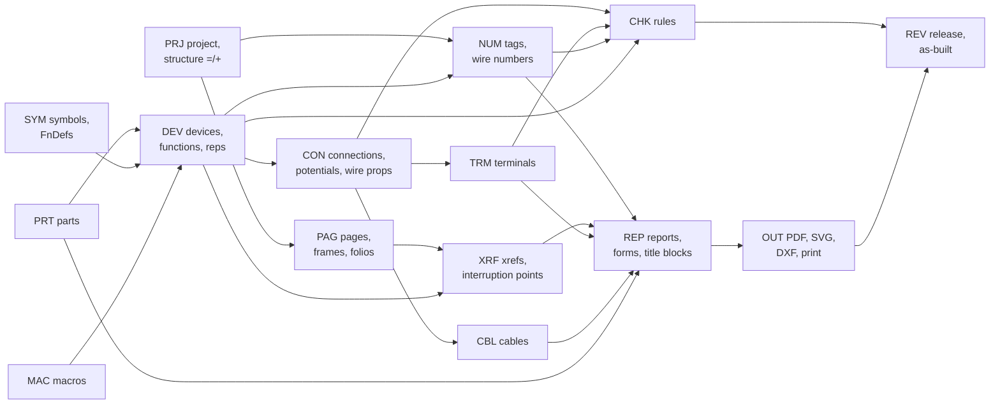

# Functional requirements: core ECAD

**Status:** Draft v0.1 · **Date:** 2026-10-17 · **Part of:** ElektraWatt design document set

**Purpose.** This catalogue states the functional requirements of ElektraWatt's (EW) core electrical CAD areas:
project structure, pages and frames, symbols, devices, numbering, connections and potentials, cross-references,
terminals, cables, parts, macros, reports and forms, page output, checks and revisions. Each requirement is one
testable statement with a priority, a release target, its sources and an acceptance criterion, most of them
phrased against the golden project (the reference project, cabinet J-E-2416). Every requirement candidate
REF-001 … REF-108 of the [reference analysis](../research/reference-drawing.md) maps to at least one requirement
here (Appendix A). PLC, bus, fluid, layout, thermal, manufacturing, import, exchange, UI, extensibility,
collaboration and project-language requirements are in [02b](02b-requirements-extended.md); non-functional
requirements are in [02c](02c-nonfunctional-requirements.md).

**Contents**
1. [Conventions](#1-conventions)
2. [PRJ: project and structure identifiers](#2-prj-project-and-structure-identifiers)
3. [PAG: pages, frames, page navigation](#3-pag-pages-frames-page-navigation)
4. [SYM: symbols and graphics](#4-sym-symbols-and-graphics)
5. [DEV: functions, devices, main/aux, black boxes, assemblies](#5-dev-functions-devices-mainaux-black-boxes-assemblies)
6. [NUM: tags and numbering](#6-num-tags-and-numbering)
7. [CON: connections, potentials, nets, wire properties](#7-con-connections-potentials-nets-wire-properties)
8. [XRF: cross-references, interruption points, contact images](#8-xrf-cross-references-interruption-points-contact-images)
9. [TRM: terminals and strips](#9-trm-terminals-and-strips)
10. [CBL: cables and conductors](#10-cbl-cables-and-conductors)
11. [PRT: parts database and libraries](#11-prt-parts-database-and-libraries)
12. [MAC: macros, templates, value sets](#12-mac-macros-templates-value-sets)
13. [REP: reports, forms, title blocks](#13-rep-reports-forms-title-blocks)
14. [OUT: PDF, print, SVG, DXF page output](#14-out-pdf-print-svg-dxf-page-output)
15. [CHK: checks and rule engine](#15-chk-checks-and-rule-engine)
16. [REV: revisions, release, as-built](#16-rev-revisions-release-as-built)
17. [Appendix A: REF → FR mapping](#appendix-a-ref--fr-mapping)
18. [Appendix B: counts per area, priority and release](#appendix-b-counts-per-area-priority-and-release)
19. [Requirements covered](#requirements-covered)
20. [Open questions](#open-questions)

---

## 1. Conventions

### 1.1 Table columns

| Column | Meaning |
|---|---|
| **ID** | `FR-<AREA>-<nnn>`. IDs are stable. A withdrawn requirement keeps its ID with the text "Withdrawn"; numbers are never reused |
| **Requirement** | One testable statement, "The system shall …". Terms follow the accepted [architecture](04-architecture.md): *Device*, *Function*, *Representation*, *Connection*, *Junction*, *connection point (CP)*, *potential*, *report block*, *command*, *transaction*, *derived* (computed by a query, never stored) |
| **Prio** | Priority within the release: **Must**, **Should**, **Could** |
| **Release** | **MVP** = what the pilot user needs to stop using QElectroTech for new projects (interactive 2D schematics reproducing the reference set, QET import, core reports, PDF, checks). **1.0** = full v1 scope (adds PLC/bus/fluid breadth, manufacturing outputs, 3D panel, EDZ/DXF/AML exchange). **1.x** = after 1.0. **Later** = parked. Release targets per area follow [vision and scope](00-vision-and-scope.md) §9 |
| **Source** | Where the requirement comes from (abbreviations in §1.2) |
| **Acceptance criterion** | The observable result that makes the requirement pass. "GP" is the golden project |

### 1.2 Source abbreviations

| Abbreviation | Document |
|---|---|
| REF-nnn, D-nn, GP §n, C*n* (brief corrections) | [reference-drawing.md](../research/reference-drawing.md): requirement candidates (§2), defects (§3), golden project (§4), corrections to the brief |
| EPL §n | [eplan-features.md](../research/eplan-features.md) |
| STD §n, RD-nn, XR-nn, M-nn | [standards.md](../research/standards.md) and its check-run tables |
| IOF §n | [interop-formats.md](../research/interop-formats.md) |
| PMF §n | [panel-manufacturing.md](../research/panel-manufacturing.md) |
| PBF §n | [plc-bus-fluid.md](../research/plc-bus-fluid.md) |
| G-n, C-n | [gaps-and-corrections.md](../research/gaps-and-corrections.md) (overrides the other notes) |
| ARCH §n | [architecture](04-architecture.md) |
| VIS §n | [vision and scope](00-vision-and-scope.md) |
| ADR-00nn | ADR index; files in `docs/adr/` |

### 1.3 The golden project in acceptance criteria

"GP" is the reference project held as an EW model ([reference analysis](../research/reference-drawing.md) §4),
reproduced in the faithful variant **Golden A** (the user's visible tags kept, S51, F55, T55, E55, S56, E56 and 1X1
as frozen tags) unless an acceptance criterion names **Golden B** (all tags page-based, used to test renumbering).
GP includes the generated report folios 903–911 of GP §4.14. "The cross-reference table" means GP §4.13: 22
interruption-point pairs and 9 main/aux reference sets.

### 1.4 How the core areas relate

Every printed value in REP and OUT is derived from the areas to its left (ARCH §1.1). No requirement below may be
met by storing a copy of a derived value.

---

## 2. PRJ: project and structure identifiers

**Intent.** A project holds its master data, parties, supply definition, settings and structure identifiers as
typed data, so that every title block, cover page, report and check reads one value. The structure identifiers
(`=P01`, `+J-E-2416`) form trees per IEC 81346 aspect; devices and pages reference nodes, never strings. This
removes D-03, D-05, D-06 and D-30 at the source.

| ID | Requirement | Prio | Release | Source | Acceptance criterion |
|---|---|---|---|---|---|
| FR-PRJ-001 | The system shall store project master data as typed properties: short and long project description, project reference, object/cabinet identifier, manufacturing year, created date, edited date and engineer. | Must | MVP | REF-001, D-06 | Every folio-1 project field of GP renders from these properties; no form cell of GP contains literal project text. |
| FR-PRJ-002 | The system shall store a drawing identification that is independent of the project reference and of the project directory name. | Must | MVP | REF-108 | Renaming the GP directory changes neither the printed `<drawing id>` nor the `<project ref>`. |
| FR-PRJ-003 | The system shall store parties with typed roles (customer, end user, panel builder/legal owner, author, checker) and their name, address, postcode, city and country, and each form cell shall bind to exactly one role. | Must | MVP | REF-001, REF-004, D-30 | On GP the cover's "Company / Customer" cell shows `<customer>`; changing the end user's name changes only cells bound to the end-user role. |
| FR-PRJ-004 | The system shall store the supply as structured data (phases, neutral, PE, earthing system TN-S/TN-C-S/TT/IT, nominal voltage, frequency) and render it through a format, e.g. "1 x 230 VAC + N + PE, 50 Hz" or "1/N/PE AC 230 V 50 Hz". | Must | MVP | REF-002, STD §7 | GP's cover supply line renders from {1, N, PE, 230 V, 50 Hz}; the string "50hz" cannot be produced by any format. |
| FR-PRJ-005 | The system shall store control voltage and rated consumption as typed quantities with units, readable by forms, reports and checks. | Must | MVP | REF-003 | GP prints "24VDC" and "6A" from `Dec3` values; a rule can compare consumption against the supply. |
| FR-PRJ-006 | The system shall store the supply origin at each external supply connection: upstream protective device rating, prospective short-circuit current (ik max) and source reference. | Should | MVP | REF-107, STD §8.3 | The J-E-206 supply on GP folio 101 carries ik max and upstream rating; both appear in the supply section of the potential overview. |
| FR-PRJ-007 | The system shall let users define project-local properties (name, type text/number/boolean/enum/date/quantity with unit, default, options, category, applicable object kinds) and attach values to projects, pages, devices, functions, connections and parts. | Should | MVP | EPL §2.3 | A user property "Customer asset no." on devices is editable, usable in a report form and survives save/load unchanged. |
| FR-PRJ-008 | The system shall hold numbering, cross-reference, colour, size, frame, report, check and export settings as named, versioned schemes at system, company, user and project level, with the project level winning, and shall export and import each scheme as a file. | Must | MVP | EPL §2.1, VIS §8 PR-10 | Exporting GP's xref scheme and importing it into an empty project yields identical xref texts for the same pages. |
| FR-PRJ-009 | The system shall create new projects from a basic project (company standard) that supplies schemes, forms, frames, profiles, structure nodes, sections, revision format and optional template pages. | Must | MVP | EPL §2.1, D-05, D-06 | A project created from the pilot basic project has sections 1/2/9, the GP frame and title block, the "DBU/WH 24 V" profile and page-based numbering without further setup. |
| FR-PRJ-010 | The system shall provide a company-standard wizard that creates a basic project from: SVG logo, title-block form, colour and size profile, identifier set, numbering scheme, structure identifiers, revision format and project languages. | Must | MVP | VIS (proposed), G13, D-03, D-08 | Running the wizard with GP's conventions yields a basic project from which GP folio 1 and the title block regenerate within ±0.2 mm. |
| FR-PRJ-011 | The system shall pin a versioned derivation profile per project and change it only through an explicit, previewed upgrade command. | Must | MVP | ADR-0003 | GP saved with profile "2027.1" and opened in a build that also ships "2028.1" prints byte-identical tags, xrefs and wire numbers; the upgrade preview lists every text that would change. |
| FR-PRJ-012 | The system shall manage structure identifiers in one table per aspect with code, description (multilingual), parent and order; the order defines the sort order, and pages and devices reference nodes, not strings. | Must | MVP | EPL §2.4, REF-026, STD §1.6 | GP contains exactly one location node for `+J-E-2416`; TOC, title blocks, tags and BOM all reference it. |
| FR-PRJ-013 | The system shall support the aspects `=` (function), `+` (location) and `-` (product) and derive full designations such as `=P01+J-E-2416-102G1`. | Must | MVP | STD §1.2, REF-022 | The device list of GP prints the PSU as `=P01+J-E-2416-102G1`. |
| FR-PRJ-014 | The system shall support the additional identifier blocks `==` (functional assignment), `++` (installation site), `&` (document kind, DCC and ICC schemes), a user-defined block (default `#`) and the type aspect (sign configurable). | Should | 1.0 | EPL §2.4, STD §1.2, §3 | A page named `==FA=P01++SITE+JE2416&EFS/101` round-trips and each block appears in its navigator column. |
| FR-PRJ-015 | The system shall support multi-level structure nodes within one aspect, rendered with the aspect prefix repeated or with a configured sub-level separator. | Should | MVP | STD §1.1, §1.3 | A child node DOOR under `+J-E-2416` renders as `+J-E-2416+DOOR`, or `+J-E-2416.DOOR` after the separator setting is changed. |
| FR-PRJ-016 | The system shall let the prefix sign and sub-level separator of every aspect be configured per project, defaulting to EN 81346 signs. | Should | MVP | EPL §2.4 | Changing the location separator changes every derived designation and no stored value. |
| FR-PRJ-017 | The system shall store each structure node code as an atomic token, so that a code containing prefix characters (`J-E-2416`) is never re-parsed into further levels. | Must | MVP | D-03, STD RD-02, ARCH §4.2 | GP's location exports to CSV as one token `+J-E-2416`; re-importing the CSV binds to the same node, not to `+J`, `-E`, `-2416`. |
| FR-PRJ-018 | The system shall rename and merge structure nodes as previewed commands that update every derived output in one transaction. | Must | MVP | D-03, REF-026 | Merging node `+JE2416` into `+J-E-2416` on an imported GP updates title blocks, TOC column, strip tags and BOM in one undoable step; no "+JE2416" text remains. |
| FR-PRJ-019 | The system shall give every page an `=`/`+` assignment and every device its own structure assignment, defaulting to the page of its first representation, overridable by a structure box or explicitly. | Must | MVP | EPL §2.4, ARCH §4.2 | A device placed on folio 102 gets `=P01+J-E-2416`; dragging its only representation to a `+J-E-206` page asks whether to reassign the device. |
| FR-PRJ-020 | The system shall provide structure boxes (rectangle or polygon, line style dotted or dash-dot, caption) that assign a structure to the representations they enclose. | Must | MVP | REF-019, EPL §3.8 | The "External Connection" box on GP folio 101 assigns `+J-E-206` to the enclosed external points; moving a point out of the box reverts it to `+J-E-2416`. |
| FR-PRJ-021 | The system shall model connections that leave the project as typed external references {project, location, device, connection point}. | Must | MVP | REF-018, C10, G15 | GP's J-E-206-L/N/PE and DP points print "+J-E-206 / JE-N1000-03" from typed fields; the wire list shows the external target in its own columns. |
| FR-PRJ-022 | The system shall resolve an external reference against the referenced project when it is available, show the target's current designation and report a stale reference when the target has changed or vanished. | Should | 1.0 | G15, VIS §9 | With the J-E-206 project present, renaming JE-N1000-03 there raises a stale-reference message in J-E-2416. |
| FR-PRJ-023 | The system shall hold project formatting settings (date format dd-mm-yyyy or ISO 8601, decimal separator, unit spacing) and apply them in all forms and reports. | Must | MVP | REF-078, G7 | GP prints "Creation: 10-06-2024"; switching to ISO 8601 prints "2024-06-10" on every page with no stored date string touched. |
| FR-PRJ-024 | The system shall mark properties that hold personal data (person names, addresses, contact data), so that exports can omit them. | Should | 1.0 | G12, G15 | A GP PDF exported with "omit personal data" has no engineer name in title blocks or XMP metadata. |
| FR-PRJ-025 | The system shall store the assembly's nameplate data (supplier, type, serial number, main document number, rated voltage, phases, frequency, full-load current, short-circuit rating, IP code, applied standard). | Should | 1.0 | STD M-13, §8.4 | A nameplate report renders from these properties; missing mandatory fields appear in the open-items list. |
| FR-PRJ-026 | The system shall distinguish project kinds (schematic project, basic project, macro/library project) and restrict commands by kind. | Should | 1.0 | EPL §2.1 | A basic project cannot be released; pages of a macro project can be saved as page macros in one step. |
| FR-PRJ-027 | The system shall allow several projects to be open in one session with navigation along external references. | Could | 1.x | VIS §9 | From J-E-2416 folio 101, "go to target" on J-E-206-L opens the J-E-206 project at the referenced device. |

---

## 3. PAG: pages, frames, page navigation

**Intent.** Pages are typed and numbered by sparse, section-based folios; frames and grids are parametric form
data; page order, Prev/Next, section dividers and generated pages are derived. The QET-compatible 17 × 8 frame
starting at column 0 keeps imported cross-references such as "102-A1" exact.

| ID | Requirement | Prio | Release | Source | Acceptance criterion |
|---|---|---|---|---|---|
| FR-PAG-001 | The system shall type every page as one of: title page, table of contents, section divider, graphic, single-line schematic, multi-line schematic, overview, bus topology, fluid-power schematic, assembly overview, panel layout (2D), generated report page. | Must | MVP | REF-011, EPL §2.5 | GP's 18 folios carry the page types of GP §4.3. |
| FR-PAG-002 | The system shall let the page type govern semantics: overview, graphic and panel-layout pages create no net connections and disable autoconnect; generated report pages reject edits. | Must | MVP | EPL §2.5, ARCH §4.2 | A line drawn between two CPs on folio 201 does not join potentials; an edit on folio 901 is refused with a link to its report block. |
| FR-PAG-003 | The system shall provide a model-view page type showing 2D views derived from a 3D layout space. | Must | 1.0 | EPL §2.5, §15 | A model view of GP's mounting plate updates when a placement moves (elaborated in 02b LAY). |
| FR-PAG-004 | The system shall provide an external-document page type that references an external file (PDF page or image) with its own title block. | Could | 1.x | EPL §2.5 | A vendor datasheet page appears in the TOC and PDF with the project title block. |
| FR-PAG-005 | The system shall identify pages by a folio {section, number, label}, allow gaps and never renumber implicitly. | Must | MVP | REF-009 | GP holds folios 1, 2, 3, 100–103, 106, 200–206, 900–902; inserting a page after 103 proposes 104 and changes no other folio. |
| FR-PAG-006 | The system shall support alphanumeric folio labels and sub-pages (101.1, 101a) with natural sort order. | Should | MVP | EPL §2.5, G7 | 101, 101.1, 101.2, 101.10, 102 sort in that order. |
| FR-PAG-007 | The system shall renumber pages by a previewed command (scope selection/section/project, start, step, keep gaps) that updates page-based tags, xrefs, TOC, BOM folio column and Prev/Next in one transaction. | Must | MVP | VIS §2, EPL §2.5, D-01 | Renumbering GP folio 103 to 104 changes "103-A1" to "104-A1" at 24VDC-1 on folio 102, the TOC row, BOM folios and Prev/Next of 102 and 106; one undo restores all. |
| FR-PAG-008 | The system shall model sections {number, folio range, title} and assign each page to at most one section. | Must | MVP | REF-010 | GP holds sections 1 (100–199), 2 (200–299) and 9 (900–999). |
| FR-PAG-009 | The system shall generate section-divider pages and their page descriptions ("=P01+J-E-2416 - Section 1 - Page 100 - 199 - Wiring Definition") from section data. | Must | MVP | REF-010, GP §4.3 | Folios 100, 200, 900 regenerate; renaming section 2 changes its divider, TOC row and title-block page description. |
| FR-PAG-010 | The system shall store a multilingual page description per page, allowing line breaks, and use it as title-block page description and TOC title. | Must | MVP | EPL §2.5 | "Power Supply 1 - Main Current" appears in folio 101's title block and in the TOC. |
| FR-PAG-011 | The system shall name generated report pages from a format with a counter ("Partlist 1", "Table of Contents 1"). | Must | MVP | EPL §2.5 | A BOM spilling onto a second page yields "Partlist 1" and "Partlist 2". |
| FR-PAG-012 | The system shall derive the full page name from page structure and folio (`=P01+J-E-2416/101`) and reject duplicate full page names in strict mode. | Must | MVP | EPL §2.5, STD §1.2 | Creating a second folio 101 under `=P01+J-E-2416` is rejected in strict mode and reported in lenient mode. |
| FR-PAG-013 | The system shall derive page order from sections and folios, including generated report pages, and compute Prev/Next, empty on the first and last page. | Must | MVP | REF-073, C2 | GP folio 1 has Prev empty and Next 2; folio 911 (last report page) has Next empty. |
| FR-PAG-014 | The system shall define frames parametrically: sheet size (ISO 216 or custom), orientation, margins, column count, start index and labels, row count and labels (option to skip I and O), header bands per side, title-block form. | Must | MVP | STD §12.3, REF-013 | A frame with 17 columns from 0 and rows A–H, labels top and left only, reproduces the GP grid. |
| FR-PAG-015 | The system shall ship a QET-compatible A4-landscape frame with 17 columns numbered 0–16 and 8 rows A–H. | Must | MVP | REF-013, IOF §1.2 | GP pages use it; cell H16 is the last column and row (x ≈ 265.6–281.2 mm, y ≈ 161.2–182.0 mm on paper, per GP §5.2). |
| FR-PAG-016 | The system shall ship ISO 5457 frames A4–A0 and an A3 frame with 10 numbered columns. | Must | 1.0 | STD §12.3, VIS §9 | An A3 project prints with ISO 5457 grid fields and centring marks. |
| FR-PAG-017 | The system shall provide frame variants with and without grid that share one title block, selectable per page type. | Must | MVP | GP §5.2 | GP folios 1, 2, 100, 200, 900, 901 render without grid; all others with grid. |
| FR-PAG-018 | The system shall assign frames by project default, by page-type default and by per-page override. | Must | MVP | EPL §2.5 | Changing the project default frame changes every page without an override. |
| FR-PAG-019 | The system shall reproduce GP's printed frame and title-block geometry within ±0.2 mm. | Must | MVP | REF-096 | Measured in the GP PDF: frame 9.79–281.18 × 9.79–199.76 mm, column 15.66 mm, row 20.88 mm, title block per GP §5.1, each ±0.2 mm. |
| FR-PAG-020 | The system shall map every page point to its frame cell by integer arithmetic on the frame's rational grid, with a documented boundary rule. | Must | MVP | ADR-0005, GP §5.2 | IP L-1 on folio 101 maps to H16; a point exactly on a column boundary maps to the right-hand cell, as documented. |
| FR-PAG-021 | The system shall give each page a rational snap grid; native pages use the EW connection grid (ADR-0027) and QET-imported pages keep their 10 px grid, with the active grid shown per page. | Must | MVP | ADR-0005, ADR-0027 | A symbol on an imported page snaps in 2.6458 mm steps; on a native page in the ADR-0027 step. |
| FR-PAG-022 | The system shall convert a QET-grid page to the native grid by a previewed command that keeps every connection and xref cell. | Could | 1.x | ADR-0027 | Converting GP folio 102 leaves all 22 IP texts unchanged. |
| FR-PAG-023 | The system shall store a page scale (1:1, 1:5, 1:10, custom, "not to scale") and print it in the title block. | Must | MVP | REF-070, D-32 | Folio 902 at 1:10 prints "1:10"; a 70 mm wide device measures 7.0 mm on paper ±0.2 mm. |
| FR-PAG-024 | The system shall provide a page navigator with structure, section and flat views, sorting by folio or type, filtering, multi-selection and drag-to-reorder that opens the renumber preview. | Must | MVP | EPL §2.5, §4 | GP's navigator lists 18 folios plus 903–911; dragging 106 before 103 opens the renumber preview. |
| FR-PAG-025 | The system shall create, copy, move and delete pages as previewed transactions; deleting a page removes its representations and page-owned rows and leaves affected devices unplaced unless the user chooses to delete them. | Must | MVP | ARCH §4.2, ADR-0009 | Deleting GP folio 106 lists its 12 IPs and two cable representations; -106W1 and -106W2 remain as unplaced devices; one undo restores the page. |
| FR-PAG-026 | The system shall assign every page item to a layer (frame, symbols, wires, texts, graphics, user layers) with visibility and print flags, used by screen, print and DXF export. | Should | 1.0 | EPL §3.13 | Hiding layer "texts" hides free texts on screen and in print; DXF puts wires on the mapped layer name. |
| FR-PAG-027 | The system shall provide a frame editor for grids and title-block cells built on the forms engine. | Must | 1.0 | VIS §9, EPL §8 | The GP frame re-created in the editor equals the shipped frame form data. |
| FR-PAG-028 | The system shall assign each page type a default document kind code (e.g. &EFS for multi-line schematics) that pages may override. | Could | 1.0 | STD §3 | GP folio 101 reports document kind EFS; folio 901 reports EPB. |

---

## 4. SYM: symbols and graphics

**Intent.** A symbol is graphics plus typed connection points and text slots; its logic lives in a separate
function definition (FnDef), so "what it is" (MCB 1P+N, NO contact, PSU) is independent of "how it looks".
Symbols are versioned library data embedded in the project. EW draws its own IEC 60617-style and ISO 1219-style
symbols; it never copies the IEC database or bundles the QET element collection (STD §4, §14; ADR-0024).

| ID | Requirement | Prio | Release | Source | Acceptance criterion |
|---|---|---|---|---|---|
| FR-SYM-001 | The system shall define a symbol by: identity and version, vector graphics in nm, connection points {index, designation, position, direction, discipline, potential role}, text slots, anchor policy, function category, representation type and variants. | Must | MVP | STD §4, ARCH §4.2 | The starter MCB 1P+N symbol defines CPs 1, 2, N (index 0), N (index 1), with directions, and loads identically on all platforms. |
| FR-SYM-002 | The system shall support the graphic primitives line, polyline, rectangle (optionally rounded), circle, ellipse, arc, polygon (open, closed, filled), static text and image, each with stroke width, dash pattern, colour and fill. | Must | MVP | IOF §1.5, GP §5.5 | Every primitive of the GP symbols (GP §5.5) can be expressed; QET-converted symbols render without loss of primitives. |
| FR-SYM-003 | The system shall provide line widths 0.13, 0.18, 0.26, 0.42, 0.52 and 1.30 mm, dash patterns scaled by pen width (dash 4:2, dot 1:2) and a drop-shadow box style. | Must | MVP | REF-105, GP §5.4 | The S51 actuator linkage prints dash 1.04 mm / gap 0.52 mm; the "External Connection" box dot 0.26 / gap 0.52 mm; PART DATA boxes have a 2.61 mm filled shadow. |
| FR-SYM-004 | The system shall derive up to eight orientation variants (four rotations, each optionally mirrored) of a symbol from its source variant with the same connection points, and allow extra representation variants (contact-image, connection-point variant). | Must | MVP | EPL §3.1 | Placing the MCB symbol rotated 90° keeps CP indices; a mirrored variant swaps CP positions, not designations. |
| FR-SYM-005 | The system shall separate function definitions from symbols: a FnDef has category/group/definition, contact kind (NO, NC, changeover, coil, pole, terminal, black box …), internal connectivity between its CPs and pass-through pairs, and a symbol references one FnDef. | Must | MVP | EPL §3.1, STD §6.3 | The thermostat contact FnDef declares CPs 5–3 as an NC pass-through; nets on GP folio 101 are split at T55 because of it. |
| FR-SYM-006 | The system shall classify symbols by representation type: multi-line, single-line, overview, fluid, topology, contact image, panel front, graphic. | Must | MVP | EPL §3.1, STD §4 | Placing -201U1 on folio 201 offers only overview and panel-front symbols of its definition. |
| FR-SYM-007 | The system shall ship a starter library covering the golden project: 2-pole switch with manual actuator, MCB 1P+N and 1P with thermal and magnetic trip, thermostat contact, position switch, lamp, heater, terminal, protective earth, functional earth, plug pin, cable marker, wire marker, junction dot, interruption point, external connection arrow, black-box frame, 5/2 solenoid/spring valve, double-acting actuator, 2-way process valve, mechanical linkage. | Must | MVP | REF-031, REF-033, ARCH §15.1 | GP folios 3–206 render from the starter library alone (no QET-converted symbol needed). |
| FR-SYM-008 | The system shall ship a full original IEC 60617-style library for control cabinets (contactors, relays and coils, auxiliary contacts, push-buttons, selector switches, motors, transformers, fuses, RCDs, SPDs, sensors, meters, PLC symbols, plugs), licensed CC-BY-SA-4.0 with the design exception. | Must | 1.0 | STD §4, ADR-0024, VIS §9 | A relay panel test project (contactor, overload, push-buttons, pilot lights) can be drawn without custom symbols; every symbol file carries its SPDX licence. |
| FR-SYM-009 | The system shall place symbol connection points on the native connection grid (ADR-0027) and graphics and texts on finer grids, and the symbol editor shall reject off-grid CPs. | Must | MVP | ADR-0027, G4 | A new symbol with a CP at 4.5 mm (grid 4 mm) cannot be saved; graphics at 0.5 mm can. |
| FR-SYM-010 | The system shall define per symbol an anchor policy (symbol origin, label position, graphical centre, named anchor point) used for cross-reference cells. | Must | MVP | REF-021, D-14 | The bus-port symbol of -201U1 on folio 3 anchors at its graphics, so the xref reads "3-B2", not "3-B0". |
| FR-SYM-011 | The system shall define text slots on symbols for device tag, function text, technical data, manufacturer, part number, CP designations, cross-reference, PLC address and user properties, each with position, rotation, alignment and visibility. | Must | MVP | REF-092, EPL §2.3 | -101F1 on GP folio 101 shows tag, "Schneider", "A9P52610", "10A C" in the slots of the starter MCB symbol. |
| FR-SYM-012 | The system shall store named property arrangements (which slots are shown and where) per symbol and let each representation select one; changing an arrangement updates every representation using it. | Should | MVP | EPL §2.3 | Switching all MCBs to arrangement "tag + rating" hides manufacturer text on 101 and 102 in one transaction. |
| FR-SYM-013 | The system shall render text slots through text styles held as model data (font, height in mm, weight, alignment) bound to the slot kind, so that all texts of one kind render identically. | Must | MVP | REF-089, D-29 | All device tags in GP render at one height; changing the "device tag" style changes S51, -202U1 and -201U3 alike. |
| FR-SYM-014 | The system shall draw mechanical linkages (actuator to contacts, actuator to process valve) as derived dashed lines between the related functions, never as free graphics. | Must | MVP | REF-032, D-28 | Moving S51's actuator symbol moves its dashed linkage; the linkage cannot be selected as a free line. |
| FR-SYM-015 | The system shall let the user rotate, mirror and cycle symbol variants and representation types while placing, with CPs snapped to the page grid. | Must | MVP | EPL §3.1, G5 | During placement of a contact, pressing the variant key cycles variants A–H; the committed representation stores the chosen variant. |
| FR-SYM-016 | The system shall keep symbols in versioned libraries and embed every used symbol in the project with {library, item, version, sha256}, and shall update embedded symbols only by a previewed "update from library" command. | Must | MVP | G2, ARCH §7.7 | GP opens and prints with no library installed; updating the lamp symbol lists every affected page before commit. |
| FR-SYM-017 | The system shall provide a symbol editor to draw graphics, place CPs, assign a FnDef, define text slots, anchors and variants, with live preview. | Should | MVP | EPL §3.1, VIS §9 | The CPX power block of folio 106 can be drawn as a new symbol (pins 1–5, FE) and placed. |
| FR-SYM-018 | The system shall hold symbols converted from imported projects in a per-project import library on their native grid, with provenance, and allow later assignment of a FnDef. | Must | MVP | ADR-0021, IOF §1.12, REF-095 | After QET import of the reference set, the heater symbol of E55 is in the "QET import" library with its source element name and grid. |
| FR-SYM-019 | The system shall record per symbol its licence (SPDX), author, source and an optional IEC 60617 reference number as metadata. | Must | MVP | STD §4, ADR-0024 | Every starter symbol carries `CC-BY-SA-4.0` with the design exception and no IEC description text. |
| FR-SYM-020 | The system shall lint symbols: CPs on grid, unique CP indices, anchor defined, variants consistent with the source, required text slots present, licence present. | Should | 1.0 | VIS §9 | The lint run over the shipped library reports zero errors in CI. |
| FR-SYM-021 | The system shall find symbols by name, function category, IEC 60617 reference and keywords, showing previews of all variants. | Must | MVP | EPL §3.1 | Searching "MCB" lists the 1P and 1P+N MCB symbols with variant previews. |
| FR-SYM-022 | The system shall exchange the symbol of a placed representation while keeping its function and connections, mapping CPs by index or designation and previewing unmapped CPs. | Should | MVP | EPL §3.1 | Exchanging E56's lamp symbol for a signal-lamp symbol keeps both connections. |
| FR-SYM-023 | The system shall provide free page graphics (lines, polylines, rectangles, circles, arcs, polygons) without electrical meaning on the graphic layer. | Must | MVP | EPL §3.13 | The duct labels "40x60" and cover rules of GP are free graphics/texts that never join a net. |
| FR-SYM-024 | The system shall provide free texts (multilingual, styled) and page texts bound to project or page properties. | Must | MVP | EPL §3.13, G7 | A free text bound to the project description updates when the description changes. |
| FR-SYM-025 | The system shall store images and logos (SVG, PNG) as content-addressed assets and render SVG as vectors on screen and in PDF. | Must | MVP | REF-079, IOF §1.8 | The company logo of the GP title block is an SVG asset and is vector in the PDF. |
| FR-SYM-026 | The system shall provide dimension objects (linear, aligned, angular, radius) for graphic and layout pages, driven by geometry. | Should | 1.0 | EPL §3.13, PMF §5.7 | A dimension between duct edges on folio 902 updates when the duct moves. |
| FR-SYM-027 | The system shall generate parametric symbol families (n-pole switches, n-channel black boxes) from one definition. | Could | 1.x | VIS §9 | A 3-pole and a 4-pole switch derive from one family with consistent CP numbering. |
| FR-SYM-028 | The system shall exchange the symbol standard of a project (IEC to NFPA) by FnDef mapping. | Could | Later | EPL §2.2 | — |

---

## 5. DEV: functions, devices, main/aux, black boxes, assemblies

**Intent.** EW follows EPLAN's triad: a *device* (one tag, its parts, technical data and typed aspects) owns
*functions* (main and auxiliary, with CPs instantiated from the definition), and each function has zero or more
*representations* on pages. One device, many drawings: schematic, overview, bus topology, fluid detail, strip
segment and panel placement all reference the same device (ADR-0006). Assemblies with children model the valve
terminal of folios 201–206.

| ID | Requirement | Prio | Release | Source | Acceptance criterion |
|---|---|---|---|---|---|
| FR-DEV-001 | The system shall model a device with tag specification, kind, optional parent device, part uses, function text, process tag, technical data, state, typed aspects and user properties. | Must | MVP | ADR-0006, ARCH §4.2 | GP -102G1 holds kind PSU, part 2904602, function text, technical data 20 A; its printed tag is derived. |
| FR-DEV-002 | The system shall model functions with role (main or auxiliary) and FnDef, instantiate their CPs from the FnDef or part pin pattern, and persist only CP overrides. | Must | MVP | ADR-0006, ADR-0004 | Placing -101F1 instantiates CPs 1, 2, N, N; the saved project contains no CP rows for it. |
| FR-DEV-003 | The system shall let a function have zero or more representations, each on one page with symbol, variant, position, orientation and representation type; a function without representation is unplaced. | Must | MVP | REF-020, REF-066, ADR-0006 | -201U1 has representations on 201 (overview), 3 (bus port) and 106 (power); deleting the one on 106 leaves the device and the others intact. |
| FR-DEV-004 | The system shall enforce exactly one main function per device; auxiliary functions reference the device's main function. | Must | MVP | EPL §3.2, ADR-0009 | A transaction that would leave -201U3 with two main functions is rejected. |
| FR-DEV-005 | The system shall represent the main function and the auxiliary functions of a device on different pages and link them for mutual cross-references. | Must | MVP | REF-020, EPL §3.2 | The 9 main/aux sets of the cross-reference table exist as links, not texts. |
| FR-DEV-006 | The system shall allow duplicate printed CP designations on one function by keeping a unique internal CP index. | Must | MVP | REF-029 | -102G1 has two "+" and two "−" CPs; the GP wire list tells W20 (-102G1:+ #1) from W21 (-102G1:+ #2). |
| FR-DEV-007 | The system shall support CP alias designations printed together with the designation. | Must | MVP | REF-030 | -102F1 prints "1 / L1" and "2 / T1". |
| FR-DEV-008 | The system shall let a CP be overridden per function (designation, alias, description) and marked "intentionally unused". | Must | MVP | REF-083, D-23 | Marking -102F2:13 and 14 unused turns the unconnected-CP finding into severity info. |
| FR-DEV-009 | The system shall hold technical data as typed values (rating, MCB characteristic, setpoint, channel current setting, voltage) and render them at the symbol. | Must | MVP | REF-106 | S51 shows "40A", -101F1 "10A C", T55 setpoint "15 °C", -102F2 "6A" per channel, all from typed values. |
| FR-DEV-010 | The system shall keep description, technical data and function text as separate fields, defaulting description and technical data from the part. | Must | MVP | REF-056, D-35 | The GP BOM description column contains no ratings; "10A C" appears in the technical-data column. |
| FR-DEV-011 | The system shall provide a manual function text and an automatic function text that is the manual text if set, otherwise the path function text of the column the representation sits in. | Should | MVP | EPL §2.3, REF-043 | A path function text "Spare" over X1031 terminals 5–10 becomes their automatic function text; a manual text overrides it. |
| FR-DEV-012 | The system shall store a process tag (plant tag such as TA05-V-15) per device or function, separate from the reference designation, never translated and unaffected by renumbering. | Must | MVP | REF-093, D-27 | TA05-V-15 prints at Q0.1 on folio 203 and survives Golden B renumbering. |
| FR-DEV-013 | The system shall provide black boxes: a drawn box with device connection points that represents a device, whose CPs and enclosed functions adopt the box's tag. | Must | MVP | REF-028, EPL §3.8 | -102F2 is a black box with CPs 24VDC (2), GND (2), 13, 14, Out1–Out4 that all report device -102F2. |
| FR-DEV-014 | The system shall support two-sided device connection points (one designation, internal and external side). | Should | MVP | EPL §3.8 | A black-box plug CP shows its internal and external wiring in the device connection list. |
| FR-DEV-015 | The system shall attach parts only to devices, with several part uses per device, each with quantity and unit. | Must | MVP | REF-050, ADR-0006 | -201U1 holds 195740 × 1 and 550208 × 1; both appear in the BOM. |
| FR-DEV-016 | The system shall display part data (manufacturer, part number, type) at the symbol through text slots fed by the assigned part. | Must | MVP | REF-092 | Assigning A9P52610 to -101F1 shows "Schneider Electric", "A9P52610" with no typing. |
| FR-DEV-017 | The system shall create a device's functions from the function template of its part as unplaced functions when the part is assigned. | Should | MVP | EPL §3.2, §6 | Assigning 533361 to -201U3 creates its four valve-position functions as unplaced entries. |
| FR-DEV-018 | The system shall let devices and functions be created unplaced (device-list workflow) and placed later from a list. | Should | MVP | EPL §3.2 | -X1031 with 20 terminals is created in the strip editor; its terminals are placed on folio 103 afterwards. |
| FR-DEV-019 | The system shall list all representations of a device (main, auxiliary, overview, topology, fluid, strip segment, panel placement) with jump to each. | Must | MVP | G5, D-02 | For -201U1 the list shows 201-E1, 3-B2, 106-G3 and its folio-902 placement. |
| FR-DEV-020 | The system shall model assemblies (Assembly aspect) with configurator order codes, ordered child devices and a BOM basis (assembly or components). | Must | MVP | REF-051, D-36 | -201U1 carries order codes 51E-F13GCQP-D+H2GG and 32P-VGL-R-MAHAHAHAHAHAHUL3LAHU-28MS; the BOM offers both modes (GP §4.5). |
| FR-DEV-021 | The system shall give child devices tags derived from their parent (e.g. -201U3-QM1). | Must | MVP | REF-062, D-27 | The 28 valves receive -201U3-QM1 … -202U2-QM4; renaming -201U3 renames its four children. |
| FR-DEV-022 | The system shall keep one assembly identity when its children are drawn on several pages. | Must | MVP | D-41 | -201U2 … -202U3 are children of one assembly; the component-mode BOM aggregates 7 × 533361 across folios 201 and 202. |
| FR-DEV-023 | The system shall generate an assembly's overview representation from its children in physical order, with break marks where the overview continues on the next page. | Must | MVP | D-10, REF-087 | Folio 202 shows 4 valves on -202U2; adding a fifth child valve adds it to the overview and to the BOM without a drawing edit. |
| FR-DEV-024 | The system shall let one device carry several typed aspects at once (assembly, PLC station, PLC module, bus node, valve terminal, strip, terminal, cable). | Must | MVP | REF-098, ARCH §4.3, REF-057 | -201U1 carries PlcStation, BusNode and Assembly; -201U3 carries PlcModule. |
| FR-DEV-025 | The system shall let one device own electrical, bus and fluid connection points. | Must | MVP | REF-098 | -201U1 shows power pins 1–5 and FE, a DP port and (via its valves) pneumatic ports 1–5 in one device entry. |
| FR-DEV-026 | The system shall give devices and functions a state (used, spare, reserved, not fitted) that reports count and list. | Must | MVP | REF-065 | GP reports 20 spare valve positions on 204–206, 12 spare terminals on -X1031 and 3 spare MICO channels. |
| FR-DEV-027 | The system shall model field devices outside the cabinet (process valves, actuators) as devices with their own location. | Should | MVP | REF-064, D-27 | TA05-V-15 … TA05-V-37 are devices in `+FIELD` and appear in the device list with that location. |
| FR-DEV-028 | The system shall record functional links between devices (actuator drives process valve, valve drives actuator) as typed relations used by linkage graphics and reports. | Should | MVP | REF-064 | The dashed linkage on folio 203 is derived from the relation actuator → TA05-V-15. |
| FR-DEV-029 | The system shall copy and paste devices with new identities, re-number them by the active scheme and keep their parts; connections are copied only when both ends are copied. | Must | MVP | ARCH §5.1 | Copying -102F1 on folio 102 and pasting yields -102F3 with part A9F78116 and no dangling wire. |
| FR-DEV-030 | The system shall delete devices by declared delete policies, listing in the preview every function, representation and connection removed and every child detached or deleted. | Must | MVP | ADR-0009 | Deleting -102F1 lists its two representations and four connections; one undo restores them. |
| FR-DEV-031 | The system shall edit a property across a multi-selection of devices or functions as one transaction. | Must | MVP | G3 | Setting the part of 20 selected X1031 terminals is one undo step. |
| FR-DEV-032 | The system shall find and replace across tags, function texts, technical data, part numbers and user properties with a preview, committed as one transaction. | Should | MVP | G5 | Replacing "Spare" by "Reserve" in function texts on 204–206 previews 16 changes and commits once. |
| FR-DEV-033 | The system shall select parts for a device filtered by its FnDef, CP count and connection data such as cross-section range. | Should | 1.0 | EPL §6, VIS §9 | Selecting a part for a 1P+N MCB function offers only 1P+N MCB parts. |
| FR-DEV-034 | The system shall provide aspects for every PLC and bus role (PLC CPU, I/O module, coupler, IO-Link master and device, safety module, network switch). | Must | 1.0 | VIS §9, PBF §11 | Each role is creatable and reported; details in 02b PLC/BUS. |
| FR-DEV-035 | The system shall support pair cross-references (the same contact drawn on an overview and on a multi-line page). | Could | 1.x | EPL §3.2 | A motor-protection switch drawn twice links both drawings without counting two devices. |

---

## 6. NUM: tags and numbering

**Intent.** Reference designations and wire numbers are derived from typed specifications (letter code,
counter, scheme, structure, page) and are never identity; renumbering is one previewed transaction whose
effect reaches every page, report, label and layout (D-01). Identifier sets and numbering schemes are data.
Frozen values exist only on purpose and are always reported (ADR-0003).

| ID | Requirement | Prio | Release | Source | Acceptance criterion |
|---|---|---|---|---|---|
| FR-NUM-001 | The system shall derive every printed device tag from the device's tag specification, structure, identifier set, numbering scheme and main representation, and keep no stored display copy. | Must | MVP | REF-022, D-01, ADR-0001 | After Golden B renumbering, every tag printed on pages, BOM, terminal diagrams and layout labels equals the device-tag query; no -4W1 or T51 exists. |
| FR-NUM-002 | The system shall derive a full tag and a displayed tag that omits structure identifiers equal to those of the page, and shall use the full tag in reports, labels and exports unless configured otherwise. | Must | MVP | EPL §3.3, STD §1.6 | On folio 103 the strip prints "-X1031"; the device list prints `=P01+J-E-2416-X1031`. |
| FR-NUM-003 | The system shall ship identifier sets as data: EN 81346-2:2009 single letters (default for new projects), IEC 81346-2:2019 two-letter classes and IEC 60750 legacy letters, selectable per project. | Must | MVP | ADR-0026, REF-027 | A new project uses F, G, S, T, E, X, W, U, Q codes; switching the set to 2019 is possible per project. |
| FR-NUM-004 | The system shall map the function category of a FnDef or part to the letter code of the active identifier set, used for new devices and for conformance checks. | Must | MVP | STD §1.6 | Placing an MCB proposes letter F (2009) or FC (2019). |
| FR-NUM-005 | The system shall provide numbering schemes: sequential (-F1), page-based (-{page}{letter}{counter} → -101F1), page-column (-F101.3) and free. | Must | MVP | REF-023, STD §1.6 | GP's -101F1, -102G1, -106W1, -201U3 follow the page-based scheme. |
| FR-NUM-006 | The system shall compose numbering formats from identifier, page, column, row, counter, sub-counter and separators, with counter scope project, structure, page, row or column. | Must | MVP | EPL §3.3 | A format "{page}{letter}{counter}" with scope "page" numbers the second MCB on 102 as -102F2. |
| FR-NUM-007 | The system shall number new devices online at commit with the next free counter of the active scheme. | Must | MVP | EPL §3.3, ARCH §5.2 | Placing a third MCB on folio 102 yields -102F3 in the same transaction. |
| FR-NUM-008 | The system shall renumber devices by a command with scope (selection, pages, structure, project) and scheme that runs as a preview on a fork, shows tag changes and affected outputs, and commits as one undoable transaction. | Must | MVP | REF-024, STD RD-08, ADR-0008 | Golden B: renumbering GP to page-based tags reports no orphan reference, identical topology and identical xref pairing; one undo returns to Golden A. |
| FR-NUM-009 | The system shall offer renumber options: skip frozen tags, renumber only non-conforming tags, order by page/column/row, close counter gaps. | Should | MVP | EPL §3.3 | "Only non-conforming" on GP changes S51, F55, T55, E55, S56, E56, 1X1 and nothing else. |
| FR-NUM-010 | The system shall support frozen tags that keep an explicit value regardless of the scheme and list them with their rule-derived value in the numbering report. | Must | MVP | REF-025, ADR-0003 | GP's seven fixed tags are frozen and listed with their page-based equivalents (e.g. S51 → -101S1). |
| FR-NUM-011 | The system shall freeze all tags and wire numbers of a scope by one command, typically at release. | Should | MVP | ADR-0003 | After "freeze" a page move changes no printed tag; the numbering report lists every deviation. |
| FR-NUM-012 | The system shall enforce tag uniqueness within a configurable scope (project, function aspect, location aspect) as a prevent rule. | Must | MVP | STD RD-04, ADR-0009 | Assigning -102F1 to a second MCB under `=P01+J-E-2416` is rejected in strict mode. |
| FR-NUM-013 | The system shall number child devices as parent tag, separator and child letter/counter. | Must | MVP | D-27, ARCH §6.4 | The valves of -201U3 are -201U3-QM1 … -201U3-QM4. |
| FR-NUM-014 | The system shall switch a project's identifier set by a previewed renumbering command. | Should | MVP | ADR-0026 | Switching GP to IEC 81346-2:2019 proposes -102TC1 for the PSU and -101FC1 for the MCB, and commits once. |
| FR-NUM-015 | The system shall parse reference designations with a strict grammar (IEC 81346) and a lenient import grammar that keeps non-conforming tags as opaque text with a warning. | Must | MVP | STD §1.3 | "S51" imports as an opaque frozen tag; "=P01+J-E-2416-102G1" parses into three aspects. |
| FR-NUM-016 | The system shall NFC-normalise identifiers on input, restrict letter codes to A–Z and flag confusable or mixed-script characters. | Must | MVP | G7 | A tag typed with Cyrillic "А" is flagged; an identical-looking Latin tag is not a duplicate. |
| FR-NUM-017 | The system shall define tag comparison as case-sensitive or case-insensitive once per project and apply it to uniqueness and search. | Must | MVP | G7 | With case-insensitive comparison, -k1 and -K1 are reported as duplicates. |
| FR-NUM-018 | The system shall sort tags, terminal designations and folios by natural order everywhere. | Must | MVP | G7, REF-053 | X2 sorts before X10; the GP BOM is not in ASCII order ("+" < "-" < digits). |
| FR-NUM-019 | The system shall number connections (wire numbers) connection-oriented or potential-oriented by a format with prefix, page, column and counter, as a previewed command and online for new wires. | Must | MVP | REF-082, EPL §3.4, D-09 | Numbering GP potential-oriented gives every wire of 24VDC-1 one number; connection-oriented gives W1 … W34 distinct numbers. |
| FR-NUM-020 | The system shall provide wire-numbering format groups with scope (connection, net, signal, potential), placeholders (source/target tag and CP, potential name, page, column), counter and sub-counter, and net extension across terminals and plugs. | Must | 1.0 | EPL §3.4, VIS §9 | A format "{potential}.{subcounter}" yields 24VDC-1.1 … 24VDC-1.n; net extension keeps one number across -X1031:1. |
| FR-NUM-021 | The system shall show a placeholder ("?") on connections whose wire number is not yet assigned. | Should | MVP | EPL §3.4 | A wire drawn after numbering shows "?" until numbered online or offline. |
| FR-NUM-022 | The system shall keep frozen wire numbers unchanged by renumbering and report their deviation. | Must | MVP | ADR-0003 | A frozen wire number keeps its value after a page renumber; the numbering report lists it. |
| FR-NUM-023 | The system shall bind wire numbers to connection identity so that route edits, symbol moves and page renumbering change them only through the numbering rule. | Must | MVP | PMF §4.1 | Moving S51 on folio 101 leaves every wire number unchanged; renumbering 101 → 105 changes page-based wire numbers only through the preview. |
| FR-NUM-024 | The system shall provide terminal-designation numbering schemes (numeric, alphanumeric, per level, prefix/suffix) selectable per profile. | Must | 1.0 | VIS §9, EPL §3.9 | A profile "sequential per strip" numbers -X1031 terminals 1–20. |
| FR-NUM-025 | The system shall offer an ISO 1219-2 component identification scheme (installation, medium, circuit, component) for fluid devices. | Could | 1.0 | STD §5 | A valve can be numbered "1-P2.3" while electrical devices keep IEC 81346 tags. |
| FR-NUM-026 | The system shall accept tag and wire-number formats written as sandboxed rhai formulas. | Should | 1.0 | ADR-0020, ARCH §10.3 | A company formula producing "-{letter}{page}.{counter}" numbers a test project identically on every run. |
| FR-NUM-027 | The system shall derive tags and interruption-point names from PLC channel data on request. | Could | 1.x | VIS §9 | A channel with symbol "TA05_V_15" can propose the valve tag. |
| FR-NUM-028 | The system shall produce numbering results that are independent of record creation order and session history. | Must | MVP | ARCH §1.2 (8), SC-6 | Loading GP with shuffled record order and renumbering yields byte-identical project files. |

---

## 7. CON: connections, potentials, nets, wire properties

**Intent.** Connections are explicit logical edges between connection points (ADR-0007); junctions record the
wiring sequence. Potentials are derived from connectivity and carry types, so wire colour and cross-section
follow from rules with visible provenance instead of the free-text rule of folio 1 (D-08). Bonds link potentials
without merging them (D-22).

| ID | Requirement | Prio | Release | Source | Acceptance criterion |
|---|---|---|---|---|---|
| FR-CON-001 | The system shall store connections as explicit logical edges between two endpoints (a CP or a junction) with a graphical route. | Must | MVP | ADR-0007, G5 | Every GP wire W1 … W34 is one connection with two endpoints. |
| FR-CON-002 | The system shall type connections as wire, cable core, bridge, fluid, bus, overview or internal, and exclude overview connections from nets. | Must | MVP | ARCH §4.2, REF-063 | Lines on overview folio 201 join no potential; bridges on -X1031 join potentials but are not wires. |
| FR-CON-003 | The system shall offer autoconnect as an editing aid: CPs that align on placement produce explicit connections shown as a ghost before commit. | Must | MVP | ADR-0007 | Dropping a contact between two aligned wire ends previews two connections; rejecting the ghost commits none. |
| FR-CON-004 | The system shall never change logical connectivity when representations are moved; routes follow their endpoints. | Must | MVP | ADR-0007 | Dragging -102F1 on folio 102 keeps every potential and wire endpoint unchanged. |
| FR-CON-005 | The system shall model junctions as objects with a display style (dot or oriented bevel) and an ordered connection sequence. | Must | MVP | REF-034, D-20 | The F55:2 junction lists E55:L before E56; the bevel chain S51:1 → -101F1:1 → F55:1 prints in that order in the wire list. |
| FR-CON-006 | The system shall allow several connections on one CP and preserve their order (daisy-chaining). | Must | MVP | REF-099 | -102F1:1 holds W20 and W21 in drawn order. |
| FR-CON-007 | The system shall create orthogonal routes automatically and let the user edit segments and bends, storing routes in nm. | Must | MVP | ADR-0005 | A route edited on folio 102 reloads to the same nanometre. |
| FR-CON-008 | The system shall split a connection when a symbol is inserted onto it and keep its properties on both parts. | Must | MVP | EPL §3.4 | Inserting a contact into W13 yields two connections with the same overrides. |
| FR-CON-009 | The system shall derive potentials from connections, interruption-point pairs, bridges, cable cores, terminal internal links and plug-in jumpers. | Must | MVP | REF-036 | GP yields exactly the potentials of GP §4.6 (L, N, L-S, N-S, L-1, N-1, L-55, N-55, N-55T, N-55S, PE, +24V, +24V-F, 24VDC-1 … 4, 0V, DP). |
| FR-CON-010 | The system shall provide potential definition points carrying name, potential type (L1/L2/L3/L, N, PE, PEN, FE, L+, L−, M, signal, undefined), voltage, AC/DC and frequency. | Must | MVP | REF-036, REF-101, EPL §3.5 | 24VDC-1 is typed L+, 24 V DC; 0V is typed M. |
| FR-CON-011 | The system shall propagate potential types across pass-through pairs declared by FnDefs (contacts, poles, terminals) and mark downstream potentials of open-able contacts as switched. | Must | MVP | D-13, STD §6.2 | N-55T (after T55) and N-55S (after S56) are typed "N, switched" without a definition point. |
| FR-CON-012 | The system shall give each potential one canonical name and list interruption-point names as aliases. | Must | MVP | REF-037, D-24 | 24VDC-1 is canonical; 24VDC-AIR1 … AIR4 are aliases in the potential overview. |
| FR-CON-013 | The system shall keep a potential's identity stable under edits that do not touch its definition point or members. | Must | MVP | ARCH §6.4 | Moving a valve on folio 203 leaves the identity of 24VDC-1 unchanged. |
| FR-CON-014 | The system shall model intentional bonds between potentials (e.g. 0 V to PE for PELV) as objects that link without merging. | Must | MVP | REF-038, D-22 | 0V and PE stay two potentials joined by one bond at -X1032:2. |
| FR-CON-015 | The system shall bond PE through rail-mounted PE terminals and the mounting plate when they are declared rail-bonded, without drawn wires. | Should | MVP | REF-039, D-21 | 1X1:PE and -X1032 belong to one PE potential through declared rail bonding. |
| FR-CON-016 | The system shall provide net definitions per signal with properties that apply to all connections of the net. | Should | 1.0 | EPL §3.4, VIS §9 | A net definition "shielded, twisted" on an analogue signal sets both flags on its wires. |
| FR-CON-017 | The system shall compute effective wire properties by the precedence connection override (CDP) > net definition > potential definition > profile rule (type × voltage × circuit class) > project default, each value with its provenance. | Must | MVP | D-08, ARCH §6.4, EPL §3.4 | GP W29 resolves to 0.75 mm² DBU "from profile 'DBU/WH 24 V', rule L+ 24 V control"; W20 to 1.5 mm² DBU "from CDP". |
| FR-CON-018 | The system shall hold wire properties: cross-section (with its unit), colour code(s), wire type or part, insulation, wire number, length and source of length, function, and flags (shielded, twisted). | Must | MVP | REF-035 | Each GP wire exposes all fields through the wire-list query. |
| FR-CON-019 | The system shall represent colours as IEC 60757 codes plus profile-declared company codes (DBU = BU, dark shade), support multi-colour codes (GNYE) and accept no free-text colour. | Must | MVP | REF-006, REF-047, D-17, STD §6.1 | "BR" cannot be stored; "BN" and "DBU" can. |
| FR-CON-020 | The system shall provide colour profiles mapping (voltage class, potential type) to colour code and name, each profile naming its basis (standard or company convention). | Must | MVP | REF-006, D-37 | Profile "DBU/WH 24 V" maps L+ 24 V → DBU, M → WH, L 230 V → BK, N → BU, PE → GNYE and states "company convention". |
| FR-CON-021 | The system shall provide size profiles giving default cross-sections per circuit class. | Must | MVP | REF-007 | Control 0.75 mm², mains 1.5 mm²; wires without override inherit them. |
| FR-CON-022 | The system shall assign each potential a circuit class (mains, control, analogue, bus, PE) derived from type and voltage or set explicitly. | Must | MVP | REF-101 | 24VDC-1 is control; L-1 is mains. |
| FR-CON-023 | The system shall provide connection definition points that carry per-connection overrides and render as wire markers. | Must | MVP | EPL §3.4, REF-035 | "2.5 BK" on folio 101 is a CDP on W4 and W7, not a free graphic. |
| FR-CON-024 | The system shall show wire markers per page or project in one of the modes: all wires, only deviations from the profile, only explicit overrides, none. | Must | MVP | REF-008 | In "only explicit overrides" mode GP prints exactly the marker groups of folios 101 and 102. |
| FR-CON-025 | The system shall expose for every effective wire property its value, its source level and the defining object, and allow "reset to derived". | Must | MVP | D-08, G5 | The query for W26 returns "0.75 mm² · potential 0V · profile 'DBU/WH 24 V'"; reset removes a CDP value. |
| FR-CON-026 | The system shall display wire numbers on connections by a rule (each segment, once per page, at both ends) with configurable text style. | Must | MVP | REF-082 | With numbering on, each GP wire shows its number once per page. |
| FR-CON-027 | The system shall list for a potential all its CPs, devices, pages and interruption points. | Must | MVP | EPL §3.5 | The 24VDC-1 trace lists -102F2:Out1, -X1031:1–4, -201U1:4, 5, -202U1:4, 5 and folios 102, 103, 106. |
| FR-CON-028 | The system shall read clamp data per CP from part data (cross-section range, maximum conductors, twin-ferrule permission) for checks and manufacturing. | Must | 1.0 | REF-086, PMF §4.4, VIS §9 | -102F1:1 reports 2 conductors against its rating; PT 2.5-TWIN reports its range. |
| FR-CON-029 | The system shall represent multi-conductor connections on single-line pages with a conductor count and map them to multi-line connections when both exist. | Should | 1.0 | IOF §1.4 | A single-line 3/N/PE feed shows "5" conductors and links to its five multi-line wires. |
| FR-CON-030 | The system shall group connections (general, PLC, terminal, user groups) for filtering and numbering. | Could | 1.0 | EPL §3.4 | Numbering "PLC connections only" leaves power wires untouched. |
| FR-CON-031 | The system shall show wire crossings without junction as plain crossings or hops, per project setting. | Could | MVP | IOF §1.2 | Switching to hops changes all crossings on GP folio 103 visually and nothing in the model. |
| FR-CON-032 | The system shall keep AWG and kcmil cross-sections in their original unit and show the metric equivalent. | Should | 1.0 | STD §9 | A 14 AWG wire shows "14 AWG (2.08 mm²)" and exports "14 AWG". |
| FR-CON-033 | The system shall assign a wire part (e.g. H05V-K 0.75 DBU) per circuit class and colour from the profile. | Should | 1.0 | PMF §7.1 | The GP wire list shows a wire part for every wire. |
| FR-CON-034 | The system shall show effective wire properties in wire lists and terminal diagrams whether explicit or rule-derived. | Must | MVP | REF-008 | Every GP wire-list row has a cross-section and colour (acceptance criterion 7 of GP §4.15). |

---

## 8. XRF: cross-references, interruption points, contact images

**Intent.** A cross-reference is a computed relation between two representations; its printed text comes from a
project format and the target's anchor cell. Interruption points pair by name and scope in star or chain mode.
QET's engine produced the reference set's 22 interruption-point pairs and 9 main/aux sets correctly (C13); EW
must reproduce them exactly, fix the "3-B0" anchor (D-14) and add PDF links (D-07).

| ID | Requirement | Prio | Release | Source | Acceptance criterion |
|---|---|---|---|---|---|
| FR-XRF-001 | The system shall compute every cross-reference as a relation between representations and render its text from a per-project format; no cross-reference text is stored. | Must | MVP | REF-014, ADR-0001 | Moving IP 24VDC-1 on folio 103 from A1 to C1 changes the text on folio 102 to "103-C1" in the same commit. |
| FR-XRF-002 | The system shall render xref formats from tokens (full structure, relative structure, document kind, page, row, column, separators) with presets "102-A1" (`%F-%l%c`), "(201-E1)", "/101.16" and "/101.H16", and full-structure "=P01+J-E-2416/101.H16". | Must | MVP | REF-014, STD §2.2 | Switching GP from the QET preset to "/101.H16" prints "/102.A1" at L-1 on folio 101 and back without loss. |
| FR-XRF-003 | The system shall express every QET xref and report formula variable (`%f` folio index, `%F` folio label, `%l`, `%c`, `%M`, `%LM`) in its xref format. | Must | MVP | C-15, REF-095, IOF §1.7 | A QET project set to `%F-%l%c` prints "102-A1"; one with the default `%f-%l%c` prints "6-A1" for the same folio, as QET does. |
| FR-XRF-004 | The system shall prefix an xref with the target's structure only when the target page's structure differs from the source page's. | Should | MVP | EPL §3.7, STD §2.2 | An xref from `+J-E-2416` to a page of `+J-E-206` prints "+J-E-206/…"; GP xrefs print no structure. |
| FR-XRF-005 | The system shall compute the xref cell from the target symbol's anchor policy, so that an xref never points to a cell without visible graphics of the target. | Must | MVP | REF-021, D-14 | The main→aux reference of -201U1 to folio 3 prints "3-B2". |
| FR-XRF-006 | The system shall model interruption points as functions with name, direction and scope and derive their pairing by name within scope. | Must | MVP | REF-015, ARCH §4.2 | Renaming PE-1.1 on folio 101 to PE-1.9 breaks the pair and raises an unpaired-IP message on both pages. |
| FR-XRF-007 | The system shall pair interruption points in star mode (one star source, all others refer to it) or chain mode (pairwise in sort order), set per project and overridable per name. | Must | MVP | EPL §3.6, STD §2.2 | In star mode 24VDC-1 on folio 102 lists both its targets; in chain mode a third occurrence pairs with the fourth. |
| FR-XRF-008 | The system shall print all targets of a one-to-many interruption point, with a matrix layout (targets per row, maximum shown, "…" overflow). | Must | MVP | REF-017, EPL §3.6 | An IP with five targets prints two rows of three and two at 3 per row. |
| FR-XRF-009 | The system shall treat the interruption-point arrow direction (▷ outgoing, ◁ incoming) as a signal-direction property independent of page side. | Must | MVP | REF-016 | PE-1.1 prints ▷ at 101-G15 and ◁ at 103-G6 as in the cross-reference table. |
| FR-XRF-010 | The system shall scope interruption-point names by a configurable structure scope (project, `=`, `+`). | Must | MVP | EPL §3.6 | Two IPs "L-1" in different `+` locations do not pair when the scope is "location". |
| FR-XRF-011 | The system shall place the xref text of an interruption point relative to its arrow (default below, right-aligned) with a configurable offset and style. | Must | MVP | REF-015, GP §5.5 | GP IP xrefs print 6.66 pt below the arrows within ±0.2 mm of the reference. |
| FR-XRF-012 | The system shall print the structured external target at external connection points instead of an in-project xref. | Must | MVP | REF-018, C10 | J-E-206-L/N/PE on 101 and DP on 3 print "+J-E-206 / JE-N1000-03". |
| FR-XRF-013 | The system shall sort and arrange the interruption points of a page by name or potential and set the chain order. | Should | MVP | D-39 | "Arrange" on folio 102 orders incoming L-1 above N-1 as on folio 101. |
| FR-XRF-014 | The system shall create the counterpart interruption point on a chosen page with the same name and direction reversed. | Should | MVP | G5 | "Continue on page 103" from 24VDC-2 on 102 places a paired IP on 103. |
| FR-XRF-015 | The system shall print on a main function the locations of its auxiliary functions after a link glyph ("∞ 203-B4") and on each auxiliary function the main location in parentheses ("(201-E1)"). | Must | MVP | REF-020, GP §4.13 | All 9 main/aux sets of the cross-reference table print exactly. |
| FR-XRF-016 | The system shall cross-reference representations of one device across overview, multi-line, single-line, topology and fluid pages. | Must | MVP | EPL §3.7 | -201U3 on 203 prints "(201-E4)"; -201U3 on 201 prints "∞ 203-B4". |
| FR-XRF-017 | The system shall show contact images on a main function (coil, protective device) "in path" below the symbol or "on component", from the contact-image variant or as a table, listing each auxiliary contact with kind, terminal designations and location. | Must | MVP | EPL §3.7, STD §2.1 | A test contactor -K1 with contacts on two pages shows "13-14 /105.3, 21-22 /106.5" (EPLAN preset) below its coil. |
| FR-XRF-018 | The system shall configure contact images per type (power/auxiliary contacts, terminal designations shown, unused contacts of the part shown). | Should | MVP | EPL §3.7, XR-02 | With "show unused", the image lists the two free NO contacts of the contactor's part. |
| FR-XRF-019 | The system shall make every xref text navigable on screen (jump, back, forward) and export it as a PDF link to a named destination. | Must | MVP | REF-080, D-07, G5 | Clicking "103-G6" at PE-1.1 jumps to folio 103 G6; the GP PDF has one link annotation per xref text. |
| FR-XRF-020 | The system shall keep xref texts synchronous (freshness class I) with every move, renumber and frame change. | Must | MVP | ARCH §6.5 | No user command can produce a PDF whose xref texts disagree with the model. |
| FR-XRF-021 | The system shall compute xref cells on the target page's own frame grid. | Must | MVP | STD XR-05 | Assigning folio 106 a 10-column frame changes the xrefs pointing into 106 and no others. |
| FR-XRF-022 | The system shall configure xref text position per kind (snap to label, below symbol, offset) and text style. | Should | MVP | IOF §1.6 | Switching aux xrefs to "below symbol" moves "(201-E1)" on folio 106 under the box. |
| FR-XRF-023 | The system shall list, per potential, the pages and cells where it continues (potential cross-reference list). | Should | 1.0 | VIS §9 | The list for 0V shows 102-C15, 103-A1 and the four AIR targets on 106. |
| FR-XRF-024 | The system shall reproduce the 22 interruption-point pairs and 9 main/aux reference sets of the cross-reference table exactly, apart from the corrected "3-B2". | Must | MVP | GP §4.13, §4.15 (3) | The acceptance runner compares all 64 printed texts (44 interruption-point texts, 20 main/aux texts) with the expected CSV and finds no difference. |

---

## 9. TRM: terminals and strips

**Intent.** A terminal strip is a device; each terminal is a device with designation, sequence, levels and
clamps (ADR-0006). Designations are mandatory and unique per strip (D-11, D-12) in strict mode and reported in
lenient mode. One strip may be drawn in several segments with one BOM row (D-42); bridges are not wires.

| ID | Requirement | Prio | Release | Source | Acceptance criterion |
|---|---|---|---|---|---|
| FR-TRM-001 | The system shall model a terminal strip as a device with a Strip aspect and each terminal as a device with a Terminal aspect {strip, sequence, designation, levels}. | Must | MVP | REF-040, ADR-0006 | -X1031 is one device with 20 terminal devices; 1X1 has terminals 1, 2, PE. |
| FR-TRM-002 | The system shall require terminal designations to be non-empty and unique within a strip, as a prevent rule rejecting the transaction in strict mode and reporting it in lenient mode. | Must | MVP | REF-041, D-11, D-12 | Importing the reference set in lenient mode reports the empty designation and the duplicate groups 1+ ×4, 2+ ×2, 4+ ×2, 1- ×4, 2-/3-/4- ×2 on -X1031 and PE ×5 on -X1032; strict mode rejects a new duplicate. |
| FR-TRM-003 | The system shall keep the terminal sequence independent of the designation and sort by natural order on request. | Must | MVP | EPL §3.9 | Re-designating -X1031 terminals keeps their drawn order; "sort" orders 1, 2, …, 10, not 1, 10, 2. |
| FR-TRM-004 | The system shall model multi-level terminals with CPs per level and side, a main level and auxiliary levels. | Must | MVP | EPL §3.9 | A 3-level installation terminal has CPs 1a, 1b, 2a, 2b, 3a, 3b; the terminal diagram shows three rows under one terminal. |
| FR-TRM-005 | The system shall model multi-connection terminals (PT 2.5-TWIN: one clamp in, two out) and count physical terminals from parts, not from symbol instances. | Must | MVP | REF-044 | The BOM counts PT 2.5-TWIN per GP §4.5 independent of how many symbols are drawn. |
| FR-TRM-006 | The system shall identify terminal clamps as strip, terminal, level and clamp in wire lists and exports. | Must | MVP | PMF §4.4, STD §13 (IEC 61666) | W29 ends at "-X1031:1 (1/a)", the 24VDC-AIR1 core at "-X1031:1 (1/b)". |
| FR-TRM-007 | The system shall model bridges (plug-in/saddle internal or external, wire bridges, inter-level bridges) as bridge connections that join potentials, appear in terminal diagrams and the BOM, and never in the wire list as wires. | Must | MVP | EPL §3.9, PMF §7.4 | Bridges 1-2-3-4 and 11–20 on -X1031 join 24VDC-1 and 0V; the wire list has no row for them. |
| FR-TRM-008 | The system shall propose bridges between adjacent terminals of the same potential. | Should | 1.0 | EPL §3.9 | For -X1032:1–5 the editor proposes one 5-pole bridge. |
| FR-TRM-009 | The system shall mark terminals as spare, count them and show them in reports. | Must | MVP | REF-065, REF-040 | -X1031 reports 12 spare terminals (5–10, 15–20). |
| FR-TRM-010 | The system shall attach function texts and group labels ("Pneumatics", "Spare") to single terminals or ranges. | Must | MVP | REF-043 | -X1031:1–4 and 11–14 carry "Pneumatics"; the terminal diagram prints it per row. |
| FR-TRM-011 | The system shall draw one strip in several segments on one or more pages without duplicating the strip device, and print the strip tag once per segment or once per page by setting. | Must | MVP | REF-042, D-42 | -X1031 drawn at 103-A3 (24 V) and 103-A10 (0 V) is one device with one BOM row. |
| FR-TRM-012 | The system shall distinguish the internal and external (field) side of each terminal CP, from the symbol orientation or explicitly. | Must | MVP | REF-045, EPL §3.9 | The 1X1 terminal diagram lists +J-E-206 on the external side and S51 on the internal side. |
| FR-TRM-013 | The system shall provide a strip editor table listing terminals with designation, level, function text, part, potential, internal and external targets, bridges and spare state; insert, delete, move, re-designate, generate levels and add accessories are each one transaction. | Must | MVP | EPL §3.9, VIS §9 | Inserting a terminal between -X1031:4 and 5 in the editor is one undoable step and shifts no other designation unless requested. |
| FR-TRM-014 | The system shall generate terminal designations in sequence (numeric or alphanumeric, prefix, start, step, per level) with preview. | Must | MVP | EPL §3.9 | Designating -X1031 sequentially yields 1–20 per GP §4.8. |
| FR-TRM-015 | The system shall let terminals exist unplaced and be placed later from the strip editor. | Should | MVP | EPL §3.9 | Spare terminals 15–20 of -X1031 exist without symbols and still appear in the terminal diagram. |
| FR-TRM-016 | The system shall manage strip accessories (end plates, end clamps, partition plates, markers, covers) at positions in the strip and include them in the BOM. | Must | 1.0 | REF-054, EPL §3.9, VIS §9 | The four end brackets of folio 902 are accessories of their strips and appear in the BOM. |
| FR-TRM-017 | The system shall mark PE terminals as rail-bonded, creating the PE bond to the rail carrier. | Should | MVP | REF-039, D-21 | -X1032 terminals are rail-bonded; the PE continuity check needs no drawn wire to the rail. |
| FR-TRM-018 | The system shall allow different terminal parts within one strip. | Must | MVP | GP §4.5 | 1X1 uses UK 5 N for terminals 1, 2 and USLKG 5 for PE. |
| FR-TRM-019 | The system shall type terminals (feed-through, PE, fuse, disconnect, diode, LED, sensor/actuator, multi-level) from their FnDef or part. | Should | MVP | EPL §3.9, IOF §1.5 | -X1032 terminals report type PE; a fuse terminal reports type fuse. |
| FR-TRM-020 | The system shall derive a terminal's internal connectivity from its FnDef (feed-through joins all CPs of a level; disconnect terminals by state). | Must | MVP | EPL §3.9 | -X1031:1 joins W29 and the 24VDC-AIR1 core into one potential. |
| FR-TRM-021 | The system shall print a terminal's label as its designation or as its function text, per strip setting. | Must | MVP | GP §4.8 | -X1031 designated 1–20 prints "1+", "2+", "1-" … as in the reference while lists show 1–20. |
| FR-TRM-022 | The system shall re-designate, swap and reorder terminals of a strip in one transaction, with uniqueness checked only at transaction end. | Must | MVP | ADR-0009 | Swapping the designations of -X1031:1 and :2 needs no intermediate rename. |
| FR-TRM-023 | The system shall model plugs and sockets with pins like terminals (plug definition, pins, male/female) with plug diagrams. | Should | 1.0 | EPL §3.11 | -3X1 can be modelled as a plug with pins A1, B1; the plug diagram lists both. |
| FR-TRM-024 | The system shall compute strip length as the sum of terminal and accessory widths and propose the rail cut length. | Should | 1.0 | PMF §7.4 | -X1031 reports 20 × terminal width + end plates; the rail length is rounded up per profile. |
| FR-TRM-025 | The system shall export strips to terminal-configurator formats. | Could | 1.x | PMF §7.4, VIS §9 | -X1031 exports to a configurator file that the vendor tool opens. |

---

## 10. CBL: cables and conductors

**Intent.** A cable is a device with a Cable aspect; its conductors carry core identity, IEC 60757 colour,
cross-section and shield (ADR-0006). Cores are assigned to connections, validated against the cable part (D-17),
and every cable has a length source so release can require one (D-19).

| ID | Requirement | Prio | Release | Source | Acceptance criterion |
|---|---|---|---|---|---|
| FR-CBL-001 | The system shall model a cable as a device with a Cable aspect and conductors {core identifier (number and/or colour), colour code, cross-section, shield flag}. | Must | MVP | REF-046, ADR-0006 | -106W1 has five conductors BK, BU, GNYE, WH, BN. |
| FR-CBL-002 | The system shall provide a cable definition line drawn across connections that assigns them to the cable and renders a cable marker with tag, part and core codes. | Must | MVP | EPL §3.10, REF-046 | Drawing the -106W1 line across five wires on folio 106 turns them into cores and prints "-106W1 Festo NEBU-G78W5-K-2-N-LE5". |
| FR-CBL-003 | The system shall assign conductors to connections manually or automatically (by order or by colour) and store each wire as a core connection. | Must | MVP | EPL §3.10 | Auto-assign by order maps BK, BU, GNYE, WH, BN of -106W1 to pins 1–5 of -201U1. |
| FR-CBL-004 | The system shall generate a cable's conductors from its part's core definition when the part is assigned. | Must | MVP | EPL §3.10 | Assigning NEBU-G78W5-K-2-N-LE5 creates its five cores with the vendor colours. |
| FR-CBL-005 | The system shall validate core colours against IEC 60757 codes and against the cable part's core definition. | Must | MVP | REF-047, D-17 | An imported "BR" core is reported and offered the quick fix "BN". |
| FR-CBL-006 | The system shall identify cores by number, by colour or by both, as set per cable part. | Must | MVP | STD §13 (IEC 62491) | A numbered control cable lists cores 1–7 and GNYE; -106W1 lists colours. |
| FR-CBL-007 | The system shall model shields as conductors with their own connection (to PE, FE or open) and a shield symbol. | Should | MVP | EPL §3.10 | The -3W1 shield connects to FE at -3X1 and appears in the cable diagram. |
| FR-CBL-008 | The system shall draw bus cables single-line (one line for a 2-core shielded cable) with a cable marker. | Must | MVP | REF-048 | -3W1 on folio 3 is one line with its marker; its cable diagram lists cores A, B and shield. |
| FR-CBL-009 | The system shall give every cable a length with its source: manual, from part (pre-assembled length), estimated, routed. | Must | MVP | D-19 | -106W1 takes 2 m from its part; -3W1 shows "length missing" until entered. |
| FR-CBL-010 | The system shall take cable lengths from committed routing results and mark them stale when the route inputs change. | Must | 1.0 | VIS §9, ADR-0003 | After `RouteWires`, -3W1 shows its routed length; moving -201U1 marks it stale. |
| FR-CBL-011 | The system shall track spare cores and list them in cable diagrams. | Must | MVP | EPL §3.10 | A 7-core cable with 5 used cores lists 2 spares. |
| FR-CBL-012 | The system shall derive a cable's ends (source and target devices and locations) from its conductor endpoints. | Must | MVP | REF-049 | -106W1 runs from `+J-E-2416` -X1031/-X1032 to -201U1. |
| FR-CBL-013 | The system shall model pre-assembled cables with connector ends and map cores to connector pins. | Should | MVP | GP §4.9 | -106W1's socket end maps BK → pin 1 … BN → pin 5. |
| FR-CBL-014 | The system shall let one cable span several pages with markers on each and cores assigned across pages. | Must | MVP | EPL §3.10 | A cable drawn on 102 and 103 is one device with one cable diagram. |
| FR-CBL-015 | The system shall allow a cable end at an external reference. | Must | MVP | D-19, GP §4.9 | The incoming supply cable runs from `+J-E-206` to 1X1:1, 2, PE. |
| FR-CBL-016 | The system shall provide an edit-cable table listing cores with assignment, colour and targets, where swapping cores is one transaction. | Must | MVP | EPL §3.10 | Swapping WH and BN on -106W1 is one undo step and updates the cable diagram. |
| FR-CBL-017 | The system shall provide a cable-type catalogue (H05VV-F, control cables, bus cables) with core definitions, usable in cable selection. | Should | 1.0 | VIS §9 | Selecting "PROFIBUS FC standard" for -3W1 creates cores A, B and shield. |
| FR-CBL-018 | The system shall generate cables for connections marked "cable connection" and select their parts automatically. | Could | 1.0 | EPL §3.10 | Five marked field wires produce one 5-core cable. |
| FR-CBL-019 | The system shall group cores into twisted pairs. | Should | 1.0 | EPL §3.10 | A 2×2×0.5 cable lists pairs 1 and 2 in its diagram. |

---

## 11. PRT: parts database and libraries

**Intent.** Parts are catalogue articles with normalised manufacturers, typed technical data, classification
keys, dimensions, connection-point patterns, contact data and per-record provenance. Catalogues are SQLite at
system, company and user level; projects embed copies of what they use, so they open without any library
(G2). Assemblies and configured products (Festo order codes) are parts with components (D-36).

| ID | Requirement | Prio | Release | Source | Acceptance criterion |
|---|---|---|---|---|---|
| FR-PRT-001 | The system shall store parts with manufacturer reference, part number, type designation, order number, multilingual description, typed technical data, product group, documents and images. | Must | MVP | REF-052, EPL §6 | Every part of GP §4.5 is stored with these fields; the BOM reads them. |
| FR-PRT-002 | The system shall keep a manufacturer master list (short code, full name, aliases) and reference it from parts. | Must | MVP | REF-090, D-18 | Importing "Murr Elektronik" and "Schneider" maps to Murrelektronik and Schneider Electric; the BOM prints the master names. |
| FR-PRT-003 | The system shall store part variants with variant-specific data and macros. | Should | 1.0 | EPL §6 | A terminal part with grey and blue variants shares one record with two variant entries. |
| FR-PRT-004 | The system shall store part alternatives as structured references to other parts, never as text in the part number. | Should | MVP | REF-091 | 1X1's "UK5N / ULSKG5" imports as part UK 5 N plus a flagged alternative, not as one part number. |
| FR-PRT-005 | The system shall store accessory lists (required and optional accessories with quantity) and add required accessories to the BOM. | Must | 1.0 | EPL §6, VIS §9 | Assigning a terminal part with a required end cover adds the cover per strip end to the BOM. |
| FR-PRT-006 | The system shall store part sets and configured products (configurator order code plus component parts with quantities) and let devices use them. | Must | MVP | REF-051, D-36, D-40 | The MPA order code 32P-VGL-R-…-28MS lists components 552286, 533361 × 7, 571334 × 28, 533354 × 2. |
| FR-PRT-007 | The system shall store a function template per part (functions with FnDef and CP designations the part provides). | Should | MVP | EPL §6 | The template of 2904602 provides one PSU function with CPs L, N, PE, +, +, −, −. |
| FR-PRT-008 | The system shall store a part's connection-point pattern: designations, levels, sides, clamp type, cross-section range, maximum conductors, twin-ferrule permission. | Should | MVP | PMF §4.3, §4.4 | PT 2.5-TWIN reports 3 clamps, 0.14–4 mm² (vendor data), 1 conductor each. |
| FR-PRT-009 | The system shall store contact data per part (contacts with terminals, kind NO/NC/changeover, special, sequence digit) for contact images and capacity checks. | Must | MVP | STD §6.3, XR-02 | A contactor part with 13-14, 21-22 yields a contact image with one NO and one NC. |
| FR-PRT-010 | The system shall hold typed optional data sections per part (PLC address map, thermal power loss, 3D model reference, drilling pattern, mounting data), each defined by the owning area. | Must | MVP | PBF §11, PMF §4.3, STD §8.2, REF-059, D-26 | 533361 carries an address map of 8 outputs; the PLC area reads it (02b). |
| FR-PRT-011 | The system shall store part dimensions (width, height, depth), mass and mounting kind, used by the 2D panel front. | Must | MVP | REF-066, PMF §4.3 | -102G1 is placed on folio 902 with its catalogue footprint. |
| FR-PRT-012 | The system shall keep parts in SQLite catalogues at system, company and user level with full-text search, with the shipped catalogue read-only. | Must | MVP | ARCH §7.7 | A search for "A9P52610" returns the part from the company catalogue; editing a shipped-catalogue part is refused. |
| FR-PRT-013 | The system shall embed a copy of every used part in the project with {library, item, version, sha256}, and render and report from the copy only. | Must | MVP | G2, ARCH §7.7 | GP opens and produces its BOM with no catalogue installed. |
| FR-PRT-014 | The system shall update embedded parts from a catalogue by a previewed command that lists changed fields and affected devices. | Must | MVP | ARCH §5.4 | Updating 2904602 shows the field diff and the device -102G1 before commit. |
| FR-PRT-015 | The system shall assign parts through a selection dialog with search, filters by category and FnDef, favourites and recently used. | Must | MVP | EPL §6 | Assigning a part to F55 offers MCB 1P+N parts first. |
| FR-PRT-016 | The system shall import parts from CSV and XLSX with a column mapping, duplicate detection and provenance. | Must | MVP | VIS §9 | A 1,000-row supplier CSV imports with a report of new, updated and rejected rows. |
| FR-PRT-017 | The system shall record per part record its source, import date and licence (SPDX or vendor terms). | Must | MVP | VIS §5 (P6), ADR-0024 | Each GP part copy shows source and licence; project-authored parts default to CC0. |
| FR-PRT-018 | The system shall key part properties by dictionary identifiers {scheme ECLASS/ETIM/IEC CDD/native, id} and store ECLASS IRDIs and ETIM classes. | Must | 1.0 | STD §10, VIS §9 | An MCB part carries an ETIM class and an ECLASS IRDI supplied by import. |
| FR-PRT-019 | The system shall ship the ETIM classification (English) with attribution for categorising parts. | Should | 1.0 | STD §10, §14 | The part editor offers ETIM classes; the About dialog shows the ODC-By attribution. |
| FR-PRT-020 | The system shall import BMEcat and ETIM product data files. | Should | 1.x | VIS §9, STD §10 | A BMEcat file from a wholesaler imports with ETIM features mapped. |
| FR-PRT-021 | The system shall rate each part's data completeness by quality level (basic, schematic-ready, layout-ready, production-ready). | Should | 1.0 | EPL §6 (EDS) | A part without dimensions is at most "schematic-ready"; the layout warns when placing it. |
| FR-PRT-022 | The system shall provide a part editor that validates mandatory fields and units. | Must | MVP | EPL §6 | Saving a part without manufacturer is refused with a message. |
| FR-PRT-023 | The system shall replace a part across all devices that use it by a previewed command. | Should | MVP | EPL §4 | Replacing A9P52610 by another MCB lists -101F1 and commits once. |
| FR-PRT-024 | The system shall store consumables and carriers as part kinds with kind-specific fields (wire, ferrule, marker, duct, rail, end bracket, enclosure, mounting plate). | Must | 1.0 | PMF §4.3, §7.3, REF-068, REF-097 | NSYPLA1074G is an enclosure part with dimensions; a 40 × 60 duct has inner width and height. |
| FR-PRT-025 | The system shall store commercial data (supplier, supplier number, price, order unit, packaging). | Should | 1.0 | EPL §6 | An order list sums quantities by order unit. |
| FR-PRT-026 | The system shall store part quantities with units (piece, metre, set) as fixed-point values. | Must | MVP | GP §4.5, ADR-0005 | -3W1 uses 6XV1830-0EH10 in metres; the BOM prints "m". |
| FR-PRT-027 | The system shall reference macros per representation type from a part (schematic, overview, panel front, 3D). | Should | MVP | EPL §5, REF-097 | Placing 2904602 on folio 902 uses its panel-front macro. |
| FR-PRT-028 | The system shall store catalogues in the same JSONL text form as projects for version control. | Should | 1.0 | ARCH §7.7 | A company catalogue committed to git shows one line per changed part in diffs. |
| FR-PRT-029 | The system shall compare up to ten parts side by side, filtered to differing fields. | Could | 1.x | EPL §6 | Comparing three MCBs highlights breaking capacity and characteristic. |
| FR-PRT-030 | The system shall read parts from a community parts repository with per-record licence. | Could | 1.x | VIS §9 | A downloaded repository snapshot imports with licences preserved. |

---

## 12. MAC: macros, templates, value sets

**Intent.** Macros are project fragments in the project format; inserting one remaps identities, rebinds
structure identifiers and numbers new devices by the active scheme (ARCH §5.5). Value sets turn a typical into
many instances: folios 203–206 become one valve-manifold typical with four value sets.

| ID | Requirement | Prio | Release | Source | Acceptance criterion |
|---|---|---|---|---|---|
| FR-MAC-001 | The system shall save a selection as a window macro containing devices, functions, representations, connections, junctions, graphics, part uses and PLC channel bindings, with an insertion point. | Must | MVP | EPL §5, ARCH §5.5 | The PSU block of folio 102 (-102G1, -102F1, -102F2 and their wires) saves as one macro. |
| FR-MAC-002 | The system shall save one or more pages as a page macro and create pages with folio proposals on insertion. | Must | MVP | EPL §5 | Inserting the folio-203 page macro after 206 proposes folio 207. |
| FR-MAC-003 | The system shall insert macros with new identities, structure identifiers rebound to the target, and devices numbered by the active scheme. | Must | MVP | ARCH §5.5 | Inserting the PSU macro on folio 105 yields -105G1, -105F1, -105F2. |
| FR-MAC-004 | The system shall define value sets: named variables bound to properties of macro objects (text, number, part, PLC address, tag counter), with one row per variant selected at insertion. | Must | MVP | EPL §5, VIS §9, REF-058 | The valve-manifold typical with four value sets reproduces folios 203–206 (Q0.1 … Q6.7, TA05-V-15 … "Spare"). |
| FR-MAC-005 | The system shall insert a macro as one undoable transaction after a ghost preview that lists conflicts (duplicate tags, interruption-point names, PLC addresses). | Must | MVP | ADR-0008 | Inserting the 203 typical twice with the same value set lists eight address conflicts before commit. |
| FR-MAC-006 | The system shall show a macro's preview (graphics and contents) before insertion. | Should | MVP | EPL §5 | Hovering the PSU macro shows its graphics and device list. |
| FR-MAC-007 | The system shall keep macros in versioned libraries with name, description, version, licence and thumbnail, and embed used macros in the project. | Must | MVP | G2, ADR-0024 | The valve typical used on GP is embedded; shipped macros carry CC-BY-SA-4.0. |
| FR-MAC-008 | The system shall keep inserted macro instances as placeholder objects so another value set can be applied later. | Should | 1.0 | EPL §5, VIS §9 | Re-applying value set 2 to the instance on folio 203 changes its addresses to Q2.x in one transaction. |
| FR-MAC-009 | The system shall store several representation variants of one macro (multi-line, overview, panel layout, 3D) under one name. | Must | 1.0 | EPL §5, VIS §9 | The MCB macro inserts its multi-line variant on 101 and its panel variant on 902. |
| FR-MAC-010 | The system shall link instances to their source macro version and update them by a previewed command. | Should | 1.0 | EPL §5 | Updating the PSU macro lists both instances and their differences. |
| FR-MAC-011 | The system shall save a project as a basic project, optionally omitting pages, devices or both. | Should | MVP | EPL §2.1 | Saving GP as a basic project keeps frame, profiles, sections and structure without devices. |
| FR-MAC-012 | The system shall provide symbol macros selectable and placed like symbols. | Should | 1.0 | EPL §5 | A "motor starter" macro appears in the symbol search. |
| FR-MAC-013 | The system shall generate macros from macro boxes in a macro project. | Could | 1.0 | EPL §5 | A macro project with ten boxes generates ten macros in one run. |
| FR-MAC-014 | The system shall import and export value sets as CSV. | Should | 1.0 | EPL §5 | The four valve value sets round-trip through CSV unchanged. |
| FR-MAC-015 | The system shall compute value-set variables by sandboxed rhai expressions (e.g. "Q{n}.1"). | Should | 1.0 | ADR-0020 | A variable "Q{module}.{2*pos-1}" yields Q0.1, Q0.3, Q0.5, Q0.7 for module 0. |
| FR-MAC-016 | The system shall generate projects from typicals by rules (configuration-driven engineering). | Could | 1.x | EPL §19, VIS §9 | A configuration with three valve terminals generates their pages. |

---

## 13. REP: reports, forms, title blocks

**Intent.** Reports are typed row queries (or user SQL over the read-only projection) rendered through
declarative forms. Report *blocks* are stored; report *pages* are derived and take part in page order, TOC,
Prev/Next and the PDF outline, so nothing can be outdated and no "update reports" step exists (ADR-0018).
Title blocks are frame forms whose every cell is bound to a property (D-05, D-06, D-30). One row source feeds
PDF, XLSX, CSV and the production package.

| ID | Requirement | Prio | Release | Source | Acceptance criterion |
|---|---|---|---|---|---|
| FR-REP-001 | The system shall store report blocks {report kind or query, filter, sort, form, section, first folio} and derive their pages, which join the page order. | Must | MVP | ADR-0018, REF-012 | GP's folios 2, 901 and 903–911 are report blocks; adding a device updates the BOM pages, TOC and Prev/Next in the same commit. |
| FR-REP-002 | The system shall paginate report rows into header, data and footer areas, use continuation forms, group by a key (one page set per strip, cable or PLC card) and settle self-referencing page counts (TOC) within three iterations. | Must | MVP | EPL §7, §8, ARCH §6.2 | A 30-row terminal diagram spills onto a continuation page; the TOC lists its own second page. |
| FR-REP-003 | The system shall generate the table of contents with folio, title and location (+) of every page, including generated pages, paginated as "Table of Contents 1, 2, …". | Must | MVP | REF-012, REF-104 | GP folio 2 equals the page set; its Location column reads `+J-E-2416` from each page's structure. |
| FR-REP-004 | The system shall generate the parts list with position, aggregated quantity, unit, manufacturer, part number, type, description, tags and folios, one row per part, naturally sorted. | Must | MVP | REF-053, D-04 | GP folio 901 lists PT 2.5-TWIN once with its quantity; -106W2 and -201U4 … -201U9 appear; no -4W1. |
| FR-REP-005 | The system shall offer the parts list in assembly mode (configured products as one row) and component mode (their components). | Must | MVP | REF-051, D-36, GP §4.5 | Assembly mode shows items 19 and 20; component mode shows 20.1–20.6 with 28 × 571334. |
| FR-REP-006 | The system shall collect BOM rows from parts on devices, assembly children, terminals and bridges. | Must | MVP | REF-054, D-04 | Bridges of -X1031 and -X1032 appear in the GP BOM. |
| FR-REP-007 | The system shall add layout objects (enclosure, mounting plate, rails, ducts) and part accessories to the BOM. | Must | 1.0 | REF-054, VIS §9, REF-068 | NSYPLA1074G, NSYPMM107, duct and rail metres appear in the GP BOM. |
| FR-REP-008 | The system shall generate a device list with full tag, function text, part, technical data and main-representation location. | Should | MVP | EPL §7 | The GP device list has one row per device of GP §4.4. |
| FR-REP-009 | The system shall generate a terminal diagram per strip with terminal, level, designation, function text, internal and external targets (device, CP, cable and core), bridges and spares. | Must | MVP | REF-045, D-09 | Folios 903–905 list 1X1, -X1031 and -X1032 exactly as GP §4.8. |
| FR-REP-010 | The system shall generate a terminal-strip overview with per-strip terminal counts, spares and parts. | Must | MVP | EPL §7 | -X1031: 20 terminals, 12 spare. |
| FR-REP-011 | The system shall generate a terminal line-up diagram (terminals in mounting order with accessories). | Should | 1.0 | EPL §7 | -X1031 line-up shows end plates and bridges at their positions. |
| FR-REP-012 | The system shall generate a cable diagram per cable with cores, colours, cross-sections, source and target per core, spares, shield and length. | Must | MVP | REF-049, D-09 | Folio 906 lists -106W1 cores per GP §4.9. |
| FR-REP-013 | The system shall generate a cable overview with tag, type, part, core count, cross-section, ends and length. | Must | MVP | REF-049 | The overview lists the incoming supply cable, -3W1, -106W1, -106W2; -3W1 shows "length missing". |
| FR-REP-014 | The system shall generate a wire/connection list with source and target (device, CP, level, clamp), potential, cross-section, colour, wire number, length, wire part and page references. | Must | MVP | REF-081, D-09 | Folio 907 equals GP §4.7, W1 … W44 plus bridges, with effective properties. |
| FR-REP-015 | The system shall generate a device connection diagram listing every CP of a device with its connections. | Should | 1.0 | EPL §7 | -102F2's diagram lists 24VDC (2), GND (2), 13, 14 (unused), Out1–Out4. |
| FR-REP-016 | The system shall generate a potential overview with canonical name, aliases, type, voltage, colour, default cross-section, pages and members. | Must | MVP | REF-102, D-09 | Folio 909 equals GP §4.6. |
| FR-REP-017 | The system shall generate a structure-identifier overview and a device-tag overview listing `=`, `+` and device tags with descriptions. | Must | MVP | REF-103 | Folio 910 lists =P01, +J-E-2416, +J-E-206, +FIELD and every tag. |
| FR-REP-018 | The system shall generate a revision overview with label, date, author, checker, description, state and changed pages. | Must | MVP | REF-075, D-05 | Folio 911 lists V1.0 and V2.0 with the pages changed in V2.0. |
| FR-REP-019 | The system shall generate a PLC card overview and an assignment list per station from the PLC model. | Must | MVP | REF-060, D-09, REF-058 | Folio 908 lists -201U1 outputs Q0.0 … Q6.7 with symbol, function text and used/spare (content elaborated in 02b PLC). |
| FR-REP-020 | The system shall generate a bus overview (bus, segment, node, address, termination). | Should | 1.0 | EPL §7, REF-061 | The DP segment lists -201U1 with address and -3X1 termination ON. |
| FR-REP-021 | The system shall generate an open-items list (TBD values, devices without parts, unplaced devices, unconnected CPs, missing lengths, unwaived errors). | Must | MVP | REF-094 | The GP list contains the TBD station address, S56 and E56 without parts and the missing -3W1 length. |
| FR-REP-022 | The system shall generate a numbering report listing frozen tags and wire numbers with their rule-derived values. | Must | MVP | REF-025, ADR-0003 | The GP report lists S51, F55, T55, E55, S56, E56, 1X1. |
| FR-REP-023 | The system shall generate an enclosure legend and a mounting list from layout placements. | Must | 1.0 | EPL §7, §15 | The folio-902 legend lists every placement with tag and part. |
| FR-REP-024 | The system shall generate plug diagrams and a plug overview. | Should | 1.0 | EPL §7 | -3X1 appears with its pins. |
| FR-REP-025 | The system shall generate an order list (by supplier and order unit) and a manufacturer list. | Could | 1.0 | EPL §7 | Quantities in metres for cables and ducts aggregate per order unit. |
| FR-REP-026 | The system shall generate a load summary per potential and protective device (sum of load currents against source and channel ratings). | Should | 1.0 | D-25, G15 | MICO channel Out1 shows the four CPX supplies on one 6 A channel. |
| FR-REP-027 | The system shall let each report block define filters, sort keys, grouping (e.g. per `+` location) and manual inclusion or exclusion. | Must | MVP | EPL §7 | A BOM block filtered to `+J-E-2416` omits the `+FIELD` process valves. |
| FR-REP-028 | The system shall place embedded report blocks on interactive pages: the PART DATA boxes of folios 201, 202 and 902, and the cover's colour and size tables generated from the active profiles. | Must | MVP | REF-005, REF-069, D-08 | Changing the 24 V colour in the profile changes the folio-1 table and every derived wire colour in one commit. |
| FR-REP-029 | The system shall allow embedded report blocks for every report type. | Must | 1.0 | VIS §9 | A terminal-diagram block embedded on folio 103 lists -X1031. |
| FR-REP-030 | The system shall export every report as XLSX and CSV from the same row source as its PDF pages. | Must | MVP | ARCH §11, VIS §9 | The GP wire list in PDF and XLSX has identical rows and order. |
| FR-REP-031 | The system shall define user reports as an SQL query over the versioned `api_v1` views plus a form, run sandboxed, and not run them from a received project until the project is trusted. | Must | 1.0 | ADR-0017, VIS §9 | The report "24 V loads per MICO channel" renders as pages; in an untrusted copy it shows a trust prompt. |
| FR-REP-032 | The system shall define forms as declarative data in nm: header, data and footer areas, row height, continuation form, static graphics, cells with typed placeholders, group breaks. | Must | MVP | EPL §8, ARCH §11 | The GP BOM form reproduces folio 901's geometry within ±0.2 mm. |
| FR-REP-033 | The system shall bind form placeholders to row fields, project properties, page properties, party roles and derived values (page, previous, next, revision, `=` and `+` aspects, scale), with formatting. | Must | MVP | REF-071, D-05, D-06 | Every title-block cell of GP is a placeholder; none holds literal project data. |
| FR-REP-034 | The system shall restrict the placeholders offered in a form to those valid for its form type. | Must | MVP | EPL §8 | A terminal-diagram form offers terminal and cable placeholders, not PLC ones. |
| FR-REP-035 | The system shall define title blocks as frame forms with label-plus-value cells and shall not provide per-page free-text title-block fields. | Must | MVP | REF-071, D-05, D-06, D-30 | No command can set the revision or description text of a single title block. |
| FR-REP-036 | The system shall bind the title-block description to the project description and allow a per-page override only as an explicit page property that a check reports. | Must | MVP | REF-072, D-06 | Overriding folio 101's description raises an info message naming the page. |
| FR-REP-037 | The system shall provide title-block cells for function (`=`), location (`+`), page, Prev, Next, creation date, saved date, revision, scale, author and checker. | Must | MVP | REF-073, REF-074, GP §5.1 | GP folio 101 prints "=P01", "+J-E-2416", "Page: 101", "Prev: 100", "Next: 102". |
| FR-REP-038 | The system shall generate cover pages from a form bound to master data, parties, supply and the active profiles. | Must | MVP | REF-005, REF-001 | GP folio 1 regenerates from the model, including the CABLE COLOUR DEFINITIONS and standard-size tables. |
| FR-REP-039 | The system shall style report tables (header fill, column widths, row height, line width, alignment) and handle overflow by wrap, shrink-to-fit with a minimum height, or a reported warning. | Must | MVP | REF-100, G7 | GP report rows are 6.52 mm with #C0C0C0 headers; an over-long German description triggers a warning instead of clipping silently. |
| FR-REP-040 | The system shall provide a forms editor with a placeholder palette per form type, live preview with project data and a placeholder-visibility toggle. | Must | 1.0 | EPL §8, VIS §9 | The GP title block can be rebuilt in the editor and equals the shipped form data. |
| FR-REP-041 | The system shall assign report pages folios within their section and report folio collisions with drawn pages. | Must | MVP | ARCH §11 | A drawn page placed at 905 collides with the terminal-diagram block and is reported. |
| FR-REP-042 | The system shall link report rows back to their source objects for navigation on screen and in the PDF. | Should | MVP | EPL §14 | Clicking "101" in the BOM folio column of -101F1 opens folio 101 at the device. |
| FR-REP-043 | The system shall generate graphical reports (multi-level terminal graphics, nameplate drawings). | Could | 1.x | EPL §7 | A multi-level terminal graphic renders from strip data. |

---

## 14. OUT: PDF, print, SVG, DXF page output

**Intent.** Every page output is produced from one display-list IR (ADR-0015), so screen, PDF, SVG, DXF, PNG and
print agree. The PDF is the primary deliverable: PDF/A-2b with outline, link annotations, named destinations,
page labels equal to folios, embedded fonts and searchable text (D-07, D-33). PDF is also the print master.

| ID | Requirement | Prio | Release | Source | Acceptance criterion |
|---|---|---|---|---|---|
| FR-OUT-001 | The system shall export the whole project, sections, page ranges or selected pages to PDF from an immutable snapshot, without blocking editing. | Must | MVP | ADR-0015, ARCH §2 | Exporting GP while moving a symbol yields a PDF of the snapshot taken at export start. |
| FR-OUT-002 | The system shall produce PDF/A-2b by default that validates without errors in veraPDF. | Must | MVP | REF-080, C-10, STD §12.1 | The GP PDF passes veraPDF PDF/A-2b in CI. |
| FR-OUT-003 | The system shall produce PDF/A-3b only when attachments (native project, AML, CSV) are embedded, after a confidentiality confirmation. | Could | 1.0 | C-10, G12 | Embedding the BOM CSV yields a valid PDF/A-3b and the export dialog shows the confidentiality warning. |
| FR-OUT-004 | The system shall write a PDF outline by section and page, with optional grouping by structure identifier. | Must | MVP | REF-080, D-07 | The GP outline has entries for sections 1, 2, 9 and every folio. |
| FR-OUT-005 | The system shall write one link annotation per cross-reference text to a named destination at the target's anchor. | Must | MVP | REF-080, D-07 | The GP PDF has a link for each of the 64 xref texts; each lands on the target cell. |
| FR-OUT-006 | The system shall write `/PageLabels` equal to the folio labels. | Must | MVP | REF-080, D-33 | A PDF viewer's "page 101" opens folio 101. |
| FR-OUT-007 | The system shall derive named destinations from stable identities so they survive regeneration. | Must | MVP | ADR-0004 | Two exports of GP before and after an unrelated edit share all destination names. |
| FR-OUT-008 | The system shall embed subset fonts and emit glyph runs with real spaces so that text extraction and search work. | Must | MVP | D-33, ARCH §8.4 | Extracted text of folio 101 contains "SK 3110.000" with its space. |
| FR-OUT-009 | The system shall write XMP metadata (title, subject, author unless omitted, generator, revision) and record font substitutions. | Must | MVP | ADR-0028, G12, REF-079 | The GP PDF states the drawing id, revision V2.0 and "Tahoma → default font" when imported. |
| FR-OUT-010 | The system shall save export settings (scope, PDF/A level, colour mode, metadata options, file naming) as named schemes. | Should | MVP | EPL §14 | The scheme "customer delivery" reproduces identical settings on another machine. |
| FR-OUT-011 | The system shall export and print in colour or monochrome, keeping wire-colour codes as text in monochrome. | Must | MVP | G9, G8 | Monochrome GP prints all wires black with "DBU", "WH" markers still present. |
| FR-OUT-012 | The system shall optionally produce tagged PDF conforming to PDF/UA-1. | Should | 1.0 | G8, VIS §9 | A tagged GP PDF passes a PDF/UA checker. |
| FR-OUT-013 | The system shall export pages as SVG with text as text and stable element order. | Must | MVP | VIS §9, ADR-0015 | SVG of folio 103 renders identically to the PDF page in a browser. |
| FR-OUT-014 | The system shall render pages to PNG at a chosen resolution without a GPU. | Must | MVP | ARCH §8.2, §10.1 | `ew render --page 103 --png` produces the same image on all CI platforms. |
| FR-OUT-015 | The system shall export pages as DXF (AC1015) with a configurable layer mapping for frame, symbols, wires, texts and graphics. | Must | 1.0 | EPL §14, VIS §9 | GP folio 101 opens in a DXF viewer with wires on layer "EW-WIRES" (or the mapped name). |
| FR-OUT-016 | The system shall export pages as DWG. | Could | Later | EPL §14 | — |
| FR-OUT-017 | The system shall print through the operating system from the PDF master, with page and section ranges, scale-to-fit with the scale stamped, colour mode and print preview. | Must | MVP | G9, ADR-0015 | Printing section 1 to an A4 printer prints 101–106 only; an A3 page fitted to A4 carries "scaled 71 %". |
| FR-OUT-018 | The system shall produce identical geometry on screen, PDF, SVG, PNG and print. | Must | MVP | ADR-0015 | Golden PNGs from the CPU renderer and the rasterised PDF differ by no more than the CI tolerance. |
| FR-OUT-019 | The system shall produce byte-identical PDF and SVG files for the same model, settings and EW version on every platform. | Must | MVP | VIS SC-6, ARCH §1.2 (8) | Exports of GP on Windows, macOS and Linux have equal SHA-256. |
| FR-OUT-020 | The system shall, in a partial export, render links to non-exported pages as plain text or as links into a named companion file, per setting. | Should | MVP | EPL §14 | Exporting only section 2 renders "103-G1" xrefs as plain text. |
| FR-OUT-021 | The system shall stamp exports of unreleased revisions with a configurable status mark (e.g. "DRAFT"). | Should | 1.0 | ADR-0013 | Exporting GP while V3.0 is open stamps "DRAFT V3.0" on every page; release exports carry no stamp. |
| FR-OUT-022 | The system shall produce every page output headless (CLI) byte-identical to the GUI export. | Must | MVP | ARCH §1.2 (7), §10.1 | `ew export pdf` and the GUI export of GP have equal SHA-256. |
| FR-OUT-023 | The system shall export PDF optional content (layers). | Could | Later | C-11, VIS §9 | — |
| FR-OUT-024 | The system shall export a 3D cabinet view into PDF (PDF/A-4e). | Could | Later | STD §12.1 | — |

---

## 15. CHK: checks and rule engine

**Intent.** Checks run in four modes (online, offline, prevent, release) from versioned rule packs and named
check schemes (ADR-0019). Online rules are incremental queries; prevent rules reject transactions in strict mode
and become messages in lenient mode (ADR-0009). The rule list below covers every defect class of the reference
set that a check can catch; PLC, bus, fluid and layout rule contents are in 02b.

| ID | Requirement | Prio | Release | Source | Acceptance criterion |
|---|---|---|---|---|---|
| FR-CHK-001 | The system shall define rules as {id, class, severity, modes, scope, implementation, parameters, message key, documentation link} and produce deterministic findings. | Must | MVP | ADR-0019, ARCH §12 | Two check runs of GP on different platforms produce identical finding lists. |
| FR-CHK-002 | The system shall run each rule in its configured modes: online (on every commit), offline (check run), prevent (reject transaction), release (gate). | Must | MVP | EPL §9, ADR-0019 | The duplicate-designation rule rejects in prevent mode and only reports in offline mode. |
| FR-CHK-003 | The system shall provide named check schemes that set enablement, severity and mode per rule, select one per project, and ship a "pre-delivery" scheme. | Must | MVP | EPL §9 | Selecting "pre-delivery" on GP changes the active rule set without editing rule packs. |
| FR-CHK-004 | The system shall load versioned rule packs and ship EW-CORE, EW-IEC81346, EW-TERM and EW-POT; companies add packs without modifying shipped ones. | Must | MVP | ADR-0019, VIS §9 | A company pack with one rhai rule loads next to the shipped packs and its findings carry the company pack version. |
| FR-CHK-005 | The system shall ship rule packs EW-PLC, EW-BUS, EW-FL, EW-LAYOUT and an EN 60204-1:2018+A1:2025 pack. | Must | 1.0 | ADR-0019, VIS §9, REF-059 | Each pack has at least the rules listed in 02b for its area and runs on GP. |
| FR-CHK-006 | The system shall implement rules as registered Rust functions or sandboxed rhai expressions. | Must | MVP | ADR-0019, ARCH §12 | The rhai rule "letter T requires a temperature-sensing FnDef" runs online on GP. |
| FR-CHK-007 | The system shall run SQL rules over the read-only projection in offline and release mode. | Must | 1.0 | ADR-0017, VIS §9 | An SQL rule "PE terminals without rail bonding" reports in an offline run with its "as of revision n" stamp. |
| FR-CHK-008 | The system shall list findings with severity, rule id, object, page and cell, with jump, grouping, filtering and incremental online update. | Must | MVP | EPL §9 | Fixing T55's wiring on folio 101 removes the EW-POT-013 finding in the same commit. |
| FR-CHK-009 | The system shall record waivers {rule, target, reason, author, date} and list them in check and release reports. | Must | MVP | ADR-0019 | Waiving D-25's finding with a reason removes it from the error count and lists it in the release report. |
| FR-CHK-010 | The system shall offer quick fixes as previewed commands. | Must | MVP | ADR-0019, G5 | "Rename +JE2416 → +J-E-2416", "set core colour BN" and "mark CP unused" each preview and commit as one transaction. |
| FR-CHK-011 | The system shall evaluate prevent rules strictly in editing and leniently in imports and legacy projects, listing every lenient violation in the migration report. | Must | MVP | ADR-0009, REF-095 | QET import of the reference set commits with D-11 and D-12 as messages; a new duplicate drawn afterwards is rejected. |
| FR-CHK-012 | The system shall run an integrity check on open and after merges (dangling references, duplicate counters, duplicate interruption-point names, prevent-rule violations) with quick fixes. | Must | MVP | ADR-0012 | A merged GP with two devices -102F3 reports the duplicate and offers renumbering one of them. |
| FR-CHK-013 | The system shall demote an online rule that exceeds its per-commit time budget to deferred and log it. | Should | MVP | ADR-0019 | A deliberately slow test rule is demoted and listed in the log. |
| FR-CHK-014 | The system shall export a check report (findings, waivers, scheme, rule-pack versions, statement that checks do not replace engineering verification) as PDF and XLSX. | Must | MVP | ADR-0019, ADR-0030 | The GP check report lists packs with versions and the disclaimer. |
| FR-CHK-015 | The system shall link each rule id to a documentation page (purpose, standard reference, typical fixes). | Should | MVP | G13 | F1 on an EW-POT-013 finding opens its rule page. |
| FR-CHK-016 | The system shall report terminals without designation and duplicate designations within a strip. | Must | MVP | REF-041, D-11, D-12, EPL §9 (P001005) | GP as drawn reports the empty "3+" terminal and every duplicate group of -X1031 and -X1032. |
| FR-CHK-017 | The system shall report unpaired and ambiguous interruption points, and odd counts in chain mode. | Must | MVP | REF-017, STD XR-01 | Deleting 24VDC-AIR3 on folio 106 reports the orphan on 103. |
| FR-CHK-018 | The system shall report unconnected CPs, at severity info when marked intentionally unused. | Must | MVP | REF-083, D-23 | GP reports -102F2:13 and :14 (info after marking unused). |
| FR-CHK-019 | The system shall report a single-pole switching contact in a neutral (N-typed, switched) potential without a switch in the corresponding line conductor (EW-POT-013). | Must | MVP | REF-084, D-13 | GP as drawn reports T55 and S56; a 2-pole switch opening L and N together is not reported. |
| FR-CHK-020 | The system shall report a PE conductor whose cross-section is smaller than required for the associated line conductor, with the sizing table supplied as rule data. | Must | MVP | REF-085, D-38, STD M-04 | With 2.5 mm² line wires at 1X1 and no override on W6, the rule-derived 1.5 mm² PE wire 1X1:PE → -XPE is reported. |
| FR-CHK-021 | The system shall report CPs whose number of conductors or cross-section exceeds the clamp data of the part. | Must | 1.0 | REF-086, STD M-08 | Three 1.5 mm² wires on a clamp rated for two are reported. |
| FR-CHK-022 | The system shall report differences between an assembly's overview or hand-drawn representation and its children (module and valve counts, positions). | Must | MVP | REF-087, D-10 | An imported folio 202 showing 5 valves on -202U2 against 4 children is reported. |
| FR-CHK-023 | The system shall report texts whose printed cap height is below a configurable minimum at print scale. | Must | MVP | REF-088, D-31 | With minimum 1.8 mm, the 3.70 pt wire-marker texts of the imported GP are reported. |
| FR-CHK-024 | The system shall report devices without part assignment and parts with incomplete mandatory data. | Must | MVP | REF-055, D-04 | GP reports S56 and E56 without parts. |
| FR-CHK-025 | The system shall report tags that do not match the active numbering scheme (frozen tags at severity info). | Must | MVP | D-03, EPL §9 (P017008) | GP lists S51, F55, T55, E55, S56, E56, 1X1 as info "frozen, deviates from scheme". |
| FR-CHK-026 | The system shall report letter codes that do not match the device's function category in the active identifier set. | Should | MVP | REF-027, STD RD-03 | Under IEC 81346-2:2019, T55 (thermostat) is reported with suggestion BT. |
| FR-CHK-027 | The system shall report structure-node codes containing prefix or separator characters that make exported full designations ambiguous. | Should | MVP | STD RD-02 | `+J-E-2416` is reported once as info with the note "exported as atomic token". |
| FR-CHK-028 | The system shall report connections between potentials of different defined type or voltage without a declared bond, and PELV circuits without exactly one 0 V–PE bond. | Must | MVP | D-22, REF-038, EPL §9 (P005019) | Replacing GP's bond by a plain wire between 0V and PE is reported; GP with the bond is clean. |
| FR-CHK-029 | The system shall check PE continuity: every PE-typed CP reaches the main PE point through wires, bridges, rail-bonded terminals or bonded carriers. | Must | 1.0 | REF-039, D-21 | Removing the rail-bonding flag of -X1032 reports its PE terminals as isolated from 1X1:PE. |
| FR-CHK-030 | The system shall report CPs where functional earth and protective earth are mixed (FE-typed pins on PE potentials) unless bonded by a declared bond. | Should | MVP | D-16 | -201U1 pin 3 typed FE on the PE potential is reported. |
| FR-CHK-031 | The system shall report GNYE used on non-PE potentials and BU used on non-N conductors in projects with an N potential. | Must | MVP | STD M-09, M-10 | Assigning GNYE to a 24 V wire is reported as error. |
| FR-CHK-032 | The system shall report core colours outside IEC 60757 and profile codes, and cores that differ from the cable part's definition. | Must | MVP | REF-047, D-17 | The imported "BR" core of -106W1 is reported with quick fix "BN". |
| FR-CHK-033 | The system shall report cables without length and external connections without a cable (release mode blocks on the former). | Must | MVP | D-19, EPL §9 (P003022) | GP reports -3W1 without length and the J-E-206 supply without a cable. |
| FR-CHK-034 | The system shall report open "to be defined" values (TBD addresses, placeholder parts, missing mandatory properties) and block release on them. | Must | MVP | REF-094, D-15, REF-057 | The TBD Profibus station address of -201U1 blocks release. |
| FR-CHK-035 | The system shall report cross-references whose target cell lies outside the frame or contains no graphics of the target. | Must | MVP | STD XR-05, D-14 | Forcing -201U1's bus-port anchor to its origin reports "3-B0: empty cell". |
| FR-CHK-036 | The system shall report auxiliary functions in excess of, or of another kind (NO/NC) than, the contacts the main function's part provides. | Must | MVP | STD XR-02 | Drawing a fourth NO contact for a contactor with three is reported. |
| FR-CHK-037 | The system shall report frozen tags, wire numbers and addresses that deviate from their rule, at severity info. | Must | MVP | ADR-0003 | After a page move, a frozen wire number that no longer matches its rule is listed. |
| FR-CHK-038 | The system shall report report-block folio collisions and pages outside their section's folio range. | Must | MVP | ARCH §11, REF-010 | A page 210 assigned to section 1 (100–199) is reported. |
| FR-CHK-039 | The system shall report devices with mountable parts that are not placed in the panel layout of their location, and layout graphics not bound to a device. | Must | MVP | REF-067, D-02, D-32, PMF §4.5 (L001) | GP reports F55, E55, E56, S56 and -201U9 as unplaced until placed. |
| FR-CHK-040 | The system shall lint descriptions for ratings, unit formatting and manufacturer spelling ("10A C" in description, "50hz", "0.75 mm ²"). | Should | 1.0 | D-18, D-35 | The imported GP BOM description "10A C" is reported with quick fix "move to technical data". |
| FR-CHK-041 | The system shall report load currents exceeding the rating of their source, protective device or channel. | Should | 1.0 | D-25, G15 | Four CPX supplies on one 6 A MICO channel are reported when their summed currents exceed 6 A. |
| FR-CHK-042 | The system shall ship a pre-delivery scheme that reports on GP exactly the expected open items: D-13 unless corrected, D-26, the TBD address, missing parts of S56 and E56 and unplaced devices. | Must | MVP | GP §4.15 (8), ARCH §14, D-26 | The acceptance runner compares the GP findings with the expected CSV and finds no difference. |

---

## 16. REV: revisions, release, as-built

**Intent.** One revision table with one label format replaces the four revision spellings of the reference set
(D-05). Release enforces four eyes (D-34), runs the release gate, freezes committed computations and writes an
as-built archive next to the project; comparison loads that archive into a read-only model (ADR-0013).

| ID | Requirement | Prio | Release | Source | Acceptance criterion |
|---|---|---|---|---|---|
| FR-REV-001 | The system shall keep a revision table with label, date, author, checker, description, state (open, released), generation, rule-pack versions and derivation profile. | Must | MVP | ADR-0013, REF-075 | GP holds V1.0 (released) and V2.0 (released) with their metadata. |
| FR-REV-002 | The system shall enforce one revision label format per project (e.g. "V1.0", "01", "A") and propose the next label. | Must | MVP | REF-075, D-05 | After V2.0 the system proposes V3.0; a label "2" is rejected under format "V{major}.{minor}". |
| FR-REV-003 | The system shall print the managed project revision in one format on every page. | Must | MVP | REF-075, D-05 | All 27 GP pages print "Revision: V2.0". |
| FR-REV-004 | The system shall derive each page's change status (last revision in which its content changed) by comparison with the previous release. | Should | MVP | REF-076, GP §4.3 | GP reports folios 101 and 106 as changed in V2.0, all other drawn pages in V1.0. |
| FR-REV-005 | The system shall refuse to release a revision whose checker equals its author. | Must | MVP | REF-077, D-34, ADR-0009 | Releasing GP V2.0 with author = checker is rejected by a structural invariant. |
| FR-REV-006 | The system shall release a revision by one command that runs the release gate, stamps the revision, freezes committed computations, writes the as-built archive and, in a git repository, creates the tag `ew/rev/<label>`. | Must | MVP | ADR-0013 | Releasing GP V2.0 produces the archive, the tag `ew/rev/V2.0` and a released state, in this order, or nothing on failure. |
| FR-REV-007 | The system shall block release on unwaived errors of the release scheme, TBD values, author = checker, stale asynchronous results or committed computations, unplaced devices and cables without length. | Must | MVP | ARCH §12, ADR-0003 | GP with the TBD station address cannot be released; after setting the address and waiving D-26 it can. |
| FR-REV-008 | The system shall write the as-built archive (canonical project text at the released generation, embedded libraries, PDF/A-2b, production package when present, SHA-256 sums) to a configurable location outside the project directory. | Must | MVP | ADR-0013, G2 | `J-E-2416.ew-archive/V2.0.ewarchive` holds the files and a sums list that verifies. |
| FR-REV-009 | The system shall keep released revisions immutable; later edits belong to the next open revision, and withdrawing a release creates a new revision record. | Must | MVP | ADR-0013 | Editing GP after V2.0 opens V3.0 (draft); the V2.0 archive is unchanged. |
| FR-REV-010 | The system shall reproduce a released revision's outputs from its archive with its recorded derivation profile and rule-pack versions. | Must | MVP | ADR-0003, G2 | Re-rendering the V2.0 archive in a later EW build yields a PDF whose page content equals the archived PDF. |
| FR-REV-011 | The system shall freeze report outputs of a released revision as committed computations stored in the archive. | Must | MVP | ARCH §11, ADR-0003 | The released BOM rows stay available after later part updates. |
| FR-REV-012 | The system shall record per revision the list of changed pages with an optional change description per page. | Should | MVP | REF-076 | The V2.0 record lists 101 "…" and 106 "…" with descriptions. |
| FR-REV-013 | The system shall provide a completed-project state that opens read-only until reopened with a reason. | Should | 1.0 | EPL §10 | A completed GP rejects edits until "reopen" records the reason. |
| FR-REV-014 | The system shall compare the current project with a released revision (or two revisions) property by property and list added, removed and changed objects with derived tags; without the archive it shall explain why comparison is unavailable. | Must | 1.0 | ADR-0013, EPL §10 | Comparing GP V2.0 with V1.0 lists the changes on folios 101 and 106 by tag. |
| FR-REV-015 | The system shall derive BOM, wire-list, terminal and PLC-address deltas between revisions. | Must | 1.0 | ADR-0013, PMF §7.1 | "Wires changed since V1.0" lists the GP wires changed in V2.0. |
| FR-REV-016 | The system shall mark changed representations with revision clouds or markers on screen and optionally in the PDF. | Should | 1.0 | REF-076, EPL §10 | The GP V2.0 PDF shows clouds around the changed objects on 101 and 106. |
| FR-REV-017 | The system shall overlay two revisions of a page with the differences highlighted. | Could | 1.0 | G15 | The overlay of folio 101 V1.0/V2.0 highlights the changed area only. |
| FR-REV-018 | The system shall keep review comments (author, status, anchor to page, position or object) with a comments list. | Should | 1.0 | EPL §3.13, ARCH §4.2 | A checker's comment on -102F1 stays anchored when the device moves. |
| FR-REV-019 | The system shall import PDF annotations as comments anchored by page and position. | Could | 1.x | G15, VIS §9 | A customer's sticky note on folio 103 of the delivered PDF becomes a comment on folio 103. |
| FR-REV-020 | The system shall record the checker's approval (date, check scheme, rule-pack versions, waivers) as part of the released revision. | Must | MVP | ADR-0019, D-34 | The V2.0 record shows the checker's approval with scheme "pre-delivery" and its waivers. |

## Appendix A: REF → FR mapping

Every requirement candidate of the [reference analysis](../research/reference-drawing.md) §2 maps to at least one requirement of this catalogue. The column "Also in 02b" names the [02b](02b-requirements-extended.md) areas that elaborate the non-core part of a candidate; the 02b editors must cite the same REF there. The mapping is generated from the Source column of the tables above, so a requirement row is the authority.

### A.1 Requirement candidates

| REF | Candidate (abridged) | Requirements in 02a | Also in 02b |
|---|---|---|---|
| REF-001 | Store project master data as typed properties: customer, end user (name … | FR-PRJ-001, FR-PRJ-003, FR-REP-038 | — |
| REF-002 | Store the supply definition as structured data (phases, N, PE, nominal … | FR-PRJ-004 | — |
| REF-003 | Store control voltage and rated consumption as project properties usable in … | FR-PRJ-005 | — |
| REF-004 | Distinguish customer and end user as separate roles. Each title-block field … | FR-PRJ-003 | — |
| REF-005 | Generate cover pages from a form template bound to project properties … | FR-REP-028, FR-REP-038 | — |
| REF-006 | Provide a colour profile mapping (voltage class, potential function) → colour … | FR-CON-019, FR-CON-020 | — |
| REF-007 | Provide a standard wire size profile per circuit class (control 0.75 mm² … | FR-CON-021 | — |
| REF-008 | Show the effective (explicit or rule-derived) wire properties in reports. It … | FR-CON-024, FR-CON-034 | — |
| REF-009 | Support sparse, section-based folio numbering (1-3, 100-199, 200-299 … | FR-PAG-005 | — |
| REF-010 | Define sections (number, folio range, title). It shall generate … | FR-PAG-008, FR-PAG-009, FR-CHK-038 | — |
| REF-011 | Assign every page a page type: title page, TOC, topology/overview, multi-line … | FR-PAG-001 | — |
| REF-012 | Generate the table of contents (folio, title, location) automatically, keep … | FR-REP-001, FR-REP-003 | — |
| REF-013 | Provide a frame form with a configurable column grid (here 17 columns … | FR-PAG-014, FR-PAG-015 | — |
| REF-014 | Compute every cross-reference text from the model in a configurable format … | FR-XRF-001, FR-XRF-002 | — |
| REF-015 | Provide interruption points (named, direction arrow) that pair across pages … | FR-XRF-006, FR-XRF-011 | — |
| REF-016 | Treat interruption-point arrow direction (▷ / ◁) as a signal-direction … | FR-XRF-009 | — |
| REF-017 | Support one-to-many interruption points and report unpaired or ambiguous … | FR-XRF-008, FR-CHK-017 | — |
| REF-018 | Support external connection points to objects in other projects or cabinets … | FR-PRJ-021, FR-XRF-012 | — |
| REF-019 | Draw structure boxes (dotted or dash-dot) with a caption marking objects … | FR-PRJ-020 | — |
| REF-020 | Implement main function / auxiliary function representations of one device on … | FR-DEV-003, FR-DEV-005, FR-XRF-015 | — |
| REF-021 | Anchor cross-references to the visible symbol (configurable: symbol origin … | FR-SYM-010, FR-XRF-005 | — |
| REF-022 | Compute device tags from structure (=function, +location, -product). It shall … | FR-PRJ-013, FR-NUM-001 | — |
| REF-023 | Support page-based device numbering `-<folio><letter><counter>` (e.g. -101F1 … | FR-NUM-005 | — |
| REF-024 | Renumber devices on page renumbering or move, with preview, and update all … | FR-NUM-008 | — |
| REF-025 | Allow fixed ("frozen") tags for template/standard devices (S51, F55, T55 … | FR-NUM-010, FR-REP-022 | — |
| REF-026 | Hold one canonical spelling of each structure identifier (e.g. `+J-E-2416`). … | FR-PRJ-012, FR-PRJ-018 | — |
| REF-027 | Support IEC 81346-2 letter codes (2009 and 2019 sets) with a project-level … | FR-NUM-003, FR-CHK-026 | — |
| REF-028 | Represent devices as black boxes with named connection points (PSU … | FR-DEV-013 | — |
| REF-029 | Allow duplicate printed connection-point designations (two "N" on a 1P+N MCB … | FR-DEV-006 | — |
| REF-030 | Support connection-point alias designations (e.g. "1 / L1", "2 / T1"). | FR-DEV-007 | — |
| REF-031 | Provide IEC 60617 symbols used here: 2-pole switch with manual actuator, 1P+N … | FR-SYM-007 | — |
| REF-032 | Draw mechanical linkages as dashed lines tied to the device's contacts, and … | FR-SYM-014 | — |
| REF-033 | Provide ISO 1219-1 fluid-power symbols: 5/2 solenoid / spring valve with … | FR-SYM-007 | FLU |
| REF-034 | Represent T-junctions as explicit model objects. Each junction has a display … | FR-CON-005 | — |
| REF-035 | Store wire properties (cross-section, colour, wire number, type, length) on … | FR-CON-018, FR-CON-023 | — |
| REF-036 | Derive potentials (nets) from connectivity, interruption points, terminal … | FR-CON-009, FR-CON-010 | — |
| REF-037 | Allow several interruption-point names on one potential (24VDC-1 = … | FR-CON-012 | — |
| REF-038 | Model intentional bonding between potentials (0 V to PE at one point, PELV) … | FR-CON-014, FR-CHK-028 | — |
| REF-039 | Model the PE path through rail-mounted PE terminals and the mounting plate … | FR-CON-015, FR-TRM-017, FR-CHK-029 | — |
| REF-040 | Provide terminal strips as first-class objects with unique terminal … | FR-TRM-001, FR-TRM-009 | — |
| REF-041 | Reject or flag duplicate terminal designations within a strip and terminals … | FR-TRM-002, FR-CHK-016 | — |
| REF-042 | Allow one terminal strip to be drawn in several places (24 V side and 0 V … | FR-TRM-011 | — |
| REF-043 | Support terminal groups and function texts ("Pneumatics", "Spare") per … | FR-DEV-011, FR-TRM-010 | — |
| REF-044 | Support multi-connection terminals (PT 2.5-TWIN: 3 connection points) and … | FR-TRM-005 | — |
| REF-045 | Generate terminal-strip diagrams/plans for 1X1, X1031, X1032, with … | FR-TRM-012, FR-REP-009 | — |
| REF-046 | Provide cables as devices with conductors (core colour or number … | FR-CBL-001, FR-CBL-002 | — |
| REF-047 | Use IEC 60757 colour codes for cores (BN, not "BR") and validate core colours … | FR-CON-019, FR-CBL-005, FR-CHK-032 | — |
| REF-048 | Support single-line bus cables (2-core shielded Profibus) drawn as one line. | FR-CBL-008 | BUS |
| REF-049 | Generate cable overview and cable diagrams (cores, sources, targets, length). | FR-CBL-012, FR-REP-012, FR-REP-013 | — |
| REF-050 | Support composite devices with several parts per device (e.g. -201U1 = 195740 … | FR-DEV-015 | — |
| REF-051 | Support configured assemblies with a configurator order code (Festo type … | FR-DEV-020, FR-PRT-006, FR-REP-005 | — |
| REF-052 | Provide a parts database: manufacturer (normalised master record), part … | FR-PRT-001 | — |
| REF-053 | Generate the parts list with position, quantity aggregation, unit … | FR-NUM-018, FR-REP-004 | — |
| REF-054 | Include enclosure, mounting plate, ducts, rails, end brackets, bridges and … | FR-TRM-016, FR-REP-006, FR-REP-007 | — |
| REF-055 | Flag devices without part assignment (E56, S56) and parts with incomplete … | FR-CHK-024 | — |
| REF-056 | Keep separate fields for description, technical characteristics (rating "10 A … | FR-DEV-010 | — |
| REF-057 | Model PLC-type bus nodes (CPX-FB13 as PROFIBUS DP slave) with station … | FR-DEV-024, FR-CHK-034 | PLC, BUS |
| REF-058 | Assign PLC outputs to valve solenoids (Q-addresses) with function texts … | FR-MAC-004, FR-REP-019 | PLC |
| REF-059 | Validate address assignment against the module's address scheme (2 addresses … | FR-PRT-010, FR-CHK-005 | PLC |
| REF-060 | Generate a PLC / I/O overview (per node and module: address, symbol … | FR-REP-019 | PLC, EXP |
| REF-061 | Generate bus topology from device bus ports, with termination state ("Switch … | FR-REP-020 | BUS |
| REF-062 | Give valve-terminal sub-components (valve positions, individual valves) their … | FR-DEV-021 | — |
| REF-063 | Model fluid connections (tubes) with tag, outer diameter, material and … | FR-CON-002 | FLU |
| REF-064 | Link field devices (process valves TA05-V-xx and their actuators) to the … | FR-DEV-027, FR-DEV-028 | FLU |
| REF-065 | Support spare reservations (spare valve positions, spare terminals, spare … | FR-DEV-026, FR-TRM-009 | — |
| REF-066 | Produce a 2D panel layout where every placed object is a schematic device … | FR-DEV-003, FR-PRT-011 | LAY |
| REF-067 | Report devices not placed in the panel layout and layout objects without … | FR-CHK-039 | LAY |
| REF-068 | Place cable ducts and DIN rails as parametric layout objects (type, length) … | FR-PRT-024, FR-REP-007 | LAY |
| REF-069 | Show a part-data box on layout pages (enclosure, backplate) bound to the … | FR-REP-028 | LAY |
| REF-070 | Render layout pages to a stated scale (e.g. 1:5 / 1:10) or "not to scale" … | FR-PAG-023 | LAY |
| REF-071 | Define title blocks as form templates with cells bound to project properties … | FR-REP-033, FR-REP-035 | — |
| REF-072 | Drive title-block Description from one project property. A per-page override … | FR-REP-036 | — |
| REF-073 | Compute Prev/Next folio numbers, leaving them empty on the first and last … | FR-PAG-013, FR-REP-037 | — |
| REF-074 | Show the function (=) and location (+) aspects of the page in dedicated … | FR-REP-037 | — |
| REF-075 | Manage project revisions (index format, date, author, description, list of … | FR-REP-018, FR-REV-001, FR-REV-002, FR-REV-003 | — |
| REF-076 | Track page-level change status (last changed in revision X) and optionally … | FR-REV-004, FR-REV-012, FR-REV-016 | — |
| REF-077 | Record author and checker separately, and optionally enforce checker ≠ author … | FR-REV-005 | — |
| REF-078 | Format dates using a project setting (dd-mm-yyyy here; ISO 8601 optional). | FR-PRJ-023 | — |
| REF-079 | Embed fonts and support vector (SVG/PDF) logos in forms. | FR-SYM-025, FR-OUT-009 | — |
| REF-080 | Export PDF with bookmarks per page and section, hyperlinked cross-references … | FR-XRF-019, FR-OUT-002, FR-OUT-004, FR-OUT-005, FR-OUT-006 | — |
| REF-081 | Generate a wire/connection list (source, target, potential, cross-section … | FR-REP-014 | MFG |
| REF-082 | Generate wire numbers by a configurable rule and print them on connections. | FR-NUM-019, FR-CON-026 | MFG |
| REF-083 | Flag unconnected connection points (e.g. MICO 13-14), with severity "info" … | FR-DEV-008, FR-CHK-018 | — |
| REF-084 | Run an electrical rule check that flags single-pole switching contacts in the … | FR-CHK-019 | — |
| REF-085 | Check PE cross-section against the associated phase conductor (copper: S ≤ 16 … | FR-CHK-020 | — |
| REF-086 | Check clamp capacity (number of wires × cross-section per connection point) … | FR-CON-028, FR-CHK-021 | — |
| REF-087 | Check that overview and detail representations of an assembly agree on module … | FR-DEV-023, FR-CHK-022 | — |
| REF-088 | Check text height against a minimum print size (e.g. ≥ 1.8 mm cap height on … | FR-CHK-023 | — |
| REF-089 | Apply text formats (font, size, alignment) to property texts via styles, so … | FR-SYM-013 | — |
| REF-090 | Normalise manufacturer names via a manufacturer master list (short code, full … | FR-PRT-002 | — |
| REF-091 | Support a part-alternatives field (UK5N / USLKG5) only as structured … | FR-PRT-004 | — |
| REF-092 | Show part data at the symbol (manufacturer, part number, rating) through … | FR-SYM-011, FR-DEV-016 | — |
| REF-093 | Support device-level "process tag" / function text (TA05-V-15) separate from … | FR-DEV-012 | — |
| REF-094 | Provide a project-wide "open items" list (TBD placeholders, missing parts … | FR-REP-021, FR-CHK-034 | — |
| REF-095 | Import this project from QElectroTech (.qet). It shall map folio reports to … | FR-SYM-018, FR-XRF-003, FR-CHK-011 | IMP |
| REF-096 | Reproduce the printed sheet geometry of this set (frame, grid, title block) … | FR-PAG-019 | — |
| REF-097 | Export the panel layout and BOM data needed for later 3D (enclosure, plate … | FR-PRT-024, FR-PRT-027 | LAY, EXP |
| REF-098 | Support devices with both electrical and fluid connection points (CPX node … | FR-DEV-024, FR-DEV-025 | PLC, FLU |
| REF-099 | Support multi-wire assignment to one terminal point and daisy-chaining on … | FR-CON-006 | — |
| REF-100 | Support tables with header shading, column widths and pagination for all … | FR-REP-039 | — |
| REF-101 | Mark the electrical environment of each potential (AC/DC, voltage) so colour … | FR-CON-010, FR-CON-022 | — |
| REF-102 | Provide a potential overview report (potential name, type, pages, connected … | FR-REP-016 | — |
| REF-103 | Provide a device-tag overview (structure-identifier overview) report listing … | FR-REP-017 | — |
| REF-104 | Keep the TOC "Location (+)" column bound to each page's location. | FR-REP-003 | — |
| REF-105 | Support drop-shadow box styles and line widths 0.13 / 0.18 / 0.26 / 0.42 / … | FR-SYM-003 | — |
| REF-106 | Record per-device "technical data" such as switch rating (40 A), MCB … | FR-DEV-009 | — |
| REF-107 | Model the supply origin (external source, upstream protection, prospective … | FR-PRJ-006 | — |
| REF-108 | Support a project-level "drawing identification" separate from project … | FR-PRJ-002 | — |

### A.2 Reference defects

Defects D-01 … D-42 ([reference analysis](../research/reference-drawing.md) §3) and the requirements that prevent, detect or document them. The prevention class of each defect is in [architecture](04-architecture.md) §14.

| Defect | Summary (abridged) | Requirements |
|---|---|---|
| D-01 | Part list shows -4W1 / -4X1, but folio 3 shows -3W1 / -3X1 (folio … | FR-PAG-007, FR-NUM-001 |
| D-02 | Layout shows T51; the schematic has T55. Layout tags `X1031`/`X1032` … | FR-PRJ-017, FR-DEV-019, FR-CHK-027, FR-CHK-039 |
| D-03 | Four tag schemes mixed: fixed (S51, F55, T55, E55, S56, E56, 1X1) … | FR-PRJ-010, FR-PRJ-017, FR-PRJ-018, FR-CHK-025, FR-CHK-026 |
| D-04 | Part list incomplete: missing -106W2, -201U4 … -201U9, the second … | FR-NUM-012, FR-REP-004, FR-REP-006, FR-CHK-024 |
| D-05 | Revision field has four formats: "1" (f. 1), "V1.0" (13 pages), "V1" … | FR-PRJ-009, FR-REP-018, FR-REP-033, FR-REP-035, FR-REV-002, FR-REV-003 |
| D-06 | Description: folio 101 "Control Cabinet Expansion", all others … | FR-PRJ-001, FR-PRJ-009, FR-REP-033, FR-REP-035, FR-REP-036 |
| D-07 | *(Brief's defect 7 withdrawn: an empty Next on the last page is … | FR-XRF-019, FR-OUT-004, FR-OUT-005 |
| D-08 | Wire sizes and colours rely on the free-text rule "if not indicated … | FR-PRJ-010, FR-NUM-008, FR-CON-017, FR-CON-025, FR-REP-028 |
| D-09 | No wire/connection list, terminal diagram, cable diagram, PLC … | FR-NUM-019, FR-REP-009, FR-REP-012, FR-REP-014, FR-REP-016, FR-REP-019 |
| D-10 | -202U2 overview shows 5 valves. The detail page (206) and the BOM … | FR-DEV-023, FR-CHK-022 |
| D-11 | Second terminal of group "3+" on X1031 has no designation. | FR-TRM-002, FR-CHK-016 |
| D-12 | Duplicate terminal designations: "1+" ×4, "2+" ×2, "4+" ×2, "1-" ×4 … | FR-TRM-002, FR-CHK-016 |
| D-13 | Thermostat T55 and door switch S56 are drawn in the neutral … | FR-CON-011, FR-CHK-019 |
| D-14 | Main-function xref of -201U1 on 201 reads "3-B0". Column 0 on folio 3 … | FR-SYM-010, FR-XRF-005, FR-CHK-035 |
| D-15 | Profibus node address "TBD". No master, baud rate or segment drawn. … | FR-CHK-034 |
| D-16 | CPX pin 3 is labelled "PE" and fed from the PE strip. Festo … | FR-CHK-030 |
| D-17 | Core colour "BR" is not an IEC 60757 code (BN). The cable's actual … | FR-CON-019, FR-CBL-005, FR-CHK-032 |
| D-18 | Typos and format errors: "Yellow / 4 Green" (×3), "50hz", "15c" … | FR-PRT-002, FR-CHK-040 |
| D-19 | The incoming supply from J-E-206 to 1X1 has no cable (tag, type … | FR-CBL-009, FR-CBL-015, FR-CHK-033 |
| D-20 | Junction notation is mixed: dots (101 F55 outputs, 103 strips) and … | FR-CON-005 |
| D-21 | PE continuity not drawn: 1X1:PE goes to an earth symbol on 101. The … | FR-CON-015, FR-TRM-017, FR-CHK-029 |
| D-22 | 0 V is bonded to PE by an ordinary wire named "PE-0VDC". In a net … | FR-CON-014, FR-CHK-028 |
| D-23 | MICO 4.10 diagnostic contact 13-14 is unconnected. No fault signal … | FR-DEV-008, FR-CHK-018 |
| D-24 | One net carries 5 interruption-point names (24VDC-1, 24VDC-AIR1…4) … | FR-CON-012 |
| D-25 | CPX supply pairs crossed: 24V El ← 24VDC-AIR2 with 0V El ← 0VDC-AIR1 … | FR-REP-026, FR-CHK-041 |
| D-26 | Valve addresses use only odd bits (Qn.1/3/5/7). Each valve position … | FR-PRT-010, FR-CHK-042 |
| D-27 | The 28 valves have no device tags. The 8 process valves and actuators … | FR-DEV-012, FR-DEV-021, FR-DEV-027, FR-NUM-013 |
| D-28 | Fluid model incomplete: no supply to port 1, no exhaust or silencer … | FR-SYM-014 |
| D-29 | Device-tag text sizes vary (8.88 pt for S51, S56, E55, E56, -202U1 … | FR-SYM-013 |
| D-30 | Title block "Customer: <end user>", but the cover "Company / … | FR-PRJ-003, FR-REP-035 |
| D-31 | Texts at 3.70 pt printed (≈ 1.3 mm em, ≈ 0.95 mm cap height): wire … | FR-CHK-023 |
| D-32 | Layout incomplete and not to scale. F55, E55, E56, S56 and -201U9 are … | FR-PAG-023, FR-CHK-039 |
| D-33 | PDF page labels are 1…18, so a viewer's "page 5" means folio 101. … | FR-OUT-006, FR-OUT-008 |
| D-34 | Author = Checker = "<initials>" on every page. No four-eyes check is … | FR-REV-005, FR-REV-020 |
| D-35 | BOM "Textual description" misused: ratings ("10A C", "20A"), wrong … | FR-DEV-010, FR-CHK-040 |
| D-36 | -201U1 shows the configurator order code on folio 3, part 195740 in … | FR-DEV-020, FR-PRT-006, FR-REP-005 |
| D-37 | Cover cites "IEC60757 EN60204-1", but DBU (dark blue) and WH for 0 V … | FR-CON-020 |
| D-38 | Under the "standard size" rule, PE wires get 1.5 mm² (mains) or 0.75 … | FR-CHK-020 |
| D-39 | Folio 102 lists incoming N-1 above L-1, while folio 101 lists L-1 … | FR-XRF-013 |
| D-40 | -202U1 is labelled 550208 "CPX-M-GE-EV-S-7/8-5POL" (a CPX … | FR-PRT-006 |
| D-41 | Same physical assembly tagged from two pages (-201U1…U9 and … | FR-DEV-022 |
| D-42 | Terminal strip X1031 is drawn twice with its full tag (A3 and A10) … | FR-TRM-011 |

---

## Appendix B: counts per area, priority and release

Generated from the tables above.

| Area | Total | Must | Should | Could | MVP | 1.0 | 1.x | Later |
|---|---|---|---|---|---|---|---|---|
| PRJ | 27 | 17 | 9 | 1 | 21 | 5 | 1 | 0 |
| PAG | 28 | 23 | 2 | 3 | 21 | 5 | 2 | 0 |
| SYM | 28 | 21 | 5 | 2 | 23 | 3 | 1 | 1 |
| DEV | 35 | 26 | 8 | 1 | 32 | 2 | 1 | 0 |
| NUM | 28 | 21 | 5 | 2 | 23 | 4 | 1 | 0 |
| CON | 34 | 27 | 5 | 2 | 28 | 6 | 0 | 0 |
| XRF | 24 | 18 | 6 | 0 | 23 | 1 | 0 | 0 |
| TRM | 25 | 18 | 6 | 1 | 20 | 4 | 1 | 0 |
| CBL | 19 | 14 | 4 | 1 | 15 | 4 | 0 | 0 |
| PRT | 30 | 17 | 11 | 2 | 19 | 8 | 3 | 0 |
| MAC | 16 | 7 | 7 | 2 | 8 | 7 | 1 | 0 |
| REP | 43 | 34 | 7 | 2 | 31 | 11 | 1 | 0 |
| OUT | 24 | 16 | 4 | 4 | 17 | 4 | 0 | 3 |
| CHK | 42 | 35 | 7 | 0 | 36 | 6 | 0 | 0 |
| REV | 20 | 13 | 5 | 2 | 13 | 6 | 1 | 0 |
| **All** | **423** | **307** | **91** | **25** | **330** | **76** | **13** | **4** |

Priority by release (all areas):

| Release | Must | Should | Could | Total |
|---|---|---|---|---|
| MVP | 281 | 48 | 1 | 330 |
| 1.0 | 26 | 42 | 8 | 76 |
| 1.x | 0 | 1 | 12 | 13 |
| Later | 0 | 0 | 4 | 4 |

---

## Requirements covered

This file **defines** the core functional requirements:
FR-PRJ-001 … 027, FR-PAG-001 … 028, FR-SYM-001 … 028, FR-DEV-001 … 035, FR-NUM-001 … 028, FR-CON-001 … 034,
FR-XRF-001 … 024, FR-TRM-001 … 025, FR-CBL-001 … 019, FR-PRT-001 … 030, FR-MAC-001 … 016, FR-REP-001 … 043,
FR-OUT-001 … 024, FR-CHK-001 … 042 and FR-REV-001 … 020 (423 requirements).

They are elaborated by these feature documents:

| Areas | Elaborated in |
|---|---|
| PRJ, DEV | [domain model](03-domain-model.md), [project format](05-project-format-and-persistence.md) |
| PAG, NUM, XRF | [schematic editor](06-schematic-editor.md) |
| SYM, PRT, MAC | [symbols, parts, macros](07-symbols-parts-macros.md) |
| CON, TRM, CBL | [connections, terminals, cables](08-connections-terminals-cables.md) |
| REP, OUT | [reports, forms, output](09-reports-forms-output.md) |
| CHK, REV | [checks, revisions, collaboration](15-checks-revisions-collaboration.md) |
| Acceptance (all areas) | [golden project](20-golden-project.md) |

The vision's proposed company-standard wizard (FR-PRJ-nnn in [vision and scope](00-vision-and-scope.md)) is
numbered here as **FR-PRJ-010**.

### Proposed new requirements

These belong to areas or files owned by other editors. The editors of 02b and 02c should adopt them (with their
own numbers) or point to an equivalent row.

| Proposed ID | Requirement | Prio | Release | Source | Acceptance criterion | Target |
|---|---|---|---|---|---|---|
| FR-IMP-nnn | The QET importer shall read each project's own cross-reference, folio-report and numbering formulas (`%F` vs `%f`) and rebuild interruption-point pairs and main/aux links from QET's link data, not from rendered text. | Must | MVP | C-15, REF-095, IOF §1.6 | Importing the reference set's `.qet` reproduces the 64 xref texts of the cross-reference table. | 02b IMP |
| FR-LAY-nnn | Panel placements shall reference devices (and optionally a function) and never store tag text; every layout label is derived. | Must | MVP | D-02, REF-066, PMF §4.5 | Renaming T55 changes its folio-902 label in the same commit; "T51" cannot exist. | 02b LAY |
| FR-PLC-nnn | A station or channel address shall accept a typed "to be defined" value that is listed as an open item and blocks release. | Must | MVP | D-15, REF-057 | GP's "Node TBD" is a typed value, appears in the open-items list and blocks release (FR-CHK-034). | 02b PLC |
| FR-PLC-nnn | Automatic channel addresses shall be derived from the module start address and the part's address map, and validated against it. | Must | MVP | D-26, REF-059 | -201U3 channels Q0.0 … Q0.7 derive from the 533361 address map; the odd-bit assignment of the reference is reported. | 02b PLC |
| FR-UI-nnn | Cross-reference jumps shall form a back/forward navigation history. | Must | MVP | G5 | Following "103-G6" from folio 101 and pressing Back returns to 101-G15. | 02b UI |
| NFR-REL-nn | A release shall be atomic: archive written and verified, revision stamped and git tag created, or no change at all. | Must | MVP | ADR-0013, FR-REV-006 | Killing the process during release leaves the revision open and no partial archive marked valid. | 02c REL |
| NFR-PERF-nn | Online check evaluation shall stay within 5 ms per rule per commit on the M fixture; slower rules are demoted (FR-CHK-013). | Should | MVP | ADR-0019 | The perf gate reports per-rule timings for GP and the M fixture. | 02c PERF |
| NFR-MAINT-nn | Every requirement of 02a with an acceptance criterion naming GP shall have an automated acceptance test in the golden suite. | Must | MVP | ARCH §13 | The acceptance runner reports per FR id pass/fail. | 02c MAINT |

## Open questions

1. **Page title vs title-block description.** The [architecture](04-architecture.md) §4.2 gives `Page` one
   field `description: Option<MlText>` that "inherits the project description" when absent. The reference title
   block has two separate cells: the page description ("Power Supply 1 - Main Current") and "Description:
   Expansion Control Cabinets". FR-PAG-010 and FR-REP-036 need both. *Recommendation:* amend the record to
   `Page { title: MlText, description_override: Option<MlText>, … }` and keep the D-06 check on the override.
2. **Canonical location spelling.** The standards note's RD-02 recommends "+JE2416" because "+J-E-2416" contains
   product prefixes; the golden project and the architecture's quick fix keep "+J-E-2416". *Recommendation:* keep
   "+J-E-2416" as an atomic node code (FR-PRJ-017), report it as info (FR-CHK-027), and confirm the spelling with
   the pilot user (reference analysis open question 2).
3. **Source of the "Saved" date.** The title block prints "Saved: 12-07-2024", but persisted entities carry no
   timestamps (ARCH §7.3). *Recommendation:* the writer records `saved_at` in `manifest.json` (not model data);
   draft exports bind "Saved" to it, released exports to the release date. The export date then is an explicit
   input, which keeps FR-OUT-019 (byte-identical PDFs) satisfiable.
4. **Potential-type propagation.** FR-CON-011 (typing N-55T as "N, switched", needed for EW-POT-013) requires
   FnDefs to declare pass-through pairs and whether a contact can open. The architecture's `potential_partition()`
   does not mention this. *Recommendation:* add `pass_through: [(cp, cp, opens: bool)]` to `FnDef` and derive a
   `switched` flag in the partition query; the domain model document should specify it.
5. **Terminal designations of -X1031/-X1032.** The golden proposal uses sequential designations 1–20 with "1+",
   "1-", "PE" printed as function text (FR-TRM-021), and assumes one PT 2.5-TWIN per drawn symbol (20 + 5).
   *Recommendation:* adopt it for Golden A, but confirm both with the pilot user before the terminal-diagram
   goldens are frozen (reference analysis open question 4).
6. **Page change status at MVP.** FR-REV-004 needs a page-level `diff_model` against the last as-built archive,
   which the vision places with revision comparison at 1.0. *Recommendation:* implement page-level status at MVP
   (it needs only page-owned rows) and keep property comparison and deltas (FR-REV-014/015) at 1.0.
7. **"Unplaced devices" as a release blocker.** ARCH §12 blocks release on unplaced devices. *Recommendation:*
   devices without any schematic representation always block; devices without a layout placement block only when
   the project has a layout space for their location (GP has folio 902, so F55, E55, E56, S56 and -201U9 block
   until placed).
8. **PE sizing data.** FR-CHK-020 needs the PE-versus-line cross-section table, which is copyrighted standard
   content (STD §14). *Recommendation:* ship the rule logic and a default data pack whose values are marked
   "verify against the licensed standard"; organisations replace the pack.
9. **Exceptions to EW-POT-013.** Devices that switch N together with L (2- and 4-pole switches, RCDs) and
   neutral-disconnect terminals must not be reported. *Recommendation:* a FnDef flag "switches N with associated
   L" plus a waiver for special cases.
10. **Wire numbering default for the pilot.** The reference set has no wire numbers (D-09), and FR-NUM-019 offers
    connection- and potential-oriented numbering. *Recommendation:* ship the pilot basic project with
    potential-oriented numbering for control circuits and connection-oriented for mains, off by default until the
    pilot chooses; decide together with the marking scheme in 02b MFG.
11. **Cross-reference preset for new native projects.** Migrated projects keep `%F-%l%c`. *Recommendation:* new
    projects on the native A3 frame default to "/101.H16"-style (EPLAN grid) references; the pilot basic project
    keeps the QET style so that its drawings look unchanged.
12. **Letter-code conformance under the default set.** FR-CHK-026 is defined per identifier set; T for a
    thermostat is non-conforming in every edition (STD §1.5) but is the pilot's convention. *Recommendation:*
    report at severity info for frozen tags and warning for new devices, under all sets.
13. **MVP size.** 330 of 423 requirements are MVP, 281 of them Must, because the golden reproduction touches every
    core area. *Recommendation:* the plan splits MVP Must into "golden-critical" (needed for SC-1 and SC-4) and
    "MVP exit" (needed for SC-3), and treats MVP Should rows as the first candidates to slip to 1.0.
14. **Native connection grid.** FR-SYM-009 and FR-PAG-021 depend on ADR-0027 (proposed: 4 mm). *Recommendation:*
    decide before spine lane 2 starts the starter symbol set (weeks 2–5), as the vision recommends.
