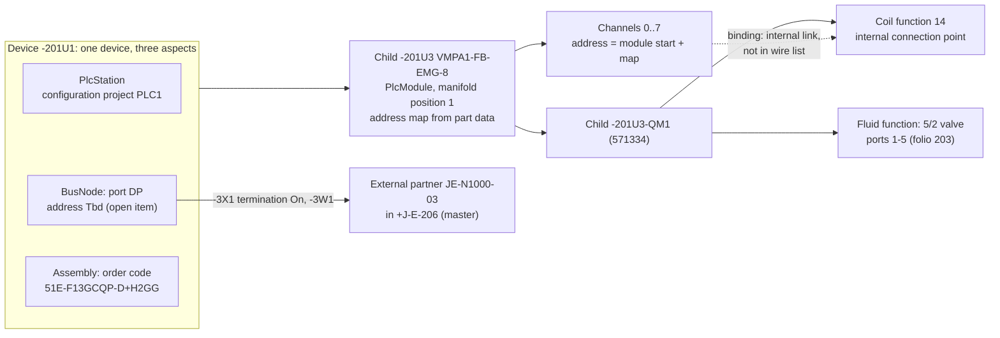
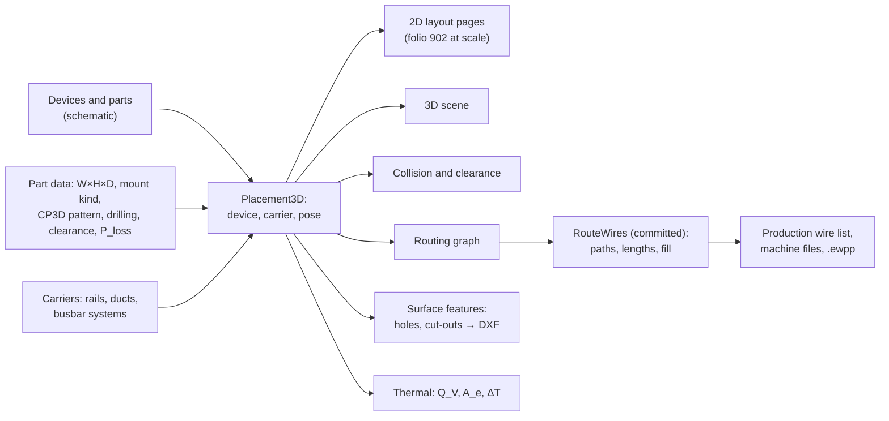
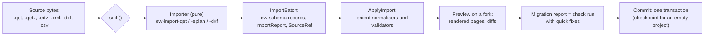

# Functional requirements B: extended areas

**Status:** Draft v0.1 · **Date:** 2026-10-17 · **Part of:** ElektraWatt design document set

**Purpose.** This catalogue states the functional requirements for the areas that take ElektraWatt (EW) beyond 2D
schematics: PLC and I/O, fieldbus, fluid power, 2D/3D panel layout, thermal calculation, manufacturing outputs,
import and migration, data exchange, user interface, extensibility, storage and collaboration, and multilingual
project data. Each row is one testable requirement with a priority, a release target consistent with
[vision and scope](00-vision-and-scope.md) §9, its sources and an acceptance criterion, mostly stated on the golden
project. The core areas (PRJ … REV) are in [02a](02a-requirements-core.md) and the non-functional requirements in
[02c](02c-nonfunctional-requirements.md); feature documents 05 and 10–17 elaborate the rows defined here.

**Contents**
0. [Conventions](#0-conventions)
1. [PLC and I/O (PLC)](#1-plc-and-io-plc)
2. [Fieldbus and networks (BUS)](#2-fieldbus-and-networks-bus)
3. [Fluid power (FLU)](#3-fluid-power-flu)
4. [Panel layout 2D/3D, routing and wire lengths (LAY)](#4-panel-layout-2d3d-routing-and-wire-lengths-lay)
5. [Thermal calculation (THM)](#5-thermal-calculation-thm)
6. [Manufacturing outputs (MFG)](#6-manufacturing-outputs-mfg)
7. [Import and migration (IMP)](#7-import-and-migration-imp)
8. [Data exchange and export (EXP)](#8-data-exchange-and-export-exp)
9. [User interface (UI)](#9-user-interface-ui)
10. [CLI, scripting, plugins, MCP (EXT)](#10-cli-scripting-plugins-mcp-ext)
11. [Storage, VCS and collaboration (COL)](#11-storage-vcs-and-collaboration-col)
12. [Multilingual project data (I18N)](#12-multilingual-project-data-i18n)
13. [Defect traceability](#13-defect-traceability)
14. [Counts](#14-counts)

---

## 0. Conventions

**Row format.** `| ID | Requirement | Prio | Release | Source | Acceptance criterion |`.
- **Requirement** is stated as "The system shall …" or as a direct obligation on a named object. One row, one
  testable obligation.
- **Prio** is the priority within the row's release: **Must**, **Should**, **Could**.
- **Release** is **MVP** (the pilot user stops using QElectroTech for new projects), **1.0** (full v1 scope), **1.x**
  (after 1.0) or **Later** (parked). Releases follow [vision and scope](00-vision-and-scope.md) §9; the one
  deviation (DWG through the ODA converter at 1.0) is raised in Open question 3. Where a requirement is Should in
  one release and Must in a later one, the row carries the earlier release and says so in its text.
- **Acceptance criterion** is the test that closes the row. "Golden" means the reference project J-E-2416 as
  specified in [reference drawing](../research/reference-drawing.md) §4 and the [golden project](20-golden-project.md)
  document. Values marked ▲ there (unknown in the reference) are test inputs, not facts.

**Source codes.** REF-nnn, D-nn, ADR-00nn, SC-n, IDEA-nnn, G-n and C-n are cited directly. Abbreviations:

| Code | Document |
|---|---|
| ARCH | [architecture](04-architecture.md) |
| VIS | [vision and scope](00-vision-and-scope.md) |
| BS | [brainstorm](01-brainstorm.md) (IDEA-nnn, PQ-nn, proposed FR-…-Pnn) |
| RD | [reference drawing](../research/reference-drawing.md) (REF-nnn, D-nn, §4 golden data) |
| PBF | [PLC, bus and fluid](../research/plc-bus-fluid.md) |
| PM | [panel and manufacturing](../research/panel-manufacturing.md) |
| IF | [interop formats](../research/interop-formats.md) |
| EF | [EPLAN features](../research/eplan-features.md) |
| GC | [gaps and corrections](../research/gaps-and-corrections.md) (G-n, C-n; overrides the other notes) |
| OSS | [open-source landscape](../research/oss-landscape.md) |
| STD | [standards](../research/standards.md) |

**Check rules.** Domain rules defined here use the IDs of the shipped rule packs (ARCH §12): `EW-PLC-nn`,
`EW-SAF-nn`, `EW-PRC-nn` (pack EW-PLC), `EW-BUS-nn`, `EW-IOL-nn` (EW-BUS), `EW-FL-nn` (EW-FL), `EW-L001` …
`EW-L011` (EW-LAYOUT), `EW-THM-nn` and `EW-MFG-nn`. The rule engine, modes (online, offline, prevent, release),
waivers, quick fixes and the core packs belong to the CHK area of [02a](02a-requirements-core.md). Rule constants
that the research marks *unverified* (bus ranges, segment lengths, ferrule colour tables, clause values) ship as
data and must be verified before a rule using them defaults to error (Open question 7).

**Reports.** Rows here define the *row content* of domain reports (I/O list, tube list, terminal assembly list …).
Forms, pagination, report blocks and the shared row source for PDF/XLSX/CSV are the REP area of 02a (ADR-0018).

**Area map.**

| Area | Owning crates ([ARCH](04-architecture.md) §3) | Elaborated in |
|---|---|---|
| PLC, BUS | `ew-plc`, `ew-derive` (`channel_addresses`, `plc_rows`) | [10-plc-and-bus](10-plc-and-bus.md) |
| FLU | `ew-model`, `ew-derive` (media propagation) | [11-fluid-power](11-fluid-power.md) |
| LAY, THM | `ew-panel`, `ew-render3d`, `ew-step-worker` (THM placement per VIS OQ6) | [12-panel-layout](12-panel-layout.md) |
| MFG | `ew-mfg`, `ew-reports` | [13-manufacturing-outputs](13-manufacturing-outputs.md) |
| IMP, EXP | `ew-interop-api`, `ew-import-qet`, `ew-import-eplan`, `ew-import-dxf`, `ew-export` | [14-interop](14-interop.md) |
| UI | `ew-ui`, `ew-viewmodel`, `elektrawatt` | [16-ux-ui](16-ux-ui.md) |
| EXT | `ew`, `ew-script`, `ew-plugin-host`, `ew-sqlview`, `ew-py` | [17-extensibility](17-extensibility.md) |
| COL | `ew-format`, `ew-store`, `ew` (merge driver, diff) | [05-project-format-and-persistence](05-project-format-and-persistence.md), [15-checks-revisions-collaboration](15-checks-revisions-collaboration.md) |
| I18N | `ew-mltext`, `ew-derive`, `ew-reports` | [09-reports-forms-output](09-reports-forms-output.md), [16-ux-ui](16-ux-ui.md) |

---

## 1. PLC and I/O (PLC)

The PLC model rests on the device aspects `PlcStation` and `PlcModule` and the `Channel` entity (ARCH §4.2–§4.3,
ADR-0006). The channel is the hub where electrical pins, the address, the symbol, the served function and the valve
coil meet (PBF Impl. 1). Addresses are derived from the module start and the part's address map
(`channel_addresses(module)`, ARCH §6.4) and frozen only on purpose (ADR-0003). Exchange uses AutomationML AR APC
1.4.0 on CAEX 2.15, which TIA Portal V21 writes (C-2, C-3), plus TIA tag XLSX and PLCopen XML.



| ID | Requirement | Prio | Release | Source | Acceptance criterion |
|---|---|---|---|---|---|
| FR-PLC-001 | The system shall model a PLC station as the `PlcStation` aspect of a device, with a role (CPU, head station, IO device, valve terminal, IO-Link master, drive, external partner), a configuration project, a firmware version and an optional device-description reference. Station roles shall not change device identity. | Must | MVP | ARCH §4.3; PBF §5.1, §11; REF-057 | Golden -201U1 is one device carrying `PlcStation` (role valve terminal), `BusNode` and `Assembly`; removing and re-adding the station aspect keeps its UUID and all references; `plc_rows(-201U1)` returns its 7 modules. |
| FR-PLC-002 | The system shall group stations into configuration projects (one per target PLC-software project), each with an address profile, a CPU reference, an address-ownership setting and the foreign-ID map and snapshot of its last exchange. Address and symbol uniqueness is scoped to the configuration project. | Must | MVP | PBF §2.2, §3.7, §11; EF §3.12 | A new project contains one default configuration project with profile "Siemens TIA (international)"; two stations in different configuration projects may both use Q0.1 without a finding; within one, EW-PLC-01 fires. |
| FR-PLC-003 | The system shall model PLC modules as the `PlcModule` aspect of a station device or a child device, with a slot path (rack, slot, subslot; manifold position for valve terminals), a type identifier (order number plus device-description module ident), a start address (`AddrSpec`) and a reference to the part's address map. Integrated modules are created with their station and cannot be deleted alone. | Must | MVP | ARCH §4.2; PBF §2.2, §5.1, §11 | Golden -201U3 … -201U8 and -202U2 are child devices with `PlcModule` in manifold positions 1–7; deleting an integrated module alone is rejected with a message naming the station. |
| FR-PLC-004 | A channel shall be an entity of exactly one module with a 0-based number, a designation (manual, automatic, determined), a kind (DI, DO, AI, AO, counter, multi-function, IO-Link port, power supply), a data type, an address (`Auto`, `Manual`, `Excluded`, `Tbd`), a state, a symbol, a multilingual comment and an optional binding to a function endpoint. Number, designation and address are separate fields. | Must | MVP | ARCH §4.2; PBF §2.4, §11; ADR-0006 | The 7 golden modules hold 56 output channels numbered 0–7 per module; changing a designation leaves number and address unchanged; a channel referencing a second module is rejected as a structural invariant. |
| FR-PLC-005 | A channel shall group one or more connection points (signal, supply, M, shield); a connection point shall belong to at most one channel. | Must | MVP | PBF §2.4, §11 (invariant 3) | Binding a connection point that is already bound to another channel is rejected in strict mode and reported in lenient mode. |
| FR-PLC-006 | The system shall support internal channels whose connection points have no physical pin (valve-terminal solenoid outputs, IO-Link process data). Internal channel–coil links shall be excluded from wire lists, terminal diagrams and wire-length calculation and included in the PLC overview, the I/O list and target tracking. | Must | MVP | PBF §2.3, §8.3; ARCH §4.3 | The golden wire list contains no row for the 28 coil links of -201U3-QM1 … -202U2-QM4; the PLC overview of -201U1 shows all 28 bindings. |
| FR-PLC-007 | PLC addresses shall be stored canonically as `{area, size, byte, bit}` under the configuration project's profile and rendered on demand; no address shall be stored as text on a symbol, page or report. | Must | MVP | PBF §2.5; STD §11; ARCH §1.2 | Switching the golden configuration project from S7 international to IEC 61131-3 notation renders Q0.1 as %QX0.1 on folio 203, on folio 908 and in the I/O list; the saved files differ only in the profile setting. |
| FR-PLC-008 | The system shall ship address profiles as versioned data, at MVP "Siemens TIA (international)" (`Q0.1`, displayed `%Q0.1`, `IW64`) and "IEC 61131-3" (`%QX0.1`, `%IW64`). A profile defines parse and render grammar, number base, bits per addressable unit, word alignment, default start addresses, mnemonic set and whether absolute addresses exist. | Must | MVP | PBF §2.5; STD §11; VIS PR-10 | Both profiles parse and round-trip every address of the golden set; a new profile file added to the profile directory is selectable without a code change. |
| FR-PLC-009 | The system shall render tag-based Rockwell Logix addresses from the station and slot model (`Local:3:O.Data.1`, remote `<adapter>:<slot>:O.Data.n`), so that a slot move updates every rendered address. | Should | 1.0 | PBF §2.5, §11 (`TagAddress`) | Moving a module from slot 3 to slot 4 changes all its rendered addresses from `Local:3:…` to `Local:4:…` in one transaction. |
| FR-PLC-010 | The system shall add address profiles, as data files, for Siemens German mnemonics (`E`, `A`), STEP 7 Classic slot-based defaults, Mitsubishi (octal or hexadecimal `X`, `Y`), Omron word.bit and Schneider topological addresses. | Could | 1.x | PBF §2.5, §15 | Each profile parses and renders its sample addresses of PBF §2.5 (`A0.1`, `X17`, `CIO 100.00`, `%Q0.2.1`). |
| FR-PLC-011 | Part data shall define a module address map from channel or valve position to bit offset (default linear: channel n → bit n), including non-linear maps such as "valve position p → coil 14 at bit 2p, coil 12 at bit 2p+1"; valve parts shall declare their solenoids (571334: `[14]`). | Must | MVP | ARCH §6.4; PBF §8.1; D-26; REF-059 | With the map "coil 14 = 2p" the coils of -201U3-QM1 … QM4 derive Q0.0, Q0.2, Q0.4, Q0.6; with "coil 14 = 2p+1" they derive Q0.1, Q0.3, Q0.5, Q0.7 as printed; the choice is part data, not code. |
| FR-PLC-012 | The system shall derive channel addresses as module start plus address-map offset; `Auto` module starts follow the profile's default scheme in station order (rack, slot, subslot; manifold order for valve terminals). | Must | MVP | ARCH §6.4; PBF §2.9 | The golden output image is Q0 … Q6, one byte per module in manifold order; changing the start of -201U5 re-addresses only its channels (engine statistics show one module recomputed). |
| FR-PLC-013 | The system shall support `Manual` (frozen) module start and channel addresses, `Excluded` channels ("do not include in addressing") and `Tbd` placeholders. Manual values that deviate from the derived value appear in the deviation report; `Tbd` is a typed open item that blocks release (EW-PLC-15). | Must | MVP | ADR-0003; D-15; REF-057, REF-094; PBF §13 | A manual Q0.0 on a position whose map yields Q0.1 is listed with both values; a `Tbd` address makes `ew check --scheme pre-delivery` exit non-zero. |
| FR-PLC-014 | The system shall provide address and re-address commands for a selection of modules or a configuration project (set start mode, recompute, convert manual to automatic), previewed with old → new address, affected pages and symbol changes, and committed as one undoable transaction. Addresses owned by the PLC side after an import are protected unless unlocked. | Should | MVP | PBF §2.9; EF §3.12; ADR-0008 | Inserting a module between -201U4 and -201U5 and re-addressing previews every changed address with its folio; undo restores the previous state in one step; a PLC-owned address stays unchanged until unlocked. |
| FR-PLC-015 | The system shall freeze all derived addresses of a configuration project (convert to `Manual`) in one command, typically at release; later rule deviations appear in the deviation report. | Should | 1.0 | ARCH §1.2 (principle 2); ADR-0003 | After freezing, changing the address map of 571334 changes no rendered address and produces one EW-PLC-12 finding per affected channel. |
| FR-PLC-016 | Each channel shall carry a manual symbol (tag name) and a multilingual comment; symbols are unique per configuration project (EW-PLC-07). | Must | MVP | PBF §2.6, §13; EF §3.12 | Entering TA05_V_15 on two channels of one configuration project yields EW-PLC-07; the comment holds an en-GB and an nl-NL text. |
| FR-PLC-017 | The system shall derive an automatic symbol from a template over the channel's tracked target (e.g. `{target.process_tag}` → TA05_V_15, or `{target.dt}_{pin}` → 201U3_QM1_14); a manual symbol wins; automatic symbols follow renumbering. | Must | 1.0 | PBF §2.1 (lessons), §2.6; EF §3.12 | Renumbering -201U3 to -201U4 changes the automatic symbol 201U3_QM1_14 to 201U4_QM1_14 everywhere; a manual symbol is unchanged. |
| FR-PLC-018 | The system shall implement target tracking: follow the net from a channel's connection points (or its internal link) through connections, terminals and bridges to the served field function (sensor, actuator, coil) and derive target DT, pin and location; optionally show the connected PLC address at terminals. | Must | 1.0 | PBF §2.1 (EPLAN 20449, 20854/20855), Impl. 3 | For a DI wired through -X1031 to a sensor, the I/O list shows the sensor DT and pin and "-X1031:n" as passed terminal; with the option set, terminal n shows the address. |
| FR-PLC-019 | Channel states shall be used, spare, reserved, deactivated or Tbd; spare channels may stay unplaced; reports count and list states. | Must | MVP | REF-065; PBF §2.4; D-15 | The golden PLC overview of -201U1 shows 8 used, 20 spare and 28 unbound channels; the counts match the I/O list. |
| FR-PLC-020 | The PLC navigator shall show configuration project → station (role icon) → rack → module (slot) → channel, with bus ports under their station and unplaced channels marked; dragging a channel onto a schematic channel symbol or a fluid valve coil binds it. | Must | MVP | PBF §2.8, §12; EF §4 | Dragging channel 1 of -201U3 onto the coil of -201U3-QM1 on folio 203 creates the binding; the valve then shows the channel address as derived text. |
| FR-PLC-021 | The PLC grid shall offer the columns of PBF §2.8 (station, rack, slot, module DT, channel number, designation, kind, address, symbol, data type, function text, process tag, state, safety, target DT, placed-on, signal range, comment), filters (unassigned, duplicate, spare, unplaced, safety, per bus, per configuration project, Tbd), fill-down, pattern fill (`TA05_V_{n:02}`) and Excel paste, each edit compiling to one command. | Should | MVP | PBF §2.8; BS IDEA-017 | Pasting 8 symbols from Excel into the golden grid is one undo step; the filter "spare" shows exactly 20 rows. |
| FR-PLC-022 | The system shall generate a PLC overview per module or station listing all channels with address, symbol, function text and state, and a cross-reference to each bound channel's representation; every representation of a channel renders the same data. | Must | MVP | ARCH §14 (D-09); PBF §2.7; REF-060; RD §4.14 (folio 908) | Golden folio 908 lists Q0.0 … Q6.7 of -201U1 with references to folios 203–206; editing a function text on folio 203 changes folio 908 in the same commit. |
| FR-PLC-023 | The system shall provide the I/O assignment list row source: configuration project, CPU, station and bus address, rack.slot.subslot, module DT and part, channel number, designation, kind, address, symbol, data type, comment, function text, process tag, target DT and pin, target page and column, passed terminals, signal range, safety address and state. Target columns fill from 1.0 (FR-PLC-018). | Must | MVP | PBF §2.10; ADR-0018; REF-060 | The PDF and XLSX I/O lists of the golden project contain the same 56 rows in the same order. |
| FR-PLC-024 | Card power-supply connection points shall be typed (load group L+/M, electronics or load supply) together with the channel group they feed, so that potential types and load rules apply. | Must | MVP | PBF §2.3; RD folio 106; D-25 | -201U1 pins 1–5 on folio 106 are typed 0V Val, 0V El, earth, 24V El, 24V Val, pin 3 being functional earth per part data (D-16); the valve group is fed by pins 1 and 5. |
| FR-PLC-025 | The system shall import PROFIBUS GSD files into a device type (ident number, supported baud rates, module catalogue with I/O lengths, `Max_Module`, maximum input and output lengths) linked to a part; the file hash, origin and licence note are stored and vendor files are not redistributed. | Must | 1.0 | PBF §4; IF §5; C-9 | A CPX-FB13 GSD yields a modular device type whose module list populates the rack/slot editor; its baud support feeds EW-BUS-05. |
| FR-PLC-026 | The system shall import PROFINET GSDML into a device type: device access points, physical, fixed and allowed slots, module and submodule catalogue with I/O data types and sizes, interface and port submodules (subslots 0x8000, 0x8001 …), order numbers, DNS-compatible default name and PROFIsafe F-parameters. | Must | 1.0 | PBF §4, §7; C-9 | The ABB FENA GSDML V2.31 sample yields a DAP with physical slots 0..2, fixed slot 0 and port submodule 32769; its F_Dest_Add range 1..65534 is stored. |
| FR-PLC-027 | The system shall import EtherCAT ESI (product code, revision, PDO entries as channels, `EBusCurrent`) and EtherNet/IP CIP EDS (identity, assemblies, connections) into device types. | Should | 1.x | PBF §4, §15; C-9 | The EL1008 ESI yields 8 BOOL input channels and an E-bus current of 90 mA. |
| FR-PLC-028 | A rack/slot editor shall build stations from device types or part data: drag modules into allowed slots, validate fixed and allowed slots, maximum module count and maximum I/O lengths (EW-PLC-11), and expand each module into a child device with channels and connection points; for valve terminals it edits the manifold position list next to the stored order code. | Must | 1.0 | PBF §4 (pipeline), §8.1, §12 | Dropping a module into a slot outside its allowed slots is refused with EW-PLC-11; building the golden manifold in the editor yields the 7 modules in RD §4.10 order. |
| FR-PLC-029 | The system shall export a configuration project as AutomationML AR APC 1.4.0 on CAEX 2.15 (`AutomationMLVersion` 2.0, class libraries referenced by path): AutomationProject → Device → DeviceItem (rack, module, submodule) with PositionNumber, TypeName, `OrderNumber:` TypeIdentifier, FirmwareVersion, BuiltIn and an `Address` list {StartAddress, Length in bits, IoType}; channels as `Channel` interfaces {Type, IoType, Number, Length}; tags in TagTables {DataType, IoType, LogicalAddress, multilingual Comment}; `InternalLink`s channel ↔ tag; EW tags in `LocationIdentifier IEC` and `ProductDesignation IEC`. | Must | 1.0 | PBF §3.1; C-2, C-3; ADR-0021; SC-8 | The golden export validates against the CAEX 2.15 schema, holds 7 module DeviceItems with 8-bit output addresses and 8 tag links, and imports into TIA Portal V21 without errors. |
| FR-PLC-030 | The AML writer shall offer AR APC 1.2.0 output, selectable per export, for older TIA Portal versions and EPLAN. | Should | 1.0 | PBF §3.1 (tests); IF §4.2; EF §3.12 | A 1.2.0 export of the golden station imports into an EPLAN AML import and a TIA V17 test installation per the exchange test protocol. |
| FR-PLC-031 | AML export and import shall carry bus interfaces, ports and nodes (`CommunicationInterface`, `CommunicationPort` with Label, `Node` or `NodeEthernet` with NetworkAddress, SubnetMask, IpProtocolSelection) and PROFIBUS DP station addresses and subnets. | Must | 1.0 | PBF §3.1 (mapping), OQ4 | A PROFINET station exported and re-imported keeps IP, mask and port labels; the DP attribute names are fixed from a real TIA DP export before acceptance (Open question 12). |
| FR-PLC-032 | The system shall import AML AR APC (CAEX 2.15 and 3.0) from TIA Portal CAx exports, creating or updating stations, racks, modules, channels and tags. Matching order: persisted foreign GUID, `ProductDesignation IEC`, (station, rack, slot, subslot, channel number), order number plus position. Unmatched foreign objects go to an unplaced "parking" list and are never placed on pages automatically. | Must | 1.0 | PBF §3.1, §3.7; C-2; ADR-0021 | Re-importing an unchanged export of the golden station yields an empty diff; a TIA module without IEC tag and with an unknown position appears in the parking list. |
| FR-PLC-033 | Re-import shall run a three-way merge against the last exchanged snapshot stored in the project and apply per-field ownership (ECAD owns DTs, pins, wiring, function texts, parts and process tags; PLC owns addresses after the first import, firmware and IP addresses; symbol and comment configurable per configuration project), showing added, removed, changed and conflicting items per channel in a preview before one transaction. | Must | 1.0 | PBF §3.7; BS IDEA-067; VIS J4 | Renaming the symbol of the first used channel in TIA and its function text in EW merges both without conflict; renaming the same symbol on both sides yields one conflict row. |
| FR-PLC-034 | The system shall import TIA Selection Tool AML (AR APC 1.4.0) to create stations and modules with order numbers, IEC tags and accessories (front connectors, memory cards) before the schematic exists; accessories feed the BOM. | Should | 1.x | PBF §3.1 (finding 6), §3.2 | A TST 2025 export creates its devices with the `-UF01`, `-K01` tags it carries and adds accessory lines to the BOM. |
| FR-PLC-035 | The system shall report exchange drift (EW-PLC-16): the configuration project changed after the last export, or the foreign file is newer than the stored snapshot. | Should | 1.0 | PBF §13 | Editing a symbol after an export raises an info finding naming the export date. |
| FR-PLC-036 | The system shall export and import the TIA Portal "PLC Tags" workbook: sheet "PLC Tags" with the columns Name, Path, Data Type, Logical Address (`%Q0.1`), Comment, Hmi Visible, Hmi Accessible, Hmi Writeable, Typeobject ID, Version ID; import matches by name, then by address, and previews changes. | Must | 1.0 | PBF §3.2; STD §11; SC-8 | The golden export holds one row per channel with a symbol; re-importing it unchanged yields an empty diff; TIA Portal V21 imports the file. |
| FR-PLC-037 | The system shall export PLCopen XML TC6 v2.01 global variable lists for CODESYS: one GVL per configuration project with one variable per used channel (`name` = symbol, `address` = IEC address such as `%QX0.1`, IEC type, `documentation` = function text and DT). | Must | 1.0 | PBF §3.3; IF §4.2; SC-8 | The golden GVL parses with the `plcopen` crate in tests and imports into CODESYS 3.5 through *Project > Import PLCopenXML*. |
| FR-PLC-038 | The system shall round-trip a generic I/O list as CSV or XLSX with the columns of FR-PLC-023, one row per channel, a stable-ID column, UTF-8 with BOM and a configurable delimiter; re-import matches by ID or by (station, slot, channel number) and previews the diff. | Should | MVP | PBF §2.10, §3.6; BS IDEA-065 | Exporting the golden I/O list, editing 3 function texts in Dutch Excel (semicolon) and re-importing changes exactly 3 fields in one transaction. |
| FR-PLC-039 | The system shall export Rockwell L5X fragments (module tree with catalog numbers, slots, IP addresses and alias tags) and Beckhoff TwinCAT TE1120 XML or AML (terminal order, product codes, channel–symbol links). | Could | 1.x | PBF §3.4, §3.5, §15 | The L5X output parses with the `l5x` crate; the TwinCAT import is verified on a test installation. |
| FR-PLC-040 | A TIA Openness bridge (a Windows-only C# tool exchanging AML and XLSX with EW) may be provided outside the Rust core. | Could | Later | PBF §3.2, Impl. 14; ARCH §16 | The core builds and runs with no .NET dependency; the bridge exchanges the golden AML with a TIA project. |
| FR-PLC-041 | Channels and modules shall carry optional safety data (F-destination and F-source address, channel pair, SIL/PL requirement field) shown in a distinct style in overviews, with a safety I/O list row source (F-address, module, channel pair, sensor or actuator DT, requirement field, test-pulse source). | Must | 1.0 | PBF §7; BS IDEA-068 | An F-DI module with two paired channels renders both in the safety style and both appear in the safety I/O list; SIL/PL values are fields only, not calculated. |
| FR-PLC-042 | EW-SAF-01 shall report F-destination addresses that are missing, duplicate within a network or the plant, or outside the device description's range (e.g. 1..65534). | Must | 1.0 | PBF §7, §13 | Two F-modules with F_Dest_Add 100 on one network yield two EW-SAF-01 errors. |
| FR-PLC-043 | EW-SAF-02 shall report incomplete 1oo2 channel pairs or pairs wired to different devices, and EW-SAF-03 F-DI sensors not supplied from the module's test-pulse supply where the module requires it. | Should | 1.0 | PBF §7, §13 | A channel pair wired to two different emergency-stop devices yields EW-SAF-02. |
| FR-PLC-044 | Address-integrity rules shall run online: EW-PLC-01 duplicate address as bit-range overlap within configuration project and area (including `IW0` against `I1.3`; a prevent rule in strict mode), EW-PLC-02 address outside the module's I/O range, EW-PLC-03 bit index outside the profile's unit width, EW-PLC-08 used channel without address (error at export). | Must | MVP | ARCH §4.6; PBF §13; STD §11 | A manual IW0 overlapping a used I1.3 is rejected in strict mode and reported in lenient mode; a bit index 8 under the S7 profile yields EW-PLC-03. |
| FR-PLC-045 | EW-PLC-12 shall report every channel whose address differs from the value derived from its part's address map. | Must | MVP | D-26; REF-059; ARCH §14; RD §4.15 (criterion 8) | With the imported manual addresses Q0.1 … and the part map "coil 14 = 2p", the golden check run reports EW-PLC-12 on each of the 28 bound coil channels; with the map "2p+1" it reports none. |
| FR-PLC-046 | Wiring-consistency rules shall run: EW-PLC-04 channel kind ≠ connected function (a DO wired to a sensor), EW-PLC-09 channel with address or symbol but no connection and not spare, EW-PLC-10 data-type width ≠ channel width. | Should | 1.0 | PBF §13; STD §11 | A Bool symbol on a 16-bit AI channel yields EW-PLC-10; a DO wired to a proximity sensor yields EW-PLC-04. |
| FR-PLC-047 | Symbols shall be validated for the target profile at export (EW-PLC-05): strict IEC 61131-3 identifiers by default (letters, digits, single underscores, no leading digit), TIA quoting rules optional. | Must | 1.0 | PBF §2.6, §13 | "TA05-V-15" as a manual symbol blocks AML and PLCopen export in strict mode with EW-PLC-05; "TA05_V_15" passes. |
| FR-PLC-048 | Supply and load rules shall run: EW-PLC-13 card power-supply group unconnected or fed from a wrong potential type (FE/PE confusion), EW-PLC-14 summed output load current from part data above the channel, group or module rating. | Should | 1.0 | PBF §2.3, §8.4, §13; D-16, D-25 | Golden -201U1 pin 3 fed from PE while the part declares FE yields EW-PLC-13; the summed coil current of the manifold against the 6 A MICO channel is stated in the EW-PLC-14 evaluation. |
| FR-PLC-049 | Devices shall carry a process tag parsed by a configurable tag scheme (regular expression with named parts, e.g. area TA05, kind V, number 15) used for sorting, symbol templates and EW-PRC-01 (scheme mismatch, duplicate process tag on different devices). | Should | 1.0 | PBF §10.1; REF-093; D-27 | TA05-V-15 parses into {area TA05, kind V, number 15}; a second device tagged TA05-V-15 yields EW-PRC-01. |
| FR-PLC-050 | The system shall import an instrument or I/O list (CSV or XLSX: tag, description, signal type, range, field location, preferred station), creating field-device placeholders and pre-assigning spare channels of the matching kind; unassignable tags become open items (EW-PRC-02). | Should | 1.0 | PBF §10.4; BS IDEA-031 | A 10-row list with 8 DO tags against the golden station assigns 8 spare channels of -201U5 and -201U6 and lists 2 unassignable tags as open items. |

---

## 2. Fieldbus and networks (BUS)

Bus ports are an aspect of functions (`BusPort`, ARCH §4.2). Logical networks carry addressing; physical networks
carry the ordered segment of ports, connectors and cables (PBF §5.2). Termination is a property, never free text
(REF-061, D-15). External partners in other cabinets are placeholder stations (PBF §5.2, REF-018).

| ID | Requirement | Prio | Release | Source | Acceptance criterion |
|---|---|---|---|---|---|
| FR-BUS-001 | Functions shall carry a `BusPort` aspect with interface name ("DP", "X1"), port label ("P1R"), bus system, role (master, slave, controller, device, passive), address (value, `Tbd` or not applicable), logical network and physical network. | Must | MVP | ARCH §4.2; PBF §5, §11; REF-057 | The "DP" port of -201U1 on folio 3 is a slave port of the PROFIBUS logical network with address `Tbd`, listed as an open item. |
| FR-BUS-002 | Logical networks (bus system, name, master port, data rate or cycle, address space) shall scope address uniqueness; ports joining a network derive its network-level properties instead of copying them. | Must | MVP | PBF §5.2; EF §3.12 (bus configuration transfer) | Changing the golden network's baud rate changes the value shown at every port in one edit; no port record stores the rate. |
| FR-BUS-003 | Physical networks shall hold ordered segments of bus ports, connectors, cables and passive devices (repeaters, switches); termination, length and stub rules run against them. | Must | MVP | PBF §5.2, §11 | The golden segment is external partner JE-N1000-03 → -3W1 → -3X1 → -201U1 DP, in this order. |
| FR-BUS-004 | Bus connectors shall be devices with cable entries, a device side and a termination state {On, Off} that is rendered from the property (e.g. "Switch to ON") and checked. | Must | MVP | PBF §5.4; REF-061; D-15 | -3X1 (Festo 532216) renders "Switch to ON" from termination = On; setting Off changes the text and raises EW-BUS-04. |
| FR-BUS-005 | An external bus partner shall be a placeholder station for a device in another project or cabinet, with role and address, no parts, excluded from the BOM, shown in topology and network lists and linked by a typed external reference (project, location, device). | Must | MVP | PBF §5.2; REF-018; ARCH §4.2 (`ExternalRef`) | JE-N1000-03 in +J-E-206 appears as PROFIBUS master in the network address list and nowhere in the golden BOM. |
| FR-BUS-006 | Topology pages shall draw representations of bus ports, connectors and single-line bus cables bound to the bus model, with address and termination rendered from properties. | Must | MVP | RD folio 3; REF-048, REF-061 | The regenerated golden folio 3 shows -201U1, -3X1 and -3W1 with texts from properties only; no free text carries "TBD". |
| FR-BUS-007 | The system shall generate a bus topology overview page per logical network: stations in order, addresses, ports, connectors with termination, cables with lengths and external partners. | Should | 1.0 | PBF §5.5, §15; BS IDEA-069 | The generated overview of the golden network matches folio 3's content and updates when -3W1's length is set. |
| FR-BUS-008 | The system shall provide row sources for a network address list (logical network, station DT, device type, address, device name, IP address, master flag, rate, configuration project) and a bus cable list (cables of bus systems with their segment). | Must | 1.0 | PBF §5.5 | The golden network address list has two rows: JE-N1000-03 (master, external) and -201U1 (slave, address `Tbd` flagged). |
| FR-BUS-009 | PROFIBUS DP ports shall carry a station address (range from data, nominally 0–125) and the network a baud rate from 9.6 kbit/s to 12 Mbit/s; the rates a slave supports come from its GSD. | Must | MVP | PBF §5.3 (ranges unverified) | Golden -201U1 accepts address 3 at a network rate of 1.5 Mbit/s; from 1.0, a rate missing from the slave's GSD raises EW-BUS-05. |
| FR-BUS-010 | PROFINET IO ports shall carry device name (DNS-compatible), IPv4 address, subnet mask and gateway, and port-to-port topology (P1/P2 neighbours) with an optional MRP ring role. | Must | 1.0 | PBF §5.3, §11 | A station named "cpx-1" at 192.168.0.10/24 exports both values to AML (FR-PLC-031) and appears in the network address list. |
| FR-BUS-011 | EtherCAT networks shall model couplers and terminal stacks (position order after the coupler, auto-increment position, optional station alias). | Should | 1.0 | PBF §3.4, §5.3 | An EK1100 with 4 terminals lists positions 1–4 in the order placed on the rail. |
| FR-BUS-012 | IO-Link masters shall expose ports as multi-function channels (mode IO-Link, DI, DQ or deactivated; port class A or B); a connected IO-Link device occupies a process-data window with a structured data type. | Must | 1.0 | PBF §6 | Port 3 of an 8-port master in IO-Link mode with an 88-bit input device shows an 11-byte input window and a struct-typed symbol. |
| FR-BUS-013 | The system shall import IODD 1.1 files (identity, process-data layout as a struct type, bitrate, SIO support, connector type, wire functions and colours) and create device pins and cable core colours from them. | Should | 1.0 | PBF §0.1 (finding 7), §4, §6 | The Balluff sample IODD creates pins L+, Other, L−, C/Q with core colours BN, WH, BU, BK on the connecting M12 cable. |
| FR-BUS-014 | The system shall provide an IO-Link port list row source (master DT, port, mode, device DT, vendor and device ID, IODD file, process-data layout, cable). | Should | 1.0 | PBF §6 | The test master lists one row per used port. |
| FR-BUS-015 | EW-BUS-01 shall report a missing (as open item) or duplicate bus address within a logical network. | Must | MVP | PBF §13; D-15 | The golden project has one open item for -201U1's `Tbd` address; two slaves at address 3 yield an error. |
| FR-BUS-016 | EW-BUS-04 shall check that termination is On at exactly the two ends of each physical segment; an external partner at a segment end counts as an end whose state is reported as unknown (info). | Must | MVP | REF-061; PBF §13 | Golden: no error (-3X1 On at the segment end) and one info for the external end; setting -3X1 Off yields an error. |
| FR-BUS-017 | EW-BUS-03 shall report invalid or duplicate PROFINET device names, duplicate IP addresses within a subnet and IP addresses outside the subnet. | Must | 1.0 | PBF §5.3, §13 | Two stations at 192.168.0.10/24 yield EW-BUS-03; a device name with an underscore is reported as invalid. |
| FR-BUS-018 | Further bus rules shall run: EW-BUS-02 address outside the bus range, EW-BUS-05 rate not supported by a slave, EW-BUS-06 segment length or station count over the limit for the rate, EW-BUS-07 logical network without master (an external partner counts), EW-BUS-09 bus port on a non-bus cable or wrong connector type. Range and length constants are data. | Should | 1.0 | PBF §5.3, §13 | Each rule has a passing and a failing fixture; with unverified constants the rules report warnings. |
| FR-BUS-019 | IO-Link rules shall run: EW-IOL-01 port class mismatch or port not in IO-Link mode with an IODD device connected; EW-IOL-02 process data larger than the port window or cable longer than the maximum. | Should | 1.0 | PBF §6, §13 | Connecting a class-B device to a class-A port yields EW-IOL-01. |
| FR-BUS-020 | EW-BUS-08 shall check the EtherCAT E-bus current budget (sum of terminal `EBusCurrent` ≤ coupler supply) from ESI data. | Should | 1.x | PBF §4, §13; FR-PLC-027 | 25 × EL1008 (90 mA each, 2,250 mA) behind a 2,000 mA coupler raises EW-BUS-08. |
| FR-BUS-021 | EtherNet/IP (IP address, mask, RPI within the EDS range, DLR ring) and AS-Interface (addresses 1–31 and 1A–31B, A/B rules, AS-i power supply) shall be supported. | Could | 1.x | PBF §5.3, §15; VIS §9 | Two AS-i slaves at 5A on one network yield EW-BUS-01. |
| FR-BUS-022 | CANopen (node-ID 1–127) and Modbus TCP/RTU (IP address plus unit ID) shall be supported. | Could | Later | PBF §5.3, §15; VIS §9 | Two CANopen nodes with node-ID 5 on one network yield EW-BUS-01. |

---

## 3. Fluid power (FLU)

Fluid power reuses the connection graph with typed ports and media (ARCH §4.2 "Fluid", STD §5, PBF Impl. 9). The
MVP turns folios 203–206 into data (ports, coils, addresses, process tags); 1.0 adds media propagation, tube
specifications and the fluid reports. Valve terminals are one assembly with children in two disciplines (ARCH
§4.3); the generic assembly model is DEV in 02a.

| ID | Requirement | Prio | Release | Source | Acceptance criterion |
|---|---|---|---|---|---|
| FR-FLU-001 | Fluid connection points shall carry a discipline (pneumatic, vacuum; hydraulic Later), a port role (supply 1, working 2 and 4, exhaust 3 and 5, pilot 12 and 14, pilot exhaust 82 and 84, external pilot X) and a printed designation; physical port data (thread such as G1/8, push-in size, nominal flow) come from part data. | Must | MVP | ARCH §4.2; STD §5; PBF §9.3; REF-063 | Every 571334 valve on folios 203–206 exposes ports 1, 2, 3, 4 and 5 with roles; the printed "3 1 5" order (RD correction C3) is symbol graphics, not data. |
| FR-FLU-002 | Fluid lines shall be connections of kind `Fluid` with a line kind (working, pilot, exhaust, drain, flexible) that determines the ISO 1219-1 line style; they join fluid ports only and never form electrical nets. | Must | MVP | ARCH §4.2; STD §5 | Drawing a fluid line from a valve port to an electrical terminal is rejected; a pilot line renders dashed. |
| FR-FLU-003 | A device may carry fluid and electrical functions at once (solenoid valve: valve function with ports, coil function 12 and/or 14 with internal or physical pins); coil and valve cross-reference each other, and the coil carries the PLC channel binding. | Must | MVP | ARCH §4.3; REF-098; PBF §9.6; EF §17 | -201U3-QM1 shows its coil's address on folio 203; the overview of -201U3 on folio 201 references "203-B4". |
| FR-FLU-004 | Valve positions of a valve terminal shall be child devices of their sub-base module, each with one fluid function and as many coil functions as the part declares solenoids; each coil binds to at most one channel; spare positions distinguish "valve fitted, unused" from "blanking plate" in BOM and slot table. | Must | MVP | ARCH §4.3; PBF §8.3; D-10, D-27, D-41; REF-062, REF-065 | The golden project has 28 valves -201U3-QM1 … -202U2-QM4 with derived tags, 8 bound to used channels; the overview of -202U2 on folio 202 shows 4 positions, never 5. |
| FR-FLU-005 | Fluid symbols shall display the bound coil's PLC address and the function text or process tag as derived property texts, never as free text. | Must | MVP | RD folios 203–206; PBF §2.7 (rule 3) | Changing the module start of -201U3 updates the address printed at -201U3-QM1 on folio 203 in the same commit. |
| FR-FLU-006 | Fluid lines from valve working ports to field actuators (double-acting actuators of process valves TA05-V-xx) shall connect across the location boundary to field devices with their own location aspect and a mechanical linkage to the process valve. | Should | MVP | REF-064; D-27; RD §4.11 | The 8 used golden valves connect ports 2 and 4 to the actuators of TA05-V-15 … TA05-V-37, which carry their own field location. |
| FR-FLU-007 | Valve symbols shall carry a valve model: switching positions with a port connectivity matrix and actuators per side (solenoid, pilot, spring, air spring, manual override, detent), used for media propagation and checks. | Must | 1.0 | STD §5; PBF §11 (`ValveModel`) | A 5/2 monostable valve connects 1→2 and 4→5 at rest and 1→4 and 2→3 with coil 14 energised. |
| FR-FLU-008 | The system shall define media with name, discipline, nominal pressure, quality class (ISO 8573-1), temperature range, default tube specification and default colour. | Must | 1.0 | PBF §9.5 | A project medium "compressed air 6 bar, class [1:4:1]" with default tube PU 6×4 BU is selectable. |
| FR-FLU-009 | Media shall propagate from medium sources (supply plate port 1, service-unit outlet, vacuum generator) through lines and passive components along the valve models' flow paths, with transformations (regulator → new pressure medium, ejector → vacuum, exhaust ports → "exhaust"), as a derived query like potentials. | Must | 1.0 | PBF §9.5; ARCH §4.2 | Setting the supply medium at -201U9 port 1 propagates "air 6 bar" to port 1 of all 28 valves and "exhaust" to ports 3 and 5 with no further input. |
| FR-FLU-010 | Fluid lines shall carry a tube specification (outer and inner diameter, material, colour as IEC 60757 code, part number, pressure and temperature rating, end fittings per end) derived from the medium default with provenance and overridable per line. | Must | 1.0 | PBF §9.4, §9.5 | The tube from -201U3-QM1:2 shows "PU 6×4 BU · from medium 'air 6 bar'" in the property grid; overriding to 8×6 sets the override marker. |
| FR-FLU-011 | Fluid lines shall carry a line tag (configurable scheme) and a length with its source (manual; routed from 1.x). | Should | 1.0 | PBF §9.4 | A tube with a manual length of 1,200 mm appears in the tube list with source "manual". |
| FR-FLU-012 | The system shall provide a tube list row source (tag, from device:port, to device:port, outer diameter, material, colour, length, fittings). | Must | 1.0 | PBF §9.4, §14; D-28 | The golden tube list holds 16 rows (8 tube pairs) once the tubes are drawn. |
| FR-FLU-013 | The system shall provide a tube cut list per type and colour and tube labels (marker sleeves) through the label engine (FR-MFG-012). | Should | 1.0 | PBF §9.4 | 16 tubes PU 6×4 BU of 1.2 m each aggregate to one cut-list line of 19.2 m. |
| FR-FLU-014 | The BOM shall include fluid items: tubes as consumables by length, fittings, silencers and blanking plugs aggregated by part, and configured assemblies as a header line with component lines. | Must | 1.0 | PBF §9.7; D-04, D-36; REF-051 | The golden BOM in component mode lists 571334 once with quantity 28 under the manifold assembly. |
| FR-FLU-015 | The system shall provide a valve-terminal configuration row source (position, module part, valve part, coils, address, process tag, spare state). | Should | 1.0 | PBF §8.3, §14 | The golden table lists the modules -201U1 … -202U3 and the 28 valve positions. |
| FR-FLU-016 | The system shall provide a medium overview row source (medium, source, pressure, consumers, default tube). | Could | 1.0 | PBF §9.5 | The golden overview has one row "air 6 bar" with 28 consumers. |
| FR-FLU-017 | EW-FL-02 (number of solenoids ≠ bound channels) and EW-FL-04 (spare positions, info) shall run online. | Must | MVP | STD §5; PBF §13; D-10 | The golden project lists 20 spare valves under EW-FL-04; binding a second channel to a single-solenoid valve yields EW-FL-02. |
| FR-FLU-018 | EW-FL-01 shall report unconnected working ports unless they are plugged or marked blanked. | Should | MVP | STD §5; PBF §13; D-28 | The 20 spare golden valves with open ports 2 and 4 are reported until marked blanked. |
| FR-FLU-019 | EW-FL-05 (two different media connected directly) and EW-FL-09 (coil voltage ≠ voltage of the supplying channel or potential) shall run online. | Must | 1.0 | PBF §13 | Joining a 6 bar line to a 4 bar regulator-outlet line yields EW-FL-05; a 230 V coil on a 24 V DO yields EW-FL-09. |
| FR-FLU-020 | EW-FL-06 (tube pressure rating below medium pressure; tube outer diameter ≠ port push-in size), EW-FL-07 (line without tube specification and no medium default) and EW-FL-10 (valve or manifold without supply on port 1) shall run. | Should | 1.0 | PBF §13; ARCH §14 (D-28) | The golden project as drawn reports EW-FL-10 for the manifold until the supply line at -201U9 is added. |
| FR-FLU-021 | EW-FL-08 shall report exhaust ports left open without silencer or collector, configurable per project. | Could | 1.0 | PBF §13; D-28 | With the rule enabled, the golden valves' ports 3 and 5 are reported until a silencer is attached to the supply plate. |
| FR-FLU-022 | EW-FL-03 shall report manifold slot occupancy that contradicts the configurator order code or vendor rules, through a configurator-decoder plugin. | Could | 1.x | PBF §8.4, §13; D-40; BS IDEA-026 | With a test decoder, the CPX block -202U1 placed inside the MPA section yields EW-FL-03. |
| FR-FLU-023 | Pneumatic devices may additionally show ISO 1219-2 component codes (installation, medium, circuit, component) as a second identifier set; IEC 81346 DTs remain the default. | Could | 1.0 | STD §5; PBF OQ8; EF §17 | Enabling the identifier set shows the ISO 1219-2 code next to -201U3-QM1 without changing the DT. |
| FR-FLU-024 | Tubes shall be routable in the 3D layout, with routed lengths. | Should | 1.x | VIS §9; PBF §15 | A tube between two placed devices gets a routed length with source "routed". |
| FR-FLU-025 | Hydraulics shall be supported: letter ports P, T, A, B, X, Y, L; hoses with identification and manufacturing date; pipe classes; hydraulic power units and accumulators. | Could | Later | PBF §9.8; EF §17 | A 4/3 hydraulic valve exposes ports P, T, A and B with roles. |

---

## 4. Panel layout 2D/3D, routing and wire lengths (LAY)

The layout model (`LayoutSpace`, `Enclosure`, `MountingSurface`, `Carrier`, `Placement3D`, `RouteOverride`) lives in
`ew-panel` (ARCH §3, §4.2). Placements reference devices and store no tag text (D-02); 2D layout pages are
projections of mounting surfaces through the 2D display list (ARCH §8.5). The MVP is the device-bound 2D plate of
folio 902 (VIS OQ1, BS IDEA-071); 1.0 adds 3D, STEP, collision, routing and lengths. Routing is a Class II job whose
results are committed only by `RouteWires` (ADR-0003).



| ID | Requirement | Prio | Release | Source | Acceptance criterion |
|---|---|---|---|---|---|
| FR-LAY-001 | Each layout space shall belong to one location structure node (e.g. +J-E-2416) and hold its enclosures, mounting surfaces, carriers and placements. | Must | MVP | ARCH §4.2; PM §4.2 | The golden layout space belongs to +J-E-2416; the unplaced-devices list for it never offers devices of +J-E-206. |
| FR-LAY-002 | Enclosures and mounting plates shall be created from part data (outer dimensions, usable plate area) and placed as a mounting surface with a local 2D frame (u, v, outward normal w) to which all poses are relative; dimensions are never typed on the layout page. | Must | MVP | PM §2 (R-902-1), §4.1, §5.1; REF-069 | Selecting NSYPLA1074G and NSYPMM107 creates enclosure and plate at their part dimensions; changing the view scale of folio 902 changes no stored pose. |
| FR-LAY-003 | Enclosure templates shall define wall thickness, doors (count, hinge side, opening angle), mounting-surface templates for door inside, door outside and gland plate (frame, usable polygon, depth range between plate and closed door), installation type (IEC TR 60890 cases), material with heat-transfer coefficient, and IP/IK rating. | Must | 1.0 | PM §5.1, §5.6 | A wall-mounted NSYPLA1074G template feeds the door-closed check (FR-LAY-030) and the effective thermal surface (FR-THM-003). |
| FR-LAY-004 | DIN rails shall be parametric carriers (profile TS 35×7.5, TS 35×15, TS 32 or TS 15; perforation; start and end on the surface; height above plate; part) contributing length and quantity to the BOM. | Must | MVP | PM §5.2; REF-068; D-04 | Three TS 35 rails on the golden plate appear in the BOM by length and in the legend. |
| FR-LAY-005 | Wiring ducts shall be parametric carriers with explicit width and height (generated label "W×H", e.g. "40×60"), inner dimensions, slot pitch, finger width, cover, a path of straight segments with butt or mitre joints, and a part, contributing to the BOM. | Must | MVP | PM §5.3; REF-068; RD §4.12 | The five golden ducts appear in the legend with generated labels; the lower duct's unknown type is a `Tbd` open item. |
| FR-LAY-006 | Placements shall reference a device (and optionally one function, e.g. a single terminal), a carrier or surface and a pose relative to it, with a locked flag; they store no tag text, and their labels are the `layout_label` query. | Must | MVP | ARCH §4.2, §14 (D-02); REF-066; PM §4.5 | Renumbering T55 updates its label on folio 902 in the same commit and changes no file under `layout/`. |
| FR-LAY-007 | Placement geometry shall come from the device's part (footprint W×H×D, mount kind, rail offset, clearance); when the part changes, the geometry is re-resolved and a new overlap is flagged, never resolved by moving devices. | Must | MVP | PM §4.3, §4.5 | Changing -102F1's part to a wider MCB widens its footprint and raises an overlap finding against -102F2. |
| FR-LAY-008 | Layout-only parts (ducts, rails, covers, end brackets, PE bars) shall be placeable without a schematic function and counted in the BOM; free layout graphics are allowed but excluded from checks and the BOM. | Must | MVP | PM §5.8 (pitfalls); REF-054 | The four golden end brackets are BOM lines; a hand-drawn rectangle on folio 902 appears neither in the BOM nor in EW-L001. |
| FR-LAY-009 | Placement labels shall render the full DT (+J-E-2416-X1031) or, by page setting, the abbreviated form (-X1031) when the device's location equals the layout page's location. | Must | MVP | PM §5.5; STD §1 | Golden folio 902 shows "-X1031" and "-X1032"; switching the page setting shows the full DTs. |
| FR-LAY-010 | Layout pages shall be views of one mounting surface at a scale from a configured series (1:2, 1:5, 1:10, 1:20) or explicitly "not to scale", with the scale bound into the title block; text height, arrowheads and line weights are paper-space constants. | Must | MVP | PM §5.5 (R-902-1); REF-070 | Golden folio 902 at 1:10 shows the plate at true scale ±0.2 mm and "1:10" in the title block; tag text keeps its paper height at 1:5. |
| FR-LAY-011 | Placements shall render as the part's 2D front outline when available, otherwise as the projected footprint rectangle; from 1.0 also as silhouettes derived from 3D (FR-LAY-039). | Must | MVP | PM §5.5 | -102G1 without a front outline renders as its footprint rectangle with its live DT. |
| FR-LAY-012 | A generated legend (placement list) per surface shall list position number, DT, manufacturer, part number, description and quantity or length, replacing hand-made "PART DATA" boxes. | Must | MVP | PM §2 (R-902-2), §5.5; REF-069; D-02 | The golden folio 902 legend lists enclosure, plate, rails, ducts, end brackets and every placement; placing F55 adds one row. |
| FR-LAY-013 | An unplaced-devices list shall show every device with a mountable part and no placement in the layout space of its location, with drag-to-place. | Must | MVP | VIS §9; REF-067; D-32; PM §2 | Before completion the golden list shows F55, E55, E56, S56 and -201U9; dragging F55 onto rail 1 removes it from the list. |
| FR-LAY-014 | Rail placement shall snap on a 1-D interval model with modes free (nearest gap), push (shift neighbours, cascading to the rail end) and swap; clearance padding; automatic end clamps at strip boundaries; snap targets (device edges, rail start, plate grid 1 mm and 5 mm, column alignment with the rail above); and mount-kind validation. | Should | MVP | PM §5.4 | Dropping F55 between -101F1 and -102F1 in push mode shifts the devices to its right by F55's width; a TS 35 device dropped on a TS 32 rail is refused (EW-L010). |
| FR-LAY-015 | Terminal strips shall be placed as a whole in strip order, with accessories (end plates, end clamps, bridges, markers) from the strip definition and a computed strip length that is rechecked on every strip change. | Should | MVP | PM §5.4, §5.8; REF-044 | Placing -X1031 places its 20 terminals with end plate and end clamps; adding a terminal in the schematic lengthens the placed strip and flags a rail overflow if one results. |
| FR-LAY-016 | Bulk placement shall place the unplaced devices of a location on a chosen rail in DT order or in schematic page and column order ("auto-fill rail", greedy with clearance gaps). | Should | MVP | PM §5.4 | Auto-filling rail 1 in DT order yields -101F1, -102F1, -102F2, -102G1 with clearance gaps; the user then reorders by drag. |
| FR-LAY-017 | EW-L001 (device with mountable part unplaced; warning, error at release), EW-L002 (placement without device; structural) and EW-L003 (placement part ≠ device part) shall run online. | Must | MVP | PM §4.5; ARCH §4.6, §14 (D-32); REF-067 | The golden project reports EW-L001 for the five unplaced devices; deleting -102F2 in the schematic removes or unlinks its placement per delete policy and never leaves an orphan. |
| FR-LAY-018 | EW-L004 (device location ≠ layout-space location) and a 2D footprint-overlap check per surface shall run online. | Should | MVP | PM §4.5 | Placing a device of +J-E-206 onto the +J-E-2416 plate from the device navigator yields EW-L004; two overlapping footprints yield an overlap finding. |
| FR-LAY-019 | The system shall show each layout space in 3D: parametric prisms for enclosures, plates, rails and ducts, instanced part meshes, feature edges, a transparent enclosure, orthographic and perspective CAD cameras, picking and a transform gizmo. | Must | 1.0 | ARCH §8.5; ADR-0016; EF §15 | The golden cabinet renders with all placements; picking -102G1 selects it in the device navigator. |
| FR-LAY-020 | STEP AP214 and AP242 files shall be imported in the out-of-process `ew-step-worker` (OCCT): assembly tree, two mesh LODs, feature edges, bounding box, convex hull and mounting frames, cached by SHA-256 of the file plus worker version; a hang or crash of the worker never affects the model. | Must | 1.0 | ARCH §2, §8.6; ADR-0016 | Importing a Phoenix Contact 2904602 STEP produces both LODs and reopening uses the cache; a fuzzed STEP that crashes the worker yields an error message and the session continues. |
| FR-LAY-021 | Imported STEP geometry shall be validated against the part's W×H×D (±5 %), checked for inch units, normalised to the EW rail-clip origin while keeping the vendor transform, and decimated to a configurable triangle budget per part (default 20,000). | Should | 1.0 | PM §6.4 (pitfalls), §6.5 | A STEP drawn in inches is detected and offered at scale 25.4; a 1.5-million-triangle drive model is decimated to at most 20,000 triangles for collision. |
| FR-LAY-022 | Vendor CAD shall never be bundled: part copies reference meshes by hash with a re-download hint, and decimated meshes are embedded in the project only when the part's licence flag allows it. | Must | 1.0 | PM §6.5; ARCH §8.6 | Saving the golden project with a vendor STEP whose flag forbids embedding writes only hash and hint; on another machine the part shows as a box marked "model not available". |
| FR-LAY-023 | When no STEP model exists, a box macro shall be generated from W×H×D with connection points spread over the top face (inputs) and bottom face (outputs) in pin-list order, marked `geometry_quality = generated` in every output that uses it. | Must | 1.0 | PM §6.5; BS IDEA-072 | Every golden device is routable without vendor CAD; wires ending on generated connection points carry the flag `estimated_cp` in the wire list. |
| FR-LAY-024 | A panel-macro editor shall set origin, mount kind and rail offset (suggesting a detected 35 mm rail groove), pick connection points on the 3D model and assign designations from the part's pin list, and sketch drilling and cut-out patterns, keep-out zones and marker-carrier positions. | Must | 1.0 | PM §6.5; BS IDEA-073 | For -102G1, picking 7 clamp openings and assigning L, N, PE, +, +, −, − yields a pattern that passes EW-L005. |
| FR-LAY-025 | The panel-macro editor shall suggest connection points from detected cylindrical holes and rectangular openings on the top and bottom faces. | Should | 1.x | PM §6.5, §10 | On a PT 2.5-TWIN model the editor proposes its three push-in openings. |
| FR-LAY-026 | Connection points in 3D shall record designation (validated against the schematic connection point), level and clamp side, position and insertion direction, clamp type, cross-section ranges (solid, fine-stranded, with ferrule), maximum conductors, twin-ferrule permission, strip length, insertion depth, torque and test access. | Must | 1.0 | PM §4.4 | A PT 2.5-TWIN terminal of -X1031 exposes one clamp on side 1 and two on side 2 with distinct level and side, so each wire or bridge ending on -X1031:1 names its clamp. |
| FR-LAY-027 | EW-L005 shall report devices whose connection-point pattern does not cover the schematic connection points, with a per-macro mapping table for spelling differences ("Out1" against "Out 1", "24V" against "+"). | Must | 1.0 | PM §4.5, §11 (pitfall 2) | -102F2 with macro pins "Out1" … "Out4" and schematic "Out 1" … "Out 4" fails without and passes with one mapping entry. |
| FR-LAY-028 | Collision checking (EW-L006) shall use a BVH broad phase and a hull-then-mesh narrow phase, skip allowed contacts (device on its carrier, joined carriers, 0.1 mm penetration between rail neighbours) and solids thinner than 0.3 mm, show the violating sub-shape, give box and hull results live while dragging and full results at drag end. | Must | 1.0 | PM §6.4; ARCH §8.5 | Two overlapping placements on the golden plate report EW-L006 naming both DTs with the colliding sub-shape highlighted; devices touching on a rail report nothing. |
| FR-LAY-029 | Clearance zones from part data (top, bottom, left, right, front) shall act as soft keep-outs, and EW-L007 shall report each violation with its amount. | Should | 1.0 | PM §4.3, §6.3, §6.4 | A device 20 mm above -102G1 whose part demands 50 mm clearance is reported with a 30 mm violation. |
| FR-LAY-030 | With doors closed, door-mounted and plate-mounted solids shall not collide, and door cut-outs shall not lie inside the door's reinforcement keep-out. | Must | 1.0 | PM §5.6, §6.4 | A push-button on the door outside whose body reaches a plate device raises an error naming both devices. |
| FR-LAY-031 | A door-swing sweep shall check door-mounted solids from closed to open against plate-mounted solids, in sub-sweeps of at most 15°. | Should | 1.x | PM §6.4; VIS §9 | A deep door device that clips -102G1 at 40° is reported with that angle. |
| FR-LAY-032 | Door layouts shall hold operator devices on door-outside and door-inside surfaces and generate cut-out features from their parts (round holes of the 22 mm class with optional anti-rotation notch, rectangular cut-outs with corner radius, gland holes on gland plates). | Must | 1.0 | PM §5.6 | Placing a 22 mm push-button on the door creates one Ø 22.3 mm cut-out in the door surface's feature list. |
| FR-LAY-033 | Placement rules shall form a rule pack (containment in the usable polygon and depth range, thermal zoning, EMC segregation distance, operator heights from the installation height per EN 60204-1, door mass limit, cable-entry zone), with constants as data. | Could | 1.0 | PM §6.3 (values unverified) | With verified constants enabled, a pilot light placed 2.2 m above the servicing level yields a height warning. |
| FR-LAY-034 | For a door-coupled rotary main switch (e.g. S51), the system shall check that handle and switch-body axes align within the part's shaft-length range. | Could | 1.0 | PM §5.6 | Moving S51 40 mm off the handle axis yields a finding. |
| FR-LAY-035 | Busbar systems (e.g. 60 mm systems) shall be carriers with phases (L1, L2, L3, N, PE), pitch and bar section; component adapters snap at the pitch and map their contacts to phases linked to the schematic potentials; straight bars count in BOM and cut list. | Should | 1.0 | PM §6.6; VIS §9 | An adapter on a 60 mm system maps contacts 1–3 to L1–L3; three 600 mm bars appear in the BOM and the cut list. |
| FR-LAY-036 | Bent copper busbars (paths with flat or edgewise bends, developed length, unfolds, NC data) shall be supported. | Could | Later | PM §6.6; BS PARK-08 | A 90° flat bend computes its developed length by the formula of PM §6.6 with the configured k factor. |
| FR-LAY-037 | Frame enclosures shall offer a system-punching snap lattice (e.g. 25 mm pitch) and a depth-adjustable plate; bayed suites shall hold several enclosures in one layout space, with side and roof surfaces. | Should | 1.x | PM §5.1, §6.2; VIS §9 | Two bayed enclosures share one layout space; a rail snaps to the punching lattice of the frame. |
| FR-LAY-038 | An enclosure selection assistant shall filter the catalogue by footprint plus clearance plus duct area plus reserve, usable depth and thermal result. | Could | 1.x | PM §5.1 | For the golden device set with 25 % reserve, the assistant lists NSYPLA1074G among the fitting enclosures. |
| FR-LAY-039 | 2D views derived from 3D shall cover orthographic front, top and side views, isometric and detail views of a surface or enclosure, placed on ordinary pages with an "out of date" indicator while regeneration is pending; 1.0 uses painter's order and silhouettes for plate front views. | Must | 1.0 | PM §6.10; ARCH §8.5 | A plate front view of the golden cabinet regenerates after a move and shows "out of date" while the job runs. |
| FR-LAY-040 | Exact hidden-line views (OCCT hidden-line removal in the STEP worker, cached per placement and view direction) shall be available for all view types. | Should | 1.x | PM §6.10 | A side view of the golden cabinet shows the hidden edges of -102G1 dashed. |
| FR-LAY-041 | Associative dimensions shall reference model features (rail axis, duct edge, hole centre, cut-out edge) and update on change, with presets for a plate overview (ordinate dimensions from the plate datum), a drilling drawing with hole table and a door cut-out drawing. | Should | 1.0 | PM §5.7 | Moving rail 2 by 10 mm updates its ordinate dimension at the next render. |
| FR-LAY-042 | The system shall generate an editable routing graph: duct centrelines at mid-depth with slot nodes every max(slot pitch, 25 mm) and joints; connection-point stubs (15 mm escape against the insertion direction, then an orthogonal run to the nearest facing slot node, validated by ray casts); edges with length, capacity (duct inner area), wire-class mask and cost factor; and a debug overlay of nodes, edges and fill. | Must | 1.0 | PM §6.7; EF §15 | The golden routing graph reaches every connection point of every placement; the debug overlay shows the slot nodes on the 40×60 ducts. |
| FR-LAY-043 | Users shall add routing paths: free-air segments (e.g. along the side wall to the gland plate) and hinge bundle paths from plate to door with a loop allowance. | Must | 1.0 | PM §6.7 | Door wiring follows the hinge path and its length includes the loop allowance (default 300 mm, configurable). |
| FR-LAY-044 | Wiring holes through the plate shall be routing nodes connecting front and rear routing. | Should | 1.x | PM §6.7, §10; EF §15 | A wire routed through a wiring hole is shorter than its duct-only route and uses the hole. |
| FR-LAY-045 | Routing shall use A* with cost = length × cost factor + bend penalty + congestion penalty and negotiated-congestion rip-up and re-route (3–10 iterations, wires ordered by cross-section × estimated length, ties broken by wire UUID); a single wire may offer k-shortest alternatives; unroutable wires report EW-L009 and remaining overflow EW-L008. | Must | 1.0 | PM §6.7; ARCH §8.5 | Routing the golden cabinet on two machines yields identical paths and lengths; removing all ducts reports EW-L009 for every wire. |
| FR-LAY-046 | Routing shall run as the explicit, previewed `RouteWires` command on a fork; its paths and lengths become committed computations with an input hash; EW-L011 flags stale routes, and release exports require fresh routes. | Must | 1.0 | ARCH §6.5, §8.5; ADR-0003 | Moving -102F2 after routing flags its wires with EW-L011 ("810 mm, re-route pending"); `ew check --scheme pre-delivery` fails until they are re-routed. |
| FR-LAY-047 | Manual route overrides and pinned paths shall be keyed by connection ID and survive re-routing. | Must | 1.0 | ARCH §4.2 (`RouteOverride`); PM §11 (pitfall 8) | A pinned path for W29 (-102F2:Out 1 → -X1031:1) is unchanged after re-routing the cabinet. |
| FR-LAY-048 | Segregation classes (e.g. MAINS_AC, SELV_DC, ANALOG_SHIELDED, BUS, SAFETY) shall be a policy: ducts carry allowed class sets, wires derive their class from potential and cable data, and mixing follows the policy. | Should | 1.0 | PM §6.7 | With a policy separating BUS from MAINS_AC, -3W1 is never routed through a duct marked mains-only. |
| FR-LAY-049 | Duct fill (EW-L008) shall be computed per edge as Σ(π/4 · OD²) / inner area, using part outer diameters (defaults flagged) and inner area from data (0.85 × nominal if absent), shown as a heat map and checked against warning and error limits from shop policy. | Must | 1.0 | PM §6.7; EF §15; BS IDEA-074 | A 40×60 duct without data-sheet inner area (2,040 mm²) carrying 30 H05V-K 0.75 wires at default OD 2.7 mm shows 8.4 % fill with a "default OD" flag. |
| FR-LAY-050 | Pre-assembled cables shall route as one object with their outer diameter and be checked as route length ≤ cable length − connector allowances. | Should | 1.0 | PM §6.7 | If -106W1's part length is 2 m and its route needs 2.3 m, a finding names the cable. |
| FR-LAY-051 | Wire length shall be L = stub A + path + stub B + Δz A + Δz B + end allowance A + end allowance B + reserve, rounded up to the machine increment; end allowances come from connection-point strip length, insertion depth and a bend allowance; the reserve policy is fixed or proportional with a door extra; each length carries its source (routed, estimated, manual). | Must | 1.0 | PM §6.8; VIS J3; SC-7 | With the inputs of PM §6.8, W29 (-102F2:Out 1 → -X1031:1) computes 806 mm and is output as 810 mm at a 10 mm increment. |
| FR-LAY-052 | A per-project calibration factor and per-device-family offsets shall adjust computed lengths and appear in the length's provenance. | Should | 1.0 | PM §6.8 | A factor of 1.03 turns 806 mm into 830.2 mm before rounding, output as 840 mm. |
| FR-LAY-053 | When placements lack 3D connection-point data or the duct network is incomplete, lengths shall be estimated from footprint positions and duct paths of the plate layout and flagged `estimated`. | Should | 1.0 | BS HMW-13; PM §6.8 | A project with a 2D plate layout but no CP patterns yields wire-list lengths with source "estimated". |
| FR-LAY-054 | Bundles and wiring sequence shall be derived by default (group by start device or strip × first duct entry; split above the maximum bundle size; order bottom to top, lower terminal level first, long before short within a duct, door wiring last) and be overridable per wire or bundle, keyed by wire UUID. | Should | 1.0 | PM §6.9 | The golden wires on -X1031 form one bundle ordered by level; moving one wire to another bundle survives re-routing. |
| FR-LAY-055 | A wiring-manager table per layout space shall list connections with route, length and source, bundle, fill along the route and status, and route or re-route a selection. | Should | 1.0 | EF §15 (Wiring Manager) | Selecting 5 rows and "re-route" runs a previewed `RouteWires` for those 5 wires only. |
| FR-LAY-056 | Surfaces shall aggregate machining features (hole, thread M4–M8, cut-out with corner radius and rotation, slot, keyhole, custom polyline) from placement patterns, carrier fixings at the policy pitch, enclosure features and user features, per surface side. | Must | 1.0 | PM §6.11 | The golden plate's feature list contains the rail and duct fixing holes at the configured pitch and the patterns of the screw-mounted modules -201U1 … -202U3. |
| FR-LAY-057 | Feature checks shall report minimum-web violations (feature to feature, feature to edge), merge duplicate holes and flag holes under other devices. | Should | 1.0 | PM §6.11 | Two devices sharing a fixing produce one merged hole; a hole 2 mm from the plate edge under a 5 mm minimum web is reported. |
| FR-LAY-058 | Carriers and surfaces shall declare PE bonding (rail to plate, plate to enclosure PE stud), so that the offline PE-continuity rule (02a CHK) can trace PE through rails and plate. | Should | 1.0 | REF-039; D-21; ARCH §14 | With the rails declared bonded, golden -X1032 and 1X1:PE are connected for the continuity rule. |

---

## 5. Thermal calculation (THM)

Thermal sizing is a calculation, not a simulation (PM §1 point 7): power loss from placed devices, effective surface
from the 3D installation, the IEC 61439-1 10.10 and IEC TR 60890 methods (STD §8.2) and climate-device sizing.
Copyrighted TR figures are not shipped; coefficients come as user or vendor data. Results are Class II
(ARCH §6.5). The crate placement (queries in `ew-panel`) follows VIS OQ6.

| ID | Requirement | Prio | Release | Source | Acceptance criterion |
|---|---|---|---|---|---|
| FR-THM-001 | The power loss Q_V of a layout space shall be the sum over placed devices of P_eff = P_n · (I_b / I_n)², with P_n and I_n from part data and I_b from the load model, a user simultaneity factor or the rated current as conservative default; each term shows its source. | Must | 1.0 | PM §6.12; STD §8.2 | With the inputs of PM §6.12 the golden Q_V is 43 W ± 1 W and the per-device table lists the PSU at 14.5 W. |
| FR-THM-002 | Conductor and busbar losses shall add routed length × loss per metre from a data table (IEC 61439-1 Annex H, user-supplied until verified). | Should | 1.0 | STD §8.2; PM §6.12 | With a test table of 0.1 W/m for 0.75 mm² at 2 A, each routed metre of such a wire adds 0.1 W. |
| FR-THM-003 | The effective cooling surface A_e shall be computed from enclosure dimensions and installation type, with sides covered by walls, ceilings or bayed neighbours taken from the 3D scene and surface factors from data. | Must | 1.0 | STD §8.2; PM §6.12 | The golden enclosure taken as 1.0 × 0.75 × 0.42 m, wall-mounted, yields A_e = 2.25 m² with the coefficients of PM §6.12. |
| FR-THM-004 | The system shall calculate per IEC 61439-1 10.10.4.2 (single compartment: Q_V against the enclosure's dissipation capability from manufacturer data, with the loading conditions recorded) and per the IEC TR 60890 method (temperature rise at 0.5 and 1.0 of the height from k, c, x and d), with k, c, x and d supplied as user or vendor data. | Must | 1.0 | STD §8.2; PM §6.12 | With k = 3.5 W/(m²·K) supplied for polyester, the golden mean temperature rise is 5.5 K ± 0.1 K. |
| FR-THM-005 | Thermal inputs per layout space shall include ambient maximum and minimum, target and minimum internal temperature, altitude, enclosure material and coefficient and installation type, with defaults from the project. | Must | 1.0 | STD §8.2 | Changing the altitude from 0 m to 600 m changes the filter-fan factor from 3.1 to 3.4. |
| FR-THM-006 | Each placement shall receive the predicted air temperature at its mounting height (interpolated from the TR 60890 profile), and EW-THM-01 shall flag devices whose maximum ambient temperature is below it. | Must | 1.0 | PM §6.3, §6.12 | A device rated 40 °C mounted at the top of a cabinet whose predicted top temperature is 45 °C is flagged. |
| FR-THM-007 | The system shall size climate devices (filter fan V = f · Q_V / ΔT with f 3.1–3.5 m³·K/Wh by altitude; cooling unit Q_E = Q_V − k · A · (T_i − T_u); air/air heat exchanger q_W = Q_E / (T_i − T_u); heater Q_H = k · A · (T_i,min − T_u,min)) and propose devices from climate-device part data (capacity at the rating point, air flow, cut-out, mounting surface). | Must | 1.0 | STD §8.2; PM §6.12 | With the inputs of PM §6.12 the heater requirement is 158 W ± 1 W for +10 °C inside at −10 °C outside, and a catalogue heater of at least 158 W is proposed. |
| FR-THM-008 | Placing a proposed climate device shall create its placement, its door or wall cut-out and its loss entry; thermal results show a stale badge after relevant edits until recomputed. | Should | 1.0 | PM §6.12 (item 4); ARCH §6.5 | Placing a filter fan adds a cut-out to the door feature list and marks the thermal result stale. |
| FR-THM-009 | A thermal report row source shall list per device P_n, I_b and P_eff, the sum Q_V, enclosure data, A_e, the temperature rise at 0.5 and 1.0 of the height, the recommended climate device, the method and every data source; it feeds the IEC 61439 design verification record. | Must | 1.0 | STD §8.4 (item 4); PM §6.12 | The golden thermal report states "IEC TR 60890 method, coefficients user-supplied" and lists every placed device with P_n. |
| FR-THM-010 | Multi-compartment calculation (IEC 61439-1 10.10.4.3, horizontal partitions, factor d) shall be supported. | Should | 1.x | STD §8.2; VIS §9 | A two-compartment enclosure yields a separate temperature rise per compartment. |
| FR-THM-011 | Forced-ventilation characteristics and a report export equivalent to vendor climate tools shall be supported. | Could | Later | PM §6.12; VIS §9 | A forced-ventilation case computes the temperature rise from the fan's characteristic curve. |

---

## 6. Manufacturing outputs (MFG)

All manufacturing outputs are views over one canonical production data set computed from connections, derived wire
properties, routed lengths and part data (PM §7, ADR-0018), in `ew-mfg`. The MVP's wire list and terminal plans are
reports (REP in 02a); 1.0 adds ferrules, labels, machine profiles, drilling data, checklists, the open production
package `.ewpp` and a read-only wiring viewer. Released packages are frozen into the as-built archive (ADR-0013).

```text
<project>-<revision>.ewpp        ZIP, deterministic member order, UTF-8
  manifest.json                  schema version, project IDs, revision, generator, SHA-256 per member
  project.json  devices.json  wires.json  wires.csv  cables.json  terminals.json
  labels/*.csv  layout/*.glb  surfaces/*.dxf (+ hole tables)  cutlists.csv  checklists.json
  docs/*.pdf (PDF/A)  machine/*  status/*.jsonl (optional)
```

| ID | Requirement | Prio | Release | Source | Acceptance criterion |
|---|---|---|---|---|---|
| FR-MFG-001 | The system shall compute one production record per wire: wire ID (the connection's UUID) and number; bundle and sequence; both ends as DT, connection point, level and clamp; potential; cross-section, colour and IEC 60757 code; wire part; length and its source; per end the treatment, ferrule part, strip length and twin partner; marker texts; route as duct names; target positions in the plate frame; torque; schematic page references; flags (door, twisted, shielded, pre-assembled, estimated connection point); status. | Must | 1.0 | PM §7.1; IF §6.1; ADR-0018 | The golden record of W29 reads -102F2:Out 1 → -X1031:1, 24VDC-1, 0.75 mm², DBU, 810 mm routed, ferrules on both ends and references to folios 102 and 103; the PDF, XLSX, CSV and `.ewpp` rows are identical. |
| FR-MFG-002 | Wire records shall identify ends on multi-level and TWIN terminals as strip:terminal:level:clamp. | Must | 1.0 | PM §4.4; REF-044; D-12 | The wire and the bridges on golden -X1031:1 show distinct level and clamp values. |
| FR-MFG-003 | The system shall provide wire-list variants: manual wiring (by bundle and sequence, grouped by device), machine set (grouped by wire type, then bundle, to minimise magazine changes) and a connection list per device. | Should | 1.0 | PM §7.1 | The machine variant of the golden list groups all 0.75 mm² DBU wires before the 0.75 mm² WH wires. |
| FR-MFG-004 | The system shall derive a rework change list between two revisions, or between a revision and the working state: wires added, removed, or changed in end, length, end treatment or marker; terminals and devices added or removed; the same list shall be derivable from two `.ewpp` packages. | Must | 1.0 | PM §7.1, §8; ARCH §7.8; BS IDEA-060; VIS J3 | After releasing V1.0, changing the outgoing wiring of -102F1 lists exactly the changed wires under "since V1.0"; comparing the two packages lists the same wires. |
| FR-MFG-005 | Ferrules shall be selected per wire end by rules over wire class (IEC 60228 class 5 or 6), clamp type and cross-section; candidates must match the cross-section, the insulation policy and the clamp's accepted sleeve length; machine-magazine ferrules are preferred, then the shop standard set; strip length follows the sleeve length; the crimp profile comes from ferrule data. | Must | 1.0 | PM §7.3; EF §15; BS IDEA-030 | A 0.75 mm² class 5 wire into the push-in clamp of a PT 2.5-TWIN gets an insulated 0.75 mm² ferrule with a sleeve length inside the clamp's range; with a magazine profile active only magazine ferrules are chosen. |
| FR-MFG-006 | Two wires on one clamp shall get a twin ferrule when the clamp permits it and the cross-sections match, counting as one conductor against the clamp's maximum; otherwise a violation is reported. | Must | 1.0 | PM §7.3; STD §7 (EN 60204-1 13.1.1) | Two 0.75 mm² wires on a clamp with twin permission get a 2 × 0.75 mm² ferrule; on a clamp without it an error names the clamp. |
| FR-MFG-007 | The ferrule colour scheme (DIN 46228-4 or "French") shall be a project property; the colour tables ship as data after verification; ferrules of the other scheme on one project are flagged. | Must | 1.0 | PM §7.3 (tables unverified), §11 (pitfall 10) | Switching the scheme re-selects the 0.75 mm² ferrules from the other scheme's parts in the preview; a manually assigned ferrule of the old scheme is flagged. |
| FR-MFG-008 | End treatments shall include ring and fork lugs for studs (PE bars, busbars) and pin lugs, chosen by rule. | Should | 1.0 | PM §7.3 | A PE wire to an M6 PE stud gets an M6 ring lug of its cross-section. |
| FR-MFG-009 | Cross-section in mm² and AWG size shall be separate keys for ferrule and lug selection. | Could | 1.x | PM §7.3 (pitfalls) | An AWG 18 wire selects an AWG-sized ferrule. |
| FR-MFG-010 | The wire marking scheme shall be a project setting: wire number on both ends, destination marking (the remote end), source and destination, or potential marking. | Must | 1.0 | PM §7.2; STD §7 (EN 60204-1 13.2.1) | With destination marking, the -102F2 end of W29 reads "-X1031:1" and the strip end "-102F2:Out 1". |
| FR-MFG-011 | Marker texts shall abbreviate DTs deterministically (dropping the location prefix equal to the cabinet's) and respect the marker type's maximum characters and lines, warning on truncation. | Must | 1.0 | PM §7.2 | Inside +J-E-2416, "+J-E-2416-X1031:1" prints as "-X1031:1"; a 12-character marker truncating a 14-character text raises a warning. |
| FR-MFG-012 | One label engine shall produce wire markers, terminal markers (per terminal and level), device markers, cable markers (both ends), door and front plates (function text, multilingual) and rating-plate data. | Must | 1.0 | PM §7.2, §7.5; BS IDEA-056 | The golden label sets hold one terminal marker per terminal of 1X1, -X1031 and -X1032 and two cable markers each for -3W1, -106W1 and -106W2. |
| FR-MFG-013 | Label exports shall write CSV or XLSX in the import layout of marking software (Weidmüller M-Print PRO, Phoenix Contact MARKING system, Brady, Murrplastik) as profiles: one row per label, one column per text line and a marker-part column. | Must | 1.0 | PM §7.2; IF §6.3; EF §14 | The M-Print PRO preset output of the golden terminal markers imports into a partner's M-Print PRO without manual mapping. |
| FR-MFG-014 | Wire, bundle and cable labels may carry a QR code with an opaque short code (package-hash prefix plus wire number) that resolves offline in the wiring viewer; a per-company URL template is optional and off by default. | Should | 1.x | BS FR-MFG-P02, IDEA-058, OQ5 | Scanning a printed wire label in the viewer opens that wire; by default the code contains no URL. |
| FR-MFG-015 | The enclosure label may carry a QR code linking to the as-built documentation (document ID or configured URL). | Could | 1.0 | PM §7.5; BS IDEA-059 | The rating-plate label set contains the QR payload configured for the project. |
| FR-MFG-016 | The terminal-strip assembly list shall give per strip: position, terminal part, designation and level, accessories in position (end plates, end clamps, plug-in bridges, partition plates, test plugs), markers, strip length (sum of widths), rail cut length and spare terminals; bridges are listed as bridges, never as wires. | Must | 1.0 | PM §7.4; REF-040, REF-044 | The -X1031 list shows its 20 PT 2.5-TWIN terminals, the plug-in bridges of each group and the computed strip length; the wire list contains no bridge rows. |
| FR-MFG-017 | The system shall export terminal strips to vendor configurators (Phoenix Contact clipx ENGINEER AML or XML, Weidmüller) for pre-assembled ordering. | Could | 1.x | PM §7.4; IF §6.3 | The clipx ENGINEER import of the -X1031 export shows the same terminal sequence and accessories. |
| FR-MFG-018 | Machine-export profiles shall be versioned TOML data: row source (built-in query or `api_v1` view), filter, column map, value transforms, limits (cross-section range, maximum length, length increment), magazine contents (wire types, ferrules), encoding (UTF-8 with or without BOM, CP1252), delimiter, line endings, header and wire-type key format. | Must | 1.0 | ADR-0018; ARCH §11; PM §7.6 | A new machine format is added as a TOML file without code changes and used by `ew export machine <profile>`. |
| FR-MFG-019 | A generic CSV and XLSX wire-list profile exposing every field of FR-MFG-001 shall ship. | Must | 1.0 | PM §7.6; IF §6.1 | The generic export of the golden project has one row per wire with every field of FR-MFG-001. |
| FR-MFG-020 | A Komax profile for TopConvert CSV shall ship (wire key = cross-section plus colour, font key for marking, end-processing keys per side). | Must | 1.0 | PM §7.6; IF §6.2; SC-7 | The golden export loads in TopConvert with the partner shop's specification sheet without manual edits. |
| FR-MFG-021 | A Rittal Wire Terminal (WT 24, WT 36, WT C) CSV profile shall ship with the machine's limits (0.5–2.5 mm², 24 or 36 wire types), sending wires outside them to the manual list. | Must | 1.0 | PM §7.6; IF §6.2; SC-7 | The golden 2.5 mm² wires at S51 are exported; a 4 mm² test wire goes to the manual list with its reason. |
| FR-MFG-022 | A Weidmüller WPC Excel profile shall ship. | Should | 1.0 | PM §7.6; IF §6.2 | The WPC tool's consistency check accepts the golden export. |
| FR-MFG-023 | Further profiles (Schleuniger CAYMAN Excel and others) shall be added as data. | Could | 1.x | IF §6.2 | A Schleuniger profile file exports the golden wires with Schleuniger part numbers. |
| FR-MFG-024 | Machine exports shall run pre-flight checks EW-MFG-01 … 06 (routed or explicitly estimated length; cross-section and wire type in the machine range; ferrule in the magazine; marker fits; no duplicate wire number; bundle fits the bin) and write excluded wires to a sidecar report. | Must | 1.0 | PM §7.6 | Exporting with one unrouted wire writes the file without it and a sidecar listing it as "no length". |
| FR-MFG-025 | Release-mode manufacturing exports shall refuse stale Class II inputs (routes, lengths, thermal results) and committed computations whose input hash no longer matches. | Must | 1.0 | ARCH §6.5; ADR-0003 | With one EW-L011 finding open, the release export of the `.ewpp` fails and names the wire. |
| FR-MFG-026 | Machine feedback files (Rittal WT feedback CSV, Komax through TopWin) shall be imported, matched on wire ID or number, setting status "cut" with actual length and timestamp. | Should | 1.x | PM §7.6; BS IDEA-061 | Importing feedback for 10 golden wires sets their status and records their actual lengths for calibration. |
| FR-MFG-027 | Native Komax WPCS, Rittal Perforex and Steinhauer NC and the RiPanel Processing Center AML dialect may be added once vendors document them. | Could | Later | PM §6.11, §10; IF §6.4; BS PARK-09 | A sample job is accepted by the vendor's software. |
| FR-MFG-028 | The system shall export drilling and cut-out DXF per surface: holes as CIRCLE, cut-outs as closed LWPOLYLINE, one layer per tool or feature class (e.g. DRILL_4.2, TAP_M5, CUT), the outline on its own layer, origin at the machine datum corner, `$INSUNITS` = 4 (mm), version AC1015 (AC1009 optional), with configurable layer conventions including an EPLAN 802–805 preset. | Must | 1.0 | PM §6.11; IF §6.4; BS IDEA-063 | The golden plate DXF shows every fixing hole on its tool layer at true size; reading it back with the `dxf` crate yields the feature count of FR-LAY-056. |
| FR-MFG-029 | Hole tables (ID, X, Y, diameter or thread, tool) per surface shall be produced as report and CSV. | Must | 1.0 | PM §5.7, §6.11 | The golden plate hole table lists every hole of FR-LAY-056 with coordinates from the plate datum. |
| FR-MFG-030 | Cut lists (report and CSV) shall list rails, ducts and busbars with length rounded to the cutting increment, part, quantity and fixing positions. | Must | 1.0 | PM §5.2, §6.11 | The golden cut list holds the three rails and five ducts with their lengths. |
| FR-MFG-031 | The production package `.ewpp` shall be a ZIP with deterministic member order and the members shown above, each JSON member with a published JSON Schema; the release of a revision stores its package in the as-built archive. | Must | 1.0 | PM §8; BS IDEA-054; ADR-0013 | Two exports of the unchanged golden project are byte-identical; every JSON member validates; the V1.0 archive contains the package. |
| FR-MFG-032 | Every manufacturing output shall carry the project revision and the package content hash, linking assembly serial number, revision and package. | Must | 1.0 | PM §7, §7.9 | Every report page in the golden package shows the revision and the manifest hash prefix in its footer. |
| FR-MFG-033 | A read-only wiring viewer shall open a `.ewpp` without the project or the parts database: a work queue by bundle and sequence with filters (device, duct, strip, door, status); per wire both ends highlighted in 3D with an auto-framed camera, the route highlighted, the wire data and the schematic region around its page reference rendered from the PDF/A; large touch targets and a dark theme. | Should | 1.0 | PM §7.7; BS FR-MFG-P01, IDEA-057 | On a machine without EW projects the viewer opens the golden package and shows W29 with both connection points highlighted and the region of folio 102. |
| FR-MFG-034 | The viewer shall log wiring and test status (done, problem with reason code and optional photo, skip) as append-only JSONL events (technician, timestamp, device ID) in `status/`, merge logs from several devices by union with last-writer-wins per wire, produce a completion report with problem list, and return problems to engineering as entity-anchored comments. | Should | 1.x | PM §7.7; VIS §9 | Two viewers marking different wires merge into one log; a "too short" problem appears in the completion report and as a comment on the wire in EW. |
| FR-MFG-035 | A browser (WebAssembly) build of the viewer shall run on tablets. | Could | Later | PM §7.7; VIS §9 | The WebAssembly viewer opens the golden package in a WebGPU-capable browser. |
| FR-MFG-036 | The system shall generate EN 60204-1 clause 18 verification checklists from the model: 18.1 compliance (devices against BOM, labels, documentation revision); 18.2.2 protective-bonding continuity (every PE conductor and bonded part of the PE potential); 18.2.3 per protective device (type, rated current, characteristic); 18.3/18.4 disconnect list from part flags; 18.6 functional list from the PLC model; 18.7 retest scope from the change list; each item with result fields. | Must | 1.0 | PM §7.8; BS IDEA-046 | The golden continuity list contains -X1032, PE-1.1 … PE-1.4, PE-AIR1, PE-AIR2 and PE-0VDC; the protective list -101F1 C10, -102F1 B16 and F55 C4; the functional list the 8 used channels, starting with the TA05-V-15 valve. |
| FR-MFG-037 | The system shall generate an IEC 61439-1/-2 clause 11 routine-verification checklist per assembly serial number: degree of protection, clearances and creepage distances, protective circuit, built-in components, internal connections (torque sample list per clamp type, point-to-point continuity list), terminals for external conductors with cross-section ranges, mechanical operation, dielectric properties, wiring and function. | Must | 1.0 | PM §7.8; STD §8.4 | The golden checklist lists 1X1, -X1031 and -X1032 as terminals for external conductors with their cross-section ranges and a torque list per clamp type. |
| FR-MFG-038 | Checklists shall be output as printable PDF and as structured JSON in the package, with sign-off fields per section (technician, date, instrument serial number, measured value); filling them in the viewer follows in 1.x. | Must | 1.0 | PM §7.8 | The golden JSON checklist validates against its schema and the PDF prints the same items. |
| FR-MFG-039 | At a released revision, the as-built package shall add the PDF/A set, the BOM with quantities, the wire list with actual lengths where feedback exists, terminal diagrams, layout views, test reports and the change list since the last delivery. | Should | 1.0 | PM §7.9; ADR-0013 | The V2.0 as-built package of the golden project contains the change list since V1.0. |
| FR-MFG-040 | Assembly marking data (IEC 61439-2 designation marking, EN 60204-1 16.4 nameplate items) shall be generated from project properties. | Should | 1.0 | PM §7.9; STD §8.4; REF-002 | The golden nameplate data shows 1 × 230 V AC + N + PE, 50 Hz, and the 24 V DC control voltage from project properties. |
| FR-MFG-041 | Forms for the IEC 61439 design verification record and EU declarations of conformity (Low Voltage Directive 2014/35/EU, EMC Directive 2014/30/EU, Machinery Regulation (EU) 2023/1230 where applicable) shall be provided. | Could | 1.0 | PM §7.9; STD §8.4 | The golden design verification record states the thermal method and result of FR-THM-009. |

---

## 7. Import and migration (IMP)

Importers are pure functions from bytes to schema records in the permissive `ew-interop-api`; `ApplyImport` turns a
batch into a previewed transaction in lenient mode, and the migration report is the resulting check run (ADR-0021,
ARCH §10.6). `ew-import-qet` is the only crate that may hold ported QElectroTech code and is excluded from the plugin
exception (ADR-0024, C-8). The QET element collection is never bundled; elements come from the user's own project
(OSS §2.6). EDZ import reads factual part data only (C-1, OSS §2.6).



| ID | Requirement | Prio | Release | Source | Acceptance criterion |
|---|---|---|---|---|---|
| FR-IMP-001 | Importers shall be pure functions from bytes to an `ImportBatch` of `ew-schema` records with an `ImportReport` and `SourceRef` provenance, selected by content sniffing (7-Zip and ZIP magic, XML root, DXF header) rather than file extension; they never access the model, and `ApplyImport` turns a batch into a previewed transaction in lenient mode. | Must | MVP | ADR-0021; ARCH §3 (rule 4), §10.6 | No importer crate depends on `ew-model` (CI dependency check); each importer has a fuzz target; an EDZ renamed to `.zip` is recognised as EDZ. |
| FR-IMP-002 | Imported records shall get IDs `v5(namespace, source_hash, source_id)` and keep their `SourceRef` (QET UUID, EDZ part number, DXF handle); re-importing the same source updates in place with a diff. | Must | MVP | ADR-0004; IF §10 | Importing the same `.qet` twice yields identical IDs and an empty diff on the second import. |
| FR-IMP-003 | Every import shall produce a migration report as a check run that lists each lenient-mode violation and each detected defect class (empty or duplicate terminal designations, mixed tag schemes, structure-identifier spelling variants, per-page revision or description conflicts, devices without parts, wires without colour or cross-section) with source location (file, folio, element UUID) and a quick fix where one exists. | Must | MVP | VIS §11 (proposed FR-IMP); SC-4; D-03, D-05, D-06, D-11, D-12; IF Impl. 2 | Importing the reference project's `.qet` lists D-11 (one terminal), D-12 (the duplicate designations on -X1031 and -X1032), "+JE2416" against "+J-E-2416" with the rename quick fix, and S56 and E56 without parts. |
| FR-IMP-004 | Import shall preview the candidate (rendered pages, entity and report diffs) and commit as one transaction; a bulk import into an empty project is a confirmed, non-undoable checkpoint. | Must | MVP | ARCH §5.3, §5.4 | Cancelling the preview leaves the project unchanged; importing into an empty project asks for the checkpoint confirmation. |
| FR-IMP-005 | Importers shall enforce input limits (at most 100,000 archive entries and 2 GiB expanded, nesting-depth limits, no external XML entities), reject `..`, absolute and drive paths in archives and NaN or infinite coordinates, and report the offending item instead of failing the session. | Must | MVP | ARCH §10.6; GC G10; IF §1.10 | A ZIP bomb, an entity-expansion XML file and a `.qet` with a NaN coordinate each produce a report entry and no crash; the fuzz corpus runs in CI. |
| FR-IMP-006 | The system shall import QET `.qet` projects of file versions 0.3 to 0.200: folios as pages with order, folio labels and properties, project and folio variables, element instances, conductors, free texts, shapes, images and the embedded element collection, with no access to the user's QET library. | Must | MVP | IF §1.1–§1.5, Impl. 1; REF-095; SC-4 | At least 22 of the 24 QET example projects and every pilot project import without structural errors. |
| FR-IMP-007 | Conductor ends shall resolve both legacy per-folio integer terminal IDs and UUID endpoints, per end, falling back to integer IDs for shared element UUIDs in copy-pasted legacy files. | Must | MVP | IF §1.4, §1.10 | `photovoltaique.qet` (31 of 64 wires with modern ends) and `schema_indus.qet` (integer references only) import with zero lost connections. |
| FR-IMP-008 | QET element definitions shall become symbols in a per-project "QET import" library on their native rational grid (10 px = 7,937,500/3 nm), mapping primitives 1:1 (line, rect, ellipse, circle, arc in Qt convention, polygon, static and dynamic texts, terminals), the style mini-language (including the tokens `hight` and `eleve`), Qt 5 and Qt 6 font strings and definition versions 0.3–0.90. | Must | MVP | IF §1.5; GC G4; ADR-0005, ADR-0027 | Every terminal of every element on the imported golden pages lies exactly on its source grid point (0 nm deviation). |
| FR-IMP-009 | Link semantics shall map: master and slave elements to main and auxiliary functions of one device; next_report and previous_report pairs to interruption points with the same name; terminal elements to terminals. Cross-reference texts are recomputed, not imported. | Must | MVP | IF §1.6; REF-095; RD §4.13 | The golden import regenerates all 22 interruption-point pairs and the 9 main/aux reference sets as printed, except the corrected "3-B2" of D-14. |
| FR-IMP-010 | The importer shall read each project's own formulas (report label, cross-reference master and slave labels, folio, element and conductor numbering), distinguish `%F` (folio label) from `%f` (folio index), keep `formula` next to the resolved label and offer conversion to an EW numbering rule. | Must | MVP | GC C-15; IF §1.7 | The golden project's `%F-%l%c` yields "102-A1", not "6-A1". |
| FR-IMP-011 | Element information shall map: `label` parsed as IEC 81346 designation using `plant` (=) and `location` (+), with unparsable labels kept as frozen tags; `manufacturer` and `manufacturer_reference` to a part reference; `function`, `description` and `designation` to function text and description; `plc_*` to channel data; `exclude_from_bom` honoured. | Must | MVP | IF §1.3, §1.12; ARCH §14 (Golden A); REF-025 | S51, F55, T55, E55, S56, E56 and 1X1 import as frozen tags listed in the numbering report; -101F1 parses as letter F, counter 1 on folio 101. |
| FR-IMP-012 | Conductors shall become connections, with nets and potentials rebuilt from connectivity, folio reports and terminal bridges; `conductor_color` and `conductor_section` become wire overrides unless they equal the profile value; `num` becomes a frozen wire number; QET 0.200 `cable` and `cable_uuid` assign conductors. | Must | MVP | IF §1.4, §1.12; D-08; REF-036 | Golden wires marked "2.5 BK" keep that override; unmarked wires take profile values with provenance; the potentials L-1, N-1, 24VDC-1 … are derived. |
| FR-IMP-013 | Terminal strips shall come from QET 0.100+ strip data (physical and real terminals, bridges) or, for older projects, be inferred from label prefixes, with inferred strips listed for review. | Must | MVP | IF §1.12; REF-040, REF-042 | Golden -X1031 imports as one strip of 20 terminals with its bridges; its two drawn segments become two representations of one strip (D-42). |
| FR-IMP-014 | Cables shall come from QET 0.200 cable data with cores or, for older projects, be inferred from cable elements and core labels, with inferred cables listed for review. | Should | MVP | IF §1.12; REF-046, REF-047 | -106W1 imports as a cable with five cores BK, BU, GNYE, WH and "BR", the last flagged as not an IEC 60757 code (D-17). |
| FR-IMP-015 | Title-block templates shall become frame forms (rows in px, columns in px, tN% or rN%, cells with %variables, PNG or SVG logos); per-folio overrides of revision and title-block texts shall be reported as conflicts and be liftable into one project property. | Must | MVP | IF §1.8; D-05, D-06; REF-071 | The golden import reports the four revision variants "1", "V1", "V1.0" and "V2.0" and the folio 101 description, each with a "lift to project property" quick fix. |
| FR-IMP-016 | QET `graphics_table` items (TOC, nomenclature, summary) shall become EW report blocks of the matching built-in kind; custom SQL is dropped and reported. | Must | MVP | IF §1.9 | Golden folios 2 and 901 import as TOC and BOM report blocks; the report notes the dropped QET SQL. |
| FR-IMP-017 | Free texts recognised as data shall become typed properties: wire markers ("2.5 BK", "1.5 DBU") wire overrides, PLC addresses ("Q0.1") channel addresses, port numbers ("3 1 5", "2", "4") port designations, process tags ("TA05-V-15") process tags; uncertain matches go to a review list. | Must | MVP | BS FR-IMP-P02, IDEA-097; PBF §9.2 | On golden folios 203–206 all 28 addresses and 8 process tags become properties; every unconverted address-like text appears in the review list. |
| FR-IMP-018 | A user-extendable mapping table shall map QET pneumatic element paths or UUIDs to EW fluid symbols, with terminal-position → port-designation maps (the QET 5/2 valve has six unnamed generic terminals). | Should | MVP | PBF §9.2, Impl. 10 | The 28 golden valves import with ports 1–5 and a coil function. |
| FR-IMP-019 | QET layout pages (rectangles and texts, folio 902) shall be matched to devices fuzzily ("T51" proposed as T55, "X1031" as -X1031), each match confirmed in a review queue; unmatched items stay layout-only graphics. | Should | MVP | PM §2 (R-902-5); D-02 | The golden folio 902 import proposes T51 → T55 and binds -102G1 … -202U3 to placements after confirmation. |
| FR-IMP-020 | Tahoma shall be substituted by the default drawing font, with a warning that line breaks may change and the substitution recorded in the migration report and the PDF metadata. | Must | MVP | ADR-0028; GC G14 | The golden import lists one substitution entry and the exported PDF's XMP records it. |
| FR-IMP-021 | A migration verifier shall compare each imported page with the matching page of a reference PDF (raster overlay and text comparison) and list deviations. | Should | MVP | BS FR-IMP-P01, IDEA-098 | Comparing the golden import with the reference PDF reports only the expected deltas (font substitution, corrected "3-B2"). |
| FR-IMP-022 | `ew import csv` shall build a project from tabular golden data (pages, structure, devices, parts, potentials, connections, terminals, cables, PLC, fluid, placements in the layout of RD §4.3–§4.13). | Must | MVP | ARCH §13; RD §4 | `ew import csv` on the golden tables followed by `ew export pdf` produces the 18 folios plus 903–911 (SC-1). |
| FR-IMP-023 | `ew import qet --batch <dir>` shall import many projects, writing one migration report per project and a summary. | Should | 1.0 | BS IDEA-099 | Batch-importing the 24 QET examples writes 24 reports and a summary of structural errors. |
| FR-IMP-024 | QET `.qetz` (formats 2–4) shall be imported by re-joining its ZIP members (mimetype, `manifest.xml` with min-reader, `project.xml` with `qetz-part` references, folios, elements, title blocks, images) into the `.qet` DOM; the embedded `project.sqlite` is opened read-only with `trusted_schema=OFF`, defensive mode and a schema check, and views are refused. | Should | 1.x | IF §1.11; ARCH §7.7 | A `.qetz` saved by QET 0.200.1-dev imports with the same result as its `.qet` export; a `.qetz` whose SQLite file contains a view is rejected with a report entry. |
| FR-IMP-025 | The system shall import part data from EDZ packages in 7-Zip and ZIP containers: `*.part.xml` article fields (part number, manufacturer, order and type numbers, multilingual descriptions `de_DE@text;en_US@text;`, picture) and function templates as pin list (connection designation, description, terminal number, function definition) with natural pin sort; `.ema` macro geometry is never reproduced. | Must | 1.0 | C-1; IF §2.2; ADR-0021; OSS §2.6 | An EDZ of Phoenix Contact 2904602 yields a part with pins L, N, PE, +, +, −, − and German and English descriptions; a ZIP-format EDZ imports the same way. |
| FR-IMP-026 | EDZ import shall be user-initiated and local, show the Data Portal terms notice before the first EDZ import of a session, never download or bundle content, and record per part the source file hash, import date and source. | Must | 1.0 | IF §2.2, §9; VIS §10 (K-5); OSS §2.6 | The notice appears once per session; the part's provenance fields are filled; the network sandbox records no connection. |
| FR-IMP-027 | EDZ extras shall be imported where present and permitted: drilling positions to drilling patterns, connection-point patterns to 3D connection-point data, accessory lists to accessories; EPLAN `.e3d` data is ignored in favour of STEP. | Should | 1.0 | IF §2.2; PM §4.3 | An EDZ with `drillingPosition` entries creates the drilling pattern used by FR-LAY-056. |
| FR-IMP-028 | The system shall import EPLAN parts XML (`partsmanagement` with parts, variants, function templates, free properties and accessory lists, honouring `length-unit`) into a company catalogue. | Must | 1.0 | IF §2.2; VIS §9 | A parts XML export of 50 parts imports with variants and accessories. |
| FR-IMP-029 | The system shall import EPLAN report exports (XLSX or CSV device, terminal and wire lists) through a column mapper with saved mappings, re-creating devices, terminals and connections without graphics. | Should | 1.0 | IF §2.3 (tier A); BS IDEA-101 | An EPLAN terminal-diagram XLSX recreates its strips and terminals with designations; the saved mapping is reusable for the next file. |
| FR-IMP-030 | EPLAN PDF or DXF pages shall be placeable as locked underlays, which are not model data, for redrawing. | Should | 1.0 | IF §2.3; BS IDEA-101 | A PDF page shows as an underlay at page size and is excluded from checks and exports unless explicitly enabled. |
| FR-IMP-031 | An experimental structural importer for EPLAN project XML (`.epj`), built from observed files, may be offered behind a flag. | Could | Later | IF §2.1; BS PARK-12 | Behind the flag, pages, devices and part numbers of a sample `.epj` import; without the flag the format is not offered. |
| FR-IMP-032 | DXF R12–2018 shall be importable as a graphic page or into a page: LINE, LWPOLYLINE and POLYLINE with bulges, ARC, CIRCLE, ELLIPSE, SPLINE (flattened), SOLID, TRACE, POINT, HATCH (solid fill and boundary), TEXT, MTEXT, INSERT (nested, scaled, mirrored, MINSERT), ATTDEF and ATTRIB, DIMENSION and LEADER through their blocks, IMAGE; LAYER, LTYPE and STYLE tables; `$INSUNITS`, `$MEASUREMENT` and extents; paper-space layouts. A missing unit prompts with an extents preview. | Must | 1.0 | IF §3.2; ADR-0021; VIS §11 | A DXF corpus (R12, 2000 and 2018 samples) imports with every listed entity type represented; a DXF without `$INSUNITS` asks for the unit. |
| FR-IMP-033 | SHX fonts in DXF shall be substituted through a table (SHX name → bundled font), with a warning. | Must | 1.0 | IF §3.2 | Text in `romans.shx` renders in the mapped font and is listed in the import report. |
| FR-IMP-034 | A DXF-to-symbol wizard shall turn blocks into symbols: attribute definitions named like TAG or DT become the label, PIN* or CONN* attributes or a dedicated layer become connection points, otherwise an interactive pick step; connection points snap to the target grid. | Must | 1.0 | IF §3.2; EF §14 | A vendor block with attribute definitions PIN1–PIN4 becomes a symbol with 4 connection points on the native connection grid (ADR-0027). |
| FR-IMP-035 | Vendor DXF drawings shall be importable as part front outlines and as drilling patterns, with layer mapping to hole and cut-out classes. | Should | 1.0 | PM §4.3, §6.11; IF §6.4 | A DXF with holes on layer 803 becomes the part's drilling pattern through the 802–805 preset. |
| FR-IMP-036 | DWG shall be importable through a user-installed ODA File Converter run as an external process (DWG → DXF, then FR-IMP-032), configured by path and never bundled. | Should | 1.0 | C-4; ADR-0021; VIS §11 | With the converter configured, a DWG imports like its DXF; without it, EW explains how to configure it. |
| FR-IMP-037 | DWG shall be readable natively through `acadrust` (MPL-2.0) behind a feature flag once a DWG corpus test passes. | Should | 1.x | C-4; IF §3.3; VIS §9 | The DWG corpus imports with the same entity counts as its ODA-converted DXF. |

---

## 8. Data exchange and export (EXP)

Exchange other than page output (PDF, SVG, DXF pages and printing are OUT in 02a). PLC exchange formats (AML,
TIA tag XLSX, PLCopen XML, L5X) are specified under PLC (FR-PLC-029 … FR-PLC-039) and manufacturing formats under
MFG. Exporters implement the permissive `Exporter` contract over a snapshot (ARCH §10.6).

| ID | Requirement | Prio | Release | Source | Acceptance criterion |
|---|---|---|---|---|---|
| FR-EXP-001 | Exporters shall implement the `Exporter` contract over an `ExportView` of a snapshot fork, never blocking editing; each output records the revision it reflects; release-mode exports refuse stale Class II results. | Must | MVP | ARCH §10.6, §6.5; ADR-0003 | Editing during an XLSX export of the golden BOM is not blocked; the export's metadata names the revision it started from. |
| FR-EXP-002 | Every report row source and navigator table shall be exportable as XLSX and CSV with exactly the rows and order of the corresponding report. | Must | MVP | ADR-0018; VIS §9 | The golden BOM XLSX and folio 901 list the same rows and quantities. |
| FR-EXP-003 | CSV output shall offer dialect presets `excel-nl` (semicolon, decimal comma, UTF-8 with BOM), `excel-en` (comma, decimal point, UTF-8 with BOM) and `rfc4180`, plus encoding and line-ending options. | Must | MVP | IF §8.2 | An `excel-nl` BOM opens in Dutch Excel with split columns and "0,75" as a number. |
| FR-EXP-004 | Tables shall round-trip through Excel: the export carries a hidden stable `id` column and the export revision; re-import computes per-cell changes, reports unknown and missing rows and edits made in EW since the export, previews, and applies one command. | Must | MVP | ARCH §9; BS IDEA-017 | Editing 5 terminal function texts in the exported -X1031 table and re-importing changes exactly 5 fields in one undo step; editing a row deleted in EW meanwhile is reported. |
| FR-EXP-005 | BOM export for purchasing and ERP shall aggregate by part with quantity and unit, in assembly or component mode, with manufacturer, part number, type, description, ECLASS or ETIM class and DTs, through a column-map profile like the machine profiles. | Must | MVP | IF §8.3; D-04; REF-053 | The golden component-mode export lists each terminal part of -X1031 once with its quantity and 571334 once with quantity 28. |
| FR-EXP-006 | Exports shall be deterministic: the same model and options produce byte-identical CSV, XLSX, AML, PLCopen, glTF and `.ewpp` files on every platform, with timestamps taken from the revision or `SOURCE_DATE_EPOCH`. | Must | MVP | ARCH §1.2 (principle 8); VIS SC-6 | CI exports the golden project on Windows, macOS and Linux and compares the SHA-256 digests. |
| FR-EXP-007 | The cabinet shall be exportable as glTF 2.0 (`.glb`, node names = placement UUIDs, DT and part as extras) and as STL per layout space. | Should | 1.0 | VIS §9; IF §7 | The golden `.glb` opens in a glTF viewer with one node per placement named by UUID and the DT in its extras. |
| FR-EXP-008 | The cabinet shall be exportable as a STEP AP242 (AP214 optional) assembly of enclosure, rails, ducts and devices named by DT, through the STEP worker. | Could | 1.0 | IF §7; BS IDEA-077 | The STEP file opens in an MCAD tool with its assembly tree named by DTs. |
| FR-EXP-009 | Exports for third parties shall offer to strip personal data (engineer, checker and party person fields, XMP authors) from XLSX, CSV, AML, `.ewpp` and `.ewz` outputs. | Should | 1.0 | GC G12; BS IDEA-050 | With the option set, no file exported from the golden project contains the engineer field's value (search over all outputs). |
| FR-EXP-010 | The system shall export a project to QET `.qet` (version 0.100.0, UUID conductor ends, EW-only fields as folio properties) for customers still using QET. | Could | 1.x | IF §1.12; VIS §9 | QET 0.100 opens the exported golden project and shows all folios. |
| FR-EXP-011 | The system may export EPLAN-importable XML. | Could | Later | VIS §9; IF §2.1 | An EPLAN installation imports the sample export without errors. |

---

## 9. User interface (UI)

The shell is egui/eframe behind `ew-ui`, over the toolkit-agnostic `ew-viewmodel` (ADR-0014, ARCH §9). This section
states the functional behaviour; the interaction design is in [16-ux-ui](16-ux-ui.md) and the accessibility and
usability targets are NFR-A11Y and NFR-UX in 02c. Domain views (PLC grid, wiring manager, unplaced list) are
defined in their areas.

| ID | Requirement | Prio | Release | Source | Acceptance criterion |
|---|---|---|---|---|---|
| FR-UI-001 | The application shell shall place the canvas in the centre, navigators in a left dock, the property grid in a right dock and messages, search results and table editors in a bottom dock, with docking and tabbing, native menus (including the macOS menu bar) and native file dialogs. | Must | MVP | ARCH §9; ADR-0014; GC G5 | A kittest flow opens the golden project, docks the terminal navigator as a tab next to the page navigator, and finds it there after a restart. |
| FR-UI-002 | Users shall save and switch named workspaces (dock layout, open panels); the Schematic workspace ships at MVP. | Must | MVP | ARCH §9 | Saving "My schematic", switching away and back restores the layout. |
| FR-UI-003 | PLC, Fluid, Panel 3D and Manufacturing workspaces shall ship with their navigators, tables and canvases. | Must | 1.0 | ARCH §9; VIS §9 | Switching to Panel 3D shows the 3D canvas, the layout navigator, the unplaced-devices list and the wiring manager. |
| FR-UI-004 | Panels and canvases shall be movable to a second monitor. | Should | 1.0 | ARCH §9; VIS §9 | A page canvas on monitor 1 and the 3D view on monitor 2 stay in selection sync. |
| FR-UI-005 | MVP navigators shall cover pages, devices (placed and unplaced functions, parts), terminal strips, cables, potentials, structure identifiers, interruption points and messages; page thumbnails may be shown. | Must | MVP | EF §4; ARCH §9 | The navigators list the golden project's 22 interruption-point pairs, 3 terminal strips and 4 cables. |
| FR-UI-006 | 1.0 navigators shall add PLC (FR-PLC-020), bus networks, fluid (devices, lines, media), layout (layout spaces, enclosures, surfaces, carriers, placements) and comments. | Must | 1.0 | EF §4; PBF §12 | The fluid navigator lists the 28 golden valves and their lines; the layout navigator lists the golden carriers and placements. |
| FR-UI-007 | Navigators shall virtualise to 100,000 rows, filter, multi-select, jump to representations, drag unplaced functions onto pages, keep selection in sync with the canvas in both directions and offer "show all representations" (main, auxiliary, overview, layout, 3D) of a device. | Must | MVP | GC G5; ARCH §9; D-02 | Selecting -201U3 lists its representations on folios 201, 203 and 902; clicking one opens that page with it selected. |
| FR-UI-008 | Every navigator shall have a table mode with column chooser, natural sort, fill-down, pattern fill and Excel paste, each edit compiled to one command. | Must | MVP | ARCH §9; BS IDEA-017; GC G7 | Filling "Spare" down over 5 terminal rows is one undo step; the terminals of -X1031 sort 1, 2, … 10, … 20. |
| FR-UI-009 | The property grid shall be generated from `ew-schema` metadata (type, unit, enum options, Fluent label key), show `‹varies›` for differing values in a multi-selection and commit one command per field edit, coalescing keystrokes until focus leaves. | Must | MVP | ARCH §9, §5.3 | Selecting -101F1 and -102F1 shows `‹varies›` for the part number; typing a description is one undo step. |
| FR-UI-010 | Derived and inherited values shall be shown greyed with their origin (e.g. "0.75 mm² · from potential 24VDC-1 via profile 'DBU/WH 24 V'"), with an override marker when overridden and a "reset to derived" action. | Must | MVP | BS IDEA-018; ARCH §9; D-08 | A golden 24 V wire shows its cross-section with the profile origin; overriding it to 1.0 mm² shows the marker; reset restores the derived value. |
| FR-UI-011 | A "why this value?" view shall show the provenance and dependency trail of any derived value, as the GUI face of `ew query --explain`. | Should | 1.0 | BS FR-UI-P01, IDEA-043; ARCH §6.8 | For "102-A1" at L-1 on folio 101 the view lists the partner interruption point, its anchor cell and the cross-reference format. |
| FR-UI-012 | A command palette shall fuzzy-search every registered command by name, label and aliases (including EPLAN and QET terms), show its shortcut, list recent commands and prompt for parameters. | Must | MVP | GC G5; BS IDEA-014 | Typing "folio report" finds the interruption-point command; typing "renum" finds renumbering with its shortcut. |
| FR-UI-013 | Keymaps shall be configurable, with conflict detection, import and export, and with the presets "EW" and "KiCad-like" (M move, R rotate, W wire, E properties). | Must | MVP | GC G5; ARCH §9 | With the KiCad-like preset, W starts a wire and E opens the properties of the selection. |
| FR-UI-014 | An "EPLAN-like" keymap preset shall ship once its bindings are collected from EPLAN users. | Should | 1.0 | GC G5 (bindings unverified) | Two EPLAN users confirm the preset in the 1.0 usability test. |
| FR-UI-015 | The canvas shall be fully operable by keyboard: grid-step cursor, placing and connecting from the keyboard, "next connection point", "next unconnected point", and every command reachable without a pointer. | Must | MVP | GC G8; ARCH §9; SC-12 | A kittest flow draws a connection from -102F1 to -102F2 on folio 102 with the keyboard only. |
| FR-UI-016 | Canvas tools shall be state machines yielding a transient overlay, a preview command or a committed command; drags use a GPU overlay, semantic ghosts (autoconnect, paste with renumber) use a fork, commits happen on release, and Escape cancels without a model change. | Must | MVP | ARCH §9; ADR-0007 | Dragging a symbol and pressing Escape leaves the model revision unchanged. |
| FR-UI-017 | While placing, users shall rotate, mirror, cycle symbol variants and representation types, and see the autoconnect ghost; placing a part creates its device with its remaining functions as unplaced entries in the device navigator. | Must | MVP | GC G5; BS IDEA-015, IDEA-016; EF §3.1 | In a new project, placing only the main function of the MICO 4.10 part on a page lists its signal contact 13-14 as an unplaced function of the new device. |
| FR-UI-018 | Canvas aids shall include snap indicators, a per-page grid with a marker on QET-grid pages, an inline dimension readout, rubber-band connections while dragging and net or potential highlighting with pattern plus colour. | Must | MVP | GC G5, G8; ADR-0027 | Highlighting 24VDC-1 marks its wires on folios 102 and 103 with a hatch pattern and a colour. |
| FR-UI-019 | Clicking a cross-reference or interruption-point text shall jump to its target; back and forward shall walk the jump history; hovering shall preview the target region. | Must | MVP | BS IDEA-019; GC G5 | Clicking "103-A1" at 24VDC-1 on folio 102 opens folio 103 at A1; Back returns to folio 102 with its previous viewport. |
| FR-UI-020 | Project-wide find and replace shall search scoped fields (text, DT, property, function text, part number), list results with jump and replace as one previewed transaction. | Must | MVP | BS IDEA-021; GC G5; D-18 | Replacing "Murr Elektronik" with "Murrelektronik" previews every affected field and commits as one undo step. |
| FR-UI-021 | The message panel shall group findings by severity and rule, update with every commit, jump to the object, run quick fixes as previewed commands and record waivers with a reason; severities show an icon plus a colour. | Must | MVP | ARCH §12; GC G5 | The golden EW-POT-013 finding jumps to T55 on folio 101; waiving it requires a reason. |
| FR-UI-022 | Bulk commands (renumber, re-address, import, update parts, route) shall open a preview with entity, tag, BOM and page diffs and rendered candidate pages, with accept and cancel and a staleness badge if the model moved meanwhile. | Must | MVP | ARCH §5.4; ADR-0008 | Renumbering folio 103 to 104 previews about 25 tag changes and the affected cross-references; accept commits one transaction. |
| FR-UI-023 | A history panel shall list undoable steps with command name and origin (GUI, CLI, script, plugin ID, MCP); undo and redo restore page, viewport and selection; non-undoable operations ask for confirmation. | Must | MVP | ARCH §5.3; GC G3 | After three edits on different folios, undoing twice returns to the first edit's folio with its selection. |
| FR-UI-024 | Class II results shall show their revision state ("as of revision n", e.g. "810 mm, re-routing…"), and background jobs shall show progress with cooperative cancel. | Must | MVP | ARCH §2, §6.5 | Starting the golden PDF export shows progress; cancelling it leaves no partial file. |
| FR-UI-025 | Meaning shall never depend on colour alone: wire colours carry their IEC 60757 codes, GNYE is striped, highlights use a colour-vision-safe palette plus pattern, and severities use icons. | Must | MVP | GC G8; ARCH §9; SC-12 | A protanopia simulation of golden folio 103 keeps every highlighted net distinguishable by pattern (CI image test). |
| FR-UI-026 | Every interactive widget shall have an accessible name, the selected object's description shall be exposed as a live region, and navigators and tables shall serve as the accessible representation of the schematic. | Must | MVP | GC G8; ARCH §9; SC-12 | kittest fails on any unnamed interactive widget; a screen reader announces DT, kind and folio of -102F1 on selection. |
| FR-UI-027 | The UI shall scale from 100 % to 300 %, follow per-monitor DPI and the system light or dark mode, and offer a high-contrast theme and a configurable minimum font size. | Must | MVP | GC G8; ARCH §9 | At 300 % on a 3840 × 2160 monitor all dialogs of the core flows fit without clipping (kittest screenshots). |
| FR-UI-028 | When no GPU adapter is available after trying DX12 WARP, the canvas shall render through the CPU renderer, and the status bar shall show the active backend. | Must | MVP | ADR-0015; ARCH §8.2 | With the GPU disabled (CI job), golden folio 103 renders on the CPU backend. |
| FR-UI-029 | The 3D canvas shall offer orbit, pan and zoom, orthographic and perspective cameras, standard views, enclosure transparency, picking, a gizmo with carrier snapping and rail-snap dragging, and show collision results on the violating sub-shape. | Must | 1.0 | ARCH §8.5; ADR-0016 | Dragging -102F1 along its rail in 3D pushes its neighbours as in 2D (FR-LAY-014) and reports collisions at drag end. |
| FR-UI-030 | On first start the application shall offer the company-standard wizard (creating the basic project defined in the PRJ area of 02a), opening the golden sample project and importing a QET project, all offline. | Must | MVP | GC G13; VIS §6 (J1); BS IDEA-023 | A first start under the network sandbox completes the wizard and opens the golden sample with no connection attempt. |
| FR-UI-031 | F1 shall open the documentation anchor of the current tool or dialog, tooltips shall show the shortcut and a "learn more" link, and check messages shall link to their rule page; the documentation is available offline. | Should | MVP | GC G13; BS IDEA-104 | F1 in the terminal-strip editor opens its page offline; EW-POT-013 links to its rule page. |
| FR-UI-032 | The UI shall be translatable through Fluent, with English and Dutch complete at MVP and German by 1.0, switchable in the settings. | Must | MVP | ARCH §9; VIS OQ8; GC G13 | Switching to Dutch shows every string of the core flows translated (translation-completeness gate in CI). |
| FR-UI-033 | User settings (keymap, theme, scale, workspaces, recent projects) shall live in the OS configuration directory, and per-project view state (open pages, viewports) in the git-ignored `.ew/` folder, never in project data. | Must | MVP | ARCH §7.2; GC G1 | Opening the golden project, changing the viewport and saving changes no tracked file. |
| FR-UI-034 | A status bar shall show the cursor position in mm and as page cell (e.g. "103-A1"), grid and snap mode, selection count, render backend and running jobs. | Should | MVP | ARCH §8.2 | Hovering over the 24VDC-1 arrow on folio 103 shows "103-A1". |
| FR-UI-035 | Several pages shall be open as tabs, and two pages shall be viewable side by side. | Should | MVP | EF §4 | Folios 102 and 103 side by side keep their own viewports. |
| FR-UI-036 | Copy and paste within and across projects shall remap IDs and renumber through a ghost preview; tabular data pasted from Excel into tables compiles to one command. | Must | MVP | ARCH §9; BS IDEA-017 | Copying the heater, thermostat and lamp group of folio 101 into another project yields new IDs and tags by that project's numbering rule. |
| FR-UI-037 | The UI chrome may be replaced by a retained toolkit consuming `ew-viewmodel` and the change feed, without changes below `ew-ui`. | Could | Later | ARCH §9; ADR-0014 | A prototype chrome renders the page navigator from `ew-viewmodel` with no change to other crates. |

---

## 10. CLI, scripting, plugins, MCP (EXT)

One command path serves every front-end (ADR-0020, VIS PR-5): the `ew` CLI and rhai in v1, MCP off by default with
ask-first writes, WASM components and a Python wheel in 1.x. The read-only SQL projection (ADR-0017) is a public,
versioned extension surface.

| ID | Requirement | Prio | Release | Source | Acceptance criterion |
|---|---|---|---|---|---|
| FR-EXT-001 | The `ew` CLI shall run the headless `Session` with the same commands, queries, checks, reports and PDF output as the GUI, without a display or GPU. | Must | MVP | ARCH §10.1; VIS PR-6 | In a container without a display, `ew export pdf` on the golden project produces a PDF identical to the GUI export. |
| FR-EXT-002 | `ew check [--scheme <name>] [--integrity]` shall exit 0 when no unwaived error exists, 1 on errors and 2 on usage or I/O errors, writing findings as text, JSON or JUnit XML. | Must | MVP | ARCH §10.1, §12 | `ew check --scheme pre-delivery` on the golden project exits 1 while D-13 is unwaived and 0 after the waiver; the JUnit file lists one failure per error. |
| FR-EXT-003 | `ew export` shall offer pdf, svg, dxf, bom, wires, terminals and cables at MVP, and plc-aml, plc-xlsx, plcopen, ewpp, machine `<profile>`, labels and drilling as their features land in 1.0. | Must | MVP | ARCH §10.1 | Each MVP subcommand exports the golden project; each 1.0 subcommand is covered by its feature's acceptance test. |
| FR-EXT-004 | `ew render --page <folio> --png [--dpi <n>]` shall render one page through the CPU backend. | Must | MVP | ARCH §10.1 | `ew render --page 103 --png` matches the golden PNG within the visual-diff threshold. |
| FR-EXT-005 | `ew query <name> <key> [--json] [--explain]` shall print any derived value, with `--explain` adding dependency trail, memo state and provenance; `ew verify-derived` shall recompute everything cold and report differences. | Must | MVP | ARCH §6.8 | `ew query device_tag` for -101F1 with `--explain` names its tag specification, folio 101 and the identifier set; `ew verify-derived` on the golden project reports zero differences. |
| FR-EXT-006 | `ew sql <project> "<select>" --format <csv, json or xlsx>` and `ew sql dump <file>` shall query the read-only projection under its sandbox (query-only connection, authorizer denying ATTACH, PRAGMA writes and extension loading, deadline, limits). | Must | MVP | ADR-0017; ARCH §10.2 | `SELECT count(*) FROM api_v1_terminal` on the golden project returns the terminal count; an `ATTACH` statement is denied with an error. |
| FR-EXT-007 | The projection shall expose versioned views `api_v1_device`, `_function`, `_page`, `_wire`, `_terminal`, `_cable`, `_conductor`, `_potential`, `_bom_component`, `_bom_assembly` and `_message` at MVP and `_plc_channel` and `_placement` at 1.0, with the collation `ew_natural` and the function `ew_ml(text, lang)`; `api_v1` lives as long as format major 1. | Must | MVP | ADR-0017; ARCH §10.2 | The golden acceptance SQL files run against the MVP views; `ORDER BY designation COLLATE ew_natural` sorts X2 before X10. |
| FR-EXT-008 | `ew import` (qet, edz, dxf, csv), `ew diff`, `ew fmt [--check]` and `ew upgrade` shall be available as their features land, with qet, csv, diff, fmt and upgrade at MVP. | Must | MVP | ARCH §10.1 | `ew fmt --check` exits 0 on the canonical golden project and 1 after a hand edit that breaks record order. |
| FR-EXT-009 | `ew print` shall print page ranges and sections through the OS print adapters. | Should | MVP | ARCH §8.4 | `ew print --pages 101-106` sends the four drawn folios 101, 102, 103 and 106 to the default printer (manual test per OS). |
| FR-EXT-010 | Jobsets (`ew jobs run release.ewjobs`) shall declare checks and exports with output paths, run deterministically and stop at the first failing check. | Must | 1.0 | ARCH §10.1; BS IDEA-032; OSS §3.4 | The golden release jobset produces PDF, BOM, wire list, terminal plans and the Komax CSV, and stops when the pre-delivery check fails. |
| FR-EXT-011 | rhai shall evaluate pure formulas inside queries (tag and wire-number formats, title-block formulas, report filters, simple rule expressions) through tracked reads only, with no I/O and with operation, depth and string-size limits. | Must | MVP | ARCH §10.3; ADR-0020 | A tag-format script that loops forever stops at the operation limit with a finding; a formula's result updates after an edit to its input. |
| FR-EXT-012 | rhai automation scripts (`ew script run` and a GUI script runner) shall call `query()`, `preview()` and `submit(command)`; each submitted command is a journalled, undoable transaction tagged with the script's origin. | Must | 1.0 | ARCH §10.3; ADR-0020 | A script setting the function text "Spare" on 20 channels in one command creates one undo step labelled with the script name. |
| FR-EXT-013 | The macro recorder shall export recorded commands as parameterisable rhai. | Should | 1.0 | ARCH §5.5 | Recording the placement of the heater group and replaying it on another folio with a folio parameter yields the same devices with new tags. |
| FR-EXT-014 | Scripts, SQL reports and rule packs inside received projects shall not run until the user trusts the project; trust is remembered by project hash and signer; built-in packs are trusted. | Must | MVP | ARCH §10.2, §10.6; GC G10 | Opening a received project with a custom SQL report shows the trust prompt and renders the report only after acceptance. |
| FR-EXT-015 | Every command shall have a stable dotted name (e.g. `device.place`, `numbering.renumber`) and a JSON Schema for its parameters, shared by palette, CLI, rhai, MCP and plugins. | Must | MVP | ARCH §5.1 | The generated command catalogue lists every command with its schema; renaming a command fails a CI compatibility test. |
| FR-EXT-016 | `ew mcp` shall serve MCP over stdio or localhost only, never started implicitly, with the read tools `query`, `sql_query`, `find`, `run_checks` and `preview_command`; it is read-only while the GUI holds the lock. | Could | MVP | ARCH §10.5; ADR-0020; VIS OQ10 | An MCP client lists the tools and answers "24 V loads per MICO channel" through `sql_query`; no socket other than stdio or 127.0.0.1 is opened. |
| FR-EXT-017 | MCP writes shall be ask-first: `commit_preview` applies a previewed command only after explicit user approval, as a journalled, undoable transaction tagged `origin=mcp`. | Should | 1.0 | ARCH §10.5; ADR-0020; BS OQ6 | An agent's proposed renumber shows its diff; declining leaves the project unchanged; accepting creates one undo step tagged mcp. |
| FR-EXT-018 | A GUI live bridge shall show agent-proposed commands as ghost previews with a model diff and apply them only on user acceptance. | Could | 1.x | BS FR-EXT-P01, IDEA-086; ARCH §2 | A proposed wire appears as a ghost on the open page until accepted or rejected. |
| FR-EXT-019 | WASM component plugins (wasmtime LTS line, WIT world `elektrawatt:plugin@1`) shall read through typed queries and `sql-query`, write only through `submit` and `preview → diff`, use capability-scoped file handles and host-rendered declarative dialogs, and may export importers, exporters, rules, report columns and machine profiles. | Must | 1.x | ADR-0020; ARCH §10.4 | A sample exporter plugin writes a CSV through its granted file handle and fails to open any other path. |
| FR-EXT-020 | Plugins shall declare capabilities approved at installation, carry signed manifests, run under fuel or epoch deadlines and store limits with WASI pre-opened directories only and no network by default, and appear by ID in the undo history. | Must | 1.x | ADR-0020; GC G10 | A plugin exceeding its fuel is stopped with a message; an unsigned plugin is refused unless the user overrides. |
| FR-EXT-021 | Plugin data shall live under namespaced `plugin.<id>.*` keys that are persisted, merged and undoable, and preserved when the plugin is not installed. | Must | 1.x | ARCH §10.4 | Opening and saving a project without the plugin keeps its keys byte-identical. |
| FR-EXT-022 | A Python wheel of the headless core shall open projects, run queries and SQL, preview and submit commands, and export. | Should | 1.x | ARCH §10.5; ADR-0020 | A Python script opening the golden project and calling the PDF export produces the golden PDF. |
| FR-EXT-023 | The permissive crates (`ew-units`, `ew-ids`, `ew-mltext`, `ew-rds`, `ew-schema`, `ew-format`, `ew-interop-api`, `ew-dl`, `ew-step-proto`) shall be published to crates.io with documentation. | Should | 1.0 | ADR-0024; BS IDEA-094; SC-11 | A sample reader depending only on the published crates validates the golden project. |
| FR-EXT-024 | CLI commands shall offer `--json` output with published schemas. | Should | MVP | ARCH §10.1 | `ew check --json` output validates against its published schema. |

---

## 11. Storage, VCS and collaboration (COL)

The project is a UUID-named JSON Lines directory written manifest-last, with an external journal, a lock file, a
semantic merge driver and format versioning (ADR-0010, ADR-0011, ADR-0012; ARCH §7). Revisions and the as-built
archive are REV in 02a (ADR-0013).

| ID | Requirement | Prio | Release | Source | Acceptance criterion |
|---|---|---|---|---|---|
| FR-COL-001 | A project shall be a directory of UUID-named JSONL files (manifest, project, structure, revisions, report blocks, waivers, comments, one file per page, 256 device shards by the last ID byte, one file per layout space, pretty-printed library copies, rules, reports, content-addressed assets, `.gitattributes`, `.gitignore`); file names never derive from tags or titles. | Must | MVP | ADR-0010; ARCH §7.2; GC G1 | No file name in the golden project directory contains a tag or title, and no path inside it exceeds 120 characters. |
| FR-COL-002 | The writer shall emit one record per line, ordered by kind, then by the ID's random bits, then by full ID, with fields in schema order, defaults and nulls omitted, integers and `Dec3` strings only, NFC strings, LF line endings and no timestamps in entities; `ew fmt` re-canonicalises hand edits. | Must | MVP | ARCH §7.3; ADR-0010 | `load(save(m)) = m`, a second save is byte-identical, and loading in shuffled record order gives identical bytes (CI). |
| FR-COL-003 | Saving shall write dirty files to temporary names with `sync_all`, rename them over their targets, write `manifest.json` last with the generation and a SHA-256 per file, and sync the directory; saving never blocks the UI. | Must | MVP | ARCH §7.4; GC G1 | Fault injection killing the process after each step leaves a project that opens as either the old or the new generation. |
| FR-COL-004 | Opening shall verify file hashes against the manifest; on a mismatch it shall load, run `ew check --integrity` and offer journal replay or the last good generation. | Must | MVP | ARCH §7.4 | Hand-editing one page file opens with an integrity notice and no data loss. |
| FR-COL-005 | Each commit shall be appended to a journal in the OS state directory (never in the project) and synced at least once per second; three rotating recovery snapshots are written every 2 minutes while the project is dirty; after a crash the application offers replay onto the last good generation. | Must | MVP | ARCH §7.4; ADR-0010 | Killing the application 1 s after an edit and restarting recovers the edit after the replay prompt. |
| FR-COL-006 | Opening shall create `.~ew.lock` atomically with user, host, process ID, application version and start time; a held lock opens the project read-only and names the holder; a stale lock (same host and dead process, or older than a configurable age) may be taken over; no OS byte-range locks are used. | Must | MVP | ARCH §7.4; GC G1 | A second instance on another host opens read-only showing `locked by <user>@<host> since <time>`; after the first instance on the same host is killed, takeover is offered. |
| FR-COL-007 | Foreign changes (git pull, a colleague's save) shall be detected, loaded, diffed per entity and applied as one undoable "External change" transaction when no unsaved local edit collides; otherwise the merge panel opens. | Must | MVP | ARCH §7.4; ADR-0012 | A `git pull` that changes folio 106 while folio 101 is open shows one "External change" step; undoing it restores the pre-pull state in memory. |
| FR-COL-008 | Projects inside OneDrive, Dropbox or iCloud folders shall trigger a warning, and files not listed in the manifest (sync conflict copies) shall be reported. | Should | MVP | ARCH §7.4; GC G1 | A conflict copy of a page file is listed when the project opens. |
| FR-COL-009 | A project shall be transportable as `.ewz` (a ZIP of the directory); opening an `.ewz` extracts it to a working directory or opens it read-only, under the archive limits of FR-IMP-005. | Must | MVP | ARCH §7.4 | The golden `.ewz` round-trips to an identical directory. |
| FR-COL-010 | Formats shall carry a two-part version (additive minors, breaking majors) with `generator` and `min_reader` stamps and per-kind schema versions; migrations are pure steps on JSON values and never deleted; readers preserve unknown fields and unknown record kinds verbatim; `ew upgrade` migrates explicitly. | Must | MVP | ADR-0011; ARCH §7.6 | A file with an unknown field and an unknown record kind from a newer minor opens, saves and keeps both byte-identical. |
| FR-COL-011 | After 1.0, format majors shall change only in a yearly window; development builds writing an unreleased format shall warn; a fixture per released format shall be opened by every build. | Must | 1.0 | ADR-0011; ARCH §7.6 | CI opens every stored fixture; a development build shows the format warning. |
| FR-COL-012 | JSON Schemas for every record kind shall be published from `ew-schema`, so that a third party can read, write and validate a project with the permissive crates alone. | Must | MVP | ADR-0011, ADR-0024; SC-11 | The permissive-only sample reader validates the golden project in CI. |
| FR-COL-013 | `ew diff [--textconv]` shall print entity changes with derived tags (e.g. "-102F1: part A9F78116 → …"), usable as git textconv. | Must | MVP | ARCH §7.5; ADR-0012 | `git log -p` on a golden repository with the shipped `.gitattributes` shows tag-level diffs. |
| FR-COL-014 | `ew merge-driver %O %A %B %P` shall merge three-way per record, then per field; disjoint field edits merge cleanly; true conflicts become `conflict` records that keep the file loadable, with a non-zero exit. Should at MVP; Must from 1.0. | Should | MVP | ADR-0012; ARCH §7.5; VIS §9 | Branches editing -102F1's part and its description merge cleanly; both editing the part yield a conflict record and the project still opens. |
| FR-COL-015 | A conflict-resolution panel shall show each conflict record with ours and theirs per field, using derived tags, and resolve them as one transaction. | Must | 1.0 | ADR-0012 | Resolving the -102F1 conflict removes the conflict record and leaves one undoable step. |
| FR-COL-016 | After merges and on every open, `ew check --integrity` shall report dangling references, duplicate counters, duplicate interruption-point names and prevent-rule violations, each with a quick fix. | Must | 1.0 | ADR-0012; ARCH §7.5, §16 (risk 9) | Two branches each adding a protective device on folio 103 as -103F1 merge into a project where the integrity check offers renumbering the incoming one. |
| FR-COL-017 | A visual comparison of two project states (commits, revisions or the working copy) shall render changed pages before and after with highlighted differences, plus an entity change list with derived tags, headless for CI. | Should | 1.0 | BS FR-COL-P01, IDEA-078 | A CI job on a golden pull request posts before and after PNGs of folio 102 and the change list. |
| FR-COL-018 | Review comments shall anchor to entities (device, connection, page region) by UUID, survive renumbering and moves, and carry a status (open, resolved). | Should | 1.0 | BS FR-COL-P02, IDEA-080 | A comment on -102F1 stays attached after renumbering it to -102F3. |
| FR-COL-019 | PDF annotations from customers shall be imported as comments anchored by page and position, resolved to entities where possible. | Should | 1.x | GC G15; VIS §9 | A sticky note on folio 101 near T55 imports as a comment on T55. |
| FR-COL-020 | An optional local history (git through gix) shall record saves with restore and compare, under retention limits. | Should | 1.x | ARCH §7.5; GC G1; BS IDEA-083 | Restoring yesterday's state from the timeline opens it as a separate read-only project. |
| FR-COL-021 | Real-time co-editing may be added on the operation log. | Could | Later | ARCH §16; BS PARK-01 | Two users editing different folios of one project see each other's changes within 1 s. |

---

## 12. Multilingual project data (I18N)

Project texts use `MlText` with EPLAN's neutral-or-languages semantics (ARCH §4.5, ADR-0005, GC G7); identifiers
are never translatable. The display language is a query key, so a PDF per language is the same derivation with
another key. UI translation is FR-UI-032.

| ID | Requirement | Prio | Release | Source | Acceptance criterion |
|---|---|---|---|---|---|
| FR-I18N-001 | Translatable project texts (function texts, page and section descriptions, comments, report headings, colour names, door labels, channel comments) shall be `MlText`: either language-neutral or a set of language strings, never both; adding a language string removes the neutral text and setting a neutral text removes all language strings. | Must | MVP | ARCH §4.5; ADR-0005; GC G7 | Adding an nl-NL text to the neutral function text of -102G1 offers to keep the neutral text as the source-language string; the stored value never holds both forms. |
| FR-I18N-002 | Identifiers (DTs, part numbers, wire numbers, PLC addresses, symbols, process tags, terminal designations) shall be NFC plain strings and never translatable. | Must | MVP | ARCH §4.5; GC G7 | The schema rejects an `MlText` value on every identifier field; the XLIFF export (FR-I18N-006) contains no identifier. |
| FR-I18N-003 | A project shall declare its source language as a BCP 47 tag (nl-NL, de-DE, en-GB …), used for all its texts at MVP. | Must | MVP | GC G7; VIS §9 | The golden project declares en-GB; every `MlText` it stores is en-GB or neutral. |
| FR-I18N-004 | Projects shall declare translation languages and, per output, display languages; function texts may print stacked ("NL / EN") in one field. | Must | 1.0 | GC G7; EF §11 | With display languages nl-NL and en-GB, the function texts on folio 102 print stacked. |
| FR-I18N-005 | The display language shall be a query key, so that a "PDF per language" export runs the same pages with another key; missing translations fall back to the source text and are listed in an untranslated-texts report per language. | Must | 1.0 | ARCH §4.5; GC G7 | Exporting the golden PDF in nl-NL and in en-GB yields identical geometry apart from text; the untranslated report lists every fallback. |
| FR-I18N-006 | Translatable texts shall be exported and imported as XLIFF 2.1 (unit ID = entity UUID plus field path, source and target per language, state); a changed source sets its targets to "needs review"; import is one previewed transaction. | Must | 1.0 | GC G7; VIS §9 | Round-tripping the golden XLIFF through a CAT tool with 30 Dutch targets sets 30 nl-NL strings in one undo step. |
| FR-I18N-007 | Translations shall also be exchangeable as CSV (ID, field, source, target per language). | Should | 1.0 | GC G7 | A CSV with nl-NL targets imports with the same result as the equivalent XLIFF. |
| FR-I18N-008 | Foreign language tags shall be mapped on import: EPLAN `de_DE` to `de-DE`, EDZ `de_DE@text;en_US@text;` to `MlText`, AML `aml-lang` comments one-to-one. | Must | 1.0 | GC G7; IF §2.2; PBF §2.6 | An EDZ description in de_DE and en_US imports as {de-DE, en-US}. |
| FR-I18N-009 | Numbers, units and dates in outputs shall be formatted per output language and project settings: decimal comma for nl and de, date format as a project setting with an ISO 8601 option, SI spacing ("0.75 mm²"). | Must | MVP | GC G7; REF-078; D-18 | The golden title block prints dates as dd-mm-yyyy; an nl-NL output prints "0,75 mm²". |
| FR-I18N-010 | Tags and designations shall sort naturally through ICU collation with numeric ordering, in navigators, reports and the SQL collation `ew_natural`. | Must | MVP | GC G7; ARCH §10.2 | The golden terminal diagram of -X1031 lists terminals 1, 2, … 10, … 20, not 1, 10, 11 …; folio 2 lists folios 1, 2, 3, 100 … in folio order. |
| FR-I18N-011 | Identifier input shall be NFC-normalised, letter codes restricted to A–Z, and confusable or mixed-script identifiers (e.g. a Cyrillic "А" in a tag) reported; whether DT comparison is case-sensitive is one project-wide setting. | Must | MVP | GC G7; ARCH §4.5 | Typing a Cyrillic "А" in a tag raises a confusable finding naming the code point. |
| FR-I18N-012 | Title-block cells and report columns shall check text overflow per display language and shrink to fit down to a minimum height, then report the overflow. | Should | 1.0 | GC G7 | A German function text too long for its cell shrinks to the minimum height and is then reported. |
| FR-I18N-013 | Colour names shall be multilingual per colour code in the profile (e.g. "DBU": "Dark blue", "Donkerblauw"). | Should | 1.0 | EF §11; REF-005 | The cover's colour table prints Dutch colour names in an nl-NL output. |
| FR-I18N-014 | Company and project dictionaries shall translate by entry, sentence or word, with a do-not-translate list and translation memory, and exchange terminology as TBX. | Should | 1.x | GC G7; EF §11; VIS §9 | Applying the dictionary translates "Power Supply" in the four golden page descriptions of folios 101, 102, 103 and 106. |
| FR-I18N-015 | Machine translation shall be available only through a plugin using the user's own engine or key; machine-translated strings are marked; no network call happens without a user action. | Could | 1.x | GC G7, G12 | Machine-translated strings carry their state in the XLIFF export. |
| FR-I18N-016 | Fonts covering CJK and right-to-left scripts shall be available as fallbacks for project texts on screen and in PDF. | Could | 1.x | GC G7 | A Chinese function text renders with the fallback font on screen and in the PDF. |

---

## 13. Defect traceability

Reference defects (RD §3) addressed by rows of this catalogue. Defects not listed are handled by 02a areas (NUM, CON,
XRF, CHK, OUT, REV, PRJ).

| Defect | Short | Rows in this catalogue |
|---|---|---|
| D-02 | Layout shows T51, free rectangles | FR-LAY-006, FR-LAY-009, FR-LAY-012, FR-LAY-017, FR-IMP-019 |
| D-03, D-11, D-12 | Mixed schemes; empty and duplicate designations | FR-IMP-003, FR-IMP-011, FR-MFG-002 |
| D-04 | BOM incomplete (layout parts, valves, quantities) | FR-LAY-004, FR-LAY-005, FR-LAY-008, FR-FLU-014, FR-EXP-005 |
| D-05, D-06 | Revision and description drift per folio | FR-IMP-015 |
| D-08 | Free-text wire rule | FR-IMP-012, FR-IMP-017, FR-UI-010 |
| D-09 | Missing PLC, bus, wire and fluid reports | FR-PLC-022, FR-PLC-023, FR-BUS-008, FR-FLU-012, FR-MFG-001 |
| D-10, D-41 | Overview 5 vs 4 valves; assembly tagged from two pages | FR-FLU-004 |
| D-15 | Profibus node "TBD", termination as free text | FR-PLC-013, FR-BUS-001, FR-BUS-004, FR-BUS-015, FR-BUS-016 |
| D-16, D-25 | FE/PE mix-up; crossed CPX supply pairs on one channel | FR-PLC-024, FR-PLC-048 |
| D-17 | Core colour "BR" | FR-IMP-014, FR-BUS-013 |
| D-19 | Cable lengths missing | FR-LAY-050, FR-LAY-051, FR-MFG-024 |
| D-21 | PE continuity not drawn | FR-LAY-058, FR-MFG-036 |
| D-26 | Odd-bit valve addresses | FR-PLC-011, FR-PLC-045 |
| D-27 | Untagged valves and process valves | FR-FLU-004, FR-FLU-006, FR-PLC-049 |
| D-28 | Fluid model incomplete | FR-FLU-009, FR-FLU-010, FR-FLU-020, FR-FLU-021 |
| D-32 | Layout incomplete, not to scale | FR-LAY-010, FR-LAY-013, FR-LAY-017 |
| D-36, D-40 | Order code vs components; CPX block inside MPA section | FR-FLU-014, FR-FLU-022, FR-PLC-028 |
| D-42 | Strip drawn twice | FR-IMP-013 |

---

## 14. Counts

The catalogue holds **353 requirements**. Counts are generated from the tables above.

**By area and priority**

| Area | Must | Should | Could | Total |
|---|---|---|---|---|
| PLC | 33 | 14 | 3 | 50 |
| BUS | 13 | 7 | 2 | 22 |
| FLU | 13 | 7 | 5 | 25 |
| LAY | 33 | 21 | 4 | 58 |
| THM | 7 | 3 | 1 | 11 |
| MFG | 25 | 9 | 7 | 41 |
| IMP | 24 | 12 | 1 | 37 |
| EXP | 6 | 2 | 3 | 11 |
| UI | 30 | 6 | 1 | 37 |
| EXT | 16 | 6 | 2 | 24 |
| COL | 14 | 6 | 1 | 21 |
| I18N | 10 | 4 | 2 | 16 |
| **Total** | **224** | **97** | **32** | **353** |

**By area and release**

| Area | MVP | 1.0 | 1.x | Later | Total |
|---|---|---|---|---|---|
| PLC | 22 | 23 | 4 | 1 | 50 |
| BUS | 9 | 10 | 2 | 1 | 22 |
| FLU | 8 | 14 | 2 | 1 | 25 |
| LAY | 17 | 34 | 6 | 1 | 58 |
| THM | 0 | 9 | 1 | 1 | 11 |
| MFG | 0 | 33 | 6 | 2 | 41 |
| IMP | 22 | 12 | 2 | 1 | 37 |
| EXP | 6 | 3 | 1 | 1 | 11 |
| UI | 30 | 6 | 0 | 1 | 37 |
| EXT | 14 | 5 | 5 | 0 | 24 |
| COL | 13 | 5 | 2 | 1 | 21 |
| I18N | 6 | 7 | 3 | 0 | 16 |
| **Total** | **147** | **161** | **34** | **11** | **353** |

**By release and priority**

| Release | Must | Should | Could | Total |
|---|---|---|---|---|
| MVP | 126 | 20 | 1 | 147 |
| 1.0 | 95 | 58 | 8 | 161 |
| 1.x | 3 | 19 | 12 | 34 |
| Later | 0 | 0 | 11 | 11 |
| **Total** | **224** | **97** | **32** | **353** |

**Observations for the plan.** Of the 126 MVP Musts in this catalogue, most fall in UI (27), the PLC data model
(19), QET import (18) and the device-bound 2D layout (13); manufacturing and thermal are entirely 1.0, matching
[vision and scope](00-vision-and-scope.md) §9. Streams S2 (interaction) and S3 (documents and migration) of
[architecture](04-architecture.md) §15.2 carry most of that MVP load, and the thin layout slice of BS OQ2 must be
staffed explicitly. The global plan should check these counts against team capacity before freezing the MVP.

---

## Requirements covered

This catalogue **defines** the following ranges; the feature documents elaborate them.

| Range | Elaborated in |
|---|---|
| FR-PLC-001 … FR-PLC-050, FR-BUS-001 … FR-BUS-022 | [10-plc-and-bus](10-plc-and-bus.md); exchange formats also in [14-interop](14-interop.md) |
| FR-FLU-001 … FR-FLU-025 | [11-fluid-power](11-fluid-power.md) |
| FR-LAY-001 … FR-LAY-058, FR-THM-001 … FR-THM-011 | [12-panel-layout](12-panel-layout.md) |
| FR-MFG-001 … FR-MFG-041 | [13-manufacturing-outputs](13-manufacturing-outputs.md) |
| FR-IMP-001 … FR-IMP-037, FR-EXP-001 … FR-EXP-011 | [14-interop](14-interop.md) |
| FR-UI-001 … FR-UI-037 | [16-ux-ui](16-ux-ui.md) |
| FR-EXT-001 … FR-EXT-024 | [17-extensibility](17-extensibility.md) |
| FR-COL-001 … FR-COL-021 | [05-project-format-and-persistence](05-project-format-and-persistence.md), [15-checks-revisions-collaboration](15-checks-revisions-collaboration.md) |
| FR-I18N-001 … FR-I18N-016 | [09-reports-forms-output](09-reports-forms-output.md), [16-ux-ui](16-ux-ui.md) |

**Adopted proposals.** The provisional IDs proposed upstream map as follows: VIS §11 FR-IMP-nnn (migration report)
→ FR-IMP-003; BS FR-COL-P01 → FR-COL-017; FR-COL-P02 → FR-COL-018; FR-MFG-P01 → FR-MFG-033; FR-MFG-P02 →
FR-MFG-014; FR-IMP-P01 → FR-IMP-021; FR-IMP-P02 → FR-IMP-017; FR-EXT-P01 → FR-EXT-018; FR-UI-P01 → FR-UI-011.
BS FR-MAC-P01, FR-DEV-P01, FR-REP-P01 and FR-OUT-P01 belong to 02a.

### Proposed new requirements

Rows this catalogue depends on that belong to [02a](02a-requirements-core.md) or
[02c](02c-nonfunctional-requirements.md). IDs are provisional; the editors of those files assign final numbers.

| Proposed ID | Requirement | Prio | Release | Source |
|---|---|---|---|---|
| FR-CHK-nnn (02a) | Rule constants taken from unverified sources (bus address ranges and segment lengths, ferrule colour tables, EN 60204-1 values, IEC TR 60890 coefficients) shall ship as data with a `verified` flag; a rule whose constant is unverified shall report at most a warning until the flag is set by a reviewed change. | Must | 1.0 | PBF §0, §13; PM §0; STD §8.2 |
| FR-REP-nnn (02a) | The built-in report kinds shall include the domain row sources defined in 02b: I/O assignment list, PLC overview, network address list, bus cable list, IO-Link port list, safety I/O list, tube list and cut list, valve-terminal configuration, medium overview, layout legend, hole table, cut list, thermal report, terminal assembly list, wire-list variants and verification checklists. | Must | 1.0 | ARCH §11; ADR-0018 |
| NFR-PERF-nn (02c) | `RouteWires` on a 2,000-wire cabinet shall complete within 5 s, and re-routing one wire within 50 ms, on the baseline machine. | Must | 1.0 | GC G6; PM §6.7 |
| NFR-PERF-nn (02c) | A full 3D collision re-check of 500 placements shall complete within 10 ms after a drag ends, with box and hull feedback inside the 16 ms frame while dragging. | Must | 1.0 | PM §6.4; ARCH §2 |
| NFR-PERF-nn (02c) | Importing a 20 MB STEP file in the worker shall take at most 30 s, and reopening it from the cache at most 1 s. | Should | 1.0 | GC G6 |
| NFR-REL-nn (02c) | Routing, length calculation, ferrule selection, bundle sequencing and every manufacturing and PLC export shall be deterministic across platforms and thread counts. | Must | 1.0 | PM §11 (pitfall 7); ARCH §1.2 |
| NFR-SEC-nn (02c) | Every importer and device-description parser (QET, QETZ, EDZ, parts XML, DXF, AML, GSD, GSDML, IODD, ESI, EDS, STEP IPC, machine feedback) shall have a cargo-fuzz target run as a smoke test per pull request and extended nightly. | Must | MVP | ARCH §13; GC G10 |
| NFR-LIC-nn (02c) | EW shall not bundle third-party engineering content without an explicit redistribution licence (QET element collection, EDZ or Data Portal content, vendor STEP and DXF, device-description files, ECLASS dictionary content, copyrighted figures of standards) and shall record provenance and licence per imported record; QET elements are never used for model training. | Must | MVP | IF §1.12, §9; PM §6.5; OSS §2.6; STD §14 |
| NFR-COMP-nn (02c) | Thermal reports, PE-continuity lists and verification checklists shall state the method, the data sources and that they do not replace verification by a competent person. | Must | 1.0 | ADR-0030; GC G11 |

---

## Open questions

1. **Configuration-project record.** [Architecture](04-architecture.md) §4.2 lists `PlcStation`, `PlcModule` and
   `Channel` but no record for the configuration project that FR-PLC-002 needs (address profile, ownership,
   exchange snapshot, foreign-ID map). *Recommendation:* add a `PlcConfigProject` record kind to `ew-schema`,
   stored in `project.jsonl`, referenced by `PlcStation.config_project`; the exchange snapshot goes into its own
   file under `exchange/` so that it does not bloat merges.
2. **Festo address map for the golden test (D-26).** Whether VMPA1-FB-EMG-8 assigns coil 14 to the even or the odd
   bit decides whether FR-PLC-045 reports 28 findings or none (PBF OQ1, BS PQ-15). *Recommendation:* ship the part
   data marked unverified until the CPX/MPA manual or the pilot's PLC program confirms it; keep golden acceptance
   criterion 8 expecting the EW-PLC-12 finding until then.
3. **DWG in v1.** The user decision lists "DXF (DWG)" import in v1, while [vision and scope](00-vision-and-scope.md)
   §9 places DWG at 1.x. *Recommendation:* the ODA-converter route (FR-IMP-036) at 1.0 Should, because it reuses
   the DXF importer at little cost, and native `acadrust` reading (FR-IMP-037) at 1.x; amend VIS §9 accordingly.
4. **QETZ timing.** FR-IMP-024 is 1.x because the pilot uses QET 0.100.0-dev. *Recommendation:* move it to MVP if
   the pilot or their customers switch to QET 0.200 before migration (BS PQ-03); the effort is low because QETZ
   re-joins into the `.qet` importer.
5. **Re-import of a modified QET file.** Imported IDs hash the source file (ADR-0004), so re-importing an *edited*
   `.qet` would mint new IDs, while the pilot may keep editing in QET during the transition. *Recommendation:* use
   the QET project UUID (0.200+) or, for older files, a namespace fixed at first import and stored in the project,
   so that IDs depend on the source element ID only; confirm with the architecture owner.
6. **Home of the wiring viewer and thermal code.** The architecture names no crate for either (VIS OQ6, BS OQ4).
   *Recommendation:* thermal as queries in `ew-panel`; the viewer as a separate read-only binary (`ew-viewer`) that
   shares `ew-render3d` and opens `.ewpp` only, because shop-floor PCs need no project tooling and a smaller binary
   reduces the attack surface.
7. **Unverified constants.** Bus ranges, segment lengths, IO-Link limits, ferrule colour tables, EN 60204-1 clause
   values and IEC TR 60890 coefficients are unverified in the research. *Recommendation:* adopt the proposed
   FR-CHK row (constants as data with a `verified` flag, warnings until verified) and budget a verification pass
   against the purchased standards and vendor manuals before 1.0.
8. **Machine formats and partner shop.** FR-MFG-020, FR-MFG-021 and SC-7 can only be accepted with real
   TopConvert specification sheets and Rittal WT templates (PM OQ2, BS PQ-21). *Recommendation:* obtain samples
   under an agreement that permits an open implementation; until then ship the generic profile as the reference and
   mark vendor profiles as preview.
9. **Default shop policies.** Duct fill limits, reserve length, marking scheme, ferrule colour scheme and bundle size
   are pilot decisions (PM OQ3, BS PQ-22). *Recommendation:* defaults of 60 % fill warning and 80 % error, 100 mm
   reserve, destination marking and DIN ferrule colours, all configurable in the basic project.
10. **Vendor mesh embedding.** Whether decimated vendor meshes may be embedded in shared projects needs a
    per-vendor review (PM OQ4). *Recommendation:* default to hash plus re-download hint (FR-LAY-022) and maintain an
    allowlist of vendors whose terms permit embedding.
11. **Address ownership default.** FR-PLC-033 needs a default per configuration project (BS PQ-19).
    *Recommendation:* ECAD owns addresses until the first TIA import, after which addresses become PLC-owned and
    are protected; the setting is visible in the PLC navigator.
12. **AR APC PROFIBUS attributes.** The verified TIA sample is PROFINET only (PBF OQ4). *Recommendation:* make a
    TIA V21 export of a DP master system with a CPX-FB13 slave a precondition for accepting FR-PLC-031's DP part.
13. **Permissive CAEX and GSDML parsers.** The research proposes publishing CAEX and GSDML crates (PBF Impl. 13),
    but the architecture places AML and GSDML in the GPL `ew-plc`. *Recommendation:* split pure parsing and writing
    into permissive `ew-caex` and `ew-gsdml` crates in the closed lower layer if a contributor owns them; otherwise
    keep them in `ew-plc` and drop them from FR-EXT-023, as this draft does.
14. **EPLAN-like keymap.** FR-UI-014 has no verified bindings (GC G5). *Recommendation:* collect them from the two
    EPLAN users of the M2 usability test and ship the preset only after they confirm it.
15. **Read-only MCP in the MVP.** FR-EXT-016 is MVP Could although QET already ships an MCP server
    (VIS OQ10). *Recommendation:* keep Could; promote to Should if the spine finishes on time, since the read tools
    reuse `ew query` and `ew sql`.
