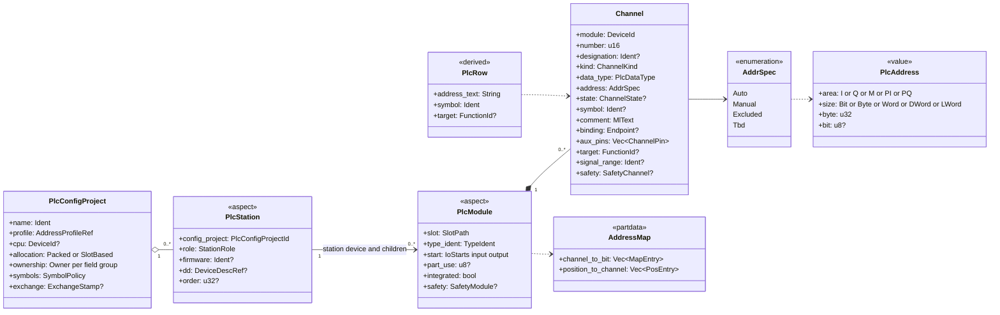
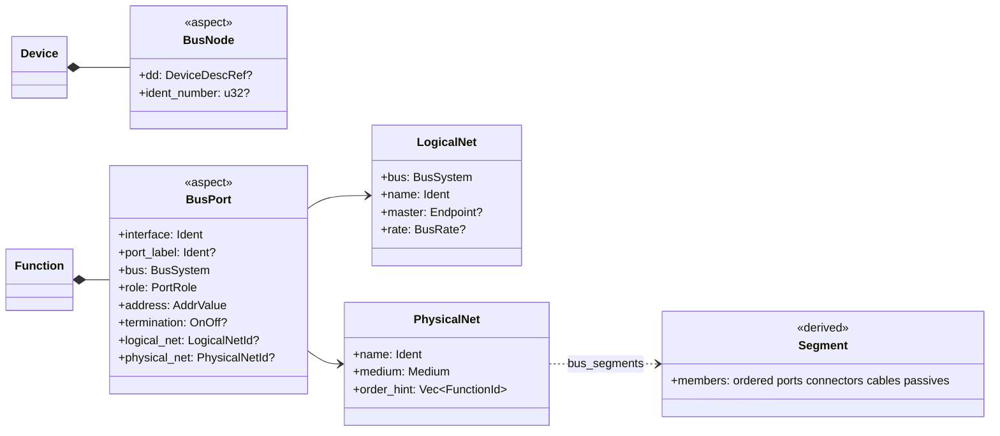
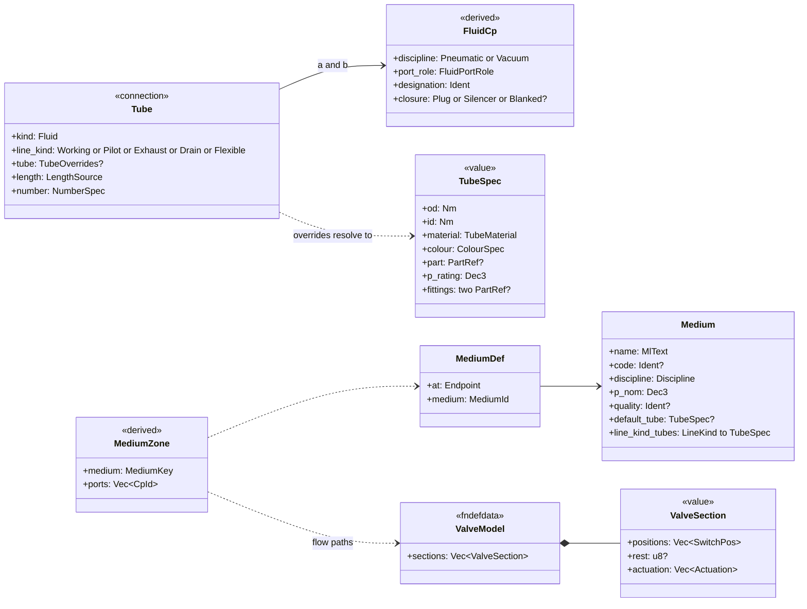
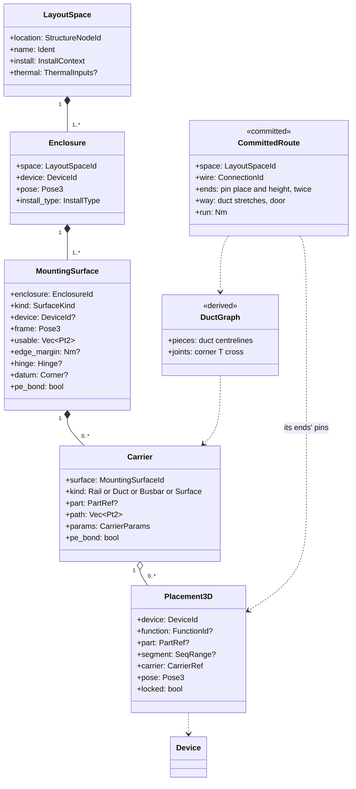
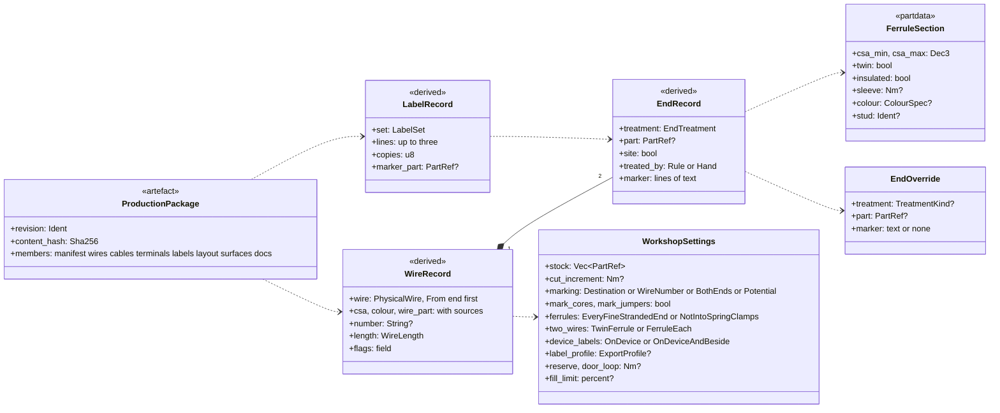
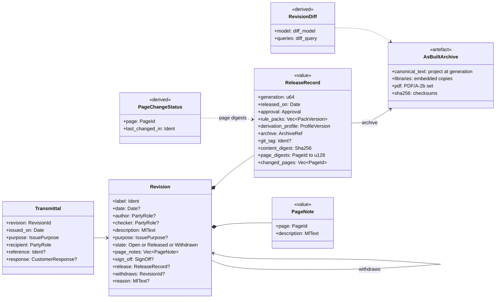
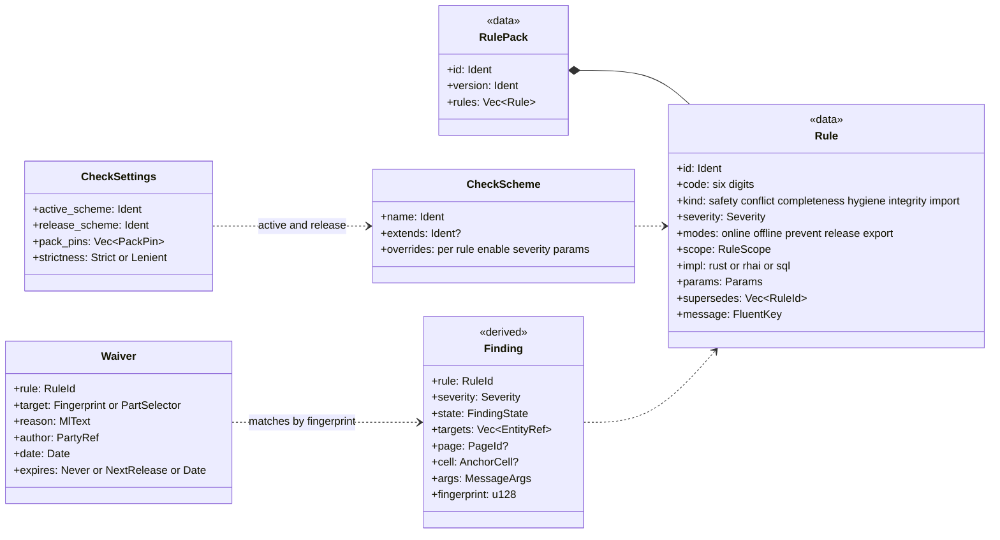

# Domain model: PLC, bus, fluid, layout, manufacturing, revisions and checks

A chapter of [Domain model](03-domain-model.md), whose table says where each section lives.

---

## 13. PLC

| Entity and purpose | Kind | Key attributes | Relationships, identity, lifecycle | Invariants |
|---|---|---|---|---|
| `PlcConfigProject` (added): one target PLC-software project | A, `project.jsonl`; the exchange body (exchange records, foreign IDs) in `exchange/<uuid>.jsonl` (1.0) | `name` ("PLC1"), `profile` (address grammar: "Siemens TIA (international)", "IEC 61131-3"; FR-PLC-008), `cpu?` (None when the DP master sits outside the project), `allocation: Packed \| SlotBased` (1.x), `ownership`: an `Owner = Ecad \| Plc \| Shared` per field group (FR-PLC-033), `symbols: SymbolPolicy{template?, strict_iec, tag_table}`, `exchange?: ExchangeStamp{format, version, file_sha256, direction, date}` | Scopes address and symbol uniqueness (FR-PLC-002); a new project has one default ([10](10-plc-and-bus.md) §2.2) | — |
| `PlcStation` aspect: an addressable participant | A | `config_project`, `role: Cpu \| HeadStation \| IoDevice \| ValveTerminal \| IoLinkMaster \| Drive \| ExternalPartner`, `firmware?`, `dd?` (GSD, GSDML, ESI, EDS, IODD reference), `order?: u32` (address-allocation order; without it UUIDv7 creation order, never tag, page or bus address) | The station is a role of a device, not a second identity (FR-PLC-001). It sits on the device that owns the bus port and the address window | — |
| `PlcModule` aspect: a card or sub-module | A | `slot: SlotPath = Rack{rack, slot, subslot} \| Positional` (rank among the station's I/O modules by `Device.position`); `type_ident` (order number plus device-description module ident); `start: IoStarts{input: AddrSpec, output: AddrSpec}` (a mixed module has both ranges); `part_use?` (which `PartUse` of the device supplies the PLC section and its address maps, needed when the device has several parts; FR-PRT-010); `integrated`; `safety?: SafetyModule{f_dest, f_source, f_wd_ms, range}` | On the station device or a child device; integrated modules cannot be deleted alone (FR-PLC-003) | S: belongs to exactly one station |
| `Channel`: the logical I/O unit (FR-PLC-004) | A, module device's shard; ID `v5(module_id, "channel", number)` | `number: u16` (0-based), `designation?` (manual; automatic and determined are derived), `kind: Di \| Do \| Ai \| Ao \| Counter \| MultiFunction \| IoLinkPort \| PowerSupply`, `data_type`, `address: AddrSpec`, `state?` (explicit Spare, Reserved or Deactivated; derived when absent, §4.2), `symbol?` (manual; automatic from target tracking, FR-PLC-017), `comment: MlText`, `binding?: Endpoint` (signal pin or the served coil's internal CP; no `Connection` row), `aux_pins: Vec<ChannelPin{role: Supply \| M \| Shield, cp}>` (added), `target?: FunctionId` (manual target override), `signal_range?` ("4..20 mA"), `safety?: SafetyChannel{evaluation, pair?, requirement?, test_pulse?}` | Number, designation and address are three fields. A normaliser creates the channels from the module's part data when the `PlcModule` aspect is added ([10](10-plc-and-bus.md) §2.4) | S: exactly one module. P: a CP in at most one channel (FR-PLC-005); address unique per area as bit-range overlap within the configuration project (FR-PLC-044); symbol unique per configuration project |
| `AddrSpec`, `PlcAddress` | A (Manual is F) / value | `Auto \| Manual(PlcAddress) \| Excluded \| Tbd`; `PlcAddress{area, size, byte: u32, bit: u8?}` stored canonically, rendered by the profile (Q0.1, %QX0.1; FR-PLC-007) | `Tbd` is a typed open item that blocks release (D-15, FR-PLC-013) | — |
| `PlcRow` | D | rendered address, symbol, function text, process tag, target, state | `channel_addresses(module)`, `plc_rows(station)` feed the PLC overview and the I/O assignment list (FR-PLC-022/023) | Chk EW-PLC-012 (FR-PLC-045): address differs from the map |

**Worked example: Q0.1 on folio 203.** Station -201U1 (valve terminal) has modules -201U3 … -201U8 and -202U2 in
manifold slots 1–7 (`SlotPath::Positional`), all with output start `Auto`. The profile's default scheme assigns output
bytes in station order, so -201U3 starts at Q0 and -202U2 at Q6 (FR-PLC-012). The 533361 address map maps channel n to
bit n. The import binds the coil 14 of -201U3-Q1 (position 1, p = 0) to channel 1, as drawn, so the derived address is
byte 0, bit 1 = **Q0.1**. The channel's automatic symbol and the valve's printed text (its function-text slot falls
back to the tracked process tag) follow the `DeviceLink` to field device -203Q1 and its process tag TA05-V-15. The
same part map also states where solenoid 14 of position p belongs (FR-PLC-011). Under "channel 2p", the suspected
vendor convention (unverified), EW-PLC-012 reports all 28 bindings as deviations; this is D-26 (FR-CHK-042, [02b](02b-requirements-extended.md) OQ2). Under "channel 2p + 1" nothing is
reported. Newly placed valves are bound by the normaliser according to the map. Channels that are neither bound nor
claimed by the map get the derived state `Deactivated` (OQ 9), which gives 8 used, 20 spare and 28 deactivated
channels. Changing -201U5's start re-addresses only its 8 channels.

`ew-schema` types these records within format 0.1 as [10](10-plc-and-bus.md) §2.2 to §2.6 say: `plc_config_project` (rank 11), `channel` (rank 37, shard of `module`, ID `v5(module, "channel", number)`), `device_link` (rank 42, §7), the device aspects `plc_station` and `plc_module`, and the part section `sections.plc`, whose `bit_of` and `positions` are the diagram's `AddressMap`. `PlcRow` is the derived row of `ew-derive`. An older 0.1 build keeps the records but does not enforce their links.

**Equivalents.** EPLAN: configuration project (20161), PLC box and card, PLC connection points with channel
designation, PLC address (20400), symbolic address (manual/automatic/determined), start address, addressing and
readdressing, AML AR APC exchange. QET: `plc_type`, `plc_address`, `plc_function`, `plc_comment` element info and,
in 0.200, `plcMasterData` (layout only).

---

## 14. Bus

| Entity and purpose | Kind | Key attributes | Relationships, identity, lifecycle | Invariants |
|---|---|---|---|---|
| `BusNode` aspect (device level) | A | device description, ident number | -201U1 is the PROFIBUS DP slave CPX-FB13 | — |
| `BusPort` aspect (on a function, FR-BUS-001) | A | `interface` ("DP"), `port_label?` ("P1R"), `bus: ProfibusDp \| Profinet \| EtherCat \| EthernetIp \| IoLink \| Asi \| …`, `role: Master \| Slave \| Controller \| Device \| Passive`, `address: AddrValue = Value(NetAddress) \| Tbd \| NotApplicable`, `termination?: On \| Off` (added, FR-BUS-004), `logical_net?`, `physical_net?` | Ports derive network properties (baud rate) instead of copying them (FR-BUS-002) | P: address unique within the logical net (FR-BUS-015) |
| `LogicalNet` | A, device shard of its master or `project.jsonl` | bus, name, master port, rate or cycle, address space | Scope of address uniqueness | — |
| `PhysicalNet` | A | `name`, `medium` (copper, fibre …), `order_hint` (members not drawn on any topology page); the ordered segments of ports, connectors, cables and passive devices are derived by `bus_segments(pnet)` from the `Bus` connections and connector links, never stored ([10](10-plc-and-bus.md) §2.7, §3.8) | Termination, length and stub rules run against the derived segments (FR-BUS-003) | Chk (FR-BUS-016): termination On at exactly both segment ends |
| External bus partner | A | `Device{kind: ExternalPartner}` with an `ExternalRef`, `BusNode`, `PlcStation{role: ExternalPartner}`, no parts | Excluded from the BOM, shown in topology and network lists (FR-BUS-005) | — |

**Example.** The logical net "PROFIBUS DP" has its master in +J-E-206 (JE-N1000-03, external partner), rate ▲. The
derived physical segment is JE-N1000-03 → -3W1 → -3X1 → -201U1 DP, master first (FR-BUS-003). -3X1 (Festo 532216) is a
connector device whose port function has `termination: On`; its "Switch to ON" text is rendered from that property.
-201U1's DP port has `address: Tbd`, an open item (D-15).

@@@ END

**Equivalents.** EPLAN: bus port (`BusTerminal` with bus address, bus system, master flag), logical network
(20414), physical network (20413), bus configuration transfer. QET: none (bus lines are conductors with `bus`
text, cable symbols).

---

## 15. Fluid power

| Entity and purpose | Kind | Key attributes | Relationships, identity, lifecycle | Invariants |
|---|---|---|---|---|
| Fluid port: a CP with fluid discipline (FR-FLU-001) | D (from `CpDef`) | `discipline: Pneumatic \| Vacuum` (Hydraulic later), `port_role: Supply1 \| Working2 \| Working4 \| Exhaust3 \| Exhaust5 \| Pilot10 \| Pilot12 \| Pilot14 \| PilotExhaust82 \| PilotExhaust84 \| ExternalPilot \| Consumer \| Sensing \| Generic` (`Pilot10`, `Consumer` for actuator ports A/B, `Sensing` and `Generic` added), designation; thread or push-in size from the part; `CpOverride.closure: Plug(PartRef) \| Silencer(PartRef) \| Blanked` closes a port without a drawn device (§7) | One graph engine for both disciplines (arch §4.2) | — |
| Tube: `Connection{kind: Fluid(FluidLine)}` (FR-FLU-002) | A, page-owned | `FluidLine{line_kind, tube?: TubeOverrides, length: LengthSource}`: `line_kind` sets the ISO 1219-1 line style; `tube` holds only the overridden fields of a `TubeSpec{od, id: Nm, material, colour: ColourSpec, part?, p_rating: Dec3 bar, t_range, fittings per end}`, each resolved with provenance (FR-FLU-010). The line tag is the common `Connection.number` (FR-FLU-011); `FluidLine` has no tag of its own | May cross the location boundary to field devices (FR-FLU-006) | S: both ends fluid CPs |
| `Medium` | A, `project.jsonl` | `name`, `code?` (ISO 1219-2 medium letter), `discipline`, `p_nom: Dec3` (bar), ISO 8573-1 quality class, temperature range, colour, `default_tube?`, `line_kind_tubes` (defaults per line kind, e.g. pilot lines) (FR-FLU-008) | `ProjectSettings.fluid.default_tube` is the project-level default below it | — |
| `MediumDef` (added): medium source | A, device shard of the owner of `at` | `at: Endpoint` (supply plate port 1, service-unit outlet), `medium` | Media propagate along valve flow paths, like potentials (FR-FLU-009); delete policy *unlink* | Chk EW-FL-005: two media joined directly |
| `ValveModel` (FnDef data, FR-FLU-007) | L | `sections: [ValveSection{positions: [SwitchPos{label, paths}], rest?, actuation: [Actuation{actuator, selects}]}]`: one section for most valves, two for a 2×3/2 body, so every valve is one fluid function (FR-FLU-004); the drawn side of an actuator is symbol graphics | Drives media propagation and valve checks ([11](11-fluid-power.md) §2.3) | — |
| `MediumZone`, effective tube | D | medium per port set; effective tube per field, from the highest level that sets it: the line's override, the data of the effective tube part, the medium's line-kind default or default tube, then `ProjectSettings.fluid.default_tube` ([11](11-fluid-power.md) §5.4) | Tube lists and cut lists (FR-FLU-012/013) | Chk EW-FL-007: line without tube spec and no default |
| Manifold galleries | D | supply, exhaust and pilot galleries from position order and the `galleries` entries of `PartCopy.sections.fluid` | Never stored as page-less fluid connections ([11](11-fluid-power.md) §5.2) | — |
| Blank position | A | a child device of kind `BlankingPlate` with a CP-less FnDef in a manifold position | A BOM item with one main function (FR-DEV-004) | — |

**Example.** Each of the 28 valves 571334 has a 5/2 monostable fluid function with ports 1–5 (printed "3 1 5" on top
and 2, 4 below, correction C3; FR-FLU-001) and a coil function 14 bound to its channel. The 8 used valves drive
the double-acting actuators of the field devices -203Q1 … -203Q8 (process tags TA05-V-15 … TA05-V-37) in +FIELD ▲,
through tube pairs F1–F16 from ports 2 and 4 (Ø ▲).

**Equivalents.** EPLAN Fluid: fluid connection points, `PLCBoxFluid` and `PLCTerminalFluid` for valve terminals,
ISO 1219 symbol library, fluid page type; media handling is unverified. QET: pneumatic elements with unnamed
generic terminals (no port semantics), so the importer needs a symbol-mapping table.

The fluid records are typed in format 0.1 as doc 11 §2.7 says: the port roles on the FnDef's CPs, `ConnectionKind::Fluid` with its line kind, and the port closure on
`CpOverride.closure`, whose part is optional (a plug's part enters the BOM at 1.0).

---

## 16. Panel layout and routing

| Entity and purpose | Kind | Key attributes | Relationships, identity, lifecycle | Invariants |
|---|---|---|---|---|
| `LayoutSpace`: one cabinet or bayed suite | A, `layout/<uuid>.jsonl` | `location: StructureNodeId` (+J-E-2416), `name`, `install: InstallContext{wall_behind, ceiling_above, neighbours, floor}` (added; thermal reads face exposure from it), thermal inputs (ambient, altitude, target temperature; FR-THM-005), `policy?` | Holds enclosures, surfaces, carriers, placements, overrides, routing paths, surface features and committed routes (FR-LAY-001) | — |
| `Enclosure` | A | `device` (-UC1, enclosure part NSYPLA1074G ▲), `pose: Pose3` (origin bottom-left-rear outside corner, X right, Y up, Z towards the door), `install_type` (THM), doors (1.0) | Tagged layout objects are devices, so parts stay on devices | — |
| `MountingSurface` | A | `kind: plate \| door \| left \| right \| top \| bottom`, `device?` (a surface part of its own: the mounting plate -UC1-U1, child of -UC1), `frame: Pose3` (u, v as the surface is seen from the side it is worked from, w towards that side), `usable` (the sheet's outline), `edge_margin?`, `hinge?: left \| right` (a door), `datum?` (the corner it is measured from; absent: bottom left), `pe_bond: bool` (FR-LAY-058) | One per face of the enclosure; the plate is made with it, every other face when a page first shows it ([12](12-placement-pages.md) §2.8, §3.1). A layout page is a view of one surface at a stated scale or "not to scale" (FR-LAY-010) | — |
| `Carrier`: rail, duct, busbar or the surface itself | A | `kind`, `part?` (layout-only part, counted in the BOM; FR-LAY-008), `path` in the surface frame, `params` (rail profile TS 35×7.5; duct W×H "40×60", slot pitch; FR-LAY-004/005), `pe_bond` | Poses of its placements are relative to it, so moving a rail moves its devices | — |
| `Placement3D`: a device, one function (e.g. a door handle) or one strip segment (e.g. a single terminal) on a carrier | A | `device`, `function?`, `part?: PartRef` (added: which part use of the device it realises; None = the primary mountable part), `segment?: SeqRange` (added: a terminal range when a strip is placed in pieces), `carrier: CarrierRef = Carrier \| Surface \| Placement` (delete policy forbid), `pose: Pose3` relative to the carrier, `variant`, `locked` (FR-LAY-006) | Stores no tag text: labels are `layout_label(placement)`, so "T51" cannot exist (D-02). Geometry comes from the part (FR-LAY-007). Panel-front representations are derived from placements by `panel_front_reps(dev)`, never stored | S: the device exists. Chk EW-LAY-001 unplaced device, EW-LAY-003 part use not on the device, EW-LAY-004 location ≠ space location |
| `RouteOverride`, `RoutingPath` | reserved (ranks 55, 57) | none typed: a way is not pinned by hand and no path is drawn ([12](12-panel-layout.md) §8.7); a manual length lives in `WireOverrides.length` of the carrier connection (§9) | — | — |
| `SurfaceFeature` (added) | A, layout file (rank 58) | a hole a person added to a surface, `{surface, at, hole, purpose?, cable?, for_cable}` (an earth stud, a spare entry; a cable's gland he placed; FR-LAY-056) | Every other hole is derived by `surface_features(surface)`; a derived hole moved or left out is a `HoleChoice` of its placement or carrier ([12-3d](12-3d-routing-thermal.md) §10) | — |
| `DuctGraph` | D | the ducts of a surface as pieces of their centrelines, joined where their outlines touch: corners, T and crosses (FR-LAY-042) | `duct_graph(surface)`, from the carriers | — |
| `CommittedRoute`, wire length | C, layout file (rank 56) | per wire: the space, the wire (its carrier connection), its two ends (CP, surface, the pin's place and height), the way as duct stretches and a door's crossing, `run` (the way's length, unrounded, without reserve or loop); the length is made from `run`, the reserve per end and the door loop and rounded once, in the `WireRecord`, to the cut increment ([12](12-panel-layout.md) §8.5, §9) | Only Route writes it (FR-LAY-046); a moved end or a changed duct stales it (EW-LAY-011) | Release exports require fresh ways |

Five kinds are typed within format 0.1: `layout_space`
`{location, name}`, `enclosure {space, device, pose}`, `mounting_surface {enclosure, kind, device?, frame, usable,
pe_bond}`, `carrier {surface, kind, part?, path, params, pe_bond}` and `placement {device, function?, part?, carrier,
pose, locked}` (ranks 50 to 54, `layout/<space>.jsonl`); every other member above (`install`, thermal inputs, `policy`,
`install_type`, doors, `max_depth`, `segment`, `variant`), surface kinds other than `Plate`, the carrier kinds busbar
and surface and the `Placement` variant of `CarrierRef` are kept verbatim. `Pose3` is integer nanometres for `t` and a
unit quaternion scaled by 10⁹ for `q`, in the surface frame (u right, v up, w out). A **rail** placement's pose is
`t = (s, 0, 0)` with `q` identity or 180° about w, `s` in [0, L] along the rail from `path[0]`; a **surface** placement's
is `t = (u, v, 0)`, rotated by k·90° about w; a **duct** carries no placement. Carriers are axis-parallel. An
enclosure's pose defaults to identity; the plate surface's frame centres the plate in the enclosure's outer W×H and
its usable polygon is the plate rectangle. `layout.place` always writes `placement.part` (the given part use, else
the primary mountable part), and `part.assign` replace follows the new copy. MVP limits: one space
per location, one enclosure per space, one plate surface per enclosure.

**PE through carriers.** A rail-bonded PE terminal on a carrier with `pe_bond`, on a surface with `pe_bond`, joins
the PE potential through that carrier. While a layout space models no PE-bonded carrier, rail-bonded
terminals of one location join a virtual "location PE" node (OQ 10).

**Example.** One layout space +J-E-2416; enclosure -UC1 with plate; five 40×60 ducts (one type ▲); three TS 35
rails ▲; placements in three rows (row 1: -102G1, -101F1, -102F1, -102F2, T55, S51; row 2: 1X1, -X1031, -X1032 with
end brackets; row 3: the valve terminal -201U1 … -202U3). Placement order and row assignment are the
acceptance criteria (FR-LAY-016). A PanelLayout page shows the plate through one `SurfaceView` page item.

**Equivalents.** EPLAN Pro Panel: layout space, mounting surface, mounting rail, cable duct, 3D macros and
placement, routing path network, wire routing and lengths. QET: none; folio 902 is free rectangles and text.

---

## 17. Manufacturing

| Entity and purpose | Kind | Key attributes | Relationships, identity, lifecycle | Invariants |
|---|---|---|---|---|
| `WireRecord`: one row of the wire list per physical wire (FR-MFG-001) | D | the physical wire (§9.2) with its From end first, effective csa and colour, the wire part (the chain's, else the stock's of its size and colour), the printed number (none for a core), the length and where it comes from (typed, with its cable, routed, stale or missing; a routed one rounded once to the cut increment), `flags.field`, two `EndRecord`s | `wire_record_set()` of `ew-derive`; one row source for the page, XLSX, CSV, the wire file and the package (ADR-0018); the consumables and the cut list read it ([13](13-manufacturing-outputs.md) §2.4, §3) | — |
| `EndRecord` | D | treatment `Ferrule \| TwinFerrule{partner} \| RingLug \| Bare \| Connector \| External \| Unknown{reason}`, its part from the workshop stock, whether it is made on site, decided by rule (with the assumption made) or by hand; the marker text, one entry per printed line | The rule table over the clamp and the conductor class, the pairing on one clamp and the shop's settings ([13](13-manufacturing-outputs.md) §4); an `EndOverride` wins | Chk: EW-MFG-008, EW-MFG-009, EW-POT-010 |
| `EndOverride` | A, `WireOverrides.end_a` and `end_b` (§9) | treatment, ferrule or ring lug part, marker text or none | On a connection of the wire's own (one no other wire stands for): `end_a` is the wire's end reached through the connection's endpoint `a`, `end_b` through `b`, so each wire at a clamp has its own end and it stays with its CP whichever way the wire reads ([13](13-manufacturing-outputs.md) §2.3) | — |
| Wire, ferrule, marker sections | L (FR-PRT-035) | `wire{csa, colour, class}`, `ferrule{csa_min, csa_max, twin, insulated, sleeve, colour, stud}`, `marker{marks, lines, chars}` ([07](07-symbols-parts-macros.md) §2.5) | The workshop stock's order chooses among them ([13](13-manufacturing-outputs.md) §4.4) | — |
| `WorkshopSettings` | A, `ProjectSettings.workshop` | the stock (wire, ferrule and marker parts in the shop's order) and the cut increment ([07](07-symbols-parts-macros.md) §2.5); the marker text (destination, wire number, both ends, potential), whether cores and jumpers are marked, ferrules (every fine-stranded end, or not into spring and push-in clamps), two wires in one clamp (one twin ferrule, or a ferrule each), device labels, the export profiles of the label file and of the wire file for a machine ([13](13-manufacturing-outputs.md) §7); for the layout's lengths and fill the reserve per end, the duct fill limit and the door loop ([12](12-panel-layout.md) §8.6, §9) | From the basic project ([13](13-manufacturing-outputs.md) §2.3) | — |
| `LabelRecord` | D | label set (wire, terminal, strip, cable markers, device labels, tube markers, plates), what it labels, up to three lines, copies, marker part, whether it fits | `label_rows()`: one engine for every label, in the order applied; one label file per label set and marker part ([13](13-manufacturing-outputs.md) §5) | Chk: EW-MFG-004 |
| Production package | X, Class II | a deterministic ZIP of the workshop's files of a job, each written by the program's own export of its kind, with `Contents.txt` and `manifest.json` (every member's kind, size and SHA-256; the revision; draft or released) ([13](13-manufacturing-outputs.md) §8) | Written by Output ▸ Workshop ▸ Package… and `ew export package` as a job; never stored in the project or the archive | A released revision's package needs the release check without an open error (FR-MFG-025) |

**Example: 102.8 of the sample.** -102Q1:14 → -102E1:X1; 24V/102Q1:14; 2.5 mm², DBU; no length typed (`—`); one twin
ferrule 2 × 2.5 mm² with 102.7 at -102Q1:14 and a ferrule 2.5 at -102E1:X1; by destination marking the markers
-102E1:X1 and -102Q1:14; page 102.

**Equivalents.** EPLAN: Smart Production, wire-end treatment by wire class (2027), labelling schemes, wire lists;
exports are proprietary. QET: wiring list view (0.200), no ferrules, no lengths.

---

## 18. Revisions and release

| Entity and purpose | Kind | Key attributes | Relationships, identity, lifecycle | Invariants |
|---|---|---|---|---|
| `Revision`: one managed project revision (FR-REV-001) | A, `revisions.jsonl` | `label` in the project's one format (V1.0, V2.0; FR-REV-002), `date?`, `author?` and `checker?` (party roles, FR-PRJ-003), `description: MlText`, `purpose?` (issue purpose, 1.0), `state`, `page_notes: [{page, description}]` (FR-REV-012; at most one note per page; `page` is not a link), `sign_off?{checker, date, scheme, packs, waivers_ack, content_digest}` (added: the checker's approval, bound to the content digest of the saved project), `release?`; on a withdrawal record `withdraws: RevisionId` (forbid link) and `reason` (added) | Open → Released by `ReleaseRevision` after `revision.approve`; withdrawing a released revision adds a separate record in state Withdrawn that points to it (FR-REV-009). "Signed off" is an open revision whose `sign_off.content_digest` equals the current digest; a later content edit voids it ([15](15-checks-revisions-collaboration.md) §5.4). A **historic** released revision (released before the project came to EW) has no release record and no archive | S: at most one open revision (EW-INV-016); labels unique among the revisions not withdrawn (EW-INV-017); the checker, when set, differs from the author (EW-INV-018; D-34, FR-REV-005); one note per page (EW-INV-019); a released or withdrawn revision is not updated (EW-INV-020, FR-REV-009). That a revision released by EW has a checker is the release gate's (EW-REL-001); label format and order are EW-REL-004 |
| `ReleaseRecord` (added, inside `Revision`) | A, value | generation, release date, approval (the sign-off copied at release: checker, date, check scheme, waivers; FR-REV-020), rule-pack versions, derivation profile, archive reference with SHA-256, git tag `ew/rev/<label>`; added: `content_digest` (at generation g, after the freeze), `page_digests: Map<PageId, u128>`, `changed_pages` (frozen) | Written in the same atomic release step as the archive ([05](05-project-format-and-persistence.md) §14.1) | — |
| `Transmittal` (added) | A, `revisions.jsonl` (rank 63, anchored to its revision) | revision, issued on, purpose, recipient role, reference, customer response | Issue and approval history towards the customer (1.0, [15](15-checks-revisions-collaboration.md) §5.9); not a content edit | — |
| `AsBuiltArchive` (ADR-0013) | X | canonical text at the released generation, embedded libraries, PDF/A-2b, frozen report rows, check report, SHA-256 sums (FR-REV-008); stored at `<parent>/<name>.ew-archive/<label>.ewarchive` | Loaded into a read-only `Model` for comparison (FR-REV-010, FR-REV-014) | — |
| `PageChangeStatus`, `RevisionDiff` | D | page change status from per-page display-list digests compared with the last release's `page_digests`, or the page notes where no digests exist (FR-REV-004, FR-REV-022); entity and query deltas: BOM, wire list, terminals, PLC addresses (FR-REV-015) | Page digests reuse the memoised display lists (Class I); `diff_model` and `diff_query` against the archive stay for property comparison and deltas | — |

The title block's "Revision" cell binds to the project revision query, so every page prints the same label (D-05).
Committed computations (routes, frozen numbers, report snapshots) are frozen at release (FR-REV-011). A release whose
predecessor is a historic released revision, which has no digests, takes its `changed_pages` from the page notes.

`ew-schema`'s `Revision` types `label`, `date?`,
`author?`, `checker?`, `description`, `state` (with the `Unknown` catch-all), `page_notes`, `withdraws?`,
`source_ref?`, `reason`, `release?` and `sign_off?`, which `revision.withdraw`, `revision.release` and
`revision.approve` write; `purpose` stays in `extra`. `date` and `author` are optional: an
open revision may have neither yet, and a historic revision may have neither author nor checker. A page note's text
member is `description`, like the revision's. A note is not a link to its page: a released revision is immutable, so
its notes keep naming a page that a later revision deletes, and a note on a missing page selects nothing.
`withdraws` is the ID of the withdrawn revision, never its label, and a forbid link (§4.2). The structural rules are
EW-INV-016 to EW-INV-020 of `crates/ew-model/invariants.md` ([ADR-0009](../adr/0009-invariant-catalogue.md)
amendment 6). Commands: `revision.create` (an open revision or a historic released one; refused with `state:
released` once any revision has a release record), `fields.set` on the open revision and `edit.delete` of
the open revision ([06](06-schematic-editor.md) §3.1). The title block's current revision is the open one, else the
latest released one by date, natural label order and ID, leaving out a revision that a withdrawal record names.
*Property grid:* `author` and `checker` show read-only in the grid, because they
decide the four-eyes sign-off, although `fields.set` can still write them ([15](15-checks-revisions-collaboration.md) §5.4).

**Equivalents.** EPLAN: revision management, revision project `*.ell`, completed project `*.elr`, change markers
and property comparison. QET: `indexrev` per folio, free text.

---

## 19. Checks

| Entity and purpose | Kind | Key attributes | Relationships, identity, lifecycle | Invariants |
|---|---|---|---|---|
| `RulePack`, `Rule` | data (shipped packs trusted; project packs `rules/<uuid>.toml` untrusted until the project is trusted) | `id` (EW-POT-013), six-digit `code`, class, `kind`, severity and release severity, modes `online \| offline \| prevent \| release \| export`, `scope` (the memo key of `checks(scope)`: project, page, potential, net, strip, cable, device, module, station, cfg (configuration project), lnet, pnet, fluid_net, space, surface, carrier), implementation (Rust, rhai or SQL), parameters and data tables with a `verified` flag, `supersedes`, Fluent message key, docs path (FR-CHK-001, [15](15-checks-revisions-collaboration.md) §2.3) | Versioned; a released revision records pack versions (FR-CHK-004) | — |
| `CheckSettings` (added) | A, in `ProjectSettings` (`project.jsonl`) | `active_scheme` (online, default `drafting`), `release_scheme` (gate, default `pre-delivery`), pack pins `{id, version_req}`, `strictness: Strict \| Lenient{since}`, rule parameters (only `{active_scheme?, release_scheme?}` are written, in `settings.extra.checks`, by the `HumanOnly` command `project.checks.set`, §5.1) | Company schemes may lock rules (FR-CHK-050) | — |
| `CheckScheme` | A, in `ProjectSettings` or the company basic project | `name`, `extends`, per-rule enablement, severity, release severity and parameters; `drafting`, `pre-delivery`, `migration`, `full` and others ship (FR-CHK-003) | Resolved pack defaults → company scheme → project scheme | — |
| `Finding` | D (online: Class I; offline and SQL rules: Class II) | rule, code, severity, `state: open \| pending \| waived \| superseded \| deferred \| possibly_resolved`, target entity refs, page and cell, message arguments (entity references, rendered at display time), origin, `fingerprint` = first 128 bits of SHA-256 over rule ID, sorted target IDs and a rule-defined discriminator (FR-CHK-044) | `checks(scope)`; the migration report is a check run in lenient mode (FR-CHK-011) | — |
| `Waiver` | A, `waivers.jsonl` | rule, `target: Fingerprint \| PartSelector{library, item}` (part selector from 1.0), reason (may be empty), author (optional), date, `expires: Never \| NextRelease \| Date` (FR-CHK-009) | Matches a finding by fingerprint, which survives renumbering, or every finding of the rule on the part; safety rules accept only fingerprint waivers; unmatched and expired waivers are reported (EW-CORE-081, EW-CORE-082) | — |

Prevent rules are the P invariants of the sections above; structural invariants are not rules and cannot be
waived. On a project with the reference set's defects, `ew check --scheme pre-delivery` reports them (FR-CHK-042):
among them D-13 (N switching), D-26 (address bits, depending on the map), the TBD station address, missing parts and
unplaced devices.

**Equivalents.** EPLAN: check runs and message management with message classes (P001xxx terminals, P003xxx cables,
P005xxx connections, P017xxx numbering). QET: none beyond import warnings.

---

## 20. The reference drawing and the sample project

The tests open the sample project (`fixtures/sample/`), which its script
draws, and [reference-drawing.md](../research/reference-drawing.md) §4 keeps the analysis of the reference drawing.

