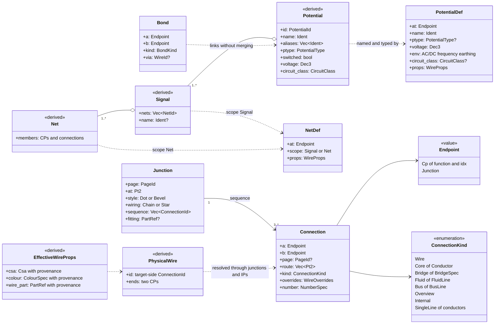
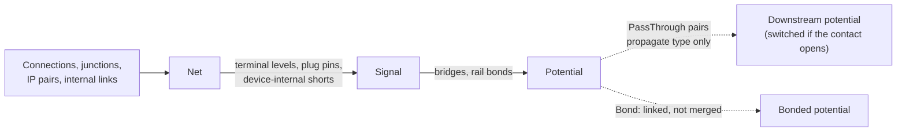
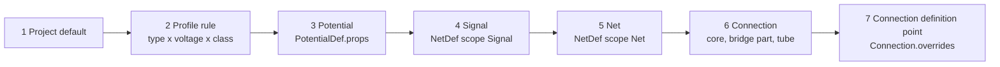
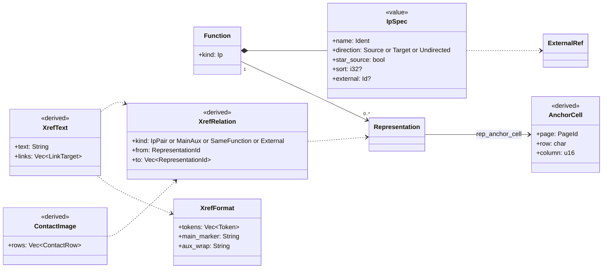
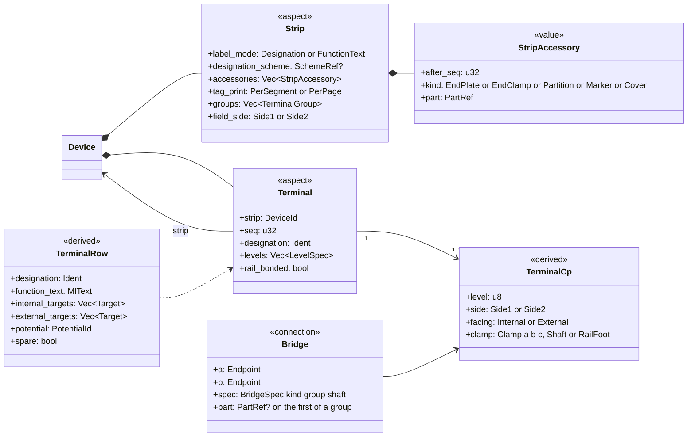
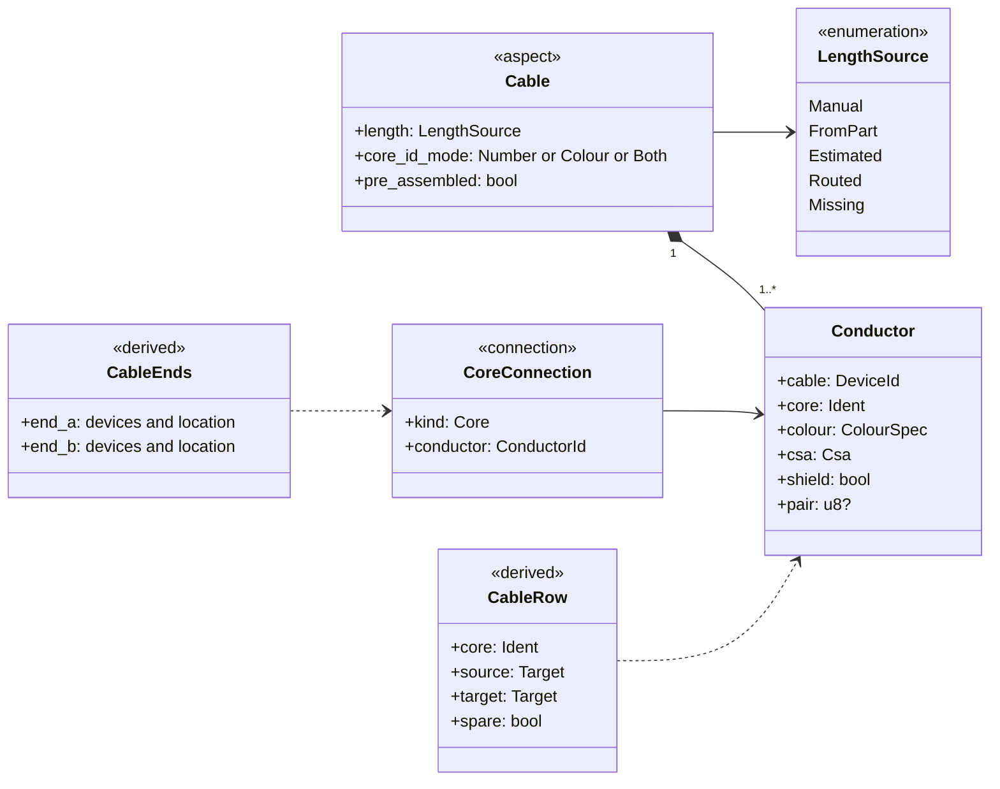

# Domain model: connectivity, interruption points, terminals and cables

A chapter of [Domain model](03-domain-model.md), whose table says where each section lives.

---

## 9. Connectivity: connections, nets, signals, potentials

| Entity and purpose | Kind | Key attributes | Relationships, identity, lifecycle | Invariants |
|---|---|---|---|---|
| `Connection`: one explicit logical edge with a route (ADR-0007) | A; page-owned when drawn, else in the shard of the device that owns endpoint `a` | `a, b: Endpoint = Cp{function, idx} \| Junction(JunctionId)`; `page?` (added: None for strip-editor bridges and page-less internal links); `route: Vec<Pt2>` (nm, orthogonal, FR-CON-007); `kind: Wire \| Core(ConductorId) \| Bridge(BridgeSpec{kind, group, shaft}) \| Fluid(FluidLine) \| Bus(BusLine{cable?}) \| Overview \| Internal \| SingleLine{conductors: u8}` (`SingleLine` is 1.0; at MVP single-line pages draw connections as `Overview`, which join no nets); `overrides: WireOverrides` (the CDP level); `number: NumberSpec` (wire number or fluid line tag) | Several connections may share one CP; their order is the order of the junction sequence or, for direct connections, ascending ID (FR-CON-006). Moving representations never changes connectivity (FR-CON-004) | S: endpoints exist and differ; `Fluid` joins fluid CPs, `Bus` joins bus-port CPs, the other kinds join electrical CPs. `Overview` and `SingleLine` connections never join nets (FR-CON-002, FR-CON-029) |
| `Junction`: explicit T-node (REF-034, D-20) | A, page-owned | `at: Pt2`, `style: Dot \| Bevel{orient}`, `wiring?: Chain \| Star` (added; absent: the style's default, Dot → Star, Bevel → Chain), `sequence: Vec<ConnectionId>`, `fitting?: PartRef` (fluid pages only: a drawn fluid T is a physical tee, [11](11-fluid-power.md) §5.1) | Created and cleaned up by normalisers | S: every connection ending at the junction is in `sequence` and vice versa; at least three connections |
| `WireOverrides`: explicit per-connection values (CDP) | A, value | `csa?`, `colour?: ColourSpec`, `wire_part?`, `insulation?`, `function?`, `flags{shielded, twisted}`, `show_marker`; added: `length?: Nm` (the length typed by hand, which works without a layout space, [12](12-panel-layout.md) §9) and `end_a?`, `end_b?: EndOverride{treatment?, part?, marker?}` (the wire's end reached through endpoint `a`, `b`, set by hand on a connection of that wire's own, [13](13-manufacturing-outputs.md) §2.3) | Rendered as a wire annotation on request (FR-CON-023, FR-CON-024). A wire's own values (its length, colour, size, flags, ends set by hand) stand on a connection no other wire stands for, so a star's or a chain's siblings keep theirs, and follow the wire through every change of the wiring ([13](13-manufacturing-outputs.md) §2.3) | Chk: override equal to the derived value ("move override to profile" quick fix) |
| `PotentialDef`: names and types a potential | A, device shard | `at: Endpoint`, `name: Ident`, `ptype?: PotentialType` (None = naming only; a set type wins over propagation; `switched` is always derived from opening pass-through pairs), `voltage: Dec3` (V), `env{ac_dc, frequency, earthing?: Pelv \| Selv \| Floating}`, `circuit_class?` (added), `props: WireProps` (added) | Optionally drawn as a definition-point symbol (FR-CON-010). A definition may only name its potential (N-55T, N-55S) or also give its type, voltage and class | Chk: two definitions with different name or type in one potential (EW-POT-017) |
| `NetDef`: properties for one signal or net | A, device shard | `at: Endpoint`, `scope: Signal \| Net` (added), `props: WireProps` | FR-CON-016 | — |
| `Bond`: intentional link of two potentials (REF-038) | A, device shard | `a, b: Endpoint`, `kind: Pelv0vPe \| FePe \| Equipotential \| Shield`, `via?: WireId` (added) | The physical wire named in `via` stays in wire lists but does not merge the two potentials (D-22) | Chk (FR-CHK-028): different types joined without a bond; PELV without exactly one 0 V–PE bond |
| `Net`, `Signal`, `Potential` | D | see §9.3–§9.4 | `page_local_nets(page)`, `stitch_graph()`, `potential_partition()` | — |
| `PhysicalWire`: what the shop cuts | D | ID, two CP ends, constituent connections | §9.2 | — |
| `ColourProfile`, `SizeProfile` | A, in `ProjectSettings` | colour: rows `(voltage class, PotentialType) → (ColourSpec, name: MlText)`, company codes, `basis: Standard \| CompanyConvention` (D-37); size: rows `circuit class → (csa, wire_part?)` | Generate the cover tables of folio 1 (FR-REP-028) | — |

A non-empty `Connection.route` is the drawing ([ADR-0033](../adr/0033-schematic-routing-model.md)): the full orthogonal vertex list from end `a`'s point (a CP's or a
junction's) to end `b`'s, both included, every corner between on the page grid or on an end's coordinate; a reader
draws it as stored and joins an end that has moved off it with one straight segment. An empty route on a page
connection whose ends lie at two points means the connection is *unrouted*: it is drawn as a dashed right-angled line
between its ends, has no wire geometry for normaliser 7, EW-TERM-006 or autoconnect, and is reported by EW-CORE-073.
Routes are written only by an explicit step (the Wire tool, Route, a move's re-solve, an
importer); no reader routes.

### 9.1 Potential types and circuit classes

`PotentialType = L1 | L2 | L3 | L | N | PE | PEN | FE | LPlus | LMinus | M | Signal | Undefined` (FR-CON-010).
`CircuitClass = Mains | Control | Analogue | Bus | Pe` is derived from type and voltage or set on the definition
(FR-CON-022). A PE connection takes the highest circuit class of its two ends (mains > control > analogue > bus, PE
ignored): at a device end from the device's own potentials, at a terminal end from the potentials on the terminal's
strip (FR-CON-038). So the size profile can give PE wires at mains devices 1.5 mm² and at control devices 0.75 mm²,
as on folio 1.

### 9.2 Junctions and physical wires

Connections are drawing edges; the shop needs CP-to-CP wires. `physical_wires_of(potential)` (memo per potential,
arch §6.4; algorithm in [08](08-connections-terminals-cables.md) §3.8) resolves them, and the wire list, routing and
`WireRecord` read it:

- A connection between two CPs is one wire with the connection's ID.
- Through an IP pair the drawn parts on both pages form one wire, which takes the ID of the **target-side**
  connection. W11 (-101F1:2 → -102G1:L via L-1) is one wire.
- Through a junction, `wiring` decides: **Star** joins the first CP in `sequence` to every other CP; **Chain** joins
  consecutive CPs. Each non-first branch connection gives one wire with its ID. At F55:2 on folio 101 a Dot junction
  in Star mode gives W13 (F55:2 → E55:L) and W14 (F55:2 → E56:X2).
- Direct connections that share a CP form a daisy chain in ascending ID order (FR-CON-006). The bevelled top bus on
  101 is two such chains, not a junction: W7 (S51:1 → -101F1:1) and W8 (-101F1:1 → F55:1) on the L side, W9 and
  W10 on the N side. The physical wires are the same as with a Chain junction.
- A bond's `via` connection is cut from the potential union but still forms a physical wire (§9.6).

Wire identity is therefore a connection UUID (FR-MFG-001), stable under renumbering and route edits.

### 9.3 Three levels: net, signal, potential

| Level | Joined through | Bounded by | Example |
|---|---|---|---|
| **Net** | connections of kind Wire, Core, Bus, Internal; junctions; IP pairs | every function CP (terminals, plugs and devices included) | W29: -102F2:Out1 → IP 24VDC-1 → -X1031:1 side 1 |
| **Signal** | nets joined by `Short` internal links: terminal levels (feed-through), plug/socket pins, duplicated device pins (PSU +#1/+#2) | bridges, rail bonds, `PassThrough` pairs, devices | W29 plus the -106W1 BN core to -201U1:5 through -X1031:1: signal "24VDC-1" |
| **Potential** | signals joined by `Bridge` connections and rail bonding (FR-CON-015) | `PassThrough` pairs (contacts, poles, channels), loads, bonds | 24VDC-1 = 4 signals over the bridged -X1031:1–4, aliases 24VDC-AIR1…4 |

The potential is the arch's "potential": the electrically equal set (FR-CON-009). The signal is what
potential-oriented wire numbering with net extension numbers once (FR-NUM-020: "24VDC-1.1" for W29 and its
continuation through -X1031:1). Overview connections never take part.

### 9.4 Potential identity, name and type

- **Identity:** `PotentialId` is the minimum `PotentialDef` ID when the potential has one or more definitions, else
  the minimum member CP ID, so the ID is stable under edits that do not touch the definitions or the members, and a
  second definition symbol does not change it (FR-CON-013). Nets and signals use the minimum member ID.
- **Name:** the `PotentialDef.name`; else the name of the first source IP in page order; else a deterministic
  fallback `<displayed tag>:<CP designation>` of the minimum member. All other IP names on the potential are aliases
  (D-24, FR-CON-012): 24VDC-1 has aliases 24VDC-AIR1…AIR4; signals take the first IP name inside them.
- **Type:** the definition's type; else the `potential_role` of member CPs (PSU "+" → L+, "−" → M, a PE pin → PE);
  else the type propagated across a `PassThrough` pair from the upstream potential. Passing a pair with
  `opens: true` sets `switched`. T55's contact 5–3 is `PassThrough{opens: true}`, so N-55T (T55:3, E55:N) is
  "N, switched", and EW-POT-013 reports D-13 unless the FnDef declares `switches_n_with_l` (FR-CHK-019).
- **Conflicts** (two types, two voltages, PE joined to M without a bond) are findings, never silent merges
  (FR-CHK-028).

### 9.5 Wire-property inheritance

Every effective property is the value of the highest level that sets it, with **provenance** (level and defining
entity) exposed in the property grid and `ew query --explain` (FR-CON-017, FR-CON-025):

Levels 2 to 5 are evaluated once per potential (`wire_props_of(potential)`, arch §6.3). Level 6 is the connection's
intrinsic data: a core takes colour and cross-section from its `Conductor`, a bridge from its part. Level 7 is the
explicit override, rendered as a wire annotation. This extends arch §6.4's chain ("connection override (CDP) > net
definition > potential definition > profile rule > project default") with the signal and intrinsic levels; it does
not reorder it.

| Wire | Potential (type, voltage) | Effective value | Provenance |
|---|---|---|---|
| W29 -102F2:Out1 → -X1031:1 | 24VDC-1 (L+, 24 V DC, control) | 0.75 mm², DBU | level 2, profile "DBU/WH 24 V" row (L+, 24 V DC) and size row "control" |
| W20 -102G1:+#1 → -102F1:1 | +24V (L+) | 1.5 mm², DBU | 1.5 mm² (level 7, CDP: the marker "1.5 DBU" on folio 102 sets the cross-section only), DBU (level 2, profile) |
| W4 1X1:1 → S51:2 | L (L, 230 V AC, mains) | 2.5 mm², BK | 2.5 mm² (level 7, CDP of the marker "2.5 BK"), BK (level 2, profile) |
| W8 -101F1:1 → F55:1 | L-S (L, 230 V AC) | 1.5 mm², BK | level 2, mains row |
| -106W1 core WH, -X1031:2 → -201U1:4 | 24VDC-1 | WH, csa of the core | level 6, conductor of -106W1 |
| W19 E55:PE → -X1032:1 | PE | 1.5 mm², GNYE | level 2, PE at a mains device |
| W33 -X1032:3 → -201U1:FE | PE | 0.75 mm², GNYE | level 2, PE at a control device |

Folio 1's rule "if size or sign is not indicated, standard size is to be used" (D-08) is thus executable, and the
cover tables are generated from the same profile.

### 9.6 Bonds

PE-0VDC (W27, -102G1:−#1 → -X1032:2 via the IP PE-0VDC) is a real wire with ferrules and a length. It is modelled
as `Bond{a: -102G1:−#1, b: -X1032:2, kind: Pelv0vPe, via: W27}`. `stitch_graph()` excludes W27's connections from the
union and records a bond edge, so 0V and PE remain two potentials, the PELV rule sees exactly one bond, and the wire
list shows W27 with potential "0V ⇄ PE". The bond wire is still a physical wire: `physical_wires_of` runs on the full
drawing graph, including the via connections.

**Naming on a bond path.** The cut sits at the via connection. Interruption points that lie on the bond's `via` path
are named on the bond, not on either potential, and still print their cross-references: "PE-0VDC" names B1 and is
neither an alias of 0V nor of PE ([08](08-connections-terminals-cables.md) §3.5).

**Equivalents.**

| Concept | Derived from it | EPLAN | QET |
|---|---|---|---|
| `Connection` | nets, wires, wire list | Connection (generated by autoconnect between aligned points) | `<conductor>` with element/terminal endpoints and `<segment>` path |
| `Junction` | wire order, physical wires | Connection symbols: angle, T-node with target direction, jumper | none: dots drawn where conductors meet |
| `WireOverrides` | level-7 values, wire annotations | Connection definition point | conductor `conductor_color`, `conductor_section`, `function`, `tension_protocol` |
| `PotentialDef`, `NetDef` | potential name, type, levels 3–5 | Potential definition point, net definition point | none: properties copied between conductors by the UI |
| `Net`, `Signal`, `Potential` | highlighting, overview, numbering scopes | Net, signal, potential (EPLAN's potential also spans contacts and fuses; EW models that span as type propagation) | implicit "everything connected"; rebuilt on import |
| `Bond` | PELV and FE checks | none | none |

---

## 10. Interruption points and cross-references

| Entity and purpose | Kind | Key attributes | Relationships, identity, lifecycle | Invariants |
|---|---|---|---|---|
| Interruption point: `Function{kind: Ip(IpSpec), device: None}` with one CP and a representation (arch §4.2) | A; function in the page file of its representation, which it follows on a page move ([05](05-project-format-and-persistence.md) §2.2); representation page-owned | `name: Ident` ("L-1"); `direction: Source \| Target \| Undirected` (signal direction, independent of the arrow glyph's orientation, FR-XRF-009); `star_source: bool` (added); `sort?: i32` (chain order, added); `external?: ExternalRefId` (added); `group?: u32` (added: external points of one reference with the same group print where they come from once, at the group's last point on the page; set by `ip.supply_in` when several points are marked at once or one is marked under or over a marked point of its place) | Its CP joins the local net; the pair joins nets across pages (§9.3). "Create counterpart" makes the partner on a chosen page (FR-XRF-014). The pairing scope is the project setting `ip_pairing.scope` (§5), not a member of `IpSpec`. Owned by its page: deleting the page or the IP representation deletes the function and the connections at its CP (ADR-0009 amendment 3). | S: `device` is None and the function has exactly one representation (ADR-0009 amendments 2 and 3; EW-INV-003, EW-INV-013). P: in star mode at most one star source per name and scope; in chain mode an even count, ordered by sort key (ADR-0009). Chk (FR-CHK-017): unpaired, ambiguous |
| External connection point: an IP with `external = Some(ref)` | A | as above | Never pairs inside the project; prints the external target "+J-E-206 / JE-N1000-03" (FR-XRF-012), the parts its reference holds ([06](06-schematic-editor.md) §3.5) | Chk (FR-CHK-033): external connection without a cable |
| `XrefFormat`: how relations print | A, in `ProjectSettings` | tokens `{page}` (folio label, QET `%F`), `{page_index}` (`%f`), `{row}` (`%l`), `{column}` (`%c`), `{function}` (`%M`), `{location}` (`%LM`), separators; main marker "∞ "; auxiliary wrap "(…)"; matrix layout (FR-XRF-008) | Presets "102-A1" (`%F-%l%c`), "(201-E1)", "/101.16" (FR-XRF-002) | — |
| `XrefRelation` | D | kinds: IP pair (star or chain), main ↔ auxiliary function, same function in another representation type (overview ↔ detail), pair cross-reference (1.x), external | Computed from functions and representations; never stored (FR-XRF-001) | — |
| `AnchorCell`, `XrefText`, `ContactImage` | D | cell on the target page's own frame (FR-XRF-021); text with link targets to PDF named destinations (FR-XRF-019); contact image rows from part contact data and auxiliary functions (FR-XRF-017) | Prefixed by structure only when the target page's structure differs (FR-XRF-004) | Chk (FR-CHK-035): target cell outside the frame or empty |

**Pairing.** IPs pair by `(name, scope key)`, where the scope key is the IP's resolved structure at the project's
pairing scope (project, `=` or `+`; FR-XRF-010). In **star** mode the star source refers to all others and each other
point refers to the source; in **chain** mode points pair in `(sort, page order, cell)` order (FR-XRF-007).
In star mode two points of one direction are never tied to each other: without a star the source is
the first source point, else the first undirected point; targets of a name without a source wait unpaired for it,
and a second source without a star stays apart (EW-CORE-052 asks
which one feeds).

**Worked examples** (all from the reference project's cross-reference table):

| Relation | Source | Target | Printed at source | Printed at target |
|---|---|---|---|---|
| IP pair L-1 | 101-H16 (Source) | 102-A1 (Target) | 102-A1 | 101-H16 |
| IP pair PE-1.1 (glyph ◁ at the target) | 101-G15 | 103-G6 | 103-G6 | 101-G15 |
| Main ↔ aux, -201U1 | main on 201-E1 (assembly view) | aux on 3-B2 (bus port) and 106-G3 (power connector) | ∞ 3-B2, 106-G3 | (201-E1) |
| Main ↔ aux, -201U3 | slot in the assembly view, 201-E4 | black-box frame on 203-B4 | ∞ 203-B4 | (201-E4) |
| External | J-E-206-L at 101-G0 | +J-E-206 / JE-N1000-03 | +J-E-206 / JE-N1000-03 | — |

The reference prints "3-B0" for -201U1 because QET anchored the xref to an invisible symbol origin (D-14). EW
computes 3-B2 from the bus-port symbol's anchor policy.

**Equivalents.** EPLAN: interruption points pair by full DT, star or chain, sort dialog; cross-reference types main
↔ auxiliary, multi-line ↔ overview, pair cross-reference; contact images "in path" or "on component". QET: folio
reports (`next_report`/`previous_report` linked by `links_uuids`, label formula `<report label>`), master/slave xrefs
with `<xrefs>` settings (`master_label`, `slave_label`, `snapto`). EW recomputes all texts on import instead of
importing them and reads each project's own formulas (C-15).

---

## 11. Terminals

| Entity and purpose | Kind | Key attributes | Relationships, identity, lifecycle | Invariants |
|---|---|---|---|---|
| Strip: `Device` with `Strip` aspect | A | tag (-X1031), `label_mode: Designation \| FunctionText`, `designation_scheme?` (FR-NUM-024), `accessories: Vec<StripAccessory{after_seq, kind, part}>` (FR-TRM-016), `tag_print: PerSegment \| PerPage` (FR-TRM-011); added: `groups: Vec<TerminalGroup{from_seq, to_seq, label: MlText}>` (range captions such as "Pneumatics" and "Spare", FR-TRM-010) and `field_side: Side1 \| Side2` (default Side2, FR-TRM-012) | Drawn as one or more `StripSegment` representations of its main function: -X1031 at 103-A3 and 103-A10 is one device and one BOM row (D-42) | S: no Terminal or Cable aspect on the same device |
| Terminal: `Device` with `Terminal` aspect; **a terminal is a device** (arch §4.2) | A | `strip: DeviceId`, `seq: u32` (drawn and mounting order, independent of the designation, FR-TRM-003), `designation: Ident`, `levels: Vec<LevelSpec{level: u8, role: Main \| Aux}>`, `rail_bonded: bool` (FR-TRM-017); part per terminal (mixed parts allowed, FR-TRM-018); `function_text` (the printed label "1+", FR-TRM-010); `state` (Spare) | May exist unplaced and be placed from the strip editor (FR-TRM-015). Its full designation is the strip tag plus ":" plus designation | P: designation non-empty (D-11) and unique within the strip (D-12), checked at transaction end so swaps need no temporary names (FR-TRM-002, FR-TRM-022). S: `strip` has a Strip aspect |
| Terminal CPs | D | `level`, `side: Side1 \| Side2` (the physical clamp side from the part's CP pattern, persisted on `CpDef.side` and `CpData.side` as `"side1"` or `"side2"`) and the derived `facing: Internal \| External` (side 2 faces the field unless `Strip.field_side` says otherwise, [08](08-connections-terminals-cables.md) §2.1), `clamp: ClampKey = Clamp(char) \| Shaft(u8) \| RailFoot` from the part pattern; PT 2.5-TWIN = level 1, clamp a (side 1), clamps b and c (side 2), plus bridge shafts; a PE terminal adds a rail foot for carrier bonding (1.0) | Internal connectivity from the FnDef: a feed-through joins all CPs of a level, shaft included (`Short`), a disconnect terminal by state (FR-TRM-020) | — |
| Bridge: `Connection{kind: Bridge(BridgeSpec)}` | A; page-owned when drawn, else in the strip's shard | `BridgeSpec{kind: PlugIn \| Saddle \| Wire \| InterLevel, group: u16, shaft: u8}`; the connections of one group (a comb over consecutive `seq` on one shaft) are one bridge object, and only the first carries the part in `overrides.wire_part`, read as level-6 data | Joins signals into one potential (§9.3); appears in terminal diagrams and the BOM (once per group), never as a wire (FR-TRM-007) | S: both ends are terminal CPs. P: a group runs over consecutive `seq` on one shaft, and groups do not overlap |
| `TerminalRow` | D | designation, level, function text, part, potential, internal and external targets (device, CP, cable and core), bridges, spare | `terminal_rows(strip)` feeds terminal diagrams (FR-REP-009) and assembly lists | — |

**Example: -X1031.** 20 terminal devices, designations 1–20 (proposal ▲), function texts "1+" ×4, "2+" ×2, "3+"
×2, "4+" ×2, "1-" ×4, "2-"/"3-"/"4-" ×2, `label_mode = FunctionText`, so the drawing looks as before while lists are
unambiguous. `Strip.groups` carries the captions "Pneumatics" (1–4, 11–14) and "Spare" (5–10, 15–20). Bridges 1–2–3–4,
5–6, 7–8, 9–10 and 11–20 are plug-in bridge groups defined in the strip editor (`page = None`); BR1, for example, is
three connections 1–2, 2–3 and 3–4 with one `group`. Twelve terminals are spare. -X1032 (5 × PT 2.5-TWIN-PE) is
rail-bonded, which joins it to 1X1:PE and the PE bar -XPE through the location's PE node (§16) without a drawn wire
(D-21).

**Equivalents.** EPLAN: terminal strip definition, terminals as functions with designation `<20030>`, multi-level
terminals, saddle jumpers, alignable accessories, edit-terminal-strip dialog. QET: terminal elements
(`element_type`, `terminal_type`, `terminal_function`), from 0.100 `<terminal_strips>` with `physical_terminal`,
`real_terminal` and `terminal_strip_bridge`; older projects infer strips from label prefixes such as "X1031:1+".

---

## 12. Cables

| Entity and purpose | Kind | Key attributes | Relationships, identity, lifecycle | Invariants |
|---|---|---|---|---|
| Cable: `Device` with `Cable` aspect | A | tag (-106W1), part, `length: LengthSource = Manual(Nm) \| FromPart \| Estimated(C) \| Routed(C) \| Missing` (default `Missing`) (FR-CBL-009/010), `core_id_mode` (FR-CBL-006), `pre_assembled` and connector parts (FR-CBL-013) | Its main function is drawn as the cable definition line and marker; drawing the line runs a command that assigns the crossed connections (FR-CBL-002), so assignment is explicit, not geometric | Chk (FR-CHK-033): no length; release blocks |
| `Conductor`: one core or shield | A, cable's shard | `core: Ident` ("1", "BK", "A"), `colour?: ColourSpec`, `csa?: Csa` (absent while unknown), `shield: bool` (FR-CBL-007), `pair?` (FR-CBL-019) | Generated from the part's core definition on assignment (FR-CBL-004); a drawn connection becomes `kind: Core(conductor)` (FR-CBL-003). One core may span several pages through IPs | Chk (FR-CHK-032): colours outside IEC 60757 or different from the part |
| `CableRow`, `CableEnds` | D | per core: source and target (device, CP, location), spare; ends from conductor endpoints (FR-CBL-012) | `cable_rows(cable)` feeds cable diagrams and overviews (FR-REP-012/013) | — |

**Example.** -106W1 and -106W2 (Festo NEBU-G78W5-K-2-N-LE5): cores BK, BU, GNYE, WH, BN (drawn "BR"), length
`FromPart` (2 m, unverified). -3W1 (6XV1830-0EH10): cores A and B plus a shield, drawn single-line on folio 3 as
one `Connection{kind: Bus(BusLine{cable: -3W1})}` (FR-CBL-008), length `Missing` until entered. The incoming supply
cable -101W1 from +J-E-206 to 1X1 (3 cores, ▲) resolves D-19.

**Equivalents.** EPLAN: cable definition line, cable DT, conductors with function definition "conductor/wire",
connection definition points at intersections, shields, edit-cable dialog. QET: `<cables>` with `<core>` entries in
0.200; plain cable symbols in 0.100, inferred on import.

