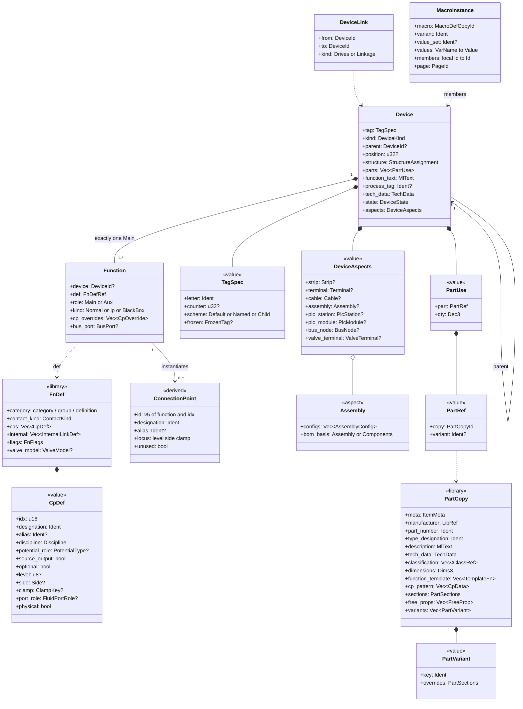
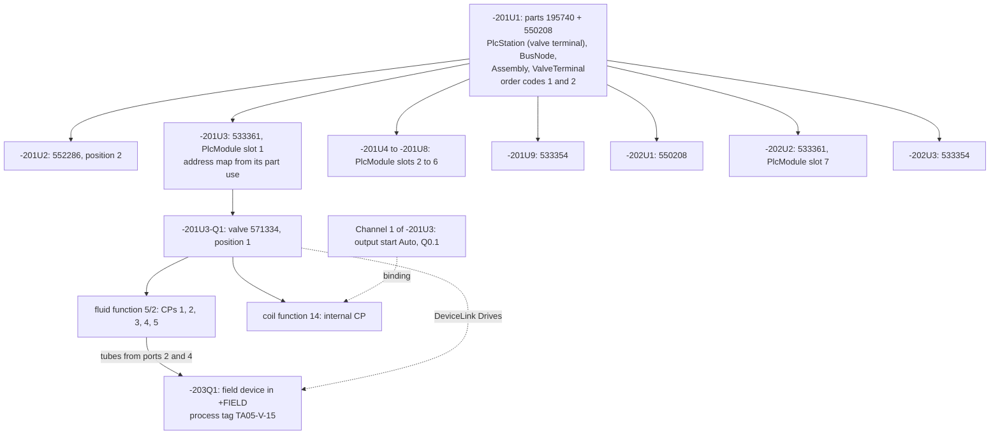
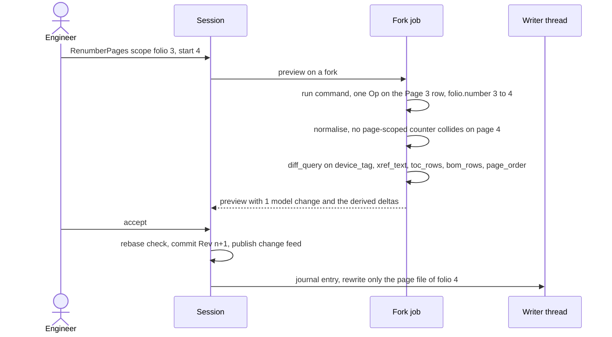

# Domain model: functions, devices, parts, tags and numbering

A chapter of [Domain model](03-domain-model.md), whose table says where each section lives.

---

## 7. Functions, devices and parts



| Entity and purpose | Kind | Key attributes | Relationships, identity, lifecycle | Invariants |
|---|---|---|---|---|
| `FnDef`: what a function is, independent of how it looks | L, `lib/fndefs/` | `category`: a three-level key category / group / definition (e.g. `ProtectionOvercurrent / MCB / 1P+N`; the first two levels map to a letter code through the identifier set, FR-NUM-004, and filter compatible parts; FR-SYM-005); `contact_kind: NO \| NC \| CO \| Coil \| Pole \| Terminal \| BlackBox \| PlcIo \| BusPort \| Valve …`; `cps: Vec<CpDef>`; `internal: Vec<{a, b, kind: Short \| PassThrough{opens: bool}}>` (added detail); `flags{switches_n_with_l, n_isolation}` (added; `n_isolation` marks neutral isolating terminals, which EW-POT-013 reports as info); `valve_model?` (§15) | Symbols, functions and part function templates reference it (FR-SYM-005) | Chk: CP indices unique |
| `CpDef`: one CP of a definition | value | `idx: u16` (internal, unique); `designation: Ident` (duplicates allowed: two "N" on a 1P+N MCB, REF-029); `alias?` ("L1", REF-030); `discipline: Electrical \| Pneumatic \| Vacuum \| Hydraulic \| Bus`; `potential_role?` (PSU "+" is L+, "−" is M, PE pin is PE); `source_output: bool` (added: the CP is an output of a source function, such as PSU +/− or a transformer secondary, and roots `potential_flow`); `optional: bool` (added: may stay free by design, such as the Out entry of a terminating bus connector or a parallel duplicate pin, so EW-POT-009 skips it); `level?`, `side?`, `clamp?: ClampKey` (terminals, §11); `port_role?` (fluid, §15); `physical: bool` (false for internal points such as a VMPA coil) | Part CP patterns refine it with clamp data (cross-section range, maximum conductors, twin-ferrule permission; FR-PRT-008) | — |
| `Function`: one logical element (a pole set, a contact, a coil, a PSU, a valve, an IP) | A, device shard; an IP function lives in the page file of its representation and follows it on a page move ([05](05-project-format-and-persistence.md) §2.2) | `device?` (None only for IPs, added); `def: Id<FnDef>`; `role: Main \| Aux`; `kind: Normal \| Ip(IpSpec) \| BlackBox`; `cp_overrides: Vec<CpOverride{idx, designation?, alias?, description?, unused: bool, closure?: Plug(PartRef) \| Silencer(PartRef) \| Blanked}>` (FR-DEV-008; `closure` added for fluid ports, §15); `bus_port?` (§14); `template_entry?` (added, the index of the part template entry it was made from, read by `function_cps`) | Placing a part creates its template functions unplaced (FR-DEV-017); UUIDv7, or `v5(device_id, template_index)` from the template | S: exactly one Main per device (FR-DEV-004); `device` is None if and only if `kind` is Ip (ADR-0009); overrides name existing indices. Chk (FR-CHK-036): more auxiliaries than the main part's contacts |
| `ConnectionPoint`: an instantiated CP | D | `id = v5(function, idx)`, effective designation and alias, level/side/clamp, discipline, potential role, `unused`, world position per representation | Endpoint of connections; member of nets; pin of a channel | — |
| `Device`: everything with one tag; the single owner of parts (ADR-0006) | A, device shard | `tag: TagSpec` (§8); `kind?: DeviceKind` (UI and numbering hint, below); `parent?`; `position?: u32` (added: order inside the parent); `structure` (added); `parts: Vec<PartUse>`; `function_text: MlText` (manual; the automatic text falls back to the path function text, FR-DEV-011); `process_tag?: Ident` (TA05-V-15 on field device -203Q1, never renumbered, FR-DEV-012); `tech_data: Vec<TechValue{key, value: Quantity or Ident}>` (keys `"<scheme>:<id>"` or native, [05](05-project-format-and-persistence.md) §3.2) (40 A, C10, 15 °C, 6 A; FR-DEV-009); `state`; `supply_scope?: own \| by_others` (FR-DEV-037; intended, not yet built: a device supplied by others stays out of the BOM and is exempt from EW-CORE-041 and the layout checks; FT-209); `aspects: DeviceAspects`; `user_props`, `extra` | Functions, aspects, children, placements and channels hang off it. UUIDv7 | S: parent graph acyclic. P: full tag unique in its scope (FR-NUM-012). S: aspect combinations consistent (Terminal excludes Strip and Cable) |
| `DeviceAspects`: typed roles of one device (arch §4.3) | A, value | strip, terminal, cable, assembly, PLC station, PLC module, bus node, valve terminal | One device may carry several at once (FR-DEV-024) | Removing an aspect keeps the device's UUID and references (FR-PLC-001) |
| `Assembly` aspect: configured product with child devices | A, value | `configs: Vec<AssemblyConfig{label: MlText, order_code: Ident, part?: PartRef, covers: Set<DeviceId>}>`; `bom_basis: Assembly \| Components` (default `Assembly`). As built: `covers` is a set that names the devices whose own part lines the order code replaces in the assembly BOM. It may name the assembly device itself, whose own parts an order code replaces (Golden A order code 1), and it is not transitive. A config without a part prints and covers nothing, and the `Components` basis keeps the components. Commands write it: `fields.set` on `assembly`, `assembly.configs` and `assembly.bom_basis` (an added cover outside the subtree is refused), and `assembly.attach` and `valve.add` build the children | Children are devices whose `parent` is the assembly, ordered by `position` (FR-DEV-020/022) | Chk: a cover outside the assembly device and its descendants is reported; the BOM derivation ignores it and skips a covered head, so no model invariant refuses it. The model unlinks a removed device from `covers` (an unlink cascade). Chk: overview vs children (FR-CHK-022) |
| `ValveTerminal` aspect | A, value | `pilot_supply: Internal \| External`, `positions` (derived from children), vendor configurator data? | Combined with PlcStation, BusNode and Assembly on -201U1 ([11](11-fluid-power.md) §3.2) | Chk (FR-FLU-022, 1.x): slot occupancy vs order code |
| `PartUse` / `PartRef`: a part on a device | A, value | `part: PartRef{copy: Id<Part>, variant?}`, `qty: Dec3` in the part's order unit | Parts attach only to devices, so the BOM aggregates one path (FR-DEV-015) | S: referenced copy embedded |
| `PartCopy` (the project's view of a catalogue `Part`) | L, `lib/parts/` | `meta: ItemMeta`; manufacturer as `LibRef` to a manufacturer record embedded under `lib/manufacturers/` (master list, FR-PRT-002), part number, type, order number, `description: MlText`, typed tech data, `free_props: Vec<{key, value: MlText}>` (EPLAN free properties, user fields), ECLASS/ETIM classes (FR-PRT-018), dimensions W×H×D (Nm), mass, mount kind; `function_template`; `cp_pattern`; contact data (FR-PRT-009); `sections{plc: AddressMap, thermal{p_loss W, i_rated A}, model3d: sha256, drilling, cable_cores, wire, ferrule, duct, rail, enclosure, tube, fluid}` (FR-PRT-010; `fluid` per [11](11-fluid-power.md) §2.6); accessories; structured alternatives (FR-PRT-004); `configured?{order_code, components: Vec<PartUse>}` (FR-PRT-006) | Renders and reports read only the copy (FR-PRT-013) | Chk (FR-CHK-024): incomplete mandatory data |
| `PartVariant` | L, value | `key: Ident`, overrides of data sections and macros | Selected by `PartRef.variant` (FR-PRT-003, 1.0) | — |
| `DeviceLink` (added): functional relation between devices | A, device shard of `from` | `from`, `to`, `kind: Drives \| Linkage` | Valve -201U3-Q1 drives field device -203Q1 (process tag TA05-V-15); the link drives the dashed linkage graphic (FR-SYM-014) and the valve's printed text: its function-text slot prints the automatic function text, else the tracked process tag of the driven device, so used valves store no function text ([11](11-fluid-power.md) §3.1) | S: endpoints exist; no self-link |
| `MacroDef`: reusable fragment | L, `lib/macros/` | `meta: ItemMeta`; kind `Window \| Symbol \| Page`; variants per representation type; records in the project format with an insertion point; variables with field-path bindings; value sets `Vec<ValueSet{name, values}>` (FR-MAC-004); `groups: Vec<PlaceholderGroup{name, members, include: Option<VarName>}>` | `InsertMacro` remaps IDs and numbers the new devices (arch §5.5); a group whose `include` variable is false is removed before the remap. Placed instances reach the groups through `MacroInstance.macro`, so a group is never a separate project record | — |
| `MacroInstance` (added): provenance of one placed macro | A, the file of its anchor page (rank 46 of [05](05-project-format-and-persistence.md) §2.2) | `macro` (copy ID of the `MacroDef`), `variant`, `value_set?`, `values: BTreeMap<VarName, Value>` (the values used), `members: Vec<(local_id, Id)>` (fragment-local ID → created record) | "Where used" and provenance at MVP; from 1.0 the placeholder object to which another value set can be re-applied (FR-MAC-008) | — |

**As built.** `device_link` (rank 42, in the shard of `from`) is typed in `ew-schema` with `from`, `to` and `kind` (`drives` or `linkage`), plus the import-provenance member `source_ref`. Deleting either device deletes the link. Golden A has eight links: the valves -201U3-Q1 … Q4 and -201U4-Q1 … Q4 drive the field devices -203Q1 … -203Q8. The command `device.link` creates a link (no self-link, no duplicate of the same kind). The `DeviceLink` half of FT-80 is done; the half that prints the tracked process tag in a used valve's function-text slot stays open.

**As built.** The part, manufacturer and macro data are typed
in `ew-schema` within the unreleased format 0.1 (ADR-0011 amendment 4): every new member is optional and
default-omitted, every new enum keeps `Unknown(Value)` and every new object its own `extra`
([05](05-project-format-and-persistence.md) §10.3). Golden A uses none of them, so no golden file and no copy hash
changed.
- **`PartCopy`** (`LibCopy<Part>`) gains, in the member order of [07](07-symbols-parts-macros.md) §2.5, `contacts:
  Vec<ContactData{kind: ContactKind, cps: Vec<Ident>, seq?: u8, special?}>` (FR-PRT-009), `mech?: MechData{width,
  height, depth: Nm?, mount_kind?: MountKind, rail_offset?: Pt2, clearance?{top, bottom, left, right, front},
  front_2d: Vec<Vec<Pt2>>, mass?: u32 grams}` (the L3 level), `alternatives: Vec<{part: LibRef, kind: equivalent |
  successor | approved}>` (FR-PRT-004), `configured?{order_code, components: Vec<{part: LibRef, qty: Dec3}>}`
  (FR-PRT-006) and `macros: Vec<{rep_type, macro: LibRef}>` (FR-PRT-027). `CpData` gains `clamp_type?`, `csa_min?`,
  `csa_max?` (`Dec3` mm²), `max_conductors?` and `twin_ferrule` (FR-PRT-008); `PartSections` gains `enclosure`,
  `duct`, `rail` and `mounting_plate`. The other members of the `PartCopy` row (classification, the 3D and drilling
  data, accessories, variants, the thermal, wire, ferrule and tube sections) stay in `extra` until their work package
  types them. These `LibRef`s are not model links: the library resolves them, not the project.
- **`Manufacturer`** (kind `manufacturer`, `lib/manufacturers/`) is `{meta, key, name: MlText, aliases, brands}`;
  `library.embed` embeds it with the checks of the other kinds. A part's `manufacturer` `LibRef` is not yet resolved to
  the embedded copy (WP-S1.19 part 3).
- **`MacroDef`** (kind `macro`, `lib/macros/`) is `{meta, name, description, kind: window | symbol | page, variants:
  Vec<{rep_type, key, fragment}>, variables: Vec<{name, ty, bindings: Vec<{record, field}>, default?}>, groups:
  Vec<PlaceholderGroup{name, members, include?}>, value_sets: Vec<{name, values}>, thumbnail?}`. The `fragment` is
  kept as JSON in the permissive schema crate; `ew-commands` parses it. Placeholder groups live only inside the macro,
  so the kind `placeholder_group` (rank 47) stays reserved (WP-S1.19 D15).
- **`MacroInstance`** (kind `macro_instance`, rank 46, the anchor page's file) is `{id, $v?, macro, variant,
  value_set?, values, members: Vec<(fragment-local ID, created ID)>, page}`. Its three links: `page` is a cascade
  (deleting the anchor page deletes the instance); `macro` is a forbid link that stores the copy ID, so the macro copy
  cannot be removed while an instance names it; `members[][1]` is an unlink link of a new sort, **kind-erased**
  (`LinkDecl::kind_erased`): a member is a bare ID that may name a record of any kind a fragment creates (page,
  device, function, representation, connection, junction, conductor, channel, potential definition, bond, device link,
  page item, structure box, report block), so a deleted member leaves the list and the instance stays, also when the
  list is left empty. No command creates an instance yet (WP-S1.19 part 5); the property grid lists its fields
  read-only, and the describe vocabulary gains the kind word `macro_instance` (357 words).
- **`Project.basic_project`** is typed as `{id, generation}`: the basic project's project ID and its manifest
  generation when it was copied, since a basic project has no semantic version ([07](07-symbols-parts-macros.md)
  §2.8; WP-S1.19 D14, the schema half).

**Device kinds.** `DeviceKind` is a hint for UI defaults and for the selectors of numbering rules (§5.1, §8.2), never
a type: behaviour comes from aspects and functions. It is an open enum persisted as a snake_case string. The v0 list
holds the kinds that a derivation or the golden project names: `psu` (-102G1), `terminal` and `blanking_plate` (a
blank manifold position, §15). Further kinds, such as `external_partner` for external bus partners (§14), are
appended as variants when their work package needs them. Any other string is kept as `Unknown` and written back
unchanged; derivations treat it as "no kind", while numbering-rule selectors and UI palettes may still match it by its
string. Kinds are therefore catalogue data, not an exhaustive Rust list.

**Library items** ([07](07-symbols-parts-macros.md) §2.1). Every library item carries `ItemMeta{key,
licence, sources, as_of, confidence per section (verified, unverified, test), status: Draft | Released |
Deprecated{successor: Option<LibRef>} | Withdrawn}` and, for imported content under foreign terms, the flag
`foreign_terms`. Items reference each other by `LibRef{library, item, version_req}`; project records reference the
embedded copy by its copy ID `v5(NS_LIBCOPY, library_id ‖ item_id)`. Manufacturer records are a library kind of
their own (`lib/manufacturers/`).

**CP instantiation.** `function_cps(f)` starts from the part's CP pattern when the function comes from the part's
function template, else from the FnDef, and applies `cp_overrides`. Only overrides are stored. -101F1 therefore has
the CPs `1`, `2`, `N#1` and `N#2` (both printed "N", internal indices distinct), and -102F1's CP 1 prints "1 / L1".

**Black boxes and device CPs.** -102G1, -102F2 and the CPX blocks on folio 106 are functions of kind `BlackBox`
whose CPs come from the part's pattern; enclosed functions adopt the box's device (FR-DEV-013).

**The valve terminal (folios 3, 106, 201–206).** One device tree carries electrical, bus, PLC and fluid roles:



- -201U1's main function is drawn on folio 201 (assembly view); its bus-port function on folio 3 and its power
  connector function on folio 106 are auxiliary functions, hence "∞ 3-B2, 106-G3" and "(201-E1)".
- Each valve is a child device of its sub-base with one fluid function and one coil function per solenoid the part
  declares (571334: `[14]`; FR-FLU-004).
- **Where the aspects go.** `PlcStation` sits on the device that owns the bus port and the address window,
  `Assembly` on the device that carries the configurator order codes; in the golden project both are -201U1, which
  also carries `BusNode` and `ValveTerminal`. A valve terminal whose bus interface is a separate module carries
  `PlcStation` and `BusNode` on that module; a multi-pin valve terminal without a bus node has no station
  ([10](10-plc-and-bus.md) §2.3).
- **BOM in assembly mode:** the two `AssemblyConfig` lines (order code 1 for the CPX part, order code 2 for the MPA
  part with the 28 valves; which order code covers -202U1 is ▲, see D-40) print as two rows, and the component parts
  of covered devices are suppressed. The PART DATA boxes on 201 and 202 are embedded report blocks over these lines.
  **Component mode:** the reverse (195740, 2 × 550208, 552286, 7 × 533361, 28 × 571334, 2 × 533354; FR-REP-005).

**Equivalents.**

| Concept | Derived from it | EPLAN | QET |
|---|---|---|---|
| `FnDef` | net splitting, potential-type propagation, contact images | Function definition (category, group, definition) | `kindInformations` and `link_type` (simple, master, slave, terminal, report) |
| `Function` | CPs, representations, main/aux xrefs | Function (placed or unplaced), main and auxiliary functions | `<element>` instance; master/slave via `links_uuids` |
| `ConnectionPoint` | net membership, wire ends | Function connection point, device connection point | `<terminal id/uuid>` inside the element |
| `Device` | tag, BOM lines, device list | Device = all functions sharing one DT | none: elements sharing a free-text `label` |
| `DeviceAspects` | strip, cable, PLC and assembly behaviour | separate function categories (terminal, cable, PLC box, PLCBoxFluid) | `element_type`, `terminal_strips`, `<cables>`, `plc_*` keys |
| `PartCopy`, `PartUse` | BOM rows, symbol part texts | Part assigned to the main function; parts database; part variants | `manufacturer` and `manufacturer_reference` element info |
| `Assembly` | BOM modes, generated overview | Part sets / configured products (unverified detail) | none |
| `DeviceLink` | linkage graphics, target tracking | mechanical linkage, target tracking (unverified detail) | dashed shapes |

*As built.* **A part's bus ports** are `PartSections.bus`
(`ports: [{interface, port_label?, bus, role, termination?}]`, doc 07 §2.5). A part port is carried by a function of
the device whose FnDef has contact kind `bus_port`; its CPs are the port's connection points, and the part names no
function or CP. Normaliser N5 (doc 06 §3.2) seeds a port-less bus-port function from the part's first port that no
function of the device carries: address `tbd` (`not_applicable` for a passive role), the part's termination, no
nets; it never rewrites or removes a port, so the function's `BusPort` stays the engineered record.

---

## 8. Tags and numbering

### 8.1 Structure of a reference designation

A full designation concatenates the resolved structure nodes in aspect order, then the product designation, then
optionally a CP:

```text
[==FA][=P01][++SITE][+J-E-2416][&EFS]-101F1[:N]
   full device tag of -101F1:     =P01+J-E-2416-101F1
   terminal 1 of strip -X1031:    =P01+J-E-2416-X1031:1
   child valve:                   =P01+J-E-2416-201U3-Q1
```

The canonical aspect order of a full designation is `==`, `=`, `++`, `+`, `&`, `#`, `%`, `-`: the type sign `%` and the
`#` aspect come after `&` and before the product `-` (decider: core team, fixed by the first implementation,
`ew-rds::Aspect`).

`ew-rds` parses with a strict IEC 81346 grammar for input and a lenient grammar for imports that keeps
non-conforming tags as opaque text with a warning (FR-NUM-015). Structure codes are atomic tokens in both strict and
lenient mode, so "J-E-2416" is never re-parsed into "+J", "-E", "-2416" (FR-PRJ-017).

### 8.2 Derivation of `device_tag(dev)`

`TagSpec { letter: Ident, counter: u32?, scheme: Default | Named(SchemeId) | Child, frozen: FrozenTag? }` is the only
stored tag data. The counter is assigned once, at commit, by the online-numbering normaliser (next free value in the
counter scope, FR-NUM-007, with the gap rule of §8.6), and changes only through `RenumberDevices` (and, for a frozen tag, through the explicit actions of §8.6). Everything else is
derived:

0. **An earth connection has no tag** (0.3.5, FT-1820). An earth symbol (FnDef category `EarthingBar / <kind> /
   Point`: protective, functional, signal earth) drawn for a device without a part stands for a connection to
   earth, not for an object: IEC 81346-2 classes objects, and the object here is the earthing bar or terminal it
   goes to, which has its own tag. Its device therefore has no product designation unless a frozen tag names it
   (typed, or a label brought in from QElectroTech, which prints as written): it takes no counter and holds none (online numbering and renumbering leave it out, so the cables of its page keep W1, W2 … ),
   prints nothing on a page, and a text that names one of its pins names the pin alone (`PE` in the wire list and
   the messages); the Devices list names its row so. No letter is asked of it, so neither EW-RDS-001, -003, -004 nor
   EW-NUM-001 looks at it, and an imported earth point (letter `A`) has no finding. *Decided against:* a letter of
   its own: under EN 81346-2:2009 every letter an earth point could take (W, X) numbers cables or strips, so it
   would take their counters again. An earth symbol given a part is a device like any other, with its tag.
1. **Frozen?** If `frozen = Some(FrozenTag{text, sign})`, the product designation is `text` (changed only as §8.6 says); `sign: Hidden` prints
   it without "-" on pages (Golden A: "S51"); full designations always carry the sign.
   **Terminal?** Otherwise a device with a `Terminal` aspect is named by its strip's product designation with the
   terminal designation as connection point (`-X1031:1`, §8.4), in its strip's structure (FR-TRM-027), and steps 2
   and 3 do not apply.
2. **Child?** If `scheme = Child`, the product designation is the parent's product designation, the child
   separator, `letter` and `counter`; the counter scope is the parent (FR-NUM-013).
3. **Otherwise** the active numbering scheme supplies a format, chosen by the first rule whose selector (aspect,
   letter or device kind) matches, else the default format. Tokens: `{letter}`, `{counter}`, `{subcounter}`,
   `{page}` (folio label of the main representation's page), `{column}`, `{row}` (FR-NUM-005, FR-NUM-006). A
   token whose value cannot be derived (no counter yet, an unplaced device) prints `?`, and an unknown token prints
   verbatim. *Until WP-S1.11* `ew-derive` applies only the
   schemes the command layer's numbering implements: a project or named scheme whose `counter_scope` is not
   `"page"`, or whose format has no `{page}` token, is not applied; the device keeps the profile's default scheme
   and a derivation note reports it.
4. **Main representation:** the main function's representation with the lowest (page order, row, column, ID) among
   the representation types the scheme counts (default: all except contact images and panel fronts). *Until WP-S1.11*
   the command layer's numbering and `ew-derive` both use a simpler rule, the smallest-ID representation of the
   smallest-ID main function, where a `ContactImage` representation never counts, so that tags stay unique wherever the counters are; this step is the WP-S1.11 target,
   and both crates change to it together (`ew-derive`'s agreement tests pin the two rules equal). A strip without a strip segment takes the main representation of its first placed terminal: the terminal on the lowest page (folio order, then folio label, then page ID), then the lowest designation in natural order, then the smallest ID; `ew-derive`'s `MainRep` and the command layer's numbering use the same rule, and online numbering treats a touched terminal as touching its strip. Golden A's 1X1 therefore takes page 101.

   *As built:* a device whose main function is not drawn takes the smallest-ID representation of its other functions that is not a contact image, in the command layer's numbering, online numbering and `ew-derive`'s `MainRep` alike.

   *As built.* **A cable's page and counter
   scope.** A cable drawn by its definition line takes that line's page. A cable without a drawn line takes the page
   of its first connected core or of the first bus line it carries (rc.5), the connection with the smallest ID; a
   cable with neither takes the project's
   counter, its tag carrying no page (`-W1`); a cable placed later takes its page's next free counter. Online
   numbering, `fields.set` and `numbering.renumber` use the same scope (the drawing's page, the first core's page or
   the project): `fields.set` refuses an unplaced cable a counter another unplaced cable holds, in words naming no
   page, and renumbering groups cables by that scope, so `include_frozen` also numbers a frozen cable without a
   drawing.

   *As built (0.3.5, FT-1899).* **An enclosure's device** is drawn on no page either: its tag prints no page (`-UC1`),
   and Enclosure… gives it the lowest counter no `UC` tag holds; online numbering and renumbering leave a page-less
   device's counter as it is. Its mounting plate is its child (`-UC1-U1`). Neither is frozen: a frozen tag (step 1)
   is a fixed text a person or an import chose, and EW-NUM-001 lists every frozen tag that differs from the scheme's.

5. **Structure:** each aspect slot of `Device.structure` resolves to an explicit node, else the structure box around
   the main representation, else the main representation's page. A slot left `Inherit` on a `Child`-scheme device
   takes its parent's resolved slot (`=P01+J-E-2416-201U3-Q1`), and an unplaced device with a parent takes the
   parent's. A page's own slots inherit from nothing: `Inherit`, `None` or an unknown slot leaves that aspect of the
   page empty. Structure boxes (FR-PRJ-020) have no record kind in format 0.x yet; they are specified for WP-S2.04 part 4a (§5, §6), and then apply after the explicit slot, as this step says: the slot of the
   box around the main representation (`SlotSource::StructureBox`) is taken for a device that is neither a terminal nor a
   child-tag device. The combined inheritance graph (terminal → strip,
   `Child`-scheme device → parent, unplaced device → parent) is acyclic, a structural invariant of `ew-model`
   (ADR-0009 amendment 4).
6. **Full tag** = rendered structure + "-" + product designation. **Displayed tag on page p** omits each aspect
   whose node equals page p's node (FR-NUM-002). Reports, labels and exports use the full tag unless the report
   form configures the displayed form.

Because the page number is a token, not a stored value, a page renumber changes every page-based tag on that page
in the same transaction without touching a device record.

### 8.3 Worked example: -101F1

| Step | Input | Result |
|---|---|---|
| Stored | `TagSpec{letter: "F", counter: 1, scheme: Default}`; main function FnDef "MCB 1P+N", category ProtectionOvercurrent → F in EN 81346-2:2009 | — |
| Scheme | pilot basic project default format `{page}{letter}{counter}`, counter scope page | — |
| Main representation | MCB symbol at 101-B8 on page 101 (folio label "101") | `{page}` = 101 |
| Product designation | 101 + F + 1 | `101F1` |
| Structure | slots Inherit → page 101: =P01, +J-E-2416 | — |
| Full tag | | `=P01+J-E-2416-101F1` |
| Displayed on folio 101 | =P01 and +J-E-2416 equal the page's | `-101F1` |
| Displayed on a page in +J-E-206 | location differs | `+J-E-2416-101F1` |

Under the IEC 81346-2:2019 identifier set the same category maps to FC; switching sets is a previewed renumbering
command (FR-NUM-014), never a silent change.

### 8.4 Worked example: the reference's "+JE2416-X1031:1+"

The printed string on folio 103 has four parts, and the reference got two of them wrong:

| Part | Reference | Model in EW |
|---|---|---|
| Location | "+JE2416", a second spelling of +J-E-2416 (D-03) | one `StructureNode{aspect: Location, code: "J-E-2416", aliases: ["JE2416"]}`; the importer maps the alias, the quick fix renames, the alias is never printed |
| Product designation | "X1031" = letter X, page 103, counter 1: letter-page-counter, unlike -101F1's page-letter-counter (D-03) | strip device `TagSpec{letter: "X", counter: 1, scheme: Default}`; the pilot scheme has a rule "devices with a Strip aspect: `{letter}{page}{counter}`"; main representation = the strip segment at 103-A3 → `X1031` |
| Separator | ":" | IEC 81346 CP separator, fixed |
| Terminal | "1+", used four times (D-12) | terminal device `Terminal{strip: -X1031, seq: 1, designation: "1"}` with function text "1+"; the strip prints function texts (`label_mode = FunctionText`, FR-TRM-021) |

Derived results: full designation `=P01+J-E-2416-X1031:1`; on folio 103 the strip prints "-X1031" (FR-NUM-002) and
the terminal prints "1+"; wire lists print "-X1031:1 (1/a)" with level and clamp (FR-TRM-006); the BOM lists
PT 2.5-TWIN once with its quantity (D-04, D-42). Moving the strip segment to folio 104 would make it -X1041
everywhere; a frozen tag prevents that if the shop has already labelled the strip.

**Parsing codes that contain prefix characters.** A node code such as "J-E-2416" is one atomic token in strict and
lenient mode alike. When `ew-rds` parses typed or imported text, it first matches the longest known node code or
alias of the aspect, and only then splits at prefix characters, so "+J-E-2416-X1031" resolves to the node
+J-E-2416 and the product designation X1031, and "+JE2416" resolves through the alias. Exports write the code as
one token. EW-RDS-002 (FR-CHK-027) reports such codes as info in the `drafting` and `full` schemes; the canonical
spelling stays a pilot question (PQ-08).

### 8.5 Child tags and frozen tags

- **Child:** valve `TagSpec{letter: "Q", counter: 1, scheme: Child}` under -201U3 gives `-201U3-Q1` (the shipped
  EN 81346-2:2009 set maps directional valves to Q and accepts QM as an alternative, ADR-0026); its counter
  is its valve position. The sub-bases themselves use the default scheme, so -201U3 stays page-based, as Golden A
  requires (FR-DEV-021).
- **Frozen:** S51, F55, T55, E55, S56, E56 and 1X1 carry `FrozenTag{text: "S51", sign: Hidden}` and so on. The
  numbering report lists each with its rule-derived value (S51 → -101S1 under the current letter), and
  EW-NUM-001 (FR-CHK-025) reports them at severity info.

### 8.6 Renumbering folio 3 → 4: why D-01 cannot happen

In the reference the bus topology page was renumbered between 3 and 4, and the part list kept the stale copy -4W1
of -3W1 (D-01), because QET stores the evaluated label. In EW the same edit is one op:



The preview lists the derived consequences, all computed from the same snapshot:

| Output | Before | After |
|---|---|---|
| Tags of devices whose main representation is on the page | -3W1, -3X1 | -4W1, -4X1 |
| -201U1 main xref on folio 201 | ∞ 3-B2, 106-G3 | ∞ 4-B2, 106-G3 |
| TOC row, PDF page label, outline | 3 | 4 |
| Prev/Next of folios 2 and 100 | Next 3 / Prev 3 | Next 4 / Prev 4 |
| BOM rows (tag and folio column), cable overview | -3W1 … 3 | -4W1 … 4 |
| Files written | — | `pages/<uuid of the page>.jsonl` only; no device shard changes |

Page renumbering cannot collide on page-scoped counters, because folios are unique. Moving a main representation to
another page can collide (e.g. -101F1 moved to folio 102, where -102F1 exists); the normaliser then assigns the next
free counter (-102F3) and the preview shows it (FR-NUM-029). 
**Frozen tags** never change by derivation. They change only by an explicit user action: `fields.set` on `tag.frozen` (explicit freeze and unfreeze; the property grid shows the resulting tag before it commits) or `numbering.renumber` with `include_frozen: true` (bulk, previewed). Both are undoable. `include_frozen` unfreezes only the frozen devices the scheme can number (placed, no terminal aspect, default scheme); unplaced devices, terminals and `Child` or named-scheme devices keep their frozen tag (lists them in the preview). The renumber option `skip_frozen` no longer exists. Frozen literals do not yet reserve their counters against new devices (FT-151).

**Next free counter.** "Next free" is the lowest positive counter not used in the numbering scope, so gaps are
filled; it is deterministic over the current snapshot. A scheme option `reuse_gaps = false` switches to maximum + 1.
Counters released by a revision (the tombstones of [15](15-checks-revisions-collaboration.md) §6.4) are never
reused. In the example -102F1 and -102F2 exist, so the moved MCB becomes -102F3; in the usability fixture GP-UT,
where -102F1 is missing, a new MCB on folio 102 becomes -102F1.

### 8.7 Wire numbers

`Connection.number: NumberSpec = Unassigned | Assigned{counter: u32} | Frozen(Ident)`. The printed number is
derived from the wire-numbering scheme: connection-oriented (`{page}.{counter}`) or potential-oriented
(`{potential}.{subcounter}` with net extension: one number per signal, §9.3), FR-NUM-019/020. Unassigned
connections print "?" (FR-NUM-021). The number binds to the connection's identity, so route edits and moves change
it only through the rule (FR-NUM-023); `FreezeNumbers` converts derived numbers to `Frozen` at release (FR-NUM-011).

**Equivalents.** EPLAN: DT `<20010>` (displayed) and full DT, identifier sets, online and offline numbering formats,
connection numbering with format groups and net extension. QET: `label` element info (a stored evaluated string),
`formula` with `%F`, `%f`, `%prefix`, autonum counters; conductor `num` and `formula`. The QET importer keeps the
formula with the label so that "convert to EW numbering rule" can be offered.

