# Domain model

**Status:** Draft v0.1 · **Date:** 2026-10-21 (cycle 11: frozen tags change only by explicit user action, segment-less strips, the `project.settings.set` command; decision log ID-290, ID-292, ID-293; cycle 12: the colour and size profile rows and their display order, §5.1, decision log ID-319; cycle 13: the PLC kinds and `DeviceLink` as built, §7, §13, §14, decision log ID-333 to ID-335; 2026-10-22, cycle 17: the typed `Revision` as built and the `Revision.withdraws` forbid link, §4.2, §18, decision log ID-427 to ID-431; 2026-10-22, cycle 22: the stored shapes written by the four commands of FT-336 and the frame fall-through rule, §5.1, §19, decision log ID-545 to ID-547; 2026-10-23, cycle 23: the `StructureBox` and `PageItem` shapes specified for WP-S2.04 part 4a with their two invariants and their derivation, §4.2, §5, §6, §8.2, decision log ID-566; the `settings.extra.drawing` member, §5.1, ID-567, ID-568; the company logo reference as built, §5.1, ID-573; 2026-10-24, cycle 25: `project.drawing.set` registered, §5.1, ID-625; revision author and checker read-only in the property grid, §18, ID-626; 2026-10-25, cycle 27: the `PageItem` notes as built (`text` optional, `arc.start`'s default, `$v`) and the wire markers' unlink on a cross-page move, §6, ID-647; 2026-10-29, cycle-34 design pass, WP-S1.19 part 1 as built: the typed part members, `Manufacturer`, `MacroDef` and `MacroInstance` with its links, `Project.basic_project`, §7, decision log ID-334, ID-783) · **Part of:** ElektraWatt design document set

> **Anonymization note:** dates and the manufacturing year of the reference project in this document are synthetic placeholders, not the original values.

**Purpose.** This document defines the conceptual domain model shared by every ElektraWatt (EW) design document.
For each entity of an electrical control-cabinet project it gives the purpose, the key attributes with types and
units, the relationships, identity and lifecycle, the invariants, whether the concept is authored (stored, changed
only by commands) or derived (computed by a query, never stored), and its EPLAN Electric P8 and QElectroTech (QET)
equivalent. It refines §4 of the accepted [architecture](04-architecture.md) without changing its decisions: record
names are those of `ew-schema`, and every addition is marked and listed in §1.2. The reference project (cabinet
J-E-2416) is the running example; its full acceptance specification lives in [20-golden-project.md](20-golden-project.md).

**Contents**
1. [Conventions](#1-conventions)
2. [Model overview](#2-model-overview)
3. [Value types: units, quantities, text](#3-value-types-units-quantities-text)
4. [Identity, lifecycle and invariants](#4-identity-lifecycle-and-invariants)
5. [Project and structure](#5-project-and-structure)
6. [Pages, frames and representations](#6-pages-frames-and-representations)
7. [Functions, devices and parts](#7-functions-devices-and-parts)
8. [Tags and numbering](#8-tags-and-numbering)
9. [Connectivity: connections, nets, signals, potentials](#9-connectivity-connections-nets-signals-potentials)
10. [Interruption points and cross-references](#10-interruption-points-and-cross-references)
11. [Terminals](#11-terminals)
12. [Cables](#12-cables)
13. [PLC](#13-plc)
14. [Bus](#14-bus)
15. [Fluid power](#15-fluid-power)
16. [Panel layout and routing](#16-panel-layout-and-routing)
17. [Manufacturing](#17-manufacturing)
18. [Revisions and release](#18-revisions-and-release)
19. [Checks](#19-checks)
20. [Golden project mapping](#20-golden-project-mapping)
21. [Requirements covered](#requirements-covered)
22. [Open questions](#open-questions)

---

## 1. Conventions

### 1.1 Notation and classification

- `Record { field: Type }` names a persisted `ew-schema` record or value type. `XId` abbreviates `Id<X>` (a UUID,
  ADR-0004), `T?` is `Option<T>`, and `Vec<T>` stands for any ordered sequence (`SmallVec` in code).
- A reference to an embedded library copy is typed by the item kind: `Id<Part>`, `Id<SymbolDef>`, `Id<FnDef>`,
  `Id<FormDef>` (the copy ID, [05](05-project-format-and-persistence.md) §13.2). The older names `PartCopyId`,
  `FnDefRef` and `FormRef` in this document mean these types (decision log ID-13).
- Field names are the `ew-schema` member names and equal their JSON names, except where the JSON name is a Rust
  keyword: `StructureAssignment.type`, `Representation.box` and `GroupSpec.break` (Rust `type_`, `box_`, `break_`).
- Every record kind that an importer can create, that is every project record kind except `ImportLineage`, ends
  with `source_ref?{lineage, key}` (import provenance, [14](14-interop.md) §2.3): the last declared member, followed
  only by the flattened device aspects and `extra`. The tables below do not repeat it (decision log ID-20).
- Value types (`Nm`, `Pt2`, `Grid`, `Orient2`, `Angle2`, `Pose3`, `Dec3`, `MlText`, `Ident`, `ColourSpec`) are
  defined in §3.
- This document is the normative field-level schema, together with `ew-schema`; [architecture](04-architecture.md)
  §4.2 summarises it. File placement and kind ranks are those of [05](05-project-format-and-persistence.md) §2.
- "CP" is a connection point, "IP" an interruption point, "GP" the golden project, "DT" a device tag.
- The column **Kind** classifies every concept:

| Marker | Meaning | Persisted | Changed by |
|---|---|---|---|
| **A** authored | A fact a human, or an importer acting for one, decided | Yes, as an `ew-schema` record | Commands only (`Command → Transaction → Op`, ADR-0008) |
| **L** library copy | Master data embedded in the project as `{library_id, item_id, version, sha256}` | Yes, under `lib/` | "Update from library", a previewed command |
| **D** derived | A pure query result (ADR-0001, ADR-0002); freshness Class I unless marked II | Never | Recomputed; cannot go stale |
| **C** committed | Output of an explicit command, stored as `Committed<T>{value, input_hash, rev}` (ADR-0003) | Yes | `RouteWires`, `FreezeNumbers`, `ReleaseRevision`; check EW-LAY-011 flags a stale input hash |
| **F** frozen | A deliberate override of a derived identifier: `TagSpec.frozen`, `NumberSpec::Frozen`, `AddrSpec::Manual` | Yes | Commands; the numbering report lists every deviation |
| **X** external artefact | A file outside the model: as-built archive, production package, STEP cache | Outside the project directory or in caches | Release and export jobs |

- Invariants are tagged **S** (structural: always on; a violation rejects the transaction) or **P** (prevent rule:
  configurable per rule pack; strict mode rejects, lenient mode reports), as in arch §4.6 and ADR-0009. Rules that
  only report are tagged **Chk** with their rule or requirement ID. All invariants are evaluated on the candidate
  snapshot at transaction end, so swaps and renumbers need no intermediate states.

### 1.2 Vocabulary mapping and additions

| Term used elsewhere | Model concept |
|---|---|
| Symbol instance | `Representation`; the display-list `Instance` (arch §8.1) is only its rendering |
| Frame, form, title block | `FormDef` with `kind` Frame, TitleBlock, Cover, Report or Label |
| Fluid port | `ConnectionPoint` with a fluid `discipline` and a `port_role` |
| Tube | `Connection { kind: Fluid }` carrying a `TubeSpec` |
| Network | `LogicalNet` plus `PhysicalNet` |
| Placement | `Placement3D`, also used by the 2D panel layout |
| Connection definition point (CDP) | `Connection.overrides`, optionally rendered as a wire marker |
| Part | a catalogue item in `ew-library`; inside a project always a `PartCopy` reached through a `PartRef` |

**Additions to arch §4.2** (records or fields not named there; each is justified where it is introduced):

| Addition | Section | Reason |
|---|---|---|
| `PlcConfigProject` record | §13 | FR-PLC-002 needs an address profile, ownership and exchange snapshot per PLC project ([02b](02b-requirements-extended.md) OQ1) |
| `MediumDef` record | §15 | Media propagate from sources (FR-FLU-009), as potentials propagate from definition points |
| `DeviceLink` record | §7 | Functional links "valve drives actuator" (FR-DEV-028) |
| `StructureBox`, `PageItem` (page items) | §5, §6 | Structure boxes (FR-PRJ-020), free graphics and texts (FR-SYM-023/024) |
| `ReleaseRecord` value inside `Revision` | §18 | Checker approval stored with the release (FR-REV-020) |
| `Page.title` + `Page.description_override` replacing `Page.description` | §6 | Two title-block cells (02a OQ1); D-06 check on the override |
| `Device.structure`, `Device.position` | §7 | Own structure assignment (FR-PRJ-019); physical order inside a parent (manifold order, valve position) |
| `StructureNode.aliases` | §5 | Import spellings such as "JE2416" map to the one canonical node (D-03) |
| `TagSpec.scheme = Child`, `FrozenTag.sign` | §8 | Child tags -201U3-Q1 (FR-NUM-013); frozen "S51" printed without the product sign |
| `FnDef.internal` with `Short` and `PassThrough{opens}`; `FnFlags.switches_n_with_l` | §7, §9 | Potential-type propagation and EW-POT-013 (FR-CON-011, 02a OQ4, OQ9) |
| `Connection.page` optional | §9 | Strip-editor bridges and page-less internal links; a channel binds its coil directly, without a connection |
| `Junction.wiring = Chain \| Star` | §9 | The physical wires behind a junction (FR-CON-005, D-20) |
| `NetDef.scope = Signal \| Net`; `PotentialDef.props`, `PotentialDef.circuit_class` | §9 | The full property inheritance chain (FR-CON-016, FR-CON-017) |
| `Bond.via` | §9 | The physical wire that realises a bond (PE-0VDC, D-22) |
| `IpSpec.star_source`, `IpSpec.sort`, `IpSpec.external`; `Function.device` optional for IPs | §10 | Star and chain pairing (FR-XRF-007), external points (FR-XRF-012) |
| `BusPort.termination` | §14 | Connector termination as a property (FR-BUS-004) |
| Assembly overview (the superseded `Representation.assembly_view`) | §6, §7 | Assembly overviews drawn by the members' overview representations, break marks derived (FR-DEV-023, D-10; decision log ID-373) |
| `MasterData.document_title` | §5 | The cover subtitle "Electrical Definition" is its own field, distinct from `long_description` ([20](20-golden-project.md) §4.1) |
| `ProjectSettings` record shapes: `numbering`, `wire_numbering`, `xref_format`, `colour_profile`, `size_profile`, `wire_default`, `frames` | §5.1 | Fixed before M1, so the derivations of the golden PDF read one shape (decision log ID-17) |
| `UserPropDef`, `user_props` | §5 | Minimal definition of the user properties of FR-PRJ-007 (decision log ID-16) |

**Schema batches adopted before `ew-schema` v0 freezes** (the revision record kinds before M1). They refine the
records of this document; the owning feature document gives the behaviour.

| Batch | Additions | Section | Owner |
|---|---|---|---|
| Value types | `Angle2` for free texts and graphics; `ColourCode::Foreign(Ident)`, lenient mode only | §3 | [14](14-interop.md) |
| Library items | `ItemMeta{key, licence, sources, as_of, confidence, status}` (no `version`: the document's own `version` member, [05](05-project-format-and-persistence.md) §13.2), `foreign_terms`, `LibRef{library, item, version_req}`, manufacturer copies; `SymbolCp.fn_cp`; three-level FnDef category; `FnFlags.n_isolation`; `CpDef.source_output`, `CpDef.optional`; `Part.free_props`; `PartCopy.sections.fluid` | §6, §7 | [07](07-symbols-parts-macros.md), [08](08-connections-terminals-cables.md), [11](11-fluid-power.md) |
| Representations and page items | `Representation.box` (black boxes), `Representation.arrangement`; `PageItem::WireMarker{connections, at, angle, fields}`, `FreeText` role `PathFunction`, `MacroBox`, `SurfaceView`, `ModelView`, `Dimension`, `Underlay` (1.0) | §6 | [06](06-schematic-editor.md), [07](07-symbols-parts-macros.md), [12](12-panel-layout.md), [14](14-interop.md) |
| Macros | `ValueSet{name, values}`, `MacroInstance`, `PlaceholderGroup` | §7 | [07](07-symbols-parts-macros.md) |
| Report blocks and forms | `ReportBlock.source = SqlQuery{api, file}`, `manual`, `continuation`, `title`, `empty`; `FormDef.page_to_sheet`, `FormDef.continuation`; `EmbedSpec.overflow` withdrawn (overflow follows the cells' policy, [09](09-reports-forms-output.md) §3.4) | §6 | [09](09-reports-forms-output.md) |
| Connections and potentials | `ConnectionKind` payloads `Bridge(BridgeSpec)`, `Bus(BusLine)`, `SingleLine{conductors}` (1.0); `PotentialDef.ptype` optional, `env.earthing`; `ClampKey`; `WireOverrides.length`, `WireOverrides.ends`; `Strip.groups`, `Strip.field_side`; `Junction.fitting` | §9, §11, §15 | [08](08-connections-terminals-cables.md), [12](12-panel-layout.md), [13](13-manufacturing-outputs.md) |
| PLC and bus | `Owner` per field group, `ExchangeStamp`, `allocation`, `symbols`; `PlcStation.order`; `PlcModule.start: IoStarts`, `part_use`, `safety`; `Channel.state` optional, `target`, `signal_range`, `safety`; derived `PhysicalNet` segments with `order_hint`, `PhysicalNet.medium` | §13, §14 | [10](10-plc-and-bus.md) |
| Fluid power | `ValveModel.sections`; `FluidPortRole` additions; `Medium.code`, `line_kind_tubes`; `TubeOverrides`; `ProjectSettings.fluid.default_tube`; `CpOverride.closure`; `DeviceKind::BlankingPlate`; no `FluidLine.tag` | §15 | [11](11-fluid-power.md) |
| Layout and manufacturing | `Placement3D.part`, `.segment`; `RouteOverride.bundle`, `.seq`; `LayoutSpace.install`; `RouteNodeRef`; `RoutingPath`, `SurfaceFeature`; `WireEnd` per 13; `MfgSettings` additions incl. length increment and reserve | §16, §17 | [12](12-panel-layout.md), [13](13-manufacturing-outputs.md) |
| Revisions and checks | `Revision.purpose`, `sign_off`, `withdraws`, `reason`; `ReleaseRecord.content_digest`, `page_digests`, `changed_pages`; `Transmittal`; `Project.completed`; `Comment.kind`, `revision`, `parent`, `resolved`; `Waiver.target`, `expires`; finding state `possibly_resolved`; `CheckSettings`; rule scopes | §5, §18, §19 | [15](15-checks-revisions-collaboration.md) |
| Import provenance | `source_ref{lineage, key}` on imported records; `ImportLineage`, `ImportRun` | §4, §5 | [14](14-interop.md) |

---

## 2. Model overview

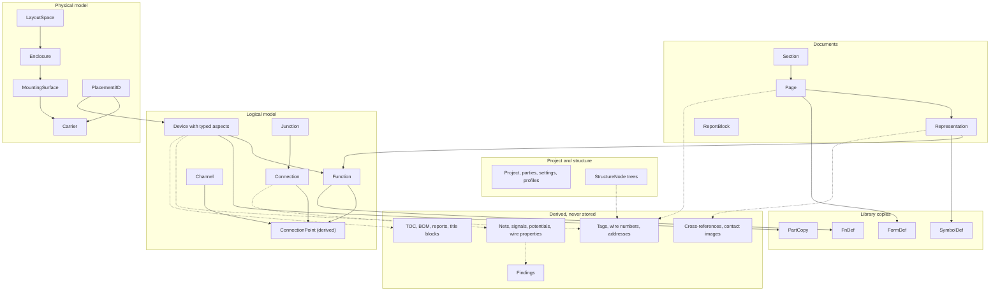

| Group | Authored records (A, L) | Main derived concepts (D, C) | File (arch §7.2, ADR-0010) | Detailed in |
|---|---|---|---|---|
| Project, structure | `Project`, `StructureNode`, `ExternalRef`, `Comment`, `ImportLineage`, `ImportRun` | full designations, identifier suppression | `project.jsonl`, `structure.jsonl`, `comments.jsonl`, `imports/<run-uuid>.jsonl` | §5, [05](05-project-format-and-persistence.md) |
| Documents | `Section`, `Page`, `Representation`, `PageItem`, `ReportBlock`, `MacroInstance` | page order, Prev/Next, generated pages, anchor cells, display lists | `structure.jsonl`, `pages/<uuid>.jsonl`, `report-blocks.jsonl`, `reports/<uuid>.sql` | §6, [06](06-schematic-editor.md), [09](09-reports-forms-output.md) |
| Logical model | `Device`, `Function`, `Connection`, `Junction`, `Conductor`, `Channel`, `PotentialDef`, `NetDef`, `Bond`, `DeviceLink`, `MediumDef`, `PlcConfigProject`, `LogicalNet`, `PhysicalNet` | CPs, tags, nets, signals, potentials, wire properties, xrefs, addresses, bus segments | `devices/<xx>.jsonl`; page-owned rows (including IP functions and macro instances) in page files; `PlcConfigProject` in `project.jsonl`, its exchange body in `exchange/<uuid>.jsonl` (1.0) | §7–§15, [08](08-connections-terminals-cables.md), [10](10-plc-and-bus.md), [11](11-fluid-power.md) |
| Library copies | `SymbolDef`, `FnDef`, `PartCopy`, `FormDef`, `MacroDef`, manufacturer records | symbol geometry, form layout | `lib/<kind>/<copy_id>.json` | [07](07-symbols-parts-macros.md) |
| Physical model | `LayoutSpace`, `Enclosure`, `MountingSurface`, `Carrier`, `Placement3D`, `RouteOverride`, `RoutingPath`, `SurfaceFeature` | routing graph, routes (C), lengths (C), duct fill, collisions, surface features | `layout/<uuid>.jsonl` | §16, [12](12-panel-layout.md) |
| Release, quality | `Revision`, `Transmittal`, `Waiver` | findings, page change status, revision diffs | `revisions.jsonl`, `waivers.jsonl` | §18–§19, [15](15-checks-revisions-collaboration.md) |
| Manufacturing | settings in `Project` | wire records, wire ends, labels; `.ewpp` (X) | — | §17, [13](13-manufacturing-outputs.md) |

---

## 3. Value types: units, quantities, text

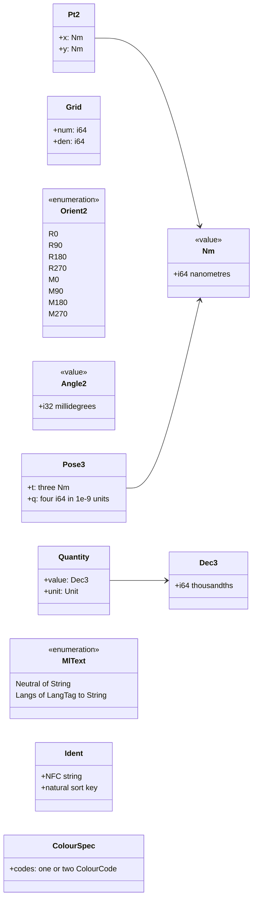

### 3.1 Geometry (ADR-0005, G4)

- **`Nm(i64)`** is the only linear unit in the model and in files: page coordinates, symbol geometry, 3D poses,
  wire and cable lengths. ±9.2 × 10⁹ m is enough for any bayed suite.
- **`Pt2 { x, y }`** on pages has its origin at the top-left corner of the sheet, x to the right and y downwards.
  This is QET's convention, so imported geometry needs no flip.
- **`Grid { num, den }`** is a rational step in nm. The QET 10 px grid is `7_937_500/3` nm (1 px = 25.4/96 mm =
  `793_750/3` nm). The native EW connection grid is 4 mm = `4_000_000/1`, with fine grids of 0.5 mm for graphics and
  1 mm for text slots: ADR-0027's recommendation, the default in force since 2026-10-18 while the ADR stays Proposed
  until the pilot confirms it at G-M0 (decision log DEC-043). Points snap to grid indices `k`, and the stored
  coordinate is `round(k × num / den)`, an error of at most 0.5 nm.
- **`Rect`** is an axis-aligned closed rectangle of two `Pt2`, always normalised (minimum corner first). It is
  persisted in embedded report blocks, form cells and data areas and `SurfaceView.clip`; the JSON encoding is
  `[[x0, y0], [x1, y1]]` ([05](05-project-format-and-persistence.md) §3.2).
- **`Orient2`** has eight variants: four rotations, each optionally mirrored (FR-SYM-004). Symbol representations
  use only `Orient2`. Rn rotates clockwise as seen on the sheet, following QET's element `orientation`
  ([06](06-schematic-editor.md) §2.5).
- **`Angle2(i32)`** is an angle in units of 10⁻³ degree, used only by free texts and graphics (QET free texts, DXF
  `INSERT` and `TEXT`), so imports keep arbitrary angles without floats in files (ADR-0005). The JSON encoding is the
  integer; the default 0 is omitted. **Sense** (ADR-0005 amendment 2): 0 points along +x (3 o'clock), and a
  positive angle rotates **counter-clockwise as seen on the sheet**, although sheet y points down. A point (x, y)
  rotated by θ about the origin becomes (x cos θ + y sin θ, −x sin θ + y cos θ). This is QET's arc convention and
  keeps DXF angles unchanged after the importer's y flip; QET free-text rotations, which Qt counts clockwise, are
  negated on import ([14](14-interop.md) §4.3, §4.13, §6.1). It is the opposite of `Orient2`'s clockwise Rn, so R90
  corresponds to `Angle2(270_000)`. Trigonometry runs in the deterministic helpers of `ew-dl`, which implement this
  rotation.
- **`Pose3`** is a translation of three `Nm` plus a unit quaternion whose four components are stored as `i64` in
  units of 10⁻⁹, so files never carry floats (arch §7.3). f64 mm appears only in 3D maths, f32 only in GPU buffers.

### 3.2 Quantities

- **`Dec3`** is fixed-point with three decimals (`i64` thousandths), written as a decimal string ("0.75"). It holds
  cross-sections (mm²), currents (A), voltages (V), frequencies (Hz), pressures (bar), temperatures (°C), masses
  (kg) and losses (W).
- **`Quantity { value: Dec3, unit }`** carries its unit. Rendering ("0.75 mm²", "6 A", decimal comma in nl and de)
  is a query over the output language (FR-I18N-009), never stored text, so "0.75 mm ²" and "50hz" (D-18) cannot be
  stored.
- **`Csa = Mm2(Dec3) | Awg(i8) | Kcmil(Dec3)`** keeps AWG and kcmil in their original unit (FR-CON-032).
- **Persisted spellings.** `Unit` is persisted in ASCII (`mm2`, `A`, `V`, `Hz`, `bar`, `degC`, `kg`, `W`, `m`,
  `piece`, `set`), `Csa` as a bare `Dec3` in mm², `{"awg": n}` or `{"kcmil": Dec3}`; the encodings are in
  [05](05-project-format-and-persistence.md) §3.2 (ADR-0005 amendment 4).
- Part quantities are `Dec3` with the part's order unit (piece, metre, set; FR-PRT-026), so -3W1's PROFIBUS cable
  counts in metres.

### 3.3 Text and identifiers (G7)

- **`MlText = Neutral(String) | Langs(BTreeMap<LangTag, String>)`** with EPLAN's mutual exclusion: adding a
  language string removes the neutral string and vice versa. `LangTag` is BCP 47 (nl-NL, en-GB). The display
  language is a query key, so a PDF per language is the same derivation with another key (FR-I18N-001, FR-I18N-005).
- **`Ident`** is an NFC string for identifiers: tags, folio labels, CP and terminal designations, part numbers,
  wire numbers, PLC symbols, process tags. Identifiers are never translated (FR-I18N-002), are checked for
  confusables and mixed scripts (FR-NUM-016), and sort by natural order (X2 < X10, FR-NUM-018). Letter codes are
  restricted to A–Z.

### 3.4 Colour codes

- **`ColourCode`** is the IEC 60757 enumeration (BK, BN, RD, OG, YE, GN, BU, VT, GY, WH, PK, GD, TQ, SR) plus
  company codes declared by the colour profile, each with a base code and shade (DBU = BU, dark), plus
  `Foreign(Ident)` for codes outside both.
- **`ColourSpec`** is one or two codes: GNYE is `[GN, YE]`.
- **Parsing.** A stored string that is not one of the 14 IEC codes is read as a company code. Whether the active
  colour profile declares it is a model check (EW-CORE-031), not a schema error
- No free-text colour exists. `Foreign` is allowed only in lenient mode: the prevent rule EW-CORE-031 rejects it in
  strict projects, so a native project can never store the core colour "BR" of -106W1 (D-17). The QET importer
  keeps "BR" as `Foreign("BR")`, reports it in the migration report (MF-11) and offers the quick fix "use BN" from
  the colour alias table (FR-CON-019, FR-IMP-044); it never maps it silently.

---

## 4. Identity, lifecycle and invariants

### 4.1 Identity

| Object | Identity | Example |
|---|---|---|
| Authored record | UUIDv7, created once, never reused | Device -102G1, Page 101 |
| Instantiated CP | `v5(function_id, idx)`, computed and never stored (only overrides persist) | -101F1 CP "N" index 2 |
| Function created from a part's function template | `v5(device_id, template_index)` | the 13-14 signal contact of -102F2, created from the MICO 4.10 template |
| Generated report page | `v5(report_block_id, page_index)` | folio 901, "Partlist 1" |
| PLC channel | `v5(module_id, "channel", number)`; stored, because it carries authored data | channel 1 of -201U3 |
| Imported record | `v5(namespace, source_key)`; the namespace is anchored on an `ImportLineage` (QET project UUID, or the SHA-256 of the lineage's first imported file) and derived from it as `v5(NS_IMPORT, …)` ([05](05-project-format-and-persistence.md) §3.2a), and the record carries `source_ref{lineage, key}` (ADR-0004, ADR-0021, [14](14-interop.md) §2.3) | a QET `<element uuid>` |
| Derived aggregate | the minimum member ID or its definition point (§9.4) | potential 24VDC-1 |

Tags, folios, designations, wire numbers and addresses are **properties, never identity** (arch §1.2 principle 4).
Every reference is an `XId`. That is why renumbering cannot orphan a reference: the BOM, the layout and the
cross-references hold IDs and ask `device_tag` for text.

### 4.2 Lifecycle and delete policies

Every link field declares a delete policy, generated into `ew-model` (arch §4.6). The main links:

| Link | Policy when the target is deleted | Note |
|---|---|---|
| `Function.device` | cascade | deleting a device deletes its functions, their representations and connections ending at their CPs, listed in the preview (FR-DEV-030) |
| `Device.parent` | forbid, or cascade by explicit choice | an assembly cannot lose its children silently |
| `Representation.functions` | cascade (representation removed) | the function stays and becomes unplaced (FR-PAG-025); an interruption-point function does not stay: it is deleted with its only representation (next row) |
| An interruption-point function's representation (deleted alone or with its page) | cascade: the IP function is deleted, and the connections at its CP with it | an IP function has no device and is owned by its page (ADR-0009 amendment 3); EW-INV-013: a function of kind `Ip` has exactly one representation |
| `Representation.page`, page-owned rows | cascade | deleting a page leaves its devices unplaced unless the user deletes them |
| `Connection.a/b` (CP or junction) | cascade | a connection never dangles |
| `PageItem.page`, `StructureBox.page` (specified for WP-S2.04 part 4a) | cascade | deleting a page deletes its page items and structure boxes (FR-PAG-025; EW-INV-022, §6) |
| A connection listed by a `WireMarker` (specified for WP-S2.04 part 4a) | unlink: the connection leaves the marker's list, and a marker left without connections is deleted in the same plan | EW-INV-023, §6: every listed connection exists and lies on the marker's page |
| `Terminal.strip` | forbid | a strip with terminals cannot be deleted alone |
| `Conductor.cable` | cascade; `Connection.kind = Core` reverts to `Wire` | the drawn wire survives |
| `Channel.module` | cascade, after confirmation when channels are placed or exchanged | |
| `Channel.binding`, `PotentialDef.at`, `NetDef.at`, `MediumDef.at` | unlink (definition dropped) | reported in the preview |
| `Placement3D.device` | cascade | a placement without a device cannot exist (D-02) |
| `Placement3D.carrier` | forbid; `DeleteCarrier` removes or re-homes its placements explicitly | [12](12-panel-layout.md) §3.6 |
| `StructureNode` referenced by pages or devices | forbid; use the merge command (FR-PRJ-018) | |
| `Revision.withdraws` | forbid | a withdrawn revision cannot be deleted while a withdrawal record names it: a cascade would delete history with it, an unchecked reference could dangle; linear undo removes the withdrawal record first (decision log ID-429) |
| `Waiver.target` (fingerprint or part selector) | none; an unmatched waiver is reported (EW-CORE-081) | |

**Policy by link class.** The complete list is the link table of `crates/ew-model/invariants.md` §4, which
`ew-model` implements; the classes are:
- **Cascade** for page-owned rows (`Representation.page`, `Connection.page`, `Junction.page`, an embedded
  `ReportBlock`'s page, `PageItem.page` and `StructureBox.page` once WP-S2.04 part 4a implements them, and an IP
  function with its representation) and for `Function.device`. A connection
  cascades with either endpoint, a representation with any of its functions, a conductor with its cable.
- **Unlink** for optional cross-references: `SupplySpec.origin.source`, `IpSpec.external`, the bus cable of a
  `Connection.kind` and `Bond.via` are cleared; `Connection.kind = Core` reverts to `Wire`; a deleted connection
  leaves `Junction.sequence` and, from part 4a, the list of every wire marker (§6). `PotentialDef.at` and `Bond.a`/`b` drop the record.
- **Forbid** for master data and structure (structure nodes, sections, forms, `Device.parent`, `Terminal.strip`),
  library copies (`Representation.symbol`, `Function.def`, `PartRef.copy`), `source_ref.lineage`,
  `Revision.withdraws`, and a `LibRef`
  that resolves to a copy embedded in the project: that copy cannot be deleted or purged while it is referenced
  ([05](05-project-format-and-persistence.md) §13.2). A `LibRef` into an external library is not a link. The
  `LibRef` forbid is a delete-time rule (EW-INV-021, ADR-0009 amendment 7): edits obey it, while undo and redo may
  remove the copy, because the state without it is valid; every other forbid link is structural.

**Lifecycle states.**
- `Device.state`: `Used`, `Spare`, `Reserved`, `NotFitted` (FR-DEV-026).
- `Channel.state`: optional; an explicit `Spare`, `Reserved` or `Deactivated` wins, otherwise the effective state
  `Used`, `Spare`, `Reserved`, `Deactivated` or `Tbd` is derived from the binding and the target device
  ([10](10-plc-and-bus.md) §3.2, FR-PLC-019).
- "Unplaced" is never stored: it is derived from the absence of a representation or a placement.
- `Revision.state`: `Open`, `Released`, `Withdrawn`. Released revisions are immutable (FR-REV-009); "signed off" is
  not a state but an open revision whose `sign_off` matches the current content digest (§18).

### 4.3 Where each concept lives

| Concept | Kind | Query or record |
|---|---|---|
| Printed tag, displayed tag | D | `device_tag(dev) → {full, displayed(page)}` |
| CP instance | D | `function_cps(f)` |
| Xref text, contact image | D | `xref_text(rep)`, `rep_anchor_cell(rep)` |
| Net, signal, potential | D | `page_local_nets`, `stitch_graph`, `potential_partition` |
| Effective wire properties | D | `wire_props_of(potential)` |
| PLC address | D (F if manual) | `channel_addresses(module)` |
| Page order, Prev/Next, TOC | D | `page_order()`, `toc_rows()`, `title_block(page)` |
| BOM | D | `device_part_lines(dev)`, `bom_rows(mode)` |
| Routed path, wire length | C | `RouteWires` output |
| Frozen tag or wire number | F | `TagSpec.frozen`, `NumberSpec::Frozen` |
| Findings | D (II for offline rules) | `checks(scope)` |
| As-built archive, `.ewpp` | X | release and export jobs |

---

## 5. Project and structure

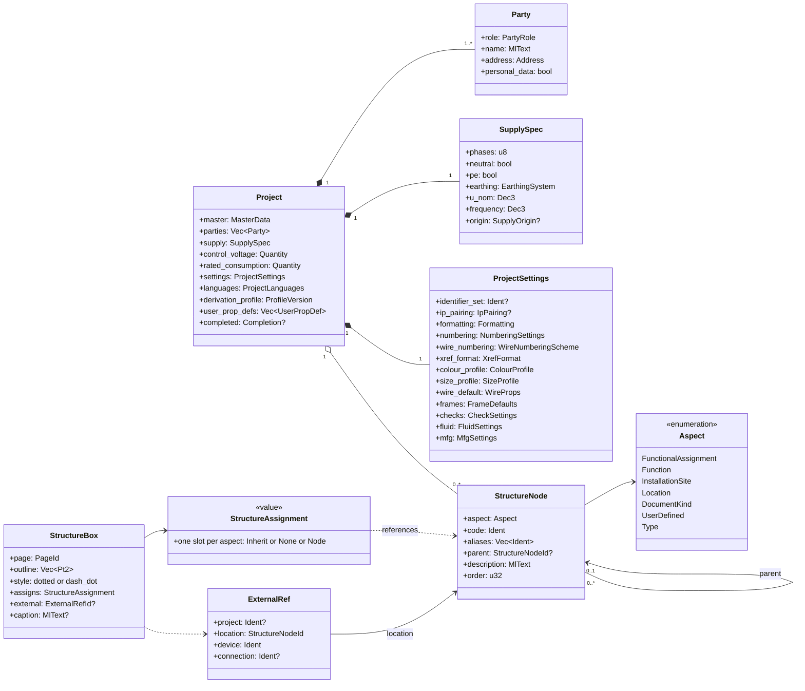

| Entity and purpose | Kind | Key attributes | Relationships, identity, lifecycle | Invariants |
|---|---|---|---|---|
| `Project`: master data, parties, supply and settings of one cabinet project | A, one row | `master{description: MlText, long_description: MlText, document_title: MlText` (added: the cover subtitle "Electrical Definition", [20](20-golden-project.md) §4.1; appended, since 0.1), `project_ref: Ident, drawing_id: Ident, object_id: Ident, manufacturing_year: u16, created: Date, edited: Date}`; `control_voltage` (V); `rated_consumption` (A); `languages{source, translations}`; `derivation_profile` ("2027.1"); `kind: Schematic \| Basic \| Macro` (FR-PRJ-026); `supply?` (absent in basic and macro projects); `user_prop_defs: Vec<UserPropDef>` (below, FR-PRJ-007); `completed?{date, by, reopen_reason?}` (added, [15](15-checks-revisions-collaboration.md) §5.10); `extra` | Created from a basic project (FR-PRJ-009); the derivation profile changes only by a previewed upgrade (FR-PRJ-011). `edited` has day precision, merges by maximum and feeds the title-block "Saved" cell; there is no stored save time (FR-PRJ-029) | S: exactly one row. Chk at release: drawing id present (FR-PRJ-002) |
| `Party`: a person or organisation in a role | A, inside `Project` | `role: Customer \| EndUser \| PanelBuilder \| Author \| Checker \| Engineer`; `name: MlText`; `address{street, postcode, city, country}`; `personal_data: bool` (FR-PRJ-024) | Form cells and revisions refer to parties by role (FR-PRJ-003); `project.company.set` writes the first panel-builder party (§5.1) | S: a form cell binds exactly one role (D-30) |
| `SupplySpec`: the incoming supply | A, value | `phases: u8`, `neutral`, `pe: bool`, `earthing: TN-S \| TN-C-S \| TT \| IT`, `u_nom: Dec3` (V), `frequency: Dec3` (Hz), `origin?{upstream_rating (A), ik_max (kA), source: ExternalRefId}` | Rendered by a format: "1 x 230 VAC + N + PE, 50 Hz" (FR-PRJ-004, FR-PRJ-006) | Chk: frequency 50 or 60 Hz |
| `ProjectSettings`: named, versioned schemes | A | `identifier_set?: Ident` (EN 81346-2:2009 by default, ADR-0026); `ip_pairing?{mode: Star \| Chain, scope: Project \| Function \| Location}` (the pairing scope of every interruption point, §10); `formatting{date: DdMmYyyy \| Iso8601, decimal_separator: Point \| Comma, tag_case: Sensitive \| Insensitive}`; the schemes of §5.1: `numbering`, `wire_numbering`, `xref_format`, `colour_profile`, `size_profile`, `wire_default`, `frames`; later `checks: CheckSettings` (§19), `fluid{default_tube}` (§15), `mfg: MfgSettings` (§17) | Inherited from the basic project, project level wins; exportable as files (FR-PRJ-008) | — |
| `UserPropDef` (added): a project-local property definition (FR-PRJ-007) | A, inside `Project.user_prop_defs`, keyed by `key` | `key: Ident` (snake_case, unique in the project); `label: MlText`; `value_kind: Text \| Number \| Bool \| Date \| Enum{options: Vec<Ident>} \| Quantity{unit: Unit}`; `scope`: a set of `Project \| Page \| Device \| Function \| Connection`; later appended: `default`, `category`, `personal_data: bool` (FR-PRJ-024, 1.0) and the part scope | Values live on the records of a scope as `user_props: Vec<UserPropValue{key, value}>`, keyed by `key`. `value` is encoded like a tech value ([05](05-project-format-and-persistence.md) §3.2): a `Quantity` object, an `MlText` for Text, otherwise a string read by the definition's kind (`Dec3` for Number, `"true"` or `"false"`, the enum option, `"YYYY-MM-DD"`). Implemented with WP-S1.12; until then `user_prop_defs` and `user_props` stay in `extra` | P: a value's key is defined, the definition's scope includes the record's kind, and the value parses as the definition's kind |
| `StructureNode`: one identifier in one aspect tree | A, `structure.jsonl` | `aspect`; `code: Ident` (atomic, FR-PRJ-017); `aliases: Vec<Ident>` (added); `parent?`; `description: MlText`; `order: u32` (defines sort order, FR-PRJ-012) | Pages, devices, layout spaces and external refs point to nodes. UUIDv7. Rename and merge are previewed commands (FR-PRJ-018) | S: parent has the same aspect; tree acyclic. P: code unique among siblings. Chk EW-RDS-002 (FR-CHK-027): a code with prefix characters, such as "J-E-2416", is reported as info in the `drafting` and `full` schemes, not in `pre-delivery` |
| `StructureAssignment`: which node a page or device belongs to, per aspect | A, value on `Page`, `Device`, `StructureBox` | one slot per aspect: `Inherit \| None \| Node(StructureNodeId)` | Device resolution: explicit slot, else the structure box around its main representation, else the page of its main representation (FR-PRJ-019) | — |
| `StructureBox` (added): dotted or dash-dot box that assigns a structure | A, page-owned (rank 44, page file, [05](05-project-format-and-persistence.md) §2.2) | `page`, `outline: Vec<Pt2>` (at least 3 vertices), `style: dotted \| dash_dot`, `caption?: MlText`, `assigns: StructureAssignment`, `external?: ExternalRefId`; shape specified for WP-S2.04 part 4a (below; decision log ID-566) | Containment of a representation's anchor point is derived (FR-PRJ-020). Deleted with its page (EW-INV-022) | S: its page exists (EW-INV-022, §6) |
| `ExternalRef`: a target in another project or cabinet | A | `project?`, `location: StructureNodeId` (+J-E-206), `device: Ident` ("JE-N1000-03"), `connection?: Ident` ("L") | Used by external connection points (§10), cable ends (FR-CBL-015) and external bus partners (§14) | Chk: stale when the referenced project is available and the target changed (FR-PRJ-022) |
| `Comment`: review note | A, `comments.jsonl` | `anchor: EntityRef \| (PageId, Pt2)`, `author`, `status: Open \| Resolved`, `text: MlText`; added: `kind: Note \| Issue`, `revision?`, `parent?` (thread), `resolved?{by, date}` ([15](15-checks-revisions-collaboration.md) §6.7) | Anchored by UUID, so it survives renumbering (FR-COL-018) | — |
| `ImportLineage` (added): the identity anchor of one imported source | A, `project.jsonl` | `importer` ("qet"), `source_name` (file name, no path), `anchor: QetProjectUuid \| FirstImportSha256 \| Copy{of, n} \| Fixed(label)`, `namespace: Uuid` (derived from the anchor, [14](14-interop.md) §2.3), `last_source_sha256`, `last_run` | Re-importing into the lineage keeps the IDs of unchanged source keys (FR-IMP-002, FR-IMP-040) | — |
| `ImportRun` (added): one persisted import | A, `imports/<run-uuid>.jsonl` | `lineage`, importer and version, source info, `as_of`, options digest, report entries and stats, `record_hashes` (the re-import base), acknowledged entries | Written in the import transaction; never conflicts with project data; import-only facts (EW-IMP findings such as a font substitution) stay visible after the import (FR-IMP-041) | — |

**`StructureBox` shape (specified for WP-S2.04 part 4a; decision log ID-566).** The record of the reserved kind
`structure_box` (rank 44, [05](05-project-format-and-persistence.md) §2.2), exactly as WP-S2.04 §10.1 words it:

| Member | Type and encoding | Rules |
|---|---|---|
| `page` | `PageId` | required; the page must exist (EW-INV-022) |
| `outline` | `[Pt2]` in absolute page nm | at least 3 vertices; the vertices need not lie on the connection grid |
| `style` | `"dotted"` or `"dash_dot"` | required; the drawing's dash patterns are WP-S2.04 §10.3 |
| `caption` | `MlText`, optional | printed above the outline's top-left vertex |
| `assigns` | `StructureAssignment`: one slot per aspect, `Inherit`, `None` or `Node(id)`, encoded as the structure slots of [05](05-project-format-and-persistence.md) §3.2 | a node must exist and have the aspect of its slot (checked by `box.structure` and `fields.set`) |
| `external` | `ExternalRefId`, optional | the external point the box stands for; printed in the caption as the external xref texts print it (§6, derivation); delete policy unlink: deleting the `ExternalRef` clears the member (ID-566) |

The earlier text of this section already names the box, its outline, line style, caption, `assigns` and `external`; the
shape adds the stored `page`, makes `style` a two-valued enumeration and `caption` optional. Which representation a box
encloses is derived, never stored (§6, derivation; FR-PRJ-019, FR-PRJ-020). Commands: `box.structure`, `fields.set`,
`rep.move` (`items`) and `edit.delete` (WP-S2.04 §5).

**Aspects and their signs.** Signs and sub-level separators are project settings (FR-PRJ-016); the defaults follow
EN 81346 and EPLAN's identifier blocks:

| `Aspect` | Default sign | Tree | Reference project |
|---|---|---|---|
| FunctionalAssignment | `==` | `StructureNode` (1.0, FR-PRJ-014) | — |
| Function | `=` | `StructureNode` | =P01 |
| InstallationSite | `++` | `StructureNode` (1.0) | — |
| Location | `+` | `StructureNode` | +J-E-2416 (alias "JE2416"), +J-E-206, +FIELD ▲ |
| Product | `-` | the device tree (`Device.parent`), never a `StructureNode`: `product` is not a valid `StructureNode.aspect`, and the reader rejects it there ([05](05-project-format-and-persistence.md) §3.2) | -101F1, -201U3-Q1 |
| DocumentKind | `&` | `StructureNode`, pages only, excluded from device numbering | &EFS (optional) |
| UserDefined | `#` | `StructureNode` (1.0) | — |
| Type | `%` (sign unverified) | `StructureNode` (1.x) | — |

**Equivalents.**

| Concept | Derived from it | EPLAN | QET |
|---|---|---|---|
| `Project` | title-block and cover cells, TOC header, report headers | Project (`*.elk` + `*.edb`), project properties `<10xxx>`, basic project `*.zw9` | `<project>` with `<properties>` and `<newdiagrams>` defaults |
| `ProjectSettings` | every derivation that reads a scheme | settings schemes (numbering, report, check, export) at project, user, workstation and company level | `<newdiagrams>` (`<xrefs>`, `<conductors_autonums>`, `<element_autonums>`, `<report label>`) |
| `StructureNode` | rendered identifiers, structure-identifier overview (FR-REP-017) | Structure identifier management, identifier blocks | none: `plant`/`location` element-info strings and folio `plant`/`locmach` attributes |
| `StructureBox` | structure of enclosed representations | Structure box | dotted shapes without semantics |
| `ExternalRef` | external xref texts "+J-E-206 / JE-N1000-03" | none typed (structure box plus free text) | none (free text) |

### 5.1 Project settings: record shapes

The schemes that the golden PDF needs at M1 have a fixed record shape (decision log ID-17), so the work packages
that implement them do not re-open it. Each is an optional member appended to `ProjectSettings` in `project.jsonl`.
Until the owning work package adds the typed struct to `ew-schema`, a file that carries the member keeps it in
`ProjectSettings.extra`, unchanged ([05](05-project-format-and-persistence.md) §10.3). Member names are JSON names,
and enums use the snake_case encoding of 05 §3.2. Schemes are copied into the project, so the project level wins
(FR-PRJ-008); `key` and `name` record which scheme the copy came from. Settings members are edited by the previewed command `project.settings.set` (one whitelisted member per command: `numbering`, `colour_profile`, `size_profile`, `xref_format`; [17](17-extensibility.md) §2.1; ADR-0008 amendment 3; decision log ID-290).
*As built (cycle 22; decision log ID-545, ID-546):* the "one previewed command" of ADR-0008 amendment 3 now has sibling commands for the members it refuses. `project.company.set`, `project.frames.set` and `project.languages.set` are `Edit`; `project.checks.set` is `HumanOnly`, because a check scheme decides check outcomes ([17](17-extensibility.md) §2.3). The whitelist of `project.settings.set` is unchanged.

| Member | Shape | Golden A | Implemented by |
|---|---|---|---|
| `numbering` | `{default: Ident, schemes: Vec<DeviceNumberingScheme>}`, schemes keyed by `key`; `TagSpec.scheme = Named(key)` selects a non-default scheme | default `page-based` | WP-S1.06 (`device_tag` reads the format), WP-S1.11 (counters, renumbering) |
| `wire_numbering` | `WireNumberingScheme`, one active scheme | connection-oriented `{page}.{counter}`, scope page, cores not numbered, not printed | WP-S1.11 |
| `xref_format` | `XrefFormat` | the QET-style preset of [06](06-schematic-editor.md) §2.8 | WP-S1.08 |
| `colour_profile` | `ColourProfile` | company "DBU/WH 24 V", 15 rows ([08](08-connections-terminals-cables.md) §4.2) | WP-S1.07 (wire properties), WP-S3.03 (cover table) |
| `size_profile` | `SizeProfile` | "0.75/1.5": Control 0.75 mm², Mains 1.5 mm², PE by class | WP-S1.07, WP-S3.03 |
| `wire_default` | `WireProps`, level 1 of the chain (§9.5) | unset | WP-S1.07 |
| `frames` | `FrameDefaults` | the QET-compatible A4 frame; its no-grid variant for title, TOC, divider and report pages | WP-S3.02 |

**`DeviceNumberingScheme`** (§8.2, FR-NUM-005 … FR-NUM-007):

| Member | Type and encoding | Default |
|---|---|---|
| `key` | `Ident` (`"page-based"`) | required |
| `name` | `MlText` | empty |
| `format` | format string: the tokens of §8.2 step 3 (`{letter}`, `{counter}`, `{subcounter}`, `{page}`, `{column}`, `{row}`) and literal separators | required; golden `"{page}{letter}{counter}"` |
| `rules` | `Vec<{select: {aspect?, letter?, kind?}, format}>` in model order, first match wins; `aspect` names a device aspect (`"strip"`, `"terminal"`, `"cable"` …), `letter` is an `Ident`, `kind` a `DeviceKind` string (§7) | empty; golden `{select: {aspect: "strip"}, format: "{letter}{page}{counter}"}` (-X1031, §8.4) |
| `counter_scope` | `"project"`, `"page"`, `"row"`, `"column"` or `{"structure": <aspect>}` (FR-NUM-006) | `"page"` |
| `counted_rep_types` | set of `RepType`s that can be the main representation (§8.2 step 4) | absent: every type except `contact_image` and `panel_front` |
| `reuse_gaps` | `bool` (§8.6) | `true`, written only as `false` |
| `online` | `bool`: number new devices at commit (FR-NUM-007) | `true`, written only as `false` |
| `child_separator` | string between the parent's and the child's designation (§8.5) | `"-"` |

Counters are not settings. The counter is `TagSpec.counter`, and "next free" is derived from the snapshot (§8.6), so
no stored counter table exists to merge.

**`WireNumberingScheme`** ([08](08-connections-terminals-cables.md) §5.2, FR-NUM-019 … FR-NUM-021):

| Member | Type and encoding | Default |
|---|---|---|
| `key`, `name` | `Ident`, `MlText` | required, empty |
| `orientation` | `"connection"` or `"potential"` | `"connection"` |
| `format` | format string with the tokens of 08 §5.2 | required; golden `"{page}.{counter}"` |
| `counter_scope` | `"page"`, `"potential"` or `"project"` | `"page"` |
| `number_cores` | `bool` | `false` |
| `online` | `bool`; without it new wires print "?" (FR-NUM-021) | `false` |
| `display` | `"none"`, `"per_segment"`, `"once_per_page"` or `"both_ends"` (FR-CON-026) | `"none"` (golden: not printed) |

Format groups, net extension and formula tokens (1.0, 08 §5.2) are later appended members.

**`XrefFormat`** ([06](06-schematic-editor.md) §2.8, FR-XRF-001 … FR-XRF-004, FR-XRF-008, FR-XRF-025):

| Member | Type and encoding | Golden (QET-style preset) |
|---|---|---|
| `key`, `name` | `Ident`, `MlText` | `"qet-style"` |
| `ip` | format string; tokens `{page}`, `{page_index}`, `{row}`, `{column}`, `{function}`, `{location}` | `"{page}-{row}{column}"` |
| `aux_to_main` | format string | `"({page}-{row}{column})"` |
| `main_to_aux` | format string with `{list}`, whose items use `ip` | `"∞ {list}"` |
| `structure` | `"when_different"` (default) or `"always"` | `"when_different"` |
| `same_page` | `"full"` (default) or `"zone_only"` | `"full"` |
| `matrix` | `{per_row: u8, max: u8, overflow: String}` | `{per_row: 3, max: 9, overflow: "…"}` |

The TOML of 06 §2.8 is the exchange form of the same scheme (`when-different` there is `when_different` here). The
contact-image settings of 06 §2.8 are a later member owned by WP-S1.08.

**`ColourProfile`** ([08](08-connections-terminals-cables.md) §4.2, §4.4):

| Member | Type and encoding |
|---|---|
| `key`, `name` | `Ident` (`"company.dbu-wh-24v"`), `MlText` |
| `basis`, `basis_note` | `"standard"` or `"company_convention"` (D-37); `MlText` |
| `verified` | `bool`, default `false` |
| `codes` | the company codes, keyed by `code`: `{code: Ident, base: <IEC code>, shade: "light" \| "dark", export_as?: Ident, names: MlText}` (DBU = BU, dark) |
| `rows` | `Vec<{group: MlText, function: MlText, select: ProfileSelect, colour: ColourSpec, order: u32, potential_type: PotentialType, colour_name: MlText}>`; the display order of the cover's colour table is the row's `order`, not the storage order. `potential_type` (the printed potential type) and `colour_name` (the printed colour name) are as built in cycle 12 in the provisional JSON member; `colour_name` is redundant with the code names and the company codes' names and is interim until the profiles are typed (decision log ID-319, FT-25) |

**`SizeProfile`** (08 §4.2):

| Member | Type and encoding |
|---|---|
| `key`, `name`, `verified` | as in `ColourProfile` |
| `class_rules` | `Vec<{select: ProfileSelect, class: CircuitClass}>`, first match wins |
| `pe_class` | `"highest_at_ends"` (FR-CON-038; the default) |
| `bond_rule` | `{colour_from: "pe", class_from: "non_pe_side"}` (the default) |
| `rows` | `Vec<{class: CircuitClass, csa: Csa, order: u32}>`, keyed by `class`; the display order of the cover's size table is the row's `order` (golden: DBU, WH, GNYE for control; BK, BU, GNYE for mains; decision log ID-319) |

The company profile data (key, name, basis note, a `standards` text, the DBU code, `verified`) come from a `profiles.csv`
source table, not from importer constants. The cover prints the `standards` text ("IEC60757 / EN60204-1", [20](20-golden-project.md)
U-35); the basis note stays metadata (FR-CON-020, D-37). The `order` column, `profiles.csv`, `standards` and the size note
are delivered by the cycle-12 fix round of the golden-project lane (decision log ID-319).

`ProfileSelect` is `{ptype: Vec<PotentialType>, ac_dc?: AcDc, u_min?: Dec3, u_max?: Dec3, discipline?: Discipline,
analogue?: bool}`. An absent or empty member matches anything. Values use the record spellings (`l_plus`, `dc`), not
the spellings of the TOML exchange form (`"L+"`, `"DC"`).

**`FrameDefaults`** ([06](06-schematic-editor.md) §2.4, FR-PAG-018) is `{default?: Id<FormDef>, per_page_type:
Vec<{page_type: PageType, form: Id<FormDef>}>}`, keyed by `page_type`. A drawn page's frame is `Page.form`, else the
entry of its page type, else `default`. Generated report pages take the form of their block (`ReportBlock.form`),
divider pages the entry for `section_divider`. When neither applies and no embedded form does, the built-in default
is the QET-compatible A4 frame geometry of [20](20-golden-project.md) §17.1, and a derivation note says so (decision
log ID-104).

*As built (cycle 22; decision log ID-547).* A `Page.form`, or a page-type entry, that names a copy the project does not
hold falls through to the next rule, identically in the cell grid and in the page output: both call
`ew_derive::frame_form_of`. The check finding for that state is FT-368. A page without its own form takes the frame
defaults in the page output as well (`PageFrameOf`, [09](09-reports-forms-output.md) §2.6), as the cell grid already
did; the golden project is unchanged.

**Stored shapes written by commands (as built, cycle 22; decision log ID-545, ID-547).** No new record kind and no
schema change: each member below already existed and is still kept in `extra` where it was ([05](05-project-format-and-persistence.md)
§10.3). The four commands of FT-336 write them:

| Command | Stored at | Shape and rules |
|---|---|---|
| `project.frames.set` | `settings.extra.frames` | `{default?: Id<FormDef>, per_page_type: [{page_type, form}]}` as `FrameDefaults` above, entries sorted by page type. `per_page_type` is always written, `[]` when empty. The command merges into the existing object (unknown members are kept) and refuses a non-object value. Each form must be an embedded copy of kind frame, cover or divider; a `report` form and a duplicate page type are refused |
| `project.checks.set` | `settings.extra.checks` | `{active_scheme?, release_scheme?}`, shipped schemes only (an `ew-api` test pins the accepted list against `ew_checks::SCHEMES`). This is the start of `CheckSettings` (§19), not all of it. `ew check` reads it without `--scheme` (`release_scheme` for mode `release`, `active_scheme` for `online`, FT-366); the release gate and the message panel do not read it yet |
| `project.company.set` | the first `Party` of role `panel_builder` in `Project.parties` (added if absent); `Project.extra["ew.company"].notice` and `.logo` | The party's `name` and `personal_data` (true by default, matching the golden panel builder; NFR-PRIV-06; nothing reads it yet). The title-block notice text is the provisional `notice` member of `ew.company`, which the `title_block` member of the shim already reads (decision log ID-78). *As built (cycle 23; decision log ID-573):* `logo` is an asset reference, `ew.company.logo = {sha256, format, size}` (`format` `svg`, `png` or `jpeg`, `size` `[w, h]` absent when unknown); the command takes the image as base64 (SVG, PNG or JPEG, at most 512 KiB, `MAX_LOGO_BYTES`; empty removes it), and the bytes join the project's asset store, `assets/<sha256>.<ext>` ([05](05-project-format-and-persistence.md) §13.3). The earlier bare form, `"logo": "sha256:…"`, is still read and kept on re-save, taking its format and size from the held asset ([05](05-project-format-and-persistence.md) §10.3) |
| `project.languages.set` | `Project.languages{source, translations}` and `settings.formatting{date, decimal_separator}` | The typed members, sent whole; `tag_case` is untouched. `decimal_separator` is read by `ew_reports::render` for a quantity printed without an output language (the printed tables of the generated pages; FT-366); an output language keeps its own separator |

**`settings.extra.drawing` (specified for WP-S2.04; decision log ID-567, ID-568).** The presentation settings of the
drawing, kept in `ProjectSettings.extra` like `frames` and `checks` (no schema change): an object
`{"crossings"?: "plain" | "hops", "marker_mode"?: "all" | "deviations" | "explicit" | "none"}`. `crossings` (part 2,
FR-CON-031) says how crossing wires are drawn; absent means `plain`. `marker_mode` (part 4a, FR-CON-024) selects which
wire markers print; **absent means the as-built rule**, a marker where the connection's `show_marker` is set, and the
modes are defined in §6 (derivation; WP-S2.04 §10.2 item 3). The command `project.drawing.set` writes the member
(`Edit`, undoable): it merges into the existing object, keeps members it does not know and takes `null` to remove a
member; it refuses a `drawing` member that is not an object, an unknown value and a call that gives no member.
*As built (cycle 25, WP-S2.04 part 1; decision log ID-625):* `project.drawing.set` is registered with `crossings`; nothing reads the member
until part 2's derivation, and `marker_mode` comes with part 4a.
`crossings` is presentation only (no derived diff); `marker_mode` is read by the derivation, so changing it changes the
derived marker texts. The per-page marker mode of FR-CON-024 is FT-375.

Not shaped here, and kept in `extra` until their work packages: `checks` (WP-S1.15), `fluid` ([11](11-fluid-power.md)),
`mfg` ([13](13-manufacturing-outputs.md)), text styles and export schemes (WP-S3.02, WP-S3.04).
*Amended 2026-10-30 ([ADR-0032](../adr/0032-per-project-text-styles.md), decision log ID-837):* text styles are shaped
as `ProjectSettings.text_styles`, overrides of the built-in table keyed by style key (`size` as em height in nm, an
optional `weight`); an absent member means the built-in table; new projects write `cp.small` and `marker` at 7 px.
Built by the lane of [WP-S1.12's text-style specification](../plan/specs/WP-S1.12-project-text-styles.md) (FT-662). *As built (cycle 37, decision log ID-855):* the member is typed in `ew-schema` (`TextStyleSpec`, `BUILTIN_TEXT_STYLES`, `effective_text_styles`); an override whose size lies outside 0.5 … 50 mm is ignored on reading and a weight of a newer format reads as absent.

---

## 6. Pages, frames and representations

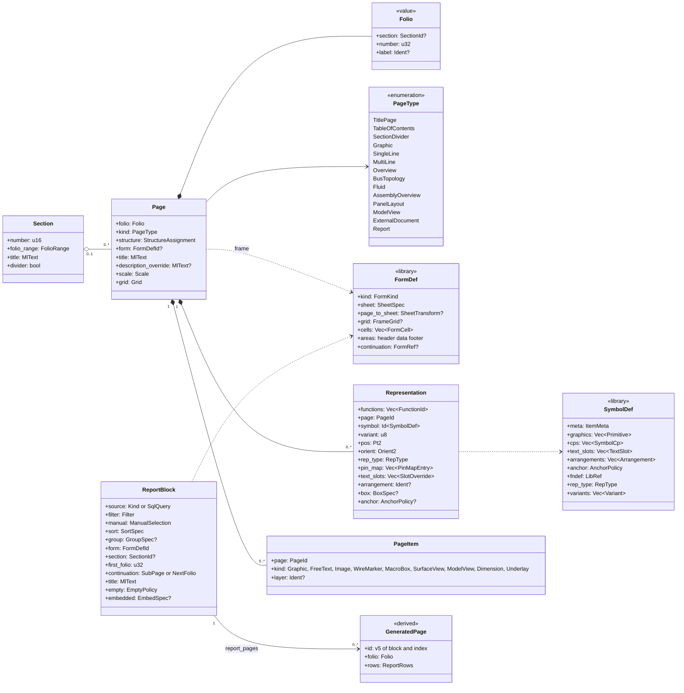

| Entity and purpose | Kind | Key attributes | Relationships, identity, lifecycle | Invariants |
|---|---|---|---|---|
| `Section`: a folio range with a title | A, `structure.jsonl` | `number: u16` (1, 2, 9), `folio_range: (u32, u32)` (100–199), `title: MlText` ("Wiring Definition"), `divider: bool` | Its divider page is a generated page (FR-PAG-009) | Chk (FR-CHK-038): a page outside its section's range |
| `Page`: one drawn sheet | A, `pages/<uuid>.jsonl` | `folio: Folio{section?, number: u32, label?: Ident}` (sparse, gaps allowed, labels "101a", "101.1"; FR-PAG-005/006); `kind: PageType`; `structure`; `form?` (frame override); `title: MlText` (page description); `description_override?` (added, D-06); `scale: OneTo(u32) \| NotToScale`; `grid: Grid` | Owns its representations, connections, junctions, interruption-point functions with their representations, macro instances, embedded report blocks and page items ([05](05-project-format-and-persistence.md) §2.2). UUIDv7. Delete cascades page-owned rows (FR-PAG-025) | P: full page name `=P01+J-E-2416/101` unique (FR-PAG-012). Chk: a description override is reported (FR-REP-036) |
| `PageType`: governs page semantics | value | see diagram (FR-PAG-001) | Overview, Graphic, AssemblyOverview and PanelLayout pages create no net connections and disable autoconnect; Report pages reject edits (FR-PAG-002) | S: a `Report` page is never stored; it is always generated (EW-INV-012). The persisted enum keeps the `report` value only so that generated pages share the page-type vocabulary: it is derived-only |
| `FormDef`: frame, title block, cover, report form or label | L, `lib/forms/` | frame: sheet size, margins, `columns{count, start_index, width: Grid, labels}`, `rows{count, labels, skip_io, height: Grid}`, header bands, title-block form, grid and no-grid variants; cells with typed placeholders (FR-REP-032/033); `page_to_sheet?: SheetTransform` (uniform integer scale and offset, QET-compatible frames only, FR-PAG-029); `continuation?: FormRef` (the "next form" of report pages, FR-REP-032) | Assigned by project default, page-type default, or page override (FR-PAG-018) | S: placeholders valid for the form kind (FR-REP-034) |
| `Representation` (the symbol instance): one drawing of one or more functions | A, page-owned | `functions`, `page`, `symbol: Id<SymbolDef>` and `variant: u8` (default 0: the stored contact-image or CP variant; orientation variants A–H are derived), two members as in [05](05-project-format-and-persistence.md) §3.5, because the variant is chosen per placement while `symbol` names the one embedded copy that every placement shares, `pos: Pt2`, `orient: Orient2`, `rep_type: MultiLine \| SingleLine \| Overview \| Fluid \| Topology \| ContactImage \| StripSegment \| Graphic` (default `MultiLine`), `pin_map` (symbol CP → function CP), `text_slots` (overrides only: slot index, `pos` in symbol coordinates before the orientation is applied, angle, visibility; decision log ID-106), `arrangement?` (named slot set of the symbol, FR-SYM-012), `box?: BoxSpec{outline: Vec<Pt2>, cps: Vec<(idx, Pt2, Dir4)>, inner: Vec<Primitive>}` (black boxes drawn with the built-in symbol `ew.gen.blackbox`; part box macros fill it on placement), `assembly_view?` (added; superseded in cycle 15 by the members' own overview representations with derived break marks, decision log ID-373), `anchor?: AnchorPolicy` (added, cycle 14: a per-representation override of the symbol copy's anchor policy, FR-SYM-010; absent follows the copy's policy; decision log ID-351) | One function has 0..n representations; with none it is unplaced (FR-DEV-003). UUIDv7. Panel fronts are not stored: `panel_front_reps(dev)` derives them from placements (§16), and a PanelLayout page hosts one `SurfaceView` | S: its functions exist and belong to one device (IPs excepted); each symbol CP maps to at most one function CP |
| `SymbolDef`: graphics plus CP geometry | L, `lib/symbols/` | `meta: ItemMeta` (below); primitives in nm; `cps: Vec<SymbolCp{idx, fn_cp, pos, dir, discipline}>` on the connection grid, where `fn_cp` is the FnDef CP the symbol draws (a symbol may draw a subset); text slots and named `arrangements`; anchor policy (origin, label, centre, named point; FR-SYM-010); `fndef: LibRef`; `rep_type` (including `PanelFront` for 2D front graphics); variants A–H plus contact-image and CP variants | Representations reference it; geometry is memoised at library durability | Chk (FR-SYM-020): CPs on grid, unique indices, anchor defined; `fn_cp` exists in the FnDef |
| `PageItem` (added): page content without electrical meaning | A, page-owned (rank 43 of [05](05-project-format-and-persistence.md) §2.2) | `kind`, an externally tagged object: `graphic` \| `free_text` \| `wire_marker` (shapes specified for WP-S2.04 part 4a) \| `image` (part 5) \| `macro_box{outline, key, kind, rep_type, variant, target_library, generated?: LibRef}` \| `surface_view{surface, side, datum_at, clip?, label_mode, layers}` \| `model_view` \| `dimension` \| `underlay{asset sha256, page, transform, opacity}` (the last five are later and stay unknown variants until typed); `layer?: Ident`; the shapes are in the table below (decision log ID-566) | A wire marker only displays the overrides of its connections, in the listed order (a group "1.5 DBU DBU WH WH" over four); its own data is only that list, its position `at`, its `angle` and the shown `fields`. A `PathFunction` text (a follow-up, FT-376) is the automatic function text of the functions in its column range (FR-DEV-011). A macro box frames the content that "Generate macros" saves as a macro version (FR-MAC-013); inserting a macro never inserts its box. `SurfaceView`, `ModelView` and `Dimension` belong to layout pages (§16, 1.0 for the last two); an `Underlay` (1.0) is read by no engineering query | — |
| `ReportBlock`: a report placed in the page order | A, `report-blocks.jsonl`; an embedded block lives in the file of its page | `source: Kind(ReportKind) \| SqlQuery{api: "v1", file}` (`{"kind": "wire_list"}`; the SQL lives in `reports/<uuid>.sql`), `manual` (include and exclude entity IDs, FR-REP-027), `sort: Vec<SortKey{key, descending}>`, `group?{key, break}`, `form: Id<FormDef>`, `section?`, `first_folio?` (required for page-oriented blocks, ignored when `embedded` is set), `continuation: SubPage \| NextFolio` (default SubPage: 907, 907.1 …; FR-PAG-030), `title` (format with `{n}`, `{count}`, `{group}`), `empty: OmitPages \| OnePage(text)`, `embedded?{page, rect}`; later appended: `params` and `filter` (WP-S3.03, [09](09-reports-forms-output.md) §2.2) | Its pages are derived (`report_pages(block)`, IDs v5) and join `page_order()` (FR-REP-001) | S: a page-oriented block has `first_folio`. Chk: folio collision with a drawn page (FR-REP-041) |

**`PageItem` shapes, invariants and derivation (specified for WP-S2.04 part 4a, `image` for part 5; decision log
ID-566).** The record of the reserved kind `page_item` (rank 43, [05](05-project-format-and-persistence.md) §2.2) is
`{"$k": "page_item", "id", "$v"?, "page": PageId, "layer"?: Ident, "kind": <variant>}` (`$v` omitted when 1, [05](05-project-format-and-persistence.md) §3.1), the variant an externally tagged
object (`{"graphic": {…}}`). The shapes are exactly those of WP-S2.04 §10.1; positions are page nm (`Pt2`), lengths `Nm`:

| Variant | Members | Rules |
|---|---|---|
| `graphic` | `shape`: one of `{"line": {"a": Pt2, "b": Pt2}}`, `{"polyline": {"points": [Pt2]}}`, `{"rect": {"min": Pt2, "max": Pt2}}`, `{"circle": {"centre": Pt2, "r": Nm}}`, `{"arc": {"centre": Pt2, "r": Nm, "start": Angle2, "sweep": Angle2}}`, `{"polygon": {"points": [Pt2]}}`; `stroke?`: `{"width": Nm}`; `dash?`: `"solid"`, `"dashed"`, `"dotted"` or `"dash_dot"`; `fill?`: `bool` | no `angle`: a shape carries its own geometry. Drawn in the page's wire stroke unless `stroke` is set; an absent `dash` is `solid` and an absent `fill` is `false` (ID-566). Degenerate shapes (a zero-length line, a polyline or polygon with fewer than two or three distinct points, a radius of 0) are refused by the commands. An `arc`'s `start` defaults to 0 and is omitted then (as built, cycle 27). |
| `free_text` | `text?`: `MlText` (omitted when empty; an empty text needs `bind`); `bind?`: `Ident`; `at`: `Pt2`; `angle?`: `Angle2`, one of 0, 90000, 180000, 270000; `style?`: `Ident` (default `text.normal`); `align?`: `"left"`, `"centre"` or `"right"` | `bind` names one of six bindable names: `project.description`, `project.document_title`, `project.drawing_id`, `page.title`, `page.folio`, `page.full_name`; the commands refuse another name and an empty `text` without `bind`. The role `path_function` of the earlier text is FT-376 and is kept verbatim as an unknown member until then. `angle` is an `Angle2` (10⁻³ degree, default 0 omitted, [05](05-project-format-and-persistence.md) §3.2) restricted to 0, 90000, 180000 and 270000 (decision log ID-566) |
| `wire_marker` | `connections`: `[ConnectionId]`; `at`: `Pt2`; `angle?`: `Angle2`, 0 or 90000 (ID-566); `fields`: `["csa", "colour"]` | `marker.place` lists at least one connection, distinct, in printed order, all on the page. A group is changed by deleting and placing it (`fields.set` cannot edit `connections`) |
| `image` (part 5) | `asset`: `"sha256:…"`; `rect`: `[Pt2, Pt2]` | placed through the asset store ([05](05-project-format-and-persistence.md) §13.3); until part 5 an `image` item is kept verbatim as an unknown variant |
| any other variant | `macro_box`, `surface_view`, `model_view`, `dimension`, `underlay`, and variants of a newer format | `PageItemKind::Unknown(Value)`, kept verbatim and round-tripped byte for byte ([05](05-project-format-and-persistence.md) §10.3) |

*Departures from the earlier text of this section* (`Graphic{shape, stroke, dash, fill, angle}`, `FreeText{text or
bound property, role, angle}`, `WireMarker{connections, fields}`, `Image{asset}`): **`Graphic` has no `angle`**;
**`FreeText` gains `bind`** beside `text` (the earlier "text or bound property" becomes two members) and its `angle` is
one of four values; **`WireMarker` gains `at` and `angle`**, which position the group; **`Image` has `rect`**. `layer`
is optional.

*Two new structural invariants* (decision log ID-566; numbered EW-INV-022 and EW-INV-023 in the catalogue of
[ADR-0009](../adr/0009-invariant-catalogue.md), the next free numbers after EW-INV-021):
- **EW-INV-022:** the `page` of a page item or a structure box exists. Deleting a page deletes them (cascade,
  FR-PAG-025).
- **EW-INV-023:** every connection a wire marker lists exists and lies on the marker's page. The delete policy: a deleted
  connection leaves the list, and a marker left empty is deleted in the same plan.

A build from before part 4a keeps `page_item` records verbatim and does not enforce that delete link, so a project can
arrive with a marker that lists a deleted connection or one on another page. On load this is **reported, not refused**:
a load finding names the marker and the connection, the derivation and the drawing ignore the stale entry, and the next
edit of the marker writes a clean list ([05](05-project-format-and-persistence.md) §2.2).

*As built (cycle 27, WP-S2.04 part 4a; decision log ID-647).* The kinds are implemented as above. A cross-page `rep.move` takes each moved connection out of the old page's wire markers in the same transaction (a marker left empty is deleted), so EW-INV-023 holds after a move; when the junction clean-up dissolves a junction, the kept member takes the removed one's place in every marker list. `item.place` and `box.structure` also refuse collinear polygons and box outlines of zero area. A page file whose items an older build wrote (reserved kinds, members in byte-wise order) loads typed and is rewritten canonically with a `NonCanonical` finding ([05](05-project-format-and-persistence.md) §10.3).

*Derivation (WP-S2.04 §10.2).* `rep_structure_box(rep)` is the innermost structure box on the representation's page
whose outline contains the point that `rep_anchor_cell` uses (an exact even-odd test in `i128`, the boundary inside;
innermost by absolute shoelace area, ties by box ID). `structure_of(device)` gains a step between its steps 1 and 3
(§8.2 step 5): an inherited aspect of a device that is neither a terminal nor a child-tag device takes the slot of the box
around its main representation when the box's `assigns` has a node or `none` for that aspect (`SlotSource::StructureBox`),
else the page's. `ip_structure(function)` is an IP function's structure, its representation's box's slots over its page's;
every reader of an IP's structure (the pairing scope `location` and the xref `{function}` and `{location}` tokens)
reads it. Golden A has no structure box and no `ip_pairing` setting, so no golden output changes. A bound free text prints
the value that the title block prints for that placeholder on its page (`title_block`'s resolver). Wire markers follow
`marker_mode` of §5.1: with it absent a connection shows a marker when `show_marker` is set; `all` shows every wire;
`deviations` a wire with an effective cross-section or colour set at levels 3 to 7, cores excepted
([08](08-connections-terminals-cables.md) §4.5); `explicit` a level-7 cross-section or colour; `none` no marker. A
connection that a wire marker lists draws no marker of its own; the item draws the group whenever at least one of its
connections would show a marker in the mode. The group text is the distinct effective cross-sections of the listed
connections in list order joined by `/`, then one colour code per connection in list order, separated by spaces: `2.5 BK
BU`, `1.5 DBU DBU WH WH`. A structure box's caption is the caption text and, when `external` is set, ` (<external>)` with
the external reference printed as the external xref texts print it: `External Connection (J-E-206 / JE-N1000-03)`.
`rep_structure_box` and `ip_structure` are new memoised families.

**Derived from pages.** `page_order()` sorts sections, then folios by natural order, including generated pages.
From it come Prev/Next (empty on the first and last page, FR-PAG-013), the TOC rows with "Location (+)"
(FR-REP-003), the PDF outline and `/PageLabels`. The title block is `title_block(page)`: every cell is a placeholder
bound to project, page, party or derived values, so "V1"/"V2.0" (D-05) and "Control Cabinet Expansion" (D-06)
cannot diverge.

**Frame cells are integer arithmetic.** `rep_anchor_cell(rep)` takes the anchor point from the symbol's anchor
policy, never from rendered geometry (D-14), and maps it to a cell of the page's frame on the frame's rational grid
(FR-PAG-020). On the QET-compatible A4 frame (17 columns from 0, rows A–H, FR-PAG-015), the native units are 20 px
header bands, 60 px columns and 80 px rows, all multiples of the 10 px grid. With `k = round(x × 3 / 7_937_500)` as
the 10 px grid index:

```text
column = floor((k_x - 2) / 6)        row = "ABCDEFGH"[floor((k_y - 2) / 8)]
anchor (1010 px, 620 px) → x = 267_229_167 nm → k_x = 101 → column 16
                          → y = 164_041_667 nm → k_y = 62  → row H         → cell "H16"
```

A point exactly on a boundary belongs to the cell to its right or below it. The interruption point L-1 at 101-H16
is therefore printed as "101-H16" on folio 102 without any float comparison.

**Assembly overviews are generated.** Folio 201 holds the overview representations of -201U1 and its children -201U2 to -201U9, folio 202 those of -202U1 to -202U3. *As built (cycle 15; decision log ID-373):* the break marks are derived, never stored: `ew-derive`'s `assembly_break_marks()` walks the assembly device and its direct children in `Device.position` order, takes each member whose main representation is an overview representation, groups consecutive members on one page into segments, and puts a right mark after the last representation of every segment but the last and a left mark before the first of every segment but the first (Golden A: right after -201U9 on 201, left before -202U1 on 202); moving a module to another page moves its marks. The earlier `assembly_view{assembly, children, break_marks}` member is superseded. A per-page break-mark family is FT-257. The module rectangles, part texts and valve glyphs are
derived from the children in `Device.position` order. Each child slot has a v5 identity `(rep_id, child_id)`, serves
as its xref anchor and PDF destination, and counts as the representation of that child's main function for tags and
cross-references (so -201U3 is page-based on 201). A fifth valve on a 4-position sub-base cannot be drawn this way
(D-10); FR-CHK-022 checks the remaining hand-drawn cases.

**Equivalents.**

| Concept | Derived from it | EPLAN | QET |
|---|---|---|---|
| `Section` | divider pages, outline levels | none; page structure or document type `&` | none; folio labels only |
| `Page` | full page name, TOC row, Prev/Next, page label, change status | Page with page type, page name, page description `<11xxx>` | `<diagram>` (folio) with title-block attributes |
| `FormDef` | title blocks, report pages, labels | plot frame (`*.fn1`), forms `*.f01`–`*.f33`, label forms | `<border>` plus `.titleblock` template, `graphics_table` |
| `Representation` | anchor cell, xref anchor, display list | placed symbol with representation type and variant | `<element>` x, y, orientation, mirror |
| `SymbolDef` | symbol geometry | symbol in `*.slk`, variants A–H | element definition `.elmt` / `<definition>` |
| `ReportBlock` | generated pages | report block, page-oriented or embedded report | `graphics_table` with SQL against QET's internal database |

---

## 7. Functions, devices and parts

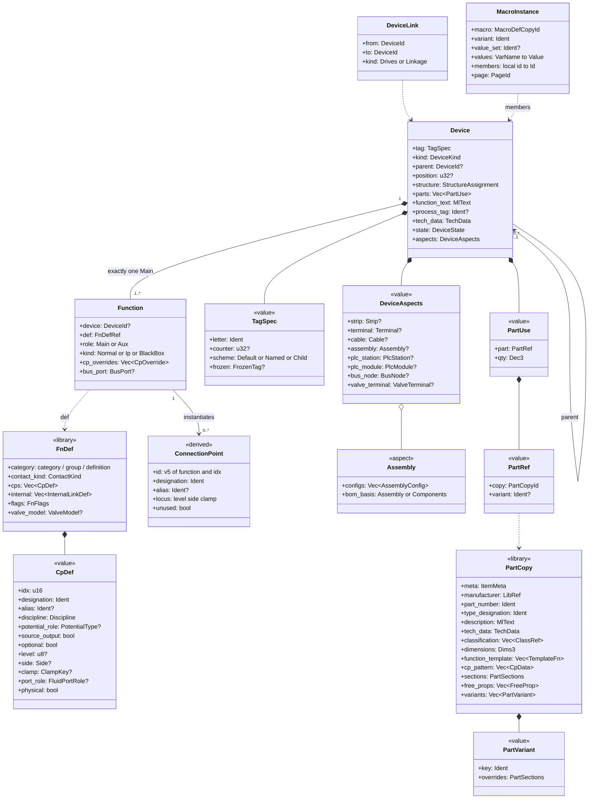

| Entity and purpose | Kind | Key attributes | Relationships, identity, lifecycle | Invariants |
|---|---|---|---|---|
| `FnDef`: what a function is, independent of how it looks | L, `lib/fndefs/` | `category`: a three-level key category / group / definition (e.g. `ProtectionOvercurrent / MCB / 1P+N`; the first two levels map to a letter code through the identifier set, FR-NUM-004, and filter compatible parts; FR-SYM-005); `contact_kind: NO \| NC \| CO \| Coil \| Pole \| Terminal \| BlackBox \| PlcIo \| BusPort \| Valve …`; `cps: Vec<CpDef>`; `internal: Vec<{a, b, kind: Short \| PassThrough{opens: bool}}>` (added detail); `flags{switches_n_with_l, n_isolation}` (added; `n_isolation` marks neutral isolating terminals, which EW-POT-013 reports as info); `valve_model?` (§15) | Symbols, functions and part function templates reference it (FR-SYM-005) | Chk: CP indices unique |
| `CpDef`: one CP of a definition | value | `idx: u16` (internal, unique); `designation: Ident` (duplicates allowed: two "N" on a 1P+N MCB, REF-029); `alias?` ("L1", REF-030); `discipline: Electrical \| Pneumatic \| Vacuum \| Hydraulic \| Bus`; `potential_role?` (PSU "+" is L+, "−" is M, PE pin is PE); `source_output: bool` (added: the CP is an output of a source function, such as PSU +/− or a transformer secondary, and roots `potential_flow`); `optional: bool` (added: may stay free by design, such as the Out entry of a terminating bus connector or a parallel duplicate pin, so EW-POT-009 skips it); `level?`, `side?`, `clamp?: ClampKey` (terminals, §11); `port_role?` (fluid, §15); `physical: bool` (false for internal points such as a VMPA coil) | Part CP patterns refine it with clamp data (cross-section range, maximum conductors, twin-ferrule permission; FR-PRT-008) | — |
| `Function`: one logical element (a pole set, a contact, a coil, a PSU, a valve, an IP) | A, device shard; an IP function lives in the page file of its representation and follows it on a page move ([05](05-project-format-and-persistence.md) §2.2) | `device?` (None only for IPs, added); `def: Id<FnDef>`; `role: Main \| Aux`; `kind: Normal \| Ip(IpSpec) \| BlackBox`; `cp_overrides: Vec<CpOverride{idx, designation?, alias?, description?, unused: bool, closure?: Plug(PartRef) \| Silencer(PartRef) \| Blanked}>` (FR-DEV-008; `closure` added for fluid ports, §15); `bus_port?` (§14); `template_entry?` (added, FT-655: the index of the part template entry it was made from, read by `function_cps`) | Placing a part creates its template functions unplaced (FR-DEV-017); UUIDv7, or `v5(device_id, template_index)` from the template | S: exactly one Main per device (FR-DEV-004); `device` is None if and only if `kind` is Ip (ADR-0009); overrides name existing indices. Chk (FR-CHK-036): more auxiliaries than the main part's contacts |
| `ConnectionPoint`: an instantiated CP | D | `id = v5(function, idx)`, effective designation and alias, level/side/clamp, discipline, potential role, `unused`, world position per representation | Endpoint of connections; member of nets; pin of a channel | — |
| `Device`: everything with one tag; the single owner of parts (ADR-0006) | A, device shard | `tag: TagSpec` (§8); `kind?: DeviceKind` (UI and numbering hint, below); `parent?`; `position?: u32` (added: order inside the parent); `structure` (added); `parts: Vec<PartUse>`; `function_text: MlText` (manual; the automatic text falls back to the path function text, FR-DEV-011); `process_tag?: Ident` (TA05-V-15 on field device -203Q1, never renumbered, FR-DEV-012); `tech_data: Vec<TechValue{key, value: Quantity or Ident}>` (keys `"<scheme>:<id>"` or native, [05](05-project-format-and-persistence.md) §3.2) (40 A, C10, 15 °C, 6 A; FR-DEV-009); `state`; `supply_scope?: own \| by_others` (FR-DEV-037; intended, not yet built: a device supplied by others stays out of the BOM and is exempt from EW-CORE-041 and the layout checks; decision log ID-322, FT-209); `aspects: DeviceAspects`; `user_props`, `extra` | Functions, aspects, children, placements and channels hang off it. UUIDv7 | S: parent graph acyclic. P: full tag unique in its scope (FR-NUM-012). S: aspect combinations consistent (Terminal excludes Strip and Cable) |
| `DeviceAspects`: typed roles of one device (arch §4.3) | A, value | strip, terminal, cable, assembly, PLC station, PLC module, bus node, valve terminal | One device may carry several at once (FR-DEV-024) | Removing an aspect keeps the device's UUID and references (FR-PLC-001) |
| `Assembly` aspect: configured product with child devices | A, value | `configs: Vec<AssemblyConfig{label: MlText, order_code: Ident, part?: PartRef, covers: Set<DeviceId>}>`; `bom_basis: Assembly \| Components` (default `Assembly`). As built (cycle 15): `covers` is a set that names the devices whose own part lines the order code replaces in the assembly BOM. It may name the assembly device itself, whose own parts an order code replaces (Golden A order code 1), and it is not transitive. A config without a part prints and covers nothing, and the `Components` basis keeps the components (decision log ID-371, ID-372). Since cycle 16 commands write it: `fields.set` on `assembly`, `assembly.configs` and `assembly.bom_basis` (an added cover outside the subtree is refused), and `assembly.attach` and `valve.add` build the children (decision log ID-393, ID-394, ID-398) | Children are devices whose `parent` is the assembly, ordered by `position` (FR-DEV-020/022) | Chk: a cover outside the assembly device and its descendants is reported (FT-260; decision log ID-371); the BOM derivation ignores it and skips a covered head, so no model invariant refuses it. The model unlinks a removed device from `covers` (an unlink cascade, decision log ID-378). Chk: overview vs children (FR-CHK-022) |
| `ValveTerminal` aspect | A, value | `pilot_supply: Internal \| External`, `positions` (derived from children), vendor configurator data? | Combined with PlcStation, BusNode and Assembly on -201U1 ([11](11-fluid-power.md) §3.2) | Chk (FR-FLU-022, 1.x): slot occupancy vs order code |
| `PartUse` / `PartRef`: a part on a device | A, value | `part: PartRef{copy: Id<Part>, variant?}`, `qty: Dec3` in the part's order unit | Parts attach only to devices, so the BOM aggregates one path (FR-DEV-015) | S: referenced copy embedded |
| `PartCopy` (the project's view of a catalogue `Part`) | L, `lib/parts/` | `meta: ItemMeta`; manufacturer as `LibRef` to a manufacturer record embedded under `lib/manufacturers/` (master list, FR-PRT-002), part number, type, order number, `description: MlText`, typed tech data, `free_props: Vec<{key, value: MlText}>` (EPLAN free properties, user fields), ECLASS/ETIM classes (FR-PRT-018), dimensions W×H×D (Nm), mass, mount kind; `function_template`; `cp_pattern`; contact data (FR-PRT-009); `sections{plc: AddressMap, thermal{p_loss W, i_rated A}, model3d: sha256, drilling, cable_cores, wire, ferrule, duct, rail, enclosure, tube, fluid}` (FR-PRT-010; `fluid` per [11](11-fluid-power.md) §2.6); accessories; structured alternatives (FR-PRT-004); `configured?{order_code, components: Vec<PartUse>}` (FR-PRT-006) | Renders and reports read only the copy (FR-PRT-013) | Chk (FR-CHK-024): incomplete mandatory data |
| `PartVariant` | L, value | `key: Ident`, overrides of data sections and macros | Selected by `PartRef.variant` (FR-PRT-003, 1.0) | — |
| `DeviceLink` (added): functional relation between devices | A, device shard of `from` | `from`, `to`, `kind: Drives \| Linkage` | Valve -201U3-Q1 drives field device -203Q1 (process tag TA05-V-15); the link drives the dashed linkage graphic (FR-SYM-014) and the valve's printed text: its function-text slot prints the automatic function text, else the tracked process tag of the driven device, so used valves store no function text ([11](11-fluid-power.md) §3.1) | S: endpoints exist; no self-link |
| `MacroDef`: reusable fragment | L, `lib/macros/` | `meta: ItemMeta`; kind `Window \| Symbol \| Page`; variants per representation type; records in the project format with an insertion point; variables with field-path bindings; value sets `Vec<ValueSet{name, values}>` (FR-MAC-004); `groups: Vec<PlaceholderGroup{name, members, include: Option<VarName>}>` | `InsertMacro` remaps IDs and numbers the new devices (arch §5.5); a group whose `include` variable is false is removed before the remap. Placed instances reach the groups through `MacroInstance.macro`, so a group is never a separate project record | — |
| `MacroInstance` (added): provenance of one placed macro | A, the file of its anchor page (rank 46 of [05](05-project-format-and-persistence.md) §2.2) | `macro` (copy ID of the `MacroDef`), `variant`, `value_set?`, `values: BTreeMap<VarName, Value>` (the values used), `members: Vec<(local_id, Id)>` (fragment-local ID → created record) | "Where used" and provenance at MVP; from 1.0 the placeholder object to which another value set can be re-applied (FR-MAC-008) | — |

**As built (cycle 13; decision log ID-333, ID-334).** `device_link` (rank 42, in the shard of `from`) is typed in `ew-schema` with `from`, `to` and `kind` (`drives` or `linkage`), plus the import-provenance member `source_ref`. Deleting either device deletes the link. Golden A has eight links: the valves -201U3-Q1 … Q4 and -201U4-Q1 … Q4 drive the field devices -203Q1 … -203Q8. Since cycle 16 the command `device.link` creates a link (no self-link, no duplicate of the same kind; decision log ID-395). The `DeviceLink` half of FT-80 is done; the half that prints the tracked process tag in a used valve's function-text slot stays open.

**As built (cycle 34, WP-S1.19 part 1; decision log ID-334, ID-783).** The part, manufacturer and macro data are typed
in `ew-schema` within the unreleased format 0.1 (ADR-0011 amendment 4): every new member is optional and
default-omitted, every new enum keeps `Unknown(Value)` and every new object its own `extra`
([05](05-project-format-and-persistence.md) §10.3). Golden A uses none of them, so no golden file and no copy hash
changed.
- **`PartCopy`** (`LibCopy<Part>`) gains, in the member order of [07](07-symbols-parts-macros.md) §2.5, `contacts:
  Vec<ContactData{kind: ContactKind, cps: Vec<Ident>, seq?: u8, special?}>` (FR-PRT-009), `mech?: MechData{width,
  height, depth: Nm?, mount_kind?: MountKind, rail_offset?: Pt2, clearance?{top, bottom, left, right, front},
  front_2d: Vec<Vec<Pt2>>, mass?: u32 grams}` (the L3 level), `alternatives: Vec<{part: LibRef, kind: equivalent |
  successor | approved}>` (FR-PRT-004), `configured?{order_code, components: Vec<{part: LibRef, qty: Dec3}>}`
  (FR-PRT-006) and `macros: Vec<{rep_type, macro: LibRef}>` (FR-PRT-027). `CpData` gains `clamp_type?`, `csa_min?`,
  `csa_max?` (`Dec3` mm²), `max_conductors?` and `twin_ferrule` (FR-PRT-008); `PartSections` gains `enclosure`,
  `duct`, `rail` and `mounting_plate`. The other members of the `PartCopy` row (classification, the 3D and drilling
  data, accessories, variants, the thermal, wire, ferrule and tube sections) stay in `extra` until their work package
  types them. These `LibRef`s are not model links: the library resolves them, not the project.
- **`Manufacturer`** (kind `manufacturer`, `lib/manufacturers/`) is `{meta, key, name: MlText, aliases, brands}`;
  `library.embed` embeds it with the checks of the other kinds. A part's `manufacturer` `LibRef` is not yet resolved to
  the embedded copy (WP-S1.19 part 3).
- **`MacroDef`** (kind `macro`, `lib/macros/`) is `{meta, name, description, kind: window | symbol | page, variants:
  Vec<{rep_type, key, fragment}>, variables: Vec<{name, ty, bindings: Vec<{record, field}>, default?}>, groups:
  Vec<PlaceholderGroup{name, members, include?}>, value_sets: Vec<{name, values}>, thumbnail?}`. The `fragment` is
  kept as JSON in the permissive schema crate; `ew-commands` parses it. Placeholder groups live only inside the macro,
  so the kind `placeholder_group` (rank 47) stays reserved (WP-S1.19 D15).
- **`MacroInstance`** (kind `macro_instance`, rank 46, the anchor page's file) is `{id, $v?, macro, variant,
  value_set?, values, members: Vec<(fragment-local ID, created ID)>, page}`. Its three links: `page` is a cascade
  (deleting the anchor page deletes the instance); `macro` is a forbid link that stores the copy ID, so the macro copy
  cannot be removed while an instance names it; `members[][1]` is an unlink link of a new sort, **kind-erased**
  (`LinkDecl::kind_erased`): a member is a bare ID that may name a record of any kind a fragment creates (page,
  device, function, representation, connection, junction, conductor, channel, potential definition, bond, device link,
  page item, structure box, report block), so a deleted member leaves the list and the instance stays, also when the
  list is left empty. No command creates an instance yet (WP-S1.19 part 5); the property grid lists its fields
  read-only, and the describe vocabulary gains the kind word `macro_instance` (357 words).
- **`Project.basic_project`** is typed as `{id, generation}`: the basic project's project ID and its manifest
  generation when it was copied, since a basic project has no semantic version ([07](07-symbols-parts-macros.md)
  §2.8; WP-S1.19 D14, the schema half).

**Device kinds.** `DeviceKind` is a hint for UI defaults and for the selectors of numbering rules (§5.1, §8.2), never
a type: behaviour comes from aspects and functions. It is an open enum persisted as a snake_case string. The v0 list
holds the kinds that a derivation or the golden project names: `psu` (-102G1), `terminal` and `blanking_plate` (a
blank manifold position, §15). Further kinds, such as `external_partner` for external bus partners (§14), are
appended as variants when their work package needs them. Any other string is kept as `Unknown` and written back
unchanged; derivations treat it as "no kind", while numbering-rule selectors and UI palettes may still match it by its
string. Kinds are therefore catalogue data, not an exhaustive Rust list (decision log ID-16).

**Library items** ([07](07-symbols-parts-macros.md) §2.1). Every library item carries `ItemMeta{key,
licence, sources, as_of, confidence per section (verified, unverified, test), status: Draft | Released |
Deprecated{successor: Option<LibRef>} | Withdrawn}` and, for imported content under foreign terms, the flag
`foreign_terms`. Items reference each other by `LibRef{library, item, version_req}`; project records reference the
embedded copy by its copy ID `v5(NS_LIBCOPY, library_id ‖ item_id)`. Manufacturer records are a library kind of
their own (`lib/manufacturers/`).

**CP instantiation.** `function_cps(f)` starts from the part's CP pattern when the function comes from the part's
function template, else from the FnDef, and applies `cp_overrides`. Only overrides are stored. -101F1 therefore has
the CPs `1`, `2`, `N#1` and `N#2` (both printed "N", internal indices distinct), and -102F1's CP 1 prints "1 / L1".

**Black boxes and device CPs.** -102G1, -102F2 and the CPX blocks on folio 106 are functions of kind `BlackBox`
whose CPs come from the part's pattern; enclosed functions adopt the box's device (FR-DEV-013).

**The valve terminal (folios 3, 106, 201–206).** One device tree carries electrical, bus, PLC and fluid roles:

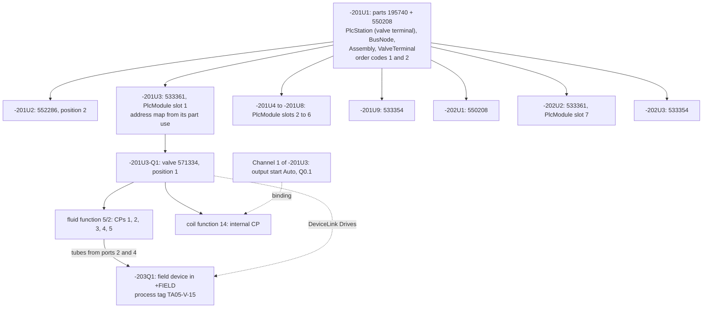

- -201U1's main function is drawn on folio 201 (assembly view); its bus-port function on folio 3 and its power
  connector function on folio 106 are auxiliary functions, hence "∞ 3-B2, 106-G3" and "(201-E1)".
- Each valve is a child device of its sub-base with one fluid function and one coil function per solenoid the part
  declares (571334: `[14]`; FR-FLU-004).
- **Where the aspects go.** `PlcStation` sits on the device that owns the bus port and the address window,
  `Assembly` on the device that carries the configurator order codes; in the golden project both are -201U1, which
  also carries `BusNode` and `ValveTerminal`. A valve terminal whose bus interface is a separate module carries
  `PlcStation` and `BusNode` on that module; a multi-pin valve terminal without a bus node has no station
  ([10](10-plc-and-bus.md) §2.3).
- **BOM in assembly mode:** the two `AssemblyConfig` lines (order code 1 for the CPX part, order code 2 for the MPA
  part with the 28 valves; which order code covers -202U1 is ▲, see D-40) print as two rows, and the component parts
  of covered devices are suppressed. The PART DATA boxes on 201 and 202 are embedded report blocks over these lines.
  **Component mode:** the reverse (195740, 2 × 550208, 552286, 7 × 533361, 28 × 571334, 2 × 533354; FR-REP-005).

**Equivalents.**

| Concept | Derived from it | EPLAN | QET |
|---|---|---|---|
| `FnDef` | net splitting, potential-type propagation, contact images | Function definition (category, group, definition) | `kindInformations` and `link_type` (simple, master, slave, terminal, report) |
| `Function` | CPs, representations, main/aux xrefs | Function (placed or unplaced), main and auxiliary functions | `<element>` instance; master/slave via `links_uuids` |
| `ConnectionPoint` | net membership, wire ends | Function connection point, device connection point | `<terminal id/uuid>` inside the element |
| `Device` | tag, BOM lines, device list | Device = all functions sharing one DT | none: elements sharing a free-text `label` |
| `DeviceAspects` | strip, cable, PLC and assembly behaviour | separate function categories (terminal, cable, PLC box, PLCBoxFluid) | `element_type`, `terminal_strips`, `<cables>`, `plc_*` keys |
| `PartCopy`, `PartUse` | BOM rows, symbol part texts | Part assigned to the main function; parts database; part variants | `manufacturer` and `manufacturer_reference` element info |
| `Assembly` | BOM modes, generated overview | Part sets / configured products (unverified detail) | none |
| `DeviceLink` | linkage graphics, target tracking | mechanical linkage, target tracking (unverified detail) | dashed shapes |

---

## 8. Tags and numbering

### 8.1 Structure of a reference designation

A full designation concatenates the resolved structure nodes in aspect order, then the product designation, then
optionally a CP:

```text
[==FA][=P01][++SITE][+J-E-2416][&EFS]-101F1[:N]
   full device tag of -101F1:     =P01+J-E-2416-101F1
   terminal 1 of strip -X1031:    =P01+J-E-2416-X1031:1
   child valve:                   =P01+J-E-2416-201U3-Q1
```

The canonical aspect order of a full designation is `==`, `=`, `++`, `+`, `&`, `#`, `%`, `-`: the type sign `%` and the
`#` aspect come after `&` and before the product `-` (decider: core team, fixed by the first implementation,
`ew-rds::Aspect`).

`ew-rds` parses with a strict IEC 81346 grammar for input and a lenient grammar for imports that keeps
non-conforming tags as opaque text with a warning (FR-NUM-015). Structure codes are atomic tokens in both strict and
lenient mode, so "J-E-2416" is never re-parsed into "+J", "-E", "-2416" (FR-PRJ-017).

### 8.2 Derivation of `device_tag(dev)`

`TagSpec { letter: Ident, counter: u32?, scheme: Default | Named(SchemeId) | Child, frozen: FrozenTag? }` is the only
stored tag data. The counter is assigned once, at commit, by the online-numbering normaliser (next free value in the
counter scope, FR-NUM-007, with the gap rule of §8.6), and changes only through `RenumberDevices` (and, for a frozen tag, through the explicit actions of §8.6). Everything else is
derived:

1. **Frozen?** If `frozen = Some(FrozenTag{text, sign})`, the product designation is `text` (changed only as §8.6 says); `sign: Hidden` prints
   it without "-" on pages (Golden A: "S51"); full designations always carry the sign.
   **Terminal?** Otherwise a device with a `Terminal` aspect is named by its strip's product designation with the
   terminal designation as connection point (`-X1031:1`, §8.4), in its strip's structure (FR-TRM-027), and steps 2
   and 3 do not apply (decision log ID-107).
2. **Child?** If `scheme = Child`, the product designation is the parent's product designation, the child
   separator, `letter` and `counter`; the counter scope is the parent (FR-NUM-013).
3. **Otherwise** the active numbering scheme supplies a format, chosen by the first rule whose selector (aspect,
   letter or device kind) matches, else the default format. Tokens: `{letter}`, `{counter}`, `{subcounter}`,
   `{page}` (folio label of the main representation's page), `{column}`, `{row}` (FR-NUM-005, FR-NUM-006). A
   token whose value cannot be derived (no counter yet, an unplaced device) prints `?`, and an unknown token prints
   verbatim ([decision log](../plan/06-decision-log.md) ID-86). *Until WP-S1.11* `ew-derive` applies only the
   schemes the command layer's numbering implements: a project or named scheme whose `counter_scope` is not
   `"page"`, or whose format has no `{page}` token, is not applied; the device keeps the profile's default scheme
   and a derivation note reports it (decision log ID-103).
4. **Main representation:** the main function's representation with the lowest (page order, row, column, ID) among
   the representation types the scheme counts (default: all except contact images and panel fronts). *Until WP-S1.11*
   the command layer's numbering and `ew-derive` both use a simpler rule, the smallest-ID representation of the
   smallest-ID main function, where a `ContactImage` representation never counts (decision log ID-102), so that tags stay unique wherever the counters are; this step is the WP-S1.11 target,
   and both crates change to it together (decision log ID-73; `ew-derive`'s agreement tests pin the two rules equal). A strip without a strip segment takes the main representation of its first placed terminal: the terminal on the lowest page (folio order, then folio label, then page ID), then the lowest designation in natural order, then the smallest ID; `ew-derive`'s `MainRep` and the command layer's numbering use the same rule, and online numbering treats a touched terminal as touching its strip (decision log ID-293). Golden A's 1X1 therefore takes page 101.

   *As built (cycle 37; decision log ID-868):* a device whose main function is not drawn takes the smallest-ID representation of its other functions that is not a contact image, in the command layer's numbering, online numbering and `ew-derive`'s `MainRep` alike.

5. **Structure:** each aspect slot of `Device.structure` resolves to an explicit node, else the structure box around
   the main representation, else the main representation's page. A slot left `Inherit` on a `Child`-scheme device
   takes its parent's resolved slot (`=P01+J-E-2416-201U3-Q1`), and an unplaced device with a parent takes the
   parent's. A page's own slots inherit from nothing: `Inherit`, `None` or an unknown slot leaves that aspect of the
   page empty. Structure boxes (FR-PRJ-020) have no record kind in format 0.x yet; they are specified for WP-S2.04 part 4a (§5, §6;
   decision log ID-566), and then apply after the explicit slot, as this step says (decision log ID-85): the slot of the
   box around the main representation (`SlotSource::StructureBox`) is taken for a device that is neither a terminal nor a
   child-tag device. The combined inheritance graph (terminal → strip,
   `Child`-scheme device → parent, unplaced device → parent) is acyclic, a structural invariant of `ew-model`
   (ADR-0009 amendment 4).
6. **Full tag** = rendered structure + "-" + product designation. **Displayed tag on page p** omits each aspect
   whose node equals page p's node (FR-NUM-002). Reports, labels and exports use the full tag unless the report
   form configures the displayed form.

Because the page number is a token, not a stored value, a page renumber changes every page-based tag on that page
in the same transaction without touching a device record.

### 8.3 Worked example: -101F1

| Step | Input | Result |
|---|---|---|
| Stored | `TagSpec{letter: "F", counter: 1, scheme: Default}`; main function FnDef "MCB 1P+N", category ProtectionOvercurrent → F in EN 81346-2:2009 | — |
| Scheme | pilot basic project default format `{page}{letter}{counter}`, counter scope page | — |
| Main representation | MCB symbol at 101-B8 on page 101 (folio label "101") | `{page}` = 101 |
| Product designation | 101 + F + 1 | `101F1` |
| Structure | slots Inherit → page 101: =P01, +J-E-2416 | — |
| Full tag | | `=P01+J-E-2416-101F1` |
| Displayed on folio 101 | =P01 and +J-E-2416 equal the page's | `-101F1` |
| Displayed on a page in +J-E-206 | location differs | `+J-E-2416-101F1` |

Under the IEC 81346-2:2019 identifier set the same category maps to FC; switching sets is a previewed renumbering
command (FR-NUM-014), never a silent change.

### 8.4 Worked example: the reference's "+JE2416-X1031:1+"

The printed string on folio 103 has four parts, and the reference got two of them wrong:

| Part | Reference | Model in EW |
|---|---|---|
| Location | "+JE2416", a second spelling of +J-E-2416 (D-03) | one `StructureNode{aspect: Location, code: "J-E-2416", aliases: ["JE2416"]}`; the importer maps the alias, the quick fix renames, the alias is never printed |
| Product designation | "X1031" = letter X, page 103, counter 1: letter-page-counter, unlike -101F1's page-letter-counter (D-03) | strip device `TagSpec{letter: "X", counter: 1, scheme: Default}`; the pilot scheme has a rule "devices with a Strip aspect: `{letter}{page}{counter}`"; main representation = the strip segment at 103-A3 → `X1031` |
| Separator | ":" | IEC 81346 CP separator, fixed |
| Terminal | "1+", used four times (D-12) | terminal device `Terminal{strip: -X1031, seq: 1, designation: "1"}` with function text "1+"; the strip prints function texts (`label_mode = FunctionText`, FR-TRM-021) |

Derived results: full designation `=P01+J-E-2416-X1031:1`; on folio 103 the strip prints "-X1031" (FR-NUM-002) and
the terminal prints "1+"; wire lists print "-X1031:1 (1/a)" with level and clamp (FR-TRM-006); the BOM lists
PT 2.5-TWIN once with its quantity (D-04, D-42). Moving the strip segment to folio 104 would make it -X1041
everywhere; a frozen tag prevents that if the shop has already labelled the strip.

**Parsing codes that contain prefix characters.** A node code such as "J-E-2416" is one atomic token in strict and
lenient mode alike. When `ew-rds` parses typed or imported text, it first matches the longest known node code or
alias of the aspect, and only then splits at prefix characters, so "+J-E-2416-X1031" resolves to the node
+J-E-2416 and the product designation X1031, and "+JE2416" resolves through the alias. Exports write the code as
one token. EW-RDS-002 (FR-CHK-027) reports such codes as info in the `drafting` and `full` schemes; the canonical
spelling stays a pilot question (PQ-08).

### 8.5 Child tags and frozen tags

- **Child:** valve `TagSpec{letter: "Q", counter: 1, scheme: Child}` under -201U3 gives `-201U3-Q1` (the shipped
  EN 81346-2:2009 set maps directional valves to Q and accepts QM as an alternative, ADR-0026); its counter
  is its valve position. The sub-bases themselves use the default scheme, so -201U3 stays page-based, as Golden A
  requires (FR-DEV-021).
- **Frozen:** S51, F55, T55, E55, S56, E56 and 1X1 carry `FrozenTag{text: "S51", sign: Hidden}` and so on. The
  numbering report lists each with its rule-derived value (S51 → -101S1 under the current letter), and
  EW-NUM-001 (FR-CHK-025) reports them at severity info.

### 8.6 Renumbering folio 3 → 4: why D-01 cannot happen

In the reference the bus topology page was renumbered between 3 and 4, and the part list kept the stale copy -4W1
of -3W1 (D-01), because QET stores the evaluated label. In EW the same edit is one op:

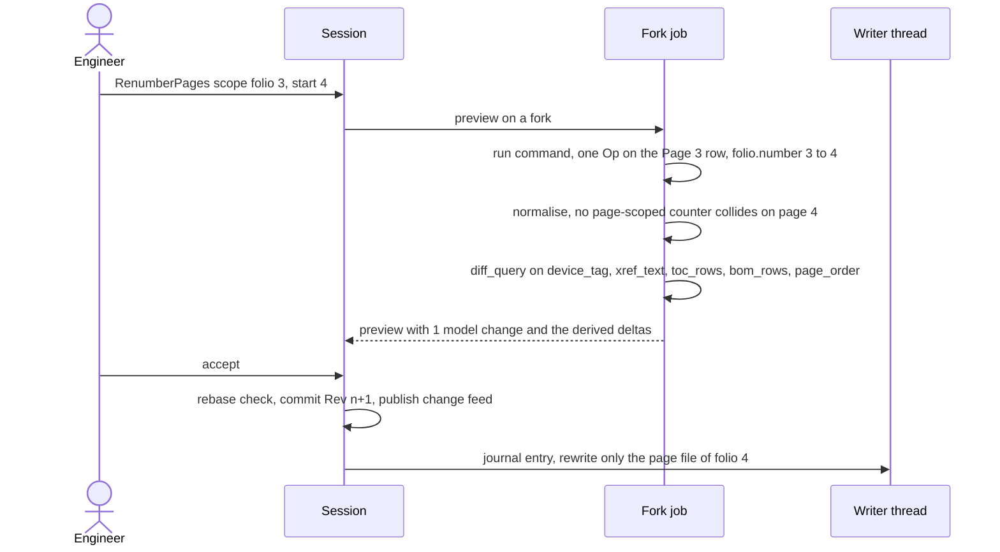

The preview lists the derived consequences, all computed from the same snapshot:

| Output | Before | After |
|---|---|---|
| Tags of devices whose main representation is on the page | -3W1, -3X1 | -4W1, -4X1 |
| -201U1 main xref on folio 201 | ∞ 3-B2, 106-G3 | ∞ 4-B2, 106-G3 |
| TOC row, PDF page label, outline | 3 | 4 |
| Prev/Next of folios 2 and 100 | Next 3 / Prev 3 | Next 4 / Prev 4 |
| BOM rows (tag and folio column), cable overview | -3W1 … 3 | -4W1 … 4 |
| Files written | — | `pages/<uuid of the page>.jsonl` only; no device shard changes |

Page renumbering cannot collide on page-scoped counters, because folios are unique. Moving a main representation to
another page can collide (e.g. -101F1 moved to folio 102, where -102F1 exists); the normaliser then assigns the next
free counter (-102F3) and the preview shows it (FR-NUM-029). 
**Frozen tags** never change by derivation (decision log ID-292). They change only by an explicit user action: `fields.set` on `tag.frozen` (explicit freeze and unfreeze; the property grid shows the resulting tag before it commits) or `numbering.renumber` with `include_frozen: true` (bulk, previewed). Both are undoable. `include_frozen` unfreezes only the frozen devices the scheme can number (placed, no terminal aspect, default scheme); unplaced devices, terminals and `Child` or named-scheme devices keep their frozen tag (FT-154 lists them in the preview). The renumber option `skip_frozen` no longer exists. Frozen literals do not yet reserve their counters against new devices (FT-151).

**Next free counter.** "Next free" is the lowest positive counter not used in the numbering scope, so gaps are
filled; it is deterministic over the current snapshot. A scheme option `reuse_gaps = false` switches to maximum + 1.
Counters released by a revision (the tombstones of [15](15-checks-revisions-collaboration.md) §6.4) are never
reused. In the example -102F1 and -102F2 exist, so the moved MCB becomes -102F3; in the usability fixture GP-UT,
where -102F1 is missing, a new MCB on folio 102 becomes -102F1 ([20](20-golden-project.md) §2).

### 8.7 Wire numbers

`Connection.number: NumberSpec = Unassigned | Assigned{counter: u32} | Frozen(Ident)`. The printed number is
derived from the wire-numbering scheme: connection-oriented (`{page}.{counter}`) or potential-oriented
(`{potential}.{subcounter}` with net extension: one number per signal, §9.3), FR-NUM-019/020. Unassigned
connections print "?" (FR-NUM-021). The number binds to the connection's identity, so route edits and moves change
it only through the rule (FR-NUM-023); `FreezeNumbers` converts derived numbers to `Frozen` at release (FR-NUM-011).

**Equivalents.** EPLAN: DT `<20010>` (displayed) and full DT, identifier sets, online and offline numbering formats,
connection numbering with format groups and net extension. QET: `label` element info (a stored evaluated string),
`formula` with `%F`, `%f`, `%prefix`, autonum counters; conductor `num` and `formula`. The QET importer keeps the
formula with the label so that "convert to EW numbering rule" can be offered.

---

## 9. Connectivity: connections, nets, signals, potentials

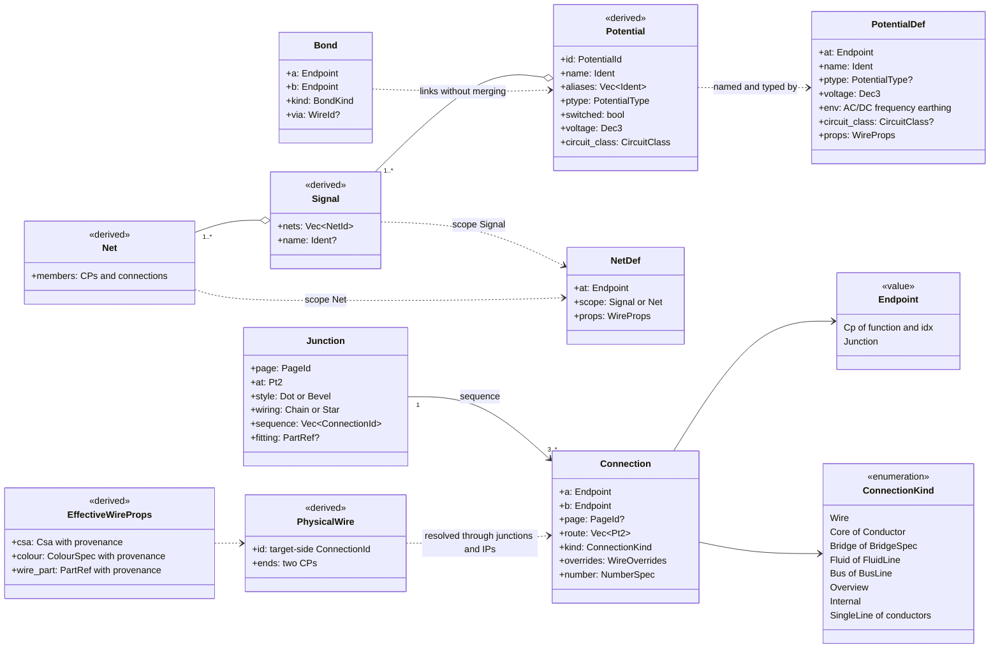

| Entity and purpose | Kind | Key attributes | Relationships, identity, lifecycle | Invariants |
|---|---|---|---|---|
| `Connection`: one explicit logical edge with a route (ADR-0007) | A; page-owned when drawn, else in the shard of the device that owns endpoint `a` | `a, b: Endpoint = Cp{function, idx} \| Junction(JunctionId)`; `page?` (added: None for strip-editor bridges and page-less internal links); `route: Vec<Pt2>` (nm, orthogonal, FR-CON-007); `kind: Wire \| Core(ConductorId) \| Bridge(BridgeSpec{kind, group, shaft}) \| Fluid(FluidLine) \| Bus(BusLine{cable?}) \| Overview \| Internal \| SingleLine{conductors: u8}` (`SingleLine` is 1.0; at MVP single-line pages draw connections as `Overview`, which join no nets); `overrides: WireOverrides` (the CDP level); `number: NumberSpec` (wire number or fluid line tag) | Several connections may share one CP; their order is the order of the junction sequence or, for direct connections, ascending ID (FR-CON-006). Moving representations never changes connectivity (FR-CON-004) | S: endpoints exist and differ; `Fluid` joins fluid CPs, `Bus` joins bus-port CPs, the other kinds join electrical CPs. `Overview` and `SingleLine` connections never join nets (FR-CON-002, FR-CON-029) |
| `Junction`: explicit T-node (REF-034, D-20) | A, page-owned | `at: Pt2`, `style: Dot \| Bevel{orient}`, `wiring?: Chain \| Star` (added; absent: the style's default, Dot → Star, Bevel → Chain), `sequence: Vec<ConnectionId>`, `fitting?: PartRef` (fluid pages only: a drawn fluid T is a physical tee, [11](11-fluid-power.md) §5.1) | Created and cleaned up by normalisers | S: every connection ending at the junction is in `sequence` and vice versa; at least three connections |
| `WireOverrides`: explicit per-connection values (CDP) | A, value | `csa?`, `colour?: ColourSpec`, `wire_part?`, `insulation?`, `function?`, `flags{shielded, twisted}`, `show_marker`; added: `length?: Nm` (manual length on the carrier connection, which works without a layout space, [12](12-panel-layout.md) §9) and `ends: SmallVec<[EndOverride{at: CpRef, treatment?, part?, strip_len?, marker?, no_marker}; 2]>` (per-end treatment, keyed by CP, [13](13-manufacturing-outputs.md) §2.3) | Rendered as a wire marker on request (FR-CON-023, FR-CON-024). The number-transfer normaliser moves `length` and `ends` together with the wire number when the carrier connection changes ([08](08-connections-terminals-cables.md) §5.1) | Chk: override equal to the derived value ("move override to profile" quick fix) |
| `PotentialDef`: names and types a potential | A, device shard | `at: Endpoint`, `name: Ident`, `ptype?: PotentialType` (None = naming only; a set type wins over propagation; `switched` is always derived from opening pass-through pairs), `voltage: Dec3` (V), `env{ac_dc, frequency, earthing?: Pelv \| Selv \| Floating}`, `circuit_class?` (added), `props: WireProps` (added) | Optionally drawn as a definition-point symbol (FR-CON-010). The golden potentials N-55T and N-55S are naming-only definitions; the other named golden potentials carry type, voltage and class (doc 20 §7.3, decision ID-69) | Chk: two definitions with different name or type in one potential (EW-POT-017) |
| `NetDef`: properties for one signal or net | A, device shard | `at: Endpoint`, `scope: Signal \| Net` (added), `props: WireProps` | FR-CON-016 | — |
| `Bond`: intentional link of two potentials (REF-038) | A, device shard | `a, b: Endpoint`, `kind: Pelv0vPe \| FePe \| Equipotential \| Shield`, `via?: WireId` (added) | The physical wire named in `via` stays in wire lists but does not merge the two potentials (D-22) | Chk (FR-CHK-028): different types joined without a bond; PELV without exactly one 0 V–PE bond |
| `Net`, `Signal`, `Potential` | D | see §9.3–§9.4 | `page_local_nets(page)`, `stitch_graph()`, `potential_partition()` | — |
| `PhysicalWire`: what the shop cuts | D | ID, two CP ends, constituent connections | §9.2 | — |
| `ColourProfile`, `SizeProfile` | A, in `ProjectSettings` | colour: rows `(voltage class, PotentialType) → (ColourSpec, name: MlText)`, company codes, `basis: Standard \| CompanyConvention` (D-37); size: rows `circuit class → (csa, wire_part?)` | Generate the cover tables of folio 1 (FR-REP-028) | — |

### 9.1 Potential types and circuit classes

`PotentialType = L1 | L2 | L3 | L | N | PE | PEN | FE | LPlus | LMinus | M | Signal | Undefined` (FR-CON-010).
`CircuitClass = Mains | Control | Analogue | Bus | Pe` is derived from type and voltage or set on the definition
(FR-CON-022). A PE connection takes the highest circuit class of its two ends (mains > control > analogue > bus, PE
ignored): at a device end from the device's own potentials, at a terminal end from the potentials on the terminal's
strip (FR-CON-038). So the size profile can give PE wires at mains devices 1.5 mm² and at control devices 0.75 mm²,
as on folio 1.

### 9.2 Junctions and physical wires

Connections are drawing edges; the shop needs CP-to-CP wires. `physical_wires_of(potential)` (memo per potential,
arch §6.4; algorithm in [08](08-connections-terminals-cables.md) §3.8) resolves them, and the wire list, routing and
`WireRecord` read it:

- A connection between two CPs is one wire with the connection's ID.
- Through an IP pair the drawn parts on both pages form one wire, which takes the ID of the **target-side**
  connection. W11 (-101F1:2 → -102G1:L via L-1) is one wire.
- Through a junction, `wiring` decides: **Star** joins the first CP in `sequence` to every other CP; **Chain** joins
  consecutive CPs. Each non-first branch connection gives one wire with its ID. At F55:2 on folio 101 a Dot junction
  in Star mode gives W13 (F55:2 → E55:L) and W14 (F55:2 → E56:X2).
- Direct connections that share a CP form a daisy chain in ascending ID order (FR-CON-006). The bevelled top bus on
  101 is two such chains, not a junction: W7 (S51:1 → -101F1:1) and W8 (-101F1:1 → F55:1) on the L side, W9 and
  W10 on the N side ([20](20-golden-project.md) §8.3). The physical wires are the same as with a Chain junction.
- A bond's `via` connection is cut from the potential union but still forms a physical wire (§9.6).

Wire identity is therefore a connection UUID (FR-MFG-001), stable under renumbering and route edits.

### 9.3 Three levels: net, signal, potential

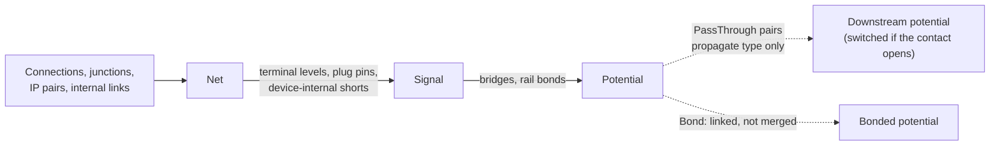

| Level | Joined through | Bounded by | Golden example |
|---|---|---|---|
| **Net** | connections of kind Wire, Core, Bus, Internal; junctions; IP pairs | every function CP (terminals, plugs and devices included) | W29: -102F2:Out1 → IP 24VDC-1 → -X1031:1 side 1 |
| **Signal** | nets joined by `Short` internal links: terminal levels (feed-through), plug/socket pins, duplicated device pins (PSU +#1/+#2) | bridges, rail bonds, `PassThrough` pairs, devices | W29 plus the -106W1 BN core to -201U1:5 through -X1031:1: signal "24VDC-1" |
| **Potential** | signals joined by `Bridge` connections and rail bonding (FR-CON-015) | `PassThrough` pairs (contacts, poles, channels), loads, bonds | 24VDC-1 = 4 signals over the bridged -X1031:1–4, aliases 24VDC-AIR1…4 |

The potential is the arch's "potential": the electrically equal set (FR-CON-009). The signal is what
potential-oriented wire numbering with net extension numbers once (FR-NUM-020: "24VDC-1.1" for W29 and its
continuation through -X1031:1). Overview connections never take part.

### 9.4 Potential identity, name and type

- **Identity:** `PotentialId` is the minimum `PotentialDef` ID when the potential has one or more definitions, else
  the minimum member CP ID, so the ID is stable under edits that do not touch the definitions or the members, and a
  second definition symbol does not change it (FR-CON-013). Nets and signals use the minimum member ID.
- **Name:** the `PotentialDef.name`; else the name of the first source IP in page order; else a deterministic
  fallback `<displayed tag>:<CP designation>` of the minimum member. All other IP names on the potential are aliases
  (D-24, FR-CON-012): 24VDC-1 has aliases 24VDC-AIR1…AIR4; signals take the first IP name inside them.
- **Type:** the definition's type; else the `potential_role` of member CPs (PSU "+" → L+, "−" → M, a PE pin → PE);
  else the type propagated across a `PassThrough` pair from the upstream potential. Passing a pair with
  `opens: true` sets `switched`. T55's contact 5–3 is `PassThrough{opens: true}`, so N-55T (T55:3, E55:N) is
  "N, switched", and EW-POT-013 reports D-13 unless the FnDef declares `switches_n_with_l` (FR-CHK-019).
- **Conflicts** (two types, two voltages, PE joined to M without a bond) are findings, never silent merges
  (FR-CHK-028).

### 9.5 Wire-property inheritance

Every effective property is the value of the highest level that sets it, with **provenance** (level and defining
entity) exposed in the property grid and `ew query --explain` (FR-CON-017, FR-CON-025):

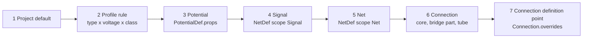

Levels 2 to 5 are evaluated once per potential (`wire_props_of(potential)`, arch §6.3). Level 6 is the connection's
intrinsic data: a core takes colour and cross-section from its `Conductor`, a bridge from its part. Level 7 is the
explicit override, rendered as a wire marker. This extends arch §6.4's chain ("connection override (CDP) > net
definition > potential definition > profile rule > project default") with the signal and intrinsic levels; it does
not reorder it.

| Wire | Potential (type, voltage) | Effective value | Provenance |
|---|---|---|---|
| W29 -102F2:Out1 → -X1031:1 | 24VDC-1 (L+, 24 V DC, control) | 0.75 mm², DBU | level 2, profile "DBU/WH 24 V" row (L+, 24 V DC) and size row "control" |
| W20 -102G1:+#1 → -102F1:1 | +24V (L+) | 1.5 mm², DBU | 1.5 mm² (level 7, CDP: the marker "1.5 DBU" on folio 102 sets the cross-section only), DBU (level 2, profile) |
| W4 1X1:1 → S51:2 | L (L, 230 V AC, mains) | 2.5 mm², BK | 2.5 mm² (level 7, CDP of the marker "2.5 BK"), BK (level 2, profile) |
| W8 -101F1:1 → F55:1 | L-S (L, 230 V AC) | 1.5 mm², BK | level 2, mains row |
| -106W1 core WH, -X1031:2 → -201U1:4 | 24VDC-1 | WH, csa of the core | level 6, conductor of -106W1 |
| W19 E55:PE → -X1032:1 | PE | 1.5 mm², GNYE | level 2, PE at a mains device |
| W33 -X1032:3 → -201U1:FE | PE | 0.75 mm², GNYE | level 2, PE at a control device |

Folio 1's rule "if size or sign is not indicated, standard size is to be used" (D-08) is thus executable, and the
cover tables are generated from the same profile.

### 9.6 Bonds

PE-0VDC (W27, -102G1:−#1 → -X1032:2 via the IP PE-0VDC) is a real wire with ferrules and a length. It is modelled
as `Bond{a: -102G1:−#1, b: -X1032:2, kind: Pelv0vPe, via: W27}`. `stitch_graph()` excludes W27's connections from the
union and records a bond edge, so 0V and PE remain two potentials, the PELV rule sees exactly one bond, and the wire
list shows W27 with potential "0V ⇄ PE". The bond wire is still a physical wire: `physical_wires_of` runs on the full
drawing graph, including the via connections.

**Naming on a bond path.** The cut sits at the via connection. Interruption points that lie on the bond's `via` path
are named on the bond, not on either potential, and still print their cross-references: "PE-0VDC" names B1 and is
neither an alias of 0V nor of PE ([08](08-connections-terminals-cables.md) §3.5).

**Equivalents.**

| Concept | Derived from it | EPLAN | QET |
|---|---|---|---|
| `Connection` | nets, wires, wire list | Connection (generated by autoconnect between aligned points) | `<conductor>` with element/terminal endpoints and `<segment>` path |
| `Junction` | wire order, physical wires | Connection symbols: angle, T-node with target direction, jumper | none: dots drawn where conductors meet |
| `WireOverrides` | level-7 values, wire markers | Connection definition point | conductor `conductor_color`, `conductor_section`, `function`, `tension_protocol` |
| `PotentialDef`, `NetDef` | potential name, type, levels 3–5 | Potential definition point, net definition point | none: properties copied between conductors by the UI |
| `Net`, `Signal`, `Potential` | highlighting, overview, numbering scopes | Net, signal, potential (EPLAN's potential also spans contacts and fuses; EW models that span as type propagation) | implicit "everything connected"; rebuilt on import |
| `Bond` | PELV and FE checks | none | none |

---

## 10. Interruption points and cross-references

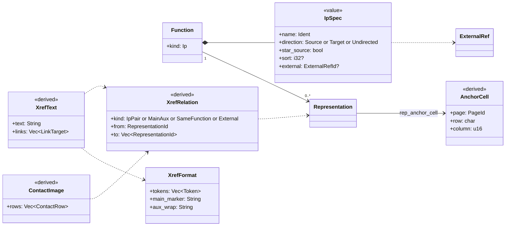

| Entity and purpose | Kind | Key attributes | Relationships, identity, lifecycle | Invariants |
|---|---|---|---|---|
| Interruption point: `Function{kind: Ip(IpSpec), device: None}` with one CP and a representation (arch §4.2) | A; function in the page file of its representation, which it follows on a page move ([05](05-project-format-and-persistence.md) §2.2); representation page-owned | `name: Ident` ("L-1"); `direction: Source \| Target \| Undirected` (signal direction, independent of the arrow glyph's orientation, FR-XRF-009); `star_source: bool` (added); `sort?: i32` (chain order, added); `external?: ExternalRefId` (added) | Its CP joins the local net; the pair joins nets across pages (§9.3). "Create counterpart" makes the partner on a chosen page (FR-XRF-014). The pairing scope is the project setting `ip_pairing.scope` (§5), not a member of `IpSpec`. Owned by its page: deleting the page or the IP representation deletes the function and the connections at its CP (ADR-0009 amendment 3). | S: `device` is None and the function has exactly one representation (ADR-0009 amendments 2 and 3; EW-INV-003, EW-INV-013). P: in star mode at most one star source per name and scope; in chain mode an even count, ordered by sort key (ADR-0009). Chk (FR-CHK-017): unpaired, ambiguous |
| External connection point: an IP with `external = Some(ref)` | A | as above | Never pairs inside the project; prints the external target "+J-E-206 / JE-N1000-03" (FR-XRF-012) | Chk (FR-CHK-033): external connection without a cable |
| `XrefFormat`: how relations print | A, in `ProjectSettings` | tokens `{page}` (folio label, QET `%F`), `{page_index}` (`%f`), `{row}` (`%l`), `{column}` (`%c`), `{function}` (`%M`), `{location}` (`%LM`), separators; main marker "∞ "; auxiliary wrap "(…)"; matrix layout (FR-XRF-008) | Presets "102-A1" (`%F-%l%c`), "(201-E1)", "/101.16" (FR-XRF-002) | — |
| `XrefRelation` | D | kinds: IP pair (star or chain), main ↔ auxiliary function, same function in another representation type (overview ↔ detail), pair cross-reference (1.x), external | Computed from functions and representations; never stored (FR-XRF-001) | — |
| `AnchorCell`, `XrefText`, `ContactImage` | D | cell on the target page's own frame (FR-XRF-021); text with link targets to PDF named destinations (FR-XRF-019); contact image rows from part contact data and auxiliary functions (FR-XRF-017) | Prefixed by structure only when the target page's structure differs (FR-XRF-004) | Chk (FR-CHK-035): target cell outside the frame or empty |

**Pairing.** IPs pair by `(name, scope key)`, where the scope key is the IP's resolved structure at the project's
pairing scope (project, `=` or `+`; FR-XRF-010). In **star** mode the star source refers to all others and each other
point refers to the source; in **chain** mode points pair in `(sort, page order, cell)` order (FR-XRF-007).

**Worked examples** (all from the cross-reference table of [20-golden-project.md](20-golden-project.md)):

| Relation | Source | Target | Printed at source | Printed at target |
|---|---|---|---|---|
| IP pair L-1 | 101-H16 (Source) | 102-A1 (Target) | 102-A1 | 101-H16 |
| IP pair PE-1.1 (glyph ◁ at the target) | 101-G15 | 103-G6 | 103-G6 | 101-G15 |
| Main ↔ aux, -201U1 | main on 201-E1 (assembly view) | aux on 3-B2 (bus port) and 106-G3 (power connector) | ∞ 3-B2, 106-G3 | (201-E1) |
| Main ↔ aux, -201U3 | slot in the assembly view, 201-E4 | black-box frame on 203-B4 | ∞ 203-B4 | (201-E4) |
| External | J-E-206-L at 101-G0 | +J-E-206 / JE-N1000-03 | +J-E-206 / JE-N1000-03 | — |

The reference prints "3-B0" for -201U1 because QET anchored the xref to an invisible symbol origin (D-14). EW
computes 3-B2 from the bus-port symbol's anchor policy.

**Equivalents.** EPLAN: interruption points pair by full DT, star or chain, sort dialog; cross-reference types main
↔ auxiliary, multi-line ↔ overview, pair cross-reference; contact images "in path" or "on component". QET: folio
reports (`next_report`/`previous_report` linked by `links_uuids`, label formula `<report label>`), master/slave xrefs
with `<xrefs>` settings (`master_label`, `slave_label`, `snapto`). EW recomputes all texts on import instead of
importing them and reads each project's own formulas (C-15).

---

## 11. Terminals

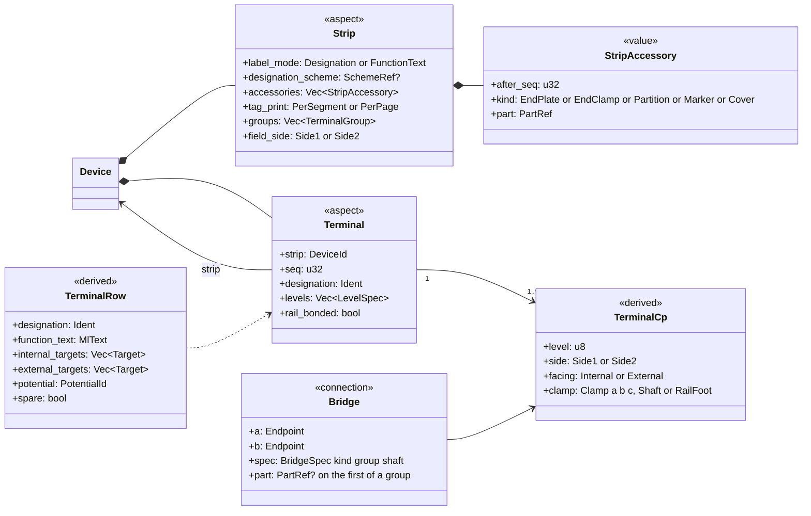

| Entity and purpose | Kind | Key attributes | Relationships, identity, lifecycle | Invariants |
|---|---|---|---|---|
| Strip: `Device` with `Strip` aspect | A | tag (-X1031), `label_mode: Designation \| FunctionText`, `designation_scheme?` (FR-NUM-024), `accessories: Vec<StripAccessory{after_seq, kind, part}>` (FR-TRM-016), `tag_print: PerSegment \| PerPage` (FR-TRM-011); added: `groups: Vec<TerminalGroup{from_seq, to_seq, label: MlText}>` (range captions such as "Pneumatics" and "Spare", FR-TRM-010) and `field_side: Side1 \| Side2` (default Side2, FR-TRM-012) | Drawn as one or more `StripSegment` representations of its main function: -X1031 at 103-A3 and 103-A10 is one device and one BOM row (D-42) | S: no Terminal or Cable aspect on the same device |
| Terminal: `Device` with `Terminal` aspect; **a terminal is a device** (arch §4.2) | A | `strip: DeviceId`, `seq: u32` (drawn and mounting order, independent of the designation, FR-TRM-003), `designation: Ident`, `levels: Vec<LevelSpec{level: u8, role: Main \| Aux}>`, `rail_bonded: bool` (FR-TRM-017); part per terminal (mixed parts allowed, FR-TRM-018); `function_text` (the printed label "1+", FR-TRM-010); `state` (Spare) | May exist unplaced and be placed from the strip editor (FR-TRM-015). Its full designation is the strip tag plus ":" plus designation | P: designation non-empty (D-11) and unique within the strip (D-12), checked at transaction end so swaps need no temporary names (FR-TRM-002, FR-TRM-022). S: `strip` has a Strip aspect |
| Terminal CPs | D | `level`, `side: Side1 \| Side2` (the physical clamp side from the part's CP pattern, persisted on `CpDef.side` and `CpData.side` as `"side1"` or `"side2"`) and the derived `facing: Internal \| External` (side 2 faces the field unless `Strip.field_side` says otherwise, [08](08-connections-terminals-cables.md) §2.1), `clamp: ClampKey = Clamp(char) \| Shaft(u8) \| RailFoot` from the part pattern; PT 2.5-TWIN = level 1, clamp a (side 1), clamps b and c (side 2), plus bridge shafts; a PE terminal adds a rail foot for carrier bonding (1.0) | Internal connectivity from the FnDef: a feed-through joins all CPs of a level, shaft included (`Short`), a disconnect terminal by state (FR-TRM-020) | — |
| Bridge: `Connection{kind: Bridge(BridgeSpec)}` | A; page-owned when drawn, else in the strip's shard | `BridgeSpec{kind: PlugIn \| Saddle \| Wire \| InterLevel, group: u16, shaft: u8}`; the connections of one group (a comb over consecutive `seq` on one shaft) are one bridge object, and only the first carries the part in `overrides.wire_part`, read as level-6 data | Joins signals into one potential (§9.3); appears in terminal diagrams and the BOM (once per group), never as a wire (FR-TRM-007) | S: both ends are terminal CPs. P: a group runs over consecutive `seq` on one shaft, and groups do not overlap |
| `TerminalRow` | D | designation, level, function text, part, potential, internal and external targets (device, CP, cable and core), bridges, spare | `terminal_rows(strip)` feeds terminal diagrams (FR-REP-009) and assembly lists | — |

**Golden -X1031.** 20 terminal devices, designations 1–20 (proposal ▲, 02a OQ5), function texts "1+" ×4, "2+" ×2, "3+"
×2, "4+" ×2, "1-" ×4, "2-"/"3-"/"4-" ×2, `label_mode = FunctionText`, so the drawing looks as before while lists are
unambiguous. `Strip.groups` carries the captions "Pneumatics" (1–4, 11–14) and "Spare" (5–10, 15–20). Bridges 1–2–3–4,
5–6, 7–8, 9–10 and 11–20 are plug-in bridge groups defined in the strip editor (`page = None`); BR1, for example, is
three connections 1–2, 2–3 and 3–4 with one `group`. Twelve terminals are spare. -X1032 (5 × PT 2.5-TWIN-PE) is
rail-bonded, which joins it to 1X1:PE and the PE bar -XPE through the location's PE node (§16) without a drawn wire
(D-21).

**Equivalents.** EPLAN: terminal strip definition, terminals as functions with designation `<20030>`, multi-level
terminals, saddle jumpers, alignable accessories, edit-terminal-strip dialog. QET: terminal elements
(`element_type`, `terminal_type`, `terminal_function`), from 0.100 `<terminal_strips>` with `physical_terminal`,
`real_terminal` and `terminal_strip_bridge`; older projects infer strips from label prefixes such as "X1031:1+".

---

## 12. Cables

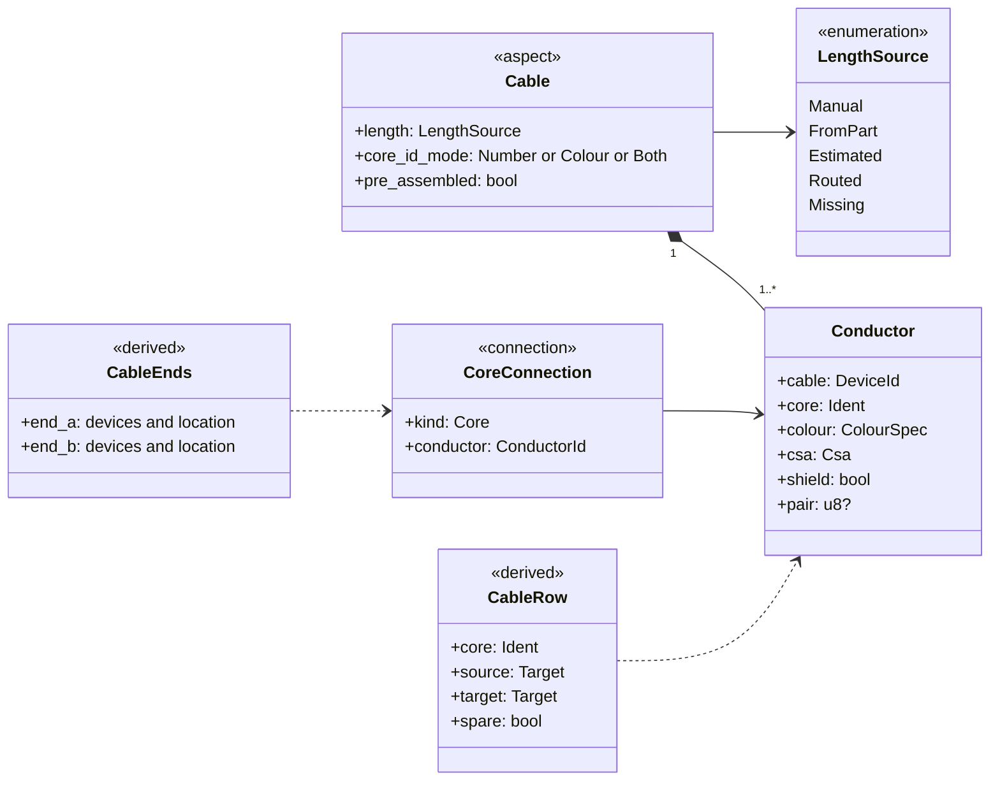

| Entity and purpose | Kind | Key attributes | Relationships, identity, lifecycle | Invariants |
|---|---|---|---|---|
| Cable: `Device` with `Cable` aspect | A | tag (-106W1), part, `length: LengthSource = Manual(Nm) \| FromPart \| Estimated(C) \| Routed(C) \| Missing` (default `Missing`) (FR-CBL-009/010), `core_id_mode` (FR-CBL-006), `pre_assembled` and connector parts (FR-CBL-013) | Its main function is drawn as the cable definition line and marker; drawing the line runs a command that assigns the crossed connections (FR-CBL-002), so assignment is explicit, not geometric | Chk (FR-CHK-033): no length; release blocks |
| `Conductor`: one core or shield | A, cable's shard | `core: Ident` ("1", "BK", "A"), `colour?: ColourSpec`, `csa?: Csa` (absent while unknown), `shield: bool` (FR-CBL-007), `pair?` (FR-CBL-019) | Generated from the part's core definition on assignment (FR-CBL-004); a drawn connection becomes `kind: Core(conductor)` (FR-CBL-003). One core may span several pages through IPs | Chk (FR-CHK-032): colours outside IEC 60757 or different from the part |
| `CableRow`, `CableEnds` | D | per core: source and target (device, CP, location), spare; ends from conductor endpoints (FR-CBL-012) | `cable_rows(cable)` feeds cable diagrams and overviews (FR-REP-012/013) | — |

**Golden.** -106W1 and -106W2 (Festo NEBU-G78W5-K-2-N-LE5): cores BK, BU, GNYE, WH, BN (drawn "BR"), length
`FromPart` (2 m, unverified). -3W1 (6XV1830-0EH10): cores A and B plus a shield, drawn single-line on folio 3 as
one `Connection{kind: Bus(BusLine{cable: -3W1})}` (FR-CBL-008), length `Missing` until entered. Golden A therefore
has 3 cables with 13 conductors. Golden A-R adds the incoming supply cable -101W1 from +J-E-206 to 1X1 (3 cores, ▲),
which resolves D-19 and gives 4 cables with 16 conductors ([20](20-golden-project.md) §10).

**Equivalents.** EPLAN: cable definition line, cable DT, conductors with function definition "conductor/wire",
connection definition points at intersections, shields, edit-cable dialog. QET: `<cables>` with `<core>` entries in
0.200; plain cable symbols in 0.100, inferred on import.

---

## 13. PLC

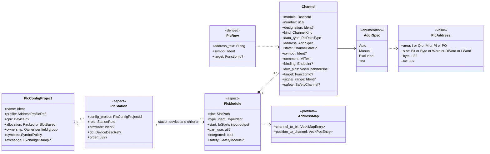

| Entity and purpose | Kind | Key attributes | Relationships, identity, lifecycle | Invariants |
|---|---|---|---|---|
| `PlcConfigProject` (added): one target PLC-software project | A, `project.jsonl`; the exchange body (exchange records, foreign IDs) in `exchange/<uuid>.jsonl` (1.0) | `name` ("PLC1"), `profile` (address grammar: "Siemens TIA (international)", "IEC 61131-3"; FR-PLC-008), `cpu?` (None in Golden A: the DP master sits in +J-E-206), `allocation: Packed \| SlotBased` (1.x), `ownership`: an `Owner = Ecad \| Plc \| Shared` per field group (FR-PLC-033), `symbols: SymbolPolicy{template?, strict_iec, tag_table}`, `exchange?: ExchangeStamp{format, version, file_sha256, direction, rev, date}` | Scopes address and symbol uniqueness (FR-PLC-002); a new project has one default ([10](10-plc-and-bus.md) §2.2) | — |
| `PlcStation` aspect: an addressable participant | A | `config_project`, `role: Cpu \| HeadStation \| IoDevice \| ValveTerminal \| IoLinkMaster \| Drive \| ExternalPartner`, `firmware?`, `dd?` (GSD, GSDML, ESI, EDS, IODD reference), `order?: u32` (address-allocation order; without it UUIDv7 creation order, never tag, page or bus address) | The station is a role of a device, not a second identity (FR-PLC-001). It sits on the device that owns the bus port and the address window | — |
| `PlcModule` aspect: a card or sub-module | A | `slot: SlotPath = Rack{rack, slot, subslot} \| Positional` (rank among the station's I/O modules by `Device.position`); `type_ident` (order number plus device-description module ident); `start: IoStarts{input: AddrSpec, output: AddrSpec}` (a mixed module has both ranges); `part_use?` (which `PartUse` of the device supplies the PLC section and its address maps, needed when the device has several parts; FR-PRT-010); `integrated`; `safety?: SafetyModule{f_dest, f_source, f_wd_ms, range}` | On the station device or a child device; integrated modules cannot be deleted alone (FR-PLC-003) | S: belongs to exactly one station |
| `Channel`: the logical I/O unit (FR-PLC-004) | A, module device's shard; ID `v5(module_id, "channel", number)` | `number: u16` (0-based), `designation?` (manual; automatic and determined are derived), `kind: Di \| Do \| Ai \| Ao \| Counter \| MultiFunction \| IoLinkPort \| PowerSupply`, `data_type`, `address: AddrSpec`, `state?` (explicit Spare, Reserved or Deactivated; derived when absent, §4.2), `symbol?` (manual; automatic from target tracking, FR-PLC-017), `comment: MlText`, `binding?: Endpoint` (signal pin or the served coil's internal CP; no `Connection` row), `aux_pins: Vec<ChannelPin{role: Supply \| M \| Shield, cp}>` (added), `target?: FunctionId` (manual target override), `signal_range?` ("4..20 mA"), `safety?: SafetyChannel{evaluation, pair?, requirement?, test_pulse?}` | Number, designation and address are three fields. A normaliser creates the channels from the module's part data when the `PlcModule` aspect is added ([10](10-plc-and-bus.md) §2.4) | S: exactly one module. P: a CP in at most one channel (FR-PLC-005); address unique per area as bit-range overlap within the configuration project (FR-PLC-044); symbol unique per configuration project |
| `AddrSpec`, `PlcAddress` | A (Manual is F) / value | `Auto \| Manual(PlcAddress) \| Excluded \| Tbd`; `PlcAddress{area, size, byte: u32, bit: u8?}` stored canonically, rendered by the profile (Q0.1, %QX0.1; FR-PLC-007) | `Tbd` is a typed open item that blocks release (D-15, FR-PLC-013) | — |
| `PlcRow` | D | rendered address, symbol, function text, process tag, target, state | `channel_addresses(module)`, `plc_rows(station)` feed the PLC overview and the I/O assignment list (FR-PLC-022/023) | Chk EW-PLC-012 (FR-PLC-045): address differs from the map |

**Worked example: Q0.1 on folio 203.** Station -201U1 (valve terminal) has modules -201U3 … -201U8 and -202U2 in
manifold slots 1–7 (`SlotPath::Positional`), all with output start `Auto`. The profile's default scheme assigns output
bytes in station order, so -201U3 starts at Q0 and -202U2 at Q6 (FR-PLC-012). The 533361 address map maps channel n to
bit n. The import binds the coil 14 of -201U3-Q1 (position 1, p = 0) to channel 1, as drawn, so the derived address is
byte 0, bit 1 = **Q0.1**. The channel's automatic symbol and the valve's printed text (its function-text slot falls
back to the tracked process tag) follow the `DeviceLink` to field device -203Q1 and its process tag TA05-V-15. The
same part map also states where solenoid 14 of position p belongs (FR-PLC-011). Under "channel 2p", the suspected
vendor convention (unverified), EW-PLC-012 reports all 28 bindings as deviations; this is D-26, which the golden check
expectation includes (FR-CHK-042, [02b](02b-requirements-extended.md) OQ2). Under "channel 2p + 1" nothing is
reported. Newly placed valves are bound by the normaliser according to the map. Channels that are neither bound nor
claimed by the map get the derived state `Deactivated` (OQ 9), which gives 8 used, 20 spare and 28 deactivated
channels. Changing -201U5's start re-addresses only its 8 channels.

**As built (cycle 13; decision log ID-333, ID-334, ID-335).** `ew-schema` implements, additively within format 0.1 (FT-111), `plc_config_project` (rank 11: `name`, `profile` = `id@version`, `cpu`), `channel` (rank 37, shard of `module`, ID `v5(module, "channel", number)`: `number`, `designation`, `kind`, `address` = `AddrSpec`, `state`, `symbol`, `comment`, `binding`, `target`) and `device_link` (rank 42, §7), the device aspects `plc_station` (`config_project`, `role`, `order`) and `plc_module` (`slot` = `SlotPath`, `start` = `IoStarts`, `part_use`, `integrated`), and the part section `sections.plc` (`role`, `io`, `channels`, `bit_of` = `MapSpec`, `unbound`): the subset of doc 10 §2.2–§2.6 that the golden project needs. The other members of the classes above stay in `extra` until their work packages: `allocation`, `ownership`, `symbols` and `exchange`; `firmware`, `dd`, `type_ident` and `safety`; `data_type`, `aux_pins` and `signal_range`; and the solenoid-position map of the `AddressMap` (`MultiFunction` is not yet a `ChannelKind`). `AddrSpec` and `PlcAddress` are implemented in full. The diagram's `AddressMap` is, as built, `sections.plc` with its `bit_of`; the position half is FT-228. `PlcRow` is the derived row of `ew-derive`. Since cycle 16 commands reach these kinds (decision log ID-395, ID-398, ID-399): `plc.config_project.create`, the `plc_station` and `plc_module` aspects through `fields.set`, `plc.bind_channel`, and normaliser N1, which creates a module's channels from its part data (until then channels came only from import); the channel members are not yet settable (FT-226). An older 0.1 build keeps the new records but does not enforce their links (decision log ID-334).

**Equivalents.** EPLAN: configuration project (20161), PLC box and card, PLC connection points with channel
designation, PLC address (20400), symbolic address (manual/automatic/determined), start address, addressing and
readdressing, AML AR APC exchange. QET: `plc_type`, `plc_address`, `plc_function`, `plc_comment` element info and,
in 0.200, `plcMasterData` (layout only).

---

## 14. Bus

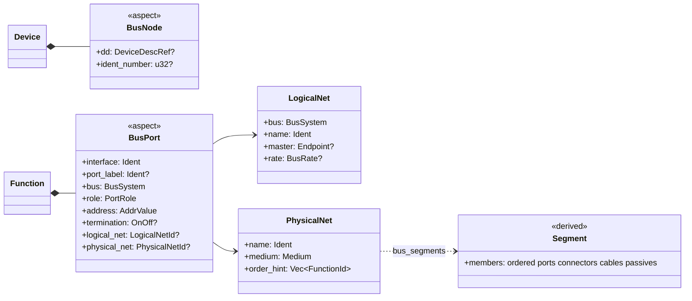

| Entity and purpose | Kind | Key attributes | Relationships, identity, lifecycle | Invariants |
|---|---|---|---|---|
| `BusNode` aspect (device level) | A | device description, ident number | -201U1 is the PROFIBUS DP slave CPX-FB13 | — |
| `BusPort` aspect (on a function, FR-BUS-001) | A | `interface` ("DP"), `port_label?` ("P1R"), `bus: ProfibusDp \| Profinet \| EtherCat \| EthernetIp \| IoLink \| Asi \| …`, `role: Master \| Slave \| Controller \| Device \| Passive`, `address: AddrValue = Value(NetAddress) \| Tbd \| NotApplicable`, `termination?: On \| Off` (added, FR-BUS-004), `logical_net?`, `physical_net?` | Ports derive network properties (baud rate) instead of copying them (FR-BUS-002) | P: address unique within the logical net (FR-BUS-015) |
| `LogicalNet` | A, device shard of its master or `project.jsonl` | bus, name, master port, rate or cycle, address space | Scope of address uniqueness | — |
| `PhysicalNet` | A | `name`, `medium` (copper, fibre …), `order_hint` (members not drawn on any topology page); the ordered segments of ports, connectors, cables and passive devices are derived by `bus_segments(pnet)` from the `Bus` connections and connector links, never stored ([10](10-plc-and-bus.md) §2.7, §3.8) | Termination, length and stub rules run against the derived segments (FR-BUS-003) | Chk (FR-BUS-016): termination On at exactly both segment ends |
| External bus partner | A | `Device{kind: ExternalPartner}` with an `ExternalRef`, `BusNode`, `PlcStation{role: ExternalPartner}`, no parts | Excluded from the BOM, shown in topology and network lists (FR-BUS-005) | — |

**Golden.** The logical net "PROFIBUS DP" has its master in +J-E-206 (JE-N1000-03, external partner), rate ▲. The
derived physical segment is JE-N1000-03 → -3W1 → -3X1 → -201U1 DP, master first (FR-BUS-003). -3X1 (Festo 532216) is a
connector device whose port function has `termination: On`; its "Switch to ON" text is rendered from that property.
-201U1's DP port has `address: Tbd`, an open item (D-15).

**As built (cycle 13; decision log ID-333, ID-336).** `Bus` connections exist (`ConnectionKind::Bus(BusLine)` with `BusLine.cable`), and Golden A draws the DP cable -3W1 and the plug-on mating with them; `BusPort`, `LogicalNet` and `PhysicalNet` and `bus_segments` are not built yet (FT-225).

**Equivalents.** EPLAN: bus port (`BusTerminal` with bus address, bus system, master flag), logical network
(20414), physical network (20413), bus configuration transfer. QET: none (bus lines are conductors with `bus`
text, cable symbols).

---

## 15. Fluid power

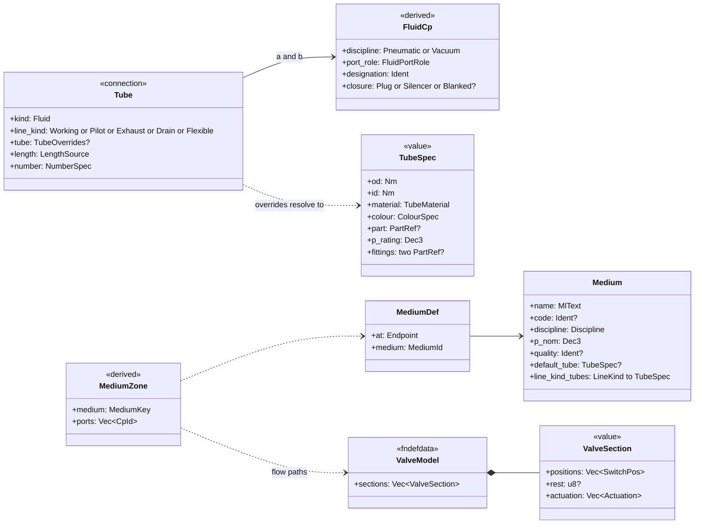

| Entity and purpose | Kind | Key attributes | Relationships, identity, lifecycle | Invariants |
|---|---|---|---|---|
| Fluid port: a CP with fluid discipline (FR-FLU-001) | D (from `CpDef`) | `discipline: Pneumatic \| Vacuum` (Hydraulic later), `port_role: Supply1 \| Working2 \| Working4 \| Exhaust3 \| Exhaust5 \| Pilot10 \| Pilot12 \| Pilot14 \| PilotExhaust82 \| PilotExhaust84 \| ExternalPilot \| Consumer \| Sensing \| Generic` (`Pilot10`, `Consumer` for actuator ports A/B, `Sensing` and `Generic` added), designation; thread or push-in size from the part; `CpOverride.closure: Plug(PartRef) \| Silencer(PartRef) \| Blanked` closes a port without a drawn device (§7) | One graph engine for both disciplines (arch §4.2) | — |
| Tube: `Connection{kind: Fluid(FluidLine)}` (FR-FLU-002) | A, page-owned | `FluidLine{line_kind, tube?: TubeOverrides, length: LengthSource}`: `line_kind` sets the ISO 1219-1 line style; `tube` holds only the overridden fields of a `TubeSpec{od, id: Nm, material, colour: ColourSpec, part?, p_rating: Dec3 bar, t_range, fittings per end}`, each resolved with provenance (FR-FLU-010). The line tag is the common `Connection.number` (FR-FLU-011); `FluidLine` has no tag of its own | May cross the location boundary to field devices (FR-FLU-006) | S: both ends fluid CPs |
| `Medium` | A, `project.jsonl` | `name`, `code?` (ISO 1219-2 medium letter), `discipline`, `p_nom: Dec3` (bar), ISO 8573-1 quality class, temperature range, colour, `default_tube?`, `line_kind_tubes` (defaults per line kind, e.g. pilot lines) (FR-FLU-008) | `ProjectSettings.fluid.default_tube` is the project-level default below it | — |
| `MediumDef` (added): medium source | A, device shard of the owner of `at` | `at: Endpoint` (supply plate port 1, service-unit outlet), `medium` | Media propagate along valve flow paths, like potentials (FR-FLU-009); delete policy *unlink* | Chk EW-FL-005: two media joined directly |
| `ValveModel` (FnDef data, FR-FLU-007) | L | `sections: [ValveSection{positions: [SwitchPos{label, paths}], rest?, actuation: [Actuation{actuator, selects}]}]`: one section for most valves, two for a 2×3/2 body, so every valve is one fluid function (FR-FLU-004); the drawn side of an actuator is symbol graphics | Drives media propagation and valve checks ([11](11-fluid-power.md) §2.3) | — |
| `MediumZone`, effective tube | D | medium per port set; effective tube per field, from the highest level that sets it: the line's override, the data of the effective tube part, the medium's line-kind default or default tube, then `ProjectSettings.fluid.default_tube` ([11](11-fluid-power.md) §5.4) | Tube lists and cut lists (FR-FLU-012/013) | Chk EW-FL-007: line without tube spec and no default |
| Manifold galleries | D | supply, exhaust and pilot galleries from position order and the `galleries` entries of `PartCopy.sections.fluid` | Never stored as page-less fluid connections ([11](11-fluid-power.md) §5.2) | — |
| Blank position | A | a child device of kind `BlankingPlate` with a CP-less FnDef in a manifold position | A BOM item with one main function (FR-DEV-004) | — |

**Golden.** Each of the 28 valves 571334 has a 5/2 monostable fluid function with ports 1–5 (printed "3 1 5" on top
and 2, 4 below, correction C3; FR-FLU-001) and a coil function 14 bound to its channel. The 8 used valves drive
the double-acting actuators of the field devices -203Q1 … -203Q8 (process tags TA05-V-15 … TA05-V-37) in +FIELD ▲,
through tube pairs F1–F16 from ports 2 and 4 (Ø ▲). Golden A keeps the gaps of D-28. Golden A-R adds the medium
"compressed air 6 bar [1:4:1]" ▲ through a supply line to -201U9:1, the default tube PU 6×4 BU, silencers on the
supply plates' ports 3 and 5 and plugs on the spare valves' ports 2 and 4 ([20](20-golden-project.md) §12).

**Equivalents.** EPLAN Fluid: fluid connection points, `PLCBoxFluid` and `PLCTerminalFluid` for valve terminals,
ISO 1219 symbol library, fluid page type; media handling is unverified. QET: pneumatic elements with unnamed
generic terminals (no port semantics), so the importer needs a symbol-mapping table.

---

## 16. Panel layout and routing

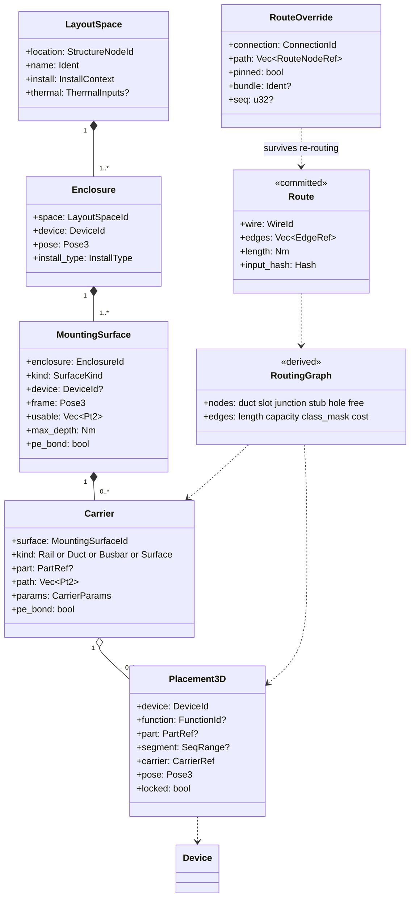

| Entity and purpose | Kind | Key attributes | Relationships, identity, lifecycle | Invariants |
|---|---|---|---|---|
| `LayoutSpace`: one cabinet or bayed suite | A, `layout/<uuid>.jsonl` | `location: StructureNodeId` (+J-E-2416), `name`, `install: InstallContext{wall_behind, ceiling_above, neighbours, floor}` (added; thermal reads face exposure from it), thermal inputs (ambient, altitude, target temperature; FR-THM-005), `policy?` | Holds enclosures, surfaces, carriers, placements, overrides, routing paths, surface features and committed routes (FR-LAY-001) | — |
| `Enclosure` | A | `device` (-UC1, enclosure part NSYPLA1074G ▲), `pose: Pose3` (origin bottom-left-rear outside corner, X right, Y up, Z towards the door), `install_type` (THM), doors (1.0) | Tagged layout objects are devices, so parts stay on devices | — |
| `MountingSurface` | A | `kind: Plate \| DoorInside \| DoorOutside \| Side \| Roof \| Floor \| Gland`, `device?` (mounting plate NSYPMM107, child of -UC1), `frame: Pose3` (u, v in plane, w outward), usable polygon, `max_depth: Nm`, `pe_bond: bool` (FR-LAY-058) | 2D layout pages are views of one surface at a stated scale or "not to scale" (FR-LAY-010) | — |
| `Carrier`: rail, duct, busbar or the surface itself | A | `kind`, `part?` (layout-only part, counted in the BOM; FR-LAY-008), `path` in the surface frame, `params` (rail profile TS 35×7.5; duct W×H "40×60", slot pitch; FR-LAY-004/005), `pe_bond` | Poses of its placements are relative to it, so moving a rail moves its devices | — |
| `Placement3D`: a device, one function (e.g. a door handle) or one strip segment (e.g. a single terminal) on a carrier | A | `device`, `function?`, `part?: PartRef` (added: which part use of the device it realises; None = the primary mountable part), `segment?: SeqRange` (added: a terminal range when a strip is placed in pieces), `carrier: CarrierRef = Carrier \| Surface \| Placement` (delete policy forbid), `pose: Pose3` relative to the carrier, `variant`, `locked` (FR-LAY-006) | Stores no tag text: labels are `layout_label(placement)`, so "T51" cannot exist (D-02). Geometry comes from the part (FR-LAY-007). Panel-front representations are derived from placements by `panel_front_reps(dev)`, never stored | S: the device exists. Chk EW-LAY-001 unplaced device, EW-LAY-003 part use not on the device, EW-LAY-004 location ≠ space location |
| `RouteOverride` | A | `connection` (physical wire ID), `path: Vec<RouteNodeRef>`, `pinned`, `bundle?`, `seq?` (added); no length: a manual length lives in `WireOverrides.length` of the carrier connection (§9) | Keyed by connection ID, so it survives re-routing (FR-LAY-047, FR-LAY-054) | — |
| `RoutingPath`, `SurfaceFeature` (added) | A, layout file (ranks 57, 58) | routing path: `kind: FreeAir \| Hinge \| WiringHole \| Guide`, points, class set, cost factor (FR-LAY-043/044); surface feature: user-authored hole, thread, cut-out, slot, keyhole or custom outline on a surface side (FR-LAY-056) | All other machining features are derived by `surface_features(surface)` | — |
| `RoutingGraph` | D, Class II | duct centrelines at mid-depth with slot nodes every max(slot pitch, 25 mm), joints, CP stubs, free-air and hinge paths; edges with length, capacity, segregation mask, cost (FR-LAY-042/043) | Built on a fork from carriers and placements | — |
| `Route`, wire length | C | per wire: path as `RouteNodeRef = Duct{carrier, seg, s} \| Joint{carrier, vertex} \| Path{routing_path, idx} \| Stub{cp} \| Entry{feature}` (carrier positions, not graph indices, so the route stays readable after a graph rebuild), `length: Nm` = the unrounded calibrated length (stubs + path + Δz + end allowances + reserve, FR-LAY-051), `input_hash`; rounding happens once, in the `WireRecord`, to the project length increment ([13](13-manufacturing-outputs.md) §3.3) | Only `RouteWires` writes it (FR-LAY-046); EW-LAY-011 flags a stale input hash | Release exports require fresh routes |

**PE through carriers.** A rail-bonded PE terminal on a carrier with `pe_bond`, on a surface with `pe_bond`, joins
the PE potential through that carrier. While a layout space models no PE-bonded carrier, rail-bonded
terminals of one location join a virtual "location PE" node (OQ 10).

**Golden.** One layout space +J-E-2416; enclosure -UC1 with plate; five 40×60 ducts (one type ▲); three TS 35
rails ▲; placements in three rows (row 1: -102G1, -101F1, -102F1, -102F2, T55, S51; row 2: 1X1, -X1031, -X1032 with
end brackets; row 3: the valve terminal -201U1 … -202U3). F55, E55, E56, S56 and -201U9 stay unplaced in Golden A
(EF-05); Golden A-R places them ([20](20-golden-project.md) §13). Placement order and row assignment are the
acceptance criteria (FR-LAY-016). A PanelLayout page shows the plate through one `SurfaceView` page item.

**Equivalents.** EPLAN Pro Panel: layout space, mounting surface, mounting rail, cable duct, 3D macros and
placement, routing path network, wire routing and lengths. QET: none; folio 902 is free rectangles and text.

---

## 17. Manufacturing

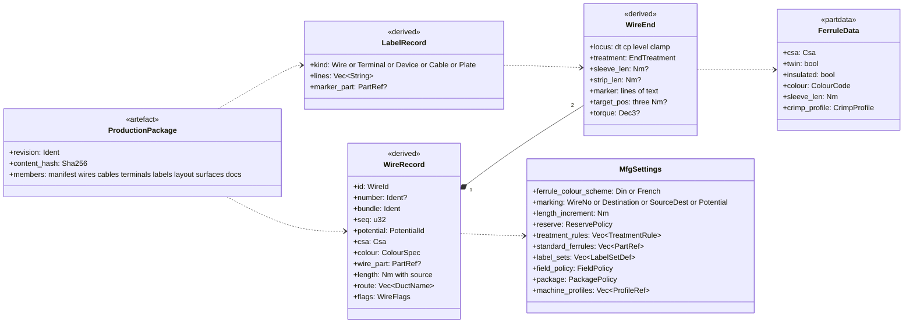

| Entity and purpose | Kind | Key attributes | Relationships, identity, lifecycle | Invariants |
|---|---|---|---|---|
| `WireRecord`: one production row per physical wire (FR-MFG-001) | D (Class II for routed lengths) | ID = physical wire ID (§9.2), number, kind (wire, core, bond), bundle and sequence (FR-LAY-054), potential, effective csa, colour and IEC 60757 code, wire part, length with source and breakdown, rounded once to `MfgSettings.length_increment`, route as duct names, page references, flags (door, twisted, shielded, pre-assembled, estimated CP, field, bond) | One row source feeds PDF, XLSX, CSV and `.ewpp` (ADR-0018); machine profiles only declare their resolution and never re-round ([13](13-manufacturing-outputs.md) §2.4, §3.3) | — |
| `WireEnd` | D | locus "strip:terminal:level:clamp" (FR-MFG-002); `treatment: EndTreatment = Ferrule{part} \| TwinFerrule{part, partner} \| RingLug{part, stud} \| ForkLug \| PinLug \| Bare \| Connector{part} \| Undetermined{reason}`; sleeve and strip length, crimp profile; marker text as one entry per printed line; `target_pos?: [Nm; 3]` (a position in the plate frame, not a pose); torque; provenance | Selected by the ordered treatment rules over wire class, clamp type and cross-section (FR-MFG-005/006); an `EndOverride` in `WireOverrides.ends` wins (§9) | Chk: two wires on a clamp without twin permission |
| Ferrule, wire, marker | L (part kinds, FR-PRT-024) | ferrule: csa, twin, insulated, colour (scheme-dependent), sleeve and total length, collar diameter, crimp profile, packaging | Machine magazines prefer their own ferrules | — |
| `MfgSettings` | A, in `ProjectSettings` | ferrule colour scheme DIN 46228-4 or "French" (FR-MFG-007), ferrule policy, `treatment_rules` (ordered data), `standard_ferrules` (the shop's ranked set), marking scheme (FR-MFG-010), `label_sets`, `field_policy` (field wires and external-end cores), `package` policy (members, documentation languages, personal-data default), `length_increment` (default 10 mm) and `reserve` policy (default fixed 100 mm), both read by the length formula of [12](12-panel-layout.md) §9; embedded machine profiles (TOML data, FR-MFG-018) | From the basic project ([13](13-manufacturing-outputs.md) §2.3) | — |
| `LabelRecord` | D | wire, terminal, device, cable and plate labels from one engine (FR-MFG-012); deterministic DT abbreviation (FR-MFG-011) | Exported in marking-software layouts | Chk: truncation |
| `ProductionPackage` `.ewpp` | X, Class II | ZIP with deterministic member order: manifest, project, devices, wires, cables, terminals, labels, layout glTF, surface DXF, cut lists, checklists, PDF, machine exports; revision and content hash (FR-MFG-031/032) | Written by export; frozen into the as-built archive at release | Release refuses stale Class II inputs (FR-MFG-025) |

**Golden W29.** -102F2:Out1 → -X1031:1 (1/a); 24VDC-1; 0.75 mm², DBU; 806 mm computed and stored unrounded in the
route, 810 mm in the wire record after rounding once to the 10 mm project increment (FR-LAY-051); insulated
0.75 mm² ferrules at both ends; folios 102 and 103.

**Equivalents.** EPLAN: Smart Production, wire-end treatment by wire class (2027), labelling schemes, wire lists;
exports are proprietary. QET: wiring list view (0.200), no ferrules, no lengths.

---

## 18. Revisions and release

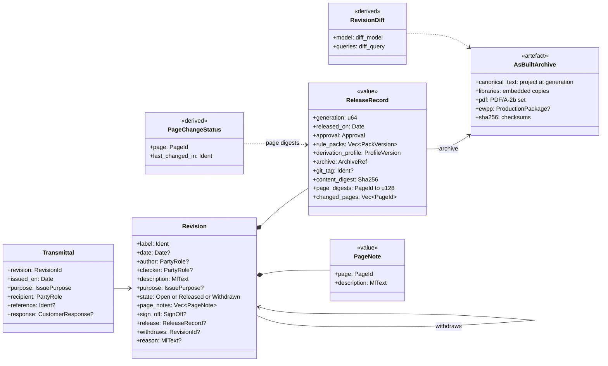

| Entity and purpose | Kind | Key attributes | Relationships, identity, lifecycle | Invariants |
|---|---|---|---|---|
| `Revision`: one managed project revision (FR-REV-001) | A, `revisions.jsonl` | `label` in the project's one format (V1.0, V2.0; FR-REV-002), `date?`, `author?` and `checker?` (party roles, FR-PRJ-003), `description: MlText`, `purpose?` (issue purpose, 1.0), `state`, `page_notes: [{page, description}]` (FR-REV-012; at most one note per page; `page` is not a link), `sign_off?{checker, date, scheme, packs, waivers_ack, content_digest}` (added: the checker's approval, bound to the content digest of the saved project), `release?`; on a withdrawal record `withdraws: RevisionId` (forbid link) and `reason` (added) | Open → Released by `ReleaseRevision` after `revision.approve`; withdrawing a released revision adds a separate record in state Withdrawn that points to it (FR-REV-009). "Signed off" is an open revision whose `sign_off.content_digest` equals the current digest; a later content edit voids it ([15](15-checks-revisions-collaboration.md) §5.4). A **historic** released revision (released before the project came to EW) has no release record and no archive | S: at most one open revision (EW-INV-016); labels unique among the revisions not withdrawn (EW-INV-017); the checker, when set, differs from the author (EW-INV-018; D-34, FR-REV-005); one note per page (EW-INV-019); a released or withdrawn revision is not updated (EW-INV-020, FR-REV-009). That a revision released by EW has a checker is the release gate's (EW-REL-001); label format and order are EW-REL-004 |
| `ReleaseRecord` (added, inside `Revision`) | A, value | generation, release date, approval (the sign-off copied at release: checker, date, check scheme, waivers; FR-REV-020), rule-pack versions, derivation profile, archive reference with SHA-256, git tag `ew/rev/<label>`; added: `content_digest` (at generation g, after the freeze), `page_digests: Map<PageId, u128>`, `changed_pages` (frozen) | Written in the same atomic release step as the archive ([05](05-project-format-and-persistence.md) §14.1) | — |
| `Transmittal` (added) | A, `revisions.jsonl` (rank 63, anchored to its revision) | revision, issued on, purpose, recipient role, reference, customer response | Issue and approval history towards the customer (1.0, [15](15-checks-revisions-collaboration.md) §5.9); not a content edit | — |
| `AsBuiltArchive` (ADR-0013) | X | canonical text at the released generation, embedded libraries, PDF/A-2b, `.ewpp`, check report, SHA-256 sums (FR-REV-008); stored at `<parent>/<name>.ew-archive/<label>.ewarchive` | Loaded into a read-only `Model` for comparison (FR-REV-010, FR-REV-014) | — |
| `PageChangeStatus`, `RevisionDiff` | D | page change status from per-page display-list digests compared with the last release's `page_digests`, or the page notes where no digests exist (FR-REV-004, FR-REV-022); entity and query deltas: BOM, wire list, terminals, PLC addresses (FR-REV-015) | Page digests reuse the memoised display lists (Class I); `diff_model` and `diff_query` against the archive stay for property comparison and deltas | — |

The title block's "Revision" cell binds to the project revision query, so every page prints the same label (D-05).
Committed computations (routes, frozen numbers, report snapshots) are frozen at release (FR-REV-011). Golden A holds
V1.0 (Released, historic, no archive) and V2.0 (Open); Golden A-R releases V2.0, and its `changed_pages` are 101 and
106 from the page notes, because V1.0 has no digests.

*As built (cycle 17; decision log ID-427 to ID-431; FT-165).* `ew-schema`'s `Revision` types `label`, `date?`,
`author?`, `checker?`, `description`, `state` (with the `Unknown` catch-all), `page_notes`, `withdraws?` and
`source_ref?`; `purpose`, `sign_off`, `release` and `reason` stay in `extra` until `revision.approve`,
`revision.release` and `revision.withdraw` write them (FT-302). `date` and `author` are optional (ruling R2): an
open revision may have neither yet, and Golden A's historic V1.0 has neither author nor checker. A page note's text
member is `description`, like the revision's. A note is not a link to its page: a released revision is immutable, so
its notes keep naming a page that a later revision deletes, and a note on a missing page selects nothing.
`withdraws` is the ID of the withdrawn revision, never its label, and a forbid link (§4.2). The structural rules are
EW-INV-016 to EW-INV-020 of `crates/ew-model/invariants.md` ([ADR-0009](../adr/0009-invariant-catalogue.md)
amendment 6). Commands: `revision.create` (an open revision or a historic released one; refused with `state:
released` once any revision has a release record, ruling R4), `fields.set` on the open revision and `edit.delete` of
the open revision ([06](06-schematic-editor.md) §3.1). The title block's current revision is the open one, else the
latest released one by date, natural label order and ID, leaving out a revision that a withdrawal record names.
*Property grid (cycle 25, WP-S2.05 part 1; decision log ID-593, ID-626):* `author` and `checker` show read-only in the grid, because they
decide the four-eyes sign-off, although `fields.set` can still write them ([15](15-checks-revisions-collaboration.md) §5.4; FT-402).

**Equivalents.** EPLAN: revision management, revision project `*.ell`, completed project `*.elr`, change markers
and property comparison. QET: `indexrev` per folio, free text.

---

## 19. Checks

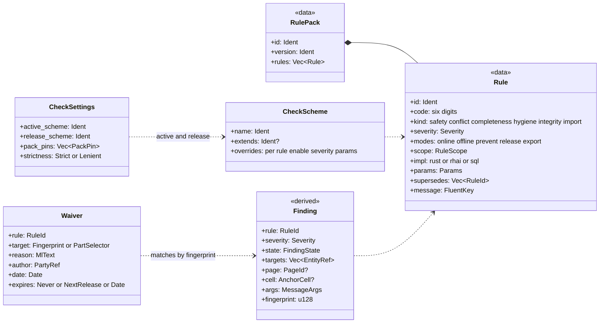

| Entity and purpose | Kind | Key attributes | Relationships, identity, lifecycle | Invariants |
|---|---|---|---|---|
| `RulePack`, `Rule` | data (shipped packs trusted; project packs `rules/<uuid>.toml` untrusted until the project is trusted) | `id` (EW-POT-013), six-digit `code`, class, `kind`, severity and release severity, modes `online \| offline \| prevent \| release \| export`, `scope` (the memo key of `checks(scope)`: project, page, potential, net, strip, cable, device, module, station, cfg (configuration project), lnet, pnet, fluid_net, space, surface, carrier), implementation (Rust, rhai or SQL), parameters and data tables with a `verified` flag, `supersedes`, Fluent message key, docs path (FR-CHK-001, [15](15-checks-revisions-collaboration.md) §2.3) | Versioned; a released revision records pack versions (FR-CHK-004) | — |
| `CheckSettings` (added) | A, in `ProjectSettings` (`project.jsonl`) | `active_scheme` (online, default `drafting`), `release_scheme` (gate, default `pre-delivery`), pack pins `{id, version_req}`, `strictness: Strict \| Lenient{since}`, rule parameters (as built, cycle 22: only `{active_scheme?, release_scheme?}` are written, in `settings.extra.checks`, by the `HumanOnly` command `project.checks.set`, §5.1; decision log ID-545) | Company schemes may lock rules (FR-CHK-050) | — |
| `CheckScheme` | A, in `ProjectSettings` or the company basic project | `name`, `extends`, per-rule enablement, severity, release severity and parameters; `drafting`, `pre-delivery`, `migration`, `full` and others ship (FR-CHK-003) | Resolved pack defaults → company scheme → project scheme | — |
| `Finding` | D (online: Class I; offline and SQL rules: Class II) | rule, code, severity, `state: open \| pending \| waived \| superseded \| deferred \| possibly_resolved`, target entity refs, page and cell, message arguments (entity references, rendered at display time), origin, `fingerprint` = first 128 bits of SHA-256 over rule ID, sorted target IDs and a rule-defined discriminator (FR-CHK-044) | `checks(scope)`; the migration report is a check run in lenient mode (FR-CHK-011) | — |
| `Waiver` | A, `waivers.jsonl` | rule, `target: Fingerprint \| PartSelector{library, item}` (part selector from 1.0), reason (at least 10 characters), author, date, `expires: Never \| NextRelease \| Date` (FR-CHK-009) | Matches a finding by fingerprint, which survives renumbering, or every finding of the rule on the part; safety rules accept only fingerprint waivers; unmatched and expired waivers are reported (EW-CORE-081, EW-CORE-082) | — |

Prevent rules are the P invariants of the sections above; structural invariants are not rules and cannot be
waived. **Golden expectation:** `ew check --scheme pre-delivery` reports exactly the rows of `findings_mvp.csv`
([20](20-golden-project.md) §18.1, FR-CHK-042): among them D-13 (N switching), D-26 (address bits, depending on the
map), the TBD station address, missing parts of S56 and E56 and unplaced devices.

**Equivalents.** EPLAN: check runs and message management with message classes (P001xxx terminals, P003xxx cables,
P005xxx connections, P017xxx numbering). QET: none beyond import warnings.

---

## 20. Golden project mapping

Summary only; the authoritative tables are in [20-golden-project.md](20-golden-project.md) and
[reference-drawing.md](../research/reference-drawing.md) §4.

| Model element | Golden content | Count |
|---|---|---|
| `Project` | object J-E-2416, project reference `<project ref>`, drawing id `<drawing id>`, parties `<customer>` and `<end user>` in separate roles, supply 1/N/PE AC 230 V 50 Hz (TN-S ▲), control 24 V DC, consumption 6 A, profiles "DBU/WH 24 V" and control 0.75 / mains 1.5 mm² | 1 |
| `StructureNode` | =P01; +J-E-2416 (alias JE2416); +J-E-206; +FIELD ▲ | 4 |
| `ExternalRef` | +J-E-206 / JE-N1000-03 (supply L, N, PE; PROFIBUS master) | 4 uses |
| `Section`, `Page` | sections 1, 2, 9; 36 pages per [20](20-golden-project.md) §5: 13 drawn (1, 3, 101–103, 106, 201–206, 902), 5 reproduced generated folios (2, 100, 200, 900, 901), the continuations 2.1 and 901.1, and 16 report pages (903–911 with their sub-pages) | 3; 36 |
| `Device` | S51 … -202U3 (29 rows), 28 valve children -201U3-Q1 … -202U2-Q4, 8 field devices -203Q1 … -203Q8 (process tags TA05-V-xx), -XPE, -UC1 and plate, 3 strips with 3 + 20 + 5 terminals, 3 cables (4 with the A-R supply cable -101W1) | ≈ 100 |
| Main/aux sets, IPs | 9 main/aux reference sets; 22 IP pairs; 4 external points | 22 pairs |
| `Connection`, `Junction` | W1 … W44 plus bridges, junctions on 101–103 | 44 + bridges |
| Potentials | L, N, L-S, N-S, L-1, N-1, L-55, N-55, N-55T, N-55S, PE, +24V, +24V-F, 24VDC-1 … -4, 0V, DP; one 0V–PE bond | 19 + 1 bond |
| `Conductor` | -106W1, -106W2 (5 each), -3W1 (A, B, shield); A-R adds the supply cable -101W1 (3) ▲ | 13 (16 with the A-R supply cable) |
| PLC | 1 configuration project, station -201U1, 7 modules, 56 channels (8 used, 20 spare, 28 deactivated) | 56 channels |
| Bus | 1 logical net, 1 physical segment, -3X1 terminated, address `Tbd` | 1 |
| Fluid | 28 valves with ports 1–5, 8 tube pairs F1–F16 ▲; medium, supply line and closures in A-R ▲ | 28 |
| Layout | 1 space, -UC1, plate, 5 ducts, 3 rails ▲, placements in 3 rows | 1 |
| `Revision` | V1.0 (2025-03-03, Released, historic, no archive), V2.0 (2025-04-14, Open, folios 101 and 106) | 2 |
| `ReportBlock` | TOC, BOM 901, 903–911; embedded PART DATA boxes on 201, 202, 902 and the cover tables | 11 + 4 |
| Frozen tags | S51, F55, T55, E55, S56, E56, 1X1 (Golden A); none in Golden B | 7 |

---

## Requirements covered

This document elaborates the data model behind:

- **PRJ:** FR-PRJ-001 … FR-PRJ-022, FR-PRJ-024, FR-PRJ-026, FR-PRJ-028, FR-PRJ-029.
- **PAG:** FR-PAG-001, FR-PAG-002, FR-PAG-005, FR-PAG-006, FR-PAG-008, FR-PAG-009, FR-PAG-010, FR-PAG-012,
  FR-PAG-013, FR-PAG-014, FR-PAG-015, FR-PAG-018, FR-PAG-020, FR-PAG-021, FR-PAG-023, FR-PAG-025, FR-PAG-029,
  FR-PAG-030.
- **SYM:** FR-SYM-001, FR-SYM-004, FR-SYM-005, FR-SYM-006, FR-SYM-009, FR-SYM-010, FR-SYM-011, FR-SYM-013,
  FR-SYM-014, FR-SYM-016, FR-SYM-018, FR-SYM-023, FR-SYM-024, FR-SYM-030.
- **DEV:** FR-DEV-001 … FR-DEV-030.
- **NUM:** FR-NUM-001 … FR-NUM-016, FR-NUM-018, FR-NUM-019, FR-NUM-020, FR-NUM-021, FR-NUM-022, FR-NUM-023,
  FR-NUM-024, FR-NUM-028, FR-NUM-029, FR-NUM-030.
- **CON:** FR-CON-001, FR-CON-002, FR-CON-004 … FR-CON-006, FR-CON-009 … FR-CON-025, FR-CON-027, FR-CON-028,
  FR-CON-029, FR-CON-032, FR-CON-034 … FR-CON-039, FR-CON-042, FR-CON-045.
- **XRF:** FR-XRF-001 … FR-XRF-012, FR-XRF-014 … FR-XRF-017, FR-XRF-019, FR-XRF-020, FR-XRF-021, FR-XRF-024.
- **TRM:** FR-TRM-001 … FR-TRM-007, FR-TRM-009 … FR-TRM-012, FR-TRM-015 … FR-TRM-018, FR-TRM-020 … FR-TRM-022,
  FR-TRM-026, FR-TRM-027.
- **CBL:** FR-CBL-001 … FR-CBL-007, FR-CBL-009, FR-CBL-010, FR-CBL-012 … FR-CBL-015, FR-CBL-019.
- **PRT:** FR-PRT-001 … FR-PRT-010, FR-PRT-013, FR-PRT-018, FR-PRT-024, FR-PRT-026, FR-PRT-031, FR-PRT-034.
- **MAC:** FR-MAC-001, FR-MAC-003, FR-MAC-004, FR-MAC-008, FR-MAC-013.
- **REP:** FR-REP-001, FR-REP-003, FR-REP-005, FR-REP-006, FR-REP-027, FR-REP-028, FR-REP-032 … FR-REP-036, FR-REP-041.
- **CHK:** FR-CHK-001 … FR-CHK-004, FR-CHK-009, FR-CHK-011, FR-CHK-019, FR-CHK-022, FR-CHK-028, FR-CHK-042,
  FR-CHK-044 … FR-CHK-046, FR-CHK-050.
- **REV:** FR-REV-001, FR-REV-002, FR-REV-004 … FR-REV-012, FR-REV-014, FR-REV-015, FR-REV-020 … FR-REV-023.
- **PLC:** FR-PLC-001 … FR-PLC-005, FR-PLC-007, FR-PLC-008, FR-PLC-011 … FR-PLC-013, FR-PLC-016, FR-PLC-017,
  FR-PLC-019, FR-PLC-033, FR-PLC-044, FR-PLC-045, FR-PLC-053, FR-PLC-054.
- **BUS:** FR-BUS-001 … FR-BUS-005, FR-BUS-015, FR-BUS-016, FR-BUS-023.
- **FLU:** FR-FLU-001 … FR-FLU-013, FR-FLU-026 … FR-FLU-028, FR-FLU-031.
- **LAY:** FR-LAY-001, FR-LAY-002, FR-LAY-004 … FR-LAY-008, FR-LAY-010, FR-LAY-042, FR-LAY-043, FR-LAY-046,
  FR-LAY-047, FR-LAY-051, FR-LAY-054, FR-LAY-056, FR-LAY-058, FR-LAY-059, FR-LAY-063.
- **THM:** FR-THM-005.
- **MFG:** FR-MFG-001, FR-MFG-002, FR-MFG-005 … FR-MFG-007, FR-MFG-010 … FR-MFG-012, FR-MFG-018, FR-MFG-025,
  FR-MFG-031, FR-MFG-032, FR-MFG-042, FR-MFG-043.
- **COL:** FR-COL-001, FR-COL-012, FR-COL-018.
- **IMP:** FR-IMP-002, FR-IMP-040, FR-IMP-041, FR-IMP-044.
- **I18N:** FR-I18N-001, FR-I18N-002, FR-I18N-003, FR-I18N-005, FR-I18N-009, FR-I18N-010, FR-I18N-011.
- **Non-functional ([02c](02c-nonfunctional-requirements.md)):** NFR-REL-04, NFR-REL-07, NFR-REL-08, NFR-REL-10,
  NFR-PRIV-06, NFR-I18N-03, NFR-I18N-04.

### Proposed new requirements

The seven rows this document proposed are in [02a](02a-requirements-core.md):
- physical wires through junctions and interruption-point pairs, with the target-side ID → **FR-CON-035**;
- signals and nets as levels of the potential partition → **FR-CON-036**;
- a bond that references the physical wire realising it → **FR-CON-037**;
- next free counter on a page-based tag collision, shown in the preview → **FR-NUM-029**;
- frozen tags printed without the product-aspect sign → **FR-NUM-030**;
- alternative spellings per structure node → **FR-PRJ-028**;
- finding fingerprints and fingerprint waivers → **FR-CHK-044**.

## Open questions

1. **Page title and description override.** The title block has a page-description cell and a project-description
   cell, which one `description: Option<MlText>` cannot carry. **Resolved:** `Page { title: MlText,
   description_override: Option<MlText> }` is the schema (§6), and arch §4.2 summarises it; the D-06 check applies to
   the override only.
2. **Signal boundaries.** §9.3 places bridges between signals and potentials, which matches FR-NUM-020's acceptance
   criterion but may not match EPLAN's exact semantics (EPLAN's potential also spans contacts and fuses).
   *Recommendation:* keep the EW definition, document the EPLAN difference in the glossary, and validate it in the
   usability test with two EPLAN users before M2 (ADR-0007).
3. **Optional `Connection.page`.** Bridges defined in the strip editor and page-less internal links have no page.
   **Resolved:** `page` is optional, and such rows live in the shard of the device that owns endpoint `a` (§9;
   ADR-0007 amendment). A channel binds its coil directly (`Channel.binding`), without a connection.
4. **Interruption-point uniqueness.** "Interruption-point name unique per scope and direction" forbade star mode
   with several targets (FR-XRF-008). **Resolved:** the prevent rule reads "at most one star source per name and
   scope; in chain mode an even count, ordered by sort key" (§10; ADR-0009 amendment), and the integrity check uses
   the same wording.
5. **IP functions without a device.** **Resolved:** `Function.device` is optional, with the structural invariant
   "None if and only if kind = Ip" (§7; ADR-0006 and ADR-0009 amendments); IP functions live in the page file of
   their representation.
6. **Where the valve-terminal assembly lives.** The PLC research sketched a separate assembly device "-201U".
   **Resolved:** `PlcStation` sits on the device that owns the bus port and the address window, `Assembly` on the
   device that carries the order codes, with `AssemblyConfig.covers` mapping order codes to children; on the golden
   project both are -201U1 ([10](10-plc-and-bus.md) §2.3).
7. **Junction wiring default.** **Resolved:** Dot junctions default to Star from the first sequence member and
   Bevel junctions to Chain (ADR-0007 amendment); golden J5 and J6 are set to Star ([20](20-golden-project.md) §8.3).
   The default sequence orders the parts of a split connection by flow distance from the source; the M2 usability
   test confirms it (PQ-27), and QET imports, where only geometry is available, take the same defaults.
8. **Strip tag format X1031.** Golden A needs letter-page-counter for strips but page-letter-counter elsewhere.
   *Recommendation:* a numbering-scheme rule per device class in the pilot basic project, not frozen tags, so that
   new strips follow the same convention; confirm with the pilot user.
9. **Unbound valve-terminal channels.** Each 8-output module drives only 4 monostable valves, so 28 of the 56 golden
   channels have no solenoid behind them. *Recommendation:* derive state `Deactivated` for channels that are neither
   bound nor claimed by the part's position map, exclude them from I/O lists by default, and keep the D-26 decision
   (even or odd bit for coil 14) in part data marked unverified until the pilot's PLC program or the vendor manual
   confirms it.
10. **PE rail bonding without modelled carriers.** *Recommendation:* at MVP, join all rail-bonded PE terminals of one
    location through a virtual "location PE" node; from 1.0, trace actual carriers and surfaces with `pe_bond`, and
    report a difference between the two as a finding during migration to a real layout.
11. **Additions to `ew-schema`.** **Resolved:** the additions of §1.2, including the schema batches of the feature
    documents, are accepted through the schema-steward rule (arch §7.6) before the spine's `ew-schema` v0 freezes
    (spine lane 2); the revision record kinds freeze at M1. This document holds the field lists, and arch §4.2
    summarises them.
12. **Type aspect sign.** The `%` sign for IEC 81346-1:2022 is unverified. *Recommendation:* ship the aspect as
    configurable data at 1.x and confirm the sign against a licensed copy of the standard first.
