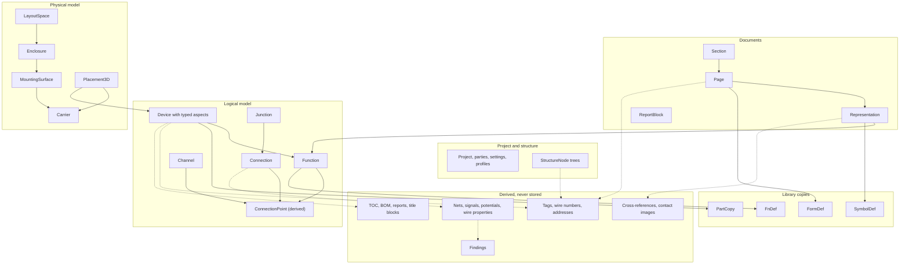
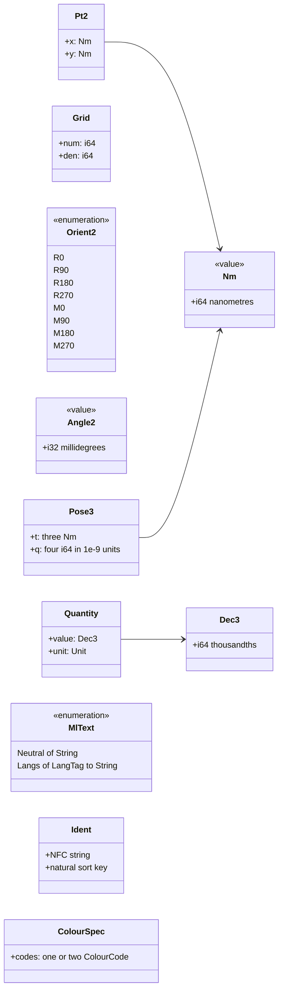

# Domain model: conventions, overview, values and identity

A chapter of [Domain model](03-domain-model.md), whose table says where each section lives.

---

## 1. Conventions

### 1.1 Notation and classification

- `Record { field: Type }` names a persisted `ew-schema` record or value type. `XId` abbreviates `Id<X>` (a UUID,
  ADR-0004), `T?` is `Option<T>`, and `Vec<T>` stands for any ordered sequence (`SmallVec` in code).
- A reference to an embedded library copy is typed by the item kind: `Id<Part>`, `Id<SymbolDef>`, `Id<FnDef>`,
  `Id<FormDef>` (the copy ID, [05](05-project-format-and-persistence.md) §13.2). The older names `PartCopyId`,
  `FnDefRef`, `FormRef`, `ExternalRefId` and `PartCopy` in this document mean these types (`Id<Part>`, `Id<FnDef>`,
  `Id<FormDef>`, `Id<ExternalRef>` and `LibCopy<Part>`); the code has no alias of those names.
- Field names are the `ew-schema` member names and equal their JSON names, except where the JSON name is a Rust
  keyword: `StructureAssignment.type`, `Representation.box` and `GroupSpec.break` (Rust `type_`, `box_`, `break_`).
- Every record kind that an importer can create, that is every project record kind except `ImportLineage`, ends
  with `source_ref?{lineage, key}` (import provenance, [14](14-interop.md) §2.3): the last declared member, followed
  only by the flattened device aspects and `extra`. The tables below do not repeat it.
- Value types (`Nm`, `Pt2`, `Grid`, `Orient2`, `Angle2`, `Pose3`, `Dec3`, `MlText`, `Ident`, `ColourSpec`) are
  defined in §3.
- This document is the normative field-level schema, together with `ew-schema`; [architecture](04-architecture.md)
  §4.2 summarises it. File placement and kind ranks are those of [05](05-project-format-and-persistence.md) §2.
- "CP" is a connection point, "IP" an interruption point, "DT" a device tag.
- The column **Kind** classifies every concept:

| Marker | Meaning | Persisted | Changed by |
|---|---|---|---|
| **A** authored | A fact a human, or an importer acting for one, decided | Yes, as an `ew-schema` record | Commands only (`Command → Transaction → Op`, ADR-0008) |
| **L** library copy | Master data embedded in the project as `{library_id, item_id, version, sha256}` | Yes, under `lib/` | "Update from library", a previewed command |
| **D** derived | A pure query result (ADR-0001, ADR-0002); freshness Class I unless marked II | Never | Recomputed; cannot go stale |
| **C** committed | Output of an explicit command, stored as `Committed<T>{value, input_hash, rev}` (ADR-0003) | Yes | `RouteWires`, `FreezeNumbers`, `ReleaseRevision`; check EW-LAY-011 flags a stale input hash |
| **F** frozen | A deliberate override of a derived identifier: `TagSpec.frozen`, `NumberSpec::Frozen`, `AddrSpec::Manual` | Yes | Commands; the numbering report lists every deviation |
| **X** external artefact | A file outside the model: as-built archive, production package, STEP cache | Outside the project directory or in caches | Release and export jobs |

- Invariants are tagged **S** (structural: always on; a violation rejects the transaction) or **P** (prevent rule:
  configurable per rule pack; strict mode rejects, lenient mode reports), as in arch §4.6 and ADR-0009. Rules that
  only report are tagged **Chk** with their rule or requirement ID. All invariants are evaluated on the candidate
  snapshot at transaction end, so swaps and renumbers need no intermediate states.

### 1.2 Vocabulary mapping

| Term used elsewhere | Model concept |
|---|---|
| Symbol instance | `Representation`; the display-list `Instance` (arch §8.1) is only its rendering |
| Frame, form, title block | `FormDef` with `kind` Frame, TitleBlock, Cover, Report or Label |
| Fluid port | `ConnectionPoint` with a fluid `discipline` and a `port_role` |
| Tube | `Connection { kind: Fluid }` carrying a `TubeSpec` |
| Network | `LogicalNet` plus `PhysicalNet` |
| Placement | `Placement3D`, also used by the 2D panel layout |
| Connection definition point (CDP) | `Connection.overrides`, optionally rendered as a wire annotation |
| Part | a catalogue item in `ew-library`; inside a project always a `PartCopy` reached through a `PartRef` |

---

## 2. Model overview

| Group | Authored records (A, L) | Main derived concepts (D, C) | File (arch §7.2, ADR-0010) | Detailed in |
|---|---|---|---|---|
| Project, structure | `Project`, `StructureNode`, `ExternalRef`, `Comment`, `ImportLineage`, `ImportRun` | full designations, identifier suppression | `project.jsonl`, `structure.jsonl`, `comments.jsonl`, `imports/<run-uuid>.jsonl` | §5, [05](05-project-format-and-persistence.md) |
| Documents | `Section`, `Page`, `Representation`, `PageItem`, `ReportBlock`, `MacroInstance` | page order, Prev/Next, generated pages, anchor cells, display lists | `structure.jsonl`, `pages/<uuid>.jsonl`, `report-blocks.jsonl`, `reports/<uuid>.sql` | §6, [06](06-schematic-editor.md), [09](09-reports-forms-output.md) |
| Logical model | `Device`, `Function`, `Connection`, `Junction`, `Conductor`, `Channel`, `PotentialDef`, `NetDef`, `Bond`, `DeviceLink`, `MediumDef`, `PlcConfigProject`, `LogicalNet`, `PhysicalNet` | CPs, tags, nets, signals, potentials, wire properties, xrefs, addresses, bus segments | `devices/<xx>.jsonl`; page-owned rows (including IP functions and macro instances) in page files; `PlcConfigProject` in `project.jsonl`, its exchange body in `exchange/<uuid>.jsonl` (1.0) | §7–§15, [08](08-connections-terminals-cables.md), [10](10-plc-and-bus.md), [11](11-fluid-power.md) |
| Library copies | `SymbolDef`, `FnDef`, `PartCopy`, `FormDef`, `MacroDef`, manufacturer records | symbol geometry, form layout | `lib/<kind>/<copy_id>.json` | [07](07-symbols-parts-macros.md) |
| Physical model | `LayoutSpace`, `Enclosure`, `MountingSurface`, `Carrier`, `Placement3D`, `RouteOverride`, `RoutingPath`, `SurfaceFeature` | routing graph, routes (C), lengths (C), duct fill, collisions, surface features | `layout/<uuid>.jsonl` | §16, [12](12-panel-layout.md) |
| Release, quality | `Revision`, `Transmittal`, `Waiver` | findings, page change status, revision diffs | `revisions.jsonl`, `waivers.jsonl` | §18–§19, [15](15-checks-revisions-collaboration.md) |
| Manufacturing | settings in `Project` | wire records, wire ends, labels; the production package (X) | — | §17, [13](13-manufacturing-outputs.md) |

---

## 3. Value types: units, quantities, text

### 3.1 Geometry (ADR-0005, G4)

- **`Nm(i64)`** is the only linear unit in the model and in files: page coordinates, symbol geometry, 3D poses,
  wire and cable lengths. ±9.2 × 10⁹ m is enough for any bayed suite.
- **`Pt2 { x, y }`** on pages has its origin at the top-left corner of the sheet, x to the right and y downwards.
  This is QET's convention, so imported geometry needs no flip.
- **`Grid { num, den }`** is a rational step in nm. The QET 10 px grid is `7_937_500/3` nm (1 px = 25.4/96 mm =
  `793_750/3` nm). The native EW connection grid is 4 mm = `4_000_000/1`, with fine grids of 0.5 mm for graphics and
  1 mm for text slots: ADR-0027's recommendation, the default in force while the ADR stays Proposed
  until the pilot confirms it. Points snap to grid indices `k`, and the stored
  coordinate is `round(k × num / den)`, an error of at most 0.5 nm.
- **`Rect`** is an axis-aligned closed rectangle of two `Pt2`, always normalised (minimum corner first). It is
  persisted in embedded report blocks, form cells and data areas and `SurfaceView.clip`; the JSON encoding is
  `[[x0, y0], [x1, y1]]` ([05](05-project-format-and-persistence.md) §3.2).
- **`Orient2`** has eight variants: four rotations, each optionally mirrored (FR-SYM-004). Symbol representations
  use only `Orient2`. Rn rotates clockwise as seen on the sheet, following QET's element `orientation`
  ([06](06-schematic-editor.md) §2.5).
- **`Angle2(i32)`** is an angle in units of 10⁻³ degree, used only by free texts and graphics (QET free texts, DXF
  `INSERT` and `TEXT`), so imports keep arbitrary angles without floats in files (ADR-0005). The JSON encoding is the
  integer; the default 0 is omitted. **Sense** (ADR-0005 amendment 2): 0 points along +x (3 o'clock), and a
  positive angle rotates **counter-clockwise as seen on the sheet**, although sheet y points down. A point (x, y)
  rotated by θ about the origin becomes (x cos θ + y sin θ, −x sin θ + y cos θ). This is QET's arc convention and
  keeps DXF angles unchanged after the importer's y flip; QET free-text rotations, which Qt counts clockwise, are
  negated on import ([14](14-interop.md) §4.3, §4.13, §6.1). It is the opposite of `Orient2`'s clockwise Rn, so R90
  corresponds to `Angle2(270_000)`. Trigonometry runs in the deterministic helpers of `ew-dl`, which implement this
  rotation.
- **`Pose3`** is a translation of three `Nm` plus a unit quaternion whose four components are stored as `i64` in
  units of 10⁻⁹, so files never carry floats (arch §7.3). f64 mm appears only in 3D maths, f32 only in GPU buffers.

### 3.2 Quantities

- **`Dec3`** is fixed-point with three decimals (`i64` thousandths), written as a decimal string ("0.75"). It holds
  cross-sections (mm²), currents (A), voltages (V), frequencies (Hz), pressures (bar), temperatures (°C), masses
  (kg) and losses (W).
- **`Quantity { value: Dec3, unit }`** carries its unit. Rendering ("0.75 mm²", "6 A", decimal comma in nl and de)
  is a query over the output language (FR-I18N-009), never stored text, so "0.75 mm ²" and "50hz" (D-18) cannot be
  stored.
- **`Csa = Mm2(Dec3) | Awg(i8) | Kcmil(Dec3)`** keeps AWG and kcmil in their original unit (FR-CON-032).
- **Persisted spellings.** `Unit` is persisted in ASCII (`mm2`, `A`, `V`, `Hz`, `bar`, `degC`, `kg`, `W`, `m`,
  `mm`, `piece`, `set` and `mA` for a coil's or an input's current), `Csa` as a bare `Dec3` in mm²,
  `{"awg": n}` or `{"kcmil": Dec3}`; the encodings are in
  [05](05-project-format-and-persistence.md) §3.2 (ADR-0005 amendment 4). `Unit::ALL` is the one list of them: a
  value typed in a field or read from a parts catalogue takes a unit by its spelling or its printed symbol (`mm2` or
  `mm²`, `piece` or `pc`), and prints by the symbol.
- Part quantities are `Dec3` with the part's order unit (piece, metre, set; FR-PRT-026), so -3W1's PROFIBUS cable
  counts in metres.

### 3.3 Text and identifiers (G7)

- **`MlText = Neutral(String) | Langs(BTreeMap<LangTag, String>)`** with EPLAN's mutual exclusion: adding a
  language string removes the neutral string and vice versa. `LangTag` is BCP 47 (nl-NL, en-GB). The display
  language is a query key, so a PDF per language is the same derivation with another key (FR-I18N-001, FR-I18N-005).
- **`Ident`** is an NFC string for identifiers: tags, folio labels, CP and terminal designations, part numbers,
  wire numbers, PLC symbols, process tags. Identifiers are never translated (FR-I18N-002), are checked for
  confusables and mixed scripts (FR-NUM-016), and sort by natural order (X2 < X10, FR-NUM-018). Letter codes are
  restricted to A–Z.

### 3.4 Colour codes

- **`ColourCode`** is the IEC 60757 enumeration (BK, BN, RD, OG, YE, GN, BU, VT, GY, WH, PK, GD, TQ, SR) plus
  company codes declared by the colour profile, each with a base code and shade (DBU = BU, dark), plus
  `Foreign(Ident)` for codes outside both.
- **`ColourSpec`** is one or two codes: GNYE is `[GN, YE]`.
- **Parsing.** A stored string that is not one of the 14 IEC codes is read as a company code. Whether the active
  colour profile declares it is a model check (EW-CORE-031), not a schema error
- No free-text colour exists. `Foreign` is allowed only in lenient mode: the prevent rule EW-CORE-031 rejects it in
  strict projects, so a native project can never store the core colour "BR" of -106W1 (D-17). The QET importer
  keeps "BR" as `Foreign("BR")`, reports it in the migration report (MF-11) and offers the quick fix "use BN" from
  the colour alias table (FR-CON-019, FR-IMP-044); it never maps it silently.

---

## 4. Identity, lifecycle and invariants

### 4.1 Identity

| Object | Identity | Example |
|---|---|---|
| Authored record | UUIDv7, created once, never reused | Device -102G1, Page 101 |
| Instantiated CP | `v5(function_id, idx)`, computed and never stored (only overrides persist) | -101F1 CP "N" index 2 |
| Function created from a part's function template | `v5(device_id, template_index)` | the 13-14 signal contact of -102F2, created from the MICO 4.10 template |
| Generated report page | `v5(report_block_id, page_index)` | folio 901, "Partlist 1" |
| PLC channel | `v5(module_id, "channel", number)`; stored, because it carries authored data | channel 1 of -201U3 |
| Imported record | `v5(namespace, source_key)`; the namespace is anchored on an `ImportLineage` (QET project UUID, or the SHA-256 of the lineage's first imported file) and derived from it as `v5(NS_IMPORT, …)` ([05](05-project-format-and-persistence.md) §3.2a), and the record carries `source_ref{lineage, key}` (ADR-0004, ADR-0021, [14](14-interop.md) §2.3) | a QET `<element uuid>` |
| Derived aggregate | the minimum member ID or its definition point (§9.4) | potential 24VDC-1 |

Tags, folios, designations, wire numbers and addresses are **properties, never identity** (arch §1.2 principle 4).
Every reference is an `XId`. That is why renumbering cannot orphan a reference: the BOM, the layout and the
cross-references hold IDs and ask `device_tag` for text.

### 4.2 Lifecycle and delete policies

Every link field declares a delete policy, generated into `ew-model` (arch §4.6). The main links:

| Link | Policy when the target is deleted | Note |
|---|---|---|
| `Function.device` | cascade | deleting a device deletes its functions, their representations and connections ending at their CPs, listed in the preview (FR-DEV-030) |
| `Device.parent` | forbid, or cascade by explicit choice | an assembly cannot lose its children silently |
| `Representation.functions` | cascade (representation removed) | the function stays and becomes unplaced (FR-PAG-025); an interruption-point function does not stay: it is deleted with its only representation (next row) |
| An interruption-point function's representation (deleted alone or with its page) | cascade: the IP function is deleted, and the connections at its CP with it | an IP function has no device and is owned by its page (ADR-0009 amendment 3); EW-INV-013: a function of kind `Ip` has exactly one representation |
| `Representation.page`, page-owned rows | cascade | deleting a page leaves its devices unplaced unless the user deletes them |
| `Connection.a/b` (CP or junction) | cascade | a connection never dangles |
| `PageItem.page`, `StructureBox.page` | cascade | deleting a page deletes its page items and structure boxes (FR-PAG-025; EW-INV-022, §6) |
| A connection listed by a `WireMarker` | unlink: the connection leaves the marker's list, and a marker left without connections is deleted in the same plan | EW-INV-023, §6: every listed connection exists and lies on the marker's page |
| `Terminal.strip` | forbid | a strip with terminals cannot be deleted alone |
| `Conductor.cable` | cascade; `Connection.kind = Core` reverts to `Wire` | the drawn wire survives |
| `Channel.module` | cascade, after confirmation when channels are placed or exchanged | |
| `Channel.binding`, `PotentialDef.at`, `NetDef.at`, `MediumDef.at` | unlink (definition dropped) | reported in the preview |
| `Placement3D.device` | cascade | a placement without a device cannot exist (D-02) |
| `Placement3D.carrier` | forbid; `DeleteCarrier` removes or re-homes its placements explicitly | [12](12-panel-layout.md) §3.6 |
| `StructureNode` referenced by pages or devices | forbid; use the merge command (FR-PRJ-018) | |
| `Revision.withdraws` | forbid | a withdrawn revision cannot be deleted while a withdrawal record names it: a cascade would delete history with it, an unchecked reference could dangle; linear undo removes the withdrawal record first |
| `Waiver.target` (fingerprint or part selector) | none; an unmatched waiver is reported (EW-CORE-081) | |

**Policy by link class.** The complete list is `LINKS` in `crates/ew-model/src/links.rs` (`crates/ew-model/invariants.md`
§4 explains it); the classes are:
- **Cascade** for page-owned rows (`Representation.page`, `Connection.page`, `Junction.page`, an embedded
  `ReportBlock`'s page, `PageItem.page` and `StructureBox.page`, and an IP
  function with its representation) and for `Function.device`. A connection
  cascades with either endpoint, a representation with any of its functions, a conductor with its cable.
- **Unlink** for optional cross-references: `SupplySpec.origin.source`, `IpSpec.external`, the bus cable of a
  `Connection.kind` and `Bond.via` are cleared; `Connection.kind = Core` reverts to `Wire`; a deleted connection
  leaves `Junction.sequence` and, from part 4a, the list of every wire annotation (§6). `PotentialDef.at` and `Bond.a`/`b` drop the record.
- **Forbid** for master data and structure (structure nodes, sections, forms, `Device.parent`, `Terminal.strip`),
  library copies (`Representation.symbol`, `Function.def`, `PartRef.copy`), `source_ref.lineage`,
  `Revision.withdraws`, and a `LibRef`
  that resolves to a copy embedded in the project: that copy cannot be deleted or purged while it is referenced
  ([05](05-project-format-and-persistence.md) §13.2). A `LibRef` into an external library is not a link. The
  `LibRef` forbid is a delete-time rule (EW-INV-021, ADR-0009 amendment 7): edits obey it, while undo and redo may
  remove the copy, because the state without it is valid; every other forbid link is structural.

**Lifecycle states.**
- `Device.state`: `Used`, `Spare`, `Reserved`, `NotFitted` (FR-DEV-026).
- `Channel.state`: optional; an explicit `Spare`, `Reserved` or `Deactivated` wins, otherwise the effective state
  `Used`, `Spare`, `Reserved`, `Deactivated` or `Tbd` is derived from the binding and the target device
  ([10](10-plc-and-bus.md) §3.2, FR-PLC-019).
- "Unplaced" is never stored: it is derived from the absence of a representation or a placement.
- `Revision.state`: `Open`, `Released`, `Withdrawn`. Released revisions are immutable (FR-REV-009); "signed off" is
  not a state but an open revision whose `sign_off` matches the current content digest (§18).

### 4.3 Where each concept lives

| Concept | Kind | Query or record |
|---|---|---|
| Printed tag, displayed tag | D | `device_tag(dev) → {full, displayed(page)}` |
| CP instance | D | `function_cps(f)` |
| Xref text, contact image | D | `xref_text(rep)`, `rep_anchor_cell(rep)` |
| Net, signal, potential | D | `page_local_nets`, `stitch_graph`, `potential_partition` |
| Effective wire properties | D | `wire_props_of(potential)` |
| PLC address | D (F if manual) | `channel_addresses(module)` |
| Page order, Prev/Next, TOC | D | `page_order()`, `toc_rows()`, `title_block(page)` |
| BOM | D | `device_part_lines(dev)`, `bom_rows(mode)` |
| Routed path, wire length | C | `RouteWires` output |
| Frozen tag or wire number | F | `TagSpec.frozen`, `NumberSpec::Frozen` |
| Findings | D (II for offline rules) | `checks(scope)` |
| As-built archive, production package | X | release and export jobs |

