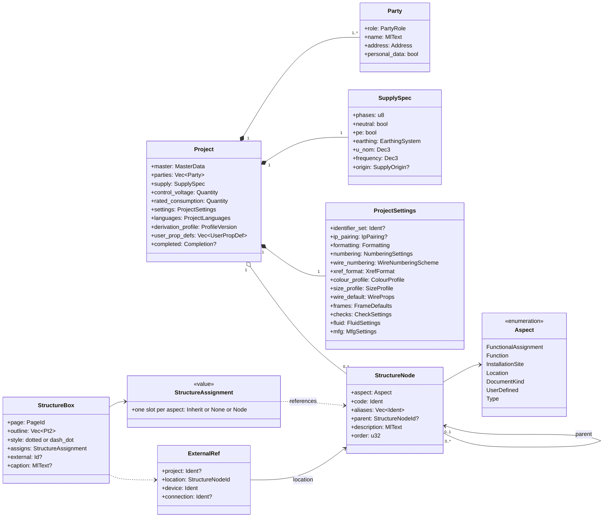
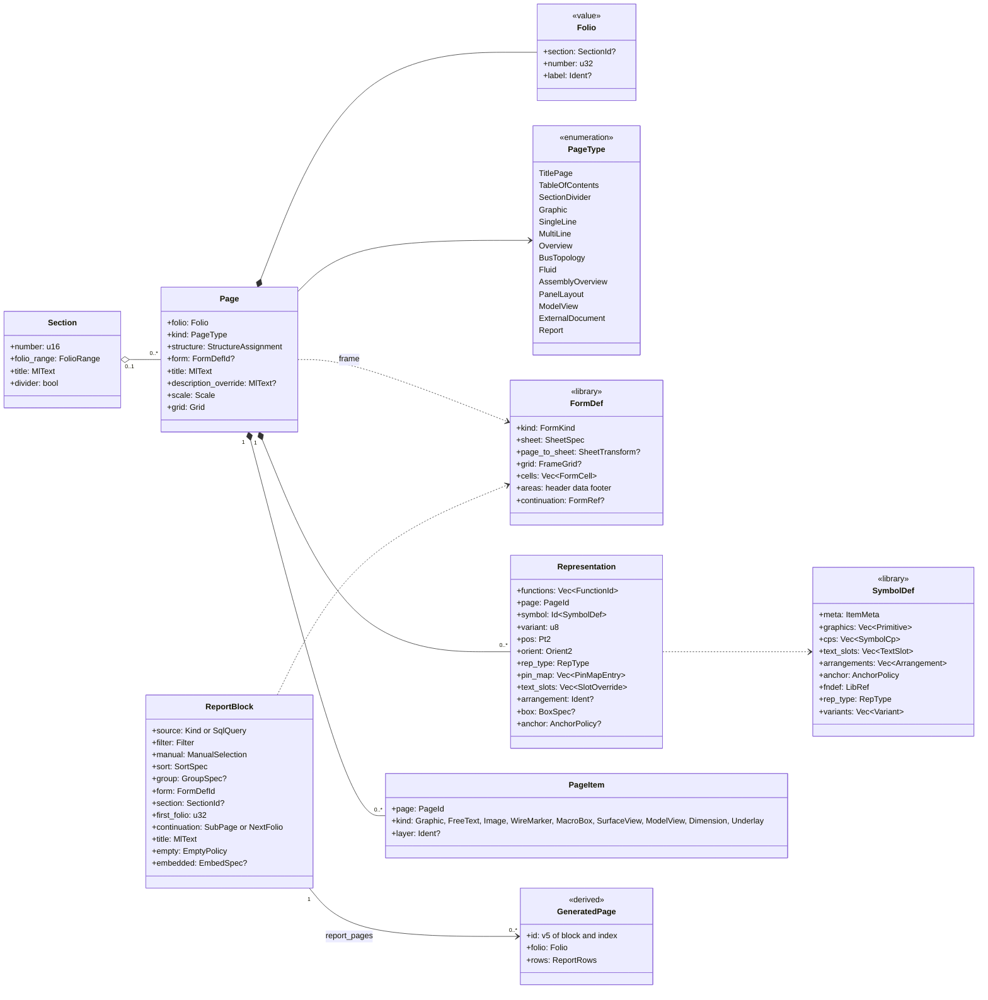

# Domain model: project, structure and pages

A chapter of [Domain model](03-domain-model.md), whose table says where each section lives.

---

## 5. Project and structure



| Entity and purpose | Kind | Key attributes | Relationships, identity, lifecycle | Invariants |
|---|---|---|---|---|
| `Project`: master data, parties, supply and settings of one cabinet project | A, one row | `master{description: MlText, long_description: MlText, document_title: MlText` (added: the cover subtitle "Electrical Definition"; appended, since 0.1), `project_ref: Ident, drawing_id: Ident, object_id: Ident, manufacturing_year: u16, created: Date, edited: Date}`; `control_voltage` (V); `rated_consumption` (A); `languages{source, translations}`; `derivation_profile` ("2027.1"); `kind: Schematic \| Basic \| Macro` (FR-PRJ-026); `supply?` (absent in basic and macro projects); `user_prop_defs: Vec<UserPropDef>` (below, FR-PRJ-007); `completed?{date, by, reopen_reason?}` (added, [15](15-checks-revisions-collaboration.md) §5.10); `extra` | Created from a basic project (FR-PRJ-009); the derivation profile changes only by a previewed upgrade (FR-PRJ-011). `edited` has day precision, merges by maximum and feeds the title-block "Saved" cell; there is no stored save time (FR-PRJ-029) | S: exactly one row. Chk at release: drawing id present (FR-PRJ-002) |
| `Party`: a person or organisation in a role | A, inside `Project` | `role: Customer \| EndUser \| PanelBuilder \| Author \| Checker \| Engineer`; `name: MlText`; `address{street, postcode, city, country}`; `personal_data: bool` (FR-PRJ-024) | Form cells and revisions refer to parties by role (FR-PRJ-003); `project.company.set` writes the first panel-builder party (§5.1) | S: a form cell binds exactly one role (D-30) |
| `SupplySpec`: the incoming supply | A, value | `phases: u8`, `neutral`, `pe: bool`, `earthing: TN-S \| TN-C-S \| TT \| IT`, `u_nom: Dec3` (V), `frequency: Dec3` (Hz), `origin?{upstream_rating (A), ik_max (kA), source: ExternalRefId}` | Rendered by a format: "1 x 230 VAC + N + PE, 50 Hz" (FR-PRJ-004, FR-PRJ-006) | Chk: frequency 50 or 60 Hz |
| `ProjectSettings`: named, versioned schemes | A | `identifier_set?: Ident` (EN 81346-2:2009 by default, ADR-0026); `ip_pairing?{mode: Star \| Chain, scope: Project \| Function \| Location}` (the pairing scope of every interruption point, §10); `formatting{date: DdMmYyyy \| Iso8601, decimal_separator: Point \| Comma, tag_case: Sensitive \| Insensitive}`; the schemes of §5.1: `numbering`, `wire_numbering`, `xref_format`, `colour_profile`, `size_profile`, `wire_default`, `frames`; later `checks: CheckSettings` (§19), `fluid{default_tube}` (§15), `mfg: MfgSettings` (§17) | Inherited from the basic project, project level wins; exportable as files (FR-PRJ-008) | — |
| `UserPropDef` (added): a project-local property definition (FR-PRJ-007) | A, inside `Project.user_prop_defs`, keyed by `key` | `key: Ident` (snake_case, unique in the project); `label: MlText`; `value_kind: Text \| Number \| Bool \| Date \| Enum{options: Vec<Ident>} \| Quantity{unit: Unit}`; `scope`: a set of `Project \| Page \| Device \| Function \| Connection`; later appended: `default`, `category`, `personal_data: bool` (FR-PRJ-024, 1.0) and the part scope | Values live on the records of a scope as `user_props: Vec<UserPropValue{key, value}>`, keyed by `key`. `value` is encoded like a tech value ([05](05-project-format-and-persistence.md) §3.2): a `Quantity` object, an `MlText` for Text, otherwise a string read by the definition's kind (`Dec3` for Number, `"true"` or `"false"`, the enum option, `"YYYY-MM-DD"`). | P: a value's key is defined, the definition's scope includes the record's kind, and the value parses as the definition's kind |
| `StructureNode`: one identifier in one aspect tree | A, `structure.jsonl` | `aspect`; `code: Ident` (atomic, FR-PRJ-017); `aliases: Vec<Ident>` (added); `parent?`; `description: MlText`; `order: u32` (defines sort order, FR-PRJ-012) | Pages, devices, layout spaces and external refs point to nodes. UUIDv7. Rename and merge are previewed commands (FR-PRJ-018) | S: parent has the same aspect; tree acyclic. P: code unique among siblings. Chk EW-RDS-002 (FR-CHK-027): a code with prefix characters, such as "J-E-2416", is reported as info in the `drafting` and `full` schemes, not in `pre-delivery` |
| `StructureAssignment`: which node a page or device belongs to, per aspect | A, value on `Page`, `Device`, `StructureBox` | one slot per aspect: `Inherit \| None \| Node(StructureNodeId)` | Device resolution: explicit slot, else the structure box around its main representation, else the page of its main representation (FR-PRJ-019) | — |
| `StructureBox` (added): dotted or dash-dot box that assigns a structure | A, page-owned (rank 44, page file, [05](05-project-format-and-persistence.md) §2.2) | `page`, `outline: Vec<Pt2>` (at least 3 vertices), `style: dotted \| dash_dot`, `caption?: MlText`, `assigns: StructureAssignment`, `external?: ExternalRefId`; its shape is below | Containment of a representation's anchor point is derived (FR-PRJ-020). Deleted with its page (EW-INV-022) | S: its page exists (EW-INV-022, §6) |
| `ExternalRef`: a target in another project or cabinet | A | `project?`, `location?: StructureNodeId` (+J-E-206), `device?: Ident` ("JE-N1000-03", or an address there, "Q4.1"), `connection?: Ident` ("L"); `location` and `device` are optional: a reference holds what is known of the far end, nothing for a far end not known ([06](06-schematic-editor.md) §3.5) | Used by external connection points (§10), cable ends (FR-CBL-015) and external bus partners (§14) | Chk: stale when the referenced project is available and the target changed (FR-PRJ-022) |
| `Comment`: review note | A, `comments.jsonl` | `anchor: EntityRef \| (PageId, Pt2)`, `author`, `status: Open \| Resolved`, `text: MlText`; added: `kind: Note \| Issue`, `revision?`, `parent?` (thread), `resolved?{by, date}` ([15](15-checks-revisions-collaboration.md) §6.7) | Anchored by UUID, so it survives renumbering (FR-COL-018) | — |
| `ImportLineage` (added): the identity anchor of one imported source | A, `project.jsonl` | `importer` ("qet"), `source_name` (file name, no path), `anchor: QetProjectUuid \| FirstImportSha256 \| Copy{of, n} \| Fixed(label)`, `namespace: Uuid` (derived from the anchor, [14](14-interop.md) §2.3), `last_source_sha256`, `last_run` | Re-importing into the lineage keeps the IDs of unchanged source keys (FR-IMP-002, FR-IMP-040) | — |
| `ImportRun` (added): one persisted import | A, `imports/<run-uuid>.jsonl` | `id`, `lineage` (a link, no cascade), `importer`, `importer_version`, `source` `{name, sha256, size, format, format_version?}`, `as_of?`, `mode`, `entries` (with targets and quick fixes), `stats`, `record_hashes` (`{source, ew?}` per record, the re-import base, [14](14-interop.md) §2.3) and `extra`; no options digest and no acknowledged entries | Written in the import transaction; never conflicts with project data; import-only facts (EW-IMP findings such as a font substitution) stay visible after the import (FR-IMP-041) | — |

**`StructureBox` shape.** The record of the kind
`structure_box` (rank 44, [05](05-project-format-and-persistence.md) §2.2):

| Member | Type and encoding | Rules |
|---|---|---|
| `page` | `PageId` | required; the page must exist (EW-INV-022) |
| `outline` | `[Pt2]` in absolute page nm | at least 3 vertices; the vertices need not lie on the connection grid |
| `style` | `"dotted"` or `"dash_dot"` | required |
| `caption` | `MlText`, optional | printed above the outline's top-left vertex |
| `assigns` | `StructureAssignment`: one slot per aspect, `Inherit`, `None` or `Node(id)`, encoded as the structure slots of [05](05-project-format-and-persistence.md) §3.2 | a node must exist and have the aspect of its slot (checked by `box.structure` and `fields.set`) |
| `external` | `Id<ExternalRef>`, optional | the external point the box stands for; printed in the caption as the external xref texts print it (§6, derivation); delete policy unlink: deleting the `ExternalRef` clears the member |

Which representation a box encloses is derived, never stored (§6, derivation; FR-PRJ-019, FR-PRJ-020). Commands:
`box.structure`, `fields.set`, `rep.move` (`items`) and `edit.delete`.

**Aspects and their signs.** Signs and sub-level separators are project settings (FR-PRJ-016); the defaults follow
EN 81346 and EPLAN's identifier blocks:

| `Aspect` | Default sign | Tree | Reference project |
|---|---|---|---|
| FunctionalAssignment | `==` | `StructureNode` (1.0, FR-PRJ-014) | — |
| Function | `=` | `StructureNode` | =P01 |
| InstallationSite | `++` | `StructureNode` (1.0) | — |
| Location | `+` | `StructureNode` | +J-E-2416 (alias "JE2416"), +J-E-206, +FIELD ▲ |
| Product | `-` | the device tree (`Device.parent`), never a `StructureNode`: `product` is not a valid `StructureNode.aspect`, and the reader rejects it there ([05](05-project-format-and-persistence.md) §3.2) | -101F1, -201U3-Q1 |
| DocumentKind | `&` | `StructureNode`, pages only, excluded from device numbering | &EFS (optional) |
| UserDefined | `#` | `StructureNode` (1.0) | — |
| Type | `%` (sign unverified) | `StructureNode` (1.x) | — |

**Equivalents.**

| Concept | Derived from it | EPLAN | QET |
|---|---|---|---|
| `Project` | title-block and cover cells, TOC header, report headers | Project (`*.elk` + `*.edb`), project properties `<10xxx>`, basic project `*.zw9` | `<project>` with `<properties>` and `<newdiagrams>` defaults |
| `ProjectSettings` | every derivation that reads a scheme | settings schemes (numbering, report, check, export) at project, user, workstation and company level | `<newdiagrams>` (`<xrefs>`, `<conductors_autonums>`, `<element_autonums>`, `<report label>`) |
| `StructureNode` | rendered identifiers, structure-identifier overview (FR-REP-017) | Structure identifier management, identifier blocks | none: `plant`/`location` element-info strings and folio `plant`/`locmach` attributes |
| `StructureBox` | structure of enclosed representations | Structure box | dotted shapes without semantics |
| `ExternalRef` | external xref texts "+J-E-206 / JE-N1000-03" | none typed (structure box plus free text) | none (free text) |

### 5.1 Project settings: record shapes

The schemes below have a fixed record shape. Each is an optional member of `ProjectSettings` in `project.jsonl`; a
member this build does not type is kept in `ProjectSettings.extra`, unchanged
([05](05-project-format-and-persistence.md) §10.3). Member names are JSON names,
and enums use the snake_case encoding of 05 §3.2. Schemes are copied into the project, so the project level wins
(FR-PRJ-008); `key` and `name` record which scheme the copy came from. Settings members are edited by the previewed command `project.settings.set` (one member per command: `numbering`, `colour_profile`, `size_profile`, `xref_format` and the others of its table, the drawing settings, the frame defaults, the languages and formats, and one member of the supply; [17](17-extensibility.md) §2.1; ADR-0008 amendment 3).
The "one previewed command" of ADR-0008 amendment 3 has sibling commands for the members it refuses. `project.company.set` is `Edit`; `project.checks.set` is `HumanOnly`, because a check scheme decides check outcomes ([17](17-extensibility.md) §2.3).

| Member | Shape | In the sample project |
|---|---|---|
| `numbering` | `{default: Ident, schemes: Vec<DeviceNumberingScheme>}`, schemes keyed by `key`; `TagSpec.scheme = Named(key)` selects a non-default scheme | default `page-based` |
| `wire_numbering` | `WireNumberingScheme`, one active scheme | connection-oriented `{page}.{counter}`, scope page, cores not numbered, not printed |
| `xref_format` | `XrefFormat` | the QET-style preset of [06](06-schematic-editor.md) §2.8 |
| `colour_profile` | `ColourProfile` | company "DBU/WH 24 V", 15 rows ([08](08-connections-terminals-cables.md) §4.2) |
| `size_profile` | `SizeProfile` | "0.75/1.5": Control 0.75 mm², Mains 1.5 mm², PE by class |
| `wire_default` | `WireProps`, level 1 of the chain (§9.5) | unset |
| `frames` | `FrameDefaults` | the QET-compatible A4 frame; its no-grid variant for title, TOC, divider and report pages |

**`DeviceNumberingScheme`** (§8.2, FR-NUM-005 … FR-NUM-007):

| Member | Type and encoding | Default |
|---|---|---|
| `key` | `Ident` (`"page-based"`) | required |
| `name` | `MlText` | empty |
| `format` | format string: the tokens of §8.2 step 3 (`{letter}`, `{counter}`, `{subcounter}`, `{page}`, `{column}`, `{row}`) and literal separators | required; the sample's `"{page}{letter}{counter}"` |
| `rules` | `Vec<{select: {aspect?, letter?, kind?}, format}>` in model order, first match wins; `aspect` names a device aspect (`"strip"`, `"terminal"`, `"cable"` …), `letter` is an `Ident`, `kind` a `DeviceKind` string (§7) | empty; the sample's `{select: {aspect: "strip"}, format: "{letter}{page}{counter}"}` (-X1031, §8.4) |
| `counter_scope` | `"project"`, `"page"`, `"row"`, `"column"` or `{"structure": <aspect>}` (FR-NUM-006) | `"page"` |
| `counted_rep_types` | set of `RepType`s that can be the main representation (§8.2 step 4) | absent: every type except `contact_image` and `panel_front` |
| `reuse_gaps` | `bool` (§8.6) | `true`, written only as `false` |
| `online` | `bool`: number new devices at commit (FR-NUM-007) | `true`, written only as `false` |
| `child_separator` | string between the parent's and the child's designation (§8.5) | `"-"` |

Counters are not settings. The counter is `TagSpec.counter`, and "next free" is derived from the snapshot (§8.6), so
no stored counter table exists to merge.

**`WireNumberingScheme`** ([08](08-connections-terminals-cables.md) §5.2, FR-NUM-019 … FR-NUM-021):

| Member | Type and encoding | Default |
|---|---|---|
| `key`, `name` | `Ident`, `MlText` | required, empty |
| `orientation` | `"connection"` or `"potential"` | `"connection"` |
| `format` | format string with the tokens of 08 §5.2 | required; the sample's `"{page}.{counter}"` |
| `counter_scope` | `"page"`, `"potential"` or `"project"` | `"page"` |
| `number_cores` | `bool` | `false` |
| `online` | `bool`; without it new wires print "?" (FR-NUM-021) | `false` |
| `display` | `"none"`, `"per_segment"`, `"once_per_page"` or `"both_ends"` (FR-CON-026) | `"none"` (the sample: not printed) |

Format groups, net extension and formula tokens (1.0, 08 §5.2) are later appended members.

**`XrefFormat`** ([06](06-schematic-editor.md) §2.8, FR-XRF-001 … FR-XRF-004, FR-XRF-008, FR-XRF-025):

| Member | Type and encoding | The sample (QET-style preset) |
|---|---|---|
| `key`, `name` | `Ident`, `MlText` | `"qet-style"` |
| `ip` | format string; tokens `{page}`, `{page_index}`, `{row}`, `{column}`, `{function}`, `{location}` | `"{page}-{row}{column}"` |
| `aux_to_main` | format string | `"({page}-{row}{column})"` |
| `main_to_aux` | format string with `{list}`, whose items use `ip` | `"∞ {list}"` |
| `structure` | `"when_different"` (default) or `"always"` | `"when_different"` |
| `same_page` | `"full"` (default) or `"zone_only"` | `"full"` |
| `matrix` | `{per_row: u8, max: u8, overflow: String}` | `{per_row: 3, max: 9, overflow: "…"}` |

The TOML of 06 §2.8 is the exchange form of the same scheme (`when-different` there is `when_different` here). The
contact-image settings of 06 §2.8 are a later member.

**`ColourProfile`** ([08](08-connections-terminals-cables.md) §4.2, §4.4):

| Member | Type and encoding |
|---|---|
| `key`, `name` | `Ident` (`"company.dbu-wh-24v"`), `MlText` |
| `basis`, `basis_note` | `"standard"` or `"company_convention"` (D-37); `MlText` |
| `verified` | `bool`, default `false` |
| `codes` | the company codes, keyed by `code`: `{code: Ident, base: <IEC code>, shade: "light" \| "dark", export_as?: Ident, names: MlText}` (DBU = BU, dark) |
| `rows` | `Vec<{group: MlText, function: MlText, select: ProfileSelect, colour: ColourSpec, order: u32, potential_type: PotentialType, colour_name: MlText}>`; the display order of the cover's colour table is the row's `order`, not the storage order. `potential_type` (the printed potential type) and `colour_name` (the printed colour name) are members of the JSON member; `colour_name` is redundant with the code names and the company codes' names |

**`SizeProfile`** (08 §4.2):

| Member | Type and encoding |
|---|---|
| `key`, `name`, `verified` | as in `ColourProfile` |
| `class_rules` | `Vec<{select: ProfileSelect, class: CircuitClass}>`, first match wins |
| `pe_class` | `"highest_at_ends"` (FR-CON-038; the default) |
| `bond_rule` | `{colour_from: "pe", class_from: "non_pe_side"}` (the default) |
| `rows` | `Vec<{class: CircuitClass, csa: Csa, order: u32}>`, keyed by `class`; the display order of the cover's size table is the row's `order` (the sample: DBU, WH, GNYE for control; BK, BU, GNYE for mains) |

The company profile data (key, name, basis note, a `standards` text, the DBU code, `verified`) come from a `profiles.csv`
source table, not from importer constants. The cover prints the `standards` text ("IEC60757 / EN60204-1",
U-35); the basis note stays metadata (FR-CON-020, D-37). The `order` column, `profiles.csv`, `standards` and the size note
are delivered.

`ProfileSelect` is `{ptype: Vec<PotentialType>, ac_dc?: AcDc, u_min?: Dec3, u_max?: Dec3, discipline?: Discipline,
analogue?: bool}`. An absent or empty member matches anything. Values use the record spellings (`l_plus`, `dc`), not
the spellings of the TOML exchange form (`"L+"`, `"DC"`).

**`FrameDefaults`** ([06](06-schematic-editor.md) §2.4, FR-PAG-018) is `{default?: Id<FormDef>, per_page_type:
Vec<{page_type: PageType, form: Id<FormDef>}>}`, keyed by `page_type`. A drawn page's frame is `Page.form`, else the
entry of its page type, else `default`. Generated report pages take the form of their block (`ReportBlock.form`),
divider pages the entry for `section_divider`. When neither applies and no embedded form does, the built-in default
is the QET-compatible A4 frame geometry.

A `Page.form`, or a page-type entry, that names a copy the project does not
hold falls through to the next rule, identically in the cell grid and in the page output: both call
`ew_derive::frame_form_of`. A page without its own form takes the frame
defaults in the page output as well (`PageFrameOf`, [09](09-reports-forms-output.md) §2.6), as in the cell grid.

**Stored shapes written by commands.** No new record kind and no
schema change: each member below already existed and is still kept in `extra` where it was ([05](05-project-format-and-persistence.md)
§10.3). The commands below write them:

| Command | Stored at | Shape and rules |
|---|---|---|
| `project.settings.set`, member `frames` | `settings.extra.frames` | `{default?: Id<FormDef>, per_page_type: [{page_type, form}]}` as `FrameDefaults` above, entries sorted by page type. `per_page_type` is always written, `[]` when empty. The command merges into the existing object (unknown members are kept) and refuses a non-object value. Each form must be an embedded copy of kind frame, cover or divider; a `report` form and a duplicate page type are refused |
| `project.checks.set` | `settings.extra.checks` | `{active_scheme?, release_scheme?}`, shipped schemes only (an `ew-api` test pins the accepted list against `ew_checks::SCHEMES`). This is the start of `CheckSettings` (§19), not all of it. `ew check` reads it without `--scheme` (`release_scheme` for mode `release`, `active_scheme` for `online`); the release gate and the message panel do not read it |
| `project.company.set` | the first `Party` of role `panel_builder` in `Project.parties` (added if absent); `Project.extra["ew.company"].notice` and `.logo` | The party's `name` and `personal_data` (true by default; NFR-PRIV-06; nothing reads it). The title-block notice text is the `notice` member of `ew.company`, which the `title_block` member reads. `logo` is an asset reference, `ew.company.logo = {sha256, format, size}` (`format` `svg`, `png` or `jpeg`, `size` `[w, h]` absent when unknown); the command takes the image as base64 (SVG, PNG or JPEG, at most 512 KiB, `MAX_LOGO_BYTES`; empty removes it), and the bytes join the project's asset store, `assets/<sha256>.<ext>` ([05](05-project-format-and-persistence.md) §13.3). The bare form `"logo": "sha256:…"` of an older file is read and kept on re-save, taking its format and size from the held asset ([05](05-project-format-and-persistence.md) §10.3) |
| `project.settings.set`, member `languages` | `Project.languages{source, translations}` and `settings.formatting{date, decimal_separator}` | The typed members, sent whole; `tag_case` is untouched. `decimal_separator` is read by `ew_reports::render` for a quantity printed without an output language (the printed tables of the generated pages); an output language keeps its own separator |

**`settings.extra.drawing`.** The presentation settings of the
drawing, kept in `ProjectSettings.extra` like `frames` and `checks` (no schema change): an object
`{"crossings"?: "plain" | "hops", "marker_mode"?: "all" | "deviations" | "explicit" | "none"}`. `crossings`
(FR-CON-031) says how crossing wires are drawn; absent means `plain`. `marker_mode` (FR-CON-024) selects which
wire markers print; **absent means** a marker where the connection's `show_marker` is set, and the
modes are defined in §6 (derivation). The member `drawing` of `project.settings.set` writes it
(interactive, undoable): it merges into the existing object, keeps members it does not know and takes `null` to remove a
member; it refuses a `drawing` member that is not an object, an unknown value and a call that gives no member.
`crossings` is presentation only (no derived diff); `marker_mode` is read by the derivation, so changing it changes the
derived marker texts. The per-page marker mode of FR-CON-024 is not built.
`wire_numbers?: bool` prints every wire's number on its pages, the PDF and print; absent (or anything but
`true`) means no numbers. It is read by the page view (`ew_derive::connection_number`, the number of the wire a
connection belongs to; a cable's core prints none) and set by `project.settings.set` like the other members (`null`
removes it), in the window by Draw ▸ Connect ▸ Print wire numbers and by its checkbox in the Main group of the
project's Properties, each with a toast that says what it now is for the whole project. It is an additive member of
this open object (ADR-0011 decision 6): an older build keeps the member in `extra` and prints no numbers.

Not shaped here, and kept in `extra`: `checks`, `fluid` ([11](11-fluid-power.md)),
`mfg` ([13](13-manufacturing-outputs.md)) and export schemes.
Text styles ([ADR-0032](../adr/0032-per-project-text-styles.md)) are shaped
as `ProjectSettings.text_styles`, overrides of the built-in table keyed by style key (`size` as em height in nm, an
optional `weight`); an absent member means the built-in table; new projects write `cp.small` and `marker` at 7 px.
The member is typed in `ew-schema` (`TextStyleSpec`, `BUILTIN_TEXT_STYLES`, `effective_text_styles`); an override whose size lies outside 0.5 … 50 mm is ignored on reading and a weight of a newer format reads as absent.
An entry may name its bundled typeface (`face`: `standard`, `narrow`, `mono`, `technical_drawing`; a newer value
reads as standard and is kept), and a free text may carry its own cap height (`FreeText.height`)
([ADR-0032](../adr/0032-per-project-text-styles.md) amendment 1).

---

## 6. Pages, frames and representations



| Entity and purpose | Kind | Key attributes | Relationships, identity, lifecycle | Invariants |
|---|---|---|---|---|
| `Section`: a folio range with a title | A, `structure.jsonl` | `number: u16` (1, 2, 9), `folio_range: (u32, u32)` (100–199), `title: MlText` ("Wiring Definition"), `divider: bool` | Its divider page is a generated page (FR-PAG-009) | Chk (FR-CHK-038): a page outside its section's range |
| `Page`: one drawn sheet | A, `pages/<uuid>.jsonl` | `folio: Folio{section?, number: u32, label?: Ident}` (sparse, gaps allowed, labels "101a", "101.1"; FR-PAG-005/006); `kind: PageType`; `structure`; `form?` (frame override); `title: MlText` (page description); `description_override?` (added, D-06); `scale: OneTo(u32) \| NotToScale`; `grid: Grid` | Owns its representations, connections, junctions, interruption-point functions with their representations, macro instances, embedded report blocks and page items ([05](05-project-format-and-persistence.md) §2.2). UUIDv7. Delete cascades page-owned rows (FR-PAG-025) | P: full page name `=P01+J-E-2416/101` unique (FR-PAG-012). Chk: a description override is reported (FR-REP-036) |
| `PageType`: governs page semantics | value | see diagram (FR-PAG-001) | Overview, Graphic, AssemblyOverview and PanelLayout pages create no net connections and disable autoconnect; Report pages reject edits (FR-PAG-002) | S: a `Report` page is never stored; it is always generated (EW-INV-012). The persisted enum keeps the `report` value only so that generated pages share the page-type vocabulary: it is derived-only |
| `FormDef`: frame, title block, cover, report form or label | L, `lib/forms/` | frame: sheet size, margins, `columns{count, start_index, width: Grid, labels}`, `rows{count, labels, skip_io, height: Grid}`, header bands, title-block form, grid and no-grid variants; cells with typed placeholders (FR-REP-032/033); `page_to_sheet?: SheetTransform` (uniform integer scale and offset, QET-compatible frames only, FR-PAG-029); `continuation?: FormRef` (the "next form" of report pages, FR-REP-032) | Assigned by project default, page-type default, or page override (FR-PAG-018) | S: placeholders valid for the form kind (FR-REP-034) |
| `Representation` (the symbol instance): one drawing of one or more functions | A, page-owned | `functions`, `page`, `symbol: Id<SymbolDef>` and `variant: u8` (default 0: the stored contact-image or CP variant; orientation variants A–H are derived), two members as in [05](05-project-format-and-persistence.md) §3.5, because the variant is chosen per placement while `symbol` names the one embedded copy that every placement shares, `pos: Pt2`, `orient: Orient2`, `rep_type: MultiLine \| SingleLine \| Overview \| Fluid \| Topology \| ContactImage \| StripSegment \| Graphic` (default `MultiLine`), `pin_map` (symbol CP → function CP), `text_slots` (overrides only: slot index, `pos` in symbol coordinates before the orientation is applied, angle, visibility), `arrangement?` (named slot set of the symbol, FR-SYM-012), `box?: BoxSpec{outline: Vec<Pt2>, cps: Vec<(idx, Pt2, Dir4)>, inner: Vec<Primitive>}` (black boxes drawn with the built-in symbol `ew.gen.blackbox`; part box macros fill it on placement), `anchor?: AnchorPolicy` (added, a per-representation override of the symbol copy's anchor policy, FR-SYM-010; absent follows the copy's policy), `locked?: bool` (added, Keep in place: Arrange and route leaves it where it stands, [06a](06a-drafting.md) §2.4; written only when set) | One function has 0..n representations; with none it is unplaced (FR-DEV-003). UUIDv7. Panel fronts are not stored: `panel_front_reps(dev)` derives them from placements (§16), and a PanelLayout page hosts one `SurfaceView` | S: its functions exist and belong to one device (IPs excepted); each symbol CP maps to at most one function CP |
| `SymbolDef`: graphics plus CP geometry | L, `lib/symbols/` | `meta: ItemMeta` (below); primitives in nm; `cps: Vec<SymbolCp{idx, fn_cp, pos, dir, discipline}>` on the connection grid, where `fn_cp` is the FnDef CP the symbol draws (a symbol may draw a subset); text slots and named `arrangements`; anchor policy (origin, label, centre, named point; FR-SYM-010); `fndef: LibRef`; `rep_type` (including `PanelFront` for 2D front graphics); variants A–H plus contact-image and CP variants | Representations reference it; geometry is memoised at library durability | Chk (FR-SYM-020): CPs on grid, unique indices, anchor defined; `fn_cp` exists in the FnDef |
| `PageItem` (added): page content without electrical meaning | A, page-owned (rank 43 of [05](05-project-format-and-persistence.md) §2.2) | `kind`, an externally tagged object: `graphic` \| `free_text` \| `wire_marker` \| `image` \| `macro_box{outline, key, kind, rep_type, variant, target_library, generated?: LibRef}` \| `surface_view{surface, side, datum_at, clip?, label_mode, layers}` \| `model_view` \| `dimension` \| `underlay{asset, format, name, page, layout, unit, rect, opacity}` (typed; `macro_box`, `model_view` and `dimension` are later and stay unknown variants until typed); `layer?: Ident`; the shapes are in the table below | A wire marker only displays the overrides of its connections, in the listed order (a group "1.5 DBU DBU WH WH" over four); its own data is only that list, its position `at`, its `angle` and the shown `fields`. A `PathFunction` text (not built) is the automatic function text of the functions in its column range (FR-DEV-011). A macro box frames the content that "Generate macros" saves as a macro version (FR-MAC-013); inserting a macro never inserts its box. `SurfaceView`, `ModelView` and `Dimension` belong to layout pages (§16, 1.0 for the last two); an `Underlay` (1.0) is read by no engineering query | — |
| `ReportBlock`: a report placed in the page order | A, `report-blocks.jsonl`; an embedded block lives in the file of its page | `source: Kind(ReportKind) \| SqlQuery{api: "v1", file}` (`{"kind": "wire_list"}`; the SQL lives in `reports/<uuid>.sql`), `manual` (include and exclude entity IDs, FR-REP-027), `sort: Vec<SortKey{key, descending}>`, `group?{key, break}`, `form: Id<FormDef>`, `section?`, `first_folio?` (required for page-oriented blocks, ignored when `embedded` is set), `continuation: SubPage \| NextFolio` (default SubPage: 907, 907.1 …; FR-PAG-030), `title` (format with `{n}`, `{count}`, `{group}`), `empty: OmitPages \| OnePage(text)`, `embedded?{page, rect}`; later appended: `params` and `filter` ([09](09-reports-forms-output.md) §2.2) | Its pages are derived (`report_pages(block)`, IDs v5) and join `page_order()` (FR-REP-001) | S: a page-oriented block has `first_folio`. Chk: folio collision with a drawn page (FR-REP-041) |

**`PageItem` shapes, invariants and derivation.** The record of the kind `page_item` (rank 43, [05](05-project-format-and-persistence.md) §2.2) is
`{"$k": "page_item", "id", "$v"?, "page": PageId, "layer"?: Ident, "kind": <variant>}` (`$v` omitted when 1, [05](05-project-format-and-persistence.md) §3.1), the variant an externally tagged
object (`{"graphic": {…}}`); positions are page nm (`Pt2`), lengths `Nm`:

| Variant | Members | Rules |
|---|---|---|
| `graphic` | `shape`: one of `{"line": {"a": Pt2, "b": Pt2}}`, `{"polyline": {"points": [Pt2]}}`, `{"rect": {"min": Pt2, "max": Pt2}}`, `{"circle": {"centre": Pt2, "r": Nm}}`, `{"arc": {"centre": Pt2, "r": Nm, "start": Angle2, "sweep": Angle2}}`, `{"polygon": {"points": [Pt2]}}`; `stroke?`: `{"width": Nm}`; `dash?`: `"solid"`, `"dashed"`, `"dotted"` or `"dash_dot"`; `fill?`: `bool` | no `angle`: a shape carries its own geometry. Drawn in the page's wire stroke unless `stroke` is set; an absent `dash` is `solid` and an absent `fill` is `false`. Degenerate shapes (a zero-length line, a polyline or polygon with fewer than two or three distinct points, a radius of 0) are refused by the commands. An `arc`'s `start` defaults to 0 and is omitted then. |
| `free_text` | `text?`: `MlText` (omitted when empty; an empty text needs `bind`); `bind?`: `Ident`; `at`: `Pt2`; `angle?`: `Angle2`, one of 0, 90000, 180000, 270000; `style?`: `Ident` (default `text.normal`); `align?`: `"left"`, `"centre"` or `"right"` | `bind` names one of six bindable names: `project.description`, `project.document_title`, `project.drawing_id`, `page.title`, `page.folio`, `page.full_name`; the commands refuse another name and an empty `text` without `bind`. The role `path_function` is not built and is kept verbatim as an unknown member. `angle` is an `Angle2` (10⁻³ degree, default 0 omitted, [05](05-project-format-and-persistence.md) §3.2) restricted to 0, 90000, 180000 and 270000 |
| `wire_marker` | `connections`: `[ConnectionId]`; `at`: `Pt2`; `angle?`: `Angle2`, 0 or 90000; `fields`: `["csa", "colour"]`; `tag_at?`: `Pt2`, relative to `at` (additive) | `marker.place` lists at least one connection, distinct, in printed order, all on the page. A group is changed by deleting and placing it (`fields.set` cannot edit `connections`). A marker whose connections are all cores of one cable is that cable's mark, drawn with the cable's tag, its type line, a stroke and the core's name on each core; `cable.create` and `conductor.add` with `wires` place it on each page the wires lie on (or extend the cable's mark there), and `tag_at` is where its tag was dragged |
| `image` (part 5) | `asset`: `"sha256:…"`; `rect`: `[Pt2, Pt2]` | placed through the asset store ([05](05-project-format-and-persistence.md) §13.3); until part 5 an `image` item is kept verbatim as an unknown variant |
| `surface_view` | `surface`: `Id<MountingSurface>`; `datum_at`: `Pt2`, where the surface's origin lands on the page; `label_mode?`: `"abbreviated"` (default, omitted) or `"full"`; `side`, `clip` and `layers` kept verbatim as unknown members until they are typed | Only on a `panel_layout` page, at most one per page, set by `page.surface_view.set {page, surface, datum_at, label_mode?}`, which is refused on another page kind; a second set replaces the view in place, its ID kept; paste and copy leave views out; a file that holds two draws the one with the lowest ID. The `surface` link is a cascade: deleting the surface deletes the view. Everything the view draws (outlines, carriers, footprints, labels) is derived, never stored ([12](12-panel-layout.md) §5.1). Typed within format 0.1 under ADR-0011 amendment 4 |
| `underlay` | `asset`: `"sha256:…"`, the source PDF or DXF; `format`: `"pdf"` or `"dxf"`; `name`: the source's file name; `page?`: the PDF page, 1-based (default 1); `layout?`: the DXF layout (absent: model space); `unit?`: the DXF unit when the drawing names none; `rect`: `[Pt2, Pt2]`; `opacity?`: per cent (default 50) | Read by no engineering query, check, report or export unless an export prints underlays (FR-IMP-030); locked: the commands neither move nor copy it, deleting it is the one edit. `rect` replaces the earlier `transform`: a PDF page fills it, a DXF drawing is drawn from its corner at its own scale ([14](14-interop.md) §5.5). The source is an asset when embedded, else the user's underlay cache. Typed under ADR-0011 amendment 6 |
| any other variant | `macro_box`, `model_view`, `dimension`, and variants of a newer format | `PageItemKind::Unknown(Value)`, kept verbatim and round-tripped byte for byte ([05](05-project-format-and-persistence.md) §10.3) |

*Departures from the earlier text of this section* (`Graphic{shape, stroke, dash, fill, angle}`, `FreeText{text or
bound property, role, angle}`, `WireMarker{connections, fields}`, `Image{asset}`): **`Graphic` has no `angle`**;
**`FreeText` gains `bind`** beside `text` (the earlier "text or bound property" becomes two members) and its `angle` is
one of four values; **`WireMarker` gains `at` and `angle`**, which position the group; **`Image` has `rect`**. `layer`
is optional.

*Two new structural invariants* (numbered EW-INV-022 and EW-INV-023 in the catalogue of
[ADR-0009](../adr/0009-invariant-catalogue.md), the next free numbers after EW-INV-021):
- **EW-INV-022:** the `page` of a page item or a structure box exists. Deleting a page deletes them (cascade,
  FR-PAG-025).
- **EW-INV-023:** every connection a wire marker lists exists and lies on the marker's page. The delete policy: a deleted
  connection leaves the list, and a marker left empty is deleted in the same plan.

A build from before part 4a keeps `page_item` records verbatim and does not enforce that delete link, so a project can
arrive with a marker that lists a deleted connection or one on another page. On load this is **reported, not refused**:
a load finding names the marker and the connection, the derivation and the drawing ignore the stale entry, and the next
edit of the marker writes a clean list ([05](05-project-format-and-persistence.md) §2.2).

A cross-page `rep.move` takes each moved connection out of the old page's wire markers in the same transaction (a marker left empty is deleted), so EW-INV-023 holds after a move; when the junction clean-up dissolves a junction, the kept member takes the removed one's place in every marker list. `item.place` and `box.structure` also refuse collinear polygons and box outlines of zero area. A page file whose items an older build wrote (reserved kinds, members in byte-wise order) loads typed and is rewritten canonically with a `NonCanonical` finding ([05](05-project-format-and-persistence.md) §10.3).

*Derivation.* `rep_structure_box(rep)` is the innermost structure box on the representation's page
whose outline contains the point that `rep_anchor_cell` uses (an exact even-odd test in `i128`, the boundary inside;
innermost by absolute shoelace area, ties by box ID). `structure_of(device)` gains a step between its steps 1 and 3
(§8.2 step 5): an inherited aspect of a device that is neither a terminal nor a child-tag device takes the slot of the box
around its main representation when the box's `assigns` has a node or `none` for that aspect (`SlotSource::StructureBox`),
else the page's. `ip_structure(function)` is an IP function's structure, its representation's box's slots over its page's;
every reader of an IP's structure (the pairing scope `location` and the xref `{function}` and `{location}` tokens)
reads it. A bound free text prints
the value that the title block prints for that placeholder on its page (`title_block`'s resolver). Wire markers follow
`marker_mode` of §5.1: with it absent a connection shows a marker when `show_marker` is set; `all` shows every wire;
`deviations` a wire with an effective cross-section or colour set at levels 3 to 7, cores excepted
([08](08-connections-terminals-cables.md) §4.5); `explicit` a level-7 cross-section or colour; `none` no marker. A
connection that a wire marker lists draws no marker of its own; the item draws the group whenever at least one of its
connections would show a marker in the mode. The group text is the distinct effective cross-sections of the listed
connections in list order joined by `/`, then one colour code per connection in list order, separated by spaces: `2.5 BK
BU`, `1.5 DBU DBU WH WH`. A structure box's caption is the caption text and, when `external` is set, ` (<external>)` with
the external reference printed as the external xref texts print it: `External Connection (J-E-206 / JE-N1000-03)`.
`rep_structure_box` and `ip_structure` are memoised families.

**Derived from pages.** `page_order()` sorts sections, then folios by natural order, including generated pages.
From it come Prev/Next (empty on the first and last page, FR-PAG-013), the TOC rows with "Location (+)"
(FR-REP-003), the PDF outline and `/PageLabels`. The title block is `title_block(page)`: every cell is a placeholder
bound to project, page, party or derived values, so "V1"/"V2.0" (D-05) and "Control Cabinet Expansion" (D-06)
cannot diverge.

**Frame cells are integer arithmetic.** `rep_anchor_cell(rep)` takes the anchor point from the symbol's anchor
policy, never from rendered geometry (D-14), and maps it to a cell of the page's frame on the frame's rational grid
(FR-PAG-020). On the QET-compatible A4 frame (17 columns from 0, rows A–H, FR-PAG-015), the native units are 20 px
header bands, 60 px columns and 80 px rows, all multiples of the 10 px grid. With `k = round(x × 3 / 7_937_500)` as
the 10 px grid index:

```text
column = floor((k_x - 2) / 6)        row = "ABCDEFGH"[floor((k_y - 2) / 8)]
anchor (1010 px, 620 px) → x = 267_229_167 nm → k_x = 101 → column 16
                          → y = 164_041_667 nm → k_y = 62  → row H         → cell "H16"
```

A point exactly on a boundary belongs to the cell to its right or below it. The interruption point L-1 at 101-H16
is therefore printed as "101-H16" on folio 102 without any float comparison.

**Assembly overviews are generated.** Folio 201 holds the overview representations of -201U1 and its children -201U2 to -201U9, folio 202 those of -202U1 to -202U3. The break marks are derived, never stored: `ew-derive`'s `assembly_break_marks()` walks the assembly device and its direct children in `Device.position` order, takes each member whose main representation is an overview representation, groups consecutive members on one page into segments, and puts a right mark after the last representation of every segment but the last and a left mark before the first of every segment but the first (right after -201U9 on 201, left before -202U1 on 202); moving a module to another page moves its marks. The module rectangles, part texts and valve glyphs are
derived from the children in `Device.position` order. Each child slot has a v5 identity `(rep_id, child_id)`, serves
as its xref anchor and PDF destination, and counts as the representation of that child's main function for tags and
cross-references (so -201U3 is page-based on 201). A fifth valve on a 4-position sub-base cannot be drawn this way
(D-10); FR-CHK-022 checks the remaining hand-drawn cases.

**Equivalents.**

| Concept | Derived from it | EPLAN | QET |
|---|---|---|---|
| `Section` | divider pages, outline levels | none; page structure or document type `&` | none; folio labels only |
| `Page` | full page name, TOC row, Prev/Next, page label, change status | Page with page type, page name, page description `<11xxx>` | `<diagram>` (folio) with title-block attributes |
| `FormDef` | title blocks, report pages, labels | plot frame (`*.fn1`), forms `*.f01`–`*.f33`, label forms | `<border>` plus `.titleblock` template, `graphics_table` |
| `Representation` | anchor cell, xref anchor, display list | placed symbol with representation type and variant | `<element>` x, y, orientation, mirror |
| `SymbolDef` | symbol geometry | symbol in `*.slk`, variants A–H | element definition `.elmt` / `<definition>` |
| `ReportBlock` | generated pages | report block, page-oriented or embedded report | `graphics_table` with SQL against QET's internal database |

