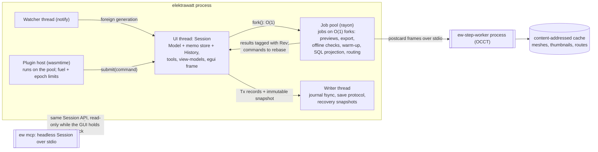
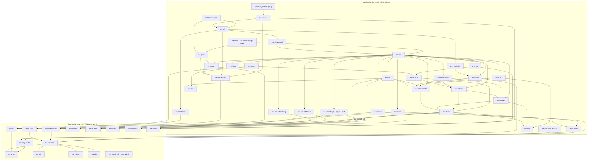
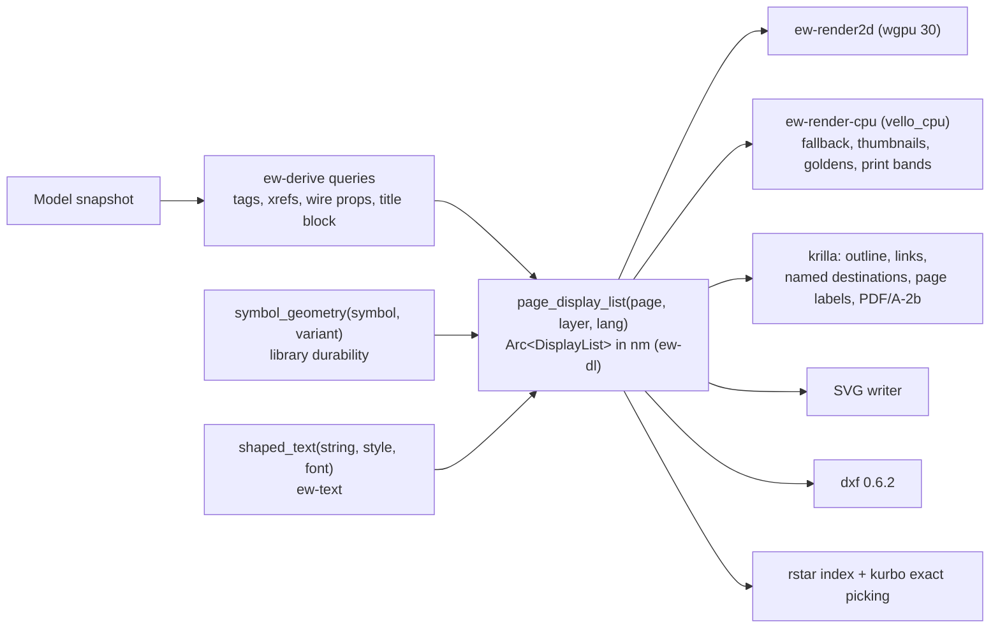

# ElektraWatt architecture specification

**Status:** Accepted · amended 2026-10-18 · **Date:** 2026-10-17 · **Decided by:** chief architect, after a judge
panel over four competing proposals (A incremental, B ECS, C relational, D retained/object model)
**Scope:** ElektraWatt (EW) v1:
- Electric P8-class schematics;
- PLC and I/O;
- fluid power;
- 3D panel layout with routing and wire lengths;
- manufacturing outputs;
- QET, EPLAN (EDZ) and DXF import.

Fixed constraints: Rust, open source, 2–4 developers, cross-platform offline-first desktop.

> **Conventions.**
> - "Golden project" means the reference project J-E-2416 ([reference-drawing.md](../research/reference-drawing.md) §4).
> - D-nn are the reference set's defects ([reference-drawing.md](../research/reference-drawing.md) §3).
> - G-n and C-n are items in [gaps-and-corrections.md](../research/gaps-and-corrections.md), which overrides the other research notes.
> - Crate versions come from the research notes. **(verify)** marks a version or API not confirmed there.
> - Performance figures are **estimates**, to be confirmed by the M0 spike (§15).
>
> This document follows the public-repository rules: it names no customer, end user, project reference, drawing
> id, person or company.

---

## 0. Decision summary

**Decision.** EW is built on **proposal A, "model-first, incremental computation", amended**. Its core:
- a typed Rust domain model held in persistent immutable maps (`imbl`) is the single source of truth;
- every edit is a transaction of typed operations;
- everything printed is a **derived query**.

**The amendments.** We graft the strongest ideas of B, C and D onto A and fix every weakness the judges raised
about A (Appendix A). The four that matter most:
1. **The incremental engine is cut down.** v1 starts with **cold queries** and adds a small in-house memo layer
   (`ew-memo`) only where profiling demands it. It drops parallel fork evaluation and memo merge-back. Salsa is not
   used.
2. **C's best idea becomes a derived artefact.** A **read-only SQL projection** of the model (SQLite in memory,
   versioned `api_v1_*` views) gives users SQL-defined reports and rules. It also serves MCP agents, acceptance
   tests and Excel round-trips. It is never the source of truth.
3. **The licence boundary is a closed lower layer.** Permissive format, schema, IR and importer-API crates never
   depend on GPL code. Importers emit format-level records (B), so third parties can read, write and import EW
   projects without GPL code.
4. **Storage is JSON Lines (C).** Each entity is one line, rows are sorted by the ID's random bits, and the manifest
   is written last. The other storage grafts are B's in-file conflict records and D's yearly format-change window
   and supply-chain controls.

| Layer | Choice |
|---|---|
| Core model | Plain Rust record structs in `imbl::OrdMap` tables; O(1) snapshots; UUID identity |
| Derived data | Pure query functions over a tracked-read context; cold first, `ew-memo` memoisation where profiled; oracle mode |
| Edits | `Command → Transaction(Vec<Op>)`; ops hold before/after rows; project-wide undo; preview = fork |
| Persistence | UUID-named JSONL project directory, sharded by the ID's last byte, manifest-last save, journal outside the project |
| Query/SQL surface | Read-only SQLite projection (`api_v1_*` views), sandboxed, for user reports, rules, MCP and tests |
| UI | egui/eframe 0.37 behind `ew-ui`, over a toolkit-agnostic `ew-viewmodel` |
| 2D rendering | One display-list IR (`ew-dl`); wgpu canvas plus an always-built vello_cpu path; krilla PDF/A-2b |
| 3D / CAD | Own wgpu 3D renderer; parry3d; out-of-process OCCT STEP worker (occt-sys / opencascade) |
| Extensibility | `ew` CLI, rhai (v1), WASM components on the wasmtime LTS line current at plugin launch (v1.x), MCP off by default, Python wheel (v1.x) |
| Licensing | App GPL-3.0-or-later with a plugin exception; permissive lower layer MIT OR Apache-2.0 (owner decision) |

**Why A rather than C** (the scores tied 22–22; §17 has the detail):
- C's distinctive strengths can be grafted onto A as a derived SQL projection. A's cannot be grafted onto C:
  freshness by construction, in-memory editing of plain Rust structs, O(1) snapshots, the Representation entity.
- C carries a conditional fatal flaw on the QET migration path: SQLite `UNIQUE` and `CHECK` constraints cannot be
  deferred, so projects containing D-11 and D-12 could not be staged.
- Cutting down A's engine removes its main delivery risk; the feasibility judge rated the cut-down A as "nearly
  equivalent in risk" to C.

---

## 1. Guiding principles and the core idea

### 1.1 Core idea

The worst defects in the reference set share one root cause: **a value that should have been computed was stored
as a copy, and the copy went stale.** Examples:
- -4W1 vs -3W1 (D-01);
- T51 vs T55 (D-02);
- "1"/"V1"/"V1.0"/"V2.0" (D-05);
- the folio 101 description (D-06);
- "if not indicated, standard size" (D-08);
- 5 vs 4 valves (D-10).

EW removes that root cause from the architecture:
- **A project is an immutable value:** typed tables of plain Rust structs in persistent maps, cloned in O(1).
- **The value changes only through a transaction of typed operations.** That transaction is also the undo record,
  the journal entry, the macro step and the diff.
- **Everything else is a query over that value:** tags, cross-references, nets, potentials, effective wire
  properties, title blocks, TOC, BOM, terminal and PLC reports, layout labels, check messages and display lists.
  A derived value cannot go stale, because no stored copy exists.

Immutability also makes the expensive features cheap:
- background PDF export on a consistent snapshot;
- "preview before commit" for a 10,000-tag renumber;
- crash journalling;
- semantic git merges;
- before/after change lists for manufacturing.

### 1.2 Principles

1. **Store intent, derive presentation.** Only facts a human decided are persisted. Every string printed on a page
   is a query result.
2. **Derived by default, frozen on purpose.** Identifiers that leave the building (tags, wire numbers, PLC
   addresses, routed lengths) may be explicitly frozen, for example at release. A check reports every frozen value
   that deviates from its rule (§6.5).
3. **One writer, many readers.** GUI, CLI, rhai, importers, WASM plugins and MCP agents edit only through
   `Command → Transaction → Op`. Readers get lock-free snapshots.
4. **Identity is a UUID, never a tag.** Every reference is an `Id<T>`. Tags, folios and wire numbers are
   properties.
5. **Typed, not property bags.** There is one Rust record struct per entity kind. Multi-role devices get optional
   typed aspects (§4.3). User-defined properties and unknown fields go into `extra` maps. There is no EAV model.
6. **Cold first, cached where measured.** Queries are plain functions. Memoisation is an optimisation added per
   query when profiling shows the need, and an oracle verifies it (§6).
7. **Headless first.** Model, queries, commands, checks, reports and PDF all run without a GUI. The golden
   project's PDF is produced by the CLI before any interactive canvas exists (§15).
8. **Determinism everywhere.** Ordered maps, integer nanometres, fixed-point electrical quantities and ID
   tie-breaks: the same model gives the same bytes, the same check findings and the same PDF.
9. **Permissive bottom, GPL top.** The schema, format, IR and importer contracts are permissive and closed under
   their dependencies (§3).
10. **Prove it in CI.** Oracle differential tests, shuffle-order determinism, golden outputs and performance and
    memory gates run from the first month (§13).

---

## 2. Process and thread model



| Actor | Responsibility and rules |
|---|---|
| **UI thread** | Owns the `Session`: the current `Model`, the memo store, `History`, selection and tools. Applies commands synchronously and runs the queries the visible panels need. **Frame budget 16 ms:** apply plus validation ≤ 2 ms, derived updates of visible views ≤ 5 ms, render ≤ 5 ms. Commands declared `Cost::Bulk` always run as preview jobs |
| **Job pool** (rayon 1.12.0 **(verify)**) | Each job runs on a `World` fork, a (model, memo snapshot) pair cloned in O(1). Jobs never block edits and are never invalidated by them. Results carry their `Rev`, and the UI shows a staleness badge when `Rev < current`. Cancellation is cooperative |
| **Writer thread** | Serialises immutable snapshots with the save protocol (§7.4). Appends the journal and fsyncs at least once per second. Writes recovery snapshots to the OS state directory. Saving never blocks the UI |
| **Watcher** (notify 8.2.0) | Detects git pulls and foreign writes, ignoring its own by manifest generation. A foreign generation is loaded on the pool, diffed entity by entity, and offered as one undoable "External change" transaction (§7.4) |
| **Plugin host** | The wasmtime LTS line current at plugin launch; development runs on the 48.x LTS line (49.0.3 is current). Plugins read through query handles on a snapshot and write only by submitting commands |
| **`ew-step-worker`** | Out-of-process OCCT via occt-sys 7.8.1 + opencascade 0.3.0 (LGPL-2.1, C-5). Supervised with timeouts and restart. Results are cached by `sha256(file) + worker_version`. A crash or a pathological vendor file cannot touch the model |
| **MCP** | `ew mcp` opens the project headless with the same `Session` API, read-only while the GUI holds the lock. A GUI "live bridge" with ask-first writes follows in v1.x (G10) |

**The job model has no memo merge-back.** This is deliberately simpler than proposal A.
- **What a job receives.** A job gets the model plus a **read-only** snapshot of the memo store, both `imbl` and
  O(1).
- **Where its results go.** Results the job verifies or computes go to a **job-local overlay**, which is dropped
  when the job ends.
- **The one exception: adopt-if-unchanged.** If the main memo store is still pointer-equal to the job's base when
  the job finishes, and the revision has not moved, the session adopts the job's store in O(1). This is used for
  the warm-up after open and for full checks run while the user is idle. Any other outcome discards the overlay.
- **Parallel work inside a job.** The job evaluates global queries once, sequentially (page order, stitch graph,
  potential partition). Only then does it fan out with rayon, giving each thread its own overlay.
- **What this design does not need.** There are no sharded locks and no memo revalidation across revisions.

**A job's model changes return as commands.** An importer, plugin or routing job hands back a command or a
prepared transaction together with its read set:
- if no key in that read set has changed since the job's revision, the session applies it;
- otherwise the session re-runs the deterministic command on the current snapshot (optimistic rebase).

**Panics.** The panic strategy is [quality, security and release](18-quality-security-release.md) §12.3. Release
builds keep `panic = "unwind"`:
- on job-pool threads (importers, rhai, SQL, checks, exports, report pagination) the panic is caught by the job's
  `catch_unwind`, so the job fails with a report while the model stays unchanged and the session keeps running
  (NFR-REL-12);
- on every other thread (UI, writer, commit pipeline) the hook asks the writer thread to flush the journal and then
  aborts; the next start offers recovery (NFR-REL-13).

**Platforms.**
- Windows 10 22H2+ and 11 (x64);
- macOS on Apple silicon, with Intel as best effort (Rust Tier 2);
- Ubuntu 22.04+ and Debian 12+, on Wayland and X11.

wgpu runs on DX12, Vulkan or Metal. DX12 WARP and the always-built CPU renderer (§8) cover GPU-less RDP and VDI
sessions (G6).

---

## 3. Crate and workspace layout

**Licence layering.**
- The **permissive layer** (MIT OR Apache-2.0) is closed under dependencies: no permissive crate depends on a GPL
  crate, and CI enforces this (§13).
- Everything else is **GPL-3.0-or-later** with the plugin exception (ADR-0025).
- `ew-import-qet` may contain ported QElectroTech code (GPL-2.0-or-later). It is therefore excluded from the plugin
  exception, and plugins never link it (C-8).

| Crate | Layer | Responsibility | Key dependencies |
|---|---|---|---|
| `ew-units` | P | `Nm(i64)`, `Pt2`, `Rect`, rational `Grid{num,den}`, `Orient2` (8 variants), `Angle2(i32)` (10⁻³ degree; free texts and graphics only), `Pose3` (nm + quaternion rounded to 1e-9), fixed-point `Dec3` (mm², A, V) | serde 1.0.229; kurbo 0.13.1 and glam 0.34.1 conversions behind features |
| `ew-ids` | P | `Id<T>`: UUIDv7 for new records, UUIDv5 for instantiated, imported and generated ones; per-session `u32` interner | uuid 1.28.0 |
| `ew-mltext` | P | `MlText` with EPLAN neutral-xor-languages semantics, BCP 47 `LangTag`, NFC, confusable detection, natural-sort keys | unicode-normalization 0.1.26, unicode-security 0.1.2, icu 2.3.1 |
| `ew-rds` | P | IEC 81346 parser and formatter (strict and lenient); identifier sets as data: EN 81346-2:2009 single letters (default), IEC 81346-2:2019, IEC 60750 legacy. Node codes are atomic tokens: parsing first matches the longest known node code or alias of the aspect and only then splits at prefix characters, so `+J-E-2416` stays one code | — |
| `ew-schema` | P | **The persisted record type of every entity kind** (plain serde structs), kind registry, per-kind schema versions, JSON Schemas | serde, schemars 1.2.3 |
| `ew-format` | P | JSONL canonical reader and writer, sharding rules, manifest, upgrade chain on `serde_json::Value`, 3-way record merge core, conflict records | serde_json 1.0.154, serde_path_to_error 0.1.20, semver 1.0.28, sha2 **(verify)** |
| `ew-interop-api` | P | `Importer`/`Exporter` traits over `ew-schema` records: `ImportBatch`, `ImportReport`, `SourceRef`, `TableImage`, `Proposal` (§10.6) | — |
| `ew-dl` | P | Display-list IR: paths, glyph runs, images, groups, symbol instances, link sources and targets, entity tags | kurbo, peniko 0.6.1 |
| `ew-step-proto` | P | STEP worker IPC contract and cache format | postcard 1.1.3, rkyv 0.8.18 |
| `ew-memo` | P | Generic memo engine: revisions, dependency recording, early cut-off, durability levels, LRU, statistics, oracle hooks, and a generic reverse-dependency API per query family. Knows nothing about ECAD. Not published to crates.io until it has two owners | imbl 7.0.2 (MPL-2.0+) |
| `ew-plcaddr` | P | `PlcAddress`, PLC address profiles as data, the address-grammar engine, bit intervals | — |
| `ew-caex` | P | CAEX 2.15/3.0 model and `ExchangeImage` | quick-xml 0.42.0 |
| `ew-devdesc` | P | Device descriptions: GSD, GSDML and IODD (ESI and EDS at 1.x) | quick-xml |
| `ew-ewpp` | P | `.ewpp` record types, JSON Schemas, reader, writer and package diff | zip 9.0.4, csv 1.4.0 |
| `ew-plugin-wit`, `ew-plugin-sdk` (v1.x) | P | WIT package `elektrawatt:plugin` and the guest SDK with typed bindings generated from the JSON Schemas | wit-bindgen 0.63.0 |
| `ew-model` | GPL | `Table<T>` of `ew-schema` records, the `Model` snapshot, `Op` apply and invert, base reverse indexes, structural invariants, link delete policies | imbl 7.0.2, smol_str 0.3.6 **(verify)** |
| `ew-rhai` | GPL | rhai engine configuration plus the formula and rule profiles (pure, tracked reads, operation limits) | rhai 1.26.1 |
| `ew-derive` | GPL | All domain queries (§6.4) and the tracked-read context `Q` | ew-memo, ew-model, ew-rds, ew-rhai, ew-plcaddr, icu |
| `ew-commands` | GPL | `Command`, `DynCommand`, `TxBuilder`, normalisers, validators, numbering engine, `History`, previews, macros, `ApplyImport` | ew-derive |
| `ew-checks` | GPL | Rule engine, rule packs, the `RuleImpl` trait and registry (Rust and rhai rules implemented here), online checks as queries, offline check jobs, waivers, quick fixes | ew-derive, ew-rhai, toml 1.1.8, fluent-bundle 0.16.0, sha2 **(verify)** |
| `ew-sqlview` | GPL | Read-only SQL projection: materialisation, `api_v1_*` views, sandbox, `ew_natural` collation; the SQL rule implementations registered into `ew-checks` | rusqlite 0.40.2 (`bundled`, `functions`, `hooks`, `limits`), ew-checks |
| `ew-library` | GPL | Parts, symbol, form and macro libraries as canonical `.ewlib` text directories at every tier (system, community, company, user); one derived SQLite FTS5 index per user in the cache; embedding used items into projects (§7.7) | ew-format, rusqlite 0.40.2 |
| `ew-store` | GPL | Save protocol, `.~ew.lock`, journal, recovery, watcher, external-change diff, `.ewz` transport, as-built archive, git commits and tags | ew-format, notify 8.2.0, zip 9.0.4, gix 0.89.0, etcetera or directories **(verify)** |
| `ew-text` | GPL | Fonts and the memoised `shaped_text` query: one text stack for screen, pagination and paper | parley 0.12.0, fontique 0.12.0, skrifa 0.48.0, harfrust 0.14.0 |
| `ew-reports` | GPL | Built-in report row queries, user SQL reports through the sandboxed query API of `ew-sqlview` (never links rusqlite), pagination into virtual pages, XLSX and CSV tables | ew-derive, ew-sqlview, ew-text, rust_xlsxwriter 0.100.0, csv 1.4.0 |
| `ew-scene` | GPL | Model to display lists per page and layer, forms engine (frames, title blocks, report forms), text through `ew-text`, spatial index, hit-testing; PDF underlays (1.0) | ew-text, rstar 0.13.0, hayro 0.8.0 (underlays, 1.0) |
| `ew-render2d` | GPL | wgpu 2D renderer: lyon tessellation once per symbol, instancing, screen-space lines, glyph atlas | wgpu 30.0.1, lyon_tessellation 1.0.22 |
| `ew-render-cpu` | GPL | vello_cpu renderer: GPU-less fallback, thumbnails, golden PNGs, banded printing | vello_cpu 0.3.0 |
| `ew-export` | GPL | PDF (outline, links, named destinations, page labels, PDF/A-2b), SVG, DXF, PNG (through `ew-render-cpu`) | krilla 0.8.2, krilla-svg 0.8.1, dxf 0.6.2, ew-render-cpu |
| `ew-print` | GPL | OS print adapters with per-OS features (§8.4) | ew-export, ew-render-cpu |
| `ew-plc` | GPL | Exchange orchestration, merge and writers: AML AR APC (CAEX 2.15 write, 2.15 and 3.0 read, through `ew-caex`), the TIA "PLC Tags" XLSX exporter and importer, PLCopen XML; rack and slot logic | ew-plcaddr, ew-caex, ew-devdesc, quick-xml 0.42.0, calamine 0.36.1 |
| `ew-panel` | GPL | Layout queries, collision reconciler, routing graph, negotiated-congestion routing, lengths, duct fill, 2D panel projection; glTF (glb) and STL writer for `layout_scene` | parry3d 0.31.1, pathfinding 4.16.0, petgraph 0.8.3, glam 0.34.1, gltf-json **(verify)** |
| `ew-render3d` | GPL | wgpu 3D: instancing, feature edges, transparency, CAD camera, picking, gizmo | wgpu 30.0.1, meshopt 0.7.0, transform-gizmo-egui 0.11.0 |
| `ew-mfg` | GPL | Production package content, wire lists with lengths, ferrules, labels, data-driven machine and label profiles | ew-panel, ew-ewpp, zip, csv, rust_xlsxwriter |
| `ew-import-qet`, `ew-import-eplan`, `ew-import-dxf` | GPL | QET `.qet`/`.qetz`; EDZ (7-Zip and ZIP), EPLAN XML/XLSX; DXF (DWG behind a feature) | roxmltree 0.21.1, quick-xml, ew-plcaddr (QET); sevenz-rust2 0.24.0, zip, calamine, csv (EPLAN); dxf 0.6.2, acadrust 0.6.4 (MPL-2.0) |
| `ew-import-catalog` | GPL | Parts from CSV/XLSX (MVP), BMEcat and ETIM xChange (1.x), behind `ew-interop-api` | csv, calamine, quick-xml |
| `ew-import-tables` | GPL | The golden CSV bootstrap behind `ew import csv`, the round-trip table reader and translation tables; reused by `ew-testkit` | csv, calamine |
| `ew-script`, `ew-plugin-host` | GPL | rhai automation bindings over queries and commands (profile from `ew-rhai`); WIT world and host on the wasmtime LTS line current at plugin launch (48.x in development), plugin export roles (§10.4), plugin rule implementations registered into `ew-checks`, the `secret-get` capability (v1.x) | ew-rhai; wasmtime LTS, wit-bindgen 0.63.0 |
| `ew-jobs` | GPL | Scheduler, progress, cancellation, staleness tagging, adopt-if-unchanged | rayon |
| `ew-api` | GPL | The `Session` facade shared by every front-end; registers the SQL and plugin rule implementations at session start; composes `.ewpp` export jobs from `ew-mfg` data, `ew-export` PDF/DXF and `ew-panel` glb | everything above except UI |
| `ew-viewmodel` | GPL | Toolkit-agnostic panel models: navigator trees, table rows with edit→command mapping, property-grid rows with provenance, message lists, each with a revision stamp | ew-api |
| `ew-ui` | GPL | egui widgets, canvas host, tools (state machines), command palette, keymaps, the action registry behind every menu | egui 0.37.0, egui_tiles 0.17.1, egui_table 0.10.0, egui_ltreeview 0.9.0 |
| `ew-viewer` (1.0) | GPL | The read-only `.ewpp` wiring viewer on `ew-ui` widgets, used by the `ew-wiring-viewer` binary and the "Preview package" view of the Manufacturing workspace | ew-ewpp, ew-ui, ew-render-cpu, hayro 0.8.0 (after the fidelity check) |
| `elektrawatt` (bin) | GPL | eframe shell, native menus on macOS and Windows (egui menu bar on Linux), dialogs, clipboard, crash handler | eframe 0.37.0, egui-wgpu 0.37.0, muda 0.21.2, rfd 0.17.2, arboard 3.7.0, ew-print |
| `ew` (bin) | GPL | CLI, `ew mcp`, merge driver, textconv, migration verifier | clap **(verify)**, rmcp 3.5.1 **(verify)**, ew-print, hayro 0.8.0 (`ew verify-migration`) |
| `ew-wiring-viewer` (bin, 1.0) | GPL | Small read-only viewer for shop PCs | ew-viewer |
| `ew-step-worker` (bin) | GPL (links LGPL OCCT) | STEP reading, tessellation, feature edges, hulls, mounting frames | occt-sys 7.8.1, opencascade 0.3.0, gltf 1.4.1 |
| `ew-testkit` | GPL | Golden builders (CSV bootstrap through `ew-import-tables`, command DSL), S–XL and XL-A generators, oracle comparator, acceptance runner | insta 1.49.0, proptest 1.12.0, criterion 0.8.2, dify 0.8.0, hayro 0.8.0 (test use) |
| `ew-py` (v1.x) | GPL | Python wheel of the headless core | pyo3 0.30.1 |

`xtask` and `fuzz/` are development-only and outside the product crate table; they never ship in release artefacts.

Arrows point from a crate to its dependencies:



**Rules.**
1. **Model access.** `ew-model` tables are `pub(crate)`. Other crates read the model only through the tracked
   context `Q` (inside queries) or through `TxBuilder` (inside commands).
2. **SQLite.** Only `ew-sqlview` and `ew-library` link rusqlite. `ew-reports` runs user SQL through the sandboxed
   query API of `ew-sqlview`, and importers receive SQLite content only as a `TableImage` (§10.6).
3. **UI toolkit and GPU.** Only `ew-ui`, `ew-viewer`, the app binary and the `ew-wiring-viewer` binary know egui.
   Only the renderers know wgpu.
4. **Importers** depend on `ew-interop-api`, their parsers and permissive helpers such as `ew-plcaddr` only. They
   never see `ew-model`.
5. **Model entities are the schema records.** `ew-model` wraps `ew-schema` record structs in tables. The GPL layer
   adds behaviour (ops, indexes, invariants, derivation) but no second data definition. Third parties can
   therefore read, write and validate EW files with the permissive crates alone.

---

## 4. Core domain model: storage and identity

### 4.1 Storage form

```rust
pub struct Model {                         // one immutable snapshot; Clone is O(1)
    pub(crate) rev: Rev,                   // monotonic on the main line
    pub(crate) project: Row<Project>,      // master data, parties, settings, profiles, derivation_profile
    pub(crate) structure: Table<StructureNode>,
    pub(crate) pages: Table<Page>,         pub(crate) sections: Table<Section>,
    pub(crate) devices: Table<Device>,     // incl. strips, terminals, cables, assemblies, PLC stations/modules
    pub(crate) functions: Table<Function>, // logical functions incl. interruption points; CPs instantiated from
                                           //   the function definition
    pub(crate) reps: Table<Representation>,// drawings of functions: multi-line, single-line, overview, fluid, topology,
                                           //   contact image, strip segment, graphic (panel fronts are derived)
    pub(crate) connections: Table<Connection>, pub(crate) junctions: Table<Junction>,
    pub(crate) conductors: Table<Conductor>,   pub(crate) channels: Table<Channel>,
    pub(crate) potential_defs: Table<PotentialDef>, pub(crate) net_defs: Table<NetDef>, pub(crate) bonds: Table<Bond>,
    pub(crate) layout: LayoutTables,       // spaces, enclosures, surfaces, carriers, placements, route overrides
    pub(crate) committed: CommittedTables, // routes, lengths, frozen numbers, released report snapshots (§6.5)
    pub(crate) lib: LibraryCopies,         // embedded library copies: parts, manufacturers, symbols, function
                                           //   defs, forms, macros, PLC, machine and label profiles
    pub(crate) report_blocks: Table<ReportBlock>, pub(crate) revisions: Table<Revision>,
    pub(crate) waivers: Table<Waiver>, pub(crate) comments: Table<Comment>, pub(crate) ext_refs: Table<ExternalRef>,
    pub(crate) idx: BaseIndexes,           // reverse-FK indexes; maintained by Op::apply, rebuilt on load, never saved
}
pub struct Table<T> { rows: imbl::OrdMap<Id<T>, Row<T>>, changed_at: Rev }
pub struct Row<T>   { value: Arc<T>, changed_at: Rev }
```

- **Why `imbl::OrdMap`:** deterministic ordered iteration, ID range scans, and O(1) snapshots. imbl mutates
  uniquely owned nodes in place, so a 10k-op transaction copies each touched B-tree node once.
- **Base indexes** are pure reverse-FK maps, each key with its own `changed_at`. Examples: `functions_by_device`,
  `reps_by_page`, `connections_by_endpoint`, `terminals_by_strip`, `channels_by_module`, `placements_by_device`.
  - `Op::apply` maintains them by delta.
  - Debug builds re-derive them and compare after every transaction.
  - A generated field-mask exhaustiveness test (from D) fails when someone adds a link field without updating the
    index declarations.

### 4.2 Entities

This table summarises the shape of each entity and the reason for it. Field-level schema:
[domain model](03-domain-model.md), which is normative together with `ew-schema`.

| Concept | Record (authored fields only) | Notes and reference |
|---|---|---|
| Project | `Project { master, parties: [Party{role}], supply: SupplySpec, settings, profiles, languages, derivation_profile, user_prop_defs, extra }` | Customer and end user are separate roles (D-30). Supply is structured (REF-002) |
| Structure | `StructureNode { aspect, code, parent, description: MlText, order }` | One canonical node for `+J-E-2416`. Spelling is a property of the node (D-03) |
| Section, Page | `Section { number, folio_range, title }`; `Page { folio: Folio{section, number, label}, kind, structure, form, title: MlText, description_override: Option<MlText>, scale, grid, … }` | `title` is the page description; without `description_override` the title block prints the project description (D-06). No stored revision, prev/next or title-block text |
| Device | `Device { tag: TagSpec, kind, parent: Option<Id<Device>>, parts: SmallVec<PartUse{part, qty}>, function_text: MlText, process_tag, tech_data, state, aspects: DeviceAspects, extra }` | `TagSpec { letter, counter, scheme, frozen: Option<FrozenTag> }`. The printed tag is derived. **Parts attach only to devices**, so the BOM aggregates one path |
| Function | `Function { device: Option<Id<Device>>, def: FnDefRef, role: Main/Aux, kind: Normal/Ip/BlackBox, cp_overrides: SmallVec<CpOverride{idx, designation, alias, unused}>, … }` | `device` is None if and only if the kind is `Ip`. **Connection points (CPs) are instantiated from the function definition** (symbol or part pin pattern). Only overrides are stored (from B). The internal `idx` keeps duplicate printed designations unique (REF-029) |
| Representation | `Representation { functions, page, symbol, variant, pos: Pt2, orient, rep_type, pin_map, text_slots }` | One function, many drawings: `rep_type` is MultiLine, SingleLine, Overview, Fluid, Topology, ContactImage, StripSegment or Graphic. An unplaced function simply has no representation. One strip drawn in two segments (D-42). **Panel fronts are not stored:** the query `panel_front_reps(dev)` derives them from placements, and a PanelLayout page hosts one `SurfaceView` (D-02) |
| Connection | `Connection { a: Endpoint, b: Endpoint, page: Option<Id<Page>>, route: SmallVec<Pt2>, kind: Wire/Core(Id<Conductor>)/Bridge(BridgeSpec)/Fluid/Bus(BusLine)/Overview/Internal/SingleLine (1.0), overrides: WireOverrides, number: NumberSpec }` | `Endpoint = Cp{function, idx} \| Junction(id)`. Overview connections are excluded from nets. Strip-editor bridges and page-less internal links have no page and live in the shard of the device that owns endpoint `a` |
| Junction | `Junction { page, at, style: Dot/Bevel{orient}, wiring: Chain/Star, sequence: SmallVec<Id<Connection>> }` | Explicit T-node order (REF-034, D-20). `wiring` decides the physical wires; Dot defaults to Star, Bevel to Chain |
| Interruption point | A `Function` of kind `Ip { name, direction, scope }` without a device, with a representation; it lives in the page file of its representation | Pairing is derived: star or chain, by name and scope |
| Potential, net | `PotentialDef { at: Endpoint, name, ptype: Option, voltage, env }`; `NetDef { at, props }` (signal level); `Bond { a, b, kind }` | Potentials themselves are derived. Bonds link potentials without merging them (D-22) |
| Terminal strip, terminal | Strip = `Device` with aspect `Strip`; terminal = `Device` with aspect `Terminal { strip, seq, designation, levels }` | **A terminal is a device**, as in EPLAN. Its levels and clamps are CPs carrying level and side (from B; TWIN terminals). Designation rules: §4.6 |
| Cable, conductor | Cable = `Device` with aspect `Cable { length: LengthSource }`; `Conductor { cable, core, colour: ColourCode, csa: Dec3, shield }` | `ColourCode` is the IEC 60757 enum plus profile-declared company codes (DBU), so "BR" cannot be stored in strict mode; imports keep it as a lenient-only foreign code (EW-CORE-031) (D-17) |
| PLC | Station and module are device aspects `PlcStation`, `PlcModule { slot, type_ident, start: IoStarts{input, output}, part_use, … }`; `Channel { module, number, kind, data_type, address: Auto/Manual/Excluded/Tbd, state: Option, symbol, comment: MlText, binding: Option<Endpoint> }` | `Auto` addresses are derived from the module start and the address map of the part use (D-26). `Tbd` is a typed open item (D-15). Channel IDs are `v5(module, "channel", number)` |
| Bus | `BusPort` aspect on functions; `LogicalNet`, `PhysicalNet` | Termination is a property, not free text (REF-061) |
| Fluid | CPs with `discipline = Pneumatic` and port role 1/2/3/4/5/12/14; fluid lines are `Connection{kind: Fluid}` with `TubeSpec`; `Medium` | One graph engine for both disciplines |
| Layout, 3D | `LayoutSpace`, `Enclosure`, `MountingSurface`, `Carrier { kind: Rail/Duct/Busbar/Surface, part, path }`, `Placement3D { device, function: Option, carrier, pose: Pose3, locked }`, `RouteOverride { connection, path }` | **No tag text is stored** (D-02). Poses are relative to the carrier. Overrides are keyed by connection ID, so they survive re-routing |
| Library copies | `PartCopy`, `SymbolDef`, `FnDef`, `FormDef`, `MacroDef`, manufacturer, PLC-profile, machine-profile and label-profile copies, each with `{library_id, item_id, version, sha256}` | The project opens without its libraries (G2). Copy IDs are item-based (§4.4) |
| Revision | `Revision { label, date, author, checker: Option, description, state: Open/Released/Withdrawn, page_notes, sign_off: Option, release: Option<ReleaseRecord> }`; `ReleaseRecord { generation, approval, rule_packs, derivation_profile, archive, git_tag, content_digest, page_digests, changed_pages }` | One table, one format (D-05); four-eyes rule (D-34). Withdrawing a release adds a separate `Withdrawn` record that points to it (§7.8) |
| Reports, notes | `ReportBlock { kind, query, filter, sort, form, section, first_folio }`; `Waiver`; `Comment`; `ExternalRef { project, location, device, connection }` | Report pages are derived (§11). External connections to J-E-206 are typed (REF-018) |

### 4.3 Device aspects: one device, several roles

Multi-role devices carry optional, typed aspects on one `Device` instead of subtypes (from B):

```rust
pub struct DeviceAspects {
    pub strip: Option<Strip>,          pub terminal: Option<Terminal>,
    pub cable: Option<Cable>,          pub assembly: Option<Assembly>,     // config code, BOM mode basis (D-36)
    pub plc_station: Option<PlcStation>, pub plc_module: Option<PlcModule>,
    pub bus_node: Option<BusNode>,     pub valve_terminal: Option<ValveTerminal>,
}
```

**The dual-nature valve terminal is explicit** (REF-098, folios 201–206):
- -201U1 is one device carrying four aspects: `PlcStation` (role valve terminal), `BusNode`, `Assembly` and
  `ValveTerminal`;
- the sub-bases -201U3 … -201U8 are child devices carrying `PlcModule`;
- each valve is a child device of its sub-base;
- each valve has a coil function bound to a `Channel` (Q0.1 …) and a pneumatic function whose CPs are ports
  1/2/3/4/5;
- the overview on 201 and 202 is a representation generated from the assembly's children (D-10).

### 4.4 Identity

| Object | ID |
|---|---|
| New records | UUIDv7 (uuid 1.28.0) |
| Instantiated children (CPs) | `v5(function_id, idx)`, computed and never stored, used for PDF destinations and external references |
| Generated report pages | `v5(report_block_id, page_index)`, so PDF named destinations stay stable |
| Imported records | `v5(lineage namespace, source key)`: the namespace is anchored on an import lineage (the QET project UUID, or the SHA-256 of the lineage's first imported file), so re-importing an edited QET file updates unchanged items in place; `source_ref{lineage, key}` keeps provenance |
| Functions created from a part's function template | `v5(device_id, template_index)` |
| PLC channels | `v5(module_id, "channel", number)`, stored because a channel carries authored data |
| Embedded library copies | `v5(NS_LIBCOPY, library_id ‖ item_id)`; only an explicit "keep both" after a cross-project paste mints `v5(NS_LIBCOPY, library_id ‖ item_id ‖ version)` |

Within a session, IDs are interned to dense `u32` values for union-find arrays and similar hot structures.

### 4.5 Coordinates, quantities, text

- **Coordinates (G4).** i64 **nanometres** in the model and in files.
  - Grids are rational: the QET 10 px grid is exactly `7_937_500/3` nm.
  - Snapping uses grid indices, never float equality.
  - f64 mm (glam `DVec3`) appears only in 3D maths, f32 only in GPU buffers.
- **Electrical quantities.** Fixed-point `Dec3` (mm², A, V), from D, so no float noise reaches files, merges or
  checks.
- **Multilingual text (G7).** `MlText = Neutral(String) | Langs(BTreeMap<LangTag, String>)`, with EPLAN's mutual
  exclusion.
  - The display language is a query key, so "PDF per language" is the same derivation with another key.
  - Identifiers (tags, part numbers, PLC addresses, wire numbers) are NFC strings, checked for confusables, and
    never translatable.

### 4.6 Invariant catalogue

Invariants are evaluated **on the candidate snapshot at the end of the transaction**, limited to touched keys and
their index neighbours. Transient states inside a transaction are therefore legal: swapping two terminal
designations, or renumbering a strip, needs no two-phase rename. This fixes the flaw the domain judge found in C.

| Class | Invariants | Behaviour |
|---|---|---|
| **Structural** (always on) | References resolve, with generated delete policies `cascade`/`unlink`/`forbid` (from D); one main function per device; `Function.device` is None if and only if the kind is `Ip`; assembly graph acyclic; a placement references a device; a channel belongs to exactly one module; connection endpoints exist and differ; a representation's functions exist; a released revision has a checker who is not the author (D-34) | Reject the transaction |
| **Prevent** (rule-pack configurable) | Terminal designation non-empty (D-11) and unique per strip (D-12); device tag unique within its structure scope; PLC address unique per area; at most one star source per interruption-point name and scope, and in chain mode an even count ordered by sort key (unpaired and ambiguous points are check findings); conductor colours consistent with the cable part | **Strict mode** rejects the transaction. **Lenient mode** (imports, legacy projects) turns a violation into a check message. The migration report lists every message |

The enumerated catalogue (about 40 rules) lives in `ew-model/invariants.md`, with a stable ID per rule, and is
tested one by one.

---

## 5. Editing: commands, transactions, undo, validation, preview, macros

### 5.1 Three layers

| Layer | What it is | Producers | Persisted |
|---|---|---|---|
| `Command` | Serialisable intent: `PlaceSymbol`, `Connect`, `RenumberDevices{scope, scheme}`, `AssignPart`, `ApplyImport`, `InsertMacro`, `SetFields` | GUI tools, CLI, rhai, plugins, MCP, importers | Journal, macro recorder |
| `Transaction` | `Vec<Op>` + `{command, origin, page/viewport/selection, coalesce_key, undoable}` | `Command::run(&mut TxBuilder)` | Undo stack, journal |
| `Op` | `Put { key, before: Option<AnyRow>, after: Option<AnyRow> }` | `TxBuilder` | Undo stack (`Arc`s); journal (field diffs) |

```rust
pub trait Command: Serialize + DeserializeOwned + Send {         // typed handlers; not dyn-compatible
    const NAME: &'static str;                                   // "device.place", "numbering.renumber"
    fn cost(&self) -> Cost { Cost::Interactive }                // Bulk ⇒ always a preview job
    fn run(&self, tx: &mut TxBuilder<'_>) -> Result<Outcome, CmdError>;   // deterministic in (snapshot, self)
}
pub trait DynCommand: Send {                                    // object-safe companion
    fn name(&self) -> &'static str;
    fn cost(&self) -> Cost;
    fn run(&self, tx: &mut TxBuilder<'_>) -> Result<Outcome, CmdError>;
    fn to_json(&self) -> serde_json::Value;                     // journal, macro recorder, command logs
}
impl<C: Command> DynCommand for C { /* blanket impl: forwards to Command */ }
impl Session {
    pub fn world(&self) -> World;                                         // O(1): model + memo snapshot
    pub fn preview(&self, cmd: Box<dyn DynCommand>) -> JobHandle<Preview>; // candidate World + diffs; nothing committed
    pub fn commit(&mut self, p: Preview) -> Result<Rev>;                  // rebase-checked
    pub fn execute(&mut self, cmd: &dyn DynCommand) -> Result<Rev>;       // interactive path
    pub fn undo(&mut self) -> Result<Rev>;  pub fn redo(&mut self) -> Result<Rev>;
}
```

Tools hand `Box<dyn DynCommand>` to the session ([schematic editor](06-schematic-editor.md) §4.1). The untyped
`AnyCommand { name, params }` of scripts, plugins and MCP implements `DynCommand` after its parameters have been
validated against the command's JSON Schema ([extensibility](17-extensibility.md) §2.1).

### 5.2 Commit pipeline (UI thread)

1. **Run.** `Command::run` executes against `TxBuilder`, a scratch snapshot with read-your-writes. Handlers may
   query it, for example for the "next free counter on page 103".
2. **Normalise** (from D). Deterministic normalisers may add ops to the same transaction, with at most three
   passes; non-convergence is a bug. The registry, with the order of the editor's normalisers, is
   [schematic editor](06-schematic-editor.md) §3.2. The normaliser families are:
   - online numbering of new devices;
   - instantiation of CPs for new functions;
   - junction clean-up;
   - conversion of autoconnect hints into explicit connections (G5);
   - conductor assignment;
   - connection split when a symbol is dropped onto a wire;
   - online wire numbering;
   - number transfer, including `WireOverrides.ends` and length;
   - clamp pick for terminals;
   - solenoid binding of valve coils to channels ([PLC and bus](10-plc-and-bus.md));
   - the fluid normalisers ([fluid power](11-fluid-power.md)).
3. **Validate.** Structural invariants, then prevent rules in the active mode (§4.6).
4. **Commit.** Swap in the new `Model` (O(1)), bump `Rev`, and push to `History`, coalescing if the coalesce key
   matches. Send the transaction to the writer thread for the journal.
5. **Notify.** Publish a change feed `{rev, touched keys, touched pages}`. View-models compare revision stamps.
   Visible panels re-query on the next frame. Online checks are queries, so they update the same way.

### 5.3 Undo and redo

- **Mechanism.** Ops hold before/after `Arc`s, so they are O(1) to create and their inverse is a swap. Undo
  applies the inverse ops as a **new** revision, which keeps `changed_at` monotonic and memo validation sound.
- **Scope and limits.** One project-wide stack (G3), bounded at 500 steps or 256 MB. Each entry restores page,
  viewport and selection. The stack survives saving, and a saved marker drives the dirty flag.
- **Coalescing.** One drag is one step. Typing in one cell merges until focus leaves. A table fill-down or an Excel
  paste is one step.
- **External reload** arrives as an undoable diff transaction (§7.4), so the stack survives a git pull.
- **Not undoable**, as in EPLAN: library writes outside the project, exports, file operations, and the bulk import
  into an empty project (a checkpoint). Every non-undoable operation is flagged as a marker line in the history.
  Only the destructive ones ask for confirmation: library writes outside the project, overwriting an existing file,
  purging library copies and the empty-project import checkpoint (ADR-0008).

### 5.4 Preview is a fork

`preview(RenumberDevices)` runs on the pool and yields a candidate `World` plus diffs:
- `diff_model(current, candidate)`: entity and field changes;
- `diff_query(current, candidate, q)` for tags, BOM rows, wire-list rows, PLC addresses, xref texts and affected
  pages.

Accept commits the prepared transaction after the rebase check (§2). Cancel drops the fork. A QET import, a
re-addressing run and "update parts from library" are inspected the same way, including rendered pages of the
candidate.

### 5.5 Macros

- **Command macros** are recorded command logs, exported as parameterisable rhai.
- **Window and page macros** are project fragments in the same JSONL format. `InsertMacro{macro, at, value_set}`
  remaps IDs, rebinds structure identifiers and lets the normalisers number the new devices. Folios 203–206 become
  one typical with four value sets.

---

## 6. Derived-data engine

### 6.1 Cold first, memoise where measured

Every derived value is a **pure function over a tracked-read context**:

```rust
pub fn device_tag(q: &Q, dev: Id<Device>) -> Arc<Tag> { /* reads TagSpec, structure, main rep's folio, scheme */ }
// Q exposes only tracked accessors: q.devices().get(id), q.idx().reps_by_page(p), q.get::<PageOrder>(()).
// Queries receive &Q and nothing else, so an untracked model read inside a query does not compile.
```

- **Phase 1 (spine): cold.** Every query runs in **cold mode**: computed on demand, with a request-scoped cache
  that prevents repeated work within one top-level evaluation. No engine is needed, and contributors write plain
  functions.
- **Phase 2 (from the M0 spike): memoise where profiled.** A query is promoted to `Memo` when profiling on the
  synthetic L/XL projects shows it on an interactive path. Every promotion is a one-line policy change, and the
  oracle verifies it.
- **Fallback.** If a query family cannot meet its budget with `ew-memo` within memory limits, it falls back to
  page-scoped dirty flags with coarse recomputation (D's service pattern), still under the oracle.

### 6.2 `ew-memo`: the cut-down engine

`ew-memo` applies salsa's red-green idea to persistent snapshots. **v1 contains only the following:**
1. **Revision stamps.** Every input row, index key and table carries `changed_at: Rev`. A memo stores
   `{value: Arc<V>, deps: SmallVec<(DepKey, observed)>, verified_at, changed_at}`.
2. **Verification and early cut-off.** A read at revision R is a hit if `verified_at == R`. Otherwise the
   dependencies are verified recursively: if none changed, the memo is re-stamped; else the query re-executes.
   - If the new value equals the old one (`Eq`, or a 128-bit hash for bulky values), `changed_at` is **backdated**
     and dependents stay green.
   - This keeps a wire edit on folio 102 from touching folio 203, and it lets unchanged display-list layers keep
     their GPU buffers.
3. **Three durability levels:** library, settings, drawing. A memo whose dependencies are all library-durable skips
   verification while the user draws. Symbol geometry and form layout are examples.
4. **LRU with a byte budget** for bulky memos (display lists, pagination).
5. **Cycle detection.** A cycle panics in debug builds. The one legitimate fixpoint, a TOC whose page count depends
   on itself, iterates inside one query, for at most three rounds.
6. **Statistics** per query and per commit: hits, verifications, re-executions, cut-offs. They are emitted through
   `tracing` and asserted in the perf gate.
7. **Reverse dependencies.** A generic API returns, per query family, the memos whose recorded reads include a given
   key. The online check engine builds its `rdeps` index from it
   ([checks, revisions and collaboration](15-checks-revisions-collaboration.md) §3.3). The M0 spike measures its
   memory; above budget the engine falls back to coarse page and shard keys.

**Out of v1:**
- parallel evaluation of the main store;
- sharded locks;
- merging memos from forks, except adopt-if-unchanged (§2);
- salsa-style cancellation of readers.

The estimated size is 1.5–2.5 kLOC. Two owners are required by the end of the spine (§15).

### 6.3 Granularity and memory rules

1. **No per-CP memos.** The finest memo key is a page, device, potential, strip, module, station, report block or
   layout space.
2. **Group small results.** Per-connection values are grouped per potential: `wire_props_of(potential) -> Arc<Map>`.
   The per-connection accessor `wire_props(conn)` is a cold lookup into that map.
3. **Promote only what pays.** A query is memoised only if its cold cost exceeds about 20 µs, or if it is read on
   every frame.
4. **Memory gate.** CI checks memo count and bytes per query family on the XL fixture (§13).

### 6.4 Query catalogue

| Query (key) | Depends on | Initial policy | Notes |
|---|---|---|---|
| `page_order()` incl. generated pages | pages, sections, report blocks, `report_page_count` | Memo | Source of Prev/Next, TOC, PDF outline and `/PageLabels` (REF-073) |
| `function_cps(f)` | function definition, overrides | Cold | CP instantiation |
| `device_tag(dev)` → `{full, displayed(page)}` | `TagSpec`, identifier set, structure nodes, main representation's folio, assembly parent | Memo | EPLAN-style identifier suppression; child tags `-201U3-Q1` (D-27, D-41) |
| `rep_anchor_cell(rep)` | position, the symbol's anchor policy, form grid | Cold | Derived from the symbol definition, never from rendered geometry; fixes "3-B0" (D-14) |
| `xref_text(rep)` | partners' anchor cells, xref format | Memo | Star or chain interruption points; "(201-E1)", "∞ 203-B4" |
| `page_local_nets(page)` | connections, junctions, reps on the page | Memo | Union-find over a few thousand edges |
| `stitch_graph()` | local nets, IP pairing, bridges, conductors, terminal side links, bonds | Memo | Nodes are local nets, about 10–15 % of CPs |
| `potential_partition()` | stitch graph, potential defs, net defs | Memo | `PotentialId` = the minimum `PotentialDef` ID when the potential has one or more definitions, else the minimum CP ID, so it is stable under unrelated edits. Canonical name plus IP aliases (D-24) |
| `physical_wires_of(potential)` | potential members, connections, junction wiring, IP pairs | Memo | One entry per physical CP-to-CP wire, keyed by the UUID of its target-side connection. Source of the wire list, routing and `WireRecord` |
| `potential_flow(potential)` | potential members, source-output CPs, function definitions | Memo | Flow rooted at the source-output CPs; the protective device per load; source of the potential overview |
| `wire_props_of(potential)` | overrides, net defs, potential defs, profile | Memo | Precedence: connection override (CDP) > net definition > potential definition > profile rule (type × voltage × circuit class) > project default. Every value carries **provenance** (D-08) |
| `channel_addresses(module)` | module start, part address map, channel specs | Memo | One edit re-addresses a module (D-26) |
| `terminal_rows(strip)`, `cable_rows(cable)`, `plc_rows(station)` | terminals, levels, bridges, conductors, channels | Memo | Sources of terminal, cable and PLC reports (REF-045/049/060) |
| `device_part_lines(dev)` → `bom_rows(mode)` | parts on devices, assembly children, carriers, accessories | Memo | Assembly and component modes (D-04, D-36) |
| `toc_rows()`, `title_block(page)`, `layout_label(placement)` | page order, project data, overrides, revisions, tags | Memo | Bound fields only; overrides explicit and flagged (D-05, D-06, D-02) |
| `checks(scope)` (page, potential, strip, station) | rule inputs | Memo | Online message panel (§12) |
| `page_display_list(page, layer, lang)` | per-layer inputs | Memo + LRU | Schematic layers: frame, symbols, wires, labels, tables, revision, highlights. Panel-page layers: surface, carriers, placements, features, dims, plus frame, labels, tables and highlights. A wire edit never rebuilds the title block |
| `panel_front_reps(dev)` | placements of the device, surfaces | Cold | Derived panel-front representations for navigation and "show all representations" (§4.2) |
| `layout_scene(space)` | placements, carriers, mesh refs, committed routes | Memo | Input to the 3D reconciler (§8.5) |
| `sql_table(api_table)` | the table's sources | Class II | SQL projection (§10.2) |

### 6.5 Freshness contract

| Class | Examples | Contract |
|---|---|---|
| **I: synchronous** | tags, xrefs, nets, wire properties, title blocks, TOC, BOM, display lists, online checks | Always fresh when read |
| **II: asynchronous** | routing and wire lengths, full 3D collision, offline checks, PDF export, SQL projection, thumbnails | Computed on forks and tagged with `Rev`; a stale badge is shown ("810 mm, re-routing…"). **Release exports require fresh results** |
| **III: external** | STEP tessellation, edges, hulls | Content-addressed cache, never model data |

**Two mechanisms keep shop-floor values stable.**

**Committed computations** (from B). Some computed values must not change behind the shop floor's back:
- routed paths and lengths;
- frozen wire numbers;
- report snapshots of a released revision.

They are **authored outputs of commands** (`RouteWires`, `FreezeNumbers`, `ReleaseRevision`), stored as
`Committed<T> { value, input_hash, rev }`. A check flags them when the input hash no longer matches: `EW-LAY-011`
for routes, `EW-MFG-001` for lengths, `EW-THM-005` for thermal results and `EW-REL-002` for any other committed value
a release output uses. "Re-route" is an explicit, previewed command.

**Frozen on purpose.** `TagSpec.frozen`, `NumberSpec::Frozen` and `AddrSpec::Manual` hold deliberate overrides. The
numbering report lists every frozen value and its deviation from the rule.

### 6.6 Versioned derivation profiles

Derived output depends on rules: xref format, numbering, title-block bindings, wire-property inheritance, report
layouts. These rules are therefore **versioned data**, and each project pins one (`derivation_profile = "2027.1"`).
- A new EW release ships new profiles but never silently changes the profile of an existing project. Upgrading a
  project's profile is an opt-in, previewed command.
- Golden outputs are tested per shipped profile.
- Released revisions archive their PDF (§7.8).

This is how a 2027 project opens in 2037 with identical tags, cross-references and wire numbers, which the
Machinery Regulation's retention period demands (G2).

### 6.7 XL-A cost estimates

The estimate case XL-A is 2,000 pages, 50k devices, about 150k functions, 200k connections, about 500k instantiated
CPs, 20k terminals and 10k channels, on the G6 baseline machine. XL itself always means the class bound of
[non-functional requirements](02c-nonfunctional-requirements.md) §2.1 (5,000 pages, 250k connections).

| Operation | Work | Estimate |
|---|---|---|
| Open | Parallel parse of about 250 MB of JSONL; tables and base indexes | 1–3 s; the first page is interactive about 1 s later |
| Warm-up | Fork job; adopted if the user has not edited yet | 2–4 s in the background |
| Move a symbol within its cell / across cells | 1 op → page-local nets (cut off) → layers / plus partner xrefs | < 1 ms / < 2 ms, plus about 1 ms per re-tessellated layer |
| Draw one wire | page-local nets; global stitch graph; potential partition | 5–10 ms at commit. Live highlighting during the drag uses page-local nets only |
| Renumber folio 103 → 104 | page order, about 25 tags, xrefs into 103, TOC, BOM folio column, Prev/Next | < 5 ms plus the preview diff |
| Change the colour of "24 V DC" in the profile | wire properties of all 24 V potentials (about 60k wires) | ~30 ms |
| Full BOM / full online check set (cold) | aggregation / per scope in parallel on a fork | ~20 ms / 1–3 s |
| SQL projection, full build | about 2M rows into SQLite | 2–5 s job; then per-table refresh |
| Memory | model and indexes ~250 MB; memos ≤ 300 MB (gated); display-list LRU ~100 MB; undo ≤ 256 MB; projection ≤ 500 MB, file-backed in the local cache at XL size | ~1–1.5 GB peak, within the 4 GB budget |

The one honest hotspot is **global connectivity**. It costs 5–10 ms per committed wire edit, which is acceptable
per commit but not per drag frame. The design accounts for this.

### 6.8 Debuggability

- **`ew query <name> <key> --json`** prints any derived value. `--explain` adds its dependency trail, the memo state
  (hit, verified or re-executed) and the provenance of each field.
- **`ew verify-derived`** (also in the GUI under Help) recomputes everything cold and reports differences.
- **Oracle mode.** In CI, debug builds and nightly runs, after each transaction sampled queries are recomputed cold
  and compared (all of them nightly).
- **Projection dump.** `ew sql dump <project> out.sqlite` writes the projection for inspection in any SQLite browser
  (§10.2).

---

## 7. Persistence and project file format

### 7.1 Contract

**Text is canonical at rest. In memory, the `Model` is canonical.** Nothing else exists:
- no working database;
- no stored derived data;
- no binary blobs other than assets addressed by content hash.

Rules for the files:
- File names derive only from UUIDs and fixed words: no tags or titles, so no Windows reserved names, no case
  collisions and short paths (G1).
- The app binary manifest sets `longPathAware` anyway.

### 7.2 Directory layout (golden project example)

```text
J-E-2416.ew/                          # name chosen by the user; content is UUID-named
  manifest.json                       # written LAST: format, min_reader, generator, generation, sha256 per file
  project.jsonl                       # project row, parties, settings, colour/size/numbering/xref profiles,
                                      #   identifier set, languages, derivation_profile, user property definitions,
                                      #   import lineages
  structure.jsonl                     # structure nodes (=P01, +J-E-2416, +J-E-206 …), sections 1/2/9
  revisions.jsonl  report-blocks.jsonl  waivers.jsonl  comments.jsonl
  pages/<page-uuid>.jsonl             # page row + page-owned rows: representations, connections, junctions,
                                      #   interruption-point functions, graphics, placed report blocks
  devices/<xx>.jsonl                  # 256 shards by the LAST id byte (v7's leading bytes are time):
                                      #   devices (incl. strips, terminals, cables, assemblies, PLC), functions,
                                      #   conductors, channels, potential/net defs, bonds, page-less connections
  layout/<space-uuid>.jsonl           # enclosures, surfaces, carriers, placements, route overrides, committed routes
  imports/<run-uuid>.jsonl            # one import run per file (MVP), so runs never conflict with project data
  exchange/<config-project-uuid>.jsonl  # PLC exchange records and foreign IDs (1.0; part of the as-built archive)
  lib/symbols/<uuid>.json  lib/fndefs/<uuid>.json  lib/forms/<uuid>.json  lib/parts/<uuid>.json  lib/macros/<uuid>.json
  lib/manufacturers/<copy_id>.json  lib/plc-profiles/<copy_id>.json (1.0)
                                      # embedded library copies, pretty-printed (rarely co-edited)
  lib/profiles/<copy_id>.toml         # machine and label profiles in their TOML source form (1.0)
  rules/<uuid>.toml (+ rules/<uuid>/)  reports/<uuid>.sql
                                      # project rule packs (the pack ID lives inside the TOML; rhai, SQL, Fluent
                                      #   and docs in the directory) and user reports
  scripts/<uuid>.rhai  jobs/<uuid>.ewjobs   # automation scripts and jobsets (1.0)
                                      # rules, reports, scripts and jobs are untrusted until the project is trusted
  assets/<sha256>.svg|png|jpg|glb     # logos, images; opt-in embeddable meshes (.glb, 1.0)
  trust.sig                           # project trust signature (1.0)
  .gitattributes  .gitignore          # *.jsonl merge=elektrawatt diff=elektrawatt; ignore .ew/ and .~ew.lock
  .ew/                                # per-user view state and caches (git-ignored)
  .~ew.lock                           # G1 lock (git-ignored)
```

At XL-A (§6.7) this is about 2,300 files plus one per embedded library item: few enough for Defender, OneDrive and
git, and local enough for merges. The full layout and the kind registry are in
[project format](05-project-format-and-persistence.md) §2.

**Ownership determines the file.** A row belongs to its page file if it is page-scoped, to its layout-space file if
it is layout-scoped, and to the shard of its owning device otherwise. A typical edit rewrites one to three files.

### 7.3 Canonical JSON Lines

```json
{"$k":"device","id":"0192f1c4-5a10-7c3e-8b21-6f0d9a4e2b10","tag":{"letter":"G","counter":1},"kind":"psu","parts":[{"part":{"copy":"0192e7d0-…"},"qty":"1"}],"function_text":{"en-GB":"Power supply 24 V DC"}}
{"$k":"device","id":"0192f1c4-77a2-7d10-9c3e-1a2b3c4d5e10","tag":{"letter":"X"},"kind":"terminal","parts":[{"part":{"copy":"0192e7d1-…"},"qty":"1"}],"terminal":{"strip":"0192f1c4-…","seq":3,"designation":"3"}}
{"$k":"connection","id":"0192f3a0-…","a":{"cp":["0192f1c4-5a11-…",4]},"b":{"cp":["0192f1c4-77a3-…",1]},"page":"0192f0aa-…","route":[[95250000,63500000],[95250000,71120000]]}
```

**Writer rules.**
- One record per line.
- Inside a file, records are ordered by kind (schema order), then by the ID's **random bits (bytes 8–15)**, then by
  the full ID. Concurrent additions on two branches therefore land on scattered lines instead of both appending at
  the end of the file, so plain-git and web-UI merges succeed far more often.
- Fields appear in schema order. Defaults and nulls are omitted.
- Values are integers (nm) and `Dec3` decimal strings only; there are no floats.
- Strings are NFC, line endings LF, and entities carry no timestamps.
- `ew fmt` re-canonicalises hand edits.

Library copies are one pretty-printed JSON document per item, because they are large and rarely co-edited.

```json
{"format":"1.0","min_reader":"1.0","generator":"ElektraWatt 0.9.0","generation":214,
 "files":{"project.jsonl":"sha256:…","pages/0192f0aa-….jsonl":"sha256:…", "…":"…"}}
```

### 7.4 Save, open, recovery, external change

- **Incremental save.** Each `Op` maps to file keys (for page-scoped rows, the old and the new page), so the dirty
  set falls out of the transaction log. The writer thread runs the G1 protocol from the immutable snapshot
  ([project format](05-project-format-and-persistence.md) §5):
  1. write every dirty file to `name.tmp-<gen>` and `sync_all` it;
  2. write the complete new manifest as a durable **intent** (`manifest.json.tmp-<gen>`) before the first rename;
     this is the commit point, and an interrupted save rolls forward on the next open;
  3. rename each temp over its target;
  4. rename the intent over `manifest.json` last;
  5. sync the directory where supported.

  An M-class save takes well under 200 ms (estimate) and never blocks the UI.
- **Open.** Verify the hashes against the manifest. A mismatch means an interrupted save, a hand edit or a merge:
  load anyway, run `ew check --integrity`, and offer journal replay or the last good generation.
- **Crash recovery.**
  - Each commit appends `{command, field diffs, rev, base_generation}` to a JSONL journal in the OS state
    directory, never in the project.
  - Rotating recovery snapshots (three generations, as QET does) are written every 2 minutes while the project is
    dirty.
  - On restart, the app offers a replay onto the last good generation.
- **Lock.** `.~ew.lock` is created with `create_new` and holds
  `{lock: 1, session, user, host, pid, pid_started, app_version, started_at}`.
  - A held lock opens the project read-only.
  - The holder refreshes the lock every 5 minutes and re-reads the session ID, so it notices a lost lock.
  - A stale lock (same host and a dead PID or a different PID start time, or older than `lock.stale_after`,
    default 60 minutes) can be taken over after confirmation. The takeover renames the stale lock **without
    replacement**, so only one of two competing instances wins.
  - No OS byte-range locks are used over SMB.
- **External change (git pull, a colleague).**
  1. Load the new generation on the pool.
  2. `diff_model(last_saved, incoming)`.
  3. If no unsaved local edit collides, apply the diff as **one undoable "External change" transaction**. Otherwise
     open the merge panel.
- **Cloud-sync folders.** OneDrive, Dropbox and iCloud paths are detected and warned about. Conflict copies (files
  not in the manifest) are reported.
- **Transport.** `.ewz` is a ZIP of the directory. Opening it extracts to a working directory, or opens read-only.

### 7.5 Git integration

- **Merge driver.** `ew merge-driver %O %A %B %L %P` (the four-argument form without `%L` is accepted too) merges
  three-way per `($k, id)` record, then per field.
  - Disjoint field edits on one record merge cleanly.
  - A true conflict is written as a `{"$k":"conflict","id":…,"ours":…,"theirs":…}` record (from B). The file stays
    valid and loadable, git gets exit code 1, and EW shows a resolution panel.
  - A caught internal error exits 129, because git reads any code up to 128 as "conflicts written" (ADR-0012).
- **Cross-file semantics.** Git calls drivers per file, so the post-merge hook and every open run
  `ew check --integrity`. It covers dangling references, duplicate counters, interruption-point pairing conflicts
  (more than one star source per name and scope) and prevent-rule violations, each reported with a quick fix.
- **Diff.** `ew diff --textconv` prints entity diffs with **derived** tags, for example "-102F1: part A9F78116 → …",
  not UUIDs.
- **Local history.** Optional git local history via gix 0.89.0, as KiCad does.

### 7.6 Versioning and migration

1. **Two-part format version.**
   - A minor bump is additive. Readers preserve unknown fields in each record's `extra` map, and **unknown record
     kinds verbatim**. New members are optional, appended after the existing members of their kind and tagged
     `since`; every persisted enum has an `Unknown` catch-all; an untouched record with unknown content is written
     back as its original line (ADR-0011).
   - A major bump refuses to open, or opens read-only.
2. **Per-kind schema versions** (`"$v"`, omitted when 1). Migrations are pure `serde_json::Value` functions per
   kind and per step (from B). They are never deleted.
3. **Stamps and schemas.** `generator` and `min_reader` stamps. JSON Schemas are published from `ew-schema` for
   every kind and validated in CI.
4. **Fixture corpus.** One fixture per released format: the golden project plus the QET examples, opened by every
   build.
5. **Change policy** (from D, the LibrePCB rule). Before 1.0, upgrade-on-read every release. After 1.0, format
   majors only in a yearly window, and development builds that write an unreleased format show a warning.
6. **Schema steward rule** (from C). Every PR that changes the format ships a migration, a fixture, the regenerated
   schema and docs.

### 7.7 Libraries and catalogues

- **Catalogues.** Libraries are canonical text at every tier (system, community, company, user): `.ewlib`
  directories in the project format, with the same writer, manifest-last save, lock and merge driver. They are fed
  from EDZ, BMEcat, ETIM or CSV. Published library versions are immutable. `ew-library` builds one derived SQLite
  FTS5 index per user in the local cache, rebuilt incrementally per library generation, for full-text search; no
  SQLite file is ever opened on a share ([symbols, parts and macros](07-symbols-parts-macros.md) §2.1–§2.2).
- **Projects never read catalogues at render time.** They embed a `PartCopy`, and "update from library" is a
  previewed command. The copy ID is `v5(NS_LIBCOPY, library_id ‖ item_id)` (§4.4), and `sha256` is taken over the
  canonical compact JSON of the item's own fields. A cross-project paste of another version offers three choices:
  update the existing copy (previewed), adapt the pasted records to the existing copy, or keep both.
- **Foreign SQLite files** (QETZ `project.sqlite`, third-party catalogues) are opened read-only with
  `trusted_schema=OFF`, defensive mode and a schema check, because a hostile file can carry views or triggers (from
  C).

### 7.8 Revisions and the as-built archive

Releasing a revision is one atomic command (ADR-0013; [project format](05-project-format-and-persistence.md) §14.1)
that runs these steps in this order:
1. runs the release gate (§12) on a fork;
2. freezes committed computations and saves generation g;
3. if the project is a git repository, commits the project directory at g (after asking);
4. builds and verifies an **as-built archive** containing the canonical text at that generation, the embedded
   libraries, the PDF/A-2b, the `.ewpp` production package and the SHA-256 sums (G2);
5. if the project is a git repository, creates the tag `ew/rev/<label>`;
6. stamps the revision `Released` with its `ReleaseRecord` (generation g, rule-pack versions, derivation profile,
   approval, archive name and hash, page digests), saved as generation g+1.

A failure after the freeze leaves the revision Open, with no archive or tag referenced. Revision states are Open,
Released and Withdrawn; withdrawing a release adds a separate `Withdrawn` record that points to it.

**The archive goes next to the project**, by default `<parent>/<name>.ew-archive/<label>.ewarchive`, at a
configurable path. It never goes inside the project directory, so git history stays small.

**Page change status** compares per-page content digests with those of the last release
(`ReleaseRecord.page_digests` and `changed_pages`;
[checks, revisions and collaboration](15-checks-revisions-collaboration.md) §5.6).

**Revision comparison** loads the archived text into a second, read-only `Model` and diffs it against the current
one:
- `diff_model` gives the property comparison (EPLAN Pro tier);
- `diff_query` gives the BOM, wire-list, terminal and PLC-address deltas, "wires changed since V1.0"
  ([panel-manufacturing.md](../research/panel-manufacturing.md) §7.1), and revision clouds from the changed representations.

---

## 8. Rendering pipeline

### 8.1 One IR



- **IR items.** `Path(BezPath, Stroke, Brush)`, `Glyphs(Arc<ShapedRun>)`, `Image`,
  `Instance(SymbolGeomId, Transform)`, `Group`. Items carry an optional `EntityRef` (picking, highlight) and a
  `LinkSource`/`LinkTarget` (xref to named destination), from which the PDF gets its link annotations (D-07, D-33).
- **Early cut-off reaches the GPU.** A layer query that returns the same backdated `Arc` lets the renderer keep its
  vertex buffers.

### 8.2 Screen

- **GPU path.** `ew-render2d` draws inside an `egui_wgpu` paint callback on the shared device:
  - symbols are tessellated once per (symbol, variant) with lyon and drawn instanced;
  - lines are expanded to screen width in the vertex shader, so zoom never re-tessellates;
  - text comes from a glyph atlas.
- **LOD.** Text under 2 px becomes a bar, hairlines clamp to 1 px, and overview zoom uses cached vello_cpu
  thumbnails keyed by display-list hash.
- **CPU path, always built and tested** (from D). `ew-render-cpu` renders the same IR into an image shown as an egui
  texture. It is used where wgpu cannot get an adapter (some RDP and VDI hosts, after DX12 WARP has been tried), for
  CI goldens and for thumbnails. The perf gate requires ≥ 30 fps for an A4 page on it (G6).
- **Hit-testing.** `page_spatial_index(page)` is an rstar R*-tree, followed by exact kurbo picking.

### 8.3 Text and fonts

- **One text stack for screen and paper** in `ew-text`: parley 0.12.0, fontique 0.12.0, skrifa 0.48.0 and harfrust
  0.14.0. `shaped_text` is memoised, so screen, report pagination and PDF share glyph positions and line breaks.
- **Fonts.** One bundled OFL sans family is the default, with osifont (ISO 3098 style) as an option. Tahoma is never
  bundled: QET imports substitute it and record the substitution (G14; default font in ADR-0028).
- **Text styles are model data** (D-29). A minimum-printed-height check runs at print scale (D-31).

### 8.4 PDF, other outputs, printing

- **PDF.** krilla 0.8.2:
  - PDF/A-2b by default, with 3b/4f only when attachments are embedded (C-10);
  - an outline from `page_order` and sections;
  - a named destination per xref target and a link annotation per xref text;
  - `/PageLabels` equal to the folios;
  - subset embedded fonts and glyph runs with real spaces (D-33);
  - tagged PDF (PDF/UA-1) as an option (G8).

  krilla has no optional content (layers, C-11), and v1 does not offer layers.
- **SVG, DXF and PNG.** An own SVG writer; DXF (AC1015, layer mapping) via dxf 0.6.2; PNG through `ew-export` →
  `ew-render-cpu` (vello_cpu). PNGs compare within the dify tolerance across platforms; PDF, SVG, XLSX, CSV, JSONL
  and `.ewpp` stay byte-identical (ADR-0015).
- **Printing.** PDF is the print master. Small adapters in `ew-print` hand it to the OS: the xdg Print portal or CUPS
  on Linux, PDFKit on macOS, and `PrintDlgEx` with banded vello_cpu rendering on Windows. Scale-to-fit stamps the
  scale, folio ranges and monochrome mode are supported, and `ew print` prints from the CLI (G9).

### 8.5 3D

- **Scene.** `layout_scene(space)` derives instances (mesh hash, world pose, highlight state) for `ew-render3d` on
  the same wgpu device. The renderer draws:
  - parametric prisms for enclosures, plates, rails and ducts;
  - instanced STEP meshes (the PT 2.5-TWIN terminals share one mesh);
  - feature edges, a transparent enclosure, and CAD orthographic/perspective cameras.
- **Reconciler.** Mutable acceleration structures (parry3d BVHs, GPU instance buffers) are kept in step by a
  reconciler. It diffs successive scene outputs by placement ID and applies insert, update and refit operations.
  Debug read-tracking and the field-mask test guard it (from D).
- **Picking and gizmo.** Picking is a CPU ray cast. The gizmo is transform-gizmo-egui 0.11.0.
- **3D export.** `ew-panel` writes glTF (glb) and STL from `layout_scene`.
- **2D panel pages** (folio 902) are projections of mounting surfaces through the same 2D IR: a PanelLayout page
  hosts one `SurfaceView` of the placements. Layout labels are `layout_label` queries (D-02).
- **Routing** is Class II: negotiated-congestion rip-up and re-route over the duct graph ([panel-manufacturing.md](../research/panel-manufacturing.md)
  §6.7), on a fork. Results become committed computations only through the explicit `RouteWires` command (§6.5).

### 8.6 STEP worker

- **Build and isolation.** `ew-step-worker` uses occt-sys 7.8.1 + opencascade 0.3.0 (LGPL-2.1; C-5, C-6). It runs as
  one or two pooled processes, receives length-prefixed postcard frames over stdio, and is killed and restarted on
  timeout.
- **Outputs:** assembly tree, two mesh LODs (meshopt 0.7.0), feature edges, bounding box, hull and mounting frames.
  They are stored as glb or rkyv under `sha256(STEP) + worker_version`.
- **Model references.** `PartCopy` references the hash, never the vendor file.
- **Not used:** cadrum stays evaluated only, because it downloads prebuilt binaries at build time, which is a
  supply-chain liability.

---

## 9. UI shell

**Toolkit: egui/eframe 0.37.0 (Stack A)**, isolated behind `ew-ui`:
- one wgpu device for UI, 2D and 3D;
- the proven Rerun pattern;
- AccessKit;
- egui_kittest for UI tests and accessible-name enforcement;
- an ecosystem of docking, tables and trees: egui_tiles 0.17.1, egui_table 0.10.0, egui_ltreeview 0.9.0.

The costs we accept:
- **Non-native look.** Mitigated by native menus (muda) on macOS and Windows, an egui-drawn menu bar on Linux (all
  generated from one action registry), and native dialogs (rfd).
- **Breaking minors every 6–10 weeks.** Absorbed by a quarterly lock-step upgrade of egui, wgpu and winit, at about
  one day each.
- **Weaker text editing.**

**A toolkit-agnostic view-model layer** (from D) sits between the core and egui. `ew-viewmodel` holds:
- navigator trees;
- table rows with their edit→command mapping;
- property-grid rows with provenance;
- message lists.

Each is a plain Rust structure computed from queries and stamped with the revision it reflects. egui calls them
every frame, which is cheap when memos are hit. A retained toolkit could subscribe to the change feed (§5.2)
instead, so a later chrome swap replaces only `ew-ui`.

| Element | Design |
|---|---|
| Layout | Canvas in the centre. Left dock: page, device, terminal, cable, PLC and potential navigators. Right dock: property grid. Bottom dock: messages, search results, table editors. Saved **workspaces**: Schematic, PLC, Fluid, Panel 3D, Manufacturing. egui viewports for second monitors |
| Navigators and tables | Virtualised to 100k rows. Fill-down, pattern fill and paste from Excel compile to **one** command. Generic Excel round trip of any table keyed by its `id` column, with a diff preview (from C) |
| Property grid | Schema-driven from `ew-schema` metadata (type, unit, enum options, Fluent label key). Values show their provenance (*"0.75 mm² · from potential 24VDC-1 via profile 'DBU/WH 24 V'"*), an override marker and "reset to derived"; `‹varies›` for multi-selection |
| Canvas tools | State machines returning `Transient(overlay)`, `Preview(command)` or `Commit(command)`, with the command as a boxed `DynCommand` (§5.1). Drags use a GPU transform overlay. Semantic ghosts (autoconnect, paste with renumber) use a fork. Commits happen on mouse release |
| Keyboard-first | Command palette over every `Command`; keymap presets "EW", "KiCad-like" and "EPLAN-like"; grid-step cursor; "next connection point" and "next unconnected point"; back/forward over xref jumps; native macOS menu bar via muda 0.21.2 |
| Accessibility (G8) | No meaning in colour alone: wire colours always shown with their IEC 60757 code, GNYE striped, highlights as Okabe–Ito colour plus pattern, severities as icon plus colour. Full keyboard operation. AccessKit names enforced: an `ew-ui` test helper walks the AccessKit tree after every kittest flow and fails on any unnamed focusable node. The selected object's description is exposed as a live region. High-contrast theme; UI scale to 300 % |
| i18n | UI strings via fluent-bundle 0.16.0 (Weblate); docs via mdbook-i18n-helpers (PO). icu 2.3.1 formats report numbers and dates. Project content uses `MlText`, a separate concern |
| Testing hooks | `egui_mcp` and the `egui/inspection` feature are compiled **only** into test builds. CI asserts that release binaries do not contain the `EGUI_INSPECTION` code path (G10) |

---

## 10. Extensibility

### 10.1 CLI `ew`

`ew` is the headless `Session`. Panel builders can fail CI on `ew check --scheme pre-delivery`. The authoritative
catalogue, with options, releases and requirements, is [extensibility](17-extensibility.md) §3.3; this table
summarises its groups.

| Group | Subcommands |
|---|---|
| Inspect | `ew check [--scheme <s>] [--gate] [--integrity] [--format …\|sarif] [--baseline …]` (CI exit codes); `ew query <name> <key> [--json] [--explain]`; `ew verify-derived`; `ew find`; `ew sql <project> "<select>"`, `ew sql dump`, `ew sql schema`; `ew commands`, `ew queries`, `ew schema <name>` |
| Output | `ew export pdf\|svg\|png\|dxf`, `bom`, `wires`, `terminals`, `cables`; `ew export report --block <name\|id>`; `ew export plc-aml\|plc-xlsx\|plcopen\|ewpp\|machine <profile>\|labels\|drilling\|tubes\|ewz`; `ew render --page 103 --png` (CPU backend: ideal for CI and agents); `ew print`; `ew review <base> <head>`. Every export that writes project content takes `--omit-personal-data` |
| Import | `ew import qet\|csv\|io-list\|edz\|dxf\|plc-aml\|table`; `ew verify-migration <project> --reference <pdf>` |
| Edit | `ew apply <project> <file.ewcmd>`; `ew script run`; `ew jobs run <file.ewjobs>` (KiCad-style jobsets, from D) |
| Format and VCS | `ew fmt [--check]`, `ew upgrade`, `ew recover`, `ew git setup [--global] [--hooks]`; `ew diff`, `ew diff --textconv`, `ew diff <a.ewpp> <b.ewpp> --wires`; `ew merge-driver %O %A %B %L %P`, `ew merge resolve` |
| Revisions and waivers | `ew revision approve\|release\|withdraw`; `ew archive verify\|rebuild`; `ew waiver list\|add\|remove` |
| Domain | `ew plc status`; `ew mfg …`; `ew lib lint\|render\|pack` |
| Trust, agents, plugins | `ew trust status\|grant\|revoke\|sign`; `ew mcp [--stdio\|--listen 127.0.0.1:0]`; `ew plugin install\|list\|…` (v1.x) |
| About and smoke | `ew about [--json]`; the release smoke flag `elektrawatt --smoke <project>` (open, render, exit) |

Human-only commands (approve, release, withdraw, waivers and the like) run on the CLI only through their dedicated
subcommands, after an interactive terminal confirmation (§10.4).

### 10.2 The read-only SQL projection (`ew-sqlview`)

C's best idea, made a derived artefact.
- **What it is.** A job on a fork materialises the model and selected query results into an SQLite database: in
  memory up to L size, file-backed in the local cache directory at XL. Internal `t_*` tables sit behind
  **versioned public views** `api_v1_*`: device, function, page, wire, terminal, cable, conductor, potential,
  plc_channel, bom_component, bom_assembly, placement, message, plus meta, cp, structure, xref, revision, fluid_line,
  valve_position and medium (columns in [extensibility](17-extensibility.md) §6.1 and
  [fluid power](11-fluid-power.md) §8.3). `api_v1` is marked **Preview** until the 1.0 freeze; the golden acceptance
  SQL is its compatibility corpus.
- **Refresh.** Per table, keyed by the `changed_at` revision of each source table or query. The projection carries
  its `Rev`, and consumers see "as of revision n" (Class II).
- **What it serves:**
  - user reports (query + form, §11);
  - SQL rule packs in offline and release modes (§12);
  - `ew sql`;
  - the MCP `sql_query` tool;
  - acceptance tests (§13);
  - machine-export profiles;
  - Excel round trips.
- **Sandbox.** Reads run on a separate read-only connection with `query_only`, one statement per call. An authorizer
  denies `ATTACH`/`DETACH`, every `PRAGMA`, DDL, DML, transactions, `ANALYZE`, `REINDEX`, direct `t_*` reads,
  `load_extension` and non-allowlisted functions. A `progress_handler` enforces a deadline and bounds the runtime;
  `SQLITE_LIMIT_*` limits apply, with `VDBE_OP` treated as a prepare-time program-size cap whose enforcement is
  **(verify)**. Result caps are 100,000 rows per report, 1,000 rows and 1 MiB per MCP response, and 1,000,000 rows
  and 256 MiB for `ew sql` (ADR-0017). The feasibility judge verified these APIs in the rusqlite source. The
  collation `ew_natural` (X2 < X10) and the function `ew_ml(text, lang)` are registered.
- **Trust.** SQL text that arrives inside a received project (user reports, rule packs) is treated like scripts:
  it does not run until the user trusts the project (§10.6). The built-in packs are trusted.
- **Contract lifetime.** `api_v1` lives as long as format major 1. Stored queries declare `api = "v1"`. A new view
  version appears only with a format major, and the old one keeps working for at least one more major.
- **Writes.** The projection is never written by users and never read back into the model. Writes are commands only.

### 10.3 Scripting: rhai 1.26.1 (v1)

- **What rhai covers:** rule expressions, tag and wire-number formats, title-block formulas, report filters and
  recorded macros.
- **Inside queries, scripts are pure.** They read only through tracked accessors, so a formula is as incremental as
  Rust. They have no I/O, and operation, depth and string-size limits apply. The engine configuration and the
  formula and rule profiles live in `ew-rhai`.
- **Trust.** Pure formulas (title-block formulas, report filters, tag and wire-number formats, value-set formulas)
  run in untrusted projects. Rule packs, machine-profile `expr` columns and automation scripts in a received project
  wait for the trust prompt (§10.6).
- **Automation scripts** call `query()` and `submit()`.

### 10.4 Plugins: WASM components (v1.x)

Plugins are WASM components on **the wasmtime LTS line current at plugin launch** (development runs on 48.x until
then), with wit-bindgen 0.63.0. Queries and records cross the boundary as published JSON Schemas and canonical
JSONL; the permissive `ew-plugin-sdk` generates typed guest bindings from the same schemas, so an additive format
field needs no WIT change (ADR-0020).

**What the WIT world `elektrawatt:plugin@1` provides:**
- typed read queries (§6.4);
- `sql-query` against the projection sandbox;
- `submit(command)`;
- `preview(command) → diff`;
- capability-scoped file handles;
- **declarative forms**: dialogs the host renders, so plugins never touch the UI toolkit (from D).

**What a plugin can export:** importers, exporters, rules, report columns, machine profiles, decoders and actions.
Actions only submit edit commands through preview and commit. Plugin rules are registered into the `ew-checks`
rule registry by `ew-api` (§12).

**Data and controls:**
- Plugin data lives under namespaced `plugin.<id>.*` keys. It is persisted, merged and undoable, and it survives
  when the plugin is not installed (from B).
- Calls run under fuel or epoch deadlines and `StoreLimits`. Manifests are signed, capabilities are approved by the
  user at install, and the plugin's ID appears in the undo history.
- **Secrets (v1.x, before the first connector plugin).** A host capability `secret-get(name)`, backed by the OS
  credential store, is granted per plugin at install and is never readable by other plugins.
- **Human-only commands** (approve, release, withdraw, waivers, schemes, strictness, trust and the like) are refused
  for plugins, scripts, Python, MCP and command-log replays.

### 10.5 MCP and Python

- **MCP.** `ew mcp` (rmcp 3.5.1 **(verify)**) exposes `query`, `sql_query`, `find`, `run_checks`,
  `preview_command` (a diff computed on a fork) and `commit_preview`.
  - It is off by default and reachable over stdio or loopback only (`--listen 127.0.0.1:0`, with a per-session
    random token and an `Origin` check; a non-loopback address is refused). Writes are ask-first.
  - Personal-data and confidential project fields are omitted unless the session was started with an explicit flag.
  - An agent edit is an ordinary journalled, undoable transaction tagged `origin=mcp`.
- **Python (v1.x).** A pyo3 0.30.1 wheel of the headless core. There is no embedded interpreter.

### 10.6 Importer and exporter contracts, and the security model

```rust
// ew-interop-api (MIT OR Apache-2.0): no model, no GPL dependency
pub trait Importer { fn sniff(&self, head: &[u8], path: &Path) -> Confidence;
                     fn import(&self, src: &mut dyn Source, cx: &ImportCx) -> Result<ImportBatch>; }
pub struct ImportBatch { pub records: Vec<ew_schema::AnyRecord>,    // each imported record carries source_ref{lineage, key}
                         pub assets: Vec<AssetBlob>,                // content-addressed logos and images
                         pub report: ImportReport,                  // entries may carry a Proposal (human decision)
                         pub provenance: Vec<SourceRef> }
pub struct TableImage { pub tables: BTreeMap<String, Vec<Vec<Cell>>> } // filled by the host, e.g. a QETZ project.sqlite
pub trait Exporter { fn export(&self, view: &ExportView, opts: &ExportOpts, sink: &mut dyn Sink) -> Result<ExportReport>; }
```

**Importers are pure functions from bytes to records** (from B):
- they can be fuzzed without a model;
- third parties can reuse them;
- they can later move into a WASM sandbox or a separate process.

`ApplyImport` turns a batch into a previewed transaction: normalisers and validators run in **lenient** mode, and
the migration report is the resulting check run.
- **Lineage and runs.** Imported IDs are `v5(lineage namespace, source key)` (§4.4). `ImportLineage` records live in
  `project.jsonl`; each import persists an `ImportRun` in `imports/<run-uuid>.jsonl` with its import-only findings
  and statistics (ADR-0021).
- **SQLite sources.** The host, not the importer, opens a foreign SQLite file with `ew-library`'s hardened read-only
  opener and passes its content as a `TableImage`, so importers never link rusqlite (§3 rules 2 and 4).
- **Proposals.** A `Proposal` attached to a report entry is format-level intent (merge two structure nodes, bind a
  free text to a field); `ApplyImport` turns an accepted proposal into a command.
- **Underlays (1.0).** A PDF or DXF page can be imported as a locked `Underlay` page item.

| Threat (G10) | Control |
|---|---|
| Malicious project or import file | Size, entry and depth limits on every parser (≤ 100k archive entries, ≤ 2 GiB); reject `..`, absolute and drive paths; NaN and overflow guards; `cargo-fuzz` per parser; parsers never execute content |
| Embedded scripts and SQL in received projects | Never auto-run. A per-project trust prompt, remembered by project hash and signer |
| Plugins | Capability manifest, WASI pre-opened directories only, fuel/epoch deadlines and `StoreLimits`, signed manifests, origin shown in undo |
| Hostile SQLite files (QETZ, catalogues) | Read-only, `trusted_schema=OFF`, defensive mode, schema check |
| AI agents | MCP off by default, stdio or localhost only, ask-first writes, every write journalled |
| Debug endpoints | egui inspection and egui_mcp only in test builds, with a CI assertion |

---

## 11. Reports and forms engine

**Two kinds of report rows, one forms engine.**
- **Built-in report types** are typed Rust row queries (fast, type-checked, memoised):
  - title page, TOC, section divider;
  - parts list (assembly and component modes), summarised parts list, device list;
  - terminal diagram and strip overview;
  - cable diagram and overview, wire list;
  - PLC overview (one row per channel of a station, folio 908), PLC card list (one row per module, 1.0) and I/O
    assignment list;
  - bus, potential, structure-identifier and revision overviews;
  - enclosure legend, tube list, open items.
- **User reports** are an SQL query over `api_v1_*` views plus a form. They live in the project or in the company
  basic project. Examples:
  - "24 V loads with their protective device and total current per MICO channel" (D-25; currents from 1.0, when
    `api_v1_cp` exposes the load current per pin);
  - "terminals per cable with the PLC address at the far end";
  - a customer nameplate list.

  This goes beyond EPLAN, whose report types are predefined ([eplan-features.md](../research/eplan-features.md) §7).

**Forms** are declarative `FormDef` data in nm:
- header, data and footer areas;
- row height (6.52 mm in the reference, REF-100) and continuation forms;
- static graphics, including drop-shadow boxes;
- cells with **typed placeholders** bound to row fields, project or page properties, or derived values (page, prev,
  next, revision, `=`/`+` aspects, parties by role);
- group breaks: one terminal diagram per strip is EPLAN's "function-related" report.

Title blocks are frame forms reproducing [reference-drawing.md](../research/reference-drawing.md) §5.1 to ±0.2 mm. **Per-page free-text title-block
fields do not exist** (D-05, D-06, D-30).

**Report blocks are model data; report pages are derived.**
- `ReportBlock {kind or query, filter, sort, form, section, first_folio}` is stored.
- `report_pages(block)` paginates rows into virtual pages, which `page_order()` merges with drawn pages. TOC,
  Prev/Next and the PDF outline therefore always include them.
- There is no "update reports" button, because nothing can be outdated. A check guards folio collisions.
- Golden folios 2, 901 and 903–911 are blocks.

**Embedded report blocks** are page items bound to a filtered row source. Examples: the "PART DATA" boxes on 201,
202 and 902, and the cover's colour and size tables generated from the active profile (REF-005, D-08).

**One row source feeds the PDF, XLSX, CSV and `.ewpp`**, so the printed wire list and the machine file cannot
disagree.

**Machine-export profiles are data** (from C). A profile is TOML:
`{row_source (built-in query or api_v1 view), filter, column map, value transforms, limits, encoding, line endings, header}`.
Two profile kinds share this machinery:
- **machine profiles** (`ew.machine-profile/1`) for wire-processing machines: a generic CSV and XLSX wire list,
  Komax (TopConvert CSV) and Rittal WT CSV ship as the profiles `generic-csv`, `generic-xlsx`,
  `komax-topconvert-csv` and `rittal-wt-csv`;
- **label profiles** (`ew.label-profile/1`) for marking software and label printers
  ([manufacturing outputs](13-manufacturing-outputs.md) §5.4).

A new machine format is therefore usually a TOML file ([panel-manufacturing.md](../research/panel-manufacturing.md)
§8). The TIA "PLC Tags" XLSX is not a profile: it is a fixed-format exporter and importer in `ew-plc`, because its
round trip needs code ([PLC and bus](10-plc-and-bus.md) §4.5).

**At release**, report outputs are frozen into the archive (§7.8) as committed computations.

---

## 12. Checks and rule engine

A rule is
`{id, code, class, severity, modes: [online|offline|prevent|release|export], scope, impl, params, message, docs_url}`
(ADR-0019; the catalogue is [checks, revisions and collaboration](15-checks-revisions-collaboration.md) §4):
- IDs are `<OWNER>-<FAMILY>-<NUMBER>` with three digits, for example EW-POT-013, and never reused. Each rule also has
  a six-digit code `CCCNNN` (class plus number) from a registry in `ew-checks`;
- classes mirror EPLAN: 001 terminals, 003 cables, 005 connections, 017 numbering;
- EW adds classes for integrity, layout (EW-LAYOUT pack, EW-LAY-001 … EW-LAY-026), PLC, bus, fluid, thermal,
  manufacturing, EN 60204-1, import and the release gate;
- `message` is a Fluent message ID `rule-<id>` with `.title` and `.hint` attributes (from B).

```toml
[[rule]]
id = "EW-POT-013"
code = "005013"                             # class 005 + number
severity = "error"
modes = ["online", "release"]
scope = "potential"
impl = "rust:pot.n_switching@1"             # or "rhai:<expr>" or "sql:pot/013.sql" (offline/release only)
message = "rule-ew-pot-013"                 # Fluent message with .title and .hint; localised
docs = "rules/ew-pot-013"
```

- **Implementations.** `ew-checks` owns the `RuleImpl` trait and the registry.
  - Registered Rust functions cover graph-heavy and online rules; `ew-checks` implements them, and the rhai rules,
    itself.
  - rhai expressions cover simple company rules, for example "letter T requires a temperature-sensing definition".
  - SQL queries over the projection cover offline and release packs, and suit domain experts writing rules without
    Rust. `ew-sqlview` implements them, and `ew-plugin-host` implements plugin rules (v1.x). `ew-api` registers both
    at session start, so `ew-checks` never depends on either.
- **Online rules are memoised queries** `checks(scope)`, so a wire edit re-evaluates only its page, potential and
  strip. A rule that exceeds its 5 ms budget per commit is demoted to deferred and logged (from C).
- **Prevent rules** are commit validators (§4.6). **Offline rules** run as Class II jobs: PE continuity across
  rails, configurator validation, clearance. **Export rules** run on the exporter's fork before it writes, for
  example the manufacturing pre-flight.
- **Rule packs** are versioned directories (`ruleset = "EN60204-1:2018+A1:2025"`) of TOML, Rust references, rhai,
  SQL and Fluent messages. Shipped packs: `EW-CORE`, `EW-IEC81346`, `EW-TERM`, `EW-POT`, `EW-PLC`, `EW-BUS`, `EW-FL`,
  `EW-LAYOUT`, `EW-THM`, `EW-MFG`, `EW-EN60204` and `EW-REL`. The domain packs ship their MVP subsets at MVP and are
  complete at 1.0. Companies add packs without forking. Licensed threshold tables plug in per organisation. A
  released revision records the pack versions it was checked against.
- **Schemes** set enablement, severity and mode per rule: `drafting` (default while editing), `pre-delivery`
  (default release scheme), `migration`, `full`, `manufacturing`, `machinery-en60204` and `assembly-iec61439`.
- **Waivers** are entities `{rule, target, reason, author, date}` and appear in the release report.
- **Quick fixes** are previewed commands, for example "rename +JE2416 → +J-E-2416", "move override to profile" or
  "create incoming supply cable".
- **Release gate.** `ew check --scheme pre-delivery` must report zero unwaived errors. The EW-REL rules run only in
  the gate, the approve dialog and `ew check --gate`. The blockers are release-scheme rules at error severity:
  - `Tbd` values;
  - author = checker, and a missing or stale sign-off (EW-REL);
  - stale Class II results or committed computations (EW-REL-002);
  - devices without schematic representation (EW-CORE-047);
  - devices without layout placement, counted only where the device's location has a layout space (EW-LAY-001);
  - cables without length (EW-CORE-033).

---

## 13. Testing strategy and CI

| Layer | Technique |
|---|---|
| **Golden J-E-2416** | Built three ways:<br/>(a) **bootstrapped as data** with `ew import csv` from the [reference-drawing.md](../research/reference-drawing.md) §4.3–§4.13 tables (from C), which is the acceptance source of truth;<br/>(b) through commands (a Rust builder DSL), which tests the command layer;<br/>(c) as a checked-in project fixture.<br/>**Acceptance** = `acceptance/*.sql` → `expected/*.csv` over the projection (pages/TOC, tags, BOM in both modes, potentials, wires, terminals, cables, PLC, the **22 interruption-point pairs and 9 main/aux sets** of §4.13), plus insta snapshots of the typed query outputs. The pilot user can read and extend the CSVs. **Golden B** applies `RenumberDevices` and asserts no orphans and identical topology |
| **Oracle differential** | proptest 1.12.0 random command sequences on golden and synthetic projects: after every step, memoised results equal a cold recomputation. A cargo-fuzz **command-sequence fuzzer** (from D) feeds the same oracle |
| **Algebraic properties** | `undo(all) ∘ apply(cmds) = id` (model and derived); `load(save(m)) = m` and byte-stable; `merge(o,a,a) = a`; `merge(o,o,b) = b`; preview + commit = execute; journal replay = live state; renumber keeps all references |
| **Determinism** (from B) | Loading with shuffled record order and spawning in shuffled order give identical files, findings and PDF bytes. Serial and rayon-parallel exports give identical digests |
| **Visual** | vello_cpu PNG per golden page and per symbol, diffed with dify 0.8.0; the PDF rasterised with hayro 0.8.0 (frame ±0.2 mm, REF-096); veraPDF for PDF/A-2b; assertions on outline, link count, `/PageLabels` and embedded fonts; GPU/CPU parity samples |
| **UI** | egui_kittest flows with accessible-name enforcement; headless view-model tests (property grid `‹varies›`, provenance, table edits → one command) |
| **Fuzzing** | cargo-fuzz 0.13.2 on the JSONL loader and migration chain, the merge driver, QET/QETZ, DXF, EDZ (7z and ZIP), AML, EPLAN XML, the STEP IPC decoder, and the SQL sandbox (hostile SQL must not escape the authorizer) |
| **SQL compile test** | Every `.sql` file (report pack, rule packs, acceptance) is prepared against the current projection schema; an `EXPLAIN QUERY PLAN` lint flags full scans on L-sized tables |
| **Performance and memory gate** | Synthetic S/M/L/XL projects and the XL-A estimate case (§6.7), made by replicating the golden model (G6). criterion 0.8.2 measures: open, warm-up, move, draw wire, renumber folio, profile change, BOM, full check, PDF of 500 pages, save, projection build. **Engine statistics** (hits, re-executions, cut-offs per edit) are asserted, not just timed. The memory gate covers memo bytes per family and peak RSS. A nightly job fails on > 15 % regression |
| **Platforms** | Windows (incl. a DX12 WARP job), macOS arm64, Ubuntu; a CPU-renderer job; a network-sandbox job that fails on any unexpected connection (G12) |

**CI pipeline.**
- **Per PR:**
  - `fmt`, clippy, nextest, insta, short proptest runs, the oracle on the golden project, kittest, fuzz smoke tests,
    the SQL compile test, and the schema/fixture check;
  - `cargo-deny` (licences, advisories, bans, sources) and `cargo-audit`;
  - **a licence-boundary check:** the dependency closure of every permissive crate contains no GPL crate;
  - a REUSE/SPDX lint and a DCO sign-off check.
- **Nightly:** full oracle, extended fuzzing, the XL perf and memory gate, WARP and CPU renderers, the network
  sandbox, veraPDF.
- **Release:**
  - CycloneDX SBOM (cargo-cyclonedx 0.5.9) and `cargo-auditable` binaries;
  - SLSA build provenance via `actions/attest-build-provenance`;
  - Authenticode via Artifact Signing under an organisation identity, and Apple notarisation via rcodesign;
  - SHA-256 sums;
  - the egui-inspection absence assertion;
  - no build script may download binaries.

  `cargo-vet` audits every new dependency.

---

## 14. How the architecture prevents the reference defects

**Classes:**
- **S, structural:** impossible by construction.
- **I, invariant:** prevent mode.
- **C, check:** online, offline or release.
- **A, assisted:** tools help, intent stays human.

| Defect | Class | Mechanism |
|---|---|---|
| D-01 stale -4W1 after renumber | S | Tags exist only as `device_tag`. BOM, layout and xrefs read the same query |
| D-02 layout T51 vs T55; free rectangles | S | `Placement3D` references a device, and panel fronts are derived from placements (`panel_front_reps`); labels come from `layout_label`. An orphan-graphic check covers the rest |
| D-03 mixed schemes, "+JE2416" | S + C | One canonical structure node; numbering rules per project; frozen tags explicit and reported |
| D-04 BOM incomplete, duplicated, no quantities | S | `bom_rows` aggregates parts on devices, assembly children, carriers and accessories; one strip is one row with a quantity |
| D-05 four revision formats | S | One `Revision` table and format; the title block reads it |
| D-06 description drift on 101 | S | Title block bound to the project property; a page override is explicit and flagged |
| D-07 no bookmarks, links or page labels | S | Outline from `page_order`, link annotations from xref link targets, `/PageLabels` from folios |
| D-08 free-text wire rule | S | `wire_props_of` with provenance; cover tables generated from the profile |
| D-09 missing reports and wire numbers | S | Built-in report pack (wire list, terminal, cable, PLC, potential overviews) as report blocks; connection numbering (`NumberSpec`) |
| D-10 overview 5 vs 4 valves | S + C | Overview representation generated from the assembly's children; hand-drawn-overview count check (REF-087) |
| D-11 missing terminal designation | I | Prevent rule (strict); lenient on import with a migration message |
| D-12 duplicate designations | I | Same, unique per strip |
| D-13 N switching (T55, S56) | C | `EW-POT-013` on derived potential types |
| D-14 "3-B0" | S | `rep_anchor_cell` from the symbol anchor policy; empty-cell check |
| D-15 address "TBD" | S + C | `AddrSpec::Tbd` is a typed open item; it blocks release |
| D-16 FE vs PE mixed | C | Potential types from part pin functions; FE ≠ PE rule |
| D-17 core colour "BR" | S + C | `ColourCode` enum plus profile codes; cores validated against the cable part |
| D-18 typos, manufacturer names, "50hz" | S + C | Manufacturer master data from the library; typed `Dec3` values with icu unit formatting; description lint |
| D-19 missing supply cable, lengths | C | External connection without a cable; missing lengths block release; lengths as committed computations |
| D-20 junction notation | S | `Junction` entities with style and sequence |
| D-21 PE continuity not drawn | C | PE bonding through carriers (rails, plate); offline continuity rule |
| D-22 0 V–PE merged by a wire | S | `Bond` links potentials without merging; type conflict without a bond is reported |
| D-23 unconnected 13-14 | C | Unconnected-CP rule unless marked `unused` |
| D-24 five IP names on one net | S | Canonical potential name with aliases |
| D-25 crossed supply pairs, one channel | C | Load summary per channel and potential; potential-pair report (user SQL example, §11) |
| D-26 odd-bit addresses | S + C | `channel_addresses` from the module start and the part address map; `EW-PLC-012` |
| D-27 untagged valves and process valves | S | Child devices of the assembly with derived tags; typed `process_tag` and field location |
| D-28 fluid model incomplete | C | `EW-FL` rules: supply on port 1, exhaust or silencer, tube spec |
| D-29 tag text sizes vary | S | Text styles bound to slot kind |
| D-30 customer vs end user | S | Typed party roles |
| D-31 3.70 pt text | C | Printed-height check at print scale |
| D-32 layout incomplete | C | `EW-LAY-001` unplaced devices; layout derived from devices |
| D-33 physical page labels, lost spaces | S | `/PageLabels`; glyph runs with real spaces |
| D-34 author = checker | I | Structural invariant on release |
| D-35 description misuse | S + C | Separate description and technical-data fields from the part; "rating in description" lint |
| D-36 order code vs components | S | `Assembly` aspect with config code; BOM in assembly and component modes |
| D-37 colour-profile basis | S + C | Profiles name their basis (standard vs company convention); rule |
| D-38 PE smaller than phase | C | PE sizing rule on derived cross-sections |
| D-39 IP ordering | A | Sort and arrange tool for interruption points |
| D-40 CPX block inside MPA section | A | Configurator-validation rule pack, as a plugin with vendor data |
| D-41 assembly tagged from two pages | S | Assembly-level tag with child numbering |
| D-42 strip drawn twice | S | One strip device with several segment representations; one BOM row |

**Reproducing the golden project (Golden A).**
- **Tags.** S51, F55, T55, E55, S56, E56 and 1X1 are kept as frozen tags and listed in the numbering report. Every
  other tag is derived.
- **Frame and xrefs.** The QET-compatible frame form has 17 columns starting at 0 and rows A–H. The xref format is
  QET's `%F-%l%c` equivalent (C-15).
- **Profiles.** The house colour profile "DBU/WH 24 V" and the size profile (0.75 / 1.5 mm²) generate folio 1's
  tables.
- **Generated pages.** Section dividers 100, 200 and 900 and report folios 2, 901 and 903–911 are generated.
- **Expected check results.** `ew check --scheme pre-delivery` reports exactly the expected open items: D-13 unless
  corrected, D-26, the TBD address, missing parts on S56 and E56, and unplaced devices.

---

## 15. Spine build order and parallel streams

### 15.1 The spine (weeks 0–12): two lanes from day one

The critical path to the golden PDF is not only the model. It is also **symbols, page geometry and frame forms**
(feasibility judge). The spine therefore runs as two lanes that meet at `ew-schema` and the query catalogue.

| Weeks | Lane 1: core (dev 1) | Lane 2: output (dev 2) |
|---|---|---|
| 0–2 | `ew-units`, `ew-ids`, `ew-mltext`, `ew-rds`; `ew-schema` v0 for the golden subset (co-owned) | `ew-dl`; symbol, function-definition and form record kinds in `ew-schema` |
| 2–5 | `ew-model` (tables, ops, base indexes, invariants); `ew-commands` (`TxBuilder`, `History`, normalisers, about 20 commands, preview fork) | Starter symbol set as data: about 40 IEC 60617 and ISO 1219 symbols used by J-E-2416. Minimal **QET element reader** (`.elmt` geometry and terminals embedded in `.qet`) into a per-project "QET import" library on its native grid |
| 3–5 | **M0 perf spike:** synthetic L and XL replicated from the golden project; cold-query latency for move, wire, renumber and profile change; global connectivity; open time and memory. **Output:** the list of queries to memoise and the go/fallback decision (§6.1) | `ew-text` and `ew-scene` frames and forms: QET-compatible 17 × 8 frame, title block with bound fields, text stack and bundled fonts |
| 5–9 | `ew-derive` (structure, tags, anchors, xrefs, two-level nets, potentials, wire properties, page order, TOC, BOM, title block), cold first; `ew-memo` for the queries M0 selected; oracle mode | `ew-render-cpu` and PNG goldens; `ew-reports` pagination (TOC, BOM 901, terminal, wire); `ew import csv` golden bootstrap (`ew-import-tables`) |
| 6–9 | `ew-format` and `ew-store`: JSONL writer and reader, manifest, save protocol, journal, lock | krilla PDF: outline, links, named destinations, page labels, PDF/A-2b |
| 9–12 | `ew-sqlview` v0 and the acceptance runner; `ew query --explain`; perf gate in CI | Integration: `ew export pdf golden/`; visual and PDF structure tests |

**Spine exit (M1, week 12).**
- `ew export pdf golden/J-E-2416.ew` produces the 18 folios plus report folios 903–911.
- §4.15 criteria 1–7 and 9 pass: pages, frame, xrefs, tags, BOM, terminals, wire data, PDF structure.
- The acceptance SQL/CSV pairs pass with the oracle on, still without a GUI.
- The XL synthetic project opens in ≤ 20 s, and commit p99 is ≤ 5 ms at M and ≤ 20 ms at XL for move and wire
  gestures.
- **Ownership:** `ew-memo` and the `Op` set have two named owners. Each lane's developer has reviewed the other's
  core crates.

### 15.2 Parallel streams after the spine

The query catalogue and `ew-schema` are the contract. UI and output developers code against `World`, the queries
and golden data, not mocks.

| Stream | Owns | First deliverables | 2 devs | 3 devs | 4 devs |
|---|---|---|---|---|---|
| **S1 Core and derivation** | Model breadth (cables, PLC, bus, fluid, assemblies, revisions), numbering, `ew-checks` and packs, merge driver and integrity, projection breadth, plugin and MCP read API | Full golden model; `ew check` with §4.15 criterion 8 | dev A | dev 1 | dev 1 |
| **S2 Interaction** | egui shell, `ew-render2d`, tools, navigators, property grid, keymaps, a11y, view-models | Read-only viewer first, then place, wire, move and undo on folios 101–106 | dev B | dev 2 (week 6 with a third dev) | dev 2 |
| **S3 Documents and migration** | Report pack and form editor, SVG/DXF, **full QET importer** (folio reports → IPs, master/slave → main/aux, per-project `%F`/`%f` formulas, potentials from connectivity), EDZ parts, AML/TIA/PLCopen, manufacturing outputs and machine profiles, `.ewpp` | QET corpus (24 examples) and the pilot's projects; Komax CSV and wire list | dev A | dev 3 | dev 3 |
| **S4 Physical** | Layout model, STEP worker, `ew-render3d`, collision reconciler, routing, lengths, duct fill, 2D panel projection | Folio 902 driven by placements; wire lengths in the wire list | dev B, after the 2D editor MVP | dev 2, after M2 | dev 4 (from month 4) |

**Indicative milestones** (the global plan sets dates):

| Milestone | Month | Content |
|---|---|---|
| M1 | 3 | Spine exit |
| M2 | 6–7 | Interactive 2D editor MVP, full QET import of the corpus, check packs and report pack, usability test with two EPLAN users and one QET user |
| M3 | 9 | PLC, bus and fluid breadth; manufacturing outputs; EDZ and AML exchange |
| M4 | 12 | 3D panel, routing and lengths |
| v1.0 | 15–18 | Hardening, docs, format freeze |

**Rotating schema-steward role.** Every format change passes the steward rule (§7.6).

---

## 16. Risks, mitigations and non-goals

| # | Risk | Mitigation |
|---|---|---|
| 1 | **Stale memos** recreate the D-01 class invisibly | Untracked reads do not compile; cold mode by default; oracle in CI, debug and nightly; command fuzzer; `ew verify-derived`; `ew query --explain`; any query can be dropped back to cold with a one-line change |
| 2 | **Interactive latency at L/XL** (global connectivity, bulk edits) | Two-level nets with stable `PotentialId`s; backdating; bulk commands as preview jobs; M0 spike at week 3 with a named fallback (§6.1); engine statistics asserted in the perf gate |
| 3 | **Memory at XL** (memos, projection, undo) | Granularity rules (§6.3); LRU; memory gate; file-backed projection at XL; 256 MB undo cap |
| 4 | **`ew-memo` bus factor** | Small v1 engine (1.5–2.5 kLOC); generic crate with design notes; two owners by M1; most contributors write plain functions |
| 5 | **Derivation drift** across EW versions changes archived drawings | Pinned derivation profiles; golden tests per profile; as-built archive with PDF |
| 6 | **egui/wgpu churn and support periods** | `ew-ui` and `ew-viewmodel` isolation; quarterly lock-step upgrades; CPU renderer; a support-period policy decided with the CRA role (ADR-0030) |
| 7 | **Messy legacy imports** (D-11/D-12, custom xref formulas, Tahoma) | Record-level importers; lenient mode; migration report as a check run; per-project formula reading; font substitution recorded |
| 8 | **SQL projection becomes a fragile public contract or an attack surface** | Versioned `api_v1` tied to the format major; sandbox; trust prompt; fuzzing; SQL is never a write path |
| 9 | **Semantic merge conflicts** after git merges | Record- and field-level merge driver; in-file conflict records; post-merge integrity check with quick fixes; branch-safe "next free" counters |
| 10 | **Licence-boundary mistakes** (GPL code reaching permissive crates; ported QET code) | Closed permissive layer from the first commit; CI licence-boundary check; REUSE headers; DCO; QET-derived code only in `ew-import-qet` |
| 11 | **Symbols and forms on the golden critical path** | Spine lane 2 from week 0; starter symbol set; QET element reader |
| 12 | **EPLAN users expect autoconnect semantics** | Autoconnect as an assistant that creates explicit connections with a ghost preview; usability test before M2 (ADR-0007) |

**What we explicitly do NOT build in v1:**
- **Core:**
  - no salsa, no ECS, no SQLite or other database as the live model, no stored derived data;
  - no parallel memo evaluation and no memo merge-back;
  - no CRDT or real-time co-editing (the op log stays CRDT-ready; Loro is the candidate).
- **UI:** no custom UI toolkit, no ribbon, no free-form native undocking.
- **Plugins and scripting:** no native dylib plugins, no embedded CPython.
- **Geometry:** no B-rep kernel of our own, no routing in the interactive path.
- **Writes and semantics:** no SQL write path for anyone; no autoconnect as model semantics.
- **Formats:**
  - no EPLAN binary formats (`.elk`, `.edb`);
  - no LibreDWG FFI (acadrust plus the user-installed ODA converter);
  - no optional-content PDF layers;
  - no HPGL;
  - no TIA Openness in the core.
- **Network and data:** no network traffic without a user action, no telemetry, no bundled EDZ or Data Portal
  content.

---

## 17. Alternatives considered

| Proposal | Scores (feasibility / domain / longevity) | Why it lost |
|---|---|---|
| **C: relational, SQLite as the live model** | 7.5 / 7 / 7.5 = 22 | It tied with A and has the best debuggability and the best path for contributors who do not write Rust. It lost for four reasons:<br/>(1) It keeps **three representations of the truth**: text at rest, the SQLite working DB, and Rust scene caches or mirrors. Its own latency fallback (mirror hot `d_*` tables in Rust) converges on A.<br/>(2) Its asynchronous writer actor makes every interactive tool reason about uncommitted state.<br/>(3) **Its constraint story fails the primary migration path.** SQLite `UNIQUE` and `CHECK` constraints cannot be deferred, contrary to the proposal, and "staging with the same DDL" cannot ingest QET projects containing D-11 or D-12. The fix (relaxed constraints as configurable rules) removes the "40 invariants for free" advantage.<br/>(4) Graph and geometry derivations still rely on hand-written dirty-key mapping.<br/>Its distinctive strengths are **grafted as derived artefacts**: the read-only SQL projection with versioned views, SQL reports and rules, machine profiles as data, CSV and SQL acceptance tests, JSONL storage, hostile-database hardening, the schema-steward rule and the enumerated invariant catalogue |
| **D: retained UI plus document object model** | 5 / 6 / 6.5 = 17.5 | **Freshness rests on discipline, not construction**: a missed subscription is the D-01 class.<br/>Slint means about 12 dev-weeks (likely 20+) of DIY docking, trees, tables, property grid, gizmo and an accessibility harness. Its canvas interop is still an unstable feature re-keyed with every wgpu major, which undoes the stability argument.<br/>Its own S-expression format and parser is avoidable work. 100k-row Slint tables are unverified.<br/>**Grafted:** the always-built CPU canvas path, the toolkit-agnostic view-model layer, declarative plugin dialogs, the permissive display-list IR, commit-time normalisers, `Dec3`, link delete policies, read-tracking and field-mask tests, the command-sequence fuzzer, jobsets, `ew render --png`, the yearly format window and the supply-chain CI set |
| **B: ECS (bevy_ecs)** | 4 / 6.5 / 6 = 16.5 | The core depends on the bevy_ecs APIs churning right now (observers, lifecycle events, relationships, disabling components). Its escape hatch to hecs or slotmap would remove exactly the hooks its transactions and undo rely on.<br/>A World cannot be snapshotted, so previews are modal and offline checks run chunked on the main thread.<br/>Many-to-many relations need reified edges, and there is a dual Entity/Uid identity.<br/>A four-month all-hands spine ends with only three folios.<br/>**Grafted:** committed computations with input hashes, deterministic v5 IDs, ECS-free importer records, typed device aspects for multi-role devices, per-kind schema versions with unknown kinds preserved, namespaced plugin data, in-file conflict records, shuffle-order determinism tests and Fluent message keys |
| **Engine-level alternatives** | — | **salsa 0.28:** a write cancels or blocks in-flight readers (exports must run on their snapshot), its inputs would duplicate our tables, and it is still 0.x.<br/>**CRDT (Loro):** merges into semantically invalid states, with logs opaque to git.<br/>**A full hand-rolled incremental engine** (proposal A as written): replaced by the cut-down `ew-memo` |

---

## Appendix A. Review findings on proposal A and their resolution

| Finding (judge) | Resolution in this specification |
|---|---|
| Hand-rolled engine is the largest novel infrastructure on the critical path; parallel fork evaluation and memo merge-back are subtle (feasibility, domain) | Cold-first queries; `ew-memo` without parallel evaluation, sharded locks or merge-back; adopt-if-unchanged only (§2, §6.1–6.2) |
| Bus factor of one on the engine and the `Op` set (feasibility, longevity) | Two owners by M1; small generic engine; contributors write plain functions (§15.1, risk 4) |
| Salsa decision gate not clean (salsa cancels readers on write) (feasibility) | Salsa rejected by ADR. The M0 spike compares cold vs memoised instead (§15.1) |
| Macro and rhai-in-query complexity (feasibility) | Tracked access by module privacy (`&Q` only), not a macro DSL; rhai in queries limited to pure formulas (§6.1, §10.3) |
| No PDF in the spine; the golden critical path is symbols and forms (feasibility) | Two-lane spine with symbols, forms and krilla PDF from week 0; minimal QET element reader; CSV bootstrap (§15.1) |
| Unflagged or inconsistent versions (directories 6.0.0, rayon 1.12.0; "wasmtime 49.0.3 pinned to 48 LTS") (feasibility, longevity) | Marked **(verify)**; "the LTS line current at plugin launch, 48.x in development, 49.0.3 current" (§2, §3) |
| Memo memory at XL not shown; no granularity rule (domain) | Granularity rules, per-potential grouping, memory gate, explicit XL budget (§6.3, §6.7) |
| Revision diff: where the frozen model lives was vague (domain) | As-built archive with canonical text, loaded into a read-only `Model` for `diff_model` and `diff_query`; git tag (§7.8) |
| Report types are a fixed enum; no user reports (domain) | User SQL reports over the projection, plus built-in typed reports (§10.2, §11) |
| Parts on Device while terminals were functions carrying parts; inheritance chain lacked signal/net levels; D-09 missing from the defect table (domain) | Terminals are devices; parts attach only to devices; precedence override > net def > potential def > profile > default; D-09 mapped (§4.2, §6.4, §14) |
| Permissive `ew-format` and `ew-interop` depended on GPL crates (longevity) | Closed permissive layer (`ew-schema`, `ew-format`, `ew-interop-api`, …); importers emit records; CI boundary check (§3, §10.6) |
| No supply-chain or CRA story (longevity) | SBOM, cargo-deny/audit/vet/auditable, SLSA provenance, signing, REUSE, DCO; steward and CRA as an owner decision (§13, ADR-0030) |
| Pretty-printed JSON arrays conflict often in plain git (longevity) | JSONL, one record per line, ordered by the ID's random bits (§7.3) |
| Immediate-mode assumption with no notification layer for a toolkit swap (longevity) | `ew-viewmodel` with revision stamps over a change feed (§5.2, §9) |
| Invariant enforcement on legacy data (cross-check of C's flaw) | Invariants checked at transaction end; prevent rules configurable, lenient on import (§4.6) |
