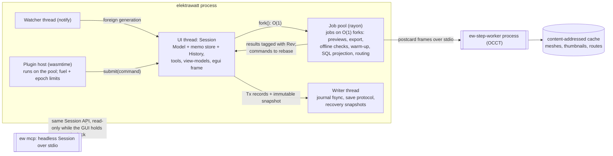
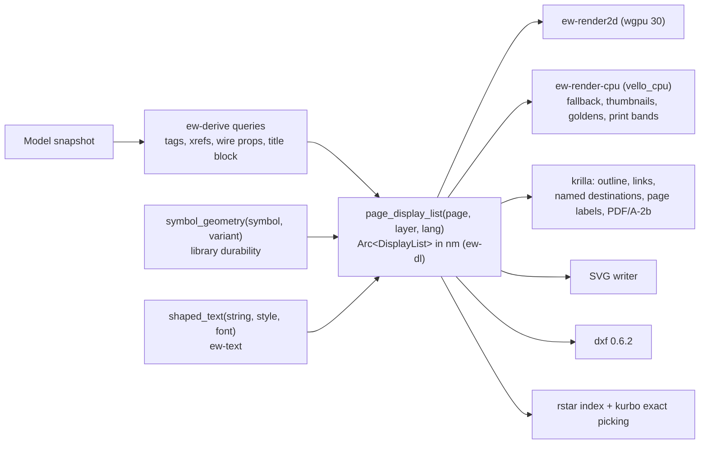

# ElektraWatt architecture specification

**Status:** Accepted · Amended 2026-10-25, cycle 28: accepted implementation and scoped follow-ups (ID-659 to ID-666); delivery validation pending; merged references/raster validation and accepted window corrections recorded; scoped Windows window checks passed; full gates/hosted pending. · amended 2026-10-18, 2026-10-20 (G-SP outcome, §6.1 to §6.4; save order, §7.4; the memo engine as built, §2, §6.2, §6.4; incremental connectivity as built, §3, §6.3, §6.4), 2026-10-21 (orphan-collection retention, §6.2; the check engine and the prevent hook as built, §3, §5, §6.4); 2026-10-21, cycle 13 (`ew-plcaddr` v0 and `ew-sqlview` v0 as built, §3); 2026-10-22, cycle 18 (a known breach of the undo law, FT-316, §13); 2026-10-22, cycle 19 (the breach closed by the delete-time rule EW-INV-021 and the two apply paths, §4.6, §5.3, §13; the application shell as built, §3, §9); 2026-10-22, cycle 21 (the canvas's CPU tile path as built, §3, §8.2, §9; the transaction-read rule, §5.2); 2026-10-22, cycle 22 (the canvas's GPU path as built, §3, §8.2, §9; the tool framework specified, §5.4, §9); 2026-10-23, cycle 23 (asset reads and the read gate, §3 rule 1; a transaction's assets, §5.2; the viewer as built and WP-S2.04's tool rules, §5.4, §9); 2026-10-24, cycle 24 (the `ew-api` edges to `ew-units` and `ew-mltext` made normal for WP-S2.05, §3; the tool framework as built, §5.4, §9; `#ew-fragment v1` as the project-fragment format, §5.5; the property grid's chip text, §9; the asset-presence guard as built, §3 rule 1, and usvg in `ew-scene`, §3); 2026-10-24, cycle 25 (the first committing tools and the property grid as built, §9); 2026-10-24, cycle 26 (the regex edge of `ew-api`, zune-jpeg in `ew-render-cpu` and krilla's raster images, §3; the wiring tools and find and replace as built, §9); 2026-10-25, cycle 27 (the fragment format as built, §5.5; the shell as built in cycle 27, §9) · **Date:** 2026-10-17 · **Decided by:** chief architect, after a judge
panel over four competing proposals (A incremental, B ECS, C relational, D retained/object model)
**Scope:** ElektraWatt (EW) v1:
- Electric P8-class schematics;
- PLC and I/O;
- fluid power;
- 3D panel layout with routing and wire lengths;
- manufacturing outputs;
- QET, EPLAN (EDZ) and DXF import.

Fixed constraints: Rust, open source, 2–4 developers, cross-platform offline-first desktop.

> **Conventions.**
> - "Golden project" means the reference project J-E-2416 ([reference-drawing.md](../research/reference-drawing.md) §4).
> - D-nn are the reference set's defects ([reference-drawing.md](../research/reference-drawing.md) §3).
> - G-n and C-n are items in [gaps-and-corrections.md](../research/gaps-and-corrections.md), which overrides the other research notes.
> - Crate versions come from the research notes. **(verify)** marks a version or API not confirmed there.
> - Performance figures are **estimates**, to be confirmed by the performance spike, gate G-SP of the plan (§15).
>
> This document follows the public-repository rules: it names no customer, end user, project reference, drawing
> id, person or company.

---

## 0. Decision summary

**Decision.** EW is built on **proposal A, "model-first, incremental computation", amended**. Its core:
- a typed Rust domain model held in persistent immutable maps (`imbl`) is the single source of truth;
- every edit is a transaction of typed operations;
- everything printed is a **derived query**.

**The amendments.** We graft the strongest ideas of B, C and D onto A and fix every weakness the judges raised
about A (Appendix A). The four that matter most:
1. **The incremental engine is cut down.** v1 starts with **cold queries** and adds a small in-house memo layer
   (`ew-memo`) only where profiling demands it. It drops parallel fork evaluation and memo merge-back. Salsa is not
   used.
2. **C's best idea becomes a derived artefact.** A **read-only SQL projection** of the model (SQLite in memory,
   versioned `api_v1_*` views) gives users SQL-defined reports and rules. It also serves MCP agents, acceptance
   tests and Excel round-trips. It is never the source of truth.
3. **The licence boundary is a closed lower layer.** Permissive format, schema, IR and importer-API crates never
   depend on GPL code. Importers emit format-level records (B), so third parties can read, write and import EW
   projects without GPL code.
4. **Storage is JSON Lines (C).** Each entity is one line, rows are sorted by the ID's random bits, and the manifest
   is written last. The other storage grafts are B's in-file conflict records and D's yearly format-change window
   and supply-chain controls.

| Layer | Choice |
|---|---|
| Core model | Plain Rust record structs in `imbl::OrdMap` tables; O(1) snapshots; UUID identity |
| Derived data | Pure query functions over a tracked-read context; cold first, `ew-memo` memoisation where profiled; oracle mode |
| Edits | `Command → Transaction(Vec<Op>)`; ops hold before/after rows; project-wide undo; preview = fork |
| Persistence | UUID-named JSONL project directory, sharded by the ID's last byte, manifest-last save, journal outside the project |
| Query/SQL surface | Read-only SQLite projection (`api_v1_*` views), sandboxed, for user reports, rules, MCP and tests |
| UI | egui/eframe 0.37 behind `ew-ui`, over a toolkit-agnostic `ew-viewmodel` |
| 2D rendering | One display-list IR (`ew-dl`); wgpu canvas plus an always-built vello_cpu path; krilla PDF/A-2b |
| 3D / CAD | Own wgpu 3D renderer; parry3d; out-of-process OCCT STEP worker (occt-sys / opencascade) |
| Extensibility | `ew` CLI, rhai (v1), WASM components on the wasmtime LTS line current at plugin launch (v1.x), MCP off by default, Python wheel (v1.x) |
| Licensing | App GPL-3.0-or-later with a plugin exception; permissive lower layer MIT OR Apache-2.0 (owner decision) |

**Why A rather than C** (the scores tied 22–22; §17 has the detail):
- C's distinctive strengths can be grafted onto A as a derived SQL projection. A's cannot be grafted onto C:
  freshness by construction, in-memory editing of plain Rust structs, O(1) snapshots, the Representation entity.
- C carries a conditional fatal flaw on the QET migration path: SQLite `UNIQUE` and `CHECK` constraints cannot be
  deferred, so projects containing D-11 and D-12 could not be staged.
- Cutting down A's engine removes its main delivery risk; the feasibility judge rated the cut-down A as "nearly
  equivalent in risk" to C.

---

## 1. Guiding principles and the core idea

### 1.1 Core idea

The worst defects in the reference set share one root cause: **a value that should have been computed was stored
as a copy, and the copy went stale.** Examples:
- -4W1 vs -3W1 (D-01);
- T51 vs T55 (D-02);
- "1"/"V1"/"V1.0"/"V2.0" (D-05);
- the folio 101 description (D-06);
- "if not indicated, standard size" (D-08);
- 5 vs 4 valves (D-10).

EW removes that root cause from the architecture:
- **A project is an immutable value:** typed tables of plain Rust structs in persistent maps, cloned in O(1).
- **The value changes only through a transaction of typed operations.** That transaction is also the undo record,
  the journal entry, the macro step and the diff.
- **Everything else is a query over that value:** tags, cross-references, nets, potentials, effective wire
  properties, title blocks, TOC, BOM, terminal and PLC reports, layout labels, check messages and display lists.
  A derived value cannot go stale, because no stored copy exists.

Immutability also makes the expensive features cheap:
- background PDF export on a consistent snapshot;
- "preview before commit" for a 10,000-tag renumber;
- crash journalling;
- semantic git merges;
- before/after change lists for manufacturing.

### 1.2 Principles

1. **Store intent, derive presentation.** Only facts a human decided are persisted. Every string printed on a page
   is a query result.
2. **Derived by default, frozen on purpose.** Identifiers that leave the building (tags, wire numbers, PLC
   addresses, routed lengths) may be explicitly frozen, for example at release. A check reports every frozen value
   that deviates from its rule (§6.5).
3. **One writer, many readers.** GUI, CLI, rhai, importers, WASM plugins and MCP agents edit only through
   `Command → Transaction → Op`. Readers get lock-free snapshots.
4. **Identity is a UUID, never a tag.** Every reference is an `Id<T>`. Tags, folios and wire numbers are
   properties.
5. **Typed, not property bags.** There is one Rust record struct per entity kind. Multi-role devices get optional
   typed aspects (§4.3). User-defined properties and unknown fields go into `extra` maps. There is no EAV model.
6. **Cold first, cached where measured.** Queries are plain functions. Memoisation is an optimisation added per
   query when profiling shows the need, and an oracle verifies it (§6).
7. **Headless first.** Model, queries, commands, checks, reports and PDF all run without a GUI. The golden
   project's PDF is produced by the CLI before any interactive canvas exists (§15).
8. **Determinism everywhere.** Ordered maps, integer nanometres, fixed-point electrical quantities and ID
   tie-breaks: the same model gives the same bytes, the same check findings and the same PDF.
9. **Permissive bottom, GPL top.** The schema, format, IR and importer contracts are permissive and closed under
   their dependencies (§3).
10. **Prove it in CI.** Oracle differential tests, shuffle-order determinism, golden outputs and performance and
    memory gates run from the first month (§13).

---

## 2. Process and thread model



| Actor | Responsibility and rules |
|---|---|
| **UI thread** | Owns the `Session`: the current `Model`, the memo store, `History`, selection and tools. Applies commands synchronously and runs the queries the visible panels need. **Frame budget 16 ms:** apply plus validation ≤ 2 ms, derived updates of visible views ≤ 5 ms, render ≤ 5 ms. Commands declared `Cost::Bulk` always run as preview jobs. The `Session` is not `Send`: its memo store is re-entrant through shared interior state (ADR-0002 amendment 5), so it never leaves this thread; jobs receive forks |
| **Job pool** (rayon 1.12.0 **(verify)**) | Each job runs on a `World` fork, a (model, memo snapshot) pair cloned in O(1). Jobs never block edits and are never invalidated by them. Results carry their `Rev`, and the UI shows a staleness badge when `Rev < current`. Cancellation is cooperative |
| **Writer thread** | Serialises immutable snapshots with the save protocol (§7.4). Appends the journal and fsyncs at least once per second. Writes recovery snapshots to the OS state directory. Saving never blocks the UI |
| **Watcher** (notify 8.2.0) | Detects git pulls and foreign writes, ignoring its own by manifest generation. A foreign generation is loaded on the pool, diffed entity by entity, and offered as one undoable "External change" transaction (§7.4) |
| **Plugin host** | The wasmtime LTS line current at plugin launch; development runs on the 48.x LTS line (49.0.3 is current). Plugins read through query handles on a snapshot and write only by submitting commands |
| **`ew-step-worker`** | Out-of-process OCCT via occt-sys 7.8.1 + opencascade 0.3.0 (LGPL-2.1, C-5). Supervised with timeouts and restart. Results are cached by `sha256(file) + worker_version`. A crash or a pathological vendor file cannot touch the model |
| **MCP** | `ew mcp` opens the project headless with the same `Session` API, read-only while the GUI holds the lock. A GUI "live bridge" with ask-first writes follows in v1.x (G10) |

*As built (cycle 15; decision log ID-362, ID-363).* No job pool exists yet. The first job, the page-output export of `ew-api` (`ew_api::output`, FT-59), is synchronous: phase 1 (page order, selection, the memoised layers of every page) runs on the session's thread because the `Session` is not `Send`, the page phase runs on `ew_export::par_map` (scoped `std` threads, results by page index), and the writer follows with the bundled fonts of `ew-text` (a normal edge since FT-59, like the one to `ew-dl`; decision log ID-369). `ew-jobs` is an empty stub; the `World` fork with progress and cooperative cancel (NFR-PERF-19) is FT-251, and it needs a memo snapshot in the fork.

**The job model has no memo merge-back.** This is deliberately simpler than proposal A.
- **What a job receives.** A job gets the model plus a **read-only** snapshot of the memo store, both `imbl` and
  O(1).
- **Where its results go.** Results the job verifies or computes go to a **job-local overlay**, which is dropped
  when the job ends.
- **The one exception: adopt-if-unchanged.** If the main memo store is still pointer-equal to the job's base when
  the job finishes, and the revision has not moved, the session adopts the job's store in O(1). This is used for
  the warm-up after open and for full checks run while the user is idle. Any other outcome discards the overlay.
- **Parallel work inside a job.** The job evaluates global queries once, sequentially (page order, stitch graph,
  potential partition). Only then does it fan out with rayon, giving each thread its own overlay.
- **What this design does not need.** There are no sharded locks and no memo revalidation across revisions.

**A job's model changes return as commands.** An importer, plugin or routing job hands back a command or a
prepared transaction together with its read set:
- if no key in that read set has changed since the job's revision, the session applies it;
- otherwise the session re-runs the deterministic command on the current snapshot (optimistic rebase).

**Panics.** The panic strategy is [quality, security and release](18-quality-security-release.md) §12.3. Release
builds keep `panic = "unwind"`:
- on job-pool threads (importers, rhai, SQL, checks, exports, report pagination) the panic is caught by the job's
  `catch_unwind`, so the job fails with a report while the model stays unchanged and the session keeps running
  (NFR-REL-12);
- on every other thread (UI, writer, commit pipeline) the hook asks the writer thread to flush the journal and then
  aborts; the next start offers recovery (NFR-REL-13).

**Platforms.**
- Windows 10 22H2+ and 11 (x64);
- macOS on Apple silicon, with Intel as best effort (Rust Tier 2);
- Ubuntu 22.04+ and Debian 12+, on Wayland and X11.

wgpu runs on DX12, Vulkan or Metal. DX12 WARP and the always-built CPU renderer (§8) cover GPU-less RDP and VDI
sessions (G6).

---

## 3. Crate and workspace layout

**Licence layering.**
- The **permissive layer** (MIT OR Apache-2.0) is closed under dependencies: no permissive crate depends on a GPL
  crate, and CI enforces this (§13).
- Everything else is **GPL-3.0-or-later** with the plugin exception (ADR-0025).
- `ew-import-qet` may contain ported QElectroTech code (GPL-2.0-or-later). It is therefore excluded from the plugin
  exception, and plugins never link it (C-8).
- **MSRV by layer** (2026-10-19, decision log ID-141). The declared `rust-version` 1.85 binds the permissive crates,
  which the MSRV job builds ([18](18-quality-security-release.md) §6.2). GPL application crates need only the pinned
  toolchain: `ew-export`, `ew-render-cpu` and the crates that depend on them declare 1.92 (krilla 0.8.2 needs 1.92,
  vello_cpu 0.3.0 1.89, parley 0.12.0 1.88). As applied: `ew-export`, `ew-render-cpu`, `ew-api`, `ew-print`,
  `ew-testkit`, `ew-ui`, `ew-viewmodel`, `elektrawatt` and `ew` (decision log ID-183).

| Crate | Layer | Responsibility | Key dependencies |
|---|---|---|---|
| `ew-units` | P | `Nm(i64)`, `Pt2`, `Rect`, rational `Grid{num,den}`, `Orient2` (8 variants), `Angle2(i32)` (10⁻³ degree; free texts and graphics only), `Pose3` (nm + quaternion rounded to 1e-9), fixed-point `Dec3` (mm², A, V) | serde 1.0.229; kurbo 0.13.1 and glam 0.34.1 conversions behind features |
| `ew-ids` | P | `Id<T>`: UUIDv7 for new records, UUIDv5 for instantiated, imported and generated ones; per-session `u32` interner | uuid 1.28.0 |
| `ew-mltext` | P | `MlText` with EPLAN neutral-xor-languages semantics, BCP 47 `LangTag`, NFC, confusable detection, natural-sort keys | unicode-normalization 0.1.26, unicode-security 0.1.2 |
| `ew-rds` | P | IEC 81346 parser and formatter (strict and lenient); identifier sets as data: EN 81346-2:2009 single letters (default), IEC 81346-2:2019, IEC 60750 legacy. Node codes are atomic tokens: parsing first matches the longest known node code or alias of the aspect and only then splits at prefix characters, so `+J-E-2416` stays one code | serde |
| `ew-schema` | P | **The persisted record type of every entity kind** (plain serde structs), kind registry, per-kind schema versions, JSON Schemas | serde, schemars 1.2.3 |
| `ew-format` | P | JSONL canonical reader and writer, sharding rules, manifest, upgrade chain on `serde_json::Value`, 3-way record merge core, conflict records | serde_json 1.0.154, semver 1.0.28, sha2 **(verify)** |
| `ew-interop-api` | P | `Importer`/`Exporter` traits over `ew-schema` records: `ImportBatch`, `ImportReport`, `SourceRef`, `TableImage`, `Proposal` (§10.6) | ew-schema, ew-ids; sha2 (input digest) |
| `ew-dl` | P | Display-list IR: paths, glyph runs, images, groups, symbol instances, link sources and targets, entity tags; `ShapedRun` carries its `layout_box`; own hashable colour type (no peniko: renderer crates convert) | kurbo 0.13.1, libm 0.2 (deterministic trigonometry), uuid; re-exports `ew_units` for renderers and writers (rule 7) |
| `ew-step-proto` | P | STEP worker IPC contract and cache format | postcard 1.1.3, rkyv 0.8.18 |
| `ew-memo` | P | Generic memo engine: revisions, dependency recording, early cut-off, durability levels, LRU, statistics, oracle hooks, and a generic reverse-dependency API per query family. Knows nothing about ECAD. Not published to crates.io until it has two owners; v1 implemented (WP-S1.05); G-SP outcome Recycle (2026-10-20): push invalidation from touched inputs, O(1) hits, nested memos through a `Q` backend, value bytes and an incremental re-execution hook join v1 (ADR-0002 amendment 4, §6.1, §6.2) | imbl 7.0.2 (MPL-2.0+), smallvec 1.16.3, tracing 0.1.44 (statistics events, ADR-0002 decision 4); dev: proptest |
| `ew-plcaddr` | P | `PlcAddress`, PLC address profiles as data, the address-grammar engine, bit intervals; v0 (cycle 13, decision log ID-333): `PlcAddress` (area, size, byte, bit), `AddressProfile` with the built-in `siemens-tia-intl@2027.1`, `AreaIntervals` for unit allocation and `MapExpr`, the `k*n+c` language of part maps; MIT OR Apache-2.0 like every P crate, so it stays below the licence boundary (rule 3) and importers may use it (rule 4) | —; dev: proptest |
| `ew-caex` | P | CAEX 2.15/3.0 model and `ExchangeImage` | quick-xml 0.42.0 |
| `ew-devdesc` | P | Device descriptions: GSD, GSDML and IODD (ESI and EDS at 1.x) | quick-xml |
| `ew-ewpp` | P | `.ewpp` record types, JSON Schemas, reader, writer and package diff | zip 9.0.4, csv 1.4.0 |
| `ew-plugin-wit`, `ew-plugin-sdk` (v1.x) | P | WIT package `elektrawatt:plugin` and the guest SDK with typed bindings generated from the JSON Schemas | wit-bindgen 0.63.0 |
| `ew-model` | GPL | `Table<T>` of `ew-schema` records, the `Model` snapshot, `Op` apply and invert, base reverse indexes, structural invariants, link delete policies; the raw read API only behind the `raw-read` feature (rule 1) | ew-schema, ew-ids, ew-units, ew-mltext, ew-rds; imbl 7.0.2, smol_str 0.3.6 **(verify)** |
| `ew-rhai` | GPL | rhai engine configuration plus the formula and rule profiles (pure, tracked reads, operation limits) | rhai 1.26.1 |
| `ew-derive` | GPL | All domain queries (§6.4), the tracked-read context `Q` and its memo backend `MemoStore` | ew-memo, ew-model (enables raw-read), ew-rhai, ew-plcaddr, ew-schema, ew-ids, ew-units, ew-mltext, ew-rds; imbl 7.0.2 (MPL-2.0+; the persistent maps of the partition and the index families, ADR-0002 amendment 6), serde, serde_json, toml (the shipped derivation profiles in profiles/, §6.6); dev: ew-commands (agreement tests of the numbering rules; listed under `[allowed_dev_edges]`); later: icu **(verify)** |
| `ew-commands` | GPL | `Command`, `DynCommand`, `TxBuilder`, normalisers, validators, numbering engine, `History`, previews, macros, `ApplyImport` | ew-derive, ew-model (enables `raw-read`), ew-schema, ew-ids, ew-units, ew-mltext, ew-rds; serde, serde_json, schemars 1.2.3, sha2 (the lineage hash of `library.embed`, cycle 16); dev: ew-ids/testkit, proptest, and ew-commands itself with its `testkit` feature (the crate's own integration tests; the dev-only self edge is listed under `[allowed_dev_edges]` in `ci/dep-rules.toml`) |
| `ew-checks` | GPL | Rule engine, rule packs, the `RuleImpl` trait and registry (Rust and rhai rules implemented here), online checks as queries, offline check jobs, waivers, quick fixes; v0 (cycle 12, decision log ID-305): Rust rules, the shipped schemes, the memo family `check_findings`, waivers by fingerprint and the prevent entry that `ew-api` installs | ew-derive, ew-rhai (declared, not used yet), sha2, serde_json; dev: ew-model (snapshots for the rule tests, no `raw-read`); later: toml 1.1.8, fluent-bundle 0.16.0 |
| `ew-sqlview` | GPL | Read-only SQL projection: materialisation, `api_v1_*` views, sandbox, `ew_natural` collation; the SQL rule implementations registered into `ew-checks`; v0 (cycle 13, WP-S1.10, decision log ID-328): thirteen views, the sandbox and `ew sql`, no SQL rules yet; GPL, above the licence boundary, like every crate that links rusqlite (rule 2) | rusqlite 0.40.2 (`bundled`, `functions`, `hooks`, `limits`; as built (WP-S1.10) also `collation` and `serialize`, the read-only deserialised copy per consumer), ew-derive (and through its re-exports ew-schema, ew-mltext, ew-rds; rule 7), ew-checks; serde_json |
| `ew-library` | GPL | Parts, symbol, form and macro libraries as canonical `.ewlib` text directories at every tier (system, community, company, user); one derived SQLite FTS5 index per user in the cache; embedding used items into projects (§7.7) | ew-format, rusqlite 0.40.2 |
| `ew-store` | GPL | Save protocol, `.~ew.lock`, journal, recovery, watcher, external-change diff, `.ewz` transport, as-built archive, git commits and tags; v0 (WP-S1.09) has the save protocol with roll-forward, the lock, the journal and the `Vfs` seam ([05](05-project-format-and-persistence.md) §5 to §8, ADR-0010 amendment 3) | ew-format (and, through its re-export, ew-schema; rule 7), ew-model (enables `raw-read`), serde_json; later: notify 8.2.0, zip 9.0.4, gix 0.89.0, etcetera or directories **(verify)**, ew-sysprobe on Windows and macOS (FT-89) |
| `ew-sysprobe` (planned, FT-89) | GPL | The only `unsafe` FFI of the core path, on the `unsafe` allowlist ([18](18-quality-security-release.md) §11.2): process liveness and start time for the stale-lock rule ([05](05-project-format-and-persistence.md) §7.4) and the peak resident memory of the performance gate (NFR-PERF-13); `ew-store` and `ew-testkit` keep `forbid(unsafe_code)` and call it through `ProcessProbe` | windows-sys (Windows), libc (macOS, Linux); both MIT OR Apache-2.0 and already in the lockfile (decision log ID-216). Node and edges join the graph and `ci/dep-rules.toml` with FT-89 |
| `ew-text` | GPL | Fonts and the memoised `shaped_text` query: one text stack for screen, pagination and paper | ew-dl, ew-units; parley 0.12.0, fontique 0.12.0, skrifa 0.44.0, harfrust 0.12.0 (through parley), sha2 0.10.9 |
| `ew-reports` | GPL | Report-kind registry and row queries (`report_rows`), arrangement (manual selection, typed filters, natural sort, grouping), pagination into generated pages (`report_block_pages`), the report engine that `page_order` calls through `ReportPagesProvider` (decision log ID-126), value rendering; user SQL reports through the sandboxed query API of `ew-sqlview` (1.0, never links rusqlite); XLSX and CSV tables (FT-61) | ew-derive (and through its re-exports ew-schema, ew-ids, ew-mltext, ew-units; rule 7), ew-sqlview, ew-text; serde_json (the provisional profile members of the project settings, read by `profile_tables`); dev: ew-model (snapshots for the row-query tests, no `raw-read`), proptest; later: rust_xlsxwriter 0.100.0, csv 1.4.0 |
| `ew-scene` | GPL | Model to display lists per page and layer, forms engine (frames, title blocks, report forms), text through `ew-text`, spatial index, hit-testing; PDF underlays (1.0); page layers as pure functions of a caller-filled `PageView` (rule 7) and the provisional orthogonal router `route` (decision log ID-137) | ew-reports, ew-dl, ew-text; ew-schema (symbol lowering reads `SymbolDef` records by reference), ew-units, ew-ids, ew-mltext; serde_json; rstar 0.13.0, hayro 0.8.0 (underlays, 1.0); usvg 0.48.1 (pinned `=0.48.1`, default features off; Apache-2.0 OR MIT for this version; with svgtypes 0.16.1, simplecss 0.2.2, data-url 0.3.2, imagesize 0.15.0 and pico-args 0.5.0, about 279 KB, no build scripts; SVG assets as `ew-dl` paths, cycle 24, FT-384, decision log ID-605); the `ew-reports` edge is declared for report forms and not used yet; dev: sha2, insta 1.49.0, proptest |
| `ew-render2d` | GPL | The canvas renderer, toolkit-neutral (no egui): wgpu 2D renderer (lyon tessellation once per symbol, instancing, screen-space lines; glyphs as tessellated outlines into an offscreen MSAA texture, ADR-0015 amendment 10) and the CPU tile path over `ew-render-cpu`. *As built (cycle 21, WP-S2.02 part 1; decision log ID-517):* `view`, `tiles` (the 256-pixel tile pyramid, its planner and LRU cache), `pool` (the raster workers), `overlay` (page bounds, grid dots, highlight outlines and their compositing for the headless snapshot) and `stats` (frame statistics and the one clock). *As built (cycle 22, WP-S2.02 part 2; decision log ID-539, ID-540):* `gpu`, the wgpu path (scene preparation on a worker, lyon meshes keyed by content, one WGSL file, the offscreen 4× MSAA texture resolved into a pane-sized `Rgba8Unorm` texture, the switch rule as `gpu::choose`, `pub use wgpu`); the crate declares `rust-version = "1.95"` | ew-dl, ew-render-cpu (the edge since cycle 21, ID-510); wgpu 30.0.1 (one backend set per operating system: DX12, Metal, or Vulkan with GL), lyon_tessellation 1.0.22 with lyon_path, lyon_geom and float_next_after (cargo-vet exemptions until FT-326, ID-543); kurbo and skrifa already in the graph |
| `ew-render-cpu` | GPL | vello_cpu renderer: GPU-less fallback, thumbnails, golden PNGs, banded printing; since cycle 26 (FT-406, decision log ID-636) `decode_image`, the one PNG and JPEG decoder of the screen, PDF and SVG paths (bounded by `MAX_IMAGE_PIXELS`, inside `catch_unwind`, a JPEG needs its EOI marker, ID-637) | ew-dl; vello_cpu 0.3.0 (default features off: `std`, `text`, `u8_pipeline`; `Level::baseline()`), png 0.18.1, zune-jpeg 0.5.15 (pinned `=0.5.15`, default features off, `std`; a direct edge since cycle 26, no new package); dev: ew-text, ew-units, sha2 |
| `ew-export` | GPL | PDF (as built: PDF/A-2b with outline, `/PageLabels`, named destinations, link annotations and subset fonts; ADR-0015 amendments 5 to 7), SVG (as built in cycle 14 with no new dependency, the page phase on `par_map` with scoped std threads instead of rayon; decision log ID-344, ID-345), DXF, PNG (through `ew-render-cpu`) | ew-dl, ew-render-cpu; krilla 0.8.2 (default features off; since cycle 26 `raster-images` for PNG and JPEG image items, which brings gif 0.14.2, image-webp 0.2.4, imagesize 0.14.0 beside usvg's 0.15.0, and color_quant 1.1.0, four audited packages; krilla's `Image::from_gif` and `Image::from_webp` are disallowed methods; FT-406, decision log ID-636); later: krilla-svg 0.8.1, dxf 0.6.2; dev: ew-text, ew-units, sha2, uuid, png |
| `ew-print` | GPL | OS print adapters with per-OS features (§8.4) | ew-export, ew-render-cpu |
| `ew-plc` | GPL | Exchange orchestration, merge and writers: AML AR APC (CAEX 2.15 write, 2.15 and 3.0 read, through `ew-caex`), the TIA "PLC Tags" XLSX exporter and importer, PLCopen XML; rack and slot logic | ew-plcaddr, ew-caex, ew-devdesc, quick-xml 0.42.0, calamine 0.36.1 |
| `ew-panel` | GPL | Layout queries, collision reconciler, routing graph, negotiated-congestion routing, lengths, duct fill, 2D panel projection; glTF (glb) and STL writer for `layout_scene` | parry3d 0.31.1, pathfinding 4.16.0, petgraph 0.8.3, glam 0.34.1, gltf-json **(verify)** |
| `ew-render3d` | GPL | wgpu 3D: instancing, feature edges, transparency, CAD camera, picking; a toolkit-agnostic camera, pick and constraint API that `ew-ui`'s gizmo drives (Rule 3) | wgpu 30.0.1, meshopt 0.7.0 |
| `ew-mfg` | GPL | Production package content, wire lists with lengths, ferrules, labels, data-driven machine and label profiles | ew-panel, ew-ewpp, zip, csv, rust_xlsxwriter |
| `ew-import-qet`, `ew-import-eplan`, `ew-import-dxf` | GPL | QET `.qet`/`.qetz`; EDZ (7-Zip and ZIP), EPLAN XML/XLSX; DXF (DWG behind a feature) | roxmltree 0.21.1, quick-xml, ew-schema, ew-units, ew-ids, ew-mltext (QET: records and value types, [14](14-interop.md) §4.3); sevenz-rust2 0.24.0, zip, calamine, csv (EPLAN); dxf 0.6.2, acadrust 0.6.4 (MPL-2.0) |
| `ew-import-catalog` | GPL | Parts from CSV/XLSX (MVP), BMEcat and ETIM xChange (1.x), behind `ew-interop-api` | csv, calamine, quick-xml |
| `ew-import-tables` | GPL | The golden CSV bootstrap behind `ew import csv`, the round-trip table reader and translation tables; reused by `ew-testkit`; the bootstrap importer TablesImporter reads a directory of tables (ADR-0021 amendment 6) | ew-interop-api, ew-schema, ew-units, ew-ids, ew-mltext, ew-rds (as ew-import-qet); serde, serde_json, sha2; an own bounded RFC-4180 reader (no csv crate yet); later: csv, calamine (round-trip reader) |
| `ew-script`, `ew-plugin-host` | GPL | rhai automation bindings over queries and commands (profile from `ew-rhai`); WIT world and host on the wasmtime LTS line current at plugin launch (48.x in development), plugin export roles (§10.4), plugin rule implementations registered into `ew-checks`, the `secret-get` capability (v1.x) | ew-rhai; wasmtime LTS, wit-bindgen 0.63.0 |
| `ew-jobs` | GPL | Scheduler, progress, cancellation, staleness tagging, adopt-if-unchanged; an empty stub so far: the export job of `ew-api` (FT-59) is synchronous and runs its page phase on `ew_export::par_map` (decision log ID-362; FT-251) | rayon |
| `ew-api` | GPL | The `Session` facade shared by every front-end; registers the SQL and plugin rule implementations at session start; composes `.ewpp` export jobs from `ew-mfg` data, `ew-export` PDF/DXF and `ew-panel` glb; the page-output export job (cycle 15, FT-59: the page views, one memoised `page_display_list` family per layer, PDF and SVG)  dev: ew-commands/testkit, ew-derive, ew-model/raw-read, ew-render-cpu, ew-ids, ew-units, ew-mltext, png, sha2, insta (the page-output goldens of WP-S3.04), ew-testkit (the acceptance runner builds AC-15 path (b) with the builder DSL, cycle 15); | v0: ew-commands, ew-checks (the shipped prevent hook, `Session::check` and the migration scheme on imports, decision log ID-306, ID-312), ew-derive (normal edge: the Session surfaces derivation findings, tracked reads only), ew-reports (the Session installs the report engine on every `Q`, decision log ID-126), ew-model, ew-schema (no `raw-read`), ew-scene and ew-export (the export job), ew-text (the bundled fonts it shapes with and embeds) and ew-dl (the layer types; normal edges since FT-59), ew-units and ew-mltext (normal edges since cycle 24, dev edges before: the property grid's field parser and formatter of WP-S2.05 part 1 name the integer value types and the multi-language text, decision log ID-600), and from WP-S2.05 part 2 the external crate regex 1.13.1 (`Session::find`; default features off, `std`, `unicode-case`, `unicode-perl`; at the lockfile's version, so no new package in `Cargo.lock`, but a runtime edge that brings `regex`, `regex-automata` and `regex-syntax` into the shipped graph, 288 to 291 packages in `cargo tree -p elektrawatt`, decision log ID-634; with `aho-corasick` they are `safe-to-deploy` exemptions the owner confirms, FT-435); dev: ew-commands/testkit, ew-derive, ew-model/raw-read, ew-render-cpu, ew-ids, png, sha2, insta (the page-output goldens of WP-S3.04); eventually everything above except UI |
| `ew-viewmodel` | GPL | Toolkit-agnostic panel models: navigator trees, table rows with edit→command mapping, property-grid rows with provenance, message lists, each with a revision stamp; the toolkit-neutral action definitions and the shell model that the GUI and the headless mode `elektrawatt --headless` both dispatch on (decision log ID-443, ID-444); as built in cycle 19: the registry, `ShellModel`, the settings file, the UI-script runner and the `ui.describe` text (ID-473, ID-474) | ew-api |
| `ew-ui` | GPL | egui widgets, canvas host, tools (state machines; specified for WP-S2.03: the tool host and the tools in `ew-viewmodel`, `ew-ui` maps input and paints, decision log ID-536), command palette, keymaps, the action registry behind every menu, the 3D transform gizmo over `ew-render3d`'s camera and pick API; as built in cycle 19: the shell frame, the CPU page view with its render worker, the palette, the bundled UI fonts and the headless runner (ID-473) | egui 0.37.0, egui_tiles 0.17.1, egui_table 0.10.0, egui_ltreeview 0.9.0, transform-gizmo-egui 0.11.0 (in cycle 19: egui 0.37.0 and skrifa 0.44.0 only; egui_kittest 0.37.0 for tests) |
| `ew-viewer` (1.0) | GPL | The read-only `.ewpp` wiring viewer on `ew-ui` widgets, used by the `ew-wiring-viewer` binary and the "Preview package" view of the Manufacturing workspace | ew-ewpp, ew-ui, ew-render-cpu, hayro 0.8.0 (after the fidelity check) |
| `elektrawatt` (bin) | GPL | eframe shell, native menus on macOS and Windows (egui menu bar on Linux), dialogs, clipboard, crash handler; as built in cycle 19: the window, the rfd dialogs, `--headless`, `--smoke` and the exit codes, with the egui menu bar on every OS (ID-446, ID-473) | eframe 0.37.0, egui-wgpu 0.37.0, muda 0.21.2, rfd 0.17.2, arboard 3.7.0, ew-print (in cycle 19: eframe 0.37.0 on wgpu and rfd 0.17.2 only; `rust-version` 1.95, ID-477) |
| `ew` (bin) | GPL | CLI, `ew mcp`, merge driver, textconv, migration verifier | clap **(verify)**, rmcp 3.5.1 **(verify)**, ew-print, hayro 0.8.0 (`ew verify-migration`), serde_json (a normal dependency since cycle 22, for the `HumanOnly` subcommand's command value; decision log ID-546) |
| `ew-wiring-viewer` (bin, 1.0) | GPL | Small read-only viewer for shop PCs | ew-viewer |
| `ew-step-worker` (bin) | GPL (links LGPL OCCT) | STEP reading, tessellation, feature edges, hulls, mounting frames | occt-sys 7.8.1, opencascade 0.3.0, gltf 1.4.1 |
| `ew-testkit` | GPL | Golden builders (CSV bootstrap through `ew-import-tables`, command DSL), S–XL and XL-A generators, oracle comparator, acceptance runner; the seeded S–XL generator ew_testkit::synth and the cold-operation benchmark harness ew_testkit::bench (WP-S1.05); the G-SP spike bench (`benches/spike.rs`) | ew-model, ew-schema, ew-ids, ew-units, ew-mltext, ew-rds (the generator); ew-import-tables (golden builders, allowed edge); serde, serde_json (the builder DSL speaks the JSON parameters of the commands through a `CommandSink` the caller implements over its `Session`, so the edges to ew-api and ew-commands stay dev-only; cycle 15); dev: ew-api, ew-commands with testkit, ew-ids with testkit, ew-derive (the spike measures the connectivity families cold and through `ew-derive`'s `MemoStore`, which is how it reaches `ew-memo`: there is no direct edge to `ew-memo`; decision log ID-223, ID-263), serde_json; later: insta 1.49.0, proptest 1.12.0, dify 0.8.0, hayro 0.8.0 (test use); criterion 0.8.2 only as a front end of the nightly performance gate (NFR-PERF-20). Dev-only everywhere: no crate may take it as a normal dependency. |
| `ew-py` (v1.x) | GPL | Python wheel of the headless core | pyo3 0.30.1 |

`xtask` and `fuzz/` are development-only and outside the product crate table; they never ship in release artefacts.
`xtask` is permissive and links no GPL crate: `cargo xtask docs-gen` (cycle 16, decision log ID-403) reads the committed
parameter schemas of `ew-commands` and the rule-catalogue snapshot `crates/ew-checks/catalogue/rules.json` as files,
and an `ew-checks` test keeps the snapshot equal to the registry. The user guide's other tool, mdBook, is a pinned
binary of the `docs-book` CI job, not a crate ([18](18-quality-security-release.md) §5.5).

Arrows point from a crate to its dependencies; dotted arrows are dev-dependency edges (`[allowed_dev_edges]` of `ci/dep-rules.toml`), and the dev-only self edge of `ew-commands` is not drawn:

```mermaid
graph TD
  subgraph PERM["Permissive layer: MIT OR Apache-2.0"]
    units[ew-units]
    ids[ew-ids]
    mltext[ew-mltext]
    rds[ew-rds]
    schema[ew-schema]
    format[ew-format]
    iapi[ew-interop-api]
    dl[ew-dl]
    stepp[ew-step-proto]
    memo[ew-memo]
    plcaddr[ew-plcaddr]
    caex[ew-caex]
    devdesc[ew-devdesc]
    ewpp[ew-ewpp]
    pwit["ew-plugin-wit / -sdk (v1.x)"]
  end
  subgraph GPLL["Application layer: GPL-3.0-or-later"]
    model[ew-model]
    rhai[ew-rhai]
    derive[ew-derive]
    cmd[ew-commands]
    checks[ew-checks]
    sqlv[ew-sqlview]
    lib[ew-library]
    store[ew-store]
    text[ew-text]
    rep[ew-reports]
    scene[ew-scene]
    r2d[ew-render2d]
    rcpu[ew-render-cpu]
    exp[ew-export]
    print[ew-print]
    plc[ew-plc]
    panel[ew-panel]
    r3d[ew-render3d]
    mfg[ew-mfg]
    imp["ew-import-qet / -eplan / -dxf"]
    icat[ew-import-catalog]
    itab[ew-import-tables]
    script[ew-script]
    plug[ew-plugin-host]
    jobs[ew-jobs]
    api[ew-api]
    vm[ew-viewmodel]
    ui[ew-ui]
    viewer[ew-viewer]
    app["elektrawatt (bin)"]
    cli["ew (bin): CLI, MCP, merge driver"]
    wv["ew-wiring-viewer (bin)"]
    stepw["ew-step-worker (bin)"]
    testkit[ew-testkit]
  end
  schema --> units & ids & mltext & rds
  format --> schema
  iapi --> schema & ids
  dl --> units
  stepp --> units
  model --> schema & ids & units & mltext & rds
  derive --> model & memo & rhai & plcaddr & schema & ids & units & mltext & rds
  cmd --> derive & model & schema & ids & units & mltext & rds
  checks --> derive & rhai
  sqlv --> derive & checks
  lib --> schema & format
  store --> format & model
  text --> dl & units
  rep --> derive & sqlv & text
  scene --> rep & dl & text & schema & units & ids & mltext
  r2d --> dl & rcpu
  rcpu --> dl
  exp --> dl & rcpu
  print --> exp & rcpu
  plc --> cmd & plcaddr & caex & devdesc
  panel --> cmd & stepp
  r3d --> panel
  mfg --> rep & panel & ewpp
  imp --> iapi
  imp -- "ew-import-qet" --> schema & units & ids & mltext
  icat --> iapi
  itab --> iapi & schema & units & ids & mltext & rds
  script --> cmd & rhai
  plug --> cmd & sqlv & checks
  api --> store & cmd & derive & checks & sqlv & lib & scene & exp & plc & panel & mfg & imp & icat & itab & script & plug & jobs & model & schema & rep & text & dl & units & mltext
  vm --> api
  ui --> vm & r2d & rcpu & r3d
  viewer --> ewpp & ui & rcpu
  app --> ui & print
  cli --> api & print
  wv --> viewer
  stepw --> stepp
  testkit --> itab & model & schema & ids & units & mltext & rds
  testkit -. dev .-> api & cmd & derive
  api -. dev .-> testkit
  derive -. dev .-> cmd
  api -. dev .-> rcpu & ids
  rcpu -. dev .-> text & units
  exp -. dev .-> text & units
  rep -. dev .-> model
```



**Rules.**
1. **Model access** (amended 2026-10-18, ADR-0001 amendment 1). `ew-model`'s tables are `pub(crate)`, and its raw
   read API (`Model::table`, `lib`, `indexes`, `row`, the `Table` and `BaseIndexes` getters) is compiled only with
   the cargo feature `raw-read`. Only `ew-derive`, `ew-commands` and `ew-store` may enable it (and `ew-model`'s own
   tests); `cargo xtask check-features` enforces this through a `[[banned_features]]` entry of `ci/dep-rules.toml`
   with `allowed_packages`. Every other crate reads the model only through the tracked context `Q` (inside queries)
   or through `TxBuilder` (inside commands), and a query receives only `&Q` (ADR-0002 amendment 2). Because cargo
   features are additive, a crate above `ew-derive` compiles with the raw API present; `cargo xtask check-raw-read`
   (implemented in cycle 6, part of `cargo xtask ci`) therefore fails when non-test source outside `ew-model`,
   `ew-derive`, `ew-commands` and `ew-store` invokes `raw_read!`, names the `raw-read` feature or calls a raw-read
   item (ADR-0001 amendment 2). It scans only packages whose normal-dependency closure reaches `ew-model`, because a
   package that cannot reach it cannot name the readers; its allowlist is `[[raw_read.allow]]` (path, item, reason)
   in the `[raw_read]` section of `ci/dep-rules.toml`, with `exempt_packages = ["xtask"]` for the guard's own
   source. Calls of raw-read items are checked by type rather than by name (ADR-0001 amendment 4, task FT-32): the
   guard generates the workspace `clippy.toml` `disallowed-methods` list from the gated items and fails when the
   committed file is stale, and only the four readers opt out with a crate-root
   `#![allow(clippy::disallowed_methods)]`. `ew-api` enables
   `raw-read` only as a dev-dependency. Rows do not leave by another route either: the normal public surface of
   `ew-commands` carries no row, and its diffs, preview ops and history entries are summaries (op kind, record kind,
   key, changed field paths); full ops exist only under its dev-only `testkit` feature (ADR-0001 amendment 3).
   *Asset reads (cycle 23, FT-337; decision log ID-575, lead ruling).* `Model::put_asset` and `Model::asset` sit
   **outside** the raw-read gate: bytes under a SHA-256 never change, so reading the bytes of a known hash is no
   freshness hazard, and the page output and the title block need them without `raw-read`. Asset **presence**, in
   contrast, can change without a revision (an asset arrives at open, or with a transaction whose only content is the
   asset), so **no memoised query may read asset presence**. The one exception is `Q::logo_asset` (the format and size
   of a bare-hash logo reference, [project format](05-project-format-and-persistence.md) §10.3), safe today only because
   an asset becomes present only at open or through `project.company.set`, which also changes the project row. A future
   op-less `put_asset` path would break that argument, so the restriction is made **mechanical** by FT-382: a
   `check-raw-read` rule that fails when non-test source of `ew-derive` reaches the model's asset accessors outside
   an allowlisted site, with `Q::logo_asset` as the only `[[raw_read.allow]]`-style entry and its reason. If a second
   memoised reader is ever needed, asset presence becomes a tracked input of the memo engine (ADR-0002) instead of a
   second exception. Trade-off: one named exception until a guard exists, against gating bytes that cannot go stale.
   *As built (cycle 24, FT-382; decision log ID-605):* **the guard exists.** `check-raw-read`'s
   `[raw_read.asset_presence]` section flags `.asset(`, `.assets(`, `.has_asset(` and their `::` paths in non-test
   `ew-derive` source, with `Q::logo_asset` the only allowed site; a planted violation fails the check, so ID-575's
   exception is mechanical.
2. **SQLite.** Only `ew-sqlview` and `ew-library` link rusqlite. `ew-reports` runs user SQL through the sandboxed
   query API of `ew-sqlview`, and importers receive SQLite content only as a `TableImage` (§10.6).
3. **UI toolkit and GPU.** Only `ew-ui`, `ew-viewer`, the app binary and the `ew-wiring-viewer` binary know egui.
   Only the renderers know wgpu. Egui integrations of other libraries count as egui: the 3D gizmo
   (transform-gizmo-egui) lives in `ew-ui`, and `ew-render3d` exposes a camera, pick and constraint API that knows
   no toolkit (amended 2026-10-18, ADR-0016 amendment 1). When `ew-ui` adds the gizmo, the egui
   `[[external_owner]]` rule of `ci/dep-rules.toml` lists `transform-gizmo-egui` in its `crates`, so no crate outside
   the four owners can depend on it.
4. **Importers** depend on `ew-interop-api`, their parsers and permissive helpers such as `ew-plcaddr` only. They
   never see `ew-model`.
5. **Model entities are the schema records.** `ew-model` wraps `ew-schema` record structs in tables. The GPL layer
   adds behaviour (ops, indexes, invariants, derivation) but no second data definition. Third parties can
   therefore read, write and validate EW files with the permissive crates alone.
6. **Foundation edges** (2026-10-18, ADR-0024 amendment 5). GPL crates may depend directly on the permissive
   foundation crates (`ew-units`, `ew-ids`, `ew-mltext`, `ew-rds`, `ew-schema`, `ew-dl`); every such edge is drawn.
   The graph above is the source; `ci/dep-rules.toml` lists the same edges in `[allowed_edges]`, and
   `cargo xtask check-deps` enforces that file. A change adds the edge to both in the same pull request. Such an edge
   never relaxes rule 1: `ew-scene` reads `SymbolDef` records by reference for symbol lowering, but reads the model
   only through `Q`.
7. **Types through re-exports** (2026-10-19, decision log ID-124, ID-125). A crate may name a foundation crate's types through the `pub use` re-export of a crate it already depends on, when those types belong to that crate's public API: `ew-reports` reaches `ew-schema`, `ew-ids`, `ew-mltext` and `ew-units` through `ew-derive`, and `ew-render-cpu` and `ew-export` reach `ew-units` through `ew-dl`; `ew-store` reaches `ew-schema` through `ew-format`, and the open and save reports that `ew-api` passes on carry `ew-format` types (findings, file paths), which `ew-api` and the front-ends name through `ew_store::ew_format` (2026-10-20, decision log ID-209). Such a use adds no edge to the graph or to `ci/dep-rules.toml`; a direct dependency still needs its drawn edge (rule 6). `ew-scene` has no edge to `ew-derive`: its caller fills a `PageView` with the records and the derived texts of a page, and `ew-scene` builds the layers as pure functions of it.

---

## 4. Core domain model: storage and identity

### 4.1 Storage form

```rust
pub struct Model {                         // one immutable snapshot; Clone is O(1)
    pub(crate) rev: Rev,                   // monotonic on the main line
    pub(crate) project: Row<Project>,      // master data, parties, settings (with the colour and size
                                           //   profiles), derivation_profile
    pub(crate) structure: Table<StructureNode>,
    pub(crate) pages: Table<Page>,         pub(crate) sections: Table<Section>,
    pub(crate) devices: Table<Device>,     // incl. strips, terminals, cables, assemblies, PLC stations/modules
    pub(crate) functions: Table<Function>, // logical functions incl. interruption points; CPs instantiated from
                                           //   the function definition
    pub(crate) reps: Table<Representation>,// drawings of functions: multi-line, single-line, overview, fluid, topology,
                                           //   contact image, strip segment, graphic (panel fronts are derived)
    pub(crate) connections: Table<Connection>, pub(crate) junctions: Table<Junction>,
    pub(crate) conductors: Table<Conductor>,   pub(crate) channels: Table<Channel>,
    pub(crate) potential_defs: Table<PotentialDef>, pub(crate) net_defs: Table<NetDef>, pub(crate) bonds: Table<Bond>,
    pub(crate) layout: LayoutTables,       // spaces, enclosures, surfaces, carriers, placements, route overrides
    pub(crate) committed: CommittedTables, // routes, lengths, frozen numbers, released report snapshots (§6.5)
    pub(crate) lib: LibraryCopies,         // embedded library copies: parts, manufacturers, symbols, function
                                           //   defs, forms, macros, PLC, machine and label profiles
    pub(crate) report_blocks: Table<ReportBlock>, pub(crate) revisions: Table<Revision>,
    pub(crate) waivers: Table<Waiver>, pub(crate) comments: Table<Comment>, pub(crate) ext_refs: Table<ExternalRef>,
    pub(crate) idx: BaseIndexes,           // reverse-FK indexes; maintained by Op::apply, rebuilt on load, never saved
}
pub struct Table<T> { rows: imbl::OrdMap<Id<T>, Row<T>>, changed_at: Rev }
pub struct Row<T>   { value: Arc<T>, changed_at: Rev }
```

- **Why `imbl::OrdMap`:** deterministic ordered iteration, ID range scans, and O(1) snapshots. imbl mutates
  uniquely owned nodes in place, so a 10k-op transaction copies each touched B-tree node once.
- **Base indexes** are pure reverse-FK maps, each key with its own `changed_at`. Examples: `functions_by_device`,
  `reps_by_page`, `connections_by_endpoint`, `terminals_by_strip`, `channels_by_module`, `placements_by_device`.
  - `Op::apply` maintains them by delta.
  - Debug builds re-derive them and compare after every transaction.
  - A generated field-mask exhaustiveness test (from D) fails when someone adds a link field without updating the
    index declarations.

### 4.2 Entities

This table summarises the shape of each entity and the reason for it; it is a summary, not a schema. The
field-level schema is the [domain model](03-domain-model.md) together with `ew-schema`, and for report blocks and
forms [09](09-reports-forms-output.md) §2.2 and §2.5: **where this summary differs from them, they are normative**
(decision log ID-12).

| Concept | Record (authored fields only) | Notes and reference |
|---|---|---|
| Project | `Project { master, parties: [Party{role, name, address, personal_data}], supply: Option<SupplySpec>, control_voltage, rated_consumption, settings: ProjectSettings, languages, derivation_profile, kind, user_prop_defs, completed, source_ref, extra }` | Customer and end user are separate roles (D-30). Supply is structured (REF-002). Numbering, wire-numbering and xref schemes and the colour and size profiles live inside `settings` ([03](03-domain-model.md) §5.1) |
| Structure | `StructureNode { aspect, code, parent, description: MlText, order }` | One canonical node for `+J-E-2416`. Spelling is a property of the node (D-03) |
| Section, Page | `Section { number, folio_range, title }`; `Page { folio: Folio{section, number, label}, kind, structure, form, title: MlText, description_override: Option<MlText>, scale, grid, … }` | `title` is the page description; without `description_override` the title block prints the project description (D-06). No stored revision, prev/next or title-block text |
| Device | `Device { tag: TagSpec, kind: Option<DeviceKind>, parent: Option<Id<Device>>, position, structure, parts: SmallVec<PartUse{part: PartRef{copy: Id<Part>, variant}, qty}>, function_text: MlText, process_tag, tech_data: [TechValue{key, value}], state, aspects: DeviceAspects, user_props, extra }` | `TagSpec { letter, counter, scheme, frozen: Option<FrozenTag> }`. The printed tag is derived. **Parts attach only to devices**, so the BOM aggregates one path |
| Function | `Function { device: Option<Id<Device>>, def: Id<FnDef>, role: Main/Aux, kind: Normal/Ip(IpSpec)/BlackBox, cp_overrides: SmallVec<CpOverride{idx, designation, alias, description, unused}>, … }` | `device` is None if and only if the kind is `Ip`. **Connection points (CPs) are instantiated from the function definition** (symbol or part pin pattern). Only overrides are stored (from B). The internal `idx` keeps duplicate printed designations unique (REF-029) |
| Representation | `Representation { functions, page, symbol: Id<SymbolDef>, variant: u8, pos: Pt2, orient, rep_type, pin_map, text_slots, arrangement, box }` | One function, many drawings: `rep_type` is MultiLine, SingleLine, Overview, Fluid, Topology, ContactImage, StripSegment or Graphic. An unplaced function simply has no representation. One strip drawn in two segments (D-42). **Panel fronts are not stored:** the query `panel_front_reps(dev)` derives them from placements, and a PanelLayout page hosts one `SurfaceView` (D-02) |
| Connection | `Connection { a: Endpoint, b: Endpoint, page: Option<Id<Page>>, route: SmallVec<Pt2>, kind: Wire/Core(Id<Conductor>)/Bridge(BridgeSpec)/Fluid/Bus(BusLine)/Overview/Internal/SingleLine (1.0), overrides: WireOverrides, number: NumberSpec }` | `Endpoint = Cp{function, idx} \| Junction(id)`. Overview connections are excluded from nets. Strip-editor bridges and page-less internal links have no page and live in the shard of the device that owns endpoint `a` |
| Junction | `Junction { page, at, style: Dot/Bevel{orient}, wiring: Option<Star/Chain>, sequence: SmallVec<Id<Connection>> }` | Explicit T-node order (REF-034, D-20). `wiring` decides the physical wires; absent, Dot means Star and Bevel means Chain |
| Interruption point | A `Function` of kind `Ip(IpSpec { name, direction, star_source, sort, external })` without a device, with a representation; it lives in the page file of its representation | Pairing is derived: star or chain, by name within the scope set in `ProjectSettings.ip_pairing` |
| Potential, net | `PotentialDef { at: Endpoint, name, ptype: Option, voltage, env, circuit_class: Option, props: WireProps }`; `NetDef { at, props }` (signal level); `Bond { a, b, kind, via }` | Potentials themselves are derived. Bonds link potentials without merging them (D-22) |
| Terminal strip, terminal | Strip = `Device` with aspect `Strip`; terminal = `Device` with aspect `Terminal { strip, seq, designation, levels, rail_bonded }` | **A terminal is a device**, as in EPLAN. Its levels and clamps are CPs carrying level and side (`side1` or `side2`, from B; TWIN terminals). Designation rules: §4.6 |
| Cable, conductor | Cable = `Device` with aspect `Cable { length: LengthSource, core_id_mode, pre_assembled }`; `Conductor { cable, core, colour: Option<ColourSpec>, csa: Option<Csa>, shield, pair }` | `ColourSpec` is one or two `ColourCode`s: the IEC 60757 enum plus profile-declared company codes (DBU), so "BR" cannot be stored in strict mode; imports keep it as a lenient-only foreign code (EW-CORE-031) (D-17). `Csa` keeps mm², AWG or kcmil in its original unit |
| PLC | Station and module are device aspects `PlcStation`, `PlcModule { slot, type_ident, start: IoStarts{input, output}, part_use, … }`; `Channel { module, number, kind, data_type, address: Auto/Manual/Excluded/Tbd, state: Option, symbol, comment: MlText, binding: Option<Endpoint> }` | `Auto` addresses are derived from the module start and the address map of the part use (D-26). `Tbd` is a typed open item (D-15). Channel IDs are `v5(module, "channel", number)` |
| Bus | `BusPort` aspect on functions; `LogicalNet`, `PhysicalNet` | Termination is a property, not free text (REF-061) |
| Fluid | CPs with `discipline = Pneumatic` and port role 1/2/3/4/5/12/14; fluid lines are `Connection{kind: Fluid}` with `TubeSpec`; `Medium` | One graph engine for both disciplines |
| Layout, 3D | `LayoutSpace`, `Enclosure`, `MountingSurface`, `Carrier { kind: Rail/Duct/Busbar/Surface, part, path }`, `Placement3D { device, function: Option, carrier, pose: Pose3, locked }`, `RouteOverride { connection, path }` | **No tag text is stored** (D-02). Poses are relative to the carrier. Overrides are keyed by connection ID, so they survive re-routing |
| Library copies | `PartCopy`, `SymbolDef`, `FnDef`, `FormDef`, `MacroDef`, manufacturer, PLC-profile, machine-profile and label-profile copies, each with `{library_id, item_id, version, sha256}`; project records reference them by typed copy IDs (`Id<Part>`, `Id<SymbolDef>`, `Id<FnDef>`, `Id<FormDef>`) | The project opens without its libraries (G2). Copy IDs are item-based (§4.4) |
| Revision | `Revision { label, date, author, checker: Option, description, state: Open/Released/Withdrawn, page_notes, sign_off: Option, release: Option<ReleaseRecord> }`; `ReleaseRecord { generation, approval, rule_packs, derivation_profile, archive, git_tag, content_digest, page_digests, changed_pages }` | One table, one format (D-05); four-eyes rule (D-34). Withdrawing a release adds a separate `Withdrawn` record that points to it (§7.8) |
| Reports, notes | `ReportBlock { source: Kind(ReportKind)/SqlQuery{api, file}, manual, sort, group, form, section, first_folio: Option, continuation, title, empty, embedded: Option<EmbedSpec{page, rect}> }`; `Waiver`; `Comment`; `ExternalRef { project, location, device, connection }` | Report pages are derived (§11); `params` and `filter` arrive with WP-S3.03 ([09](09-reports-forms-output.md) §2.2). External connections to J-E-206 are typed (REF-018) |

### 4.3 Device aspects: one device, several roles

Multi-role devices carry optional, typed aspects on one `Device` instead of subtypes (from B):

```rust
pub struct DeviceAspects {
    pub strip: Option<Strip>,          pub terminal: Option<Terminal>,
    pub cable: Option<Cable>,          pub assembly: Option<Assembly>,     // config code, BOM mode basis (D-36)
    pub plc_station: Option<PlcStation>, pub plc_module: Option<PlcModule>,
    pub bus_node: Option<BusNode>,     pub valve_terminal: Option<ValveTerminal>,
}
```

**The dual-nature valve terminal is explicit** (REF-098, folios 201–206):
- -201U1 is one device carrying four aspects: `PlcStation` (role valve terminal), `BusNode`, `Assembly` and
  `ValveTerminal`;
- the sub-bases -201U3 … -201U8 are child devices carrying `PlcModule`;
- each valve is a child device of its sub-base;
- each valve has a coil function bound to a `Channel` (Q0.1 …) and a pneumatic function whose CPs are ports
  1/2/3/4/5;
- the overview on 201 and 202 is a representation generated from the assembly's children (D-10).

### 4.4 Identity

| Object | ID |
|---|---|
| New records | UUIDv7 (uuid 1.28.0) |
| Instantiated children (CPs) | `v5(function_id, idx)`, computed and never stored, used for PDF destinations and external references |
| Generated report pages | `v5(report_block_id, page_index)`, so PDF named destinations stay stable |
| Imported records | `v5(lineage namespace, source key)`: the namespace is anchored on an import lineage (the QET project UUID, or the SHA-256 of the lineage's first imported file) and derived from it as `v5(NS_IMPORT, …)` ([05](05-project-format-and-persistence.md) §3.2a, ADR-0004 amendment 4), so re-importing an edited QET file updates unchanged items in place; `source_ref{lineage, key}` keeps provenance |
| Functions created from a part's function template | `v5(device_id, template_index)` |
| PLC channels | `v5(module_id, "channel", number)`, stored because a channel carries authored data |
| Embedded library copies | `v5(NS_LIBCOPY, library_id ‖ item_id)`; only an explicit "keep both" after a cross-project paste mints `v5(NS_LIBCOPY, library_id ‖ item_id ‖ version)` |

Within a session, IDs are interned to dense `u32` values for union-find arrays and similar hot structures.

### 4.5 Coordinates, quantities, text

- **Coordinates (G4).** i64 **nanometres** in the model and in files.
  - Grids are rational: the QET 10 px grid is exactly `7_937_500/3` nm.
  - Snapping uses grid indices, never float equality.
  - f64 mm (glam `DVec3`) appears only in 3D maths, f32 only in GPU buffers.
- **Electrical quantities.** Fixed-point `Dec3` (mm², A, V), from D, so no float noise reaches files, merges or
  checks.
- **Multilingual text (G7).** `MlText = Neutral(String) | Langs(BTreeMap<LangTag, String>)`, with EPLAN's mutual
  exclusion.
  - The display language is a query key, so "PDF per language" is the same derivation with another key.
  - Identifiers (tags, part numbers, PLC addresses, wire numbers) are NFC strings, checked for confusables, and
    never translatable.

### 4.6 Invariant catalogue

Invariants are evaluated **on the candidate snapshot at the end of the transaction**, limited to touched keys and
their index neighbours. Transient states inside a transaction are therefore legal: swapping two terminal
designations, or renumbering a strip, needs no two-phase rename. This fixes the flaw the domain judge found in C.

| Class | Invariants | Behaviour |
|---|---|---|
| **Structural** (always on) | References resolve, with generated delete policies `cascade`/`unlink`/`forbid` (from D; the `forbid` of a `LibRef` link is the delete-time rule below); one main function per device; `Function.device` is None if and only if the kind is `Ip`; assembly graph acyclic; a placement references a device; a channel belongs to exactly one module; connection endpoints exist and differ; a representation's functions exist; a released revision has a checker who is not the author (D-34) | Reject the transaction |
| **Delete-time** (always on, edits only; ADR-0009 amendment 7) | An edit does not remove an embedded library copy that a record names through a `LibRef` (EW-INV-021). A state without the copy is valid, so the rule judges a removal, not a state: `Model::apply_with` (every command) and the delete plan evaluate it; the history path of undo and redo (`Model::apply_history`) and the integrity check do not. Crash recovery onto a moved base reports a removal it would make as a collision | Reject the edit (`Referenced`) |
| **Prevent** (rule-pack configurable) | Terminal designation non-empty (D-11) and unique per strip (D-12); device tag unique within its structure scope; PLC address unique per area; at most one star source per interruption-point name and scope, and in chain mode an even count ordered by sort key (unpaired and ambiguous points are check findings); conductor colours consistent with the cable part | **Strict mode** rejects the transaction. **Lenient mode** (imports, legacy projects) turns a violation into a check message. The migration report lists every message |

The enumerated catalogue (about 40 rules) lives in `ew-model/invariants.md`, with a stable ID per rule, and is
tested one by one.

---

## 5. Editing: commands, transactions, undo, validation, preview, macros

### 5.1 Three layers

| Layer | What it is | Producers | Persisted |
|---|---|---|---|
| `Command` | Serialisable intent: `PlaceSymbol`, `Connect`, `RenumberDevices{scope, scheme}`, `AssignPart`, `ApplyImport`, `InsertMacro`, `SetFields` | GUI tools, CLI, rhai, plugins, MCP, importers | Journal, macro recorder |
| `Transaction` | `Vec<Op>` + `{command, origin, page/viewport/selection, coalesce_key, undoable}` | `Command::run(&mut TxBuilder)` | Undo stack, journal |
| `Op` | `Put { key, before: Option<AnyRow>, after: Option<AnyRow> }` | `TxBuilder` | Undo stack (`Arc`s); journal (field diffs) |

```rust
pub trait Command: Serialize + DeserializeOwned + Send {         // typed handlers; not dyn-compatible
    const NAME: &'static str;                                   // "device.place", "numbering.renumber"
    fn cost(&self) -> Cost { Cost::Interactive }                // Bulk ⇒ always a preview job
    fn run(&self, tx: &mut TxBuilder<'_>) -> Result<Outcome, CmdError>;   // deterministic in (snapshot, self)
}
pub trait DynCommand: Send {                                    // object-safe companion
    fn name(&self) -> &'static str;
    fn cost(&self) -> Cost;
    fn run(&self, tx: &mut TxBuilder<'_>) -> Result<Outcome, CmdError>;
    fn to_json(&self) -> serde_json::Value;                     // journal, macro recorder, command logs
}
impl<C: Command> DynCommand for C { /* blanket impl: forwards to Command */ }
impl Session {
    pub fn world(&self) -> World;                                         // O(1): model + memo snapshot
    pub fn preview(&self, cmd: Box<dyn DynCommand>) -> JobHandle<Preview>; // candidate World + diffs; nothing committed
    pub fn commit(&mut self, p: Preview) -> Result<Rev>;                  // rebase-checked
    pub fn execute(&mut self, cmd: &dyn DynCommand) -> Result<Rev>;       // interactive path
    pub fn undo(&mut self) -> Result<Rev>;  pub fn redo(&mut self) -> Result<Rev>;
}
```

**v0** (WP-S1.04; decision log ID-42). `execute` and `commit` return a `Receipt {rev, outcome, created, passes}`
and `undo` and `redo` a `Restored {rev, context, label}`; both carry the `Rev` shown above. `preview` runs
synchronously and returns the `Preview` until the job pool of WP-S1.05 wraps it in a `JobHandle`, and a `Cost::Bulk`
command sent to `execute` is refused with `CmdError::NeedsPreview`. [Extensibility](17-extensibility.md) §4 lists the
v0 facade.

Tools hand `Box<dyn DynCommand>` to the session ([schematic editor](06-schematic-editor.md) §4.1). The untyped
`AnyCommand { name, params }` of scripts, plugins and MCP implements `DynCommand` after its parameters have been
validated against the command's JSON Schema ([extensibility](17-extensibility.md) §2.1).

### 5.2 Commit pipeline (UI thread)

1. **Run.** `Command::run` executes against `TxBuilder`, a scratch snapshot with read-your-writes. Handlers may
   query it, for example for the "next free counter on page 103". **A transaction never reads the memoised queries
   `Q`** (ADR-0008 amendment 4, decision log ID-525): they describe committed snapshots, not the pending state. An
   index answer inside a transaction is a structural-index lookup on `TxBuilder` over the model's referrer index of a
   link (since cycle 21 `channels_of_module` and `channels_at_cp`), with read-your-writes and recorded in the read set,
   and a derived key is recomputed from the rows read; normalisers (step 2) follow the same rule. *Example
   (WP-S2.04, decision log ID-567):* a command whose input depends on derived data takes it from the caller, so
   `ip.arrange` receives the new order that the tool computed (by name or by derived potential name) and reads no
   memoised query. *Assets (cycle 23, ADR-0008 amendment 5):* a handler may add image bytes through
   `TxBuilder::put_asset`; they join the model's asset store with the ops at commit and are not ops.
2. **Normalise** (from D). Deterministic normalisers may add ops to the same transaction, with at most three
   productive passes plus one confirming pass; non-convergence is a bug (`CmdError::Internal`, ADR-0008
   amendment 2). The registry, with the order of the editor's normalisers, is
   [schematic editor](06-schematic-editor.md) §3.2. The normaliser families are:
   - online numbering of new devices;
   - instantiation of CPs for new functions;
   - junction clean-up;
   - conversion of autoconnect hints into explicit connections (G5);
   - conductor assignment;
   - connection split when a symbol is dropped onto a wire;
   - online wire numbering;
   - number transfer, including `WireOverrides.ends` and length;
   - clamp pick for terminals;
   - solenoid binding of valve coils to channels ([PLC and bus](10-plc-and-bus.md));
   - the fluid normalisers ([fluid power](11-fluid-power.md)).
3. **Validate.** Structural invariants, then prevent rules in the active mode (§4.6). Since cycle 12 the hook is
   `ew-api`'s shipped prevent hook over the base and the candidate snapshot, which refuses only violations the batch
   creates; its one rule is EW-TERM-002 (decision log ID-306, ADR-0009 amendment 5).
4. **Commit.** Swap in the new `Model` (O(1)), bump `Rev`, and push to `History`, coalescing if the coalesce key
   matches. Send the transaction to the writer thread for the journal.
5. **Notify.** Publish a change feed `{rev, touched keys, touched pages}`. View-models compare revision stamps.
   Visible panels re-query on the next frame. Online checks are queries, so they update the same way.

### 5.3 Undo and redo

- **Mechanism.** Ops hold before/after `Arc`s, so they are O(1) to create and their inverse is a swap. Undo
  applies the inverse ops as a **new** revision, which keeps `changed_at` monotonic and memo validation sound.
- **Scope and limits.** One project-wide stack (G3), bounded at 500 steps or 256 MB. Each entry restores page,
  viewport and selection. The stack survives saving, and a saved marker drives the dirty flag. Marker lines count
  towards the 500; the 256 MB counts only the rows the history alone keeps alive, by in-memory size, and one step
  larger than that is kept alone. Undo and redo run the structural invariants but not the prevent rules (ADR-0008
  amendment 2), nor the model's delete-time rule EW-INV-021 (ADR-0009 amendment 7): they apply through
  `Model::apply_history`, the history path, and restore a committed state,
  so the undo of `library.embed` removes copies that `LibRef`s name, which then name nothing again.
- **Coalescing.** One drag is one step. Typing in one cell merges until focus leaves. A table fill-down or an Excel
  paste is one step.
- **External reload** arrives as an undoable diff transaction (§7.4), so the stack survives a git pull.
- **Not undoable**, as in EPLAN: library writes outside the project, exports, file operations, and the bulk import
  into an empty project (a checkpoint). Every non-undoable operation is flagged as a marker line in the history.
  Only the destructive ones ask for confirmation: library writes outside the project, overwriting an existing file,
  purging library copies and the empty-project import checkpoint (ADR-0008).

### 5.4 Preview is a fork

`preview(RenumberDevices)` runs on the pool and yields a candidate `World` plus diffs:
- `diff_model(current, candidate)`: entity and field changes;
- `diff_query(current, candidate, q)` for tags, BOM rows, wire-list rows, PLC addresses, xref texts and affected
  pages.

Accept commits the prepared transaction after the rebase check (§2). Cancel drops the fork. A QET import, a
re-addressing run and "update parts from library" are inspected the same way, including rendered pages of the
candidate.

*Specified (cycle 22, WP-S2.03 part 2; decision log ID-536).* The preview of an interactive canvas tool is the same
mechanism at the smallest scale: `Session::preview` runs the command as a dry run on a fork and yields the
`DerivedDiff` that draws the semantic ghost. The `Session` is not `Send`, so each tool preview runs on the UI thread,
after the pointer has rested for 80 ms (the action `canvas.dwell`); a fork job off the UI thread, with FT-251, is
FT-358. The jobs above that run `preview` on the pool are unchanged.

*Decided for WP-S2.04 (cycle 23; decision log ID-562).* Every editing tool previews through `Session::preview` of the
very command it would commit; there is no second preview model, and the autoconnect ghosts are overlay items until the
commit (their hints reach the model only inside the committed `device.place`). WP-S2.03 part 1, the viewer, runs no
preview (ID-556).

*As built (cycle 24, WP-S2.03 part 2; decision log ID-586, ID-589).* The tool host in `ew-viewmodel` runs a tool's
`Preview` through `Session::preview_with` on the UI thread, once per changed command or revision, keeps it as
`PreviewState` with the derived diff as the semantic ghost and marks it stale when the revision moves on; a commit in
the window takes `Session::commit` of a fresh equal preview, else `Session::execute_with`, and headless the one-line
command log of `Session::run_script`, so the exposure rules and `--record` apply unchanged. A preview also runs on a
read-only project (a preview is a read; only the commit is refused). The fork job off the UI thread stays FT-358; its
cost is not measured (owner's rule). The shipped tools, Select and Measure, preview nothing; the probe that does is
test-only (`ew-viewmodel` feature `testkit`).

### 5.5 Macros

- **Command macros** are recorded command logs, exported as parameterisable rhai.
- **Window and page macros** are project fragments in the same JSONL format. `InsertMacro{macro, at, value_set}`
  remaps IDs, rebinds structure identifiers and lets the normalisers number the new devices. Folios 203–206 become
  one typical with four value sets.

*Ruled (cycle 24, WP-S2.05 D12; decision log ID-596).* **The project-fragment format of this section is the text
format `#ew-fragment v1`** that WP-S2.05 part 3 builds for the clipboard: a header line, then the records in the
canonical JSONL of §7.3 with their library copies. Copy, cut, paste, duplicate and, later, WP-S1.19's window and page
macros use this one format; macros extend it (value sets, parameters) within its version rules rather than define a
second one. Within v1 unknown header members are ignored; another `format` or a record of another `$v` is refused
until WP-S1.17's migration chain exists (FT-403). `edit.paste` takes the whole fragment as its parameters, so a paste
replays from the command log; references are remapped and judged by `ew_model::LINKS` and their delete policy.
Trade-off: one format to keep stable across versions and instances, against a macro format free to diverge.

*As built (cycle 27, WP-S2.05 part 3; decision log ID-648).* The format is as ruled, with these settled points: the records follow in (kind rank, position, ID) order, not by ID; the fragment carries raw UUIDs as data (it is clipboard content, not the shell's machine text, so the alias `@n` does not apply); the `$fragment` header is open within v1 and a `$node` line closed; a leading byte-order mark is skipped; a record's import lineage (`source_ref`) is dropped; `edit.paste` mints in (kind rank, fragment order) and numbers the pasted devices in that order. Since cycle 28 the fragment also carries page items and structure boxes (ranks 43/44); marker associations retain and remap copied connections, empty markers/unknown variants are skipped and counted, and cross-project structure-box paste clears `external`. Copy remains partial-selection tolerant; Cut refuses an incomplete selected page-item transfer before side effects (ID-660; WP-S2.05 §8). The exact text is [05](05-project-format-and-persistence.md) §12 and the WP-S2.05 specification's §8.1.

---

## 6. Derived-data engine

### 6.1 Cold first, memoise where measured

Every derived value is a **pure function over a tracked-read context**:

```rust
pub fn device_tag(q: &Q, dev: Id<Device>) -> Arc<Tag> { /* reads TagSpec, structure, main rep's folio, scheme */ }
// Q exposes only tracked accessors: q.devices().get(id), q.idx().reps_by_page(p), q.get::<PageOrder>(()).
// Queries receive &Q and nothing else, so an untracked model read inside a query does not compile.
```

- **Phase 1 (spine): cold.** Every query runs in **cold mode**: computed on demand, with a request-scoped cache
  that prevents repeated work within one top-level evaluation. No engine is needed, and contributors write plain
  functions.
- **As built (cycle 6).** `ew-derive` declares each family through the trait
  `Query { type Key; type Value; const FAMILY: &str; const POLICY: Policy /* Cold | Memo | MemoLru */; fn run(q: &Q, key: &Key) -> Arc<Value> }`.
  `Q` owns a model snapshot (an O(1) clone), its request-scoped cache (one typed map per family; a second query type
  with the same family name, or a re-entrant key, panics) and a `Tracker` that sees every read as a `DepKey`
  (project, row, table, index key, whole index, reserved records) with its observed stamp. Phase 1 uses the no-op
  `ColdTracker`; `RecordingTracker` serves tests and `--explain`. `POLICY` records the intended policy of §6.4
  (`FAMILIES` lists them) but every family still runs cold; the spike switches `ew-memo` in behind the tracker
  without changing a query body. No accessor of `Q` returns the model, a table, an index or an `Op` (a
  `compile_fail` doctest guards it). What a derivation cannot express as a value (an unknown pinned profile, a
  numbering scheme not applied, the built-in default frame used, a malformed shim) goes to a request-scoped note
  channel, `DeriveNote`, which `ew-api`'s `Session` surfaces as findings. Decision log ID-83, ID-99.
- **Phase 2 (from the performance spike, G-SP): memoise where profiled.** A query is promoted to `Memo` when profiling on the
  synthetic L/XL projects shows it on an interactive path. Every promotion is a one-line policy change, and the
  oracle verifies it.
- **G-SP outcome: Recycle** (2026-10-20, ADR-0002 amendment 4, decision log ID-218). The spike
  ([report](../research/spike-g-sp-2026-10.md)) measured the cold global connectivity at 2.6–3× (S), 25–27× (M)
  and 66–97× (L) over NFR-PERF-05 (XL: 308× for a wire, 462× for a move), and an opaque memo of
  `potential_partition` worse than cold; the folio renumber, the open-time proxy and the affected-only profile
  change are within budget at S, M and L, while at XL the renumber (1.2×) needs the memos of `page_order` and
  `device_tag` and the affected-only profile change (2.1×) the cheaper wire chain as well. The memo list stays; the
  connectivity families are reshaped (§6.4) and become incremental (below), and the engine gains push
  invalidation (§6.2). The re-test after the recycle runs on a BM-class runner.
- **Fallback: incremental connectivity** (amended 2026-10-20; ADR-0002 amendment 4 replaces decision 7). The former
  fallback, page-scoped dirty flags with a coarse global recompute, fails as worded: the coarse recompute alone costs
  87 ms at M. A family that cannot meet its budget by memoisation is instead maintained incrementally, still under
  the oracle. For global connectivity: the local nets stay one memo per page; the stitch graph and the potential
  partition are kept per connected component; an edit that only adds connections unions components in
  near-constant time, and an edit that removes one or changes a page's nets recomputes only the components that
  held the touched page nets, from the per-page nets; potential names are derived afterwards by their own family.
  The cold family stays the reference that the oracle compares with in CI. The algorithm is WP-S1.07's cycle-9
  work.

### 6.2 `ew-memo`: the cut-down engine

`ew-memo` applies salsa's red-green idea to persistent snapshots. **v1 contains only the following:**
1. **Revision stamps.** Every input row, index key and table carries `changed_at: Rev`. A memo stores
   `{value: Arc<V>, deps: SmallVec<(DepKey, observed)>, verified_at, changed_at}`.
2. **Verification and early cut-off.** A read at revision R is a hit if `verified_at == R`. Otherwise the
   dependencies are verified recursively: if none changed, the memo is re-stamped; else the query re-executes.
   - If the new value equals the old one (`Eq`, or a 128-bit hash for bulky values), `changed_at` is **backdated**
     and dependents stay green.
   - This keeps a wire edit on folio 102 from touching folio 203, and it lets unchanged display-list layers keep
     their GPU buffers.
3. **Three durability levels:** library, settings, drawing. A memo whose dependencies are all library-durable skips
   verification while the user draws. Symbol geometry and form layout are examples.
4. **LRU with a byte budget** for bulky memos (display lists, pagination).
5. **Cycle detection.** A cycle panics in debug builds. A value computed under a caught cycle is volatile: it is
   returned but never kept, and its readers are volatile too (ADR-0002 amendment 5). The one legitimate fixpoint, a TOC whose page count depends
   on itself, is settled inside one query by a closed form and one confirming round (amended 2026-10-19, decision
   log ID-155; ADR-0018 amendment 4; [09](09-reports-forms-output.md) §3.1).
6. **Statistics** per query and per commit: hits, verifications, re-executions, cut-offs. They are emitted through
   `tracing` and asserted in the perf gate.
7. **Reverse dependencies.** A generic API returns, per query family, the memos whose recorded reads include a given
   key. The online check engine builds its `rdeps` index from it
   ([checks, revisions and collaboration](15-checks-revisions-collaboration.md) §3.3). The performance spike (G-SP) measures its
   memory; above budget the engine falls back to coarse page and shard keys.

**Out of v1:**
- parallel evaluation of the main store;
- sharded locks;
- merging memos from forks, except adopt-if-unchanged (§2);
- salsa-style cancellation of readers.

The estimated size is 1.5–2.5 kLOC. Two owners are required by the end of the spine (§15).

**Status (cycle 6).** `ew-memo` v1 exists with everything listed above, an oracle (`Every` or a deterministic
`OneIn(n)` sample, checked at every depth) and O(1) forks; ADR-0002 amendment 3 records the precise durability
contract and the eviction, cycle and cut-off readings. The synthetic S–XL generator (`ew_testkit::synth`) and the
cold-operation benchmark harness (`ew_testkit::bench`, p99 over 1,000 samples, without criterion) exist as well. The
spike run itself, and with it G-SP, is cycle-7 work: it needs the connectivity queries of WP-S1.07, which are the
families the spike has to measure.

**Additions after G-SP** (2026-10-20, ADR-0002 amendment 4; cycle 9, WP-S1.05 with WP-S1.07). The spike showed that
verification by walking every dependency cannot meet NFR-PERF-05 at L: 12 µs per page memo, so 18.8 ms for the
1,499 untouched page memos at L, and a hit that clones its memo with the dependency list first. v1 therefore also
contains:
1. **Push invalidation.** `advance` receives the commit's touched inputs from the change feed. The memos reachable
   from them through the reverse-dependency index (item 7) are marked possibly changed and verified at their next
   read; every other memo is re-stamped in O(1) at its next read. The index uses page-level keys (page, device
   shard, table, settings member): with row-level keys it would hold about 56 MB at XL, over its 40 MB budget.
2. **O(1) hits.** `verified_at` is checked before anything is cloned; dependency lists sit behind an `Arc`.
3. **Nested memos through `Q`.** `Q` gets a memo backend; a memoised family read inside another records one memo
   dependency instead of its flattened reads. The report-pages provider is bound to the store at creation (FT-60).
4. **Value bytes and an incremental re-execution hook.** Families report their value bytes (`Query::bytes`) to the
   memory gate, and a family may receive its previous value and the touched inputs when it re-executes; its result
   is checked against the cold `run` by the oracle (§6.1, incremental connectivity).

**Status (cycle 9, WP-S1.07 part 1; ADR-0002 amendment 5).** All four additions are built, with part dependencies
(a reader of one part of a producer's value is invalidated only by that part) as the mechanism of the per-component
maintenance of §6.1. `ew-derive`'s `MemoStore` backs `Q`: in a `Session` memoisation is on by default, every family
of policy Memo or Memo + LRU is memoised (§6.4), a commit advances the store with the page-level keys of its change
feed, and a committed oracle test over the golden project compares the memoised session with cold evaluation. The
partition as a producer, the incremental index families and the benchmark on `MemoStore` are part 2 (cycle 10).

**Status (cycle 10, WP-S1.07 part 2; ADR-0002 amendment 6).** The partition is an incremental producer of parts
and the connectivity inputs are incremental index and per-key families (§6.4). Value parts (`Q::get_value_part`)
make high fan-out values cut-off firewalls; the topology families are note-free; `Q::detached` shares the request cache
of its frame, so a cold `Q` evaluates every (family, key) once; `Query::bytes` is asked for only at the writes of
LRU families and on demand by `Store::memory`, and the incremental producers keep running estimates; producers
forget dead keys and drop carried dependencies (`Store::forget`, `Store::drop_carried`), unread parts keep no stamp
and every advance collects orphan memos, since 2026-10-21 only those of dead keys or under LRU eviction, so an
unread memo of a live key is kept (ADR-0002 amendment 7, decision log ID-297, FT-157); debug guards enforce `Query::PRODUCER` and `Query::NOTE_FREE`;
`MemoStore::fork` is public. The benchmark runs on `MemoStore` with the composite family of a move or wire commit (names and
cross-references included); the G-SP re-test on a BM-class runner is open.

### 6.3 Granularity and memory rules

1. **No per-CP memos.** The finest memo key is a page, device, potential, strip, module, station, report block or
   layout space. *Amended 2026-10-20 (decision log ID-262):* a function is also allowed as a key where the value
   per function is small and an incremental reader needs it per function: `function_links(f)` (up to one memo per
   function with a CP in the graph, about 150,000 at XL-A) and `ip_info(f)` (one per interruption point). Their
   count and bytes are under the memory gate (rule 4) like every other family.
2. **Group small results.** Per-connection values are grouped per potential: `wire_props_of(potential) -> Arc<Map>`.
   The per-connection accessor `wire_props(conn)` is a cold lookup into that map.
3. **Promote only what pays.** A query is memoised only if its cold cost exceeds about 20 µs, or if it is read on
   every frame.
4. **Memory gate.** CI checks memo count and bytes per query family on the XL fixture (§13).
5. **No whole-table reads on interactive paths** (2026-10-20, ADR-0002 amendment 4). A query on the commit path
   reads through indexes and the settings members it needs; a read of a whole table or of the whole project row
   invalidates the query on every edit, which the spike found in `stitch_graph` and `potential_partition`.

### 6.4 Query catalogue

*Status (cycle 10; ADR-0002 amendments 5 and 6).* In a `Session` every built family below whose policy is Memo or
Memo + LRU is memoised through `ew-memo`, those of `ew-reports` included; `query_over` and the tests' `Q::new` stay
cold. `FAMILIES` in `crates/ew-derive/src/lib.rs` lists every built `ew-derive` family with its policy, and this
table follows it. Connectivity is incremental since WP-S1.07 part 2: `page_local_nets` per page, the index families
and the per-key memos re-execute only for what an edit touched, and `potential_partition` is a producer of parts
whose incremental execution recomputes the touched components only; it falls back to the cold algorithm, and
declares the difference, when it cannot attribute a change or `Changes::via` exceeds 4,096 entries (a bulk device
edit at L does today). **Still whole-project:** `stitch_graph` (the cold reference, read by tests only);
`potential_flow_bfs` (kept when the partition and the attributes it read are unchanged, otherwise one BFS); the
re-pairing of `ip_pairing` after a change; `bond_paths`, `bond_vias` and `rail_bonds` (small); and the report kinds,
which read the whole partition. *Note-free* below means that the family keeps what it must report in its value and
pushes no notes; its helper queries run in `Q::detached` (ADR-0002 amendment 6). *Value part* means that readers
take the whole value as a cut-off point (`Q::get_value_part`).

| Query (key) | Depends on | Initial policy | Notes |
|---|---|---|---|
| `page_order()` incl. generated pages | pages, sections, report blocks, the generated pages of the installed `ReportPagesProvider` (`report_block_pages`) | Memo | Source of Prev/Next, TOC, PDF outline and `/PageLabels` (REF-073). The TOC page count comes from a closed form with one confirming round, else EW-CORE-025 (decision log ID-135, ID-155); a `Q` without the report engine has no generated pages (ID-126) |
| `drawn_page_order()` | pages, sections | Memo | Drawn pages and dividers only, in the relative order of `page_order`. Every query that feeds pagination (`bom_rows`, the report row sources) reads this one, never `page_order` (decision log ID-127) |
| `page_title(pageref)` | `Page.title`; for a divider the section, its title and `section_structure`; for a generated page `page_order` | Cold | The page description printed in the title block and the TOC (FR-PAG-010): the drawn page's title, the divider's "structure - Section n - Page a - b - title" text (FR-PAG-009), or the title the block's pagination supplies (FR-PAG-011) |
| `page_structure(page)` | the page's structure slots, structure nodes (via `structure_path`) | Cold | The page's own structure per aspect; pages do not inherit, so an absent, `none` or unknown slot leaves the aspect empty |
| `section_structure(section)` | `page_structure` of every drawn page of the section | Cold | The structure all drawn pages of a section share; empty when they disagree in any aspect or the section has no pages. Dividers and generated pages of the section print it (FR-PAG-009) |
| `page_ref_structure(pageref)` | `page_structure`, `section_structure`, report blocks | Cold | The structure of any page of the page order: a drawn page's own, the section's shared structure for a divider and for a generated page of a block in a section, and for a generated page of a block outside every section (the TOC) the structure all drawn pages share (empty when they disagree) |
| `function_cps(f)` | function definition, overrides | Cold | CP instantiation |
| `device_tag(dev)` → `{full, displayed(page)}` | `TagSpec`, identifier set, structure nodes, main representation's folio, assembly parent | Memo | EPLAN-style identifier suppression; child tags `-201U3-Q1` (D-27, D-41) |
| `main_function(dev)` | the device's functions | Cold | The device's function with role `Main` and the smallest ID |
| `main_rep(dev)` | `main_function`, the function's representations | Cold | The smallest-ID representation that draws the main function and is not a contact image ([03](03-domain-model.md) §5.1; decision log ID-73, ID-102); none for an unplaced device |
| `displayed_tag(dev, page)` | `device_tag`, `page_structure` | Cold | The device's tag as printed on a page (FR-NUM-002); empty for a missing device |
| `numbering_settings()` | the project's `numbering` settings member | Cold | The numbering settings parsed once per `Q`; a member that is present but does not parse yields none (the profile's default applies) and a `MalformedShim` note |
| `structure_path(node)` | structure nodes, the parent's `structure_path` | Cold | The node's path from the root of its tree: the parent's path plus the node. A parent cycle on a corrupt snapshot is cut, noted as `QueryCycle`, and the paths stay finite |
| `structure_of(dev)` | the device's own slot, its terminal strip or parent device, `main_rep`'s page structure, `structure_path` | Cold | The resolved structure of a device per aspect: own slot, else the strip's or parent's, else the page of its main representation, else the parent's for an unplaced device (FR-PRJ-019). Inheritance cycles are cut and noted |
| `devices_by_structure()` | `structure_of` of every device | Memo | Every device under each structure node it resolves to (any aspect), devices in ID order; a request-scoped derived index |
| `rep_anchor_cell(rep)` | position, the symbol's anchor policy, form grid | Cold | Derived from the symbol definition, never from rendered geometry; fixes "3-B0" (D-14). The anchor point comes from one exact function in `ew-schema` over `SymbolDef` geometry (integer nm, ties toward zero), shared with `ew-scene` and the importers (decision log ID-109) |
| `cell_of(point, page)` | the page's frame form and connection grid | Cold | Exact frame-cell lookup: a point less than 1 nm from a grid point (the rounding window) is evaluated at that grid point on the rational grid, any other point at its exact nm value ([06](06-schematic-editor.md) §5.1, FR-PAG-020). Used by `rep_anchor_cell` and the cursor readout; `ew-units` has only the integer `Grid` primitives |
| `frame_settings()` | the project's `frames` settings member | Cold | The `frames` settings member parsed once per `Q`, malformed parts dropped and noted once as `MalformedShim` |
| `frame_grid(page)` | the page, `frame_settings`, the frame form | Cold | The page's frame grid, evaluated once per page per `Q`: the page's own form, else the entry for its page type, else the default form, else the built-in default grid (noted); title, TOC and divider pages default to the no-grid variant (FR-PAG-018) |
| `xref_text(rep)` | `xref_relation`, partners' anchor cells, xref format | Memo | Star or chain interruption points; "(201-E1)", "∞ 203-B4". A text that lists several items carries one link per item (decision log ID-228, ID-267) |
| `xref_format()` | the `xref_format` settings member, else the pinned profile's `xref` table | Cold | A malformed member is noted and the profile's format applies (decision log ID-189) |
| `xref_relation(rep)` | the representation's function, `ip_pairing` (the point's `Ip` part), `ip_notes` (value part), the device's representations | Cold | The cross-reference relation of a representation: partner points, or the main and auxiliary representations of its device |
| `device_boxes(device)` | the device's representations with a `box` | Cold | The black-box outlines of a device in page space, once per device, so a device with many auxiliaries stays linear |
| `page_local_nets(page)` | connections, junctions, reps on the page, `bond_vias` (value part) | Memo | Union-find over a few thousand edges, one memo per page; an edit re-executes only the pages it touched. Built in cycle 7 (WP-S1.07) |
| `page_ids()` | the page table | Memo, incremental index | Every page in ID order; a renumber re-selects its pages and cuts off. Note-free |
| `pageless_links()` | the connection table, `bond_vias` | Memo, incremental index | Every `Bridge` connection and every page-less joining connection that no bond cuts, by ID, with an index by end; a change of the bond cut re-selects every row. Note-free |
| `bond_index()` | the bond table | Memo, incremental index | Every bond by ID with its kind and via connection. Note-free |
| `bond_vias()` | `bond_index` | Memo (value part) | The connections named as some `Bond.via` (the bond cut, [08](08-connections-terminals-cables.md) §3.7), in ID order; read by `page_local_nets` and `pageless_links` as a cut-off point. Small, recomputed whole |
| `ip_functions()` | the function table | Memo, incremental index | The specification of every interruption-point function, by ID. Note-free |
| `def_points()` | the potential-definition table | Memo, incremental index | Where each potential definition is placed. Note-free |
| `rail_terminals()` | the device table | Memo, incremental index | The terminal devices with `rail_bonded` set, in ID order. Note-free |
| `ip_info(f)` | `ip_functions`, the point's CP, first representation and page, `page_structure`, `drawn_page_order`, `rep_anchor_cell`, the `ip_pairing` settings member | Memo, per function (§6.3 rule 1) | One interruption point as the pairing and the names read it: specification, CP, page, pairing scope node and page-order position; a move or renumber re-derives this one value. Note-free (its EW-CORE-051 notes are in its value) |
| `ip_pairing()` | `ip_functions`, `ip_info` of every point, the `ip_pairing` settings member | Memo, incremental producer of `Ip` parts | Groups the points by name and scope and pairs them (star or chain, [03](03-domain-model.md) §10). Keeps its value when no point value changed, otherwise pairs again (whole) and declares the points whose pairing changed. Note-free. Split out of the stitch graph in cycle 10; `physical_wires_of` and `xref_relation` read it per point |
| `ip_notes()` | `ip_pairing` | Memo (value part) | Pushes the EW-CORE-051 notes of the pairing, in the order of the cycle-7 stitch graph; read whole by the cross-reference relation and the stitch graph |
| `function_links(f)` | the function, its FnDef, `function_cps`, `structure_of` for terminal groups | Memo, per function (§6.3 rule 1) | What a function contributes to the stitch graph whatever is drawn: declared FnDef links, duplicated-pin and terminal-level groups, and its flow data (protective device, N switched with L, terminal contact, source outputs). Note-free |
| `rail_terminal(d)` | `rail_terminals`, the terminal's functions and CPs, `structure_of` | Memo, per device | The PE CPs and location of one rail-bonded terminal; its EW-TERM-005, EW-POT-008 and cycle notes are in its value (note-free) |
| `rail_bonds()` | `rail_terminal` of every rail-bonded terminal | Memo, incremental | Per location the PE CPs that the rail joins ([08](08-connections-terminals-cables.md) §3.7); keeps its value when no terminal value it read changed. Note-free. Small |
| `bond_paths()` | `bond_index`, `ip_pairing` | Memo (value part) | The interruption points on the `via` path of every bond and their names ([03](03-domain-model.md) §9.6). Note-free. Small, recomputed whole |
| `stitch_graph()` | local nets, the index families, `ip_pairing`, `ip_notes`, `function_links`, `rail_bonds`, `bond_paths` | Memo; since cycle 10 the cold reference only | Nodes are local nets, about 10–15 % of CPs. Built in cycle 7 (WP-S1.07). Since cycle 10 the partition no longer reads it: it is the oracle's and the tests' whole-graph reference and pushes the pairing's notes when read. Reads through indexes, never whole tables (§6.3 rule 5) |
| `potential_partition()` | `page_local_nets`, the index families, `ip_pairing`, `function_links`, `rail_bonds`, `bond_paths` | Memo, incremental producer of the parts `Potential`, `Endpoint`, `Bonds`, `BondsOf` | **Topology only:** the components and their `PotentialId`s, stored per component in persistent maps with the incidence the maintenance needs. `PotentialId` = the minimum `PotentialDef` ID when the potential has one or more definitions, else the minimum CP ID, so it is stable under unrelated edits. Cold = the global algorithm of cycle 7 (the oracle's reference); incremental = the components through the touched endpoints, recomputed from the per-page nets (an added connection unions), with the changed potentials and endpoints declared; cold fallback as in the status line. Cut-off by structural equality with a 128-bit fingerprint per component. Note-free |
| `potential_name(p)` | the potential's `Potential` part, `potential_attrs`, `ip_info` of its points, `bond_paths` (value part), `device_tag`, `function_cps`, `rep_anchor_cell`, `drawn_page_order` | Memo, per potential | Replaces the `potential_names()` of ADR-0002 amendment 4. The canonical name (first definition in ID order, else the first non-external source point in page order, else the first external one, else `<tag>:<designation>` of the first member CP), the aliases (the other IP names, natural order; points on a bond's via path are named on the bond), the IP names and the name of each signal (the first IP name inside it; a signal outside a potential has none). Pushes EW-POT-001 for the attribute conflicts and EW-POT-017 for a second definition name, naming the potential. A folio renumber or a move re-derives names, not topology |
| `potential_attrs(p)` | the potential's `Potential` part, its definitions, the member CPs' `potential_role` | Memo, per potential | Type, voltage, environment and class, each from the first definition in ID order that sets it, the type else from the member roles; every disagreeing value is a conflict kept in the value. Note-free, so a rename does not reach the wire properties or the flow |
| `physical_wires_of(potential)` | the potential's `Potential` and `BondsOf` parts, `Bonds`, connections, junction wiring, the `Ip` parts of its points | Memo | One entry per physical CP-to-CP wire, keyed by the UUID of its target-side connection. Source of the wire list, routing and `WireRecord`. Built in cycle 7 (WP-S1.07); the causes of its super-linear chain are fixed (cycle 10); it goes under the LRU if its values stay bulky |
| `potential_flow(potential)` | `potential_flow_bfs` (the potential's `Flow` part), `flow_notes` (value part) | Cold | Flow rooted at the source-output CPs; the protective device per load (a load is a consuming function on the potential, decision log ID-172); source of the potential overview. A lookup into `potential_flow_bfs` (< 20 µs), Cold since G-SP (decision log ID-221, ID-248) |
| `potential_flow_bfs()` | `potential_partition`, `potential_attrs`, the pass-through pairs of `function_links` | Memo, producer of `Flow` parts | The one BFS over the partition behind every `potential_flow(potential)` ([08](08-connections-terminals-cables.md) §3.6). Keeps its value when neither the partition nor an attribute it read changed; otherwise the BFS runs whole (incremental flow is follow-up work). Note-free: the pass-through conflicts are values |
| `flow_notes()` | `potential_flow_bfs`, `potential_name` | Memo (value part) | Pushes the EW-POT-001 notes of the pass-through conflicts, naming the two potentials |
| `settings_member(name)` | the project row | Memo (value part; a cut-off point, not a cost saving) | One key per settings member read by a derivation (`ip_pairing`, `colour_profile`, `size_profile`, `wire_default`, `numbering`, `frames`, the pinned profile), so a colour-profile edit no longer invalidates the pairing; no new stamp in `ew-model` (ADR-0002 amendment 4). Built in cycle 10 |
| `wire_profiles()` | the `colour_profile`, `size_profile` and pinned-profile settings members | Memo | The three provisional members parsed, with their notes; never the project row. Readers take one row through `profile_row_for` |
| `wire_profile_notes()` | `wire_profiles` | Memo (value part) | The profile notes, sorted and deduplicated, pushed by `wire_props_of` |
| `wire_default_props()` | the `wire_default` settings member | Memo (value part) | The project default of the wire-property chain (level 1) |
| `profile_row_for(key)` | `wire_profiles` | Memo (value part) | The circuit class, colour row and size row of one attribute set (`ProfileKey`: type, voltage, AC/DC and the potential's own class, ordered by a canonical tuple, decision log ID-255); a profile edit re-executes the few keys and cuts off every unaffected one, so only the potentials whose row changed re-derive |
| `end_class(scope)` | `function_cps`, the potentials of the scope's CPs (`Endpoint` parts), `profile_row_for` | Memo, per device or strip | The highest circuit class among the potentials that hold a CP of a device's functions or of a strip's terminals; the PE rule's read (FR-CON-038), once per scope instead of once per wire end. A PE wire still reads the classes of its own end function's CPs directly, so a row change of another potential on that terminal re-executes it once (follow-up work) |
| `wire_props_of(potential)` | overrides, net defs, potential defs, `profile_row_for`, `end_class`, `wire_default_props`, `wire_profile_notes` (value parts) | Memo | Precedence: connection override (CDP) > net definition > potential definition > profile rule (type × voltage × circuit class) > project default. Every value carries **provenance** (D-08). Built in cycle 7 (WP-S1.07). It reads the profile only through `profile_row_for` and never the project row, so a profile edit re-derives the affected potentials only; NFR-PERF-07 at L is feasible only with push invalidation (§6.2) |
| `wire_props(connection)` | `wire_props_of` of the connection's potentials | Cold | The physical wires a connection belongs to with their effective properties, in wire ID order; empty for bridges, bus and overview connections |
| `channel_addresses(module)` | module start, part address map, channel specs | Memo | One edit re-addresses a module (D-26) |
| `terminal_rows(strip)`, `cable_rows(cable)`, `plc_rows(station)` | terminals, levels, bridges, conductors, channels | Memo | Sources of terminal, cable and PLC reports (REF-045/049/060) |
| `device_part_lines(dev)` → `bom_rows(mode)` | parts on devices, assembly children, carriers, accessories | Memo | Assembly and component modes (D-04, D-36) |
| `report_rows(block)` (`ew-reports`) | the kind's row query, manual selection, sort, grouping, the form's layout | Memo | The block's `RowSet` in final order ([09](09-reports-forms-output.md) §2.3); embedded blocks read it too. A TOC's rows read `page_order`, so it is never read from inside pagination |
| `report_block_pages(block, toc_pages)` (`ew-reports`) | `report_rows`, form layouts, the block's numbering | Memo + LRU | Generated pages with IDs `v5(block, index)`; `toc_pages` matters only for a TOC, other blocks are keyed 0; feeds `page_order` through the provider ([09](09-reports-forms-output.md) §3.2) |
| `toc_rows()`, `title_block(pageref)` (struct `TitleBlockValues`), `layout_label(placement)` (not built yet) | page order, project data, overrides, revisions, tags | Memo | Bound fields only; overrides explicit and flagged (D-05, D-06, D-02) |
| `checks(scope)` (page, potential, strip, station) | rule inputs | Memo | Online message panel (§12). As built (cycle 12, decision log ID-305): `check_findings(rule, scope)` with the scope kinds project, page, strip, device, cable and potential; severity, supersession and waivers apply on top |
| `page_display_list(page, layer, lang)` | per-layer inputs | Memo + LRU | Schematic layers: frame, symbols, wires, labels, tables, revision, highlights. Panel-page layers: surface, carriers, placements, features, dims, plus frame, labels, tables and highlights. A wire edit never rebuilds the title block. As built (cycle 7) it is a pure function over a caller-filled `PageView` (rule 7, decision log ID-125, ID-136). As built (cycle 15, FT-59): one Memo + LRU family per layer in `ew-api` (`page_display_list_frame`, `_symbols`, `_wires`, `_labels`, `_tables`; the other layers are empty). The layers read memoised view parts (`page_frame`, `page_grid`, `page_bindings`, `page_reps`, `page_slots`, `page_cp_targets` over the project-level `cp_targets_by_page`, `page_table`, `page_embedded`) and two cold ones, `page_connections` and `page_junctions`, whose row reads are recorded in the reading layer; neutral language, no `lang` key yet. Decision log ID-363: layers build serially on the session's thread; `PageTableOf` and `PageBindingsOf` are Memo (they were Cold in the first build), `cp_targets_by_page` is project-level; the cold parts' row reads are recorded in the reading layer, so a layer stays fresh |
| `panel_front_reps(dev)` | placements of the device, surfaces | Cold | Derived panel-front representations for navigation and "show all representations" (§4.2) |
| `layout_scene(space)` | placements, carriers, mesh refs, committed routes | Memo | Input to the 3D reconciler (§8.5) |
| `sql_table(api_table)` | the table's sources | Class II | SQL projection (§10.2) |

### 6.5 Freshness contract

| Class | Examples | Contract |
|---|---|---|
| **I: synchronous** | tags, xrefs, nets, wire properties, title blocks, TOC, BOM, display lists, online checks | Always fresh when read |
| **II: asynchronous** | routing and wire lengths, full 3D collision, offline checks, PDF export, SQL projection, thumbnails | Computed on forks and tagged with `Rev`; a stale badge is shown ("810 mm, re-routing…"). **Release exports require fresh results** |
| **III: external** | STEP tessellation, edges, hulls | Content-addressed cache, never model data |

**Two mechanisms keep shop-floor values stable.**

**Committed computations** (from B). Some computed values must not change behind the shop floor's back:
- routed paths and lengths;
- frozen wire numbers;
- report snapshots of a released revision.

They are **authored outputs of commands** (`RouteWires`, `FreezeNumbers`, `ReleaseRevision`), stored as
`Committed<T> { value, input_hash, rev }`. A check flags them when the input hash no longer matches: `EW-LAY-011`
for routes, `EW-MFG-001` for lengths, `EW-THM-005` for thermal results and `EW-REL-002` for any other committed value
a release output uses. "Re-route" is an explicit, previewed command.

**Frozen on purpose.** `TagSpec.frozen`, `NumberSpec::Frozen` and `AddrSpec::Manual` hold deliberate overrides. The
numbering report lists every frozen value and its deviation from the rule.

### 6.6 Versioned derivation profiles

Derived output depends on rules: xref format, numbering, title-block bindings, wire-property inheritance, report
layouts. These rules are therefore **versioned data**, and each project pins one (`derivation_profile = "2027.1"`).
- A new EW release ships new profiles but never silently changes the profile of an existing project. Upgrading a
  project's profile is an opt-in, previewed command.
- The shipped profiles are TOML data in `ew-derive` (`crates/ew-derive/profiles/2027.1.toml`), parsed once; they
  are part of the build, not library items. A project's own settings win over the profile's defaults (ADR-0003
  amendment 2).
- A pinned profile the build does not ship is kept, reported (EW-CORE-018) and used through the newest shipped
  profile for display only; profile-dependent commands are refused until the profile upgrade resolves it (ADR-0003
  amendment 1).
- Golden outputs are tested per shipped profile.
- Released revisions archive their PDF (§7.8).

This is how a 2027 project opens in 2037 with identical tags, cross-references and wire numbers, which the
Machinery Regulation's retention period demands (G2).

### 6.7 XL-A cost estimates

The estimate case XL-A is 2,000 pages, 50k devices, about 150k functions, 200k connections, about 500k instantiated
CPs, 20k terminals and 10k channels, on the G6 baseline machine. XL itself always means the class bound of
[non-functional requirements](02c-nonfunctional-requirements.md) §2.1 (5,000 pages, 250k connections).

| Operation | Work | Estimate |
|---|---|---|
| Open | Parallel parse of about 250 MB of JSONL; tables and base indexes | 1–3 s; the first page is interactive about 1 s later |
| Warm-up | Fork job; adopted if the user has not edited yet | 2–4 s in the background |
| Move a symbol within its cell / across cells | 1 op → page-local nets (cut off) → layers / plus partner xrefs | < 1 ms / < 2 ms, plus about 1 ms per re-tessellated layer |
| Draw one wire | page-local nets; global stitch graph; potential partition | 5–10 ms at commit. Live highlighting during the drag uses page-local nets only |
| Renumber folio 103 → 104 | page order, about 25 tags, xrefs into 103, TOC, BOM folio column, Prev/Next | < 5 ms plus the preview diff |
| Change the colour of "24 V DC" in the profile | wire properties of all 24 V potentials (about 60k wires) | ~30 ms |
| Full BOM / full online check set (cold) | aggregation / per scope in parallel on a fork | ~20 ms / 1–3 s |
| SQL projection, full build | about 2M rows into SQLite | 2–5 s job; then per-table refresh |
| Memory | model and indexes ~250 MB; memos ≤ 300 MB (gated); display-list LRU ~100 MB; undo ≤ 256 MB; projection ≤ 500 MB, file-backed in the local cache at XL size | ~1–1.5 GB peak, within the 4 GB budget |

The one honest hotspot is **global connectivity**. It costs 5–10 ms per committed wire edit, which is acceptable
per commit but not per drag frame. The design accounts for this.

**Measured at G-SP** (2026-10-20, [spike report](../research/spike-g-sp-2026-10.md)). Cold, the global part is far
above this estimate: a wire commit with the global potential update takes 124 ms (M), 656 ms (L) and 6.17 s (XL) at
p99, and the 24 V profile change over every potential 545 ms (M) and 10.9 s (L). The peak working set of the
benchmark process at XL, 5.78 GB, is over the 4 GB of the memory row although the two heaviest families were left
out (an upper bound with the generator's records included). The estimates above are therefore the targets of
the incremental connectivity and push invalidation of §6.1 and §6.2 (predicted: a few milliseconds per commit at L),
not cold figures; the re-test after the recycle replaces them with measurements.

### 6.8 Debuggability

- **`ew query <name> <key> --json`** prints any derived value. `--explain` adds its dependency trail, the memo state
  (hit, verified or re-executed) and the provenance of each field.
- **`ew verify-derived`** (also in the GUI under Help) recomputes everything cold and reports differences. On a fresh open it checks determinism only (memo and cold computed on one snapshot agree); staleness across edits needs a long-lived session (decision log ID-357).
- **Oracle mode.** In CI, debug builds and nightly runs, after each transaction sampled queries are recomputed cold
  and compared (all of them nightly).
- **Projection dump.** `ew sql dump <project> out.sqlite` writes the projection for inspection in any SQLite browser
  (§10.2).

---

## 7. Persistence and project file format

### 7.1 Contract

**Text is canonical at rest. In memory, the `Model` is canonical.** Nothing else exists:
- no working database;
- no stored derived data;
- no binary blobs other than assets addressed by content hash.

Rules for the files:
- File names derive only from UUIDs and fixed words: no tags or titles, so no Windows reserved names, no case
  collisions and short paths (G1).
- The app binary manifest sets `longPathAware` anyway.

### 7.2 Directory layout (golden project example)

```text
J-E-2416.ew/                          # name chosen by the user; content is UUID-named
  manifest.json                       # written LAST: format, min_reader, generator, generation, sha256 per file
  project.jsonl                       # project row, parties, settings, colour/size/numbering/xref profiles,
                                      #   identifier set, languages, derivation_profile, user property definitions,
                                      #   import lineages
  structure.jsonl                     # structure nodes (=P01, +J-E-2416, +J-E-206 …), sections 1/2/9
  revisions.jsonl  report-blocks.jsonl  waivers.jsonl  comments.jsonl
  pages/<page-uuid>.jsonl             # page row + page-owned rows: representations, connections, junctions,
                                      #   interruption-point functions, graphics, placed report blocks
  devices/<xx>.jsonl                  # 256 shards by the LAST id byte (v7's leading bytes are time):
                                      #   devices (incl. strips, terminals, cables, assemblies, PLC), functions,
                                      #   conductors, channels, potential/net defs, bonds, page-less connections
  layout/<space-uuid>.jsonl           # enclosures, surfaces, carriers, placements, route overrides, committed routes
  imports/<run-uuid>.jsonl            # one import run per file (MVP), so runs never conflict with project data
  exchange/<config-project-uuid>.jsonl  # PLC exchange records and foreign IDs (1.0; part of the as-built archive)
  lib/symbols/<uuid>.json  lib/fndefs/<uuid>.json  lib/forms/<uuid>.json  lib/parts/<uuid>.json  lib/macros/<uuid>.json
  lib/manufacturers/<copy_id>.json  lib/plc-profiles/<copy_id>.json (1.0)
                                      # embedded library copies, pretty-printed (rarely co-edited)
  lib/profiles/<copy_id>.toml         # machine and label profiles in their TOML source form (1.0)
  rules/<uuid>.toml (+ rules/<uuid>/)  reports/<uuid>.sql
                                      # project rule packs (the pack ID lives inside the TOML; rhai, SQL, Fluent
                                      #   and docs in the directory) and user reports
  scripts/<uuid>.rhai  jobs/<uuid>.ewjobs   # automation scripts and jobsets (1.0)
                                      # rules, reports, scripts and jobs are untrusted until the project is trusted
  assets/<sha256>.svg|png|jpg|glb     # logos, images; opt-in embeddable meshes (.glb, 1.0)
  trust.sig                           # project trust signature (1.0)
  .gitattributes  .gitignore          # *.jsonl merge=elektrawatt diff=elektrawatt; ignore .ew/ and .~ew.lock
  .ew/                                # per-user view state and caches (git-ignored)
  .~ew.lock                           # G1 lock (git-ignored)
```

At XL-A (§6.7) this is about 2,300 files plus one per embedded library item: few enough for Defender, OneDrive and
git, and local enough for merges. The full layout and the kind registry are in
[project format](05-project-format-and-persistence.md) §2.

**Ownership determines the file.** A row belongs to its page file if it is page-scoped, to its layout-space file if
it is layout-scoped, and to the shard of its owning device otherwise. A typical edit rewrites one to three files.

### 7.3 Canonical JSON Lines

```json
{"$k":"device","id":"0192f1c4-5a10-7c3e-8b21-6f0d9a4e2b10","tag":{"letter":"G","counter":1},"kind":"psu","parts":[{"part":{"copy":"0192e7d0-…"},"qty":"1"}],"function_text":{"en-GB":"Power supply 24 V DC"}}
{"$k":"device","id":"0192f1c4-77a2-7d10-9c3e-1a2b3c4d5e10","tag":{"letter":"X"},"kind":"terminal","parts":[{"part":{"copy":"0192e7d1-…"},"qty":"1"}],"terminal":{"strip":"0192f1c4-…","seq":3,"designation":"3"}}
{"$k":"connection","id":"0192f3a0-…","a":{"cp":["0192f1c4-5a11-…",4]},"b":{"cp":["0192f1c4-77a3-…",1]},"page":"0192f0aa-…","route":[[95250000,63500000],[95250000,71120000]]}
```

**Writer rules.**
- One record per line.
- Inside a file, records are ordered by kind (schema order), then by the ID's **random bits (bytes 8–15)**, then by
  the full ID. Concurrent additions on two branches therefore land on scattered lines instead of both appending at
  the end of the file, so plain-git and web-UI merges succeed far more often.
- Fields appear in schema order. Defaults and nulls are omitted.
- Values are integers (nm) and `Dec3` decimal strings only; there are no floats.
- Strings are NFC, line endings LF, and entities carry no timestamps.
- `ew fmt` re-canonicalises hand edits.

Library copies are one pretty-printed JSON document per item, because they are large and rarely co-edited.

```json
{"format":"1.0","min_reader":"1.0","generator":"ElektraWatt 0.9.0","generation":214,
 "files":{"project.jsonl":"sha256:…","pages/0192f0aa-….jsonl":"sha256:…", "…":"…"}}
```

### 7.4 Save, open, recovery, external change

- **Incremental save.** Each `Op` maps to file keys (for page-scoped rows, the old and the new page), so the dirty
  set falls out of the transaction log. The writer thread runs the G1 protocol from the immutable snapshot
  ([project format](05-project-format-and-persistence.md) §5):
  1. write every dirty file to `name.tmp-<gen>` and `sync_all` it;
  2. write the complete new manifest as a durable **intent** (`manifest.json.tmp-<gen>`, with the hash of the
     manifest it replaces as `base`) and sync the temps' directories, then the root, before the first rename;
     this is the commit point, and an interrupted save rolls forward on the next open when `base` still matches
     the manifest's bytes;
  3. rename each temp over its target, after moving an unlisted file at that path aside, and sync the target
     directories;
  4. rename the intent over `manifest.json` last;
  5. sync the root directory where supported (ADR-0010 amendment 3).

  An M-class save takes well under 200 ms (estimate) and never blocks the UI.
- **Open.** Verify the hashes against the manifest. A mismatch means an interrupted save, a hand edit or a merge:
  load anyway, run `ew check --integrity`, and offer journal replay or the last good generation.
- **Crash recovery.**
  - Each commit appends `{command, field diffs, rev, base_generation}` to a JSONL journal in the OS state
    directory, never in the project.
  - Rotating recovery snapshots (three generations, as QET does) are written every 2 minutes while the project is
    dirty.
  - On restart, the app offers a replay onto the last good generation.
- **Lock.** `.~ew.lock` is created with `create_new` and holds
  `{lock: 1, session, user, host, pid, pid_started, app_version, started_at}`.
  - A held lock opens the project read-only.
  - The holder refreshes the lock every 5 minutes and re-reads the session ID, so it notices a lost lock.
  - A stale lock (same host and a dead PID or a different PID start time, or older than `lock.stale_after`,
    default 60 minutes) can be taken over after confirmation. The takeover renames the stale lock **without
    replacement**, so only one of two competing instances wins.
  - No OS byte-range locks are used over SMB.
- **External change (git pull, a colleague).**
  1. Load the new generation on the pool.
  2. `diff_model(last_saved, incoming)`.
  3. If no unsaved local edit collides, apply the diff as **one undoable "External change" transaction**. Otherwise
     open the merge panel.
- **Cloud-sync folders.** OneDrive, Dropbox and iCloud paths are detected and warned about. Conflict copies (files
  not in the manifest) are reported.
- **Transport.** `.ewz` is a ZIP of the directory. Opening it extracts to a working directory, or opens read-only.

### 7.5 Git integration

- **Merge driver.** `ew merge-driver %O %A %B %L %P` (the four-argument form without `%L` is accepted too) merges
  three-way per `($k, id)` record, then per field.
  - Disjoint field edits on one record merge cleanly.
  - A true conflict is written as a `{"$k":"conflict","id":…,"ours":…,"theirs":…}` record (from B). The file stays
    valid and loadable, git gets exit code 1, and EW shows a resolution panel.
  - A caught internal error exits 129, because git reads any code up to 128 as "conflicts written" (ADR-0012).
- **Cross-file semantics.** Git calls drivers per file, so the post-merge hook and every open run
  `ew check --integrity`. It covers dangling references, duplicate counters, interruption-point pairing conflicts
  (more than one star source per name and scope) and prevent-rule violations, each reported with a quick fix.
- **Diff.** `ew diff --textconv` prints entity diffs with **derived** tags, for example "-102F1: part A9F78116 → …",
  not UUIDs.
- **Local history.** Optional git local history via gix 0.89.0, as KiCad does.

### 7.6 Versioning and migration

1. **Two-part format version.**
   - A minor bump is additive. Readers preserve unknown fields in each record's `extra` map, and **unknown record
     kinds verbatim**. New members are optional, appended after the existing members of their kind and tagged
     `since`; every persisted enum has an `Unknown` catch-all; an untouched record with unknown content is written
     back as its original line (ADR-0011).
   - A major bump refuses to open, or opens read-only.
2. **Per-kind schema versions** (`"$v"`, omitted when 1). Migrations are pure `serde_json::Value` functions per
   kind and per step (from B). They are never deleted.
3. **Stamps and schemas.** `generator` and `min_reader` stamps. JSON Schemas are published from `ew-schema` for
   every kind and validated in CI.
4. **Fixture corpus.** One fixture per released format: the golden project plus the QET examples, opened by every
   build.
5. **Change policy** (from D, the LibrePCB rule). Before 1.0, upgrade-on-read every release. After 1.0, format
   majors only in a yearly window, and development builds that write an unreleased format show a warning.
6. **Schema steward rule** (from C). Every PR that changes the format ships a migration, a fixture, the regenerated
   schema and docs.

### 7.7 Libraries and catalogues

- **Catalogues.** Libraries are canonical text at every tier (system, community, company, user): `.ewlib`
  directories in the project format, with the same writer, manifest-last save, lock and merge driver. They are fed
  from EDZ, BMEcat, ETIM or CSV. Published library versions are immutable. `ew-library` builds one derived SQLite
  FTS5 index per user in the local cache, rebuilt incrementally per library generation, for full-text search; no
  SQLite file is ever opened on a share ([symbols, parts and macros](07-symbols-parts-macros.md) §2.1–§2.2).
- **Projects never read catalogues at render time.** They embed a `PartCopy`, and "update from library" is a
  previewed command. The copy ID is `v5(NS_LIBCOPY, library_id ‖ item_id)` (§4.4), and `sha256` is taken over the
  canonical compact JSON of the item's own fields. A cross-project paste of another version offers three choices:
  update the existing copy (previewed), adapt the pasted records to the existing copy, or keep both.
- **Foreign SQLite files** (QETZ `project.sqlite`, third-party catalogues) are opened read-only with
  `trusted_schema=OFF`, defensive mode and a schema check, because a hostile file can carry views or triggers (from
  C).

### 7.8 Revisions and the as-built archive

Releasing a revision is one atomic command (ADR-0013; [project format](05-project-format-and-persistence.md) §14.1)
that runs these steps in this order:
1. runs the release gate (§12) on a fork;
2. freezes committed computations and saves generation g;
3. if the project is a git repository, commits the project directory at g (after asking);
4. builds and verifies an **as-built archive** containing the canonical text at that generation, the embedded
   libraries, the PDF/A-2b, the `.ewpp` production package and the SHA-256 sums (G2);
5. if the project is a git repository, creates the tag `ew/rev/<label>`;
6. stamps the revision `Released` with its `ReleaseRecord` (generation g, rule-pack versions, derivation profile,
   approval, archive name and hash, page digests), saved as generation g+1.

A failure after the freeze leaves the revision Open, with no archive or tag referenced. Revision states are Open,
Released and Withdrawn; withdrawing a release adds a separate `Withdrawn` record that points to it.

**The archive goes next to the project**, by default `<parent>/<name>.ew-archive/<label>.ewarchive`, at a
configurable path. It never goes inside the project directory, so git history stays small.

**Page change status** compares per-page content digests with those of the last release
(`ReleaseRecord.page_digests` and `changed_pages`;
[checks, revisions and collaboration](15-checks-revisions-collaboration.md) §5.6).

**Revision comparison** loads the archived text into a second, read-only `Model` and diffs it against the current
one:
- `diff_model` gives the property comparison (EPLAN Pro tier);
- `diff_query` gives the BOM, wire-list, terminal and PLC-address deltas, "wires changed since V1.0"
  ([panel-manufacturing.md](../research/panel-manufacturing.md) §7.1), and revision clouds from the changed representations.

---

## 8. Rendering pipeline

### 8.1 One IR



- **IR items.** `Path(BezPath, Stroke, Brush)` (the `Stroke` carries width, caps, joins, dash and its own `brush`,
  default black; the third member is the fill brush; ADR-0015 amendment 4), `Glyphs(Arc<ShapedRun>)` (with its
  `layout_box`), `Image`, `Instance(SymbolGeomId, Transform)`, `Group`. Items carry an optional `EntityRef` (picking, highlight) and a
  `LinkSource`/`LinkTarget` (xref to named destination), from which the PDF gets its link annotations (D-07, D-33).
- **Early cut-off reaches the GPU.** A layer query that returns the same backdated `Arc` lets the renderer keep its
  vertex buffers.

### 8.2 Screen

- **GPU path** (as built in cycle 22, ADR-0015 amendment 10). `ew-render2d` draws on the shared device into its own
  offscreen texture, not inside an `egui_wgpu` paint callback:
  - symbols and groups are tessellated once per content key with lyon and drawn instanced;
  - lines are expanded to screen width in the vertex shader, so zoom never re-tessellates;
  - text is tessellated glyph outlines, one mesh per (font, glyph), drawn instanced like symbols; there is no glyph
    atlas.
- **LOD.** Text under 2 px becomes a bar, hairlines clamp to 1 px, and overview zoom uses cached vello_cpu
  thumbnails keyed by display-list hash.
- **CPU path, always built and tested** (from D). `ew-render-cpu` renders the same IR into an image shown as an egui
  texture. It is used where wgpu cannot get an adapter (some RDP and VDI hosts, after DX12 WARP has been tried), for
  CI goldens and for thumbnails. The perf gate requires ≥ 30 fps for an A4 page on it (G6).
- **Hit-testing.** `page_spatial_index(page)` is an rstar R*-tree, followed by exact kurbo picking.

*As built (cycle 21, WP-S2.02 part 1; decision log ID-517 to ID-521).* The canvas exists on the CPU path only: the
page's sheet display list is rastered by `ew-render-cpu::render_region` into a pyramid of 256-pixel tiles (levels
6 × 2^k dpi, scaled down by at most 2 while moving, the exact resolution once the view has been still for 150 ms) on a
pool of worker threads, and `ew-ui` shows them as egui textures, so they reach the screen through egui's own wgpu
renderer; `render_region` of the full rectangle equals `render` byte for byte, and culling by `ItemBounds` never changes
a pixel. The overlays (page bounds, the grid under the page-to-sheet map, the dashed hover outline over
`DisplayList::entity_bounds`) are screen-space primitives of `ew-render2d`. Hit-testing is the hover placeholder over
display-list boxes until WP-S2.03's `page_spatial_index`. The thumbnails of the LOD line are not built.

*As built (cycle 22, WP-S2.02 part 2; decision log ID-539 to ID-544).* The GPU path is `ew_render2d::gpu`:
- **Scene and meshes.** The page's display list is walked once on a worker; every group with a transform or a clip is a
  mesh context (an instance of a mesh keyed by a 128-bit content key), every glyph an instance of a mesh keyed by
  (font, glyph), and the remaining paths form the page's static mesh. Meshes outlive scenes, so a second preparation of
  the same page tessellates nothing. The scene is keyed (session, revision, folio), where the session is a per-shell
  epoch bumped whenever a project is created or reloaded, so a revision number of another project can never match; the
  previous revision of the same folio stands in while a new one prepares, and until a scene is ready the canvas shows
  the CPU tiles.
- **Target and colour.** The canvas renders into a 4× multisampled texture (1× where the adapter cannot) and resolves
  into a pane-sized `Rgba8Unorm` texture, which egui-wgpu samples as gamma-space colour with nearest filtering, one
  texel per physical pixel, so authored sRGB bytes blend as the CPU renderer's u8 pipeline blends them (#0072B2 reads
  back within ±1). Uploads use `write_buffer` and `write_texture`; the only mapped view is in `GpuCanvas::read_back`
  (the rule of ADR-0014's as-built note).
- **Translucency** is exact in paint order between instances and approximate inside one mesh (ID-541).
- **The switch rule** is the pure function `gpu::choose`, table-tested, evaluated at start and on a failure. The status
  bar labels are `GPU DX12`, `GPU Vulkan`, `GPU Metal` or `GPU GL`, `WARP` (a CPU-type adapter on DX12) and `CPU`. The
  canvas is the CPU canvas for `--no-gpu`, for the setting `canvas_backend = cpu` (default `auto`; View ▸ Use the CPU
  renderer for the canvas), without a wgpu render state (headless, kittest) and for a software adapter other than WARP;
  an initialisation failure, a device lost or an uncaptured error end on the CPU canvas with one banner. `--no-gpu`
  also asks eframe for a software adapter for the window (none: the default adapter, with a banner).
- **Row 8 and the shared device.** There is one device (ADR-0014), so a real device loss also ends egui's window and the
  fallback "CPU for the rest of the session" helps for uncaptured errors only; recovery is FT-310 and WP-S2.11
  (ID-544). A pane beyond the device's limits (`GpuError::Limits`) ends the GPU path for the session with the banner; a
  per-frame CPU fallback is FT-363.
- **No adapter at all.** The window cannot open: `elektrawatt` writes one message to stderr (naming `elektrawatt
  --headless`, `ew` and, on Linux, Mesa's software drivers) and exits with code 3. Exit 3 follows an adapter-request
  or `--no-gpu` selector failure, or any other wgpu error when a fresh enumeration counts no adapter (otherwise 1); that
  count honours `WGPU_BACKEND` while eframe's instance does not (FT-364; ID-542).
- **The CPU path stays the golden reference.** `ew-render-cpu` and every golden byte are unchanged, `canvas.snapshot` is
  always a CPU image, and the GPU path is checked against the CPU canvas by a render-to-texture parity test under a
  neighbourhood rule with a mean-difference bound and an edge-position check, never by bytes (WP-S2.02 §8, §10 B2).
  Per-layer GPU buffers across a commit and the tile-scene digest remain FT-347's (WP-S2.04); mipmaps are deferred
  (FT-354).

### 8.3 Text and fonts

- **One text stack for screen and paper** in `ew-text`: parley 0.12.0, fontique 0.12.0, skrifa 0.44.0 and harfrust
  0.12.0 (through parley). `shaped_text` is memoised, so screen, report pagination and PDF share glyph positions and
  line breaks.
- **Fonts.** One bundled OFL sans family is the default, with osifont (ISO 3098 style) as an option. Tahoma is never
  bundled: QET imports substitute it and record the substitution (G14; default font in ADR-0028).
- **Text styles are model data** (D-29). A minimum-printed-height check runs at print scale (D-31).

### 8.4 PDF, other outputs, printing

- **PDF.** krilla 0.8.2:
  - PDF/A-2b by default, with 3b/4f only when attachments are embedded (C-10);
  - an outline from `page_order` and sections;
  - a named destination per xref target and a link annotation per xref text;
  - `/PageLabels` equal to the folios (krilla's native page labels, ADR-0015 amendment 5);
  - subset embedded fonts and glyph runs with real spaces (D-33);
  - tagged PDF (PDF/UA-1) as an option (G8).

  krilla has no optional content (layers, C-11), and v1 does not offer layers.
- **SVG, DXF and PNG.** An own SVG writer; DXF (AC1015, layer mapping) via dxf 0.6.2; PNG through `ew-export` →
  `ew-render-cpu` (vello_cpu). PNGs are byte-identical per build target (vello_cpu `Level::baseline()`) and compare within the dify tolerance across targets (ADR-0015 amendment 6); PDF, SVG, XLSX, CSV, JSONL
  and `.ewpp` stay byte-identical (ADR-0015). *As built (cycle 15; decision log ID-362, ID-364, ID-370):* `ew export pdf|svg` write through the export job; PNG export is FT-254.
- **Printing.** PDF is the print master. Small adapters in `ew-print` hand it to the OS: the xdg Print portal or CUPS
  on Linux, PDFKit on macOS, and `PrintDlgEx` with banded vello_cpu rendering on Windows. Scale-to-fit stamps the
  scale, folio ranges and monochrome mode are supported, and `ew print` prints from the CLI (G9).

### 8.5 3D

- **Scene.** `layout_scene(space)` derives instances (mesh hash, world pose, highlight state) for `ew-render3d` on
  the same wgpu device. The renderer draws:
  - parametric prisms for enclosures, plates, rails and ducts;
  - instanced STEP meshes (the PT 2.5-TWIN terminals share one mesh);
  - feature edges, a transparent enclosure, and CAD orthographic/perspective cameras.
- **Reconciler.** Mutable acceleration structures (parry3d BVHs, GPU instance buffers) are kept in step by a
  reconciler. It diffs successive scene outputs by placement ID and applies insert, update and refit operations.
  Debug read-tracking and the field-mask test guard it (from D).
- **Picking and gizmo.** Picking is a CPU ray cast. The gizmo is transform-gizmo-egui 0.11.0, hosted by `ew-ui`
  over `ew-render3d`'s camera, pick and constraint API, because only `ew-ui` may know egui (§3 Rule 3).
- **3D export.** `ew-panel` writes glTF (glb) and STL from `layout_scene`.
- **2D panel pages** (folio 902) are projections of mounting surfaces through the same 2D IR: a PanelLayout page
  hosts one `SurfaceView` of the placements. Layout labels are `layout_label` queries (D-02).
- **Routing** is Class II: negotiated-congestion rip-up and re-route over the duct graph ([panel-manufacturing.md](../research/panel-manufacturing.md)
  §6.7), on a fork. Results become committed computations only through the explicit `RouteWires` command (§6.5).

### 8.6 STEP worker

- **Build and isolation.** `ew-step-worker` uses occt-sys 7.8.1 + opencascade 0.3.0 (LGPL-2.1; C-5, C-6). It runs as
  one or two pooled processes, receives length-prefixed postcard frames over stdio, and is killed and restarted on
  timeout.
- **Outputs:** assembly tree, two mesh LODs (meshopt 0.7.0), feature edges, bounding box, hull and mounting frames.
  They are stored as glb or rkyv under `sha256(STEP) + worker_version`.
- **Model references.** `PartCopy` references the hash, never the vendor file.
- **Not used:** cadrum stays evaluated only, because it downloads prebuilt binaries at build time, which is a
  supply-chain liability.

---

## 9. UI shell

**Toolkit: egui/eframe 0.37.0 (Stack A)**, isolated behind `ew-ui`:
- one wgpu device for UI, 2D and 3D;
- the proven Rerun pattern;
- AccessKit;
- egui_kittest for UI tests and accessible-name enforcement;
- an ecosystem of docking, tables and trees: egui_tiles 0.17.1 (0.18.0 since cycle 20, decision log ID-490), egui_table 0.10.0, egui_ltreeview 0.9.0.

The costs we accept:
- **Non-native look.** Mitigated by native menus (muda) on macOS and Windows, an egui-drawn menu bar on Linux (all
  generated from one action registry), and native dialogs (rfd).
- **Breaking minors every 6–10 weeks.** Absorbed by a quarterly lock-step upgrade of egui, wgpu and winit, at about
  one day each.
- **Weaker text editing.**

**A toolkit-agnostic view-model layer** (from D) sits between the core and egui. `ew-viewmodel` holds:
- navigator trees;
- table rows with their edit→command mapping;
- property-grid rows with provenance;
- message lists.

Each is a plain Rust structure computed from queries and stamped with the revision it reflects. egui calls them
every frame, which is cheap when memos are hit. A retained toolkit could subscribe to the change feed (§5.2)
instead, so a later chrome swap replaces only `ew-ui`.

| Element | Design |
|---|---|
| Layout | Canvas in the centre. Left dock: page, device, terminal, cable, PLC and potential navigators. Right dock: property grid. Bottom dock: messages, search results, table editors. Saved **workspaces**: Schematic, PLC, Fluid, Panel 3D, Manufacturing. egui viewports for second monitors |
| Navigators and tables | Virtualised to 100k rows. Fill-down, pattern fill and paste from Excel compile to **one** command. Generic Excel round trip of any table keyed by its `id` column, with a diff preview (from C) |
| Property grid | Schema-driven from `ew-schema` metadata (type, unit, enum options, Fluent label key). Values show their provenance (*"0.75 mm² · potential 24VDC-1 · size profile '0.75/1.5' · class control"*; the chip names the profile that supplied the value, decision log ID-598), an override marker and "reset to derived"; `‹varies›` for multi-selection |
| Canvas tools | State machines returning `Transient(overlay)`, `Preview(command)` or `Commit(command)`, with the command as a boxed `DynCommand` (§5.1). Drags use a GPU transform overlay. Semantic ghosts (autoconnect, paste with renumber) use a fork. Commits happen on mouse release |
| Keyboard-first | Command palette over every `Command`; keymap presets "EW", "KiCad-like" and "EPLAN-like"; grid-step cursor; "next connection point" and "next unconnected point"; back/forward over xref jumps; native macOS menu bar via muda 0.21.2 |
| Accessibility (G8) | No meaning in colour alone: wire colours always shown with their IEC 60757 code, GNYE striped, highlights as Okabe–Ito colour plus pattern, severities as icon plus colour. Full keyboard operation. AccessKit names enforced: an `ew-ui` test helper walks the AccessKit tree after every kittest flow and fails on any unnamed focusable node. The selected object's description is exposed as a live region. High-contrast theme; UI scale to 300 % |
| i18n | UI strings via fluent-bundle 0.16.0 (Weblate); docs via mdbook-i18n-helpers (PO). icu 2.3.1 formats report numbers and dates. Project content uses `MlText`, a separate concern |
| Testing hooks | `egui_mcp` and the `egui/inspection` feature are compiled **only** into test builds. CI asserts that release binaries do not contain the `EGUI_INSPECTION` code path (G10) |

*As built (cycle 19, WP-S2.01 part 1; decision log ID-473 to ID-477).* `ew-viewmodel` holds the toolkit-neutral
action registry and `ShellModel`, whose `dispatch` is the one path by which a menu entry, a shortcut, a palette entry,
a dialog result or a headless script step changes the application; it reaches the model only through
`ew_api::Session` (no new crate, no new workspace edge, no new `ew-api` item). `ew-ui` draws the frame with egui and
rasters the current page with `ew-render-cpu` on one long-lived worker thread; the `elektrawatt` binary opens it in an
eframe window on the wgpu renderer, with rfd's dialogs, and runs the headless mode (`--headless --script`, JSON Lines
`ew.uiscript/1` in, `ew.uitranscript/1` out) and the smoke run of §10.1 without eframe, winit or a GPU. Deviations
from the table above, for part 1: the egui menu bar on every OS (muda deferred, FT-310), no docking, tables or
trees yet, AccessKit always on (a hard dependency of egui 0.37), no clipboard and no crash handler; the shell keeps
the journal of a dirty session at exit ([05](05-project-format-and-persistence.md) §8.1). Its 296 new crates are
cargo-vet exemptions until the lead's audit, which comes before any distribution (FT-326).

*As built (cycle 21, WP-S2.02 part 1; decision log ID-513, ID-517).* The project view's page pane is the canvas: the
toolkit-neutral `CanvasModel` in `ew-viewmodel` (zoom ladder, fit, pan clamp, pointer, hover pick, grid, backend label)
changed only through `ShellModel::dispatch` by registry actions, which the headless mode drives as well, and an `ew-ui`
host that maps input onto those actions and paints the tiles of `ew-render2d` (§8.2). The shell is a read-only viewer
until WP-S2.03 to WP-S2.05 add navigation, the tool framework, editing gestures and the property grid.

*As built (cycle 22, WP-S2.02 part 2; decision log ID-539 to ID-544).* The canvas host also drives the GPU path of §8.2:
at start it asks the switch rule for the backend and sets it with `ShellModel::set_canvas_backend`, it registers the
resolved texture once per pane size as an egui native texture through egui-wgpu (a direct dependency of `ew-ui`,
ADR-0014), paints it under the overlays that both backends share, and shows the banner of a failed start or a lost
device. The canvas has one more setting, `canvas_backend` (View ▸ Use the CPU renderer for the canvas), and the
transcript's `canvas` member ends with `renderer`. The UI scale enlarges the chrome only (FT-349: `D = zoom × 96 × ppp /
ui_scale`), and a page pane hidden behind another dock tab keeps its tiles within a quarter of the cache and frees its
GPU targets (FT-356). WP-S2.02 is complete with this part; the canvas stays read-only.

*Specified (cycle 22, WP-S2.03; decision log ID-531 to ID-537; not built).* The **canvas tools row** above changes in
one point of placement: the tool host and the tools are toolkit-neutral and live in `ew-viewmodel`, and their context
carries the prepared page tables (display list, entity rectangles, links, cells, grid, connection points) and no
`World`, so a tool never calls the `Session`; only the host does. `ew-ui` paints the transient overlay, maps pointer
and keys onto tool events and runs the dwell timer. There is one active tool per window, not per canvas, and timing is
an input (`canvas.dwell`), never model state (ID-536). Previews go through `Session::preview` (§5.4). The canvas area of
the page-view pane is per-project state in a nested egui_tiles tree, rebuilt from the model, outside `ew.workspace/1`
(ID-533). Part 1 of WP-S2.03 is the read-only viewer (page navigator, tabs, side by side, cross-reference jumps,
Go to); part 2 is the tool framework with the Select and Measure tools; no shipped tool commits, so the shell stays a
viewer until WP-S2.04 and WP-S2.05 (ID-513).

*As built (cycle 23, WP-S2.03 part 1; decision log ID-556 to ID-560).* **The shell is a viewer with navigation** and
stays read-only until WP-S2.04 (ID-513's note updated). The project view's Pages pane is a navigator (flat, by
section or by structure; sorted by folio or type; a filter), the canvas area holds at most 32 tabs in one or two
groups, a click or F on a cross-reference follows it, Alt+Left and Alt+Right walk a per-tab history that restores the
exact view, Ctrl+G goes to a folio or a cell, the status bar shows the cursor's cell (`102-H15 · x … mm`, FT-345) and
the arrow keys move a grid cursor announced through the canvas node and a polite live region. Below the shell the
public items are in `ew_api::output::navigation` (`DisplayList::link_sources`, `page_rows`, `page_cells`,
`resolve_goto`, `link_targets`; `ew_derive::cell_in_grid` public), and the link rectangles equal the PDF writer's
annotations to 0.01 pt. The view models fetch each page's content once per (epoch, revision) and keep the tabs' pages
plus eight most recently used, cleared on a revision change; tabs hold `PageId` values, not UUIDs (ID-557). With two
groups the second gets its own GPU canvas on the leader's device; with one, the canvases' scenes go to `ew-render2d`
in one merged submission (`submit_many`, latest request wins; ID-558). No timers drive the model.

*As built (cycle 24, WP-S2.03 part 2; decision log ID-586 to ID-589). WP-S2.03 is complete.* The **canvas tools row**
is built as specified for cycle 22: the contract (`CanvasEvent`, `ToolOutput` with `Select` and `Follow`, `trait
Tool`, `ToolCx` with the prepared page, the snapper and the selection, no `World`), the toolkit-neutral overlay, the
snapper on grid indices and the selection live in `ew_viewmodel::tools`, with one active tool per window acting on the
focused group's canvas; previews and commits as in §5.4; `Session::page_cps` is the sixth public item below the shell
(fetched once per revision and folio with the page content). `ew-ui` paints the overlay in screen space through
`ew-render2d` (lines, bands, ghosts and snap markers, the 2-pixel selection outline; labels and the semantic ghost as
chrome chips, never in a snapshot), takes the primary button's presses and releases from egui's pointer-button events
in order behind egui's widget hit test, measures the pointer's rest and sends `canvas.dwell` after 80 and 300 ms, and
shows the 320 × 200 point link preview popup from the same tile pool. The shipped tools are Select (clicks, bands that
enclose or touch, a click on a link follows it) and Measure (snapped to connection points or, with Alt, to the grid;
the readout `dx … dy … mm, d mm`); neither previews nor commits, so the shell stays read-only until WP-S2.04 (ID-513).
Open from this part: the preview chips' position (FT-389), the popup's AccessKit node (FT-390), one scale rule for
overlay marks (FT-391) and a group hidden while a press is held (FT-392). No new edge or package.

*As built (cycle 25, WP-S2.04 part 1 and WP-S2.05 part 1; decision log ID-625, ID-626, ID-628). The shell edits.* The **canvas tools row** gains the first committing tools: Place (with the picker over `Session::place_catalogue` and the starter library `ew_library::starter`, embedding a starter symbol through `Session::starter_embed` as its own step), Select's drag rows and the keyboard move in grid steps, the transforms and Delete on a selection, and Change symbol; the tools read `Session::page_tables` and `symbol_shape` once per revision and folio and never the model, and the host commits through the paths of §5.4. The **property-grid row** is built as designed, in two layers: below the shell `ew_api::output` holds the field catalogue (one walker over `ew_schema::kind_schema`, 19 kinds) and `Session::property_sheet` with its provenance, edit routes and read-only reasons; above it the `ew-viewmodel` panel model compiles every edit into one `fields.set` or one `project.settings.set` member, previews it once, shows the inline card or the toast and never builds a `HumanOnly` command, its exposure read from `Session::command_meta` (§5.1). Shortcuts are unique per shell context, a context binding shadowing a global one. No new crate, workspace edge or package; `ew-api` re-exports `allowed_rep_types`, `company_codes` and the `CommandMeta`, `Cost` and `Exposure` types (all GPL), and the two crates' new public items are listed in their specifications (WP-S2.04 §4.3, WP-S2.05 §4.2). The dependency table of §3 follows with lane D's delivery in cycle 26.

*As built (cycle 26, WP-S2.04 part 2 and WP-S2.05 part 2; decision log ID-634, ID-635, ID-638, ID-640). The shell wires and finds.* The **canvas tools row** gains the Wire tool, the autoconnect proposals of the Place ghost, route edit, the junction sequence editor and the crossings toggle. Routing is a pure function below the shell, `ew_commands::route::auto_route` (an exact least-cost search with a deterministic tie rule, capped at 262,144 nodes with the L route as the fallback), wrapped for the tools as `ew_api::routing`; the tools call it once per changed snapped target and read only `Session::page_tables`, `Session::junction_wires` and the routing wrapper, never the model; crossings are drawn as hops by `ew-scene` from the new memoised family `drawing_settings` (70 families). **Find and replace** is two layers like the grid: `Session::find` and `FindResults::replace_command` in `ew-api` (the regex edge of §3), and the find pane's panel model in `ew-viewmodel`, which sends the one `fields.set_many` through the preview card (46 commands). A page or tab change ends an editing tool and Select takes over; shortcuts stay unique per shell context, with Ctrl+Enter bound in three contexts (canvas, property grid, find). The headless output prints every record ID as its session alias `@n` (ID-640); the model, the window's widgets and the `--record` log keep real UUIDs. No new crate or workspace edge; the external edges are `ew-api → regex` and, for FT-406, `ew-render-cpu → zune-jpeg` and krilla's `raster-images` feature (§3).

*As built (cycle 27, WP-S2.04 parts 3 and 4a, WP-S2.05 part 3, FT-404, FT-408 to FT-410, FT-439; decision log ID-643 to ID-652). The shell places interruption points and black boxes, copies and pastes, creates pages and structure nodes, and imports parts.* The canvas tools row gains the IP tool (P) and the black box tool (B) with grips; the clipboard actions write and read the fragment of §5.5 through egui's clipboard (`copy_text` and the paste event, `RequestPaste` for the menu); `page.new`, `structure.new` and `external_ref.new` preview one command each through the host and open a creation form when a parameter is missing; File ▸ Import ▸ Parts table… reads the bytes in the shell and previews the `Bulk` command `parts.import` (54 commands). The part-4a record kinds are typed in `ew-schema` and `ew-model` and drawn by `ew-scene::items`, without a new display-list layer. Undo and redo take the caller's origin, and the shell passes the GUI origin in the window and the command-log origin headless (FT-404). Shell output lists records by label, else place, the ID last (FT-439). No new crate, workspace edge or package.

*As built (cycle 28, ID-659, ID-660).* Text, Text edit, Graphic, Wire marker and Structure box use the tool host; Select moves/deletes items, boxes and representations together. The clipboard carries items/boxes and guards incomplete Cut; Tools ▸ Wire markers selects marker mode. Property rows explain variant/group restrictions and canvas geometry routes (FT-450). There are 54 commands; window evidence and remaining checks are recorded in ID-665, and delivery validation remains pending. Correction `6ecc9e7` globally enables the shipped eframe 0.37 clipboard feature with a shipping-feature guard and compatibility-pins smithay-clipboard to 0.7.2, retaining the existing SCTK/calloop chain; ID-660 records the reproduced defect and scoped Windows publication/Paste proof.

---

## 10. Extensibility

### 10.1 CLI `ew`

`ew` is the headless `Session`. Panel builders can fail CI on `ew check --scheme pre-delivery`. The authoritative
catalogue, with options, releases and requirements, is [extensibility](17-extensibility.md) §3.3; this table
summarises its groups.

| Group | Subcommands |
|---|---|
| Inspect | `ew check [--scheme <s>] [--gate] [--integrity] [--format …\|sarif] [--baseline …]` (CI exit codes); `ew query <name> <key> [--json] [--explain]`; `ew verify-derived`; `ew find`; `ew sql <project> "<select>"`, `ew sql dump`, `ew sql schema`; `ew commands`, `ew queries`, `ew schema <name>` |
| Output | `ew export pdf\|svg\|png\|dxf`, `bom`, `wires`, `terminals`, `cables`; `ew export report --block <name\|id>`; `ew export plc-aml\|plc-xlsx\|plcopen\|ewpp\|machine <profile>\|labels\|drilling\|tubes\|ewz`; `ew render --page 103 --png` (CPU backend: ideal for CI and agents); `ew print`; `ew review <base> <head>`. Every export that writes project content takes `--omit-personal-data` |
| Import | `ew import qet\|csv\|io-list\|edz\|dxf\|plc-aml\|table`; `ew verify-migration <project> --reference <pdf>` |
| Edit | `ew apply <project> <file.ewcmd>`; `ew script run`; `ew jobs run <file.ewjobs>` (KiCad-style jobsets, from D) |
| Format and VCS | `ew fmt [--check]`, `ew upgrade`, `ew recover`, `ew git setup [--global] [--hooks]`; `ew diff`, `ew diff --textconv`, `ew diff <a.ewpp> <b.ewpp> --wires`; `ew merge-driver %O %A %B %L %P`, `ew merge resolve` |
| Revisions and waivers | `ew revision approve\|release\|withdraw`; `ew archive verify\|rebuild`; `ew waiver list\|add\|remove` |
| Domain | `ew plc status`; `ew mfg …`; `ew lib lint\|render\|pack` |
| Trust, agents, plugins | `ew trust status\|grant\|revoke\|sign`; `ew mcp [--stdio\|--listen 127.0.0.1:0]`; `ew plugin install\|list\|…` (v1.x) |
| About and smoke | `ew about [--json]`; the release smoke flag `elektrawatt --smoke <project>` (open, render, exit) |

Human-only commands (approve, release, withdraw, waivers and the like) run on the CLI only through their dedicated
subcommands, after an interactive terminal confirmation (§10.4).

### 10.2 The read-only SQL projection (`ew-sqlview`)

C's best idea, made a derived artefact.
- **What it is.** A job on a fork materialises the model and selected query results into an SQLite database: in
  memory up to L size, file-backed in the local cache directory at XL. Internal `t_*` tables sit behind
  **versioned public views** `api_v1_*`: device, function, page, wire, terminal, cable, conductor, potential,
  plc_channel, bom_component, bom_assembly, placement, message, plus meta, cp, structure, xref, revision, fluid_line,
  valve_position and medium (columns in [extensibility](17-extensibility.md) §6.1 and
  [fluid power](11-fluid-power.md) §8.3). `api_v1` is marked **Preview** until the 1.0 freeze; the golden acceptance
  SQL is its compatibility corpus.
- **Refresh.** Per table, keyed by the `changed_at` revision of each source table or query. The projection carries
  its `Rev`, and consumers see "as of revision n" (Class II).
- **What it serves:**
  - user reports (query + form, §11);
  - SQL rule packs in offline and release modes (§12);
  - `ew sql`;
  - the MCP `sql_query` tool;
  - acceptance tests (§13);
  - machine-export profiles;
  - Excel round trips.
- **Sandbox.** Reads run on a separate read-only connection with `query_only`, one statement per call. An authorizer
  denies `ATTACH`/`DETACH`, every `PRAGMA`, DDL, DML, transactions, `ANALYZE`, `REINDEX`, direct `t_*` reads,
  `load_extension` and non-allowlisted functions. A `progress_handler` enforces a deadline and bounds the runtime;
  `SQLITE_LIMIT_*` limits apply, with `VDBE_OP` treated as a prepare-time program-size cap whose enforcement is
  **(verify)**. Result caps are 100,000 rows per report, 1,000 rows and 1 MiB per MCP response, and 1,000,000 rows
  and 256 MiB for `ew sql` (ADR-0017). The feasibility judge verified these APIs in the rusqlite source. The
  collation `ew_natural` (X2 < X10) and the function `ew_ml(text, lang)` are registered.
- **Trust.** SQL text that arrives inside a received project (user reports, rule packs) is treated like scripts:
  it does not run until the user trusts the project (§10.6). The built-in packs are trusted.
- **Contract lifetime.** `api_v1` lives as long as format major 1. Stored queries declare `api = "v1"`. A new view
  version appears only with a format major, and the old one keeps working for at least one more major.
- **Writes.** The projection is never written by users and never read back into the model. Writes are commands only.

### 10.3 Scripting: rhai 1.26.1 (v1)

- **What rhai covers:** rule expressions, tag and wire-number formats, title-block formulas, report filters and
  recorded macros.
- **Inside queries, scripts are pure.** They read only through tracked accessors, so a formula is as incremental as
  Rust. They have no I/O, and operation, depth and string-size limits apply. The engine configuration and the
  formula and rule profiles live in `ew-rhai`.
- **Trust.** Pure formulas (title-block formulas, report filters, tag and wire-number formats, value-set formulas)
  run in untrusted projects. Rule packs, machine-profile `expr` columns and automation scripts in a received project
  wait for the trust prompt (§10.6).
- **Automation scripts** call `query()` and `submit()`.

### 10.4 Plugins: WASM components (v1.x)

Plugins are WASM components on **the wasmtime LTS line current at plugin launch** (development runs on 48.x until
then), with wit-bindgen 0.63.0. Queries and records cross the boundary as published JSON Schemas and canonical
JSONL; the permissive `ew-plugin-sdk` generates typed guest bindings from the same schemas, so an additive format
field needs no WIT change (ADR-0020).

**What the WIT world `elektrawatt:plugin@1` provides:**
- typed read queries (§6.4);
- `sql-query` against the projection sandbox;
- `submit(command)`;
- `preview(command) → diff`;
- capability-scoped file handles;
- **declarative forms**: dialogs the host renders, so plugins never touch the UI toolkit (from D).

**What a plugin can export:** importers, exporters, rules, report columns, machine profiles, decoders and actions.
Actions only submit edit commands through preview and commit. Plugin rules are registered into the `ew-checks`
rule registry by `ew-api` (§12).

**Data and controls:**
- Plugin data lives under namespaced `plugin.<id>.*` keys. It is persisted, merged and undoable, and it survives
  when the plugin is not installed (from B).
- Calls run under fuel or epoch deadlines and `StoreLimits`. Manifests are signed, capabilities are approved by the
  user at install, and the plugin's ID appears in the undo history.
- **Secrets (v1.x, before the first connector plugin).** A host capability `secret-get(name)`, backed by the OS
  credential store, is granted per plugin at install and is never readable by other plugins.
- **Human-only commands** (approve, release, withdraw, waivers, schemes, strictness, trust and the like) are refused
  for plugins, scripts, Python, MCP and command-log replays.

### 10.5 MCP and Python

- **MCP.** `ew mcp` (rmcp 3.5.1 **(verify)**) exposes `query`, `sql_query`, `find`, `run_checks`,
  `preview_command` (a diff computed on a fork) and `commit_preview`.
  - It is off by default and reachable over stdio or loopback only (`--listen 127.0.0.1:0`, with a per-session
    random token and an `Origin` check; a non-loopback address is refused). Writes are ask-first.
  - Personal-data and confidential project fields are omitted unless the session was started with an explicit flag.
  - An agent edit is an ordinary journalled, undoable transaction tagged `origin=mcp`.
- **Python (v1.x).** A pyo3 0.30.1 wheel of the headless core. There is no embedded interpreter.

### 10.6 Importer and exporter contracts, and the security model

```rust
// ew-interop-api (MIT OR Apache-2.0): no model, no GPL dependency
pub trait Importer { fn sniff(&self, head: &[u8], path: &Path) -> Confidence;
                     fn import(&self, src: &mut dyn Source, cx: &ImportCx) -> Result<ImportBatch>; }
pub struct ImportBatch { pub records: Vec<ew_schema::AnyRecord>,    // each imported record carries source_ref{lineage, key}
                         pub assets: Vec<AssetBlob>,                // content-addressed logos and images
                         pub report: ImportReport,                  // entries may carry a Proposal (human decision)
                         pub provenance: Vec<SourceRef> }
pub struct TableImage { pub tables: BTreeMap<String, Vec<Vec<Cell>>> } // filled by the host, e.g. a QETZ project.sqlite
pub trait Exporter { fn export(&self, view: &ExportView, opts: &ExportOpts, sink: &mut dyn Sink) -> Result<ExportReport>; }
```

**Importers are pure functions from bytes to records** (from B):
- they can be fuzzed without a model;
- third parties can reuse them;
- they can later move into a WASM sandbox or a separate process.

`ApplyImport` turns a batch into a previewed transaction: normalisers and validators run in **lenient** mode, and
the migration report is the resulting check run.
- **Lineage and runs.** Imported IDs are `v5(lineage namespace, source key)` (§4.4). `ImportLineage` records live in
  `project.jsonl`; each import persists an `ImportRun` in `imports/<run-uuid>.jsonl` with its import-only findings
  and statistics (ADR-0021).
- **SQLite sources.** The host, not the importer, opens a foreign SQLite file with `ew-library`'s hardened read-only
  opener and passes its content as a `TableImage`, so importers never link rusqlite (§3 rules 2 and 4).
- **Proposals.** A `Proposal` attached to a report entry is format-level intent (merge two structure nodes, bind a
  free text to a field); `ApplyImport` turns an accepted proposal into a command.
- **Underlays (1.0).** A PDF or DXF page can be imported as a locked `Underlay` page item.

| Threat (G10) | Control |
|---|---|
| Malicious project or import file | Size, entry and depth limits on every parser (≤ 100k archive entries, ≤ 2 GiB); reject `..`, absolute and drive paths; NaN and overflow guards; `cargo-fuzz` per parser; parsers never execute content |
| Embedded scripts and SQL in received projects | Never auto-run. A per-project trust prompt, remembered by project hash and signer |
| Plugins | Capability manifest, WASI pre-opened directories only, fuel/epoch deadlines and `StoreLimits`, signed manifests, origin shown in undo |
| Hostile SQLite files (QETZ, catalogues) | Read-only, `trusted_schema=OFF`, defensive mode, schema check |
| AI agents | MCP off by default, stdio or localhost only, ask-first writes, every write journalled |
| Debug endpoints | egui inspection and egui_mcp only in test builds, with a CI assertion |

---

## 11. Reports and forms engine

**Two kinds of report rows, one forms engine.**
- **Built-in report types** are typed Rust row queries (fast, type-checked, memoised):
  - title page, TOC, section divider;
  - parts list (assembly and component modes), summarised parts list, device list;
  - terminal diagram and strip overview;
  - cable diagram and overview, wire list;
  - PLC overview (one row per channel of a station, folio 908), PLC card list (one row per module, 1.0) and I/O
    assignment list;
  - bus, potential, structure-identifier and revision overviews;
  - enclosure legend, tube list, open items.
- **User reports** are an SQL query over `api_v1_*` views plus a form. They live in the project or in the company
  basic project. Examples:
  - "24 V loads with their protective device and total current per MICO channel" (D-25; currents from 1.0, when
    `api_v1_cp` exposes the load current per pin);
  - "terminals per cable with the PLC address at the far end";
  - a customer nameplate list.

  This goes beyond EPLAN, whose report types are predefined ([eplan-features.md](../research/eplan-features.md) §7).

**Forms** are declarative `FormDef` data in nm:
- header, data and footer areas;
- row height (6.52 mm in the reference, REF-100) and continuation forms;
- static graphics, including drop-shadow boxes;
- cells with **typed placeholders** bound to row fields, project or page properties, or derived values (page, prev,
  next, revision, `=`/`+` aspects, parties by role);
- group breaks: one terminal diagram per strip is EPLAN's "function-related" report.

Title blocks are frame forms reproducing [reference-drawing.md](../research/reference-drawing.md) §5.1 to ±0.2 mm. **Per-page free-text title-block
fields do not exist** (D-05, D-06, D-30).

**Report blocks are model data; report pages are derived.**
- `ReportBlock {kind or query, filter, sort, form, section, first_folio}` is stored.
- `report_pages(block)` paginates rows into virtual pages, which `page_order()` merges with drawn pages. TOC,
  Prev/Next and the PDF outline therefore always include them.
- There is no "update reports" button, because nothing can be outdated. A check guards folio collisions.
- Golden folios 2, 901 and 903–911 are blocks.

**Embedded report blocks** are page items bound to a filtered row source. Examples: the "PART DATA" boxes on 201,
202 and 902, and the cover's colour and size tables generated from the active profile (REF-005, D-08).

**One row source feeds the PDF, XLSX, CSV and `.ewpp`**, so the printed wire list and the machine file cannot
disagree.

**Machine-export profiles are data** (from C). A profile is TOML:
`{row_source (built-in query or api_v1 view), filter, column map, value transforms, limits, encoding, line endings, header}`.
Two profile kinds share this machinery:
- **machine profiles** (`ew.machine-profile/1`) for wire-processing machines: a generic CSV and XLSX wire list,
  Komax (TopConvert CSV) and Rittal WT CSV ship as the profiles `generic-csv`, `generic-xlsx`,
  `komax-topconvert-csv` and `rittal-wt-csv`;
- **label profiles** (`ew.label-profile/1`) for marking software and label printers
  ([manufacturing outputs](13-manufacturing-outputs.md) §5.4).

A new machine format is therefore usually a TOML file ([panel-manufacturing.md](../research/panel-manufacturing.md)
§8). The TIA "PLC Tags" XLSX is not a profile: it is a fixed-format exporter and importer in `ew-plc`, because its
round trip needs code ([PLC and bus](10-plc-and-bus.md) §4.5).

**At release**, report outputs are frozen into the archive (§7.8) as committed computations.

---

## 12. Checks and rule engine

A rule is
`{id, code, class, severity, modes: [online|offline|prevent|release|export], scope, impl, params, message, docs_url}`
(ADR-0019; the catalogue is [checks, revisions and collaboration](15-checks-revisions-collaboration.md) §4):
- IDs are `<OWNER>-<FAMILY>-<NUMBER>` with three digits, for example EW-POT-013, and never reused. Each rule also has
  a six-digit code `CCCNNN` (class plus number) from a registry in `ew-checks`;
- classes mirror EPLAN: 001 terminals, 003 cables, 005 connections, 017 numbering;
- EW adds classes for integrity, layout (EW-LAYOUT pack, EW-LAY-001 … EW-LAY-026), PLC, bus, fluid, thermal,
  manufacturing, EN 60204-1, import and the release gate;
- `message` is a Fluent message ID `rule-<id>` with `.title` and `.hint` attributes (from B).

```toml
[[rule]]
id = "EW-POT-013"
code = "005013"                             # class 005 + number
severity = "error"
modes = ["online", "release"]
scope = "potential"
impl = "rust:pot.n_switching@1"             # or "rhai:<expr>" or "sql:pot/013.sql" (offline/release only)
message = "rule-ew-pot-013"                 # Fluent message with .title and .hint; localised
docs = "rules/ew-pot-013"
```

- **Implementations.** `ew-checks` owns the `RuleImpl` trait and the registry.
  - Registered Rust functions cover graph-heavy and online rules; `ew-checks` implements them, and the rhai rules,
    itself.
  - rhai expressions cover simple company rules, for example "letter T requires a temperature-sensing definition".
  - SQL queries over the projection cover offline and release packs, and suit domain experts writing rules without
    Rust. `ew-sqlview` implements them, and `ew-plugin-host` implements plugin rules (v1.x). `ew-api` registers both
    at session start, so `ew-checks` never depends on either.
- **Online rules are memoised queries** `checks(scope)`, so a wire edit re-evaluates only its page, potential and
  strip. A rule that exceeds its 5 ms budget per commit is demoted to deferred and logged (from C).
- **Prevent rules** are commit validators (§4.6). **Offline rules** run as Class II jobs: PE continuity across
  rails, configurator validation, clearance. **Export rules** run on the exporter's fork before it writes, for
  example the manufacturing pre-flight.
- **Rule packs** are versioned directories (`ruleset = "EN60204-1:2018+A1:2025"`) of TOML, Rust references, rhai,
  SQL and Fluent messages. Shipped packs: `EW-CORE`, `EW-IEC81346`, `EW-TERM`, `EW-POT`, `EW-PLC`, `EW-BUS`, `EW-FL`,
  `EW-LAYOUT`, `EW-THM`, `EW-MFG`, `EW-EN60204` and `EW-REL`. The domain packs ship their MVP subsets at MVP and are
  complete at 1.0. Companies add packs without forking. Licensed threshold tables plug in per organisation. A
  released revision records the pack versions it was checked against.
- **Schemes** set enablement, severity and mode per rule: `drafting` (default while editing), `pre-delivery`
  (default release scheme), `migration`, `full`, `manufacturing`, `machinery-en60204` and `assembly-iec61439`.
- **Waivers** are entities `{rule, target, reason, author, date}` and appear in the release report.
- **Quick fixes** are previewed commands, for example "rename +JE2416 → +J-E-2416", "move override to profile" or
  "create incoming supply cable".
- **Release gate.** `ew check --scheme pre-delivery` must report zero unwaived errors. The EW-REL rules run only in
  the gate, the approve dialog and `ew check --gate`. The blockers are release-scheme rules at error severity:
  - `Tbd` values;
  - author = checker, and a missing or stale sign-off (EW-REL);
  - stale Class II results or committed computations (EW-REL-002);
  - devices without schematic representation (EW-CORE-047);
  - devices without layout placement, counted only where the device's location has a layout space (EW-LAY-001);
  - cables without length (EW-CORE-033).

---

## 13. Testing strategy and CI

| Layer | Technique |
|---|---|
| **Golden J-E-2416** | Built three ways:<br/>(a) **bootstrapped as data** with `ew import csv` from the [reference-drawing.md](../research/reference-drawing.md) §4.3–§4.13 tables (from C), which is the acceptance source of truth;<br/>(b) through commands (a Rust builder DSL), which tests the command layer;<br/>(c) as a checked-in project fixture.<br/>**Acceptance** = `acceptance/*.sql` → `expected/*.csv` over the projection (pages/TOC, tags, BOM in both modes, potentials, wires, terminals, cables, PLC, the **22 interruption-point pairs and 9 main/aux sets** of §4.13), plus insta snapshots of the typed query outputs. The pilot user can read and extend the CSVs. **Golden B** applies `RenumberDevices` and asserts no orphans and identical topology |
| **Oracle differential** | proptest 1.12.0 random command sequences on golden and synthetic projects: after every step, memoised results equal a cold recomputation. A cargo-fuzz **command-sequence fuzzer** (from D) feeds the same oracle |
| **Algebraic properties** | `undo(all) ∘ apply(cmds) = id` (model and derived); `load(save(m)) = m` and byte-stable; `merge(o,a,a) = a`; `merge(o,o,b) = b`; preview + commit = execute; journal replay = live state; renumber keeps all references |
| **Determinism** (from B) | Loading with shuffled record order and spawning in shuffled order give identical files, findings and PDF bytes. Serial and rayon-parallel exports give identical digests |
| **Visual** | vello_cpu PNG per golden page and per symbol, diffed with dify 0.8.0; the PDF rasterised with hayro 0.8.0 (frame ±0.2 mm, REF-096); veraPDF for PDF/A-2b; assertions on outline, link count, `/PageLabels` and embedded fonts; GPU/CPU parity samples |
| **UI** | egui_kittest flows with accessible-name enforcement; headless view-model tests (property grid `‹varies›`, provenance, table edits → one command) |
| **Fuzzing** | cargo-fuzz 0.13.2 on the JSONL loader and migration chain, the merge driver, QET/QETZ, DXF, EDZ (7z and ZIP), AML, EPLAN XML, the STEP IPC decoder, and the SQL sandbox (hostile SQL must not escape the authorizer) |
| **SQL compile test** | Every `.sql` file (report pack, rule packs, acceptance) is prepared against the current projection schema; an `EXPLAIN QUERY PLAN` lint flags full scans on L-sized tables |
| **Performance and memory gate** | Synthetic S/M/L/XL projects and the XL-A estimate case (§6.7), made by replicating the golden model (G6). criterion 0.8.2 measures: open, warm-up, move, draw wire, renumber folio, profile change, BOM, full check, PDF of 500 pages, save, projection build. **Engine statistics** (hits, re-executions, cut-offs per edit) are asserted, not just timed. The memory gate covers memo bytes per family and peak RSS. A nightly job fails on > 15 % regression |
| **Platforms** | Windows (incl. a DX12 WARP job), macOS arm64, Ubuntu; a CPU-renderer job; a network-sandbox job that fails on any unexpected connection (G12) |

*Closed breach of `undo(all) ∘ apply(cmds) = id` (cycle 18, decision log ID-462; closed in cycle 19 by FT-316).*
Undoing `library.embed` was refused when a project-local part named an embedded function definition through a
`LibRef`, because the `LibRef` keep-alive was enforced inside the structural check, through which undo applies its
inverse ops, although the state before the embedding is valid (a `LibRef` to an item the project does not embed is
not dangling, NFR-REL-11). Since ADR-0009 amendment 7 the keep-alive is the delete-time rule EW-INV-021: the edit path
(`Model::apply_with`, and the delete plan of `edit.delete` and the purge) refuses the removal, and the history path of
undo and redo (`Model::apply_history`, §5.3) does not evaluate it. The golden build undoes completely to its shell, and the
command fuzzer's undo-all oracle covers the shape.

**CI pipeline.**
- **Per PR:**
  - `fmt`, clippy, nextest, insta, short proptest runs, the oracle on the golden project, kittest, fuzz smoke tests,
    the SQL compile test, and the schema/fixture check;
    - rustdoc with `-D warnings` on Linux and Windows (decision log ID-380); the three test jobs have a 50-minute timeout and the headless acceptance tests run once per job (ID-381, FT-268)
  - `cargo-deny` (licences, advisories, bans, sources) and `cargo-audit`;
  - **a licence-boundary check:** the dependency closure of every permissive crate contains no GPL crate;
  - a REUSE/SPDX lint and a DCO sign-off check.
- **Nightly:** full oracle, extended fuzzing, the XL perf and memory gate, WARP and CPU renderers, the network
  sandbox, veraPDF.
- **Release:**
  - CycloneDX SBOM (cargo-cyclonedx 0.5.9) and `cargo-auditable` binaries;
  - SLSA build provenance via `actions/attest-build-provenance`;
  - Authenticode via Artifact Signing under an organisation identity, and Apple notarisation via rcodesign;
  - SHA-256 sums;
  - the egui-inspection absence assertion;
  - no build script may download binaries.

  `cargo-vet` audits every new dependency.

---

## 14. How the architecture prevents the reference defects

**Classes:**
- **S, structural:** impossible by construction.
- **I, invariant:** prevent mode.
- **C, check:** online, offline or release.
- **A, assisted:** tools help, intent stays human.

| Defect | Class | Mechanism |
|---|---|---|
| D-01 stale -4W1 after renumber | S | Tags exist only as `device_tag`. BOM, layout and xrefs read the same query |
| D-02 layout T51 vs T55; free rectangles | S | `Placement3D` references a device, and panel fronts are derived from placements (`panel_front_reps`); labels come from `layout_label`. An orphan-graphic check covers the rest |
| D-03 mixed schemes, "+JE2416" | S + C | One canonical structure node; numbering rules per project; frozen tags explicit and reported |
| D-04 BOM incomplete, duplicated, no quantities | S | `bom_rows` aggregates parts on devices, assembly children, carriers and accessories; one strip is one row with a quantity |
| D-05 four revision formats | S | One `Revision` table and format; the title block reads it |
| D-06 description drift on 101 | S | Title block bound to the project property; a page override is explicit and flagged |
| D-07 no bookmarks, links or page labels | S | Outline from `page_order`, link annotations from xref link targets, `/PageLabels` from folios |
| D-08 free-text wire rule | S | `wire_props_of` with provenance; cover tables generated from the profile |
| D-09 missing reports and wire numbers | S | Built-in report pack (wire list, terminal, cable, PLC, potential overviews) as report blocks; connection numbering (`NumberSpec`) |
| D-10 overview 5 vs 4 valves | S + C | Overview representation generated from the assembly's children; hand-drawn-overview count check (REF-087) |
| D-11 missing terminal designation | I | Prevent rule (strict); lenient on import with a migration message |
| D-12 duplicate designations | I | Same, unique per strip |
| D-13 N switching (T55, S56) | C | `EW-POT-013` on derived potential types |
| D-14 "3-B0" | S | `rep_anchor_cell` from the symbol anchor policy; empty-cell check |
| D-15 address "TBD" | S + C | `AddrSpec::Tbd` is a typed open item; it blocks release |
| D-16 FE vs PE mixed | C | Potential types from part pin functions; FE ≠ PE rule |
| D-17 core colour "BR" | S + C | `ColourCode` enum plus profile codes; cores validated against the cable part |
| D-18 typos, manufacturer names, "50hz" | S + C | Manufacturer master data from the library; typed `Dec3` values with icu unit formatting; description lint |
| D-19 missing supply cable, lengths | C | External connection without a cable; missing lengths block release; lengths as committed computations |
| D-20 junction notation | S | `Junction` entities with style and sequence |
| D-21 PE continuity not drawn | C | PE bonding through carriers (rails, plate); offline continuity rule |
| D-22 0 V–PE merged by a wire | S | `Bond` links potentials without merging; type conflict without a bond is reported |
| D-23 unconnected 13-14 | C | Unconnected-CP rule unless marked `unused` |
| D-24 five IP names on one net | S | Canonical potential name with aliases |
| D-25 crossed supply pairs, one channel | C | Load summary per channel and potential; potential-pair report (user SQL example, §11) |
| D-26 odd-bit addresses | S + C | `channel_addresses` from the module start and the part address map; `EW-PLC-012` |
| D-27 untagged valves and process valves | S | Child devices of the assembly with derived tags; typed `process_tag` and field location |
| D-28 fluid model incomplete | C | `EW-FL` rules: supply on port 1, exhaust or silencer, tube spec |
| D-29 tag text sizes vary | S | Text styles bound to slot kind |
| D-30 customer vs end user | S | Typed party roles |
| D-31 3.70 pt text | C | Printed-height check at print scale |
| D-32 layout incomplete | C | `EW-LAY-001` unplaced devices; layout derived from devices |
| D-33 physical page labels, lost spaces | S | `/PageLabels`; glyph runs with real spaces |
| D-34 author = checker | I | Structural invariant on release |
| D-35 description misuse | S + C | Separate description and technical-data fields from the part; "rating in description" lint |
| D-36 order code vs components | S | `Assembly` aspect with config code; BOM in assembly and component modes |
| D-37 colour-profile basis | S + C | Profiles name their basis (standard vs company convention); rule |
| D-38 PE smaller than phase | C | PE sizing rule on derived cross-sections |
| D-39 IP ordering | A | Sort and arrange tool for interruption points |
| D-40 CPX block inside MPA section | A | Configurator-validation rule pack, as a plugin with vendor data |
| D-41 assembly tagged from two pages | S | Assembly-level tag with child numbering |
| D-42 strip drawn twice | S | One strip device with several segment representations; one BOM row |

**Reproducing the golden project (Golden A).**
- **Tags.** S51, F55, T55, E55, S56, E56 and 1X1 are kept as frozen tags and listed in the numbering report. Every
  other tag is derived.
- **Frame and xrefs.** The QET-compatible frame form has 17 columns starting at 0 and rows A–H. The xref format is
  QET's `%F-%l%c` equivalent (C-15).
- **Profiles.** The house colour profile "DBU/WH 24 V" and the size profile (0.75 / 1.5 mm²) generate folio 1's
  tables.
- **Generated pages.** Section dividers 100, 200 and 900 and report folios 2, 901 and 903–911 are generated.
- **Expected check results.** `ew check --scheme pre-delivery` reports exactly the expected open items: D-13 unless
  corrected, D-26, the TBD address, missing parts on S56 and E56, and unplaced devices.

---

## 15. Spine build order and parallel streams

### 15.1 The spine: two lanes from day one

The critical path to the golden PDF is not only the model. It is also **symbols, page geometry and frame forms**
(feasibility judge). The spine therefore runs as two lanes that meet at `ew-schema` and the query catalogue.

**Effort, not calendar.** The first column below counts *effort weeks* of two full-time lanes. It fixes the order
and the dependencies of the spine's work, not dates. The calendar is the plan of record: the spine ends at milestone
M1, which the [global plan](../plan/01-global-plan.md) dates in §5.1 and §7 and
[milestones.csv](../plan/milestones.csv) (month 16 for three developers and the lean scope, because the same work
shares the team with the rest of S0, S1, S3, S6 and S7).

| Effort weeks | Lane 1: core (dev 1) | Lane 2: output (dev 2) |
|---|---|---|
| 0–2 | `ew-units`, `ew-ids`, `ew-mltext`, `ew-rds`; `ew-schema` v0 for the golden subset (co-owned) | `ew-dl`; symbol, function-definition and form record kinds in `ew-schema` |
| 2–5 | `ew-model` (tables, ops, base indexes, invariants); `ew-commands` (`TxBuilder`, `History`, normalisers, about 20 commands, preview fork) | Starter symbol set as data: about 40 IEC 60617 and ISO 1219 symbols used by J-E-2416. Minimal **QET element reader** (`.elmt` geometry and terminals embedded in `.qet`) into a per-project "QET import" library on its native grid |
| 3–5 | **Performance spike (gate G-SP in the plan, right after WP-S1.03):** synthetic L and XL replicated from the golden project; cold-query latency for move, wire, renumber and profile change; global connectivity; open time and memory. **Output:** the list of queries to memoise and the go/fallback decision (§6.1) | `ew-text` and `ew-scene` frames and forms: QET-compatible 17 × 8 frame, title block with bound fields, text stack and bundled fonts |
| 5–9 | `ew-derive` (structure, tags, anchors, xrefs, two-level nets, potentials, wire properties, page order, TOC, BOM, title block), cold first; `ew-memo` for the queries the performance spike selected; oracle mode | `ew-render-cpu` and PNG goldens; `ew-reports` pagination (TOC, BOM 901, terminal, wire); `ew import csv` golden bootstrap (`ew-import-tables`) |
| 6–9 | `ew-format` and `ew-store`: JSONL writer and reader, manifest, save protocol, journal, lock | krilla PDF: outline, links, named destinations, page labels, PDF/A-2b |
| 9–12 | `ew-sqlview` v0 and the acceptance runner; `ew query --explain`; perf gate in CI | Integration: `ew export pdf golden/`; visual and PDF structure tests |

**Spine exit (M1).** The exit criteria are the content of gate G-M1 ([gates](../plan/03-gates.md) §5):
- `ew export pdf golden/J-E-2416.ew` produces the 18 folios plus report folios 903–911.
- §4.15 criteria 1–7 and 9 pass: pages, frame, xrefs, tags, BOM, terminals, wire data, PDF structure.
- The acceptance SQL/CSV pairs pass with the oracle on, still without a GUI.
- The XL synthetic project opens in ≤ 20 s, and commit p99 is ≤ 5 ms at M and ≤ 20 ms at XL for move and wire
  gestures.
- **Ownership:** `ew-memo` and the `Op` set have two named owners. Each lane's developer has reviewed the other's
  core crates.

### 15.2 Parallel streams after the spine

The query catalogue and `ew-schema` are the contract. UI and output developers code against `World`, the queries
and golden data, not mocks.

| Stream | Owns | First deliverables | 2 devs | 3 devs | 4 devs |
|---|---|---|---|---|---|
| **S1 Core and derivation** | Model breadth (cables, PLC, bus, fluid, assemblies, revisions), numbering, `ew-checks` and packs, merge driver and integrity, projection breadth, plugin and MCP read API | Full golden model; `ew check` with §4.15 criterion 8 | dev A | dev 1 | dev 1 |
| **S2 Interaction** | egui shell, `ew-render2d`, tools, navigators, property grid, keymaps, a11y, view-models | Read-only viewer first, then place, wire, move and undo on folios 101–106 | dev B | dev 2 | dev 2 |
| **S3 Documents and migration** | Report pack and form editor, SVG/DXF, **full QET importer** (folio reports → IPs, master/slave → main/aux, per-project `%F`/`%f` formulas, potentials from connectivity), EDZ parts, AML/TIA/PLCopen, manufacturing outputs and machine profiles, `.ewpp` | QET corpus (24 examples) and the pilot's projects; Komax CSV and wire list | dev A | dev 3 | dev 3 |
| **S4 Physical** | Layout model, STEP worker, `ew-render3d`, collision reconciler, routing, lengths, duct fill, 2D panel projection | Folio 902 driven by placements; wire lengths in the wire list | dev B, from the start of WP-S4.01 | dev 2, from the start of WP-S4.01 | dev 4 (joins at month 4 in the plan) |

**Milestones.** The content of each milestone is below; the dates are the plan's (see
[global plan](../plan/01-global-plan.md) §3.4 and §5.1 and [milestones.csv](../plan/milestones.csv)). The "plan of
record" column quotes month *n* counted from November 2026 for three developers and the lean scope; other team sizes
and the re-baseline at G-M1 are in the plan.

| Milestone | Plan of record | Content |
|---|---|---|
| M1 | month 16 | Spine exit: the headless golden PDF (§15.1) |
| M-PP (pilot preview, release 0.0.x) | month 26 | A slice of S1 and S2 for the pilot only: interactive 2D editing of new projects with the starter symbols, core reports, PDF and core online checks; unsigned build; gate G-PP |
| M2 (MVP) | month 41 | Interactive 2D editor MVP, QET import of the corpus (the plan's lean variant ships the project migration in the next 0.x, see [vision](00-vision-and-scope.md) §9.1), check packs and report pack, 2D panel front, usability test with two EPLAN users and one QET user, first signed release |
| M3 | month 47 | PLC, bus and fluid 1.0; QET migration; EDZ, AML, TIA tag and PLCopen exchange; DXF and DWG |
| M4 | month 58 | 3D panel, collision, routing and lengths; manufacturing outputs and machine profiles |
| M5 | month 59 | 1.0 feature complete (beta) |
| M6 (v1.0) | month 65 | Hardening, docs, format freeze, signed 1.0 |

**Rotating schema-steward role.** Every format change passes the steward rule (§7.6).

---

## 16. Risks, mitigations and non-goals

| # | Risk | Mitigation |
|---|---|---|
| 1 | **Stale memos** recreate the D-01 class invisibly | Untracked reads do not compile; cold mode by default; oracle in CI, debug and nightly; command fuzzer; `ew verify-derived`; `ew query --explain`; any query can be dropped back to cold with a one-line change |
| 2 | **Interactive latency at L/XL** (global connectivity, bulk edits) | Two-level nets with stable `PotentialId`s; backdating; bulk commands as preview jobs; performance spike (G-SP) early in the spine with a named fallback (§6.1); engine statistics asserted in the perf gate. Partly materialised at G-SP (2026-10-20, outcome Recycle): incremental connectivity, push invalidation and the reshaped connectivity queries (§6.1 to §6.4, ADR-0002 amendment 4) |
| 3 | **Memory at XL** (memos, projection, undo) | Granularity rules (§6.3); LRU; memory gate; file-backed projection at XL; 256 MB undo cap |
| 4 | **`ew-memo` bus factor** | Small v1 engine (1.5–2.5 kLOC); generic crate with design notes; two owners by M1; most contributors write plain functions |
| 5 | **Derivation drift** across EW versions changes archived drawings | Pinned derivation profiles; golden tests per profile; as-built archive with PDF |
| 6 | **egui/wgpu churn and support periods** | `ew-ui` and `ew-viewmodel` isolation; quarterly lock-step upgrades; CPU renderer; a support-period policy decided with the CRA role (ADR-0030) |
| 7 | **Messy legacy imports** (D-11/D-12, custom xref formulas, Tahoma) | Record-level importers; lenient mode; migration report as a check run; per-project formula reading; font substitution recorded |
| 8 | **SQL projection becomes a fragile public contract or an attack surface** | Versioned `api_v1` tied to the format major; sandbox; trust prompt; fuzzing; SQL is never a write path |
| 9 | **Semantic merge conflicts** after git merges | Record- and field-level merge driver; in-file conflict records; post-merge integrity check with quick fixes; branch-safe "next free" counters |
| 10 | **Licence-boundary mistakes** (GPL code reaching permissive crates; ported QET code) | Closed permissive layer from the first commit; CI licence-boundary check; REUSE headers; DCO; QET-derived code only in `ew-import-qet` |
| 11 | **Symbols and forms on the golden critical path** | Spine lane 2 from the start; starter symbol set; QET element reader |
| 12 | **EPLAN users expect autoconnect semantics** | Autoconnect as an assistant that creates explicit connections with a ghost preview; usability test before M2 (ADR-0007) |

**What we explicitly do NOT build in v1:**
- **Core:**
  - no salsa, no ECS, no SQLite or other database as the live model, no stored derived data;
  - no parallel memo evaluation and no memo merge-back;
  - no CRDT or real-time co-editing (the op log stays CRDT-ready; Loro is the candidate).
- **UI:** no custom UI toolkit, no ribbon, no free-form native undocking.
- **Plugins and scripting:** no native dylib plugins, no embedded CPython.
- **Geometry:** no B-rep kernel of our own, no routing in the interactive path.
- **Writes and semantics:** no SQL write path for anyone; no autoconnect as model semantics.
- **Formats:**
  - no EPLAN binary formats (`.elk`, `.edb`);
  - no LibreDWG FFI (acadrust plus the user-installed ODA converter);
  - no optional-content PDF layers;
  - no HPGL;
  - no TIA Openness in the core.
- **Network and data:** no network traffic without a user action, no telemetry, no bundled EDZ or Data Portal
  content.

---

## 17. Alternatives considered

| Proposal | Scores (feasibility / domain / longevity) | Why it lost |
|---|---|---|
| **C: relational, SQLite as the live model** | 7.5 / 7 / 7.5 = 22 | It tied with A and has the best debuggability and the best path for contributors who do not write Rust. It lost for four reasons:<br/>(1) It keeps **three representations of the truth**: text at rest, the SQLite working DB, and Rust scene caches or mirrors. Its own latency fallback (mirror hot `d_*` tables in Rust) converges on A.<br/>(2) Its asynchronous writer actor makes every interactive tool reason about uncommitted state.<br/>(3) **Its constraint story fails the primary migration path.** SQLite `UNIQUE` and `CHECK` constraints cannot be deferred, contrary to the proposal, and "staging with the same DDL" cannot ingest QET projects containing D-11 or D-12. The fix (relaxed constraints as configurable rules) removes the "40 invariants for free" advantage.<br/>(4) Graph and geometry derivations still rely on hand-written dirty-key mapping.<br/>Its distinctive strengths are **grafted as derived artefacts**: the read-only SQL projection with versioned views, SQL reports and rules, machine profiles as data, CSV and SQL acceptance tests, JSONL storage, hostile-database hardening, the schema-steward rule and the enumerated invariant catalogue |
| **D: retained UI plus document object model** | 5 / 6 / 6.5 = 17.5 | **Freshness rests on discipline, not construction**: a missed subscription is the D-01 class.<br/>Slint means about 12 dev-weeks (likely 20+) of DIY docking, trees, tables, property grid, gizmo and an accessibility harness. Its canvas interop is still an unstable feature re-keyed with every wgpu major, which undoes the stability argument.<br/>Its own S-expression format and parser is avoidable work. 100k-row Slint tables are unverified.<br/>**Grafted:** the always-built CPU canvas path, the toolkit-agnostic view-model layer, declarative plugin dialogs, the permissive display-list IR, commit-time normalisers, `Dec3`, link delete policies, read-tracking and field-mask tests, the command-sequence fuzzer, jobsets, `ew render --png`, the yearly format window and the supply-chain CI set |
| **B: ECS (bevy_ecs)** | 4 / 6.5 / 6 = 16.5 | The core depends on the bevy_ecs APIs churning right now (observers, lifecycle events, relationships, disabling components). Its escape hatch to hecs or slotmap would remove exactly the hooks its transactions and undo rely on.<br/>A World cannot be snapshotted, so previews are modal and offline checks run chunked on the main thread.<br/>Many-to-many relations need reified edges, and there is a dual Entity/Uid identity.<br/>A four-month all-hands spine ends with only three folios.<br/>**Grafted:** committed computations with input hashes, deterministic v5 IDs, ECS-free importer records, typed device aspects for multi-role devices, per-kind schema versions with unknown kinds preserved, namespaced plugin data, in-file conflict records, shuffle-order determinism tests and Fluent message keys |
| **Engine-level alternatives** | — | **salsa 0.28:** a write cancels or blocks in-flight readers (exports must run on their snapshot), its inputs would duplicate our tables, and it is still 0.x.<br/>**CRDT (Loro):** merges into semantically invalid states, with logs opaque to git.<br/>**A full hand-rolled incremental engine** (proposal A as written): replaced by the cut-down `ew-memo` |

---

## Appendix A. Review findings on proposal A and their resolution

| Finding (judge) | Resolution in this specification |
|---|---|
| Hand-rolled engine is the largest novel infrastructure on the critical path; parallel fork evaluation and memo merge-back are subtle (feasibility, domain) | Cold-first queries; `ew-memo` without parallel evaluation, sharded locks or merge-back; adopt-if-unchanged only (§2, §6.1–6.2) |
| Bus factor of one on the engine and the `Op` set (feasibility, longevity) | Two owners by M1; small generic engine; contributors write plain functions (§15.1, risk 4) |
| Salsa decision gate not clean (salsa cancels readers on write) (feasibility) | Salsa rejected by ADR. The performance spike compares cold vs memoised instead (§15.1) |
| Macro and rhai-in-query complexity (feasibility) | Tracked access by module privacy (`&Q` only), not a macro DSL; rhai in queries limited to pure formulas (§6.1, §10.3) |
| No PDF in the spine; the golden critical path is symbols and forms (feasibility) | Two-lane spine with symbols, forms and krilla PDF from the start; minimal QET element reader; CSV bootstrap (§15.1) |
| Unflagged or inconsistent versions (directories 6.0.0, rayon 1.12.0; "wasmtime 49.0.3 pinned to 48 LTS") (feasibility, longevity) | Marked **(verify)**; "the LTS line current at plugin launch, 48.x in development, 49.0.3 current" (§2, §3) |
| Memo memory at XL not shown; no granularity rule (domain) | Granularity rules, per-potential grouping, memory gate, explicit XL budget (§6.3, §6.7) |
| Revision diff: where the frozen model lives was vague (domain) | As-built archive with canonical text, loaded into a read-only `Model` for `diff_model` and `diff_query`; git tag (§7.8) |
| Report types are a fixed enum; no user reports (domain) | User SQL reports over the projection, plus built-in typed reports (§10.2, §11) |
| Parts on Device while terminals were functions carrying parts; inheritance chain lacked signal/net levels; D-09 missing from the defect table (domain) | Terminals are devices; parts attach only to devices; precedence override > net def > potential def > profile > default; D-09 mapped (§4.2, §6.4, §14) |
| Permissive `ew-format` and `ew-interop` depended on GPL crates (longevity) | Closed permissive layer (`ew-schema`, `ew-format`, `ew-interop-api`, …); importers emit records; CI boundary check (§3, §10.6) |
| No supply-chain or CRA story (longevity) | SBOM, cargo-deny/audit/vet/auditable, SLSA provenance, signing, REUSE, DCO; steward and CRA as an owner decision (§13, ADR-0030) |
| Pretty-printed JSON arrays conflict often in plain git (longevity) | JSONL, one record per line, ordered by the ID's random bits (§7.3) |
| Immediate-mode assumption with no notification layer for a toolkit swap (longevity) | `ew-viewmodel` with revision stamps over a change feed (§5.2, §9) |
| Invariant enforcement on legacy data (cross-check of C's flaw) | Invariants checked at transaction end; prevent rules configurable, lenient on import (§4.6) |
