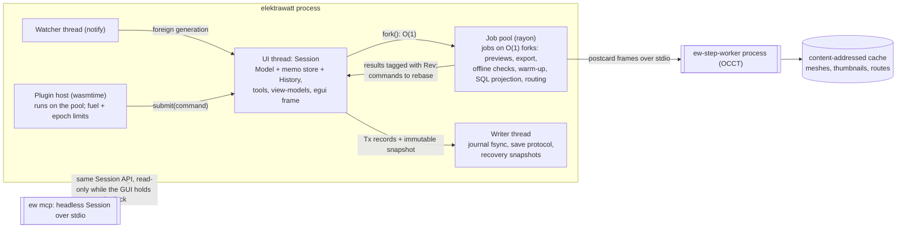

# Architecture: the process model, the core model, editing and persistence

A chapter of the [architecture](04-architecture.md): its §2, §4, §5 and §7, under the numbers the code and the other
documents cite. The crates, their order, where a thing lives, how a text reaches a person and what the shell
and the window own are in the architecture itself; read this chapter by the section you need.

---

## 2. Process and thread model



| Actor | Responsibility and rules |
|---|---|
| **UI thread** | Owns the `Session`: the current `Model`, the memo store, `History`, selection and tools. Applies commands synchronously and runs the queries the visible panels need. **Frame budget 16 ms:** apply plus validation ≤ 2 ms, derived updates of visible views ≤ 5 ms, render ≤ 5 ms. Commands declared `Cost::Bulk` always run as preview jobs. The `Session` is not `Send`: its memo store is re-entrant through shared interior state (ADR-0002 amendment 5), so it never leaves this thread; jobs receive forks |
| **Job pool** (rayon 1.12.0 **(verify)**) | Each job runs on a `World` fork, a (model, memo snapshot) pair cloned in O(1). Jobs never block edits and are never invalidated by them. Results carry their `Rev`, and the UI shows a staleness badge when `Rev < current`. Cancellation is cooperative |
| **Writer thread** | Serialises immutable snapshots with the save protocol (§7.4). Appends the journal and fsyncs at least once per second. Writes recovery snapshots to the OS state directory. Saving never blocks the UI |
| **Watcher** (notify 8.2.0) | Detects git pulls and foreign writes, ignoring its own by manifest generation. A foreign generation is loaded on the pool, diffed entity by entity, and offered as one undoable "External change" transaction (§7.4) |
| **Plugin host** | The wasmtime LTS line current at plugin launch; development runs on the 48.x LTS line (49.0.3 is current). Plugins read through query handles on a snapshot and write only by submitting commands |
| **`ew-step-worker`** | Out-of-process OCCT via occt-sys 7.8.1 + opencascade 0.3.0 (LGPL-2.1, C-5). Supervised with timeouts and restart. Results are cached by `sha256(file) + worker_version`. A crash or a pathological vendor file cannot touch the model |
| **MCP** | `ew mcp` opens the project headless with the same `Session` API, read-only while the GUI holds the lock. A GUI "live bridge" with ask-first writes follows in v1.x (G10). Specified, not built: `ew` has no `mcp` subcommand yet |

The table is the process model as specified. **What is built:** the UI thread and the jobs of `ew-jobs`. There
is no writer or watcher thread: the store saves by the protocol of §7.4 and appends the journal, synced per
entry, on the session's thread, and it polls the manifest for an external change
([05](05-project-format-and-persistence.md) §8.1, §9). The job pool, the plugin host, the STEP worker and MCP are
not built.

- **The synchronous export.** The page-output export of `ew-api` (`ew_api::output`) is synchronous in its core:
  phase 1 (page order, selection, the memoised layers of every page) runs on the session's thread because the
  `Session` is not `Send`, the page phase runs on `ew_export::par_map` (scoped `std` threads, results by page
  index), and the writer follows with the bundled fonts of `ew-text`.
- **`ew-jobs`** is a minimal runner: **one named `std` thread per job**, progress reports, a cancel flag checked
  at named checkpoints, a waker for the UI, `catch_unwind` (a panic fails the job and leaves the session
  untouched) and a test `Gate` whose hold is a breakpoint; `ew-api` re-exports it. `Session::export_job` carries
  the `World`, the report engine and the asset bytes to the job, which builds a **cold `Q`** on its thread and
  runs the export's phases (`export_pages_hooked`, shared with the synchronous export) with a checkpoint per page;
  its bytes equal `Session::export_pdf`'s.
- **Not built:** the memo snapshot in the fork, the rayon job pool and adopt-if-unchanged. They follow only if
  the release-phase measurement asks for them.

**Specified: the job model has no memo merge-back.**
- **What a job receives.** A job gets the model plus a **read-only** snapshot of the memo store, both `imbl` and
  O(1).
- **Where its results go.** Results the job verifies or computes go to a **job-local overlay**, which is dropped
  when the job ends.
- **The one exception: adopt-if-unchanged.** If the main memo store is still pointer-equal to the job's base when
  the job finishes, and the revision has not moved, the session adopts the job's store in O(1). This is used for
  the warm-up after open and for full checks run while the user is idle. Any other outcome discards the overlay.
- **Parallel work inside a job.** The job evaluates global queries once, sequentially (page order, stitch graph,
  potential partition). Only then does it fan out with rayon, giving each thread its own overlay.
- **What this design does not need.** There are no sharded locks and no memo revalidation across revisions.

**A job's model changes return as commands.** An importer, plugin or routing job hands back a command or a
prepared transaction together with its read set:
- if no key in that read set has changed since the job's revision, the session applies it;
- otherwise the session re-runs the deterministic command on the current snapshot (optimistic rebase).

**Panics.** The panic strategy is [quality, security and release](18-quality-security-release.md) §12.3. Release
builds keep `panic = "unwind"`:
- on job-pool threads (importers, rhai, SQL, checks, exports, report pagination) the panic is caught by the job's
  `catch_unwind`, so the job fails with a report while the model stays unchanged and the session keeps running
  (NFR-REL-12);
- on every other thread (UI, writer, commit pipeline) the hook asks the writer thread to flush the journal and then
  aborts; the next start offers recovery (NFR-REL-13).

**Platforms.**
- Windows 10 22H2+ and 11 (x64);
- Ubuntu 22.04+ and Debian 12+, on Wayland and X11.

macOS is not supported: the code keeps its existing macOS branches for portability, and
nothing more is promised. wgpu runs on DX12 or Vulkan. DX12 WARP and the always-built CPU renderer (§8) cover GPU-less RDP and VDI
sessions (G6).

---

## 4. Core domain model: storage and identity

### 4.1 Storage form

```rust
pub struct Model {                         // one immutable snapshot; Clone is O(1)
    pub(crate) rev: Rev,                   // monotonic on the main line
    pub(crate) project: Row<Project>,      // master data, parties, settings (with the colour and size
                                           //   profiles), derivation_profile
    pub(crate) structure: Table<StructureNode>,
    pub(crate) pages: Table<Page>,         pub(crate) sections: Table<Section>,
    pub(crate) devices: Table<Device>,     // incl. strips, terminals, cables, assemblies, PLC stations/modules
    pub(crate) functions: Table<Function>, // logical functions incl. interruption points; CPs instantiated from
                                           //   the function definition
    pub(crate) reps: Table<Representation>,// drawings of functions: multi-line, single-line, overview, fluid, topology,
                                           //   contact image, strip segment, graphic (panel fronts are derived)
    pub(crate) connections: Table<Connection>, pub(crate) junctions: Table<Junction>,
    pub(crate) conductors: Table<Conductor>,   pub(crate) channels: Table<Channel>,
    pub(crate) potential_defs: Table<PotentialDef>, pub(crate) net_defs: Table<NetDef>, pub(crate) bonds: Table<Bond>,
    pub(crate) layout: LayoutTables,       // spaces, enclosures, surfaces, carriers, placements, route overrides
    pub(crate) committed: CommittedTables, // routes, lengths, frozen numbers, released report snapshots (§6.5)
    pub(crate) lib: LibraryCopies,         // embedded library copies: parts, manufacturers, symbols, function
                                           //   defs, forms, macros, PLC, machine and label profiles
    pub(crate) report_blocks: Table<ReportBlock>, pub(crate) revisions: Table<Revision>,
    pub(crate) waivers: Table<Waiver>, pub(crate) comments: Table<Comment>, pub(crate) ext_refs: Table<ExternalRef>,
    pub(crate) idx: BaseIndexes,           // reverse-FK indexes; maintained by Op::apply, rebuilt on load, never saved
}
pub struct Table<T> { rows: imbl::OrdMap<Id<T>, Row<T>>, changed_at: Rev }
pub struct Row<T>   { value: Arc<T>, changed_at: Rev }
```

- **Why `imbl::OrdMap`:** deterministic ordered iteration, ID range scans, and O(1) snapshots. imbl mutates
  uniquely owned nodes in place, so a 10k-op transaction copies each touched B-tree node once.
- **Base indexes** are pure reverse-FK maps, each key with its own `changed_at`. Examples: `functions_by_device`,
  `reps_by_page`, `connections_by_endpoint`, `terminals_by_strip`, `channels_by_module`, `placements_by_device`.
  - `Op::apply` maintains them by delta.
  - Debug builds re-derive them and compare after every transaction.
  - A generated field-mask exhaustiveness test fails when someone adds a link field without updating the
    index declarations.

### 4.2 Entities

This table summarises the shape of each entity and the reason for it; it is a summary, not a schema. The
field-level schema is the [domain model](03-domain-model.md) together with `ew-schema`, and for report blocks and
forms [09](09-reports-forms-output.md) §2.2 and §2.5: **where this summary differs from them, they are normative**.

| Concept | Record (authored fields only) | Notes and reference |
|---|---|---|
| Project | `Project { master, parties: [Party{role, name, address, personal_data}], supply: Option<SupplySpec>, control_voltage, rated_consumption, settings: ProjectSettings, languages, derivation_profile, kind, user_prop_defs, completed, source_ref, extra }` | Customer and end user are separate roles (D-30). Supply is structured (REF-002). Numbering, wire-numbering and xref schemes and the colour and size profiles live inside `settings` ([03](03-domain-model.md) §5.1) |
| Structure | `StructureNode { aspect, code, parent, description: MlText, order }` | One canonical node for `+J-E-2416`. Spelling is a property of the node (D-03) |
| Section, Page | `Section { number, folio_range, title }`; `Page { folio: Folio{section, number, label}, kind, structure, form, title: MlText, description_override: Option<MlText>, scale, grid, … }` | `title` is the page description; without `description_override` the title block prints the project description (D-06). No stored revision, prev/next or title-block text |
| Device | `Device { tag: TagSpec, kind: Option<DeviceKind>, parent: Option<Id<Device>>, position, structure, parts: SmallVec<PartUse{part: PartRef{copy: Id<Part>, variant}, qty}>, function_text: MlText, process_tag, tech_data: [TechValue{key, value}], state, aspects: DeviceAspects, user_props, extra }` | `TagSpec { letter, counter, scheme, frozen: Option<FrozenTag> }`. The printed tag is derived. **Parts attach only to devices**, so the BOM aggregates one path |
| Function | `Function { device: Option<Id<Device>>, def: Id<FnDef>, role: Main/Aux, kind: Normal/Ip(IpSpec)/BlackBox, cp_overrides: SmallVec<CpOverride{idx, designation, alias, description, unused}>, … }` | `device` is None if and only if the kind is `Ip`. **Connection points (CPs) are instantiated from the function definition** (symbol or part pin pattern). Only overrides are stored. The internal `idx` keeps duplicate printed designations unique (REF-029) |
| Representation | `Representation { functions, page, symbol: Id<SymbolDef>, variant: u8, pos: Pt2, orient, rep_type, pin_map, text_slots, arrangement, box }` | One function, many drawings: `rep_type` is MultiLine, SingleLine, Overview, Fluid, Topology, ContactImage, StripSegment or Graphic. An unplaced function simply has no representation. One strip drawn in two segments (D-42). **Panel fronts are not stored:** the query `panel_front_reps(dev)` derives them from placements, and a PanelLayout page hosts one `SurfaceView` (D-02) |
| Connection | `Connection { a: Endpoint, b: Endpoint, page: Option<Id<Page>>, route: SmallVec<Pt2>, kind: Wire/Core(Id<Conductor>)/Bridge(BridgeSpec)/Fluid/Bus(BusLine)/Overview/Internal/SingleLine (1.0), overrides: WireOverrides, number: NumberSpec }` | `Endpoint = Cp{function, idx} \| Junction(id)`. Overview connections are excluded from nets. Strip-editor bridges and page-less internal links have no page and live in the shard of the device that owns endpoint `a` |
| Junction | `Junction { page, at, style: Dot/Bevel{orient}, wiring: Option<Star/Chain>, sequence: SmallVec<Id<Connection>> }` | Explicit T-node order (REF-034, D-20). `wiring` decides the physical wires; absent, Dot means Star and Bevel means Chain |
| Interruption point | A `Function` of kind `Ip(IpSpec { name, direction, star_source, sort, external })` without a device, with a representation; it lives in the page file of its representation | Pairing is derived: star or chain, by name within the scope set in `ProjectSettings.ip_pairing` |
| Potential, net | `PotentialDef { at: Endpoint, name, ptype: Option, voltage, env, circuit_class: Option, props: WireProps }`; `NetDef { at, props }` (signal level); `Bond { a, b, kind, via }` | Potentials themselves are derived. Bonds link potentials without merging them (D-22) |
| Terminal strip, terminal | Strip = `Device` with aspect `Strip`; terminal = `Device` with aspect `Terminal { strip, seq, designation, levels, rail_bonded }` | **A terminal is a device**, as in EPLAN. Its levels and clamps are CPs carrying level and side (`side1` or `side2`; TWIN terminals). Designation rules: §4.6 |
| Cable, conductor | Cable = `Device` with aspect `Cable { length: LengthSource, core_id_mode, pre_assembled }`; `Conductor { cable, core, colour: Option<ColourSpec>, csa: Option<Csa>, shield, pair }` | `ColourSpec` is one or two `ColourCode`s: the IEC 60757 enum plus profile-declared company codes (DBU), so "BR" cannot be stored in strict mode; imports keep it as a lenient-only foreign code (EW-CORE-031) (D-17). `Csa` keeps mm², AWG or kcmil in its original unit |
| PLC | Station and module are device aspects `PlcStation`, `PlcModule { slot, type_ident, start: IoStarts{input, output}, part_use, … }`; `Channel { module, number, kind, data_type, address: Auto/Manual/Excluded/Tbd, state: Option, symbol, comment: MlText, binding: Option<Endpoint> }` | `Auto` addresses are derived from the module start and the address map of the part use (D-26). `Tbd` is a typed open item (D-15). Channel IDs are `v5(module, "channel", number)` |
| Bus | `BusPort` aspect on functions; `LogicalNet`, `PhysicalNet` | Termination is a property, not free text (REF-061) |
| Fluid | CPs with `discipline = Pneumatic` and port role 1/2/3/4/5/12/14; fluid lines are `Connection{kind: Fluid}` with `TubeSpec`; `Medium` | One graph engine for both disciplines |
| Layout, 3D | `LayoutSpace`, `Enclosure`, `MountingSurface`, `Carrier { kind: Rail/Duct/Busbar/Surface, part, path }`, `Placement3D { device, function: Option, carrier, pose: Pose3, locked }`, `RouteOverride { connection, path }` | **No tag text is stored** (D-02). Poses are relative to the carrier. Overrides are keyed by connection ID, so they survive re-routing |
| Library copies | `PartCopy`, `SymbolDef`, `FnDef`, `FormDef`, `MacroDef`, manufacturer, PLC-profile, machine-profile and label-profile copies, each with `{library_id, item_id, version, sha256}`; project records reference them by typed copy IDs (`Id<Part>`, `Id<SymbolDef>`, `Id<FnDef>`, `Id<FormDef>`) | The project opens without its libraries (G2). Copy IDs are item-based (§4.4) |
| Revision | `Revision { label, date, author, checker: Option, description, state: Open/Released/Withdrawn, page_notes, sign_off: Option, release: Option<ReleaseRecord> }`; `ReleaseRecord { generation, approval, rule_packs, derivation_profile, archive, git_tag, content_digest, page_digests, changed_pages }` | One table, one format (D-05); four-eyes rule (D-34). Withdrawing a release adds a separate `Withdrawn` record that points to it (§7.8) |
| Reports, notes | `ReportBlock { source: Kind(ReportKind)/SqlQuery{api, file}, manual, sort, group, form, section, first_folio: Option, continuation, title, empty, embedded: Option<EmbedSpec{page, rect}> }`; `Waiver`; `Comment`; `ExternalRef { project, location, device, connection }` | Report pages are derived (§11); `params` and `filter` are specified, not built ([09](09-reports-forms-output.md) §2.2). External connections to J-E-206 are typed (REF-018) |

### 4.3 Device aspects: one device, several roles

Multi-role devices carry optional, typed aspects on one `Device` instead of subtypes:

```rust
pub struct DeviceAspects {
    pub strip: Option<Strip>,          pub terminal: Option<Terminal>,
    pub cable: Option<Cable>,          pub assembly: Option<Assembly>,     // config code, BOM mode basis (D-36)
    pub plc_station: Option<PlcStation>, pub plc_module: Option<PlcModule>,
    pub bus_node: Option<BusNode>,     pub valve_terminal: Option<ValveTerminal>,
}
```

**The dual-nature valve terminal is explicit** (REF-098, folios 201–206):
- -201U1 is one device carrying four aspects: `PlcStation` (role valve terminal), `BusNode`, `Assembly` and
  `ValveTerminal`;
- the sub-bases -201U3 … -201U8 are child devices carrying `PlcModule`;
- each valve is a child device of its sub-base;
- each valve has a coil function bound to a `Channel` (Q0.1 …) and a pneumatic function whose CPs are ports
  1/2/3/4/5;
- the overview on 201 and 202 is a representation generated from the assembly's children (D-10).

### 4.4 Identity

| Object | ID |
|---|---|
| New records | UUIDv7 (uuid 1.28.0) |
| Instantiated children (CPs) | `v5(function_id, idx)`, computed and never stored, used for PDF destinations and external references |
| Generated report pages | `v5(report_block_id, page_index)`, so PDF named destinations stay stable |
| Imported records | `v5(lineage namespace, source key)`: the namespace is anchored on an import lineage (the QET project UUID, or the SHA-256 of the lineage's first imported file) and derived from it as `v5(NS_IMPORT, …)` ([05](05-project-format-and-persistence.md) §3.2a, ADR-0004 amendment 4), so re-importing an edited QET file updates unchanged items in place; `source_ref{lineage, key}` keeps provenance |
| Functions created from a part's function template | `v5(device_id, template_index)` |
| PLC channels | `v5(module_id, "channel", number)`, stored because a channel carries authored data |
| Embedded library copies | `v5(NS_LIBCOPY, library_id ‖ item_id)`; only an explicit "keep both" after a cross-project paste mints `v5(NS_LIBCOPY, library_id ‖ item_id ‖ version)` |

Within a session, IDs are interned to dense `u32` values for union-find arrays and similar hot structures (specified; not built: `ew-ids` has no interner).

### 4.5 Coordinates, quantities, text

- **Coordinates (G4).** i64 **nanometres** in the model and in files.
  - Grids are rational: the QET 10 px grid is exactly `7_937_500/3` nm.
  - Snapping uses grid indices, never float equality.
  - f64 mm (glam `DVec3`) appears only in 3D maths, f32 only in GPU buffers.
- **Electrical quantities.** Fixed-point `Dec3` (mm², A, V), so no float noise reaches files, merges or
  checks.
- **Multilingual text (G7).** `MlText = Neutral(String) | Langs(BTreeMap<LangTag, String>)`, with EPLAN's mutual
  exclusion.
  - The display language is a query key, so "PDF per language" is the same derivation with another key.
  - Identifiers (tags, part numbers, PLC addresses, wire numbers) are NFC strings, checked for confusables, and
    never translatable.

### 4.6 Invariant catalogue

Invariants are evaluated **on the candidate snapshot at the end of the transaction**, limited to touched keys and
their index neighbours. Transient states inside a transaction are therefore legal: swapping two terminal
designations, or renumbering a strip, needs no two-phase rename.

| Class | Invariants | Behaviour |
|---|---|---|
| **Structural** (always on) | References resolve, with generated delete policies `cascade`/`unlink`/`forbid` (the `forbid` of a `LibRef` link is the delete-time rule below); one main function per device; `Function.device` is None if and only if the kind is `Ip`; assembly graph acyclic; a placement references a device; a channel belongs to exactly one module; connection endpoints exist and differ; a representation's functions exist; a released revision has a checker who is not the author (D-34) | Reject the transaction |
| **Delete-time** (always on, edits only; ADR-0009 amendment 7) | An edit does not remove an embedded library copy that a record names through a `LibRef` (EW-INV-021). A state without the copy is valid, so the rule judges a removal, not a state: `Model::apply_with` (every command) and the delete plan evaluate it; the history path of undo and redo (`Model::apply_history`) and the integrity check do not. Crash recovery onto a moved base reports a removal it would make as a collision | Reject the edit (`Referenced`) |
| **Prevent** (rule-pack configurable) | Terminal designation non-empty (D-11) and unique per strip (D-12); device tag unique within its structure scope; PLC address unique per area; at most one star source per interruption-point name and scope, and in chain mode an even count ordered by sort key (unpaired and ambiguous points are check findings); conductor colours consistent with the cable part | **Strict mode** rejects the transaction. **Lenient mode** (imports, legacy projects) turns a violation into a check message. The migration report lists every message |

The enumerated catalogue (about 40 rules) lives in `ew-model/invariants.md`, with a stable ID per rule, and is
tested one by one.

---

## 5. Editing: commands, transactions, undo, validation, preview, macros

### 5.1 Three layers

| Layer | What it is | Producers | Persisted |
|---|---|---|---|
| `Command` | Serialisable intent: `PlaceSymbol`, `Connect`, `RenumberDevices{scope, scheme}`, `AssignPart`, `ApplyImport`, `InsertMacro`, `SetFields` | GUI tools, CLI, rhai, plugins, MCP, importers | Journal, macro recorder |
| `Transaction` | `Vec<Op>` + `{command, origin, undoable, exposure, label}` (page/viewport/selection and `coalesce_key`: specified; not built) | `Command::run(&mut TxBuilder)` | Undo stack, journal |
| `Op` | `Put { key, before: Option<AnyRow>, after: Option<AnyRow> }` | `TxBuilder` | Undo stack (`Arc`s); journal (field diffs) |

```rust
pub trait Command: Serialize + DeserializeOwned + Send {         // typed handlers; not dyn-compatible
    const NAME: &'static str;                                   // "device.place", "numbering.renumber"
    fn cost(&self) -> Cost { Cost::Interactive }                // Bulk ⇒ always a preview job
    fn run(&self, tx: &mut TxBuilder<'_>) -> Result<Outcome, CmdError>;   // deterministic in (snapshot, self)
}
pub trait DynCommand: Send {                                    // object-safe companion
    fn name(&self) -> &'static str;
    fn cost(&self) -> Cost;
    fn run(&self, tx: &mut TxBuilder<'_>) -> Result<Outcome, CmdError>;
    fn to_json(&self) -> serde_json::Value;                     // journal, macro recorder, command logs
}
impl<C: Command> DynCommand for C { /* blanket impl: forwards to Command */ }
impl Session {
    pub fn world(&self) -> World;                                         // O(1): model + memo snapshot
    pub fn preview(&self, cmd: Box<dyn DynCommand>) -> JobHandle<Preview>; // candidate World + diffs; nothing committed
    pub fn commit(&mut self, p: Preview) -> Result<Rev>;                  // rebase-checked
    pub fn execute(&mut self, cmd: &dyn DynCommand) -> Result<Rev>;       // interactive path
    pub fn undo(&mut self) -> Result<Rev>;  pub fn redo(&mut self) -> Result<Rev>;
}
```

**v0**. `execute` and `commit` return a `Receipt {rev, outcome, created, passes}`
and `undo` and `redo` a `Restored {rev, context, label}`; both carry the `Rev` shown above. The `Outcome`'s notices
(what a command or a normaliser dropped or adjusted instead of refusing) are texts by key, as a refusal is: the window
words them in its language, the command line prints their English. `preview` runs
synchronously and returns the `Preview` (the `JobHandle` waits for the job pool of §2), and a `Cost::Bulk`
command sent to `execute` is refused with `CmdError::NeedsPreview`. [Extensibility](17-extensibility.md) §4 lists the
v0 facade.

Tools hand `Box<dyn DynCommand>` to the session ([schematic editor](06-schematic-editor.md) §4.1). The untyped
`AnyCommand { name, params }` of scripts, plugins and MCP implements `DynCommand` after its parameters have been
validated against the command's JSON Schema ([extensibility](17-extensibility.md) §2.1).

### 5.2 Commit pipeline (UI thread)

1. **Run.** `Command::run` executes against `TxBuilder`, a scratch snapshot with read-your-writes. Handlers may
   query it, for example for the "next free counter on page 103". **A transaction never reads the memoised queries
   `Q`** (ADR-0008 amendment 4): they describe committed snapshots, not the pending state. An
   index answer inside a transaction is a structural-index lookup on `TxBuilder` over the model's referrer index of a
   link (`channels_of_module` and `channels_at_cp`), with read-your-writes and recorded in the read set,
   and a derived key is recomputed from the rows read; normalisers (step 2) follow the same rule. *Example:* a
   command whose input depends on derived data takes it from the caller, so
   `ip.arrange` receives the new order that the tool computed (by name or by derived potential name) and reads no
   memoised query. *Assets (ADR-0008 amendment 5):* a handler may add image bytes through
   `TxBuilder::put_asset`; they join the model's asset store with the ops at commit and are not ops.
2. **Normalise.** Deterministic normalisers may add ops to the same transaction, with at most three
   productive passes plus one confirming pass; non-convergence is a bug (`CmdError::Internal`, ADR-0008
   amendment 2). The registry, with the order of the editor's normalisers, is
   [schematic editor](06-schematic-editor.md) §3.2. The normaliser families are:
   - online numbering of new devices;
   - instantiation of CPs for new functions;
   - junction clean-up;
   - conversion of autoconnect hints into explicit connections (G5);
   - conductor assignment;
   - connection split when a symbol is dropped onto a wire;
   - online wire numbering;
   - number transfer, including `WireOverrides.ends` and length;
   - clamp pick for terminals;
   - solenoid binding of valve coils to channels ([PLC and bus](10-plc-and-bus.md));
   - the fluid normalisers ([fluid power](11-fluid-power.md)).
3. **Validate.** Structural invariants, then prevent rules in the active mode (§4.6). The hook is
   `ew-api`'s shipped prevent hook over the base and the candidate snapshot, which refuses only violations the batch
   creates; its one rule is EW-TERM-002 (ADR-0009 amendment 5).
4. **Commit.** Swap in the new `Model` (O(1)), bump `Rev`, and push to `History` (coalescing on a matching key is specified; not built). Send the transaction to the writer thread for the journal.
5. **Notify.** Publish a change feed `{rev, touched keys, touched pages}`. View-models compare revision stamps.
   Visible panels re-query on the next frame. Online checks are queries, so they update the same way.

### 5.3 Undo and redo

- **Mechanism.** Ops hold before/after `Arc`s, so they are O(1) to create and their inverse is a swap. Undo
  applies the inverse ops as a **new** revision, which keeps `changed_at` monotonic and memo validation sound.
- **Scope and limits.** One project-wide stack (G3), bounded at 500 steps or 256 MB. Each entry restores the model
  (page, viewport and selection: specified; not built). The stack survives saving, and a saved marker drives the dirty flag. Marker lines count
  towards the 500; the 256 MB counts only the rows the history alone keeps alive, each by the length of its compact
  JSON, and one step larger than that is kept alone. Undo and redo run the structural invariants but not the prevent rules (ADR-0008
  amendment 2), nor the model's delete-time rule EW-INV-021 (ADR-0009 amendment 7): they apply through
  `Model::apply_history`, the history path, and restore a committed state,
  so the undo of `library.embed` removes copies that `LibRef`s name, which then name nothing again.
- **Coalescing** (specified; not built: each gesture commits its own step). One drag is one step. Typing in one cell merges until focus leaves. A table fill-down or an Excel
  paste is one step.
- **External reload** arrives as an undoable diff transaction (§7.4), so the stack survives a git pull.
- **Not undoable**, as in EPLAN: library writes outside the project, exports, file operations, and the bulk import
  into an empty project (a checkpoint). Every non-undoable operation is flagged as a marker line in the history.
  Only the destructive ones ask for confirmation: library writes outside the project, overwriting an existing file,
  purging library copies and the empty-project import checkpoint (ADR-0008).

### 5.4 Preview is a fork

`preview(RenumberDevices)` runs on the pool and yields a candidate `World` plus diffs:
- `diff_model(current, candidate)`: entity and field changes;
- `diff_query(current, candidate, q)` for tags, BOM rows, wire-list rows, PLC addresses, xref texts and affected
  pages.

Accept commits the prepared transaction after the rebase check (§2). Cancel drops the fork. A QET import, a
re-addressing run and "update parts from library" are inspected the same way, including rendered pages of the
candidate.

The preview of an interactive canvas tool is the same mechanism at the smallest scale: `Session::preview` runs
the command as a dry run on a fork and yields the `DerivedDiff` that draws the semantic ghost. Every editing tool
previews through the very command it would commit; there is no second preview model, and the autoconnect ghosts
are overlay items until the commit (their hints reach the model only inside the committed `device.place`). The
viewer and Measure run no preview.

The tool host in `ew-viewmodel` runs a tool's `Preview` through `Session::preview_with` on the UI thread (the
`Session` is not `Send`), once per changed command or revision and after the pointer has rested for 80 ms (the
action `canvas.dwell`), keeps it as `PreviewState` with the derived diff as the semantic ghost and marks it stale when
the revision moves on. A commit in the window takes `Session::commit` of a fresh equal preview, else
`Session::execute_with`, and headless the one-line command log of `Session::run_script`, so the exposure rules
and `--record` apply unchanged. A preview also runs on a read-only project (a preview is a read; only the commit
is refused). A fork job off the UI thread is specified, not built; its cost is not measured.

### 5.5 Macros

- **Command macros** are recorded command logs, exported as parameterisable rhai.
- **Window and page macros** are project fragments in the same JSONL format. `InsertMacro{macro, at, value_set}`
  remaps IDs, rebinds structure identifiers and lets the normalisers number the new devices. Folios 203–206 become
  one typical with four value sets.

**The project-fragment format of this section is the text format `#ew-fragment v1`** that the clipboard uses: a
header line, then the records in the canonical JSONL of §7.3 with their library copies. Copy, cut, paste,
duplicate and the window and page macros use this one format; macros extend it (value sets, parameters) within
its version rules rather than define a second one. Within v1 unknown header members are ignored (the `$fragment`
header is open, a `$node` line closed); another `format` or a record of another `$v` is refused until the
migration chain exists. `edit.paste` takes the whole fragment as its parameters, so a paste replays from the
command log; references are remapped and judged by `ew_model::LINKS` and their delete policy. Trade-off: one
format to keep stable across versions and instances, against a macro format free to diverge.

- The records follow in (kind rank, position, ID) order, not by ID; `edit.paste` mints in (kind rank, fragment
  order) and numbers the pasted devices in that order.
- The fragment carries raw UUIDs as data (it is clipboard content, not the shell's machine text, so the alias
  `@n` does not apply); a leading byte-order mark is skipped; a record's import lineage (`source_ref`) is dropped.
- The fragment also carries page items and structure boxes (ranks 43 and 44); marker associations retain and
  remap copied connections, empty markers and unknown variants are skipped and counted, and a cross-project paste
  of a structure box clears `external`.
- Copy tolerates a partial selection; Cut refuses an incomplete transfer of the selected page items before any
  side effect.

The exact text is [05](05-project-format-and-persistence.md) §12.

---

## 7. Persistence and project file format

### 7.1 Contract

**Text is canonical at rest. In memory, the `Model` is canonical.** Nothing else exists:
- no working database;
- no stored derived data;
- no binary blobs other than assets addressed by content hash.

Rules for the files:
- File names derive only from UUIDs and fixed words: no tags or titles, so no Windows reserved names, no case
  collisions and short paths (G1).
- The app binary manifest sets `longPathAware` anyway.

### 7.2 Directory layout (an example)

```text
J-E-2416.ew/                          # name chosen by the user; content is UUID-named
  manifest.json                       # written LAST: format, min_reader, generator, generation, sha256 per file
  project.jsonl                       # project row, parties, settings, colour/size/numbering/xref profiles,
                                      #   identifier set, languages, derivation_profile, user property definitions,
                                      #   import lineages
  structure.jsonl                     # structure nodes (=P01, +J-E-2416, +J-E-206 …), sections 1/2/9
  revisions.jsonl  report-blocks.jsonl  waivers.jsonl  comments.jsonl
  pages/<page-uuid>.jsonl             # page row + page-owned rows: representations, connections, junctions,
                                      #   interruption-point functions, graphics, placed report blocks
  devices/<xx>.jsonl                  # 256 shards by the LAST id byte (v7's leading bytes are time):
                                      #   devices (incl. strips, terminals, cables, assemblies, PLC), functions,
                                      #   conductors, channels, potential/net defs, bonds, page-less connections
  layout/<space-uuid>.jsonl           # enclosures, surfaces, carriers, placements, route overrides, committed routes
  imports/<run-uuid>.jsonl            # one import run per file (MVP), so runs never conflict with project data
  exchange/<config-project-uuid>.jsonl  # PLC exchange records and foreign IDs (1.0; part of the as-built archive)
  lib/symbols/<uuid>.json  lib/fndefs/<uuid>.json  lib/forms/<uuid>.json  lib/parts/<uuid>.json  lib/macros/<uuid>.json
  lib/manufacturers/<copy_id>.json  lib/plc-profiles/<copy_id>.json (1.0)
                                      # embedded library copies, pretty-printed (rarely co-edited)
  lib/profiles/<copy_id>.toml         # machine and label profiles in their TOML source form (1.0)
  rules/<uuid>.toml (+ rules/<uuid>/)  reports/<uuid>.sql
                                      # project rule packs (the pack ID lives inside the TOML; rhai, SQL, Fluent
                                      #   and docs in the directory) and user reports
  scripts/<uuid>.rhai  jobs/<uuid>.ewjobs   # automation scripts and jobsets (1.0)
                                      # rules, reports, scripts and jobs are untrusted until the project is trusted
  assets/<sha256>.svg|png|jpg|glb     # logos, images; opt-in embeddable meshes (.glb, 1.0)
  trust.sig                           # project trust signature (1.0)
  .gitattributes  .gitignore          # *.jsonl merge=elektrawatt diff=elektrawatt; ignore .ew/ and .~ew.lock
  .ew/                                # per-user view state and caches (git-ignored)
  .~ew.lock                           # G1 lock (git-ignored)
```

At XL-A (§6.7) this is about 2,300 files plus one per embedded library item: few enough for Defender, OneDrive and
git, and local enough for merges. The full layout and the kind registry are in
[project format](05-project-format-and-persistence.md) §2.

**Ownership determines the file.** A row belongs to its page file if it is page-scoped, to its layout-space file if
it is layout-scoped, and to the shard of its owning device otherwise. A typical edit rewrites one to three files.

### 7.3 Canonical JSON Lines

```json
{"$k":"device","id":"0192f1c4-5a10-7c3e-8b21-6f0d9a4e2b10","tag":{"letter":"G","counter":1},"kind":"psu","parts":[{"part":{"copy":"0192e7d0-…"},"qty":"1"}],"function_text":{"en-GB":"Power supply 24 V DC"}}
{"$k":"device","id":"0192f1c4-77a2-7d10-9c3e-1a2b3c4d5e10","tag":{"letter":"X"},"kind":"terminal","parts":[{"part":{"copy":"0192e7d1-…"},"qty":"1"}],"terminal":{"strip":"0192f1c4-…","seq":3,"designation":"3"}}
{"$k":"connection","id":"0192f3a0-…","a":{"cp":["0192f1c4-5a11-…",4]},"b":{"cp":["0192f1c4-77a3-…",1]},"page":"0192f0aa-…","route":[[95250000,63500000],[95250000,71120000]]}
```

**Writer rules.**
- One record per line.
- Inside a file, records are ordered by kind (schema order), then by the ID's **random bits (bytes 8–15)**, then by
  the full ID. Concurrent additions on two branches therefore land on scattered lines instead of both appending at
  the end of the file, so plain-git and web-UI merges succeed far more often.
- Fields appear in schema order. Defaults and nulls are omitted.
- Values are integers (nm) and `Dec3` decimal strings only; there are no floats.
- Strings are NFC, line endings LF, and entities carry no timestamps.
- `ew fmt` re-canonicalises hand edits.

Library copies are one pretty-printed JSON document per item, because they are large and rarely co-edited.

```json
{"format":"1.0","min_reader":"1.0","generator":"ElektraWatt 0.9.0","generation":214,
 "files":{"project.jsonl":"sha256:…","pages/0192f0aa-….jsonl":"sha256:…", "…":"…"}}
```

### 7.4 Save, open, recovery, external change

- **Incremental save.** Each `Op` maps to file keys (for page-scoped rows, the old and the new page), so the dirty
  set falls out of the transaction log. The writer thread runs the G1 protocol from the immutable snapshot
  ([project format](05-project-format-and-persistence.md) §5):
  1. write every dirty file to `name.tmp-<gen>` and `sync_all` it;
  2. write the complete new manifest as a durable **intent** (`manifest.json.tmp-<gen>`, with the hash of the
     manifest it replaces as `base`) and sync the temps' directories, then the root, before the first rename;
     this is the commit point, and an interrupted save rolls forward on the next open when `base` still matches
     the manifest's bytes;
  3. rename each temp over its target, after moving an unlisted file at that path aside, and sync the target
     directories;
  4. rename the intent over `manifest.json` last;
  5. sync the root directory where supported (ADR-0010 amendment 3).

  An M-class save takes well under 200 ms (estimate) and never blocks the UI.
- **Open.** Verify the hashes against the manifest. A mismatch means an interrupted save, a hand edit or a merge:
  load anyway, run `ew check --integrity`, and offer journal replay or the last good generation.
- **Crash recovery.**
  - Each commit appends `{command, field diffs, rev, base_generation}` to a JSONL journal in the OS state
    directory, never in the project.
  - Rotating recovery snapshots (three generations, as QET does) are written every 2 minutes while the project is
    dirty.
  - On restart, the app offers a replay onto the last good generation.
- **Lock.** `.~ew.lock` is created with `create_new` and holds
  `{lock: 1, session, user, host, pid, pid_started, app_version, started_at}`.
  - A held lock opens the project read-only.
  - The holder refreshes the lock every 5 minutes and re-reads the session ID, so it notices a lost lock.
  - A stale lock (same host and a dead PID or a different PID start time, or older than `lock.stale_after`,
    default 60 minutes) can be taken over after confirmation. The takeover renames the stale lock **without
    replacement**, so only one of two competing instances wins.
  - No OS byte-range locks are used over SMB.
- **External change (git pull, a colleague).**
  1. Load the new generation on the pool.
  2. `diff_model(last_saved, incoming)`.
  3. If no unsaved local edit collides, apply the diff as **one undoable "External change" transaction**. Otherwise
     open the merge panel.
- **Cloud-sync folders.** OneDrive, Dropbox and iCloud paths are detected and warned about. Conflict copies (files
  not in the manifest) are reported.
- **Transport.** `.ewz` is a ZIP of the directory. Opening it extracts to a working directory, or opens read-only.

### 7.5 Git integration

- **Merge driver.** `ew merge-driver %O %A %B %L %P` (the four-argument form without `%L` is accepted too) merges
  three-way per `($k, id)` record, then per field.
  - Disjoint field edits on one record merge cleanly.
  - A true conflict is written as a `{"$k":"conflict","id":…,"ours":…,"theirs":…}` record. The file stays
    valid and loadable, git gets exit code 1, and EW shows a resolution panel.
  - A caught internal error exits 129, because git reads any code up to 128 as "conflicts written" (ADR-0012).
- **Cross-file semantics.** Git calls drivers per file, so the post-merge hook and every open run
  `ew check --integrity`. It covers dangling references, duplicate counters, interruption-point pairing conflicts
  (more than one star source per name and scope) and prevent-rule violations, each reported with a quick fix.
- **Diff.** `ew diff --textconv` prints entity diffs with **derived** tags, for example "-102F1: part A9F78116 → …",
  not UUIDs.
- **Local history.** Optional git local history via gix 0.89.0, as KiCad does.

### 7.6 Versioning and migration

1. **Two-part format version.**
   - A minor bump is additive. Readers preserve unknown fields in each record's `extra` map, and **unknown record
     kinds verbatim**. New members are optional, appended after the existing members of their kind and tagged
     `since`; every persisted enum has an `Unknown` catch-all; an untouched record with unknown content is written
     back as its original line (ADR-0011).
   - A major bump refuses to open, or opens read-only.
2. **Per-kind schema versions** (`"$v"`, omitted when 1). Migrations are pure `serde_json::Value` functions per
   kind and per step. They are never deleted.
3. **Stamps and schemas.** `generator` and `min_reader` stamps. JSON Schemas are published from `ew-schema` for
   every kind and validated in CI.
4. **Fixture corpus.** One fixture per released format: the reference project as saved in format 0.1 (`fixtures/format/0.1/`)
   and, for every later format, the sample project (ADR-0011 amendment 7), plus the QET examples, opened by every build.
5. **Change policy** (the LibrePCB rule). Before 1.0, upgrade-on-read every release. After 1.0, format
   majors only in a yearly window, and development builds that write an unreleased format show a warning.
6. **Schema steward rule.** Every PR that changes the format ships a migration, a fixture, the regenerated
   schema and docs.

### 7.7 Libraries and catalogues

- **Catalogues.** Libraries are canonical text at every tier (system, community, company, user): `.ewlib`
  directories in the project format, with the same writer, manifest-last save, lock and merge driver. They are fed
  from EDZ, BMEcat, ETIM or CSV. Published library versions are immutable. The system library is the compiled-in starter, whose ID is the
  constant `ew_schema::starter::LIBRARY` (7202fd8b-1024-4bf1-9e99-670772eaa589), held in the permissive
  record crate beside the other starter names that code refers to, because importers may depend neither on each
  other nor on `ew-library`; the QET, EPLAN and tables importers reference built-in items through it. `ew-library` builds one derived SQLite
  FTS5 index per user in the local cache, rebuilt incrementally per library generation, for full-text search; no
  SQLite file is ever opened on a share ([symbols, parts and macros](07-symbols-parts-macros.md) §2.1–§2.2).
- **Projects never read catalogues at render time.** They embed a `PartCopy`, and "update from library" is a
  previewed command. The copy ID is `v5(NS_LIBCOPY, library_id ‖ item_id)` (§4.4), and `sha256` is taken over the
  canonical compact JSON of the item's own fields. A cross-project paste of another version offers three choices:
  update the existing copy (previewed), adapt the pasted records to the existing copy, or keep both.
- **Foreign SQLite files** (QETZ `project.sqlite`, third-party catalogues) are opened read-only with
  `trusted_schema=OFF`, defensive mode and a schema check, because a hostile file can carry views or triggers.

### 7.8 Revisions and the as-built archive

Releasing a revision is one atomic command (ADR-0013; [project format](05-project-format-and-persistence.md) §14.1)
that runs these steps in this order:
1. runs the release gate (§12) on a fork;
2. freezes committed computations and saves generation g;
3. if the project is a git repository, commits the project directory at g (after asking);
4. builds and verifies an **as-built archive** containing the canonical text at that generation, the embedded
   libraries, the PDF/A-2b, the `.ewpp` production package and the SHA-256 sums (G2);
5. if the project is a git repository, creates the tag `ew/rev/<label>`;
6. stamps the revision `Released` with its `ReleaseRecord` (generation g, rule-pack versions, derivation profile,
   approval, archive name and hash, page digests), saved as generation g+1.

A failure after the freeze leaves the revision Open, with no archive or tag referenced. Revision states are Open,
Released and Withdrawn; withdrawing a release adds a separate `Withdrawn` record that points to it.

**The archive goes next to the project**, by default `<parent>/<name>.ew-archive/<label>.ewarchive`, at a
configurable path. It never goes inside the project directory, so git history stays small.

**Page change status** compares per-page content digests with those of the last release
(`ReleaseRecord.page_digests` and `changed_pages`;
[checks, revisions and collaboration](15-checks-revisions-collaboration.md) §5.6).

**Revision comparison** loads the archived text into a second, read-only `Model` and diffs it against the current
one:
- `diff_model` gives the property comparison (EPLAN Pro tier);
- `diff_query` gives the BOM, wire-list, terminal and PLC-address deltas, "wires changed since V1.0"
  ([panel-manufacturing.md](../research/panel-manufacturing.md) §7.1), and revision clouds from the changed representations.
