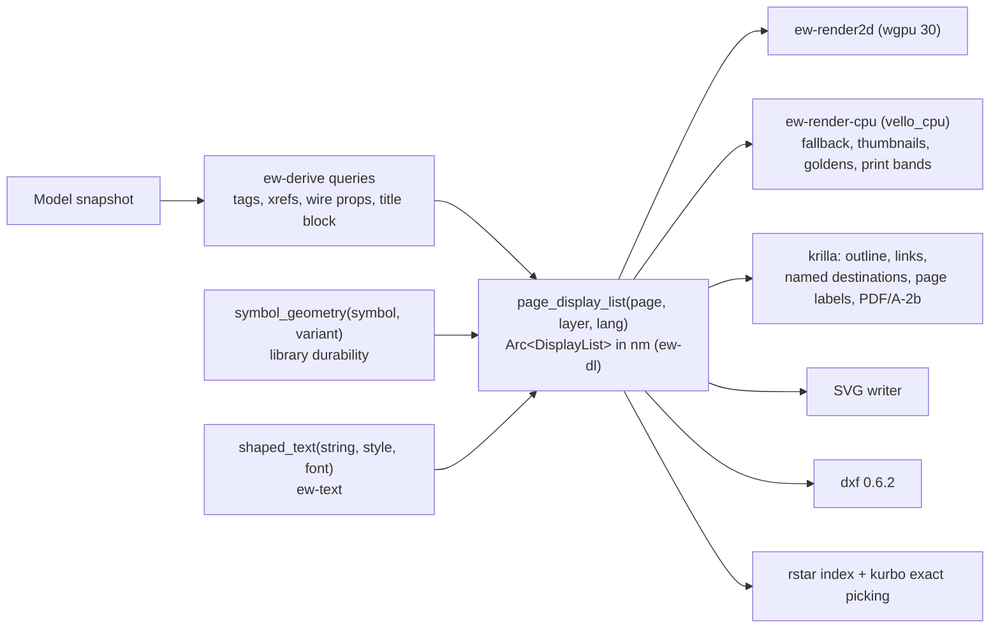

# Architecture: rendering, extensibility, reports and checks

A chapter of the [architecture](04-architecture.md): its §8 and §10 to §12, under the numbers the code and the other
documents cite. The crates, their order, where a thing lives, how a text reaches a person and what the shell
and the window own are in the architecture itself; read this chapter by the section you need.

---

## 8. Rendering pipeline

### 8.1 One IR



- **IR items.** `Path(BezPath, Stroke, Brush)` (the `Stroke` carries width, caps, joins, dash and its own `brush`,
  default black; the third member is the fill brush; ADR-0015 amendment 4), `Glyphs(Arc<ShapedRun>)` (with its
  `layout_box`), `Image`, `Instance(SymbolGeomId, Transform)`, `Group`. Items carry an optional `EntityRef` (picking, highlight) and a
  `LinkSource`/`LinkTarget` (xref to named destination), from which the PDF gets its link annotations (D-07, D-33).
- **Early cut-off reaches the GPU.** A layer query that returns the same backdated `Arc` lets the renderer keep its
  vertex buffers.

### 8.2 Screen

- **GPU path** (ADR-0015 amendment 10). `ew-render2d` draws on the shared device into its own
  offscreen texture, not inside an `egui_wgpu` paint callback:
  - symbols and groups are tessellated once per content key with lyon and drawn instanced;
  - lines are expanded to screen width in the vertex shader, so zoom never re-tessellates;
  - text is tessellated glyph outlines, one mesh per (font, glyph), drawn instanced like symbols; there is no glyph
    atlas.
- **LOD.** Text under 2 px becomes a bar and hairlines clamp to 1 px. Overview thumbnails from vello_cpu keyed by
  display-list hash are specified, not built.
- **CPU path, always built and tested.** `ew-render-cpu` renders the same IR into an image shown as an egui
  texture. It is used where wgpu cannot get an adapter (some RDP and VDI hosts, after DX12 WARP has been tried), for
  the expected pictures of the tests and for `canvas.snapshot`. The perf gate requires ≥ 30 fps for an A4 page on
  it (G6).
- **Hit-testing.** The hover pick runs over the display list's entity boxes (`DisplayList::entity_bounds`): the
  smallest box that contains the pointer wins. A spatial index (`page_spatial_index(page)`, an rstar R*-tree with
  exact kurbo picking) is specified, not built.

**The CPU canvas.** The page's sheet display list is rastered by `ew-render-cpu::render_region` into a pyramid of
256-pixel tiles (levels 6 × 2^k dpi, scaled down by at most 2 while moving, the exact resolution once the view has
been still for 150 ms) on a pool of worker threads, and `ew-ui` shows them as egui textures, so they reach the
screen through egui's own wgpu renderer; `render_region` of the full rectangle equals `render` byte for byte, and
culling by `ItemBounds` never changes a pixel. The overlays (page bounds, the grid under the page-to-sheet map, the
dashed hover outline over `DisplayList::entity_bounds`) are screen-space primitives of `ew-render2d`.

**The GPU canvas** is `ew_render2d::gpu`:
- **Scene and meshes.** The page's display list is walked once on a worker; every group with a transform or a clip is a
  mesh context (an instance of a mesh keyed by a 128-bit content key), every glyph an instance of a mesh keyed by
  (font, glyph), and the remaining paths form the page's static mesh. Meshes outlive scenes, so a second preparation of
  the same page tessellates nothing. The scene is keyed (session, revision, folio), where the session is a per-shell
  epoch bumped whenever a project is created or reloaded, so a revision number of another project can never match; the
  previous revision of the same folio stands in while a new one prepares, and until a scene is ready the canvas shows
  the CPU tiles.
- **Target and colour.** The canvas renders into a 4× multisampled texture (1× where the adapter cannot) and resolves
  into a pane-sized `Rgba8Unorm` texture, which egui-wgpu samples as gamma-space colour with nearest filtering, one
  texel per physical pixel, so authored sRGB bytes blend as the CPU renderer's u8 pipeline blends them (#0072B2 reads
  back within ±1). Uploads use `write_buffer` and `write_texture`; the only mapped view is in `GpuCanvas::read_back`
  (ADR-0014).
- **Translucency** is exact in paint order between instances and approximate inside one mesh.
- **The switch rule** is the pure function `gpu::choose`, table-tested, evaluated at start and on a failure. The status
  bar labels are `GPU DX12`, `GPU Vulkan`, `GPU Metal` or `GPU GL`, `WARP` (a CPU-type adapter on DX12) and `CPU`. The
  canvas is the CPU canvas for `--no-gpu`, for the setting `canvas_backend = cpu` (default `auto`; View ▸ Use the CPU
  renderer for the canvas), without a wgpu render state (headless, kittest) and for a software adapter other than WARP;
  an initialisation failure, a device lost or an uncaptured error end on the CPU canvas with one banner. `--no-gpu`
  also asks eframe for a software adapter for the window (none: the default adapter, with a banner).
- **The shared device.** There is one device (ADR-0014), so a real device loss also ends egui's window and the
  fallback "CPU for the rest of the session" helps for uncaptured errors only; recovery from a device loss is not
  built. A pane beyond the device's limits (`GpuError::Limits`) ends the GPU path for the session with the banner; a
  per-frame CPU fallback is not built yet.
- **No adapter at all.** The window cannot open: `elektrawatt` writes one message to stderr (naming `elektrawatt
  --headless`, `ew` and, on Linux, Mesa's software drivers) and exits with code 3. Exit 3 follows an adapter-request
  or `--no-gpu` selector failure, or any other wgpu error when a fresh enumeration counts no adapter (otherwise 1); that
  count honours `WGPU_BACKEND` while eframe's instance does not.
- **The CPU path stays the golden reference.** `ew-render-cpu` and every golden byte are unchanged, `canvas.snapshot` is
  always a CPU image, and the GPU path is checked against the CPU canvas by a render-to-texture parity test under a
  neighbourhood rule with a mean-difference bound and an edge-position check, never by bytes. Per-layer GPU
  buffers across a commit, the tile-scene digest and mipmaps are not built.

### 8.3 Text and fonts

- **One text stack for screen and paper** in `ew-text`: parley 0.12.0, fontique 0.12.0, skrifa 0.44.0 and harfrust
  0.12.0 (through parley). `shaped_text` is memoised, so screen, report pagination and PDF share glyph positions and
  line breaks.
- **Fonts.** One bundled OFL sans family is the default, with osifont (ISO 3098 style) as an option. Tahoma is never
  bundled: QET imports substitute it and record the substitution (G14; default font in ADR-0028).
- **Text styles are model data** (D-29). A minimum-printed-height check runs at print scale (D-31).

### 8.4 PDF, other outputs, printing

- **PDF.** krilla 0.8.2:
  - PDF/A-2b by default, with 3b/4f only when attachments are embedded (C-10);
  - an outline from `page_order` and sections;
  - a named destination per xref target and a link annotation per xref text;
  - `/PageLabels` equal to the folios (krilla's native page labels, ADR-0015 amendment 5);
  - subset embedded fonts and glyph runs with real spaces (D-33);
  - tagged PDF (PDF/UA-1) as an option (G8).

  krilla has no optional content (layers, C-11), and v1 does not offer layers.
- **SVG, DXF and PNG.** An own SVG writer; DXF (AC1024, layer mapping) via dxf 0.6.2; PNG through `ew-export` →
  `ew-render-cpu` (vello_cpu). PNGs are byte-identical per build target (vello_cpu `Level::baseline()`) and compare within the dify tolerance across targets (ADR-0015 amendment 6); PDF, SVG, XLSX, CSV, JSONL
  and `.ewpp` stay byte-identical (ADR-0015). `ew export pdf|svg|png` write through the page output of `ew-api`.
- **Printing.** PDF is the print master. Small adapters in `ew-print` hand it to the OS: the xdg Print portal or CUPS
  on Linux and `PrintDlgEx` with banded vello_cpu rendering on Windows. Scale-to-fit stamps the
  scale, folio ranges and monochrome mode are supported, and `ew print` prints from the CLI (G9).

### 8.5 3D

- **Scene.** `layout_scene(space)` derives instances (mesh hash, world pose, highlight state) for `ew-render3d` on
  the same wgpu device. The renderer draws:
  - parametric prisms for enclosures, plates, rails and ducts;
  - instanced STEP meshes (the PT 2.5-TWIN terminals share one mesh);
  - feature edges, a transparent enclosure, and CAD orthographic/perspective cameras.
- **Reconciler.** Mutable acceleration structures (parry3d BVHs, GPU instance buffers) are kept in step by a
  reconciler. It diffs successive scene outputs by placement ID and applies insert, update and refit operations.
  Debug read-tracking and the field-mask test guard it.
- **Picking and gizmo.** Picking is a CPU ray cast. The gizmo is transform-gizmo-egui 0.11.0, hosted by `ew-ui`
  over `ew-render3d`'s camera, pick and constraint API, because only `ew-ui` may know egui (§3 Rule 3).
- **3D export.** `ew-panel` writes glTF (glb) and STL from `layout_scene`.
- **2D panel pages** (folio 902) are projections of mounting surfaces through the same 2D IR: a PanelLayout page
  hosts one `SurfaceView` of the placements. Layout labels are `layout_label` queries (D-02).
- **Routing** is Class II: negotiated-congestion rip-up and re-route over the duct graph ([panel-manufacturing.md](../research/panel-manufacturing.md)
  §6.7), on a fork. Results become committed computations only through the explicit `RouteWires` command (§6.5).

### 8.6 STEP worker

- **Build and isolation.** `ew-step-worker` uses occt-sys 7.8.1 + opencascade 0.3.0 (LGPL-2.1; C-5, C-6). It runs as
  one or two pooled processes, receives length-prefixed postcard frames over stdio, and is killed and restarted on
  timeout.
- **Outputs:** assembly tree, two mesh LODs (meshopt 0.7.0), feature edges, bounding box, hull and mounting frames.
  They are stored as glb or rkyv under `sha256(STEP) + worker_version`.
- **Model references.** `PartCopy` references the hash, never the vendor file.
- **Not used:** cadrum stays evaluated only, because it downloads prebuilt binaries at build time, which is a
  supply-chain liability.

---

## 10. Extensibility

### 10.1 CLI `ew`

`ew` is the headless `Session`. Panel builders can fail CI on `ew check --scheme pre-delivery`. The authoritative
catalogue, with options, releases and requirements, is [extensibility](17-extensibility.md) §3.3; this table
summarises its groups.

| Group | Subcommands |
|---|---|
| Inspect | `ew check [--scheme <s>] [--gate] [--integrity] [--format …\|sarif] [--baseline …]` (CI exit codes); `ew query <name> <key> [--json] [--explain]`; `ew verify-derived`; `ew find`; `ew sql <project> "<select>"`, `ew sql dump`, `ew sql schema`; `ew commands`, `ew queries`, `ew schema <name>` |
| Output | `ew export pdf\|svg\|png\|dxf`, `bom`, `wires`, `terminals`, `cables`; `ew export report --block <name\|id>`; `ew export plc-aml\|plc-xlsx\|plcopen\|ewpp\|machine <profile>\|labels\|drilling\|tubes\|ewz`; `ew render --page 103 --png` (CPU backend: ideal for CI and agents); `ew print`; `ew review <base> <head>`. Every export that writes project content takes `--omit-personal-data` |
| Import | `ew import qet\|csv\|io-list\|edz\|dxf\|plc-aml\|table`; `ew verify-migration <project> --reference <pdf>` |
| Edit | `ew apply <project> <file.ewcmd>`; `ew script run`; `ew jobs run <file.ewjobs>` (KiCad-style jobsets) |
| Format and VCS | `ew fmt [--check]`, `ew upgrade`, `ew recover`, `ew git setup [--global] [--hooks]`; `ew diff`, `ew diff --textconv`, `ew diff <a.ewpp> <b.ewpp> --wires`; `ew merge-driver %O %A %B %L %P`, `ew merge resolve` |
| Revisions and waivers | `ew revision approve\|release\|withdraw`; `ew archive verify\|rebuild`; `ew waiver list\|add\|remove` |
| Domain | `ew plc status`; `ew mfg …`; `ew lib lint\|render\|pack` |
| Trust, agents, plugins | `ew trust status\|grant\|revoke\|sign`; `ew mcp [--stdio\|--listen 127.0.0.1:0]`; `ew plugin install\|list\|…` (v1.x) |
| About and smoke | `ew about [--json]`; the release smoke flag `elektrawatt --smoke <project>` (open, render, exit) |

Human-only commands (approve, release, withdraw, waivers and the like) run on the CLI only through their dedicated
subcommands, after an interactive terminal confirmation (§10.4).

### 10.2 The read-only SQL projection (`ew-sqlview`)

- **What it is.** A job on a fork materialises the model and selected query results into an SQLite database: in
  memory up to L size, file-backed in the local cache directory at XL. Internal `t_*` tables sit behind
  **versioned public views** `api_v1_*`: device, function, page, wire, terminal, cable, conductor, potential,
  plc_channel, bom_component, bom_assembly, placement, message, plus meta, cp, structure, xref, revision, fluid_line,
  valve_position and medium (columns in [extensibility](17-extensibility.md) §6.1 and
  [fluid power](11-fluid-power.md) §8.3). `api_v1` is marked **Preview** until the 1.0 freeze.
- **Refresh.** Per table, keyed by the `changed_at` revision of each source table or query. The projection carries
  its `Rev`, and consumers see "as of revision n" (Class II).
- **What it serves:**
  - user reports (query + form, §11);
  - SQL rule packs in offline and release modes (§12);
  - `ew sql`;
  - the MCP `sql_query` tool;
  - acceptance tests (§13);
  - machine-export profiles;
  - Excel round trips.
- **Sandbox.** Reads run on a separate read-only connection with `query_only`, one statement per call. An authorizer
  denies `ATTACH`/`DETACH`, every `PRAGMA`, DDL, DML, transactions, `ANALYZE`, `REINDEX`, direct `t_*` reads,
  `load_extension` and non-allowlisted functions. A `progress_handler` enforces a deadline and bounds the runtime;
  `SQLITE_LIMIT_*` limits apply, with `VDBE_OP` treated as a prepare-time program-size cap whose enforcement is
  **(verify)**. Result caps are 100,000 rows per report, 1,000 rows and 1 MiB per MCP response, and 1,000,000 rows
  and 256 MiB for `ew sql` (ADR-0017). The collation `ew_natural` (X2 < X10) and the function `ew_ml(text, lang)` are registered.
- **Trust.** SQL text that arrives inside a received project (user reports, rule packs) is treated like scripts:
  it does not run until the user trusts the project (§10.6). The built-in packs are trusted.
- **Contract lifetime.** `api_v1` lives as long as format major 1. Stored queries declare `api = "v1"`. A new view
  version appears only with a format major, and the old one keeps working for at least one more major.
- **Writes.** The projection is never written by users and never read back into the model. Writes are commands only.

### 10.3 Scripting: rhai 1.26.1 (v1)

- **What rhai covers:** rule expressions, tag and wire-number formats, title-block formulas, report filters and
  recorded macros.
- **Inside queries, scripts are pure.** They read only through tracked accessors, so a formula is as incremental as
  Rust. They have no I/O, and operation, depth and string-size limits apply. The engine configuration and the
  formula and rule profiles live in `ew-rhai`.
- **Trust.** Pure formulas (title-block formulas, report filters, tag and wire-number formats, value-set formulas)
  run in untrusted projects. Rule packs, machine-profile `expr` columns and automation scripts in a received project
  wait for the trust prompt (§10.6).
- **Automation scripts** call `query()` and `submit()`.

### 10.4 Plugins: WASM components (v1.x)

Plugins are WASM components on **the wasmtime LTS line current at plugin launch** (development runs on 48.x until
then), with wit-bindgen 0.63.0. Queries and records cross the boundary as published JSON Schemas and canonical
JSONL; the permissive `ew-plugin-sdk` generates typed guest bindings from the same schemas, so an additive format
field needs no WIT change (ADR-0020).

**What the WIT world `elektrawatt:plugin@1` provides:**
- typed read queries (§6.4);
- `sql-query` against the projection sandbox;
- `submit(command)`;
- `preview(command) → diff`;
- capability-scoped file handles;
- **declarative forms**: dialogs the host renders, so plugins never touch the UI toolkit.

**What a plugin can export:** importers, exporters, rules, report columns, machine profiles, decoders and actions.
Actions only submit edit commands through preview and commit. Plugin rules are registered into the `ew-checks`
rule registry by `ew-api` (§12).

**Data and controls:**
- Plugin data lives under namespaced `plugin.<id>.*` keys. It is persisted, merged and undoable, and it survives
  when the plugin is not installed.
- Calls run under fuel or epoch deadlines and `StoreLimits`. Manifests are signed, capabilities are approved by the
  user at install, and the plugin's ID appears in the undo history.
- **Secrets (v1.x, before the first connector plugin).** A host capability `secret-get(name)`, backed by the OS
  credential store, is granted per plugin at install and is never readable by other plugins.
- **Human-only commands** (approve, release, withdraw, waivers, schemes, strictness, trust and the like) are refused
  for plugins, scripts, Python, MCP and command-log replays.

### 10.5 MCP and Python

- **MCP.** `ew mcp` (rmcp 3.5.1 **(verify)**) exposes `query`, `sql_query`, `find`, `run_checks`,
  `preview_command` (a diff computed on a fork) and `commit_preview`.
  - It is off by default and reachable over stdio or loopback only (`--listen 127.0.0.1:0`, with a per-session
    random token and an `Origin` check; a non-loopback address is refused). Writes are ask-first.
  - Personal-data and confidential project fields are omitted unless the session was started with an explicit flag.
  - An agent edit is an ordinary journalled, undoable transaction tagged `origin=mcp`.
- **Python (v1.x).** A pyo3 0.30.1 wheel of the headless core. There is no embedded interpreter.

### 10.6 Importer and exporter contracts, and the security model

The contract as specified:

```rust
// ew-interop-api (MIT OR Apache-2.0): no model, no GPL dependency
pub trait Importer { fn sniff(&self, head: &[u8], path: &Path) -> Confidence;
                     fn import(&self, src: &mut dyn Source, cx: &ImportCx) -> Result<ImportBatch>; }
pub struct ImportBatch { pub records: Vec<ew_schema::Record>,    // each imported record carries source_ref{lineage, key}
                         pub assets: Vec<AssetBlob>,                // content-addressed logos and images
                         pub report: ImportReport,                  // entries may carry a Proposal (human decision)
                         pub provenance: Vec<SourceRef> }
pub struct TableImage { pub tables: BTreeMap<String, Vec<Vec<Cell>>> } // filled by the host, e.g. a QETZ project.sqlite
pub trait Exporter { fn export(&self, view: &ExportView, opts: &ExportOpts, sink: &mut dyn Sink) -> Result<ExportReport>; }
```

**Importers are pure functions from bytes to records:**
- they can be fuzzed without a model;
- third parties can reuse them;
- they can later move into a WASM sandbox or a separate process.

`ApplyImport` turns a batch into a previewed transaction: normalisers and validators run in **lenient** mode, and
the migration report is the resulting check run.
- **Lineage and runs.** Imported IDs are `v5(lineage namespace, source key)` (§4.4). `ImportLineage` records live in
  `project.jsonl`; each import persists an `ImportRun` in `imports/<run-uuid>.jsonl` with its import-only findings
  and statistics (ADR-0021).
- **SQLite sources.** The host, not the importer, opens a foreign SQLite file with `ew-library`'s hardened read-only
  opener and passes its content as a `TableImage`, so importers never link rusqlite (§3 rules 2 and 4).
- **Proposals.** A `Proposal` attached to a report entry is format-level intent (merge two structure nodes, bind a
  free text to a field); `ApplyImport` turns an accepted proposal into a command.
- **Underlays (1.0).** A PDF or DXF page can be imported as a locked `Underlay` page item.

**What is built.** `ImportBatch` is `{records, lib, assets, report}`: each record's `source_ref` is its
provenance, so there is no `provenance` vector, and `assets` holds the bytes of the image files the records name
by their SHA-256, each once, which the host stores as project assets. `TableImage`,
`Proposal` and the `Importer` and `Exporter` traits are not built: the importers have an inherent `import`
method. Every host call of an importer goes through one front door, `ew_api::import::front_door`, which applies the input limits, isolates a panic
and checks the batch's contract before `ApplyImport` (the internal transaction `import.apply`) commits it
([14](14-interop.md) §2.1 and §3.1). The CSV and XLSX table writers of `ew-reports` (`table_csv`, `xlsx`) are
called directly; `ew-reports` does not depend on `ew-interop-api`.

| Threat (G10) | Control |
|---|---|
| Malicious project or import file | Size, entry and depth limits on every parser (≤ 100k archive entries, ≤ 2 GiB); reject `..`, absolute and drive paths; NaN and overflow guards; `cargo-fuzz` per parser; parsers never execute content |
| Embedded scripts and SQL in received projects | Never auto-run. A per-project trust prompt, remembered by project hash and signer |
| Plugins | Capability manifest, WASI pre-opened directories only, fuel/epoch deadlines and `StoreLimits`, signed manifests, origin shown in undo |
| Hostile SQLite files (QETZ, catalogues) | Read-only, `trusted_schema=OFF`, defensive mode, schema check |
| AI agents | MCP off by default, stdio or localhost only, ask-first writes, every write journalled |
| Debug endpoints | egui inspection and egui_mcp only in test builds, with a CI assertion |

---

## 11. Reports and forms engine

**Two kinds of report rows, one forms engine.**
- **Built-in report types** are typed Rust row queries (fast, type-checked, memoised):
  - title page, TOC, section divider;
  - parts list (assembly and component modes), summarised parts list, device list;
  - terminal diagram and strip overview;
  - cable diagram and overview, wire list;
  - PLC overview (one row per channel of a station, folio 908), PLC card list (one row per module, 1.0) and I/O
    assignment list;
  - bus, potential, structure-identifier and revision overviews;
  - enclosure legend, tube list, open items.
- **User reports** are an SQL query over `api_v1_*` views plus a form. They live in the project or in the company
  basic project. Examples:
  - "24 V loads with their protective device and total current per MICO channel" (D-25; currents from 1.0, when
    `api_v1_cp` exposes the load current per pin);
  - "terminals per cable with the PLC address at the far end";
  - a customer nameplate list.

  This goes beyond EPLAN, whose report types are predefined ([eplan-features.md](../research/eplan-features.md) §7).

**Forms** are declarative `FormDef` data in nm:
- header, data and footer areas;
- row height (6.52 mm in the reference, REF-100) and continuation forms;
- static graphics, including drop-shadow boxes;
- cells with **typed placeholders** bound to row fields, project or page properties, or derived values (page, prev,
  next, revision, `=`/`+` aspects, parties by role);
- group breaks: one terminal diagram per strip is EPLAN's "function-related" report.

Title blocks are frame forms reproducing [reference-drawing.md](../research/reference-drawing.md) §5.1 to ±0.2 mm. **Per-page free-text title-block
fields do not exist** (D-05, D-06, D-30).

**Report blocks are model data; report pages are derived.**
- `ReportBlock {kind or query, filter, sort, form, section, first_folio}` is stored.
- `report_pages(block)` paginates rows into virtual pages, which `page_order()` merges with drawn pages. TOC,
  Prev/Next and the PDF outline therefore always include them.
- There is no "update reports" button, because nothing can be outdated. A check guards folio collisions.

**Embedded report blocks** are page items bound to a filtered row source. Examples: the "PART DATA" boxes on 201,
202 and 902, and the cover's colour and size tables generated from the active profile (REF-005, D-08).

**One row source feeds the PDF, XLSX, CSV and `.ewpp`**, so the printed wire list and the machine file cannot
disagree.

**Machine-export profiles are data.** A profile is TOML:
`{row_source (built-in query or api_v1 view), filter, column map, value transforms, limits, encoding, line endings, header}`.
Two profile kinds share this machinery:
- **machine profiles** (`ew.machine-profile/1`) for wire-processing machines: a generic CSV and XLSX wire list,
  Komax (TopConvert CSV) and Rittal WT CSV ship as the profiles `generic-csv`, `generic-xlsx`,
  `komax-topconvert-csv` and `rittal-wt-csv`;
- **label profiles** (`ew.label-profile/1`) for marking software and label printers
  ([manufacturing outputs](13-manufacturing-outputs.md) §5.4).

A new machine format is therefore usually a TOML file ([panel-manufacturing.md](../research/panel-manufacturing.md)
§8). The TIA "PLC Tags" XLSX is not a profile: it is a fixed-format exporter and importer in `ew-plc`, because its
round trip needs code ([PLC and bus](10-plc-and-bus.md) §4.5).

**At release**, report outputs are frozen into the archive (§7.8) as committed computations.

---

## 12. Checks and rule engine

A rule is
`{id, code, class, severity, modes: [online|offline|prevent|release|export], scope, impl, params, message, docs_url}`
(ADR-0019; the catalogue is [checks, revisions and collaboration](15-checks-revisions-collaboration.md) §4):
- IDs are `<OWNER>-<FAMILY>-<NUMBER>` with three digits, for example EW-POT-013, and never reused. Each rule also has
  a six-digit code `CCCNNN` (class plus number) from a registry in `ew-checks`;
- classes mirror EPLAN: 001 terminals, 003 cables, 005 connections, 017 numbering;
- EW adds classes for integrity, layout (EW-LAYOUT pack, EW-LAY-001 … EW-LAY-026), PLC, bus, fluid, thermal,
  manufacturing, EN 60204-1, import and the release gate;
- `message` is a Fluent message ID `rule-<id>` with `.title` and `.hint` attributes.

```toml
[[rule]]
id = "EW-POT-013"
code = "005013"                             # class 005 + number
severity = "error"
modes = ["online", "release"]
scope = "potential"
impl = "rust:pot.n_switching@1"             # or "rhai:<expr>" or "sql:pot/013.sql" (offline/release only)
message = "rule-ew-pot-013"                 # Fluent message with .title and .hint; localised
docs = "rules/ew-pot-013"
```

- **Implementations.** `ew-checks` owns the `RuleImpl` trait and the registry.
  - Registered Rust functions cover graph-heavy and online rules; `ew-checks` implements them, and the rhai rules,
    itself.
  - rhai expressions cover simple company rules, for example "letter T requires a temperature-sensing definition".
  - SQL queries over the projection cover offline and release packs, and suit domain experts writing rules without
    Rust. `ew-sqlview` implements them, and `ew-plugin-host` implements plugin rules (v1.x). `ew-api` registers both
    at session start, so `ew-checks` never depends on either.
- **Online rules are memoised queries** `checks(scope)`, so a wire edit re-evaluates only its page, potential and
  strip. A rule that exceeds its 5 ms budget per commit is demoted to deferred and logged.
- **Prevent rules** are commit validators (§4.6). **Offline rules** run as Class II jobs: PE continuity across
  rails, configurator validation, clearance. **Export rules** run on the exporter's fork before it writes, for
  example the manufacturing pre-flight.
- **Rule packs** are versioned directories (`ruleset = "EN60204-1:2018+A1:2025"`) of TOML, Rust references, rhai,
  SQL and Fluent messages. Shipped packs: `EW-CORE`, `EW-IEC81346`, `EW-TERM`, `EW-POT`, `EW-PLC`, `EW-BUS`, `EW-FL`,
  `EW-LAYOUT`, `EW-THM`, `EW-MFG`, `EW-EN60204` and `EW-REL`. The domain packs ship their MVP subsets at MVP and are
  complete at 1.0. Companies add packs without forking. Licensed threshold tables plug in per organisation. A
  released revision records the pack versions it was checked against.
- **Schemes** set enablement, severity and mode per rule: `drafting` (default while editing), `pre-delivery`
  (default release scheme), `migration`, `full`, `manufacturing`, `machinery-en60204` and `assembly-iec61439`.
- **Waivers** are entities `{rule, target, reason, author, date}` and appear in the release report.
- **Quick fixes** are previewed commands, for example "rename +JE2416 → +J-E-2416", "move override to profile" or
  "create incoming supply cable".
- **Release gate.** `ew check --scheme pre-delivery` must report zero unwaived errors. The EW-REL rules run only in
  the gate, the approve dialog and `ew check --gate`. The blockers are release-scheme rules at error severity:
  - `Tbd` values;
  - author = checker, and a missing or stale sign-off (EW-REL);
  - stale Class II results or committed computations (EW-REL-002);
  - devices without schematic representation (EW-CORE-047);
  - devices without layout placement, counted only where the device's location has a layout space (EW-LAY-001);
  - cables without length (EW-CORE-033).
