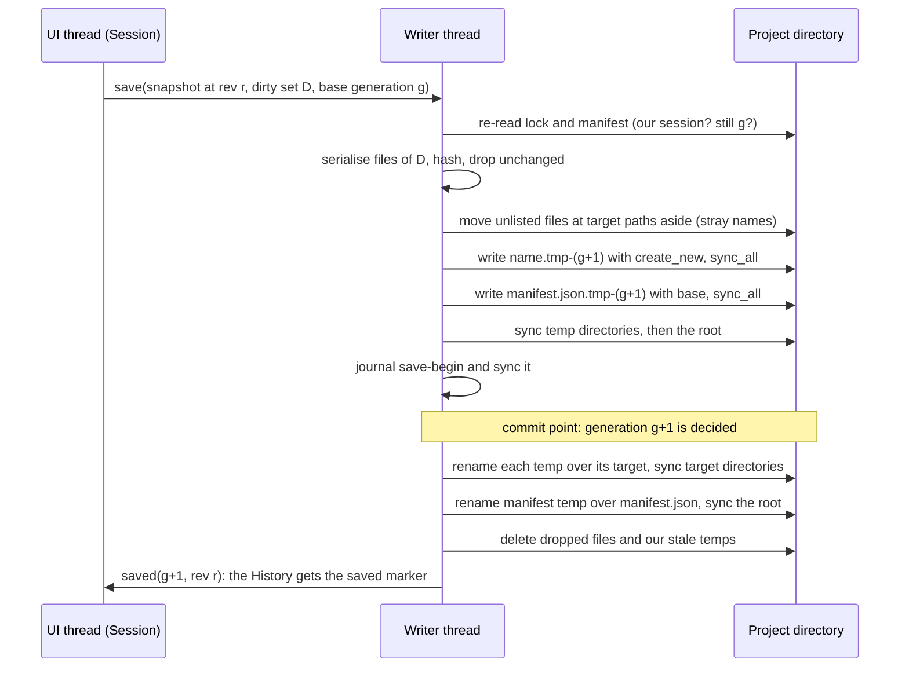
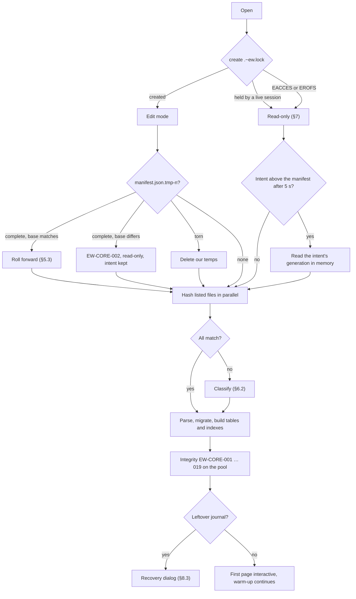
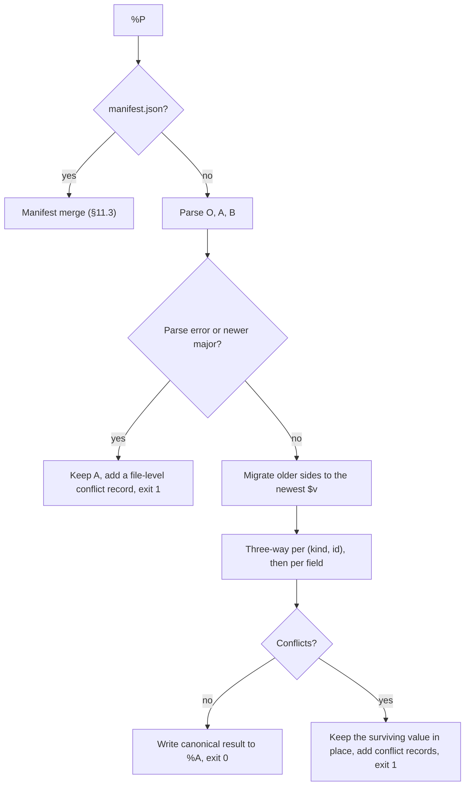

# Project format and persistence

**Status:** Draft v0.3 · Amended 2026-10-29, cycle-34 design pass, WP-S1.19 part 1 as built: `macro_instance`, `macro` and `manufacturer` implemented, a part copy with `mech`, the typed part members within 0.1 and manufacturer and macro copies, §2.2, §3.5, §10.3, §13.2, decision log ID-334, ID-783. · Amended 2026-10-28, cycle 30: the journal recovery dialog as built, §8.3, decision log ID-714, ID-715. · Amended 2026-10-26, cycle 28: accepted implementation; final local validation and publication status in ID-665; hosted CI pending at publication; hold after delivery; scoped follow-ups (ID-659 to ID-666); merged references/raster validation and accepted window corrections recorded; scoped Windows window checks passed. · **Date:** 2026-10-21 (amended 2026-10-25, cycle 27: the page-item records as written and an older build's lines rewritten canonically, §2.2, §10.3, decision log ID-647; the project fragment, §12, ID-648; the parts import's copies, §13.2, ID-651; amended 2026-10-24, cycle 24: the purge command (`HumanOnly`, the data-safety rules of lane C's fix round, ID-620), the export's image findings, the SVG hazard checks, the drawn image subset and the mechanical asset-presence guard as built, §13.3, decision log ID-605; amended 2026-10-23, cycle 23: the asset store as built and the rule that a save never removes an asset file, §13.3; the asset temps, the journal's assets and the logo reference form, §2.1, §8.1, §10.3, §17.2; `page_item` and `structure_box` specified and implemented additively under ADR-0011 amendment 4, §2.2, §10.3, decision log ID-566, ID-573 to ID-575; amended 2026-10-22, cycle 22: the members written by the four commands of FT-336 stay in `extra`, no schema change, §10.3, §17.2, decision log ID-545, ID-547; amended 2026-10-22, cycle 19: the journal kept on a dirty exit and the shell's read-only open with the recovery banner, §8.1, §8.3, decision log ID-475; the replay on a moved base and a removed library copy that a `LibRef` still names, §8.2 step 4, ID-479; amended 2026-10-22, cycle 17: the typed `revision` kind and the open failure of old revision files that break an invariant, §10.3, decision log ID-428; v0.3, cycle 13: the member order of the flattened device aspects as built, §3.1, decision log ID-337; additive implementation of reserved kinds, §10.3, ID-334; v0.2: the persistence core as built and reviewed in cycle 8,
ADR-0010 amendment 3, decision log ID-200 to ID-217; cycle 11: journal granularity of `project.settings.set`, Golden B1 files, ID-290) · **Part of:** ElektraWatt design document set

> **Anonymization note:** dates and the manufacturing year of the reference project in this document are synthetic placeholders, not the original values.

**Purpose.** This document specifies how an ElektraWatt (EW) project lives on disk and travels between machines:
- the directory layout and the canonical JSON Lines encoding;
- the manifest and its generations, and the save protocol;
- the lock, the crash journal and recovery, and external-change handling;
- `.ewz` transport, format versioning and git integration;
- library embedding and the as-built archive.

It elaborates [architecture](04-architecture.md) §7 and ADR-0010 … ADR-0013 without changing their decisions.
Its refinements of those ADRs are recorded as their amendments of 2026-10-18 and 2026-10-20 and are marked where
they apply; the
open questions keep the record of how each was decided. The crates concerned are `ew-format` (MIT OR
Apache-2.0), `ew-store` and `ew-library` (GPL-3.0-or-later).

**Contents**
1. [Principles and locations](#1-principles-and-locations)
2. [Directory layout and record ownership](#2-directory-layout-and-record-ownership)
3. [Canonical encoding](#3-canonical-encoding)
4. [Manifest and generations](#4-manifest-and-generations)
5. [Save protocol](#5-save-protocol)
6. [Open, verification and integrity](#6-open-verification-and-integrity)
7. [Lock file](#7-lock-file)
8. [Crash journal and recovery](#8-crash-journal-and-recovery)
9. [External changes](#9-external-changes)
10. [Format versioning and migration](#10-format-versioning-and-migration)
11. [Git integration](#11-git-integration)
12. [`.ewz` transport](#12-ewz-transport)
13. [Libraries, catalogues and embedding](#13-libraries-catalogues-and-embedding)
14. [Revisions and the as-built archive](#14-revisions-and-the-as-built-archive)
15. [Platform, share and cloud-sync pitfalls](#15-platform-share-and-cloud-sync-pitfalls)
16. [UI and UX touchpoints](#16-ui-and-ux-touchpoints)
17. [The reference project on disk](#17-the-reference-project-on-disk)
18. [Scope by release](#18-scope-by-release)
19. [Dependencies](#19-dependencies)
20. [Requirements covered](#requirements-covered)
21. [Open questions](#open-questions)

---

## 1. Principles and locations

1. **Text is canonical at rest, the `Model` in memory** (ARCH §7.1): no working database, no derived data, no blobs
   except content-addressed assets.
2. **Each record lives in exactly one file**, chosen by an ownership rule (§2.2); files group records by page,
   device shard or layout space, never one file per object. A typical edit rewrites one to three files.
3. **Names from UUIDs, hashes and fixed words only.** There are no reserved names or case collisions, and internal
   paths stay ≤ 120 characters (NFR-PLAT-05).
4. **A generation is complete or absent.** The manifest goes into place last (NFR-REL-01).
5. **No machine-, user- or time-specific project data:** no wall-clock save times, absolute paths or view state
   (NFR-REL-07, FR-UI-033). Authored dates (a revision date, the edited date of FR-PRJ-029) are model data.
6. **Unknown bytes are never dropped** (NFR-REL-04).
7. **Crash protection lives outside the project** (§8). EW writes only to the project, to sibling archive and
   backup files the user chose, and to per-user OS directories, never to its installation directory (NFR-PLAT-07).

| Location | Content | In git |
|---|---|---|
| `<name>.ew/` | Project data (§2) | Yes |
| `<name>.ew/.ew/u-<hash>/` | Per-user view state in `view.json`: open pages, viewports, jump history, workspace (FR-UI-033). `<hash>` = 8 hex digits of SHA-256(`user@host`), so the users of a shared folder do not overwrite each other. From 1.0 also `base.ewz`, the base generation of a work copy ([15](15-checks-revisions-collaboration.md) §6.8) | Ignored |
| `<name>.ew/.~ew.lock` | Lock record (§7); `.~ew.lock.stale-<session>` after a takeover | Ignored |
| `<name>.ew/.~ew.requests/` | "Request edit" files (1.x, [15](15-checks-revisions-collaboration.md) §6.2) | Ignored |
| OS state directory | Journal and recovery snapshots (§8); user-only permissions; removed on clean close, leftovers pruned after 30 days (NFR-PRIV-05) | Never |
| OS cache directory | STEP meshes, thumbnails, the file-backed SQL projection at XL, read-only `.ewz` extractions, the derived per-user library search index (§13.1) | Never |
| OS data directory | User library and installed community packs ([07](07-symbols-parts-macros.md) §2.1) | Never |
| OS configuration directory | Settings, recent projects, **trust decisions** (§13.4) | Never |
| `<parent>/<name>.ew-archive/` (configurable) | As-built archives (§14) | Not in the project history |

The OS directories are `$XDG_STATE_HOME`, `$XDG_CACHE_HOME`, `$XDG_DATA_HOME` and `$XDG_CONFIG_HOME` (each with an
`elektrawatt/` subfolder) on Linux; `~/Library/Application Support/ElektraWatt` and `~/Library/Caches/ElektraWatt`
on macOS; and `%LOCALAPPDATA%\ElektraWatt` on Windows, never the roaming profile. Where one base directory serves
several roles (macOS, Windows), EW uses the subfolders `config/`, `data/`, `state/` and, on Windows, `cache/`. The
mapping crate (etcetera or directories) is **(verify)**, as in ARCH §3.

**Equivalents.** EW maps the EPLAN and QElectroTech project forms ([EPLAN features](../research/eplan-features.md)
§2, §13; [gaps and corrections](../research/gaps-and-corrections.md) G1) as follows:

| EPLAN | QElectroTech | ElektraWatt |
|---|---|---|
| `*.elk` file plus `*.edb` project database | one `.qet` XML file (or `.qetz`) | `<name>.ew/` text directory (§2) |
| `*.elp` packed project, `*.zw1` backup | copy of the `.qet` | `.ewz` (§12) |
| `*.ell` revision project, `*.elr` completed project | none (per-folio `indexrev` text) | as-built archive (§14); the completed state of [15](15-checks-revisions-collaboration.md) §5.10 (1.0) |
| `*.zw9` basic project | none (copy of an existing project) | an `.ew` directory with `Project.kind = Basic` ([07](07-symbols-parts-macros.md) §2.8) |
| Open modes Default, Exclusive, Read-only; multi-user editing (Pro tier) | none | Edit or read-only through `.~ew.lock` (§7); parallel work through git branches or work copies; co-editing Later (FR-COL-021) |
| — | three rotating crash snapshots | journal plus three snapshot slots outside the project (§8) |

---

## 2. Directory layout and record ownership

### 2.1 Layout of the golden project

The reference project on disk ([golden project](20-golden-project.md), fixture `golden/J-E-2416.ew`). Golden IDs are
UUIDv5 values derived from the golden tables ([golden project](20-golden-project.md) §3.2). Records later created in
the GUI get UUIDv7 IDs (ADR-0004).

```text
J-E-2416.ew/                      # folder name chosen by the user; everything inside is UUID-named
  manifest.json                   # written LAST (§4): format, generation, SHA-256 of every file below
  project.jsonl                   # project (master data, parties as placeholders, supply, settings: identifier set,
                                  #   numbering, xref format, profile "DBU/WH 24 V", size profile, derivation profile),
                                  #   plc_config_project, logical_net and physical_net (PROFIBUS)
  structure.jsonl                 # =P01, +J-E-2416 (alias JE2416), +J-E-206, +FIELD; sections 1, 2, 9;
                                  #   external_ref ×4 (J-E-206 L, N, PE; DP master JE-N1000-03)
  revisions.jsonl                 # V1.0 (released, historic), V2.0 (open)
  report-blocks.jsonl             # 11 page-oriented report blocks: TOC, 901, 903 … 911
  waivers.jsonl                   # W-1 on -XPE      (comments.jsonl absent: empty tables write no file)
  pages/<uuid>.jsonl              # 13 files, one per drawn page: 1, 3, 101–103, 106, 201–206, 902. Generated pages
                                  #   (2, 2.1, 100, 200, 900, 901, 901.1, 903–911) have no file: they are derived
  devices/<xx>.jsonl              # ≈ 80 of 256 shards, e.g. c2.jsonl holds -102G1 and everything anchored to it
  layout/<uuid>.jsonl             # layout space +J-E-2416: -UC1, plate, ducts, rails, placements
  lib/{symbols,fndefs,forms,parts,macros,manufacturers}/<uuid>.json
                                  # embedded copies (§13): ≈ 40 symbols, the QET-compatible frame and report forms,
                                  #   23 parts (533356, A9P52610, 2904602, PT 2.5-TWIN, 571334 …), the 203–206 typical,
                                  #   the manufacturers the parts reference
  assets/<sha256>.svg             # placeholder logo
  .gitattributes  .gitignore      # §11.1; not listed in the manifest
```

Optional directories and files are absent in the golden project:
- `rules/<uuid>.toml` (a project rule pack; its rhai, SQL, Fluent and doc files go into `rules/<uuid>/`; the human
  pack ID such as `EW-POT` lives inside the file, [15](15-checks-revisions-collaboration.md) §3.7) and
  `reports/<uuid>.sql` (user SQL reports);
- `imports/<run-uuid>.jsonl` (MVP): one file per import run (kind `import_run`), so import runs never conflict with
  project data; the lineage they belong to is an `import_lineage` record in `project.jsonl`
  ([14](14-interop.md) §2.3, ADR-0004 amendment 1);
- from 1.0, `scripts/<uuid>.rhai` and `jobs/<uuid>.ewjobs` (ADR-0010 amendment 2);
- from 1.0, `exchange/<config-project-uuid>.jsonl`: the PLC exchange records and foreign IDs of one configuration
  project (kinds `exchange_record`, `foreign_id`), included in the as-built archive; the `PlcConfigProject` keeps
  only the exchange stamp ([10](10-plc-and-bus.md) §4.2);
- from 1.0, `lib/plc-profiles/<copy_id>.json` (user PLC address profiles, kind `plc_profile`; built-in profiles are
  versioned and never removed) and `lib/profiles/<copy_id>.toml` (machine and label profiles kept in their TOML
  source form, so that the SHA-256 equals the published item; the `schema` key tells the two apart,
  [13](13-manufacturing-outputs.md));
- from 1.0, `trust.sig` at the root (a signature over the trust hash, §13.4) and opt-in embeddable meshes
  `assets/<sha256>.glb` ([12](12-panel-layout.md) §6.2).

None of the rule, report, script or job content runs until the user trusts the project (NFR-SEC-05, §13.4).

**Temps, orphans and strays** (2026-10-20, ADR-0010 amendment 3; decision log ID-203, ID-214). The save protocol's
own temps ("our temps") are the intents `manifest.json.tmp-<g>` and the `.tmp-<g>` files of record files, library
documents and assets (`assets/<sha256>.<ext>.tmp-<g>`, as built in cycle 23, decision log ID-573); an editing open
deletes or rolls forward only those (§5.3, §6.1). Every other file that the
manifest does not list is left alone: with a manifest present it is never read, never deleted and reported as
EW-CORE-004 (§6.2). A save that needs the path of such a file first moves it aside to
`<stem>.unlisted-<g>[-<n>].<ext>` (§5.2), a **stray** name that the application never reads, writes or deletes.

### 2.2 Kind registry and ownership

`ew-schema` holds a **kind registry**: the `$k` name, a fixed **rank** (sort order, §3.3) and an **ownership
rule**. Ranks are never reused or renumbered.

| Rank | `$k` | File | Anchor |
|---|---|---|---|
| 10–14 | `project`, `plc_config_project`, `logical_net`, `physical_net`, `medium` | `project.jsonl` | — |
| 15 | `import_lineage` | `project.jsonl` | — |
| 20–22 | `structure_node`, `section`, `external_ref` | `structure.jsonl` | — |
| 30 | `page` | `pages/<id>.jsonl` | own ID |
| 31 | `device` (with every aspect: strip, terminal, cable, assembly, PLC, bus, valve terminal) | shard | own ID |
| 32 | `function` | shard; an interruption-point (IP) function without a device goes to its page, which owns it: deleting the page or the IP representation deletes the function (ADR-0009 amendment 3), and an IP function has exactly one representation (EW-INV-013) | `device`; IP: page of its representation |
| 33, 35 | `representation`, `junction` | page file | `page` |
| 34 | `connection` | page file if `page` is set, else a shard | `page`, else the device owning endpoint `a` |
| 36, 37 | `conductor`, `channel` | shard | `cable`, `module` |
| 38–41 | `potential_def`, `net_def`, `medium_def`, `bond` | shard (junction endpoint: its page) | device owning `at` (bond: `a`) |
| 42 | `device_link` | shard | `from` |
| 43–45 | `page_item` (variants include `SurfaceView`, `ModelView`, `Dimension` and `Underlay`), `structure_box`, embedded `report_block` | page file | `page` / `embedded.page` |
| 45 (same kind) | page-oriented `report_block` | `report-blocks.jsonl` | — |
| 46 | `macro_instance` | page file of the macro's anchor page | anchor page |
| 47 | `placeholder_group` (reserved: [03](03-domain-model.md) §7 keeps placeholder groups inside `MacroDef`, so no project record uses it yet) | page file of the anchor page | anchor page |
| 50–56 | `layout_space`, `enclosure`, `mounting_surface`, `carrier`, `placement`, `route_override`, `committed_route` | `layout/<space>.jsonl` | space via carrier → surface → enclosure |
| 57, 58 | `routing_path`, `surface_feature` | `layout/<space>.jsonl` | space |
| 60–62 | `revision`, `waiver`, `comment` | own root file | — |
| 63 | `transmittal` | `revisions.jsonl` | its revision |
| 70, 71 | `exchange_record`, `foreign_id` (1.0) | `exchange/<config-project-uuid>.jsonl` | configuration project |
| 72 | `import_run` | `imports/<run-uuid>.jsonl` | own ID |
| — | `part`, `symbol`, `fndef`, `form`, `macro`, `manufacturer` (library copies) | `lib/<kind>s/<id>.json`, one pretty document each (§3.4) | own ID |
| — | `plc_profile` (library copy, 1.0) | `lib/plc-profiles/<id>.json` (§3.4) | own ID |
| — | `machine_profile`, `label_profile` (library copies, 1.0) | `lib/profiles/<id>.toml`, the TOML source form; the `schema` key tells the kinds apart | own ID |
| 255 | `conflict` | file of its target | target |

**`page_item` and `structure_box`** (specified 2026-10-23, WP-S2.04 §10.1; decision log ID-566). Both kinds have had
their rank and ownership since the registry was written: `page_item` is rank 43 and `structure_box` rank 44, each
owned by the page file of its `page` member. In `ew-schema` both are `KindStatus::Reserved`, so a record of either
kind is kept verbatim as a reserved kind (§10.3) **until WP-S2.04 part 4a implements them**, which makes them
`Implemented`. Their typed tables are additive within format 0.1 on the basis of ADR-0011 amendment 4 (decision log
ID-334, §10.3 rule 2), which applies again: `schemas/0.1` is re-blessed, with no format bump and no `$v` bump, and an
older 0.1 build keeps the records verbatim. The shapes below are those of WP-S2.04 §10.1; the domain model's
[03](03-domain-model.md) §5 (`StructureBox`) and §6 (`PageItem`) carry the fields. Illustrative records, on folio 101
of the golden project (Golden A has neither kind; IDs shortened, the connection is W7):

```json
{"$k":"page_item","id":"…","page":"8e41c0d2-1b7f-5a39-a6c4-0f5e2d913b7a","kind":{"wire_marker":{"connections":["b29e4f17-8d63-5a0c-9f71-3c6a2e8d05b1"],"at":[90000000,24000000],"fields":["csa","colour"]}}}
{"$k":"page_item","id":"…","page":"8e41c0d2-1b7f-5a39-a6c4-0f5e2d913b7a","kind":{"graphic":{"shape":{"rect":{"min":[20000000,40000000],"max":[80000000,64000000]}},"dash":"dashed"}}}
{"$k":"structure_box","id":"…","page":"8e41c0d2-1b7f-5a39-a6c4-0f5e2d913b7a","outline":[[20000000,40000000],[80000000,40000000],[80000000,64000000],[20000000,64000000]],"style":"dotted","caption":"External Connection","assigns":{"location":"a41f6c2d-8e05-5d97-b3c1-5f2e8a7d9c60"}}
```

- **`page_item`:** `{"$k", "id", "$v"?, "page", "layer"?: Ident, "kind": <variant>}`, the variant an externally tagged
  object: `graphic`, `free_text` or `wire_marker`. Their members, enumerations and defaults are in
  [03](03-domain-model.md) §6. Any other variant (`macro_box`, `surface_view`, `model_view`, `dimension`, `underlay`,
  and `image` until WP-S2.04 part 5) is kept verbatim as `PageItemKind::Unknown(Value)` (§10.3 rule 3) and round-trips
  byte for byte, as does a variant of a newer format.
- **`structure_box`:** `{"$k", "id", "$v"?, "page", "outline": [Pt2] (at least 3), "style": "dotted" | "dash_dot",
  "caption"?: MlText, "assigns": StructureAssignment, "external"?: IdS}` ([03](03-domain-model.md) §5).
- **Links and invariants.** The `page` of either kind is a cascade link (deleting a page deletes its items and boxes,
  FR-PAG-025), and the connections a wire marker lists are held by two new structural invariants of ADR-0009
  (EW-INV-022 and EW-INV-023, [03](03-domain-model.md) §6): a deleted connection leaves the list, and a marker left
  empty is deleted in the same plan. `StructureBox.external` (an `ExternalRef` ID) is an unlink
  link: deleting the reference clears the member (lead ruling, decision log ID-566).
- **Load finding.** A build from before part 4a keeps `page_item` records verbatim and does not enforce that delete
  link, so a project can arrive with a wire marker that lists a deleted connection or a connection on another page.
  This is **reported, not refused**: a load finding that names the marker and the connection, among the other load
  findings of `Session::load_findings` (a derivation finding, not an integrity rule of §6.3). The stale entry is ignored
  by the derivation and the drawing, and the project opens; the next edit of that marker writes a clean list.
- **Migration test.** A page file that holds both kinds and an unknown `page_item` variant is read and written back byte
  for byte (an unknown variant is `Unknown(Value)`, written back unchanged, §10.3). *As built (cycle 27, decision log ID-647):* that file round-trips byte for byte; the same records as a build before part 4a wrote them (reserved kinds, so every object's members in byte-wise order) load typed with a `NonCanonical` finding and are rewritten in the typed kinds' member order (§10.3; the revision precedent, FT-165). `free_text.text` is omitted when empty, `arc.start` when 0 and `$v` when 1, so an explicit `"$v": 1` is not canonical.

**`macro_instance`, `macro` and `manufacturer`** (as built, cycle 34, WP-S1.19 part 1; decision log ID-334, ID-783).
The three kinds turn `Implemented`, each at schema version 1, under the same rule (ADR-0011 amendment 4, §10.3 rule 2):
`schemas/0.1` is re-blessed with the new `macro.schema.json`, `macro_instance.schema.json` and
`manufacturer.schema.json`, no format and no `$v` bump, no `required` list changed and no property removed.
- **`macro_instance`** (rank 46) lives in the page file of its `page` member, the anchor page:
  `{"$k", "id", "$v"?, "macro", "variant", "value_set"?, "values"?, "members"?, "page"}`, where `macro` is the macro
  copy's ID and `members` a list of `[fragment-local ID, created ID]` pairs ([03](03-domain-model.md) §7). Its links:
  `page` cascade, `macro` forbid, `members[][1]` a kind-erased unlink (a deleted member leaves the list; the instance
  stays). An older 0.1 build keeps its lines verbatim as a reserved kind and does not apply these links.
- **`macro` and `manufacturer`** are library copies under `lib/macros/` and `lib/manufacturers/`, one pretty document
  each (§3.4), read and written and hashed like the other library kinds (§13.2).
- **`placeholder_group`** (rank 47) stays reserved (WP-S1.19 D15).

Channel IDs are `v5(module, "channel", number)` ([10](10-plc-and-bus.md) §2.4, ADR-0004 amendment 2), so a channel
keeps its file and line position however often its module is re-addressed.

**Anchor fallbacks** (2026-10-20, format level; decision log ID-205). Every record of a known kind has exactly one
deterministic file, also when its anchor cannot be resolved the normal way:
- a page-less record anchored at a connection point of an interruption-point function (which has no device), such
  as a page-less connection or a potential definition at that point, follows the function into its page file;
- an interruption-point function without a representation (a broken EW-INV-013) goes to the shard of its own ID;
- a dangling anchor (the referenced function or junction does not exist, EW-CORE-008) goes to the shard of the
  referenced ID, so the record keeps its file when the reference is repaired; an endpoint of a newer format goes to
  the shard of the record's own ID;
- a record of a reserved or unknown kind gets a file only where its rule needs nothing but the record itself (a
  root file, `imports/<own id>.jsonl`, the page named by its `page` member); otherwise it stays in the file it was
  read from (§10.3).

A shard is `devices/<xx>.jsonl`, where `xx` is the anchor ID's last byte as two lower-case hex digits. The
[domain model](03-domain-model.md) §14 allows a `LogicalNet` in its master's shard or in `project.jsonl`; this
format always uses `project.jsonl`, so that a change of master (in the golden project the external partner
JE-N1000-03) does not re-key the net.

**Follow relations.** Some records take their file from another record. A transaction that changes one of these
source fields re-keys the dependent records, and the writer marks both their old and their new files dirty:

| Source field changes | Records re-keyed |
|---|---|
| `Representation.page` of an IP representation | its IP function |
| `Function.device` | page-less connections, potential, net and medium definitions and bonds at the function's CPs |
| `Carrier.surface`, `MountingSurface.enclosure`, `Enclosure.space` | dependent layout records |

A property test guards the table: after any random command sequence, incremental saves must equal a full save,
byte for byte (NFR-REL-16).

**Committed computations** (`Committed<T>{value, input_hash, rev}`, ADR-0003) are persisted without `rev`, which is
a session-local counter. A routed path is a `committed_route` record with ID `v5(connection, "route")`. Frozen wire
numbers live in `Connection.number`. A released revision's report snapshots live in its archive (§14).

---

## 3. Canonical encoding

### 3.1 Files and records

- **Files.** UTF-8 without BOM, LF line endings on every platform, one record per line, a final LF, no blank lines.
  The reader accepts one leading BOM in a JSONL file and in a library document (§3.4) and the next save rewrites the
  file without it: a reader tolerance, not a format change (decision log ID-552; no ADR).
  A file that would be empty is not written; if it exists, it is deleted.
- **Lines.** Each line is a compact JSON object: no whitespace outside strings. String escaping equals serde_json's
  compact output:
  - `"` and `\` are escaped;
  - control characters become `\b \f \n \r \t` or `\u00xx`;
  - non-ASCII characters stay raw;
  - `/` is never escaped.

  The form is close to RFC 8785 (JCS), but members follow the schema order and numbers are integers only. The
  byte-wise key order of `extra` relies on serde_json's sorted `Map`; its feature `preserve_order`, which would
  switch every `Map` in the build to insertion order, is banned by `ci/dep-rules.toml` and guarded by a unit test
  (decision log ID-215).
- **Strings are NFC** (ARCH §7.3). A non-NFC string read from disk is normalised in memory, and its file counts as
  non-canonical, so it is rewritten at the next save; `ew fmt --check` reports it.
- **Member order:**
  1. `"$k"`, `"id"`, `"$v"` (per-kind schema version, omitted when 1, §10.2);
  2. known members in **schema declaration order**;
  3. flattened device aspects (`strip`, `terminal`, `cable`, `assembly`, `plc_station`, `plc_module`, `bus_node`,
     `valve_terminal`), as in the ARCH §7.3 example (as built, cycle 13: `assembly` is written before
     `plc_station`; decision log ID-337);
  4. the `extra` map (unknown members and namespaced `plugin.<id>.*` keys, FR-EXT-021), in byte-wise key order.
- **Defaults omitted.** A member equal to its schema default is not written: `None`, empty arrays and maps, `false`
  flags and default enum variants. Where the default is not the type's zero value the schema names it. The v0
  defaults: `Page.scale` `not_to_scale`; `Representation.rep_type` and `SymbolDef.rep_type` `multi_line`;
  `Junction.wiring` absent means the style's default (Dot: star, Bevel: chain); `Cable.length` `missing`;
  `ItemMeta.status` `released`; `CpDef.discipline` and `SymbolCp.discipline` `electrical`; `Strip.field_side`
  `side2`; `CpDef.physical` `true` (written only as `false`).
- **`extra` at every depth.** Every JSON object of the format, records and nested value objects (`Quantity`,
  `PartRef`, `Folio`, `WireOverrides` …) alike, has its own `extra` map, flattened last, so a member that a newer
  minor appends at any depth survives a load and a save (ADR-0011 amendment 2).
- **Import provenance last.** `source_ref?{lineage, key}` ([14](14-interop.md) §2.3) is the last declared member of
  every project record kind except `import_lineage`; in a device only the flattened aspects and `extra` follow it.
- **`$v` is checked.** A typed reader accepts only the registry's `$v` of each kind; older records are migrated first
  (§10.2).

### 3.2 Value encodings

| Type | JSON | Example |
|---|---|---|
| `Id<T>` | lower-case hyphenated UUID | `"c7a90e35-42d8-5f61-8b03-9d2e6f1a47c2"` |
| Integer, `Nm` | integer with \|n\| ≤ 2⁵³ − 1 (safe for JavaScript and jq); no `-0` or exponent | `137583333` |
| `Pt2`, `Grid` | `[x, y]` in nm; reduced `{"num","den"}` with `den` > 0 | `[42333333,15875000]`, `{"num":7937500,"den":3}` |
| `Rect` | `[[x0, y0], [x1, y1]]`: two `Pt2`, the minimum corner first (`x0 ≤ x1`, `y0 ≤ y1`); a degenerate rectangle is allowed, a reversed one is a schema violation. Persisted by the embedded `report_block` (`embedded.rect`), form `DataArea.rect` and `FormCell.rect` (title-block and report cells), and `SurfaceView.clip`. `ew-schema` implements the encoding; `ew-units` keeps `Rect` free of serde | `[[10000000,180000000],[120000000,270000000]]` |
| `Orient2` | string; default `"r0"` omitted | `"r90"`, `"m0"` |
| `Angle2` | integer in 10⁻³ degree; default 0 omitted. Free texts and graphics only; symbol representations use `Orient2` | `"angle":45000` |
| `Pose3` | `{"t":[x,y,z],"q":[w,x,y,z]}`, `q` in 10⁻⁹, sign-normalised (w > 0, else the first non-zero component > 0) | `{"t":[0,500000000,0],"q":[1000000000,0,0,0]}` |
| `Dec3` | decimal string: at most 3 fraction digits, no trailing zeros, no `+`, `-0` or exponent, never a unit | `"0.75"`, `"40"`, `"1"` |
| `Quantity`; `TechValue` | `{"value": Dec3, "unit": Unit}` with the unit spellings below; `{"key", "value"}` whose value is a `Quantity` object or an `Ident` string, told apart by JSON type. A key qualified by a classification scheme is `"<scheme>:<id>"` (schemes `etim`, `eclass`, `iec_cdd`); a plain key without a colon is a native or project property. Booleans and enumeration values are `Ident`s (`"true"`, `"false"`, the member) until a typed form is needed ([07](07-symbols-parts-macros.md) §2.5) | `{"key":"i_out","value":{"value":"20","unit":"A"}}`, `{"key":"curve","value":"C"}`, `{"key":"etim:EF001234","value":"true"}` |
| `Csa` | a bare `Dec3` string in mm²; `{"awg": n}` with 1/0 as 0, 2/0 as −1, 3/0 as −2, 4/0 as −3; `{"kcmil": Dec3}` | `"2.5"`, `{"awg":18}`, `{"kcmil":"250"}` |
| `MlText` | string (neutral) or object keyed by sorted BCP 47 tags | `"1+"`, `{"en-GB":"Power Supply 1 - Main Current"}` |
| `Ident` | NFC string without surrounding white space | `"A9F78116"` |
| `ColourSpec` | an array of one or two `ColourCode`s. A `ColourCode` is a string: one of the 14 IEC 60757 codes (`BK` … `SR`), else a company code, which the colour profile must declare (EW-CORE-031 checks it; it is not a parse error); a foreign code (lenient projects only, EW-CORE-031) is the data variant `{"foreign": code}` | `["BK"]`, `["GN","YE"]`, `["DBU"]`, `[{"foreign":"BR"}]` |
| Authored date | `"YYYY-MM-DD"` | `"2025-04-14"` (a revision date, entered by a person) |
| Enum | unit variant as a snake_case string; data variant as a one-member object. Persisted enums are open: an unknown value is kept as `Unknown` and written back unchanged (§10.3); the JSON Schemas omit the catch-all (§10.4) | `"tbd"`, `{"core":"<id>"}`, `{"manual":"Q0.1"}` |
| `Endpoint` | `{"cp":[function, idx]}` or `{"junction": id}` | `{"cp":["d40b6e93-…",0]}` |
| Structure slot | absent = inherit; a node ID; `"none"` | `"location":"a41f6c2d-…"` |
| `Aspect` (of a structure node) | snake_case string: `functional_assignment`, `function`, `installation_site`, `location`, `document_kind`, `user_defined`, `type`. `product` (`-`) is the device tree and never a `StructureNode.aspect`: the reader rejects it there and the JSON Schemas omit it ([03](03-domain-model.md) §5); another unknown string is kept like any open enum value (§10.3) | `"location"` |
| Sequence / set / keyed list | A sequence keeps model order. A **set** is sorted by the compact JSON text of its elements in byte order, so `"ab!"` precedes `"ab"` (`!` is 0x21, `"` is 0x22); the sets are `aliases`, `translations`, `keywords`, `manual.include`, `manual.exclude` and `Arrangement.slots`. A **keyed list** is sorted by its key in the key type's order (integers numerically, `Ident` keys byte-wise): `cp_overrides`, `cp_pattern` and `cps` (of `SymbolDef`, `FnDef` and `ExtraVariant`) by `idx`, `tech_data` and `free_props` by `key`, `pin_map` by `symbol_cp`, `text_slots` by `slot`. The reader rejects an unsorted set or keyed list and a duplicate element or key. NFC normalisation on load (§3.1) can change a set's order; `ew-format` re-sorts it when it rewrites the non-canonical file | `route`; `aliases`; `cp_overrides` by `idx` |
| `Rgb` | `"#rrggbb"`, lower-case hex | `"#c0c0c0"` |
| `Pen` | a house pen `"p013"`, `"p018"`, `"p026"`, `"p042"`, `"p052"`, `"p130"`, or `{"width": Nm}` | `"p026"`, `{"width":183000}` |
| `Primitive` | a one-member object named by the primitive kind: `line`, `polyline`, `rect`, `circle`, `ellipse`, `arc`, `polygon`, `text`, `image` | `{"line":{"from":[0,0],"to":[0,8000000],"stroke":{"pen":"p026"}}}` |
| `CategoryKey` | a three-element array: category, group, definition | `["ProtectionOvercurrent","MCB","1P+N"]` |
| `SortKey` | `{"key": Ident, "descending": bool}`, `descending` omitted when false | `{"key":"folio"}` |
| Hash | `"sha256:<64 lower-case hex>"` | manifest, library copies |

**Unit spellings** (`Quantity.unit`, ADR-0005 amendment 4). Units are written in ASCII so files stay greppable;
rendering ("mm²", "°C") is a query. Geometric lengths are `Nm`, never a `Quantity`.

| JSON | Unit | Used for |
|---|---|---|
| `mm2` | square millimetre | cross-sections |
| `A` | ampere | currents |
| `V` | volt | voltages |
| `Hz` | hertz | frequencies |
| `bar` | bar | pressures |
| `degC` | degree Celsius | temperatures |
| `kg` | kilogram | masses |
| `W` | watt | losses and power |
| `m` | metre | lengths in technical data; the order quantity of cables |
| `piece` | piece | counts; the default order unit |
| `set` | set | order unit |
| any other string | `Unknown`, kept verbatim | a unit of a newer format |

**There are no floats anywhere** (ADR-0005). A number with a fraction or an exponent is a schema violation
(EW-CORE-007).

### 3.2a Derived identities

UUIDv5 IDs (ADR-0004 amendments 1, 2 and 4) are computed from a namespace and a name. The bytes that enter the hash
are part of the format and never change; `ew-ids` (`v5` module) implements them and pins them with fixed test
vectors.

- **Namespace:** the parent UUID the formula names, or a fixed constant. Each constant is a random v4 UUID minted
  once, fixed forever and held by `ew-ids`:

  | Constant | Value | Used by |
  |---|---|---|
  | `NS_LIBCOPY` | `04c1640f-8857-4dfc-9bff-e9baad47fb47` | embedded library copies (§13.2) |
  | `NS_IMPORT` | `7b75186c-f28e-49ce-b7f7-26b137095a65` | import-lineage namespaces ([14](14-interop.md) §2.3) |

- **Name:** the UTF-8 bytes of the components' canonical text forms, joined by U+001F (UNIT SEPARATOR, written ␟):
  UUIDs lower-case hyphenated; integers in decimal without sign, padding or separators; the literals `channel` and
  `route` verbatim; source keys and version strings exactly as given. U+001F cannot occur in a UUID or a decimal
  integer, so the joined name is unambiguous.
- **Hash:** `Uuid::new_v5(namespace, name)` (SHA-1, RFC 9562 §5.5).

| ID | Formula | Name bytes | Stored? |
|---|---|---|---|
| Connection point | `v5(function, idx)` | `2` | no; only `CpOverride` rows |
| Generated report page | `v5(report_block, page_index)` | `7` | no |
| Function from a part's function template | `v5(device, template_index)` | `3` | yes |
| PLC channel | `v5(module, "channel", number)` | `channel␟3` | yes |
| Committed route | `v5(connection, "route")` | `route` | yes |
| Embedded library copy | `v5(NS_LIBCOPY, library ‖ item)` | `<library uuid>␟<item uuid>` | yes (file name) |
| "Keep both" library copy | `v5(NS_LIBCOPY, library ‖ item ‖ version)` | `<library uuid>␟<item uuid>␟2.1.0` | yes (file name) |
| Import-lineage namespace | `v5(NS_IMPORT, importer ‖ anchor kind ‖ anchor value)` | `dxf␟sha256␟<64 lower-case hex>` | yes (`ImportLineage.namespace`) |
| Imported record | `v5(lineage namespace, source_key)` | the source key byte for byte, e.g. `qet:el:<uuid>` | yes |

`ew-ids::v5::lineage_namespace(importer, anchor)` implements the lineage-namespace row; the importer is required in
lower-case ASCII.

**Worked example.** For the module `0192f3a4-5b6c-7d8e-8f01-23456789abd0`, `plc_channel_id(m, 3) = v5(m,
"channel␟3")` = `c3cb5781-8135-54b1-8948-9f118e22553d`. For an import lineage anchored on the SHA-256 of an empty
file, `v5(NS_IMPORT, "dxf␟sha256␟e3b0c44298fc1c149afbf4c8996fb92427ae41e4649b934ca495991b7852b855")` =
`a1ba512b-c515-50c5-af0b-26fa3b5599f5`. Importers emit source keys in NFC (§3.1), so the stored `source_ref.key`
re-derives the record's ID.

### 3.3 Line order

Records sort by kind rank, then by the ID's bytes 8–15 read as a big-endian `u64` (the random bits), then by the
full ID.

**Why the random bits.** UUIDv7's leading bytes are a timestamp, so time order would make additions on two branches
append at the same spot. Random-bits order scatters them, so plain-git and web merges succeed far more often
(ADR-0010).

**The order needs truly random bytes 8–15.** `ew-ids` therefore generates UUIDv7 by RFC 9562 §6.2 method 3
(ADR-0004 amendment 3): a sub-millisecond fraction in `rand_a` and 62 fresh CSPRNG bits in `rand_b` for every ID.
It puts no counter in `rand_b`. The uuid crate's `ContextV7` keeps a 42-bit counter spanning `rand_a` and the
top 30 bits of `rand_b` (checked in uuid 1.28.0), so `ew-ids` does not use `Uuid::now_v7` and assembles the bits
itself. UUIDv5 bytes are hash-random anyway. Sharding uses
byte 15, which is random under both schemes. Loading records in any order yields the same tables, and therefore
the same bytes on save (NFR-REL-07).

**Unknown and reserved kinds.** Records of a kind this reader does not know, and of a reserved kind that has a
rank but no table yet (such as `import_run`, or the layout kinds before WP-S4.01), are kept and written in the same
order: by rank where the registry knows the kind, else after every known kind, ordered by the `$k` text byte-wise,
and then by the ID order above. A duplicate `($k, id)` among them is EW-CORE-009 like any other (§6.3). Records of
a **reserved** kind are kept verbatim without a finding, because this format version defines them; only kinds,
members and variants the reader does not know at all are EW-CORE-016 (decision log ID-206).

### 3.4 Library documents

Library copies (`lib/**`) are pretty JSON, one document per item (ARCH §7.3):
- 2-space indentation, member order as in §3.1, LF and a final newline;
- every array or object whose compact form is ≤ 100 bytes is written inline, with `": "` and `", "` separators, so
  a 200-point symbol stays readable;
- the copy metadata `library_id`, `item_id`, `version` and `sha256` (ARCH §4.2) follow `$k` and `id` (§13.2).
- the item's members follow. Every item kind carries `meta: ItemMeta`, a provenance object with `key?`
  (`pxc.2904602`), `licence?` (an SPDX expression), `sources: Vec<String>`, `as_of?: Date`, `confidence` (section
  name → `verified`, `unverified` or `test`), `status` (`draft`, `released`, `deprecated{successor?}` or
  `withdrawn`; default `released`) and `foreign_terms: bool` ([07](07-symbols-parts-macros.md) §2.1, §2.5).
  `ItemMeta` has no `version`: a document stores its version once (§13.2).

The exception is `lib/profiles/` (1.0): machine and label profiles keep their TOML source form, so that the hash
over the item's own text equals that of the published item. The copy metadata `{library_id, item_id, version,
sha256}` is a leading `[copy]` table, which the hash excludes as it excludes the JSON copy metadata
([13](13-manufacturing-outputs.md) open question 3).

*Reader tolerance (as built, cycle 22; decision log ID-552).* The writer never writes a BOM (§3.1), but the reader
forgives one, as it does in a JSONL file: one leading BOM before a library copy is stripped and the copy is marked
non-canonical, so the next save rewrites it without the BOM; a second BOM is a syntax error and the copy stays opaque.
A copy with a BOM whose content is malformed is a kept document: it is preserved byte for byte, BOM included, and
never rewritten. The copy's `sha256` (EW-CORE-014) is computed over the item's compact JSON, so a BOM never changes
it, while the manifest hash stays over the file's bytes.
Before this, a BOM made the copy opaque and the project failed to open with an integrity error (EW-INV-001), the
first finding of the `migration_chain` fuzz target ([18](18-quality-security-release.md) §3.12).

### 3.5 Example records (golden project)

Folio 101's page file holds the page row, the -101F1 representation and wire W7 (S51:1 → -101F1:1):

```json
{"$k":"page","id":"8e41c0d2-1b7f-5a39-a6c4-0f5e2d913b7a","folio":{"section":"0e8b3d61-a74c-5f12-b5e9-82d4c1f06a3e","number":101},"kind":"multi_line","structure":{"function":"7d2c95e0-1f4a-5b38-a6e7-0c93b5d1f284","location":"a41f6c2d-8e05-5d97-b3c1-5f2e8a7d9c60"},"title":{"en-GB":"Power Supply 1 - Main Current"},"grid":{"num":7937500,"den":3}}
{"$k":"representation","id":"6f03d8a5-c912-5e7b-8a40-1d5b39e2f7c6","functions":["3e7a1c58-90d4-5b26-8f3a-6c0d2e9b417e"],"page":"8e41c0d2-1b7f-5a39-a6c4-0f5e2d913b7a","symbol":"2c7e9b40-5a18-5f63-9d2c-b8a1e07f4396","pos":[137583333,31750000]}
{"$k":"connection","id":"b29e4f17-8d63-5a0c-9f71-3c6a2e8d05b1","a":{"cp":["d40b6e93-25f7-5c1a-9e8d-7a3f1c05b6e2",0]},"b":{"cp":["3e7a1c58-90d4-5b26-8f3a-6c0d2e9b417e",0]},"page":"8e41c0d2-1b7f-5a39-a6c4-0f5e2d913b7a","route":[[42333333,15875000],[137583333,15875000]],"overrides":{"csa":"2.5","colour":["BK"],"show_marker":true}}
```

- **Page.** The record has no description override and no revision, Prev/Next or title-block text (D-05, D-06). It
  uses `title` and `description_override` as the [domain model](03-domain-model.md) §1.2 amends ARCH §4.2.
- **Representation.** Its position (10 px grid indices 52, 12) lies in cell B8. The optional member `anchor` (an
  `AnchorPolicy`, absent here) overrides the anchor policy of the symbol copy for this one representation; adding it
  is additive within 0.1 (ADR-0011 amendment 4, decision log ID-334, ID-351).
- **W7.** Its 2.5 mm² BK is an explicit override (CDP) with a marker. W8 (-101F1:1 → F55:1) has **no**
  `overrides` member: its 1.5 mm² BK is derived (D-08).

Shard `devices/c2.jsonl` holds -102G1 (ID ending `c2`) and, after it (rank 32 after 31), its main function:

```json
{"$k":"device","id":"c7a90e35-42d8-5f61-8b03-9d2e6f1a47c2","tag":{"letter":"G","counter":1},"kind":"psu","parts":[{"part":{"copy":"e5d2a8f1-0c37-5b94-8e6a-4f1d93c7b025"},"qty":"1"}],"function_text":{"en-GB":"Power supply 1 AC / 24 V DC"},"tech_data":[{"key":"i_out","value":{"value":"20","unit":"A"}}]}
{"$k":"function","id":"1d6f3a92-7c05-5b8e-94a1-e3c2087f5d19","device":"c7a90e35-42d8-5f61-8b03-9d2e6f1a47c2","def":"5b9e2d70-3c41-5f8a-b6d2-19e4c7a03f58","kind":"black_box"}
```

Shard `devices/2a.jsonl` holds terminal 1 of -X1031 (ID ending `2a`). It prints its function text "1+" through
the strip's `label_mode` ([domain model](03-domain-model.md) §8.4):

```json
{"$k":"device","id":"f19c3a7e-6b02-5e48-9d5a-c7e1340b8f2a","tag":{"letter":"X"},"kind":"terminal","parts":[{"part":{"copy":"a07c4e19-d25b-5f83-9c16-4e8b0d7a2f35"},"qty":"1"}],"function_text":"1+","terminal":{"strip":"58e2b1d0-4c97-5a3f-8e16-d09a72c5e3f1","seq":1,"designation":"1"}}
```

`parts[].part` is a `PartRef{copy, variant?}` and `qty` a `Dec3` in the part's order unit (-3W1 counts in metres;
[domain model](03-domain-model.md) §3.2, §7).

The text "-102G1" appears in no file. It derives from `{G, 1}`, the page-based scheme and the folio of the main
representation ([domain model](03-domain-model.md) §8.2). An excerpt of `lib/parts/e5d2a8f1-….json` (2904602;
library IDs and the hash abbreviated). The manufacturer is a `LibRef`, which resolves to the project's embedded
copy of that item under `lib/manufacturers/` ([07](07-symbols-parts-macros.md) §2.5, §3.1):

```json
{
  "$k": "part",
  "id": "e5d2a8f1-0c37-5b94-8e6a-4f1d93c7b025",
  "library_id": "6a1d0f3e-…",
  "item_id": "8b42c7d9-…",
  "version": "1.2.0",
  "sha256": "sha256:9f2c…",
  "meta": {"licence": "CC0-1.0", "sources": ["golden tables"]},
  "manufacturer": {"library": "6a1d0f3e-…", "item": "0f7b2c94-…", "version_req": "^1"},
  "part_number": "2904602",
  "description": {"en-GB": "Power supply 1 AC / 24 V DC, 20 A"},
  "cp_pattern": [
    {"idx": 0, "designation": "L"},
    {"idx": 1, "designation": "N"},
    {"idx": 2, "designation": "PE", "potential_role": "pe"},
    {"idx": 3, "designation": "+", "potential_role": "l_plus"},
    {"idx": 4, "designation": "+", "potential_role": "l_plus"},
    {"idx": 5, "designation": "-", "potential_role": "m"},
    {"idx": 6, "designation": "-", "potential_role": "m"}
  ]
}
```

`meta` is the part's provenance object (§3.4); the part's version is the copy metadata `version` alone.

**A part with `mech`** (as built, cycle 34, WP-S1.19 part 1; decision log ID-334, ID-783). Golden A's part copies
carry no L3 data, so this excerpt is the `ew-format` test fixture of 2904602 (dimensions and offsets are test values,
not checked against a datasheet), with an alternative and a macro link; library IDs and the hash abbreviated. Lengths
are nanometres, the mass grams. The typed members follow `cp_pattern` in the order of
[07](07-symbols-parts-macros.md) §2.5 (`contacts`, `mech`, `sections`, `alternatives`, `configured`, `macros`). The
line breaks follow §3.4, except that the abbreviated `LibRef` objects are shown inline: with their full IDs they
exceed 100 bytes and the writer breaks them over lines.

```json
{
  "$k": "part",
  "id": "e5d2a8f1-0c37-5b94-8e6a-4f1d93c7b025",
  "library_id": "6a1d0f3e-…",
  "item_id": "8b42c7d9-…",
  "version": "1.2.0",
  "sha256": "sha256:…",
  "meta": {"key": "pxc.2904602", "licence": "CC0-1.0"},
  "manufacturer": {"library": "6a1d0f3e-…", "item": "0f7b2c94-…", "version_req": "^1"},
  "part_number": "2904602",
  "description": {"en-GB": "Power supply 1 AC / 24 V DC, 20 A"},
  "cp_pattern": [{"idx": 0, "designation": "L"}, {"idx": 1, "designation": "N"}],
  "mech": {
    "width": 60000000,
    "height": 130000000,
    "depth": 125000000,
    "mount_kind": "ts35x7_5",
    "rail_offset": [30000000, 65000000],
    "clearance": {"top": 50000000, "bottom": 50000000},
    "front_2d": [[[0, 0], [60000000, 0], [60000000, 130000000], [0, 130000000]]],
    "mass": 1100
  },
  "alternatives": [{"part": {"library": "6a1d0f3e-…", "item": "…", "version_req": "^1"}, "kind": "successor"}],
  "macros": [{"rep_type": "multi_line", "macro": {"library": "6a1d0f3e-…", "item": "…", "version_req": "^1"}}]
}
```

A clearance side that is absent is 0. A copy that an older build wrote with `mech` in `extra` (members in byte-wise
order) is read typed, reported not canonical and rewritten in this order at the next save (§10.3).

### 3.6 Loader limits

The JSONL loader is a hardened parser under NFR-SEC-02 and is fuzzed together with the migration chain
(NFR-SEC-03). Its limits:
- lines ≤ 16 MiB, files ≤ 512 MiB, ≤ 100,000 files, JSON nesting ≤ 64; a file or line beyond a limit is not
  read and is EW-CORE-019 (error, read-only; decision log ID-207), checked by a linear pre-scan before any parse;
  reading the manifest, the lock and an intent with the same bound before their size is checked follows with
  FT-90;
- duplicate member names rejected;
- only regular files are read. Symbolic links and junctions inside the project are not followed (NFR-SEC-16),
  because a received project could otherwise make EW read, export or overwrite a file outside its directory.

---

## 4. Manifest and generations

`manifest.json` is pretty-printed with one file per line, sorted by path, so that line merges stay local:

```json
{
  "format": "1.0",
  "min_reader": "1.0",
  "generator": "ElektraWatt 1.0.0",
  "project": "3f2b8c1e-6d4a-5e07-9b1c-2a7d4e9f0c13",
  "generation": 1,
  "files": {
    "assets/4b1f…e2.svg": "sha256:4b1f…e2",
    "devices/c2.jsonl": "sha256:…",
    "lib/parts/e5d2a8f1-0c37-5b94-8e6a-4f1d93c7b025.json": "sha256:…",
    "pages/8e41c0d2-1b7f-5a39-a6c4-0f5e2d913b7a.jsonl": "sha256:…",
    "project.jsonl": "sha256:…",
    "…": "…"
  }
}
```

| Member | Meaning |
|---|---|
| `format` | Two-part format of the writer's schema (§10.1). Never lowered |
| `min_reader` | Lowest format a reader needs. Computed from the `since` metadata of every kind, member and enum variant actually present, so a 1.3 writer that uses no newer feature writes `"1.0"` |
| `generator` | Program and version that wrote this generation |
| `project` | The project row's ID: key for the journal, the trust store and "two copies open" warnings |
| `generation` | +1 per save; after a git merge, max(ours, theirs) + 1 (§11.3) |
| `base` | `"sha256:<hex>"` of the raw bytes of the `manifest.json` that this generation's save replaced (ADR-0010 amendment 3; decision log ID-202). Written into the intent (§5.2 step 5) and therefore present in every manifest a save writes; absent in a first generation (the golden fixture has none). The comparison that skips writing an unchanged project ignores it, and no save copies an earlier `base` forward. It conflicts in text merges like `generation` (§11.3, §11.4) |
| `files` | Every EW file except the manifest, the git files, `.ew/`, the lock files, `.~ew.requests/` and temps |
| `merged` | `true` only when written by the merge driver: the hashes are not authoritative |
| `unstable` | `true` when written by a development build with an unreleased schema (§10.4) |

The manifest carries **no wall-clock time**. Saving an unchanged project writes nothing. The title block's "Saved"
date is model data: `Project.master.edited` (FR-PRJ-029, open question 1).

---

## 5. Save protocol

### 5.1 Dirty set

Each `Op{key, before, after}` maps to `file_key(before)` and `file_key(after)` (both, when a row changes files),
plus the follow relations of §2.2. The dirty set thus falls out of the transaction log, with no scanning. A file
whose bytes turn out unchanged (an edit undone) is skipped in step 3.

### 5.2 Steps



1. **Trigger:** Ctrl+S, the CLI or idle auto-save (§5.5). Saves are serialised; a save requested during a save runs
   next with the union of both dirty sets.
2. **Pre-check:** the lock still holds our session (§7), and `manifest.json` still hashes to what we last wrote or
   loaded. Otherwise the external-change flow (§9) runs first, so a pull is never overwritten.
3. **Serialise** each dirty file from the snapshot (§3), hash it, drop files equal to their manifest hash, and mark
   empty files for removal.
4. **Temps:** `<name>.tmp-<g+1>` beside its target, `create_new`, `sync_all` (`F_FULLFSYNC` on Apple platforms,
   G1). Before it writes the temp of a path that the baseline manifest does not list, the writer checks the target:
   an existing file there (another user's file, a sync client's copy) is **moved aside**, never renamed over, by a
   rename without replacement to `<stem>.unlisted-<g+1>[-<n>].<ext>` (§2.1, a stray), with the next free `n` when
   the name is taken. The save reports EW-CORE-004 naming the new path in its save report and continues (owner
   ruling, decision log ID-203). The move is made durable together with the temps.
5. **Intent:** the complete new manifest as `manifest.json.tmp-<g+1>`, with `base` = the SHA-256 of the raw bytes
   of the `manifest.json` the save started from (§4; absent when there was none), `sync_all`. Then the directories
   are synced in this order: the temps' directories first, the root (which holds the intent) last, so that a
   durable intent name implies durable temp names (ADR-0010 amendment 3, decision log ID-200). On Windows,
   directory sync is unavailable and the NTFS metadata log is relied on **(verify)**. The writer then journals
   `save-begin{gen, writes, removes}` (§8.1) and syncs the journal.
6. **Renames:** each temp over its target, then a sync of the target directories other than the root. On Windows,
   `ERROR_SHARING_VIOLATION` and `ERROR_ACCESS_DENIED` (antivirus, indexer, sync client) are retried with backoff
   10 … 1,000 ms. After that, EW reports "save incomplete" and retries the roll-forward (§5.3) every 5 s.
7. **Manifest:** rename the intent over `manifest.json`, then sync the root. The renamed data files are durable
   before the manifest names the new generation: the earlier order "rename the manifest, then sync the
   directories" let, on file systems with per-directory sync (ext4, APFS), a durable manifest rename precede a
   durable data-file rename, which after a power loss gave a silent mixed generation or a false EW-CORE-002 (found
   by the power-loss mode of §5.6).
8. **Clean-up:** delete the files that left the manifest (deleted pages, emptied shards) and our stale temps (§2.1).
   A normal save deletes them after the manifest rename and relies on the journal's `save-begin{removes}` after a
   crash; a roll-forward deletes them before it renames the intent (§5.3, decision log ID-201).
9. **Bookkeeping:** journal `save-done`, start a new segment (§8), and move the saved marker to rev r. Later commits
   stay dirty.

**Incomplete saves** (decision log ID-213). A save that fails after the commit point is *incomplete*: generation
g+1 is decided, and the writer retries the roll-forward before the next save. A retry that fails again is
reported as "pending incomplete" (`SaveError::PendingIncomplete`) and writes nothing new. The `Session` clears its
unsaved state only when a save succeeds, or when it ends incomplete with a generation above the one before the
call; a failed retry therefore never marks newer edits as saved.

The save never blocks the UI. Budgets: S/M ≤ 200 ms, L ≤ 500 ms, XL ≤ 2 s (NFR-PERF-12).

*Cycle 28 (FT-468, ID-663):* file-key enumeration comes from `Model::keys`, generated from the entity list and including page items and structure boxes; no format bump or format change is needed.

### 5.3 Commit point and roll-forward (ADR-0010 amendments 1 and 3)

**The gap.** ARCH §7.4 orders temp → rename → manifest. Renames are atomic only per file, so a crash between two
renames leaves generation g partly overwritten.

**The fix.** The intent manifest of step 5 is durable *before* the first rename, and every temp it lists is already
durable. A crash at any point therefore leaves a state that resolves to g or g+1:

| Crash between | On disk | Next open (lock held) |
|---|---|---|
| Steps 1 and 5 | g intact plus our temps | Delete our temps (§2.1); open g |
| Steps 5 and 7 | Complete intent; each data file at g or g+1, the rest as temps | **Roll forward** after the base check below: move unlisted files at target paths aside (§5.2 step 4), rename every temp whose hash matches the intent, delete the old generation's files that the intent no longer lists, sync the target directories, rename the intent, sync the root; open g+1 |
| Steps 7 and 8 | g+1 complete, removed files still present | Delete those named in the journal's `save-begin{removes}`; report the rest (EW-CORE-004) |
| Intent present, but for some file neither the target nor a temp matches the intent hash | Mixed, not repairable from disk | EW-CORE-002: journal recovery (§8) or a best-effort read-only load |
| Intent present, but its `base` does not match the manifest's bytes, or it records no `base` while a manifest exists | The manifest changed after the save began (a pull, a colleague's save, a hand edit) | EW-CORE-002, read-only, intent and temps kept: rolling forward would overwrite the newer state |

**Which intents count.** Only an intent whose generation is above the manifest's (when the manifest parses) is
an interrupted save; an older one is a leftover that the next editing open deletes with our other temps. A torn
intent (unreadable) never committed and is deleted with its temps.

**Base check** (ADR-0010 amendment 3; decision log ID-202). Wherever an intent is applied (the roll-forward at an
editing open, a read-only opener's in-memory read of §6.1, the retry of an incomplete save), its `base` is compared
with the SHA-256 of the raw bytes of `manifest.json` on disk, never with parsed generations. A conflicted or
unparseable manifest whose bytes are unchanged therefore still rolls forward; without a parsed manifest every
record file on disk counts as the save's baseline (for the unlisted-file rule). Only differing bytes, or a missing
`base` while a manifest exists, refuse the intent (last row of the table).

The fault-injection harness of NFR-REL-01 (§5.6) kills the writer at random points of steps 4–8 on ext4, NTFS
and APFS. Every reopen must yield g or g+1.

### 5.4 Failures (NFR-REL-03)

| Failure | Behaviour |
|---|---|
| Disk full, quota or permission error before the commit point | Delete our temps; g intact; project stays dirty; cause and remedy shown ("free 40 MB on S:") |
| Same after the commit point; SMB disconnect | Background roll-forward retries; "save incomplete" status. The journal is local, so no edit is lost |
| Lock lost (§7.4) or project directory gone | Nothing written; read-only switch; Save a Copy or Save As offered |

### 5.5 Save variants

- **Save As** writes a full generation to a new directory and moves the lock. The project ID stays. At XL it takes
  at most 15 s (NFR-PERF-12).
- **Save a Copy as new project** assigns a new project ID and keeps record IDs, so `ew diff` against the original
  stays meaningful. **New project from basic project** re-IDs every record as `v5(new_project_seed, source_id)`
  ([07](07-symbols-parts-macros.md) §2.8).
- **Work copy** (1.0): `<name>.work-<user>.ew/` plus its base generation in `.ew/base.ewz`, merged back three-way
  inside the original's lock ([15](15-checks-revisions-collaboration.md) §6.8).
- **Auto-save** is `save.mode = manual | idle(<s>)`, default `manual` (open question 9). The journal protects
  unsaved work in both modes.
- **No-op save.** With an empty dirty set, saving writes nothing. When only the manifest is stale (after a hand edit
  or a merge), saving writes just the manifest. Files that were non-canonical at open are rewritten at the next
  save.

### 5.6 Fault-injection design (NFR-REL-01, NFR-REL-03)

[Quality, security and release](18-quality-security-release.md) runs the harness; this is its design:
- **One I/O seam.** Every file operation of `ew-store` (create, write, `sync_all`, directory sync, rename, unlink,
  lock create) goes through a `Vfs` trait. Production uses `std::fs`; tests use `FaultVfs`, which numbers each call.
- **Kill mode.** A child process saves the golden project and the M fixture through `FaultVfs` and aborts at call
  k. The parent reopens with the real file system and asserts generation g or g+1, a model digest equal to one
  of the two generations and no integrity finding above info. 1,000 random k per file system on ext4, NTFS and
  APFS (NFR-REL-01).
- **Power-loss mode** (Linux, nightly). `FaultVfs` keeps writes that no `sync_all` has covered in a buffer and
  drops them at the crash point. This proves that every rename follows a durable temp and that the intent is
  durable before the first rename. Here the "not repairable" row of §5.3 may occur, but only as a reported EW-CORE-002,
  never as a silent mixed generation (NFR-REL-01).
- **Error mode.** ENOSPC, EACCES, EROFS and, on Windows, `ERROR_SHARING_VIOLATION` are injected at each call: g
  stays intact, the project stays dirty, and the message names cause and remedy (NFR-REL-03).
- **As built (WP-S1.09, cycle 8).** The kill, power-loss and error modes run in-process on the in-memory `MemVfs`,
  which numbers, fails and "powers off" calls; the power-loss mode found the sync order that §5.2 steps 5 to 7 now
  prescribe, and an extra probe of 2,944 double-crash roll-forward cases found no failure (the roll-forward is
  idempotent). The child-process run on real ext4, NTFS and APFS volumes is a milestone task (FT-92).

---

## 6. Open, verification and integrity

### 6.1 Sequence



- **Only listed files are read.** With a manifest present the loader reads exactly the files it lists; any other
  file in the layout is EW-CORE-004 and is not read (§6.2, decision log ID-203).
- **Read-only openers never roll forward** (ADR-0010 amendment 3; decision log ID-204). Behind a stale or
  live-looking lock, one that meets an intent above the manifest's generation retries every 200 ms for up to 5 s
  for the save to finish. If the intent is still there after the wait (a writer that crashed or stalls), the
  opener reads the intent's generation **in memory**: each listed file from its target or from its temp, whichever
  matches the intent's hash, after the base check of §5.3. The disk is not changed, the result is exactly one
  generation, and a file that matches neither is EW-CORE-002. A read-only open therefore never waits longer than
  5 s and never fails because a save is in progress; `OpenError::SaveInProgress` is no longer produced.
- **Parallel parse.** Files are parsed in parallel into ordered tables, so the result does not depend on order.
- **Budget.** Opening stays within NFR-PERF-03 (S ≤ 0.5 s … XL ≤ 20 s). Hashing the roughly 250 MB of an XL
  project takes well under a second in parallel (estimate, to be measured in the performance spike (gate G-SP)).

### 6.2 Classifying hash mismatches

A mismatch is classified, loaded anyway and explained (FR-COL-004):

| Evidence | Class | Action |
|---|---|---|
| The hash matches after CRLF → LF | Line-ending conversion (`core.autocrlf`, an editor) | Info; rewritten at the next save |
| `merged: true`, or `MERGE_HEAD` or rebase state in an ancestor `.git` | Git merge or rebase | Integrity check; manifest rewritten at the next save |
| Files differ, valid, no temps | Foreign edit (hand edit, checkout, a tool) | "Changed outside ElektraWatt: 2 files" notice; integrity check |
| A listed file is missing | Partial copy, sparse checkout, sync unfinished | EW-CORE-003, read-only. On cloud paths, re-check after 5 s first |
| An unlisted file matching an EW or sync-conflict name pattern (§15), or a stray `.unlisted-<g>` name | Orphan, conflict copy or a file moved aside by a save | EW-CORE-004. Not read while a manifest exists, never deleted. A save or roll-forward that needs its path moves it aside first (§5.2 step 4) and reports EW-CORE-004 in its save report; the save continues (decision log ID-203) |

**As built (WP-S1.09).** The format layer loads anyway as above, but `Model::from_records` still refuses a record
set it cannot build (for example one that breaks a structural invariant, EW-CORE-012), so such a project fails to
open with its findings instead of opening read-only; the lenient model build that FR-COL-004's "load anyway"
needs follows with FT-87.

The "last good generation" of FR-COL-004 is not a second copy on disk. Earlier states come from the recovery
snapshots, git history and `.ewz` backups.

### 6.3 Integrity findings

`ew check --integrity` (FR-CHK-012, MVP) runs on every open, after merges and from the CLI; cross-file
reconciliation after merges (§11.5) is FR-COL-016 (1.0). The findings are the integrity rules EW-CORE-001 … 019 of
[checks, revisions and collaboration](15-checks-revisions-collaboration.md) §4.2 (kind `integrity`, never
waivable). A finding marked **R** blocks release: EW-CORE-002, -003, -005 … -009, -011, -012, -013, -015, -017,
-018 and -019, and EW-CORE-016 only where outputs are affected.

**Read-only findings** (decision log ID-207). EW-CORE-002, -003, -005, -006 and -019 force a read-only session,
because a save could otherwise drop or overwrite data the reader did not see (EW-CORE-006 until its conflict
records are loaded, FR-COL-025). The flag counts every such finding, also those beyond the findings cap.

| ID | Finding | Severity | Quick fix |
|---|---|---|---|
| EW-CORE-001 | Manifest missing, unparseable or with conflict markers | warning | Rebuild it (`ew check --integrity --fix-manifest`) |
| EW-CORE-002 | Mixed generation that cannot roll forward | error; R | Journal recovery; best-effort read-only load |
| EW-CORE-003 | A listed file is missing | error; R | Restore it from git or the sync client; drop the entry |
| EW-CORE-004 | Orphan or sync-conflict copy, an unlisted file, or a file a save moved aside to a stray `.unlisted-<g>` name (§5.2 step 4) | warning | Compare; merge the copy as an external change (§9); delete by hand (EW never deletes it) |
| EW-CORE-005 | JSON syntax error at file:line | error; R; read-only | `ew fmt --repair`: discard the line, with an `.ewz` backup |
| EW-CORE-006 | Git conflict markers in a JSONL file | error; R | Converted into conflict records (§11.4) |
| EW-CORE-007 | Schema violation: wrong type, missing member, a float, an unparseable value such as a `Dec3` with four fraction digits. An undeclared company colour code such as "BR" parses as a company code and is reported by EW-CORE-031; a lenient import writes `{"foreign":"BR"}` (§3.2) | error; R | The line is quarantined verbatim and references to it are reported |
| EW-CORE-008 | Dangling reference | error; R | The link's delete policy, as a previewed fix |
| EW-CORE-009 | Duplicate `($k, id)` within or across files, records of unknown and reserved kinds included (§3.3) | error; R | Cross-file move reconciliation (§11.5), else keep one |
| EW-CORE-010 | A record in the wrong file | info | Moved at the next save |
| EW-CORE-011 | Conflict records present | error; R | Merge panel (FR-COL-015) |
| EW-CORE-012 | Structural invariant violated (ADR-0009) | error; R | Listed; the next transaction touching the key must restore it |
| EW-CORE-013 | Uniqueness collision after a merge: tag or counter, terminal designation, wire number, PLC address or symbol taken twice, or an interruption-point name that breaks "at most one star source per name and scope; in chain mode an even count, ordered by sort key" (EW-CORE-052, ADR-0009 amendment 1; [15](15-checks-revisions-collaboration.md) §6.4) | error; R | "Renumber the newer": renumber all but the keeper (frozen or released value first, then the record present in the merge base, then the older UUIDv7); one previewed command per merge |
| EW-CORE-014 | A library copy whose content does not match its `sha256` | warning | Mark it locally modified, or re-embed it |
| EW-CORE-015 | An asset missing or not matching its hash name | error; R | Re-import; drop the reference |
| EW-CORE-016 | Unknown kinds, members or variants from a newer format (a malformed value of a known variant is EW-CORE-017). Records of a reserved kind (a rank but no table yet, §3.3) are kept verbatim and are not reported | info; R where outputs are affected | Upgrade EW |
| EW-CORE-017 | Malformed value of a known variant: an enum value whose tag names a variant this reader knows but whose payload does not parse, such as `{"core": 5}` or `{"cp": ["<id>"]}`. The value is kept verbatim as `Unknown` (ADR-0011 amendment 2) and derivations treat it as unknown (§10.3) | error; R | Re-enter the value in the property grid, which shows the raw value |
| EW-CORE-018 | The project pins a derivation profile this build does not ship (a newer file or a hand edit). The pin is kept; the newest shipped profile is used for display only, and profile-dependent commands are refused (§10.1, ADR-0003 amendment 1) | error; R | The opt-in, previewed profile upgrade; or open the project in a build that ships the profile |
| EW-CORE-019 | A hostile-input limit of §3.6 exceeded (line, file, file count or nesting); the file or line is not read (2026-10-20, decision log ID-207) | error; R; read-only | Split or repair the file outside EW; check the source of the project |

**Notices without a rule ID** (decision log ID-208). Four results of the reader are not catalogue rules and carry
no EW-CORE ID: a hash that matches after CRLF → LF (line endings, §6.2), a listed file changed outside EW (foreign
edit, §6.2), a valid but non-canonical file (§3.1), and the note that more findings than the cap (1,000) were
counted (truncated). The first three classify the open and resolve themselves at the next save; the fourth is
about the report, not the project. None blocks release or forces read-only. They are reported as notices with
their kind name ("Changed outside ElektraWatt: 2 files"), and the integrity block 001 … 019 (doc 15 §2.2) has no
number left for them.

### 6.4 Concurrent readers

**Reading commands take no lock** (`ew export`, `ew check`, `ew sql`, `ew render`, `ew fmt --check`). They open
read-only (§6.1): they read the manifest and then the listed files, and verify the hashes. While a save is in
progress they retry for up to 5 s; if the save's intent is still there after the wait, they read the intent's
generation in memory, after its base check (§5.3), instead of failing. They never exit with code 2 because of a
save in progress (amended 2026-10-20, decision log ID-204). Their output therefore reflects exactly one generation
(FR-COL-027): the manifest's, or the one a crashed or stalled save had decided.

**Writing commands take the lock or refuse:** `ew apply`, `ew import` into an existing project, `ew fmt` (when it
writes), `ew upgrade`, `ew revision approve|release|withdraw`, `ew waiver add|remove`, `ew merge resolve`,
`ew script run`, `ew trust sign` and `ew mcp --writable`, like the GUI ([17](17-extensibility.md) §3.3).

---

## 7. Lock file

### 7.1 Record and acquisition

`.~ew.lock` is not project data, so it may carry times. It extends the ADR-0010 record `{user, host, pid,
app_version, started_at}` with a format number, the session ID and the PID's start time (ADR-0010 amendment 1):

```json
{"lock":1,"session":"01a14728-8400-7c3e-9b21-6f0d9a4e2b10","user":"<os user>","host":"<host>","pid":48211,"pid_started":"2026-10-17T07:41:58Z","app_version":"ElektraWatt 1.0.0","started_at":"2026-10-17T07:42:10Z"}
```

- **Acquisition.** EW creates the lock with `create_new` (O_EXCL; SMB2 `FILE_CREATE`) and syncs it. It uses no
  byte-range locks (G1).
- **Two paths, one lock.** A project opened through a UNC path and through a mapped drive meets the same physical
  lock file.
- **Read-only fallback.** A lock creation that fails with EACCES or EROFS (a read-only share or a mail attachment
  folder) opens the project read-only and says why.

### 7.2 Heartbeat and lock loss

- **Heartbeat.** The holder refreshes the lock's modification time every 5 minutes (`File::set_modified`) and
  re-reads the session ID.
- **Lock loss.** If the session ID is no longer its own, the holder has lost the lock (FR-COL-026). It
  switches to read-only at once. Its unsaved changes stay in memory and in the journal, and it offers "Save a Copy"
  or "Merge into current" (the external-change flow, then re-acquiring the lock if it is free).

### 7.3 Read-only mode

The banner reads `Read-only: locked by <user>@<host> since <time>` (FR-COL-006). The project reloads silently when
the holder saves, because read-only sessions have no local edits. When the lock disappears, EW offers "Switch to
editing".

### 7.4 Stale locks and takeover

**Stale.** A lock is stale in either of two cases:
- same host, and the PID is dead or its start time differs (PID reuse);
- its modification time is older than `lock.stale_after` (default 60 min, configurable; open question 10).

**Takeover.** It always needs confirmation, showing holder, host and "last seen 3 h ago". Then:
1. EW renames `.~ew.lock` **without replacement** (`renameat2(RENAME_NOREPLACE)` on Linux, `renamex_np(RENAME_EXCL)`
   on macOS, `MoveFileExW` without `MOVEFILE_REPLACE_EXISTING` on Windows) to `.~ew.lock.stale-<stale session>`.
   Two instances taking over the same stale lock aim at the same target name, so only one rename succeeds. A plain
   replacing rename would let the slower one move the winner's fresh lock away. When the target already exists with
   the same bytes as the lock (a takeover that crashed between the link and the unlink of a rename without
   replacement left both), the copy is redundant: it is pruned and the rename is tried once more.
2. The winner **restamps** the renamed file's modification time to the takeover time, so the age rule below counts
   from the takeover; otherwise it keeps the holder's last heartbeat, and the winner's own open would prune it at
   once and reopen the race (decision log ID-210). It then creates its own lock with `create_new` and re-reads it
   after 2 s.
3. Where a file system cannot rename without replacement (some CIFS and NFS mounts **(verify)**), EW falls back to
   the plain rename, and the re-read of step 2 plus the heartbeat's session check (§7.2) detect the loser.

A laptop that wakes after a takeover detects the loss at its next heartbeat (§7.2). `.~ew.lock.stale-*` files
older than `lock.stale_after` (counted from the takeover, step 2) are deleted at the next editing open.

**PID liveness as built** (decision log ID-216). Only Linux probes the PID (through `/proc/<pid>`, without its
start time). On Windows and macOS a crashed holder's lock is stale only by age, so after a crash on the same host the
project opens read-only for up to 60 minutes (`lock.stale_after`) before a takeover is offered. The probe of PID
and start time on Windows and macOS (and the start time on Linux) comes with the small `ew-sysprobe` crate
(FT-89).

---

## 8. Crash journal and recovery

### 8.1 Journal

The journal lives in `<state>/journal/<project id>-<8 hex of SHA-256(canonical path)>/`. The canonical path is the
absolute path with links, `.` and `..` resolved and, on Windows, the verbatim prefix `\\?\` stripped, so one project
reached through two paths has one journal (decision log ID-211); journals of pre-release builds kept under a
non-canonical path are not found. It holds one JSONL segment per base generation and three snapshot slots (the
slots, group commit and the undo rebuild of §8.2 step 5 follow with FT-88; v0 replays the whole segment onto its
base generation). The example records W20's colour change from DBU to BU
(folio 102):

```json
{"j":"open","v":1,"project":"3f2b8c1e-…","path":"<canonical project path>","base":231,"base_manifest":"sha256:…","app_version":"ElektraWatt 1.0.0","session":"01a14728-…"}
{"j":"tx","seq":17,"t":1792241530117,"cmd":"connection.set_overrides","origin":"gui","ops":[{"k":["connection","5e07c3b9-…"],"set":{"overrides":{"colour":["BU"]}},"was":{"overrides":{"colour":["DBU"]}}}]}
{"j":"tx","seq":18,"t":1792241531002,"cmd":"project.company.set","origin":"gui","ops":[…],"assets":[{"ref":{"sha256":"sha256:…","format":"svg","size":[80,20]},"b64":"PHN2Zy…"}]}
{"j":"snap","seq":40,"slot":1}
{"j":"save-begin","gen":232,"writes":17,"removes":["devices/9f.jsonl"]}
{"j":"save-done","gen":232}
```

- **Entries.**
  - `tx` holds field-level diffs: `set` for the after-values, `was` for the before-values, and `put` or `del` with
    whole records.
  - Field diffs are per top-level member of a record. `project.settings.set` (decision log ID-290) therefore journals the whole `settings` value of the project record in `set` and `was`, not only the edited member; settings are a few kilobytes, so per-member paths are not planned.
  - Undo and redo are journalled as the transactions they are.
  - **Assets** (as built in cycle 23, FT-337; decision log ID-573 to ID-575). A `tx` line carries in `assets`, each as
    `{"ref": <AssetRef>, "b64": <base64 of the bytes>}`, every asset that the model after the transaction names
    (`Model::referenced_assets`, today the company logo, §10.3) unless its file is on disk with that hash or an earlier
    line of the segment carried it. The second condition is a per-segment set, reset when a segment starts, to which a
    hash is added only after its line is appended; after a save's commit point the saved assets count as on disk, which
    is safe because a roll-forward restores them from their temps (§5.3). A recovery therefore restores the bytes of
    every asset its replayed model names, also after a save started a new segment and an undo named an older asset again
    (set logo X, set logo Y, save, undo, crash).
  - A transaction without row changes that brings such an asset is journalled with an empty `ops` (a logo whose file was
    lost, picked again), and an asset that arrives in a transaction without ops marks the project dirty
    (`Session::is_dirty`; cleared when a save succeeds), so that the unsaved-changes dialog and the recovery see it.
  - An asset whose bytes do not hash to its `ref` or do not sniff as its format is dropped when the segment is read and
    **counted per line**. The recovery reports the count as EW-CORE-015 (§6.3) in the findings of the recovery result,
    and the next save's report carries it too; it does not force a read-only open, and the line's other ops are
    replayed.
  - The base64 form is acceptable at the logo bound (512 KiB, §13.3: a line of about 683 KiB). Larger rasters and
    meshes (`glb`) will use side files, `journal/<segment>.assets/<sha256>`, synced before the transaction line that
    names them (FT-381, before images above that bound).
  - `t` (epoch ms) and the absolute `path` serve only the recovery dialog. The journal is not project data and
    never leaves the user-only state directory (NFR-PRIV-05).
- **Durability.** Group commit syncs every entry within 1 s of its commit (NFR-REL-02). It also syncs at once on
  focus loss, before a save and in the panic hook, with a 500 ms deadline (NFR-REL-13).
- **Panics.** The panic strategy is that of [quality, security and release](18-quality-security-release.md) §12.3:
  importer, rhai and SQL panics are caught on their job threads (NFR-REL-12), and on the abort path the writer
  flushes the journal before the process ends (NFR-REL-13).
- **Snapshots.** Every 2 minutes while the project is dirty (ARCH §7.4), the next slot receives:
  - the full canonical content of every file that differs from the base generation;
  - a `snap.json` with `{base, base_manifest, seq, files{path: sha256}}`.

  At XL this is the dirty overlay, not the whole project.
- **Lifecycle.**
  - A successful save starts a new segment; the old one goes after the next snapshot.
  - A clean close deletes the directory (NFR-PRIV-05).
  - A dirty session that ends without a clean close or an explicit discard keeps its journal. The shell (since
    cycle 19, decision log ID-475) closes a clean session at exit but drops a dirty one without closing it: a window
    closed or a log-off while dirty, and the end of a headless script with unsaved changes (which exits 1), all leave
    the journal for the next open; only the unsaved-changes dialog's Discard, or `file.close` or `app.quit` with
    `discard: true`, deletes it.
  - At the next editing open, leftover segments of other sessions that hold no unsaved transaction (a session that
    crashed or was dropped right after a save) are deleted; only segments with unsaved transactions reach the
    recovery dialog (decision log ID-211).
  - At start-up, leftovers older than 30 days are pruned and logged.
  - If the state directory is unavailable, EW shows "unsaved changes are not crash-protected" and editing continues.

### 8.2 Recovery

1. **Find** a leftover journal whose `project` matches. The path hash only tells clones apart.
2. **Load** the current disk generation G.
3. **If G is the journal's base** (same manifest hash):
   - take the newest valid snapshot, falling back to an older slot or to none;
   - overlay its files on G;
   - replay `tx` entries after the snapshot's `seq`, stopping at the first torn line.

   The result is the live model at the crash, minus at most 1 s of commits (NFR-REL-02; NFR-REL-08: journal replay
   equals live state).
4. **If the base moved** (a pull or a colleague's save after the crash), replay the field diffs as a candidate
   transaction against G. A field whose current value differs from `was` is a collision, resolved in the merge panel
   (§9). The replay's net removals are judged against the moved base as a candidate transaction against G, as an edit
   on G would be: a library copy that the replay removes while a `LibRef` of the result still names it is also a
   collision, its member being the link (the delete-time rule EW-INV-021, ADR-0009 amendment 7; decision log
   ID-479). It is reported only when no field collision exists, which is harmless, because nothing is applied either
   way. The judgement is net, so a copy that the journal embeds and then undoes is no collision.
5. **Open dirty.** The recovered model opens with unsaved changes. Its transactions are rebuilt into the undo
   history from `set` and `was` (FR-COL-028).

### 8.3 Dialog

At start-up, and when opening a project with a leftover journal, EW shows project, path, time of the last change and
the number of unsaved transactions. The choices are "Recover", "Open without recovering" (the journal is kept 30
days) and "Discard". The CLI equivalent is `ew recover <project> [--list | --apply | --discard]`.

*As built (cycle 19; decision log ID-475).* Neither the dialog nor `ew recover` exists yet (FT-313, FT-252). The
shell opens a project with a leftover journal read-only, with the banner "This project has unsaved changes from a
session that ended unexpectedly. It is open read-only; recovery comes with a later version.", and keeps the journal;
`ew apply` refuses such a project. Because every dirty exit of the shell now leaves a journal, discarding it in the
application comes first, with WP-S2.01 part 2 (FT-313); recovery follows with WP-S2.09.

*As built (cycle 30, WP-S2.09 part 1; decision log ID-694, ID-714, ID-715; FT-313 closed).* A project with a leftover
journal still opens read-only first, and the recovery dialog then shows the unsaved transactions, the time of the last
change (in UTC; local time is FT-503) and whether the project changed on disk since. **Recover** re-opens it with
`Recovery::Apply`, editable and dirty with the edits; a failed recovery (the leftover still present, a collision with
another session's save, or a re-open that is not an editing one) re-opens read-only with the reason and leaves only
Open read-only and Discard…. **Open read-only** keeps the journal and the read-only access (Escape means the same).
**Discard…** asks for confirmation, then opens editable without the edits; its Cancel returns to the dialog. Nothing
is written before a choice. Headless, `journal.recover`, `journal.keep` and `file.discard_journal { confirm: true }`
answer the dialog. `ew recover` is not built (FT-252). Save As closes the original cleanly once the copy exists (its
journal of the edits that went into the copy deleted, its lock released), so reopening the original does not show this
dialog; a failed Save As keeps the original's journal (FT-499, fixed in the cycle-30 review round).

---

## 9. External changes

1. **Detection.**
   - `notify` 8.2.0 watches the project recursively, excluding `.ew/`, temps and the lock.
   - A `stat` of `manifest.json` runs on window focus.
   - On network file systems (detected through `statfs` or `GetDriveType`), the manifest is polled every 3 s,
     because inotify misses remote writes on CIFS mounts **(verify)**.
2. **Own writes.** Events from our own save window are ignored when the manifest afterwards is the one we wrote.
3. **Quiescence.** Wait until no event has arrived for 750 ms and no git operation is running (`index.lock`,
   `MERGE_HEAD`, `rebase-merge/` or `rebase-apply/` in the git directory of an ancestor `.git`; a `.git` file, as in
   linked worktrees and submodules, is resolved to its `gitdir`).
4. **Diff.** Load the incoming generation on the pool. Compute `diff_model(baseline, incoming)` and
   `diff_model(baseline, current)`, where the baseline is the last saved or loaded model.
5. **Apply or merge.**
   - **No collision** (no field changed differently on both sides): apply the incoming diff as **one undoable
     transaction**. The label is "External change", with the git commit added when gix can read it ("git a1b2c3d:
     Merge branch 'rework-102'"). The baseline becomes the incoming model, and remaining local edits keep the project
     dirty.
   - **Collision:** the merge panel opens with base, ours and theirs per field (FR-COL-007).
6. **Undo.** Undoing an external change restores the pre-pull state in memory. Saving would then write it over the
   pulled files, and the undo entry says so.

If git writes into the directory during an EW save, the pre-checks of §5.2 narrow the window, and EW re-hashes the
written files after each save. The integrity report names any overwritten file and offers "re-apply incoming from
git", read from the object database. The journal holds every EW transaction, so nothing is lost on the EW side.

---

## 10. Format versioning and migration

### 10.1 Versions and reader decisions

- **Version scheme** (ADR-0011): `format` is `major.minor`. Minors are additive, majors break.
- **Before 1.0:** formats are `0.x`, and every step counts as breaking.

In the table, R is the reader's format, F the file's format and M its `min_reader`:

| Condition | Behaviour |
|---|---|
| M > R | Refuse; nothing written |
| Same major, F ≤ R | Normal. A save writes `format = max(F, R)` and recomputes `min_reader` |
| Same major, F > R, M ≤ R | Read-write with a banner: "written by a newer ElektraWatt; unknown data preserved". The stamp stays F |
| F.major > R.major, M ≤ R | Read-only |
| F.major < R.major | Migrate in memory. The first save asks first and writes `<name>.ew.pre-<F>.ewz` beside the project (NFR-REL-06) |
| `unstable: true` in a release build | Read-only with a warning |

**Unknown derivation profile** (ADR-0003 amendment 1; decision log ID-72). A project whose `derivation_profile`
this build does not ship (a newer file or a hand edit) opens under the rules above, but the pin is never silently
replaced: it stays as stored, EW-CORE-018 reports it as an error and blocks release, and the newest shipped profile is used for
display only. Every profile-dependent command (device and wire numbering, renumbering, every upgrade except the profile
upgrade) is refused until the opt-in, previewed profile upgrade resolves the pin.

### 10.2 Per-kind versions and migrations

- **`$v` bumps.** A `$v` bump breaks its kind, so it is allowed only in a format major: after 1.0, only in the
  yearly window (FR-COL-011). Within a major, kinds change only by additions.
- **Migrations.** Each is a pure function `fn(serde_json::Value) -> Result<Value>`, one per kind and step. Migrations
  run after parsing and before typed deserialisation. They are never deleted (NFR-REL-05). Error paths are JSON
  Pointers: typed reading in `ew-schema` reports the path of the failing value itself (`SchemaError::path`), and a
  migration step reports its own (ADR-0011 amendment 3).
- **`$v` check.** Typed deserialisation (`ew-schema`) accepts only the registry's `$v` of each kind and rejects any
  other ("migrate first"). A record whose `$v` is newer than the registry's can come only from a newer major, which
  this reader opens read-only (§10.1); it is kept verbatim like a record of an unknown kind (§10.3) and reported as
  EW-CORE-016 (ADR-0011 amendment 2).
- **Small upgrade diffs.** A major that changes only connections rewrites only connection records, so `ew upgrade`
  yields a small git diff (FR-EXT-008).
- **Same chain everywhere.** Macros, catalogue items and archives carry `$v` and use the same chain.

### 10.3 Additive change rules and preservation

The schema-steward rule (ARCH §7.6) requires every format PR to ship a migration, a fixture, regenerated schemas and
docs. Additive changes also follow four rules (rules 1 and 3 and the original-line preservation below are ADR-0011
amendment 1):

1. **New members** are optional with a default, are **appended** after the existing members of their kind, and
   carry `since = "1.n"`, which feeds `min_reader`.
2. **New kinds** take a new rank and declare their ownership.
   *As built (cycle 13; decision log ID-334, ADR-0011 amendment 4).* A kind that the registry already reserves with a rank and ownership (§2.2), and a device aspect or part section that this document already names, may get its typed table within the current unreleased 0.x format: no format bump, no `$v` bump, and `schemas/0.1` is re-blessed. This is additive. An older 0.1 build keeps such records verbatim (a reserved kind, ID-206) or their members in `extra`, but it does not enforce their links: an older build that deletes a module leaves its channels dangling (FT-229 reports them, FT-230 tests that case). *Cycle 15 (decision log ID-378):* the typed assembly aspect adds the unlink cascade of `configs[].covers[]` and the forbid link of `configs[].part.copy`. An older 0.1 build that deletes a covered device leaves a dangling cover, and `Model::from_records` then refuses the project (`OpenError::Model`); the current build must open it, report the dangling cover and then unlink it (FT-266, the analogue of FT-229 and FT-230). Exposure is nil: no earlier build wrote covers. *Cycle 17 (decision log ID-428, FT-165):* the reserved kind `revision` (rank 60, `revisions.jsonl`) is typed. A `revisions.jsonl` of an earlier build opens as typed records with every member kept, is reported not canonical (info) and is rewritten at the next save; one whose revisions break EW-INV-016, EW-INV-018 or EW-INV-019 fails to open with `OpenError::Model`, accepted for the unreleased 0.1 because no released build wrote revisions. After a format release, typing a reserved kind that adds cascade links or other semantics an older reader must apply is a minor bump that raises `min_reader`; typing without such semantics stays additive. Precedent: FT-84, decision log ID-197. *Cycle 23 (decision log ID-566):* the rule applies again to the reserved kinds `page_item` and `structure_box` (§2.2). An older 0.1 build keeps their records verbatim and does not enforce their delete links (the cascade of a deleted page, the wire marker's connection list), so the current build opens a project whose marker lists a deleted connection or one on another page, reports it and ignores the stale entry; it neither refuses the project nor rewrites the record. *Cycle 34 (WP-S1.19 part 1; decision log ID-783):* the rule
   applies to the reserved kinds `macro_instance`, `macro` and `manufacturer` (§2.2) and to the part members of
   [07](07-symbols-parts-macros.md) §2.5 that the document already named. The new part members take their places in
   07 §2.5's member order rather than being appended (WP-S1.19 D2), which is possible only while 0.1 is unreleased: a
   part copy of an older build that carries them in `extra` is read typed, reported not canonical (info) and rewritten
   in the typed order at the next save, with its stored `sha256` kept, so EW-CORE-014 reports the copy where the
   canonical order differs; this is accepted within 0.1 (ID-334). Golden A carries none of the new members, so no
   golden copy hash moved.
3. **Enums.** Every persisted enum has an `Unknown(serde_json::Value)` catch-all, so adding a variant is additive.
   Derivations treat `Unknown` conservatively: an unknown connection kind joins no net and is drawn grey and dashed.
   It blocks release where it affects outputs, as here (EW-CORE-016).
4. **No breaking edits.** Within a major, no member changes type, meaning or unit, or moves to another kind.

Unknown data is preserved as follows:

| Unknown | Handling |
|---|---|
| Member of a known kind | Kept in `extra` and written after the known members. While the record is untouched, its **original line** is written verbatim, so a file from a newer minor survives a save byte-identical, whatever member order that minor used (FR-COL-010) |
| Kind | The line is kept verbatim in the file it was read from, since its ownership rule is unknown. It sorts after the known kinds by the `$k` text byte-wise, then in ID order; a reserved kind with a rank sorts by its rank (§3.3) |
| Enum variant | `Unknown(Value)`: the record stays editable, and the value is written back unchanged. A value whose tag names a *known* variant but whose payload does not parse is kept the same way and reported as EW-CORE-017, because a known variant's payload never changes within a major |
| File listed in the manifest | Never rewritten or deleted; EW-CORE-016 |
| `plugin.<id>.*` keys | Kept in `extra`, merged per key, and kept without the plugin (FR-EXT-021) |

Original lines are held only for records with unknown content. A project in the current format costs no extra
memory.

**As built (v0, WP-S1.09; decision log ID-217).** Unknown kinds and the lines of EW-CORE-007 and EW-CORE-017 are
kept byte for byte, but an untouched record with unknown *members* is re-emitted canonically (its members kept in
`extra`, in byte-wise order) instead of by its original line; the original-line rule above follows with FT-96.
`min_reader` is written equal to `format` and `unstable` is never written (§4, §10.4); the computed values follow
with FT-95.

**As built (cycle 22; decision log ID-545, ID-547).** The four commands of FT-336 add no record kind and change no
schema: `frames` and `checks` (in `ProjectSettings.extra`) and `ew.company` (in `Project.extra`) are existing `extra`
members that commands now write, and the company is an ordinary `Party` of role `panel_builder`. Their stored shapes
are in [03](03-domain-model.md) §5.1. `ew.company` is a provisional member (the basic project's company data, with the
logo and the title-block notice; decision log ID-78), so the work package that types it must read old files that carry
it in `extra`, written by these commands or by the importer, without a migration step. A command that writes into one of
these members merges into the existing object, so members it does not know survive (the rule above).

**As built (cycle 23; decision log ID-573).** The logo of the provisional `ew.company` member is an asset reference:
`"logo": {"sha256": "sha256:<64 hex>", "format": "svg" | "png" | "jpeg", "size": [w, h]}`, with `size` absent when the
intrinsic size is unknown, written by `project.company.set` and naming the file `assets/<sha256>.<ext>` (ext `svg`,
`png` or `jpg`, §13.3). The earlier form, a bare `"logo": "sha256:<64 hex>"` (read before the asset store existed as a
PNG of unknown size), is still read, and it is kept byte for byte on re-save: the command rewrites the `logo` member only
when it sets or removes the logo. A bare reference takes its format and size from the held asset when the title block
reads it (`Q::logo_asset`), so a bare hash that names an SVG file prints as SVG. The new `logo` object is an existing
`extra` member's value, not a schema change, like the other members of this paragraph.

**As built (cycle 27; decision log ID-647).** Implementing a reserved kind changes how an older build's lines read: a build before WP-S2.04 part 4a kept `page_item` and `structure_box` records as reserved kinds and wrote their members in byte-wise order, so this build loads them typed, reports the file with a `NonCanonical` finding (info) and schedules its rewrite in the typed kinds' member order (`Loaded::rewrite`; the revision precedent, FT-165); a canonical line, and an unknown `page_item` variant, are written back byte for byte. A newer build's file read by the older build follows the reserved-kind path and is kept line for line.

### 10.4 Schemas, fixtures and development builds

- **JSON Schemas** (FR-COL-012). `ew-schema` generates JSON Schema 2020-12 (schemars 1.2.3; the draft is
  schemars 1.x's default **(verify)**) under `schemas/<format>/`, licensed MIT OR Apache-2.0:
  - `manifest.schema.json`;
  - `record.schema.json`, a `oneOf` keyed by `$k`;
  - one schema per kind and per library document.

  Additional members are allowed. Format 0.1 publishes no "strict" variant that forbids them: the typed reader is
  the strict check (ADR-0011 amendment 3). The `Unknown` catch-alls are omitted:
  the schemas of a format describe the variants it defines, and a newer minor's variant validates against that
  minor's schemas (ADR-0011 amendment 2). The schemas also go into the generated format specification (NFR-DOC-06) and into every as-built archive (NFR-REL-10).
- **Permissive-only reader.** A sample reader built on the permissive crates alone validates the golden project in
  CI (SC-11).
- **Fixture corpus.** `fixtures/format/<version>/` holds the golden project and the QET-derived examples as each
  released format wrote them. Every build opens them, saves them and compares the result with the expected migration
  output (NFR-REL-05).
- **Development builds** with an unreleased schema write `"unstable": true` and warn on every save. Release builds
  open such projects read-only, because an unreleased member may still be renamed.

---

## 11. Git integration

### 11.1 Repository files and configuration

EW maintains a marked block in the project's own `.gitattributes` and `.gitignore`. Nested attribute files work, so
a project can live inside a larger repository. Lines that users add outside the block are kept.

```gitattributes
# >>> ElektraWatt (managed) >>>
*.jsonl          text eol=lf merge=elektrawatt diff=elektrawatt
lib/**/*.json    text eol=lf merge=elektrawatt diff=elektrawatt
manifest.json    text eol=lf merge=elektrawatt
rules/**         text eol=lf
reports/*.sql    text eol=lf
assets/*         binary
# <<< ElektraWatt (managed) <<<
```

From 1.0 the block adds `scripts/** text eol=lf`, `jobs/** text eol=lf` and `lib/profiles/*.toml text eol=lf`
(ADR-0010 amendment 2). The managed
`.gitignore` block lists `.ew/`, `.~ew.lock`, `.~ew.lock.stale-*`, `.~ew.requests/` and `*.tmp-*` (which covers
the intent `manifest.json.tmp-<g>`). `eol=lf` protects the manifest hashes from `core.autocrlf`.

Git never takes driver definitions from a repository, which is a security property. `ew git setup [--global]
[--hooks]` writes them after the user agrees (FR-COL-024). The status bar shows "merge driver not
configured" for a project in a worktree without them.

```ini
[merge "elektrawatt"]
    name = ElektraWatt record merge
    driver = ew merge-driver %O %A %B %L %P
[diff "elektrawatt"]
    textconv = ew diff --textconv
    cachetextconv = true
```

This five-argument form is the canonical configuration (ADR-0012 amendment 2, FR-COL-014,
[17](17-extensibility.md) §3.3); the older four-argument form `%O %A %B %P` stays accepted. `cachetextconv` caches
per blob, so cached labels can lag a later renumbering; `ew diff` (§11.6) is always exact.

### 11.2 Merge driver

- **When git calls it:** only for paths changed on both sides.
- **Arguments:** `%O`, `%A` and `%B` are temporary files holding the ancestor, ours (where the result goes) and
  theirs. `%L` (the marker size) is used where a conflict is rendered as text; the driver itself writes conflict
  records instead of markers. `%P` selects the handling.



**Record level** (value of the key in O, A, B; − = absent):

| O | A | B | Result |
|---|---|---|---|
| − | a | − | a (and symmetrically b when only B added) |
| − | a | b | a when a = b (the same v5 import or library copy on both sides), else a field merge with an empty base |
| o | − | − | deleted |
| o | − | b | deleted if b = o, else a **delete/modify conflict** that keeps b (symmetric for A) |
| o | a | b | field merge |

**Field level**, by `ew-schema` annotation:

| Strategy | Used for | Rule |
|---|---|---|
| `object` | Structs and string-keyed maps: `overrides`, `tag`, aspects, `settings`, `extra`, `MlText` languages | Recursive, member by member; an absent member counts as its default |
| `atomic` | Leaves: scalars, enums, `Pt2`, `Pose3`, ordered sequences (`route`, `Junction.sequence`); `MlText` switching between neutral and multilingual | a = o → b; b = o → a; a = b → a; else conflict |
| `keyed(<member>)` | `cp_overrides` (idx), `tech_data` (key), `parties` (role) | Merged as a map by key, written sorted |
| `set` | `aliases` | (o ∩ a ∩ b) ∪ (a ∖ o) ∪ (b ∖ o), sorted |
| `max` | `Project.master.edited` (FR-PRJ-029) | max(a, b) |

**Conflict records.** The target keeps **ours** (or the surviving side of a delete/modify), so the file stays
loadable. One conflict record per target, sorted last, holds only the conflicting members as partial objects. A
deleted side is `"deleted"`. In library documents the conflict becomes a top-level `"$conflict"` member. The
example is W20 after both branches of §11.7 changed its colour:

```json
{"$k":"conflict","id":"5e07c3b9-1a4d-5f82-a6c3-90d8e2b71f4c","kind":"connection","base":{"overrides":{"colour":["DBU"]}},"ours":{"overrides":{"colour":["BU"]}},"theirs":{"overrides":{"colour":["WH"]}}}
```

When a side does not parse or comes from a newer major, the driver keeps A (B if A is the failing side) and
appends one **file-level** conflict record,
`{"$k":"conflict","id":v5(path),"kind":"file","side":"theirs","lines":[…]}`, holding the other side's lines
verbatim as strings, so nothing is lost and the file still loads.

**Exit codes and tests.** 0 = clean; 1 = conflict records written; 129 = caught internal error (any failure exits
with 129 or higher), which git treats as a failure rather than a conflict. This is the one exception to the 0/1/2
scheme of FR-EXT-002 ([17](17-extensibility.md) §3.2), because git reads any non-zero code up to 128 as "conflicts
written" (ADR-0012 amendment 2). The driver is fuzzed (NFR-SEC-03), and CI
checks `merge(o,a,a) = a` and `merge(o,o,b) = b` (ARCH §13).

### 11.3 Manifest merge

The driver writes:
- `generation = max(a, b) + 1`;
- `format` and `min_reader` as the maximum of both sides, and `generator` from ours;
- `files` merged three-way per path, with `"sha256:pending"` where both sides changed;
- `merged: true`;
- no `base`: a merged manifest is not the result of a save, and the next save records the hash of the merged
  manifest's bytes as its `base` (§4, decision log ID-202).

The open path treats the result as in §6.2, and the next save writes a clean manifest. As built (v0), that save
restarts at generation 1 after a conflicted manifest instead of continuing at max(ours, theirs) + 1 (FT-97).

### 11.4 Without the driver

GitHub web merges and clones without `ew git setup` fall back to git's text merge:
- **Merges mostly succeed:** one record per line, ordered by random bits, keeps conflicts rare (ADR-0012).
- **The manifest conflicts** on the `generation` and `base` lines (amended 2026-10-20, decision log ID-203). Any
  resolution of these two lines is acceptable: either side, or `base` dropped; the next save records the hash of
  the resolved manifest's bytes, and an interrupted save whose `base` still matches those bytes rolls forward
  (§5.3). The resolution does not make other files acceptable: only the files the resolved manifest lists are
  read, an unlisted file is EW-CORE-004, and a later save moves an unlisted file at a path it writes aside instead
  of overwriting it (§5.2 step 4). A manifest left with conflict markers is EW-CORE-001 (rebuild it).
- **Leftover markers become conflict records.** The loader reads each hunk's ours and theirs lines as complete
  records, plus the base when the diff3 style is used, and turns them into conflict records (EW-CORE-006,
  FR-COL-025). The project then opens in the merge panel instead of failing.

### 11.5 Post-merge integrity

Git merges file by file, so whole-project semantics are checked afterwards: on open, or through a `post-merge` hook
installed by `ew git setup --hooks`.

- **Cross-file move.** Branch A moves a representation from folio 101 to 102, and branch B changes its symbol
  variant on 101. The page-101 driver run sees a delete/modify, so it keeps B's record and adds a conflict record;
  the page-102 file holds A's record. On load, the duplicate ID together with that conflict record is reconciled by
  a field merge: page and position from A, variant from B. The result is shown for confirmation (EW-CORE-009;
  FR-COL-016, 1.0).
- **Branch-safe counters** (ARCH risk 9). Two branches each add a device on folio 103 that numbers as -103F1.
  EW-CORE-013 offers renumbering the newer one to -103F2 (FR-CHK-012, MVP).

### 11.6 textconv and `ew diff`

- **`ew diff --textconv <file>`.** Git passes only a single blob, so EW renders one record per line in file order,
  with labels derived from the **working tree**, e.g. `connection -102G1:+ → -102F1:1 (folio 102)
  overrides.csa="1.5" overrides.colour=DBU`. Historic tags may therefore print as they read today. Git does not
  pass the path either, so `ew` finds the project by looking the record IDs up in the `*.ew` projects of the
  current worktree; unknown IDs print as kind and short ID.
- **`ew diff [<from>] [<to>] [--queries bom,wires,terminals,plc,xref] [--json]`** is exact (FR-COL-013).
  - Each side can be a directory, an `.ewz`, an `.ewarchive`, `git:<rev>` (read through gix) or `rev:<label>`.
  - Both models are built, and `diff_model` and `diff_query` run with tags derived on each side.
  - The JSON output feeds the visual review of FR-COL-017.

### 11.7 Worked example (golden AC-41)

The base: W20 (-102G1:+#1 → -102F1:1, folio 102) carries `overrides {csa "1.5", colour DBU}`.
- Branch A changes -102F2's function text (a device shard) and W20's colour to BU (the page-102 file).
- Branch B changes W20's cross-section to 2.5.

On merge:
- git takes the device shard from A, because only A changed it;
- the manifest goes through §11.3;
- the driver merges the page-102 file: `object` recursion into `overrides` yields csa "2.5" from B and colour BU
  from A, with exit 0.

If B had also set the colour, to WH, BU would stay in place, the conflict record of §11.2 would be written and the
driver would exit 1. EW then opens with EW-CORE-011, and resolving the conflict is one undoable transaction
(FR-COL-015).

### 11.8 Local history (1.x)

The optional local history (FR-COL-020) commits each save to a private repository under the OS state directory
(gix 0.89.0). It applies KiCad-style retention limits on count, age and size. A state restores as a separate
read-only project. The user's own repository is never touched.

---

## 12. `.ewz` transport

`.ewz` is a deterministic ZIP of the project directory (FR-COL-009, NFR-REL-07):

```text
J-E-2416.ewz
  mimetype        "application/vnd.elektrawatt.project+zip": first entry, stored, no extra field
  …               all other entries sorted byte-wise by path, Deflate; never .ew/, the lock files,
                  .~ew.requests/, temps or .git/
```

- **Determinism.** Every entry has DOS time 1980-01-01 00:00:00, or the date rule of
  [09](09-reports-forms-output.md) §4.3 when `SOURCE_DATE_EPOCH` or an export date is set; mode 0644 and the UTF-8
  flag. No extended timestamps, no comments. The Deflate level is fixed and the compressor is pinned through
  `Cargo.lock`, so bytes are identical for the same project, date setting and EW version.
- **Opening.**
  - "Extract and open" unpacks into `<name>.ew/` beside the file or into a chosen folder, and never into an
    existing one.
  - "Open read-only" extracts to `<cache>/ewz/<sha256>/`; editing then requires Save As.
  - Every CLI command that takes a project path also accepts an `.ewz`, opened read-only.
- **Limits** (FR-IMP-005, NFR-SEC-02).
  - At most 100,000 entries, 2 GiB expanded and 512 MiB per entry, with a compression-ratio cap of 200 : 1 per
    entry, as for every archive reader ([14](14-interop.md) §11).
  - The extractor rejects `..`, absolute paths, drive letters, backslashes, `:` and NUL in names, duplicate names
    (exact or case-insensitive), symbolic-link and encrypted entries, and paths outside the layout of §2.1.
  - The extracted manifest must verify.
- **Uses.**
  - Hand-over by e-mail (the golden `.ewz` is estimated at about 200 KB).
  - The format-upgrade backup (§10.1).
  - `ew export ewz [--omit-personal-data]`. With the flag it replaces the fields marked as personal data with
    placeholders on a fork before packing (FR-OUT-025, MVP).

**The project fragment `#ew-fragment v1`** (as built, cycle 27, WP-S2.05 part 3; decision log ID-596, ID-648; ARCH §5.5). Copy, cut, duplicate and paste carry records as text: UTF-8, LF line ends (CRLF is read), line 1 `#ew-fragment v1`, line 2 the header `{"$fragment": {"format", "project", "grid", "page_kind", "anchor", "ghost"}}`, then one canonical record line per record (§3.1) in (kind rank, position, ID) order, then one `{"$lib": …}` line per library copy (the `lib/` form) in (kind, copy ID) order, then one `{"$node": {"id", "aspect", "path", "aliases"}}` line per referenced structure node in ID order. Within v1 the header is open (unknown members are ignored) and a `$node` line closed; a leading byte-order mark and empty lines are skipped. The records keep their source IDs as data; `edit.paste` mints new IDs, remaps the references by `ew_model::LINKS` and their delete policy, drops a record's import lineage (`source_ref`) and refuses a fragment of another `format` or `$v` until WP-S1.17's migration chain exists (FT-403). The parser's limits are 4 MiB, 10,000 records, 1 MiB per line and nesting 64. Since cycle 28 the fragment also carries page items and structure boxes (ranks 43/44); marker associations retain and remap copied connections, empty markers/unknown variants are skipped and counted, and cross-project structure-box paste clears `external`. Copy remains partial-selection tolerant; Cut refuses an incomplete selected page-item transfer before side effects (ID-660; WP-S2.05 §8). The full rules are the WP-S2.05 specification's §8.

---

## 13. Libraries, catalogues and embedding

### 13.1 Tiers

Libraries are `.ewlib` text directories in the project format at every tier
([symbols, parts and macros](07-symbols-parts-macros.md) §2.1, §2.2; FR-PRT-012, FR-PRT-028):

| Tier | Location | Form | Writes |
|---|---|---|---|
| System | Installation directory (NFR-PLAT-06) | `<name>.ewlib/`: canonical JSONL, sharded like `devices/`, manifest `library.json` written last | Never (FR-PRT-012) |
| Community pack | User data directory, installed from a file or a git clone | `<name>.ewlib/` | Never in EW; updated by reinstalling |
| Company | A directory on a file share (path from settings or an MSI policy key, often SMB) or in a git repository | `<name>.ewlib/`, written with this document's writer, lock and merge driver | Library maintainers |
| User | OS data directory | `<name>.ewlib/` | Yes |
| Project | `lib/` | Pretty JSON per item (§3.4) | Commands only |

- **Derived search index.** `ew-library` builds one SQLite FTS5 index per user (rusqlite bundled) in the OS cache
  directory, over all installed libraries. It is rebuilt incrementally when a library's manifest generation
  changes and from scratch when it is missing or corrupt ([07](07-symbols-parts-macros.md) §4.7). It is never
  authoritative and can be deleted at any time.
- **No SQLite on a share.** No SQLite file is ever opened on a network share: a company library there is a text
  directory, read and saved like a project (§5, §7), so ADR-0010's reason for rejecting SQLite on shares does not
  arise.
- **Immutable versions.** A published version never changes: `ew lib pack` refuses different content under an
  existing version, so `(library_id, item_id, version)` determines the content ([07](07-symbols-parts-macros.md)
  §2.1). The starter library's draft items (status `draft`, every one at 0.1.0, [07](07-symbols-parts-macros.md)
  §2.3) are not published before the first release and may change in place (ID-733). The consequence: a project
  made before such a change refuses a cross-project paste of the changed item (a terminal, after FT-505) until
  "update from library" (FR-PRT-014) exists.
- **Foreign SQLite files** (QETZ, third-party catalogues) open read-only with `trusted_schema=OFF`, defensive mode
  and a schema check (ARCH §7.7, NFR-SEC-06).
- **Item content** is specified in [symbols, parts and macros](07-symbols-parts-macros.md). The record kinds
  (`part`, `symbol`, `fndef`, `form`, `macro`, `manufacturer`; from 1.0 also the profile kinds of §2.2) are the
  same in every tier, so embedding is a copy.

### 13.2 Embedding

- **Copy identity** is `v5(NS_LIBCOPY, library_id ‖ item_id)`: one copy per library item and project
  (ADR-0004 amendment 2; [07](07-symbols-parts-macros.md) §2.1).
  - "Update from library" rewrites that one `lib/` file and leaves every `Representation.symbol`, `Function.def` and
    `PartRef.copy` untouched, so diffs and merges stay small.
  - Two branches embedding the same item version produce identical files.
  - Updates to different versions conflict, as they should.
  - Only an explicit "keep both" after a cross-project paste of another version
    ([06](06-schematic-editor.md) §3.6) mints `v5(NS_LIBCOPY, library_id ‖ item_id ‖ version)` for the second copy.
  - Project-local items, including the per-project "QET import" library, use UUIDv7 or element-hash UUIDv5 IDs,
    with `library_id` = the project ID. The "QET import" library's human key is `qet-import`; the importer
    receives the project ID as `ImportCx.project` ([14](14-interop.md) §2.1), because importers never read the
    model (decision log ID-24).
  - Manufacturer and macro copies (as built, cycle 34, WP-S1.19 part 1; decision log ID-783) follow the same
    identity, metadata and hash rules under `lib/manufacturers/` and `lib/macros/`. `library.embed` embeds them with
    the checks of parts, symbols, FnDefs and forms (a copy listed twice, copy identity, hash, an edited member, a
    project-local item), refuses one that is already held; `edit.paste` refuses a fragment that carries either kind, since a fragment's
    closure names neither. A
    part's `manufacturer` `LibRef` is not yet resolved to the embedded manufacturer copy (WP-S1.19 part 3); a
    `macro_instance` names its macro copy by copy ID, a forbid link (§2.2).
  - Project-local part copies made by the parts import (FT-410; decision log ID-651) take the IDs the golden emitter mints: `library_id` = the project ID, `item_id` = `v5(ns, "parts|{key}")` from the part's key in the namespace of `ew-import-tables`' bootstrap, so an import and the bootstrap give the same copy; `meta.source` is the file's base name, no import date is stored (FR-PRT-017's reading, [02a](02a-requirements-core.md)), and an absent licence is `NOASSERTION`. `library.embed` still refuses project-local items.
- **Metadata** is `{library_id, item_id, version, sha256}` (ARCH §4.2), with `version` the item's semantic version.
  `ItemMeta` carries no `version`. An embedded copy stores the version once, in this metadata; a library record
  (`.ewlib`, [07](07-symbols-parts-macros.md) §2.2) stores it once, in its own top-level `version` member after `id`.
  The hash rule therefore needs no exception (decision log ID-14).
  `sha256` is computed over the canonical compact JSON of the item's own fields, without `id`, `library` and these
  four members, so the copy's hash equals the published item's; EW-CORE-014 checks it. A project therefore opens,
  renders and exports without its libraries (NFR-REL-11).
- **Closure.** Embedding is transitive: a part pulls in its template's FnDefs, its macros and its manufacturer, a
  macro its symbols, parts and forms, a symbol its FnDef, and a form its assets. Within the project, a `LibRef`
  between embedded items resolves to the embedded copy and is a forbid link: a copy that another embedded copy
  references cannot be deleted or purged. A `LibRef` into a library that is not embedded is not a link
  ([03](03-domain-model.md) §4.2).
- **When copies come and go.**
  - The first command that uses an item embeds it in the same transaction (FR-PRT-013, FR-MAC-007).
  - "Update from library" is a previewed command (FR-PRT-014).
  - "Purge unused library copies" is explicit and previewed, and also offered at release. Saving never removes a
    copy, because that would be a hidden model change.
- **Provenance and licence** are stored per copy, in the item's `meta` object (§3.4; FR-PRT-017, NFR-LIC-07).
  Embedded copies do not bring projects under EW's copyleft (NFR-LIC-09).

### 13.3 Assets

*As built (cycle 23, FT-337; decision log ID-573 to ID-576; ADR-0021 amendment 1).* The asset store below exists in
`ew-model`, `ew-commands` and `ew-store`; where a bullet says "as built" it states the code, and the rest is design.

- **Naming.** `assets/<sha256>.<ext>`, with `ext` ∈ {svg, png, jpg} at MVP (the format names in JSON are `svg`, `png`,
  `jpeg`) and `glb` from 1.0 (opt-in embeddable meshes, [12](12-panel-layout.md) §6.2; ADR-0010 amendment 2). Raster
  images are at most 16 MiB; SVG files at most 8 MiB and 100,000 elements. *As built* the limits are applied by the
  sniffer (below), which counts SVG elements textually; since cycle 24 an SVG is also parsed by `ew_schema::svg_hazard`
  inside the sniff (FT-383) and drawn through usvg with external references refused ([14](14-interop.md) §11; FT-384,
  decision log ID-576, ID-605).
- **The store in the model (as built).** The model keeps image bytes by hash in an asset store beside its tables
  (`Model::asset`, `Model::assets`, `Model::put_asset`). Assets are not rows and not ops: putting an asset the model
  already holds does nothing, and no revision is made. A transaction brings its assets through
  `TxBuilder::put_asset(bytes)`, which sniffs the format and the intrinsic size from the headers (magic bytes; no
  decoding and no new dependency), applies the limits above, hashes the bytes and returns the `AssetRef` that a record
  stores; the bytes join the model with the transaction's ops at its commit. **Undo and redo keep assets:** the model
  keeps every asset it was given for the session, so undoing a logo change brings the reference back with its bytes.
  Bytes under a hash never change, so reading them by hash is no freshness hazard and sits outside the raw-read gate;
  the **presence** of an asset can change without a revision, so no memoised query may read it, with one named
  exception, `Q::logo_asset`, which is safe today only because an asset becomes present at open or through
  `project.company.set`, which also changes the project row (decision log ID-575). The rule is mechanical since cycle
  24 (FT-382, ID-605): `check-raw-read`'s `[raw_read.asset_presence]` flags the asset accessors in non-test `ew-derive`
  source, with that query as its one allowlisted site.
- **What a save writes (as built).** The assets the records name (`Model::referenced_assets`: today the company logo
  of the project row, §10.3) that have no file on disk with that hash, through the **full save protocol** of §5: a temp
  `assets/<sha256>.<ext>.tmp-<g>` (`create_new`, `sync_all`), named in the intent manifest, the directory syncs, the
  renames after the commit point; a roll-forward (§5.3) completes asset renames like any other. The manifest lists each
  asset as a `FileHash::Sha256` in its sorted `files` map (§4). A file under an asset's name whose bytes differ
  (EW-CORE-015) is replaced by the asset the model holds; an asset a record names but the model does not hold writes
  nothing. **Save As and a new project write every asset the model holds**, not only the named ones, because kept
  unknown members and lines may name assets that no known record names (the flag is reset even when that save fails). A
  new project made from a basic project carries the template's assets unchanged (they are named by content), and its
  first save writes them.
- **Open (as built).** Every file under `assets/` whose name is its SHA-256 and whose bytes sniff as the format of its
  extension is loaded into the model. Any other asset file stays an opaque file listed in the manifest, never rewritten
  or deleted; EW-CORE-015 reports bytes that do not match the hash in the name (§6.3).
- **Lifetime (amended 2026-10-23; decision log ID-574).** **A save never removes an asset file.** The model keeps the
  bytes of every asset it holds while the session lasts; a save writes the named assets that have no file and deletes
  none. EW cannot know every reference: kept unknown members and lines (§10.3) and future kinds that name assets (`glb`
  meshes, images in forms, `image` page items) may name a file that no known record does, so deleting on save could
  destroy a file that a newer writer's record still uses, and a hidden deletion is a model change, as with library
  copies (§13.2: saving never removes a copy). The earlier rule, that a save deletes unreferenced asset files, is
  withdrawn. Cleanup is the **explicit, previewed purge command** (FT-380, before the first release): it deletes only
  asset files whose hash appears in no project file, the kept lines included, and in no undo entry; it is refused in
  read-only sessions and while lines are quarantined; and the deletions go through the save protocol's removal list
  (§5.2 step 8). *As built (cycle 24, FT-380 and lane C's fix round; decision log ID-605, ID-620):* the command is
  `project.assets.purge`, `Bulk`, a non-undoable marker line of ADR-0008 amendment 1, and **`HumanOnly`** (amendment
  3; owner ruling, ID-620): the `Session` checks its origin before touching any file (`PurgeError::HumanOnly`), the
  CLI `ew project assets purge [<dir>]` confirms with the typed word `purge` on a terminal (`--preview` lists only and
  needs none), and the GUI's confirmed step under Project settings → Storage is FT-417. The file side runs in the
  `Session` (`purge_preview`, `purge_assets`). An asset file goes only if its bytes match its name, **re-hashed at
  purge time** (a file rewritten from outside is never deleted by its old hash), and its hash is named nowhere: not by
  the model's records (`referenced_assets` over every record as the next save writes it, kept lines once
  JSON-decoded, so a `\u00XX`-escaped hash is caught), not by any file in the project directory (any 64 hex digits
  in any case: record files with kept and quarantined lines, stray and foreign files, the manifest apart from its file
  list; streamed in 1 MiB chunks with a 63-byte overlap through `Vfs::read_at`) and not by an undo or redo entry. It
  is refused when the session is read-only, has quarantined lines, unsaved journal steps or edits, a crashed session's
  pending journal, an incomplete save, or a manifest changed on disk; if a hash the preview listed is no longer
  purgeable, nothing is removed. Roll-forward and the journal's removals finish a purged asset's deletion after a
  crash, and when a save is incomplete the marker records the planned hashes.
- **Format and size** (decision log ID-61). When an asset is imported, the asset store sniffs its magic bytes and
  records its format (PNG, JPEG or SVG) and its intrinsic size (PNG `IHDR`, JPEG `SOF`, SVG `viewBox` or
  `width`/`height`). Readers such as the forms layer trust the resulting `AssetRef {sha256, format, size}` and never
  sniff; an asset without a known size fills its cell's inset area instead of being fitted. *As built* (`ew_schema::sniff`,
  the asset store's one entry): a PNG must start with its `IHDR` chunk and a JPEG must reach a start-of-frame marker, and a
  zero dimension or a cut-short header is `AssetError::Damaged`; an SVG is recognised by its root element `svg` after an
  optional byte-order mark, XML declaration, comments and a doctype, and takes its size from the root's `viewBox`, else
  `width` and `height` (a percentage gives none); other bytes are `UnknownFormat`.
- **The logo bound** (decision log ID-574). `ew_schema::MAX_LOGO_BYTES` is **512 KiB** (re-exported by `ew-api`). The
  logo travels as base64 inside the command parameter of `project.company.set` and inside a journal line (§8.1), and the
  base64 JSON string must stay under the command layer's `MAX_PARAM_STRING` of 1 MiB: 512 KiB is 699,052 base64
  characters. The bound is checked on the text length before decoding and again on the bytes; the wizard checks the file
  size before and after reading. Base64 in the journal is acceptable at this bound; larger rasters and meshes need the
  side files of §8.1 (FT-381).
- **SVG** is rendered by EW's own pipeline and never executed. **Sniffing is not sanitising** (decision log ID-576),
  so *as built (cycle 24; FT-383, FT-384, decision log ID-605)* `ew_schema::svg_hazard` runs inside the sniff and
  refuses DOCTYPE internal subsets, entities, scripts, `on*` attributes, `foreignObject`, any `href` that is not
  `#…` (embedded `data:` images too, until FT-407), nesting deeper than 64, reference cycles, expansion past 200,000
  elements, markers inside markers, numbers above 1e9, overly complex CSS, `transform-origin` and `feConvolveMatrix`;
  the parse runs inside `catch_unwind` (threat-model row TM-18, [18](18-quality-security-release.md) §11). An accepted
  SVG is parsed by usvg 0.48.1 in `ew-scene` and drawn as `ew-dl` paths. **What renders:** SVG logos are drawn as vector paths by the CPU renderer, the PDF writer, the SVG writer and the viewer (the export job resolves them before any writer runs); PNG is drawn on the CPU path; the SVG writer embeds PNG and JPEG; JPEG on the CPU path and rasters in the PDF are FT-406. The
  golden PDF bytes are unchanged. **The drawn SVG subset:** gradients are drawn in their mean colour, even-odd fills as
  non-zero; text, embedded images, clip paths, masks and filters are not drawn. **No silent loss** (lane C's fix round,
  ID-620): an image an export cannot draw (its asset missing, or refused by the sniff) is reported as
  `PageFinding::Image` (missing or refused) among the export's findings. The rejecter's limits are calibrated against
  real exporters' output with FT-418, and a viewer-side parse cache by hash is FT-419.
- **STEP** files are not embedded by default (open question 8). `PartCopy` references `sha256(STEP)`; meshes live in
  the OS cache, and without the STEP file the 3D view shows the part's bounding box.

### 13.4 Trust store

**Where.** Trust decisions for `rules/`, `reports/` and, from 1.0, `scripts/`, `jobs/` and the gated library
copies below (NFR-SEC-05, FR-EXT-014) are kept in the user's configuration directory.

**What.** Each entry is `{project, content_sha256, signer?, decision}`. The hash (`ew-trust/1`) is taken over the
sorted paths and hashes of the regular files under `rules/`, `reports/`, `scripts/` and `jobs/`, of the embedded
profile copies under `lib/profiles/` that contain `expr` or `sql:` columns, and of the `lib/macros/` copies that are
command macros, so a changed rule file asks again. **Trust is never read from the project directory**, because a
received project could otherwise ship its own "trusted" flag. A `trust.sig` at the project root (1.0) only carries
a signature over this hash; it counts only for a signer key the user has trusted ([17](17-extensibility.md) §2.4).

---

## 14. Revisions and the as-built archive

### 14.1 Release sequence

`ew revision release V2.0` and the GUI command run, in order (FR-REV-006):

1. **Gate.** Run on a fork at the saved generation (FR-REV-007, ADR-0013 amendment 1). Its blockers are rules of
   the release scheme at error severity ([15](15-checks-revisions-collaboration.md) §4.8, §5.5):
   - zero unwaived errors, among them EW-CORE-047 (device without schematic representation), EW-LAY-001 (device
     without layout placement, counted only where its location has a layout space) and EW-CORE-033 (cable without
     length);
   - no `Tbd` values;
   - checker ≠ author and a current sign-off (EW-REL);
   - no stale Class II results or committed computations (EW-REL-002).

   The R findings of §6.3, among them conflict records (EW-CORE-011) and unknown data that affects outputs
   (EW-CORE-016), also block.
2. **Freeze.** A transaction applies the freeze policy (`FreezeNumbers`, committed routes brought up to date), then
   EW saves generation g. The archive therefore contains the frozen values.
3. **Git, when the project is in a worktree.** The project directory must be committed at g. With consent, EW
   commits only that directory as "Release V2.0" and records commit C (open question 7).
4. **Archive.**
   - Build it from snapshot g plus the explicit **release context** (date, label).
   - Write `V2.0.ewarchive.tmp-<g>` and sync it.
   - Verify it: re-read the ZIP, check the sums, and check that the canonical text hashes equal manifest g.
   - Rename it into place.
5. **Tag.** Create the annotated tag `ew/rev/V2.0` on C. Its message carries the archive's SHA-256.
6. **Stamp.** A transaction sets `Released` and writes `ReleaseRecord{generation g, released_on, approval,
   rule_packs, derivation_profile, archive{name, sha256}, git_tag}`, plus `content_digest`, `page_digests` and
   `changed_pages` ([15](15-checks-revisions-collaboration.md) §5.5). EW then saves generation g+1 and leaves it
   for the user's next commit. The tag therefore points at the commit of generation g, whose `revisions.jsonl`
   still reads V2.0 Open; the archive's `ARCHIVE.json` carries the release facts.

**On failure.**
- A failure in steps 4–6 leaves the revision Open and removes the temp, plus any archive or tag created by this run.
  The freeze of step 2 stays, as an ordinary undoable transaction in the history.
- A crash leaves at most a complete but unreferenced archive. The next open offers "incomplete release V2.0: discard
  or complete".

This is the release atomicity of NFR-REL-15.

### 14.2 Archive layout

```text
J-E-2416.ew-archive/V2.0.ewarchive      deterministic ZIP as in §12
  mimetype                              "application/vnd.elektrawatt.archive+zip"
  ARCHIVE.json                          project, revision {id, label}, generation g, release context,
                                        derivation profile, rule-pack versions, generator, format
  project/                              the canonical project directory at generation g, incl. lib/ and assets/
  pdf/<drawing id>_V2.0.pdf             PDF/A-2b (one per display language from 1.0)
  reports/<report-block id>.csv         frozen report rows: the committed snapshots of FR-REV-011
  check/report.json  check/report.pdf   findings, waivers, scheme, pack versions, disclaimer (FR-CHK-014)
  ewpp/<project>-V2.0.ewpp              production package when present (1.0)
  schemas/  spec/                       JSON Schemas and format specification (1.0, NFR-REL-10)
  SHA256SUMS                            `sha256sum -c` format over all other entries
```

- **File name.** The sanitised label: characters outside [A-Za-z0-9._-] become `_`, and Windows reserved names get
  a `_` prefix (a label "CON" is invalid even with an extension).
- **No path in the project.** `ReleaseRecord.archive` stores only name and hash. EW searches the default root
  `<parent>/<name>.ew-archive/` and the archive roots configured per user or company.
- **Inside a worktree.** If the default root lies inside a git worktree, EW warns and proposes a location outside
  it. It never adds archives to git.

### 14.3 Use

- **Comparison** (FR-REV-014, FR-REV-015). `project/` loads into a second, read-only `Model` with its pinned
  derivation profile and rule packs, and `diff_model` and `diff_query` run against the current model (ADR-0013). If
  no archive is found, EW explains why and points to `ew archive rebuild`.
- **Reproduction** (FR-REV-010). Rendering `project/` with the release context reproduces the archived PDF's page
  content.
- **Verify and rebuild** (1.0, FR-REV-025, ADR-0013 amendment 4).
  - `ew archive verify <file>` checks the sums, the schemas and the reproduction.
  - `ew archive rebuild <label>` recreates a missing archive from the git tag and marks it "rebuilt".
- **Immutability.** Archives are never modified (FR-REV-009).

---

## 15. Platform, share and cloud-sync pitfalls

| # | Pitfall | Mitigation |
|---|---|---|
| 1 | Windows `MAX_PATH` = 260. Long paths need both `LongPathsEnabled` and the `longPathAware` manifest flag, and relative paths are always limited (G1). Explorer, zip tools and git without `core.longpaths` still fail on long paths | Internal paths ≤ 120 characters; `longPathAware` set; std verbatim paths; warning when the project root path exceeds 130 characters |
| 2 | Reserved names (`CON`, `PRN`, `AUX`, `NUL`, `COM1–9`, `LPT1–9`, also with superscript digits and with any extension, G1); trailing dots or spaces; the characters `<>:"/\|?*` | No user text in internal names; folder names and archive labels validated and sanitised |
| 3 | Case-insensitive file systems (NTFS, default APFS) | Lower-case hex only; `.ewz` rejects case-insensitive duplicates |
| 4 | Antivirus, indexer or sync client holding a file during a rename; memory-mapped files blocking renames | Retry with backoff and roll-forward (§5.2); project files are read fully and closed, never mapped |
| 5 | Defender scanning every opened file | About 2,300 files plus one per embedded library item in the XL-A estimate case (ARCH §6.7, ADR-0010); measured in the Windows perf job; Dev Drive mentioned in the docs **(verify)** |
| 6 | `core.autocrlf` | `eol=lf`; CRLF recognised and classified (§6.2) |
| 7 | Partial cloud sync (OneDrive, Dropbox, iCloud, Google Drive) delivering a mixed generation | Manifest hashes; re-check after 5 s on cloud paths before reporting |
| 8 | Conflict copies: OneDrive `name-<HOST>.jsonl`, Dropbox `(… conflicted copy …)`, Syncthing `.sync-conflict-…`, iCloud `name 2.jsonl` **(verify patterns)** | EW-CORE-004 lists them; "merge this copy" applies its records as an external change |
| 9 | Online-only placeholders (OneDrive Files On-Demand; iCloud `.<name>.icloud` stubs on older macOS, dataless files on newer releases **(verify)**) | Detected by attribute or name; "N files not downloaded"; read-only open |
| 10 | Lock files reach a cloud folder late, so two editors can open the project within the sync delay | Cloud warning at open (FR-COL-008); git or SMB recommended for teams (PQ-26); a lock that changes under a live session raises a contention warning |
| 11 | Detecting cloud folders | OneDrive environment variables, `~/Library/CloudStorage/`, `~/Library/Mobile Documents/`, Dropbox `info.json` **(verify)** |
| 12 | SMB directory caching (about 10 s) and unreliable change notification; NFS attribute caching | The manifest is authoritative, not directory listings; 3 s polling; SMB 2.1/3 (NFR-PLAT-05); `O_EXCL` on NFSv3+ |
| 13 | Symbolic links or junctions in received projects | Not followed (§3.6). Hard links are harmless, because saving replaces files by rename |
| 14 | One project reached through two paths, or copied in Explorer | One physical lock file; "two copies of project … are open" when two open directories share a project ID |
| 15 | Read-only locations; a laptop asleep with the project open on a share | Read-only open with the reason; heartbeat and lock-loss handling (§7) |

---

## 16. UI and UX touchpoints

Screens are specified in [UX and UI](16-ux-ui.md). Persistence provides:

| Touchpoint | Behaviour |
|---|---|
| Status bar | Dirty dot, generation, badges (network share, cloud folder, read-only, merge driver missing), save progress and failures with cause and remedy (NFR-UX-07) |
| File commands | Save, Save As, Save a Copy, Export `.ewz`, Open `.ewz`; all non-blocking |
| Recovery dialog (§8.3) | At start-up and on open |
| Lock banner and dialogs (§7) | Holder, "since", "last seen"; take over, notify when free, switch to editing; lock lost |
| External-change toast | "External change applied: 12 records on folios 103 and 106 (git a1b2c3d)", with Undo and Show changes |
| Merge panel | Base, ours and theirs per field, with derived tags. External-change collisions at MVP; conflict records at 1.0 (FR-COL-015) |
| Banners | Integrity (read-only on EW-CORE-005); newer minor, newer major, older major (with backup), unstable format; untrusted rules, reports or scripts |
| Project settings → Storage | Save mode, lock stale age, archive roots, git status with "Set up merge driver", purge unused library copies; purge unused assets (the confirmed `HumanOnly` step with the preview in the `Destructive` dialog, FT-417) |

---

## 17. The reference project on disk

### 17.1 Size

The golden project has about 200 files and is well under 1 MB:
- 5 root JSONL files and the manifest;
- 13 page files;
- about 80 device shards (256 × (1 − e^(−96/256)) ≈ 80 for 96 devices, terminals included, with everything else
  following its anchor);
- 1 layout file, about 100 library documents and 1 asset.

The fixture comparison of [golden project](20-golden-project.md) §3.2 ignores only the manifest's `generator`
member, so an EW version bump does not invalidate the checked-in fixture.

**As generated** (cycle 8, WP-S1.09; decision log ID-212). `golden/J-E-2416.ew/` is written by the bootstrap and
checked in: 164 files, about 0.8 MB, generation 1 (so its manifest has no `base`). It opens with no finding, and a
full save of it writes nothing. It has no revisions, waivers, layout or manufacturer copies yet, because those
kinds are reserved in `ew-schema` v0, which is why it holds fewer files than the estimate above. One test compares
it byte for byte with the bootstrap; its bless mode (`EW_BLESS_GOLDEN_FIXTURE=1`, run on that single test) only
writes files, so a file that is no longer produced is removed by hand.

### 17.2 Edits and the files they write

| Edit (golden) | Files written besides the manifest |
|---|---|
| Renumber folio 3 → 4 (AC-20, the D-01 replay) | Folio 3's page file only: one op on the page row. -3W1 becomes -4W1 everywhere because no tag is stored ([domain model](03-domain-model.md) §8.6) |
| Golden B2: folio 106 → 104 | Folio 106's page file only. Two tags and 14 xref texts change in the outputs; none of them is in a file |
| Golden B1: page-based renumbering of 10 tags | `project.jsonl` (the `numbering` settings line drops the strip rule, which renames -X1031/-X1032 without touching their records) and the shards of the devices whose `TagSpec` changes (frozen text cleared, counter set). After undo and save, every data file is byte-identical to Golden A again; only `generation` differs (AC-18) |
| 24 V DC colour changed in the profile (AC-12) | `project.jsonl` only. No wire record stores a derived colour |
| Company, frame defaults, languages or check scheme set by `project.company.set`, `project.frames.set`, `project.languages.set` or `project.checks.set` (cycle 22) | `project.jsonl` only: the `Party` rows, `languages` and `settings` (with the `frames` and `checks` members in `extra`) are all inside the project record. Exception (cycle 23, decision log ID-573): a company logo also writes `assets/<sha256>.<ext>` at the first save that finds no file with that hash, and the manifest lists it (§13.3) |
| W29 colour override set, then undone | Nothing, not even the manifest: step 3 of §5.2 drops the unchanged file, so the dirty set is empty |
| Valve-manifold macro inserted on a new page | The new page file, the new devices' shards, and `lib/macros/…` if not yet embedded |

### 17.3 Defects the format prevents

| Defect | How persistence prevents it |
|---|---|
| D-01 stale -4W1 / -4X1 | Files hold `TagSpec{letter, counter}` and folios, never printed tags. No BOM is stored |
| D-02 "T51" on the layout, free rectangles | `placement` records reference a device ID and carry no label text. A missing device is EW-CORE-008 |
| D-03 "+JE2416" vs "+J-E-2416" | One `structure_node` with `aliases`. Device and page records hold node IDs, never spellings |
| D-04, D-42 BOM gaps, strip drawn twice | One strip `device` record, whatever the number of segment representations. Quantities are `Dec3` in `parts[].qty` |
| D-05 four revision formats | One `revisions.jsonl`; the schema has no per-page revision member |
| D-06 description drift on 101 | `Page.title` plus an optional, flagged `description_override`. No title-block text exists in any file |
| D-08 free-text wire rule | Only explicit overrides are stored (W7), never derived properties (W8) |
| D-11, D-12 empty and duplicate designations | Stored as authored data under lenient import and reported as findings (FR-CHK-016); strict mode prevents new ones, and duplicates that a merge creates are EW-CORE-013 |
| D-15 "TBD" address | The typed value `"tbd"`, which blocks release |
| D-17 core colour "BR" | `ColourSpec` admits IEC 60757 and declared codes. A foreign code exists only in a lenient (imported) project, written `{"foreign":"BR"}` and reported by EW-CORE-031 with the quick fix "use BN"; a strict project rejects it. A hand-edited bare "BR" parses as a company code and is reported by EW-CORE-031 |
| D-22 0 V–PE merged by a wire | A `bond` record with `via` W27 |
| D-30, D-34 parties and approval | Parties stored by role. `ReleaseRecord.approval` is written only by the release command, which enforces checker ≠ author |

QET stores evaluated labels and per-folio title-block strings, and these produced D-01, D-05 and D-06
([reference analysis](../research/reference-drawing.md) §3).

---

## 18. Scope by release

| Capability | MVP | 1.0 | 1.x | Later |
|---|---|---|---|---|
| Layout, canonical JSONL, kind registry and ownership, `ew fmt` | Must | — | — | — |
| Manifest, save protocol with roll-forward, failure handling | Must | — | — | — |
| Lock with heartbeat; read-only mode; takeover; lock loss | Must | — | — | — |
| Journal, snapshots, recovery dialog | Must; undo rebuild Should | — | — | — |
| External-change apply; merge panel for collisions | Must | — | — | — |
| Integrity EW-CORE-001 … 019 on open and after merges, with the EW-CORE-013 "renumber the newer" quick fix (FR-CHK-012) | Must | Cross-file reconciliation (§11.5), FR-COL-016 | — | — |
| Fault-injection harness (§5.6) | Must | — | — | — |
| Cloud warning, conflict copies, placeholders | Should | — | — | — |
| `.ewz` pack and open; `.ewz` as CLI input; `--omit-personal-data` (FR-OUT-025) | Must | — | — | — |
| Versioning, migrations, preservation, JSON Schemas, `ew upgrade`, fixture corpus | Must | Format freeze, yearly window | — | — |
| Merge driver, conflict records, `ew git setup`, textconv, `ew diff`, conflict-marker loading | Should (AC-41 at MVP) | Must; conflict panel (FR-COL-015) | Plugin-key merges | — |
| Embedded copies; `.ewlib/` text libraries at every tier with the derived per-user search index (FR-PRT-012, FR-PRT-028); `lib/manufacturers/` | Must | Profile copies in `lib/plc-profiles/` and `lib/profiles/` | Community repository snapshots | — |
| Further project files: `imports/` with `import_lineage` and `import_run` (ranks 15, 72); `macro_instance` (rank 46) | Must | `exchange/` (ranks 70, 71), `routing_path` and `surface_feature` (57, 58), `transmittal` (63), `scripts/`, `jobs/`, `trust.sig`, `.glb` assets | — | — |
| As-built archive (text, libraries, PDF, report snapshots, sums) and git tag | Must | Schemas, spec, `.ewpp`, `ew archive verify` and `rebuild` | — | — |
| Archive loading for revision comparison (FR-REV-014, FR-REV-015) | — | Must | — | — |
| Work copies with a recorded base ([15](15-checks-revisions-collaboration.md) §6.8) | — | Should | — | — |
| "Request edit" files next to the lock | — | — | Should | — |
| STEP embedding option | — | Could | — | — |
| Local history via gix | — | — | Should | — |
| Real-time co-editing | — | — | — | FR-COL-021 (the op log stays CRDT-ready) |

---

## 19. Dependencies

**Documents.**
- **Inputs:** the [architecture](04-architecture.md) (§3, §4, §7; ADR-0004, ADR-0005, ADR-0009 … ADR-0013,
  ADR-0017 for the cached SQL projection, ADR-0020 for trust, ADR-0024 for the permissive boundary), the
  [domain model](03-domain-model.md) and the archive limits of [interop](14-interop.md) §11.
- **Docs that use this one:**
  - [07](07-symbols-parts-macros.md): item content, library directories, the search index and copy identity
    (§13);
  - [09](09-reports-forms-output.md): the "Saved" binding and the release context;
  - [12](12-panel-layout.md): layout records;
  - [13](13-manufacturing-outputs.md): `.ewpp` reuses the ZIP rules of §12;
  - [15](15-checks-revisions-collaboration.md): the integrity rules EW-CORE-001 … 019, the release gate, merge and
    conflict panels;
  - [16](16-ux-ui.md): dialogs;
  - [17](17-extensibility.md): CLI catalogue;
  - [18](18-quality-security-release.md): fault injection, the incremental-equals-full property, fixture corpus,
    driver fuzzing, SMB and cloud jobs;
  - [20](20-golden-project.md): fixture and acceptance criteria.

| Crate | Layer | Role | Key dependencies |
|---|---|---|---|
| `ew-ids` | P | UUIDv7 (method 3), UUIDv5 | uuid 1.28.0 |
| `ew-schema` | P | Records, kind registry, ranks, `since`, merge strategies, JSON Schemas | serde 1.0.229, schemars 1.2.3 |
| `ew-format` | P | Canonical reader and writer, manifest, migrations, three-way record merge, conflict records | serde_json 1.0.154, semver 1.0.28, sha2 **(verify)** |
| `ew-store` | GPL | Save, lock, journal, recovery, watcher, external-change diff, `.ewz`, archive, git glue, `Vfs` seam (§5.6) | ew-format (re-exported, with `ew-schema` through it), ew-model (`raw-read`), serde_json; later ew-sysprobe for the PID probe (FT-89), notify 8.2.0, zip 9.0.4, etcetera or directories **(verify)**; added to ARCH §3: gix 0.89.0 for `git:<rev>` reads, release commits, tags and local history (with the `git` CLI as fallback for commits and tags, **(verify)**) |
| `ew-library` | GPL | Registry of installed `.ewlib` libraries, the derived per-user search index, embedding closure | ew-format, rusqlite 0.40.2 |
| `ew` (bin) | GPL | `merge-driver`, `diff`, `fmt`, `upgrade`, `git setup`, `recover`, `archive` | clap **(verify)** |

The permissive crates alone can read, validate, write and merge a project (FR-EXT-023, SC-11).

---

## Requirements covered

- **COL:** FR-COL-001 … FR-COL-016, FR-COL-020, FR-COL-024 … FR-COL-028; FR-COL-021 (scope only).
- **REV:** FR-REV-006, FR-REV-007 (gate inputs), FR-REV-008, FR-REV-009, FR-REV-010, FR-REV-011, FR-REV-014,
  FR-REV-015 (archive loading), FR-REV-025.
- **PRT, MAC, PRJ:** FR-PRT-012, FR-PRT-013, FR-PRT-014, FR-PRT-017, FR-PRT-028, FR-MAC-007, FR-PRJ-001 (edited
  date), FR-PRJ-011, FR-PRJ-029.
- **CHK, EXT, IMP, OUT, UI:** FR-CHK-012, FR-EXT-008, FR-EXT-014, FR-EXT-021, FR-EXT-023, FR-IMP-002, FR-IMP-005,
  FR-OUT-025 (`.ewz`), FR-UI-033.
- **Non-functional:**
  - REL: NFR-REL-01 … NFR-REL-08 (NFR-REL-07 for project files and `.ewz`; NFR-REL-08 for journal replay),
    NFR-REL-10, NFR-REL-11, NFR-REL-12, NFR-REL-13, NFR-REL-15, NFR-REL-16;
  - PRIV, PLAT, PERF: NFR-PRIV-05; NFR-PLAT-05, NFR-PLAT-07; NFR-PERF-03, NFR-PERF-12;
  - SEC: NFR-SEC-02, NFR-SEC-03, NFR-SEC-05, NFR-SEC-06, NFR-SEC-16;
  - DOC, MAINT, LIC: NFR-DOC-06, NFR-DOC-07; NFR-MAINT-07; NFR-LIC-07.

### Proposed new requirements

The eleven rows this document proposed are in the catalogues:
- incremental saves byte-identical to a full save → **NFR-REL-16** ([02c](02c-nonfunctional-requirements.md));
- release atomicity, one row together with the [02a](02a-requirements-core.md) proposal → **NFR-REL-15** (02c);
- loader reads only regular files, follows no links and reads no trust from the project → **NFR-SEC-16** (02c);
- `ew git setup` and the merge-driver status → **FR-COL-024** ([02b](02b-requirements-extended.md));
- git conflict markers loaded as conflict records → **FR-COL-025** (02b);
- lock heartbeat and lock-loss handling → **FR-COL-026** (02b);
- readers see exactly one generation → **FR-COL-027** (02b);
- undo history rebuilt on recovery → **FR-COL-028** (02b);
- cross-file reconciliation after a merge → covered by the existing **FR-COL-016** (02b, 1.0);
- `ew archive verify` and `ew archive rebuild` → **FR-REV-025** ([02a](02a-requirements-core.md));
- edited date set by a normaliser, merged by maximum and bound to the "Saved" cell, refining FR-PRJ-001 →
  **FR-PRJ-029** (02a).

---

## Open questions

1. **Source of the "Saved" date.** 02a OQ3 proposed `saved_at` in the manifest. FR-PRJ-001 already stores an
   edited date as master data, the [golden project](20-golden-project.md) §17.2 and
   [09](09-reports-forms-output.md) bind "Saved" to it, and NFR-REL-07 forbids wall-clock times in project files.
   **Resolved:** there is no `saved_at`. "Saved" binds to `Project.master.edited` (day precision, `max` merge, an
   injectable clock for tests; FR-PRJ-029, a refinement of FR-PRJ-001). Release exports take date and label from
   the release context. The manifest stays time-free.
2. **Release of the integrity check.** FR-CHK-012 (MVP) and FR-COL-016 (1.0) described the same check, and
   FR-CHK-012's acceptance already demands the renumber offer for a merged duplicate (-102F3 twice) at MVP.
   **Resolved:** EW-CORE-001 … 018 and the EW-CORE-013 "renumber the newer" quick fix belong to MVP under
   FR-CHK-012; FR-COL-016 (1.0) is narrowed to cross-file reconciliation (§11.5) and the full conflict-panel flow,
   and references FR-CHK-012.
3. **Schema order versus byte-identical preservation.** "Fields in schema order" (ARCH §7.3) and FR-COL-010 can
   disagree when a newer minor inserts several members. **Resolved:** ADR-0011 amendment 1 adopts the append-only
   member rule and the `Unknown(Value)` catch-all of §10.3, and original-line preservation for untouched records
   with unknown content.
4. **ARCH §7.3 examples.** The examples wrote `"counter":null`, `"qty":1` and `"part":"<id>"`. The writer rules
   omit nulls, `PartUse.qty` is a `Dec3` string, and `PartUse.part` is a `PartRef{copy, variant?}`
   ([domain model](03-domain-model.md) §7). **Resolved:** ARCH §7.3 uses `"tag":{"letter":"X"}`, `"qty":"1"` and
   `"part":{"copy":"<id>"}`, as §3.5 does.
5. **Commit point.** ADR-0010's step order could not guarantee "previous or new generation" (NFR-REL-01).
   **Resolved:** ADR-0010 amendment 1 adopts the durable intent manifest and roll-forward of §5.3, verified by the
   fault-injection test, together with the lock record of §7.1, the 5-minute heartbeat, the 60-minute default
   stale age and the takeover rename without replacement.
6. **Manifest in git.** The `generation` line conflicts in merges made without the driver. *Recommendation:* keep
   the manifest tracked, since clones need its format, `min_reader` and hashes, and tolerate the trivial conflict
   (§6.2, §11.4). An untracked generation would lose interrupted-save detection on shares. **Decided** 2026-10-18
   as recommended (decision log DEC-080 item 3).
7. **Git commits by EW at release.** A tag needs a commit. *Recommendation:* ask, commit only the project directory
   ("Release <label>") and never push. Skip the tag, with a message, when unrelated changes are staged. Confirm with
   the pilot user (PQ-09, PQ-26).
8. **STEP embedding.** Embedding makes 3D complete everywhere but bloats history. *Recommendation:* off by default at
   1.0, with a project option that copies STEP files into `assets/` and documents git LFS. Decide at M4 on the
   pilot's cabinets.
9. **Auto-save default.** EPLAN users expect immediate persistence; git users want deliberate saves.
   *Recommendation:* `manual` with the journal always on, plus an `idle(30 s)` option. Validate in the M2 usability
   test and with PQ-26.
10. **Lock stale age.** **Resolved for v1** (ADR-0010 amendment 1): 60 minutes with a 5-minute heartbeat. The
    setting is exposed and takeovers are logged. Revisit after the pilot's first months on SMB (PQ-26, AS-3).
11. **Scripts and jobsets in the project.** ARCH §7.2 had no place for them. **Resolved:** `scripts/<uuid>.rhai`
    and `jobs/<uuid>.ewjobs` at 1.0, under the trust store of §13.4 (ADR-0010 amendment 2).
12. **UUIDv7 method.** Line order (§3.3) and sharding (§2.2) use bytes 8–15 of every ID, so they must be random; a
    counter in `rand_b` would cluster IDs minted in one millisecond in one shard and one sort position.
    **Resolved** (ADR-0004 amendment 3): `ew-ids` follows RFC 9562 method 3, filling `rand_a` with sub-millisecond
    clock bits and `rand_b` with 62 fresh random bits for every ID, never a counter. A CI test checks that 10,000 IDs
    minted within one millisecond spread evenly over shards and sort positions.
13. **Fixed 256 shards.** Small projects get about 80 shard files. A size-dependent shard count would complicate
    merges between differently sized projects. *Recommendation:* keep 256. **Decided** 2026-10-18 as recommended
    (decision log DEC-080 item 1).
14. **macOS package bundle.** A `.ew` bundle would show the project as one document in Finder, but would hinder git
    tools. *Recommendation:* no bundle in v1; reconsider at 1.x if macOS pilot users ask. **Decided** 2026-10-18 as
    recommended (decision log DEC-080 item 2).
15. **Catalogue storage form.** ARCH §7.7 and FR-PRT-012 described SQLite catalogues per tier, which an earlier
    draft of §13.1 followed with a versioned publication scheme on shares, while [07](07-symbols-parts-macros.md)
    §2.2 made `.ewlib` text directories canonical at every tier and SQLite a derived per-user index in the cache.
    **Resolved:** 07's form, now the tier table of §13.1. It removes SQLite from shares entirely (ADR-0010's reason
    for rejecting SQLite), reuses this document's writer, manifest, lock and merge driver for libraries, and meets
    the reworded FR-PRT-012 (libraries at system, company and user level with full-text search through a derived
    index) and FR-PRT-028 at MVP. ARCH §7.7 states the same form.
16. **Copy identity.** §13.2 named a copy `v5(NS_LIBCOPY, library_id ‖ item_id)`, an earlier draft of
    [07](07-symbols-parts-macros.md) §2.1 `v5(NS_LIBCOPY, sha256)`. The item-based ID makes "update from library"
    rewrite one `lib/` file and leaves every `Representation.symbol`, `Function.def` and `PartRef.copy` untouched,
    so diffs and merges stay small; the content ID deduplicated pastes and let two versions coexist.
    **Resolved** (ADR-0004 amendment 2; 07 §2.1): the item-based ID, and `v5(NS_LIBCOPY, library_id ‖ item_id ‖
    version)` only when a user chooses "keep both" after a cross-project paste. The hash excludes `id`, `library`
    and the copy metadata (§13.2).
17. **Rule-pack file names.** An earlier draft of [15](15-checks-revisions-collaboration.md) §3.7 stored project
    packs as `rules/<pack-id>.toml`, using the human pack ID, while §2.1 here names them by UUID, in line with
    principle 3 (no user text in internal names). **Resolved:** `rules/<uuid>.toml` plus an optional
    `rules/<uuid>/` directory for rhai, SQL, Fluent and doc files, with the human pack ID inside the TOML; 15 §3.7
    uses the same form. Shipped and company pack directories may keep their own internal layout.
18. **`Rect` encoding.** §3.2 defined none, so `ew-units` shipped `Rect` without serde, yet embedded report blocks,
    form cells and data areas, and `SurfaceView.clip` persist rectangles. **Resolved** (2026-10-18): two `Pt2`,
    minimum corner first (§3.2), implemented in `ew-schema`. It reuses the `Pt2` form and has one spelling per value;
    `{x, y, w, h}` would have added a second number shape.
19. **UUIDv5 name bytes.** ADR-0004 named the formulas but not the bytes hashed. **Resolved** (ADR-0004 amendment 4):
    components joined by U+001F, and lineage namespaces derived from `NS_IMPORT` (§3.2a).
20. **Unlisted files at a path the save writes.** The review of WP-S1.09 found that a save renamed its temp over a
    file the manifest did not list (a colleague's file after a text merge, a sync client's copy), and §11.4 called
    "any resolution" of a conflicted manifest acceptable. **Resolved** (2026-10-20, project owner (delegated);
    ADR-0010 amendment 3, decision log ID-203): only listed files are read; a save or roll-forward moves an
    unlisted file at a target path aside to a stray `.unlisted-<g>` name by a rename without replacement, reports
    EW-CORE-004 and continues; EW never reads or deletes the moved file. §11.4 is amended accordingly.
21. **Intents and changed manifests.** An intent was checked against the manifest's parsed generation, so a
    conflicted but otherwise unchanged manifest could not roll forward, and a manifest replaced by a pull with the
    same generation number could be overwritten. **Resolved** (2026-10-20; ADR-0010 amendment 3, decision log
    ID-202): the intent records the raw-byte hash of its base manifest as `base`, and only a byte comparison decides.
