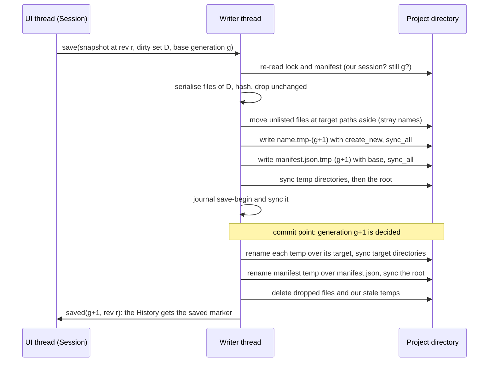
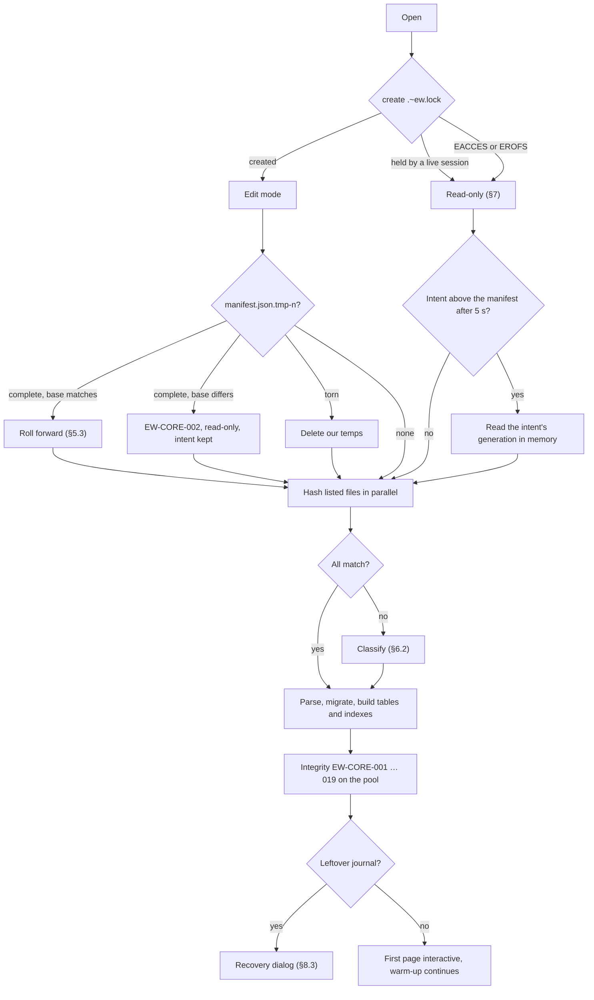

# Project format and persistence: manifest, save, open, lock, journal and external changes

A chapter of [Project format and persistence](05-project-format-and-persistence.md), whose table says where each section lives.

---

## 4. Manifest and generations

`manifest.json` is pretty-printed with one file per line, sorted by path, so that line merges stay local:

```json
{
  "format": "1.0",
  "min_reader": "1.0",
  "generator": "ElektraWatt 1.0.0",
  "project": "3f2b8c1e-6d4a-5e07-9b1c-2a7d4e9f0c13",
  "generation": 1,
  "files": {
    "assets/4b1f…e2.svg": "sha256:4b1f…e2",
    "devices/c2.jsonl": "sha256:…",
    "lib/parts/e5d2a8f1-0c37-5b94-8e6a-4f1d93c7b025.json": "sha256:…",
    "pages/8e41c0d2-1b7f-5a39-a6c4-0f5e2d913b7a.jsonl": "sha256:…",
    "project.jsonl": "sha256:…",
    "…": "…"
  }
}
```

| Member | Meaning |
|---|---|
| `format` | Two-part format of the writer's schema (§10.1). Never lowered |
| `min_reader` | Lowest format a reader needs: the format the writer writes (ADR-0011 amendment 9). A save of a newer minor (§10.1) keeps the stamps it found |
| `generator` | Program and version that wrote this generation |
| `project` | The project row's ID: key for the journal, the trust store and "two copies open" warnings |
| `generation` | +1 per save; after a git merge, max(ours, theirs) + 1 (§11.3) |
| `base` | `"sha256:<hex>"` of the raw bytes of the `manifest.json` that this generation's save replaced (ADR-0010 amendment 3). Written into the intent (§5.2 step 5) and therefore present in every manifest a save writes; absent in a first generation. The comparison that skips writing an unchanged project ignores it, and no save copies an earlier `base` forward. It conflicts in text merges like `generation` (§11.3, §11.4) |
| `files` | Every EW file except the manifest, the git files, `.ew/`, the lock files, `.~ew.requests/` and temps |
| `merged` | `true` only when written by the merge driver: the hashes are not authoritative |
| `unstable` | `true` when written by a development build with an unreleased schema (§10.4) |

The manifest carries **no wall-clock time**. Saving an unchanged project writes nothing. The title block's "Saved"
date is model data: `Project.master.edited` (FR-PRJ-029); there is no `saved_at`, and the manifest stays time-free.

---

## 5. Save protocol

### 5.1 Dirty set

Each `Op{key, before, after}` maps to `file_key(before)` and `file_key(after)` (both, when a row changes files),
plus the follow relations of §2.2. The dirty set thus falls out of the transaction log, with no scanning. A file
whose bytes turn out unchanged (an edit undone) is skipped in step 3.

### 5.2 Steps



1. **Trigger:** Ctrl+S, the CLI or idle auto-save (§5.5). Saves are serialised; a save requested during a save runs
   next with the union of both dirty sets.
2. **Pre-check:** the lock still holds our session (§7), and `manifest.json` still hashes to what we last wrote or
   loaded. Otherwise the external-change flow (§9) runs first, so a pull is never overwritten.
3. **Serialise** each dirty file from the snapshot (§3), hash it, drop files equal to their manifest hash, and mark
   empty files for removal.
4. **Temps:** `<name>.tmp-<g+1>` beside its target, `create_new`, `sync_all` (`F_FULLFSYNC` on Apple platforms,
   G1). Before it writes the temp of a path that the baseline manifest does not list, the writer checks the target:
   an existing file there (another user's file, a sync client's copy) is **moved aside**, never renamed over, by a
   rename without replacement to `<stem>.unlisted-<g+1>[-<n>].<ext>` (§2.1, a stray), with the next free `n` when
   the name is taken. The save reports EW-CORE-004 naming the new path in its save report and continues. The move is made durable together with the temps.
5. **Intent:** the complete new manifest as `manifest.json.tmp-<g+1>`, with `base` = the SHA-256 of the raw bytes
   of the `manifest.json` the save started from (§4; absent when there was none), `sync_all`. Then the directories
   are synced in this order: the temps' directories first, the root (which holds the intent) last, so that a
   durable intent name implies durable temp names (ADR-0010 amendment 3). On Windows,
   directory sync is unavailable and the NTFS metadata log is relied on **(verify)**. The writer then journals
   `save-begin{gen, writes, removes}` (§8.1) and syncs the journal.
6. **Renames:** each temp over its target, then a sync of the target directories other than the root. On Windows,
   `ERROR_SHARING_VIOLATION` and `ERROR_ACCESS_DENIED` (antivirus, indexer, sync client) are retried with backoff
   10 … 1,000 ms. After that, EW reports "save incomplete" and retries the roll-forward (§5.3) every 5 s.
7. **Manifest:** rename the intent over `manifest.json`, then sync the root. The renamed data files are durable
   before the manifest names the new generation: the earlier order "rename the manifest, then sync the
   directories" let, on file systems with per-directory sync (ext4, APFS), a durable manifest rename precede a
   durable data-file rename, which after a power loss gave a silent mixed generation or a false EW-CORE-002 (found
   by the power-loss mode of §5.6).
8. **Clean-up:** delete the files that left the manifest (deleted pages, emptied shards) and our stale temps (§2.1).
   A normal save deletes them after the manifest rename and relies on the journal's `save-begin{removes}` after a
   crash; a roll-forward deletes them before it renames the intent (§5.3).
9. **Bookkeeping:** journal `save-done`, start a new segment (§8), and move the saved marker to rev r. Later commits
   stay dirty.

**Incomplete saves**. A save that fails after the commit point is *incomplete*: generation
g+1 is decided, and the writer retries the roll-forward before the next save. A retry that fails again is
reported as "pending incomplete" (`SaveError::PendingIncomplete`) and writes nothing new. The `Session` clears its
unsaved state only when a save succeeds, or when it ends incomplete with a generation above the one before the
call; a failed retry therefore never marks newer edits as saved.

The save never blocks the UI. Budgets: S/M ≤ 200 ms, L ≤ 500 ms, XL ≤ 2 s (NFR-PERF-12).

File-key enumeration comes from `Model::keys`, generated from the entity list and including page items and structure boxes; no format bump or format change is needed.

### 5.3 Commit point and roll-forward (ADR-0010 amendments 1 and 3)

**The gap.** ARCH §7.4 orders temp → rename → manifest. Renames are atomic only per file, so a crash between two
renames leaves generation g partly overwritten.

**The fix.** The intent manifest of step 5 is durable *before* the first rename, and every temp it lists is already
durable. A crash at any point therefore leaves a state that resolves to g or g+1:

| Crash between | On disk | Next open (lock held) |
|---|---|---|
| Steps 1 and 5 | g intact plus our temps | Delete our temps (§2.1); open g |
| Steps 5 and 7 | Complete intent; each data file at g or g+1, the rest as temps | **Roll forward** after the base check below: move unlisted files at target paths aside (§5.2 step 4), rename every temp whose hash matches the intent, delete the old generation's files that the intent no longer lists, sync the target directories, rename the intent, sync the root; open g+1 |
| Steps 7 and 8 | g+1 complete, removed files still present | Delete those named in the journal's `save-begin{removes}`; report the rest (EW-CORE-004) |
| Intent present, but for some file neither the target nor a temp matches the intent hash | Mixed, not repairable from disk | EW-CORE-002: journal recovery (§8) or a best-effort read-only load |
| Intent present, but its `base` does not match the manifest's bytes, or it records no `base` while a manifest exists | The manifest changed after the save began (a pull, a colleague's save, a hand edit) | EW-CORE-002, read-only, intent and temps kept: rolling forward would overwrite the newer state |

**Which intents count.** Only an intent whose generation is above the manifest's (when the manifest parses) is
an interrupted save; an older one is a leftover that the next editing open deletes with our other temps. A torn
intent (unreadable) never committed and is deleted with its temps.

**Base check** (ADR-0010 amendment 3). Wherever an intent is applied (the roll-forward at an
editing open, a read-only opener's in-memory read of §6.1, the retry of an incomplete save), its `base` is compared
with the SHA-256 of the raw bytes of `manifest.json` on disk, never with parsed generations. A conflicted or
unparseable manifest whose bytes are unchanged therefore still rolls forward; without a parsed manifest every
record file on disk counts as the save's baseline (for the unlisted-file rule). Only differing bytes, or a missing
`base` while a manifest exists, refuse the intent (last row of the table).

The fault-injection harness of NFR-REL-01 (§5.6) kills the writer at random points of steps 4–8 on ext4, NTFS
and APFS. Every reopen must yield g or g+1.

### 5.4 Failures (NFR-REL-03)

| Failure | Behaviour |
|---|---|
| Disk full, quota or permission error before the commit point | Delete our temps; g intact; project stays dirty; cause and remedy shown ("free 40 MB on S:") |
| Same after the commit point; SMB disconnect | Background roll-forward retries; "save incomplete" status. The journal is local, so no edit is lost |
| Lock lost (§7.4) or project directory gone | Nothing written; read-only switch; Save a Copy or Save As offered |

### 5.5 Save variants

- **Save As** writes a full generation to a new directory and moves the lock. The project ID stays. At XL it takes
  at most 15 s (NFR-PERF-12).
- **Save a Copy as new project** assigns a new project ID and keeps record IDs, so `ew diff` against the original
  stays meaningful. **New project from basic project** re-IDs every record as `v5(new_project_seed, source_id)`
  ([07](07-symbols-parts-macros.md) §2.8).
- **Work copy** (1.0): `<name>.work-<user>.ew/` plus its base generation in `.ew/base.ewz`, merged back three-way
  inside the original's lock ([15](15-checks-revisions-collaboration.md) §6.8).
- **Auto-save** is `save.mode = manual | idle(<s>)`, default `manual`. The journal protects
  unsaved work in both modes.
- **No-op save.** With an empty dirty set, saving writes nothing. When only the manifest is stale (after a hand edit
  or a merge), saving writes just the manifest. Files that were non-canonical at open are rewritten at the next
  save.

### 5.6 Fault-injection design (NFR-REL-01, NFR-REL-03)

[Quality, security and release](18-quality-security-release.md) runs the harness; this is its design:
- **One I/O seam.** Every file operation of `ew-store` (create, write, `sync_all`, directory sync, rename, unlink,
  lock create) goes through a `Vfs` trait. Production uses `std::fs`; tests use `FaultVfs`, which numbers each call.
- **Kill mode.** A child process saves the sample project and the M fixture through `FaultVfs` and aborts at call
  k. The parent reopens with the real file system and asserts generation g or g+1, a model digest equal to one
  of the two generations and no integrity finding above info. 1,000 random k per file system on ext4, NTFS and
  APFS (NFR-REL-01).
- **Power-loss mode** (Linux, nightly). `FaultVfs` keeps writes that no `sync_all` has covered in a buffer and
  drops them at the crash point. This proves that every rename follows a durable temp and that the intent is
  durable before the first rename. Here the "not repairable" row of §5.3 may occur, but only as a reported EW-CORE-002,
  never as a silent mixed generation (NFR-REL-01).
- **Error mode.** ENOSPC, EACCES, EROFS and, on Windows, `ERROR_SHARING_VIOLATION` are injected at each call: g
  stays intact, the project stays dirty, and the message names cause and remedy (NFR-REL-03).
- The kill, power-loss and error modes run in-process on the in-memory `MemVfs`,
  which numbers, fails and "powers off" calls; the power-loss mode checks the sync order of §5.2 steps 5 to 7, and
  the roll-forward is idempotent under a second crash. The child-process run on real ext4, NTFS and APFS volumes is
  not built.

---

## 6. Open, verification and integrity

### 6.1 Sequence



- **Only listed files are read.** With a manifest present the loader reads exactly the files it lists; any other
  file in the layout is EW-CORE-004 and is not read (§6.2). The readers of `ew` (export, print, render,
  query, sql, layout, `fmt --check`) and its writers that take the common editing open (`apply`, `fmt`, the imports
  into a project) name every such file on stderr (`warning: <file>: manifest.json does not list it, so it is not read …`), so a file
  added by hand is never silently absent; a library directory's records file that `library.json` does not list is a
  note of that library in `ew lib list` (doc 07 §2.2).
- **Read-only openers never roll forward** (ADR-0010 amendment 3). Behind a stale or
  live-looking lock, one that meets an intent above the manifest's generation retries every 200 ms for up to 5 s
  for the save to finish. If the intent is still there after the wait (a writer that crashed or stalls), the
  opener reads the intent's generation **in memory**: each listed file from its target or from its temp, whichever
  matches the intent's hash, after the base check of §5.3. The disk is not changed, the result is exactly one
  generation, and a file that matches neither is EW-CORE-002. A read-only open therefore never waits longer than
  5 s and never fails because a save is in progress; no `OpenError::SaveInProgress` is produced.
- **Parallel parse.** Files are parsed in parallel into ordered tables, so the result does not depend on order.
- **Budget.** Opening stays within NFR-PERF-03 (S ≤ 0.5 s … XL ≤ 20 s). Hashing the roughly 250 MB of an XL
  project takes well under a second in parallel (estimate, to be measured in the performance spike (gate G-SP)).

### 6.2 Classifying hash mismatches

A mismatch is classified, loaded anyway and explained (FR-COL-004):

| Evidence | Class | Action |
|---|---|---|
| The hash matches after CRLF → LF | Line-ending conversion (`core.autocrlf`, an editor) | Info; rewritten at the next save |
| `merged: true`, or `MERGE_HEAD` or rebase state in an ancestor `.git` | Git merge or rebase | Integrity check; manifest rewritten at the next save |
| Files differ, valid, no temps | Foreign edit (hand edit, checkout, a tool) | "Changed outside ElektraWatt: 2 files" notice; integrity check |
| A listed file is missing | Partial copy, sparse checkout, sync unfinished | EW-CORE-003, read-only. On cloud paths, re-check after 5 s first |
| An unlisted file matching an EW or sync-conflict name pattern (§15), or a stray `.unlisted-<g>` name | Orphan, conflict copy or a file moved aside by a save | EW-CORE-004. Not read while a manifest exists, never deleted. A save or roll-forward that needs its path moves it aside first (§5.2 step 4) and reports EW-CORE-004 in its save report; the save continues |

The format layer loads anyway as above, but `Model::from_records` refuses a record
set it cannot build (for example one that breaks a structural invariant, EW-CORE-012), so such a project fails to
open with its findings instead of opening read-only; the lenient model build that FR-COL-004's "load anyway"
needs is not built.

The "last good generation" of FR-COL-004 is not a second copy on disk. Earlier states come from the recovery
snapshots, git history and `.ewz` backups.

### 6.3 Integrity findings

`ew check --integrity` (FR-CHK-012, MVP) runs on every open, after merges and from the CLI; cross-file
reconciliation after merges (§11.5) is FR-COL-016 (1.0). The findings are the integrity rules EW-CORE-001 … 019 of
[checks, revisions and collaboration](15-checks-revisions-collaboration.md) §4.2 (kind `integrity`, never
waivable). A finding marked **R** blocks release: EW-CORE-002, -003, -005 … -009, -011, -012, -013, -015, -017,
-018 and -019, and EW-CORE-016 only where outputs are affected.

**Read-only findings**. EW-CORE-002, -003, -005, -006 and -019 force a read-only session,
because a save could otherwise drop or overwrite data the reader did not see (EW-CORE-006 until its conflict
records are loaded, FR-COL-025). The flag counts every such finding, also those beyond the findings cap.

| ID | Finding | Severity | Quick fix |
|---|---|---|---|
| EW-CORE-001 | Manifest missing, unparseable or with conflict markers | warning | Rebuild it (`ew check --integrity --fix-manifest`) |
| EW-CORE-002 | Mixed generation that cannot roll forward | error; R | Journal recovery; best-effort read-only load |
| EW-CORE-003 | A listed file is missing | error; R | Restore it from git or the sync client; drop the entry |
| EW-CORE-004 | Orphan or sync-conflict copy, an unlisted file, or a file a save moved aside to a stray `.unlisted-<g>` name (§5.2 step 4) | warning | Compare; merge the copy as an external change (§9); delete by hand (EW never deletes it) |
| EW-CORE-005 | JSON syntax error at file:line | error; R; read-only | `ew fmt --repair`: discard the line (one that is not JSON or not UTF-8), after packing the files as found, the line and any edit outside EW since the last save included, as `<project folder>.before-repair-g<generation>.ewz` beside the project folder (§12; a file of that name is reused only when it holds that pack); refused for a library document that is not UTF-8, while another finding forces read-only, and when the files cannot be packed: no manifest, an incomplete save, a file that cannot be read or that changed since the repair opened it |
| EW-CORE-006 | Git conflict markers in a JSONL file | error; R | Converted into conflict records (§11.4) |
| EW-CORE-007 | Schema violation: wrong type, missing member, a float, an unparseable value such as a `Dec3` with four fraction digits. An undeclared company colour code such as "BR" parses as a company code and is reported by EW-CORE-031; a lenient import writes `{"foreign":"BR"}` (§3.2) | error; R | The line is quarantined verbatim and references to it are reported |
| EW-CORE-008 | Dangling reference | error; R | The link's delete policy, as a previewed fix |
| EW-CORE-009 | Duplicate `($k, id)` within or across files, records of unknown and reserved kinds included (§3.3) | error; R | Cross-file move reconciliation (§11.5), else keep one |
| EW-CORE-010 | A record in the wrong file | info | Moved at the next save |
| EW-CORE-011 | Conflict records present | error; R | Merge panel (FR-COL-015) |
| EW-CORE-012 | Structural invariant violated (ADR-0009) | error; R | Listed; the next transaction touching the key must restore it |
| EW-CORE-013 | Uniqueness collision after a merge: tag or counter, terminal designation, wire number, PLC address or symbol taken twice, or an interruption-point name that breaks "at most one star source per name and scope; in chain mode an even count, ordered by sort key" (EW-CORE-052, ADR-0009 amendment 1; [15](15-checks-revisions-collaboration.md) §6.4) | error; R | "Renumber the newer": renumber all but the keeper (frozen or released value first, then the record present in the merge base, then the older UUIDv7); one previewed command per merge |
| EW-CORE-014 | A library copy whose content does not match its `sha256` | warning | Mark it locally modified, or re-embed it |
| EW-CORE-015 | An asset missing or not matching its hash name | error; R | Re-import; drop the reference |
| EW-CORE-016 | Unknown kinds, members or variants from a newer format (a malformed value of a known variant is EW-CORE-017). Records of a reserved kind (a rank but no table yet, §3.3) are kept verbatim and are not reported | info; R where outputs are affected | Upgrade EW |
| EW-CORE-017 | Malformed value of a known variant: an enum value whose tag names a variant this reader knows but whose payload does not parse, such as `{"core": 5}` or `{"cp": ["<id>"]}`. The value is kept verbatim as `Unknown` (ADR-0011 amendment 2) and derivations treat it as unknown (§10.3) | error; R | Re-enter the value in the property grid, which shows the raw value |
| EW-CORE-018 | The project pins a derivation profile this build does not ship (a newer file or a hand edit). The pin is kept; the newest shipped profile is used for display only, and profile-dependent commands are refused (§10.1, ADR-0003 amendment 1) | error; R | The opt-in, previewed profile upgrade; or open the project in a build that ships the profile |
| EW-CORE-019 | A hostile-input limit of §3.6 exceeded (line, file, file count or nesting); the file or line is not read | error; R; read-only | Split or repair the file outside EW; check the source of the project |

**Notices without a rule ID**. Four results of the reader are not catalogue rules and carry
no EW-CORE ID: a hash that matches after CRLF → LF (line endings, §6.2), a listed file changed outside EW (foreign
edit, §6.2), a valid but non-canonical file (§3.1), and the note that more findings than the cap (1,000) were
counted (truncated). The first three classify the open and resolve themselves at the next save; the fourth is
about the report, not the project. None blocks release or forces read-only. They are reported as notices with
their kind name ("Changed outside ElektraWatt: 2 files"), and the integrity block 001 … 019 (doc 15 §2.2) has no
number left for them.

### 6.4 Concurrent readers

**Reading commands take no lock** (`ew export`, `ew check`, `ew sql`, `ew render`, `ew fmt --check`). They open
read-only (§6.1): they read the manifest and then the listed files, and verify the hashes. While a save is in
progress they retry for up to 5 s; if the save's intent is still there after the wait, they read the intent's
generation in memory, after its base check (§5.3), instead of failing. They never exit with code 2 because of a
save in progress. Their output therefore reflects exactly one generation
(FR-COL-027): the manifest's, or the one a crashed or stalled save had decided.

**Writing commands take the lock or refuse:** `ew apply`, `ew import` into an existing project, `ew fmt` (when it
writes), `ew upgrade`, `ew revision approve|release|withdraw`, `ew waiver add|remove`, `ew merge resolve`,
`ew script run`, `ew trust sign` and `ew mcp --writable`, like the GUI ([17](17-extensibility.md) §3.3).

---

## 7. Lock file

### 7.1 Record and acquisition

`.~ew.lock` is not project data, so it may carry times. It extends the ADR-0010 record `{user, host, pid,
app_version, started_at}` with a format number, the session ID and the PID's start time (ADR-0010 amendment 1):

```json
{"lock":1,"session":"01a14728-8400-7c3e-9b21-6f0d9a4e2b10","user":"<os user>","host":"<host>","pid":48211,"pid_started":"2026-10-17T07:41:58Z","app_version":"ElektraWatt 1.0.0","started_at":"2026-10-17T07:42:10Z"}
```

- **Acquisition.** EW creates the lock with `create_new` (O_EXCL; SMB2 `FILE_CREATE`) and syncs it. It uses no
  byte-range locks (G1).
- **Two paths, one lock.** A project opened through a UNC path and through a mapped drive meets the same physical
  lock file.
- **Read-only fallback.** A lock creation that fails with EACCES or EROFS (a read-only share or a mail attachment
  folder) opens the project read-only and says why.

### 7.2 Heartbeat and lock loss

- **Heartbeat.** The holder refreshes the lock's modification time every 5 minutes (`File::set_modified`) and
  re-reads the session ID. The session refreshes it once 5 minutes have passed since the last refresh,
  checked at each disk poll of the window (every 3 s) and before each line of a command log (`ew apply`).
- **Lock loss.** If the session ID is no longer its own, the holder has lost the lock (FR-COL-026). It
  switches to read-only at once. Its unsaved changes stay in memory and in the journal, and it offers "Save a Copy"
  or "Merge into current" (the external-change flow, then re-acquiring the lock if it is free).

### 7.3 Read-only mode

The banner reads `Read-only: locked by <user>@<host> since <time>` (FR-COL-006). The project reloads silently when
the holder saves, because read-only sessions have no local edits. When the lock disappears, EW offers "Switch to
editing".

### 7.4 Stale locks and takeover

**Stale.** A lock is stale in either of two cases:
- same host, and the PID is dead or its start time differs (PID reuse);
- its modification time is older than `lock.stale_after` (default 60 min, configurable).

**Takeover.** It always needs confirmation, showing holder, host and "last seen 3 h ago". Then:
1. EW renames `.~ew.lock` **without replacement** (`renameat2(RENAME_NOREPLACE)` on Linux, `renamex_np(RENAME_EXCL)`
   on macOS, `MoveFileExW` without `MOVEFILE_REPLACE_EXISTING` on Windows) to `.~ew.lock.stale-<stale session>`.
   Two instances taking over the same stale lock aim at the same target name, so only one rename succeeds. A plain
   replacing rename would let the slower one move the winner's fresh lock away. When the target already exists with
   the same bytes as the lock (a takeover that crashed between the link and the unlink of a rename without
   replacement left both), the copy is redundant: it is pruned and the rename is tried once more.
2. The winner **restamps** the renamed file's modification time to the takeover time, so the age rule below counts
   from the takeover; otherwise it keeps the holder's last heartbeat, and the winner's own open would prune it at
   once and reopen the race. It then creates its own lock with `create_new` and re-reads it
   after 2 s.
3. Where a file system cannot rename without replacement (some CIFS and NFS mounts **(verify)**), EW falls back to
   the plain rename when the target name does not exist yet, and the re-read of step 2 plus the heartbeat's session
   check (§7.2) detect the loser.

A takeover that meets the target name taken, or the stale lock or its own new lock moved by another contender, is
lost: the project is not taken over, and a library names the session that holds its lock. On Windows a read, a create
or a rename refused with access denied is tried again for a short while, since Windows reports a file whose deletion
another contender left pending that way. A lock of another session of the same process is live. The session ID is a
UUIDv7 of `ew-ids`.

A laptop that wakes after a takeover detects the loss at its next heartbeat (§7.2). `.~ew.lock.stale-*` files
older than `lock.stale_after` (counted from the takeover, step 2) are deleted at the next editing open.

**PID liveness.** Only Linux probes the PID (through `/proc/<pid>`, without its
start time). On Windows and macOS a crashed holder's lock is stale only by age, so after a crash on the same host the
project opens read-only for up to 60 minutes (`lock.stale_after`) before a takeover is offered. The probe of PID
and start time on Windows and macOS (and the start time on Linux) is not built.

---

## 8. Crash journal and recovery

### 8.1 Journal

The journal lives in `<state>/journal/<project id>-<8 hex of SHA-256(canonical path)>/`. The canonical path is the
absolute path with links, `.` and `..` resolved and, on Windows, the verbatim prefix `\\?\` stripped, so one project
reached through two paths has one journal; journals of pre-release builds kept under a
non-canonical path are not found. It holds one JSONL segment per base generation and three snapshot slots (the
slots, group commit and the undo rebuild of §8.2 step 5 are not built; the whole segment is replayed onto its
base generation). The example records W20's colour change from DBU to BU
(folio 102):

```json
{"j":"open","v":1,"project":"3f2b8c1e-…","path":"<canonical project path>","base":231,"base_manifest":"sha256:…","app_version":"ElektraWatt 1.0.0","session":"01a14728-…"}
{"j":"tx","seq":17,"t":1792241530117,"cmd":"connection.set_overrides","origin":"gui","ops":[{"k":["connection","5e07c3b9-…"],"set":{"overrides":{"colour":["BU"]}},"was":{"overrides":{"colour":["DBU"]}}}]}
{"j":"tx","seq":18,"t":1792241531002,"cmd":"project.company.set","origin":"gui","ops":[…],"assets":[{"ref":{"sha256":"sha256:…","format":"svg","size":[80,20]},"b64":"PHN2Zy…"}]}
{"j":"snap","seq":40,"slot":1}
{"j":"save-begin","gen":232,"writes":17,"removes":["devices/9f.jsonl"]}
{"j":"save-done","gen":232}
```

- **Entries.**
  - `tx` holds field-level diffs: `set` for the after-values, `was` for the before-values, and `put` or `del` with
    whole records.
  - Field diffs are per top-level member of a record. `project.settings.set` therefore journals the whole `settings` value of the project record in `set` and `was`, not only the edited member; settings are a few kilobytes, so per-member paths are not planned.
  - Undo and redo are journalled as the transactions they are.
  - **Assets**. A `tx` line carries in `assets`, each as
    `{"ref": <AssetRef>, "b64": <base64 of the bytes>}`, every asset that the model after the transaction names
    (`Model::referenced_assets`: the company logo, §10.3) unless its file is on disk with that hash or an earlier
    line of the segment carried it. The second condition is a per-segment set, reset when a segment starts, to which a
    hash is added only after its line is appended; after a save's commit point the saved assets count as on disk, which
    is safe because a roll-forward restores them from their temps (§5.3). A recovery therefore restores the bytes of
    every asset its replayed model names, also after a save started a new segment and an undo named an older asset again
    (set logo X, set logo Y, save, undo, crash).
  - A transaction without row changes that brings such an asset is journalled with an empty `ops` (a logo whose file was
    lost, picked again), and an asset that arrives in a transaction without ops marks the project dirty
    (`Session::is_dirty`; cleared when a save succeeds), so that the unsaved-changes dialog and the recovery see it.
  - An asset whose bytes do not hash to its `ref` or do not sniff as its format is dropped when the segment is read and
    **counted per line**. The recovery reports the count as EW-CORE-015 (§6.3) in the findings of the recovery result,
    and the next save's report carries it too; it does not force a read-only open, and the line's other ops are
    replayed.
  - The base64 form is acceptable at the logo bound (512 KiB, §13.3: a line of about 683 KiB). Larger rasters and
    meshes (`glb`) will use side files, `journal/<segment>.assets/<sha256>`, synced before the transaction line that
    names them (before images above that bound).
  - `t` (epoch ms) and the absolute `path` serve only the recovery dialog. The journal is not project data and
    never leaves the user-only state directory (NFR-PRIV-05).
- **Durability.** Group commit syncs every entry within 1 s of its commit (NFR-REL-02). It also syncs at once on
  focus loss, before a save and in the panic hook, with a 500 ms deadline (NFR-REL-13).
- **Panics.** The panic strategy is that of [quality, security and release](18-quality-security-release.md) §12.3:
  importer, rhai and SQL panics are caught on their job threads (NFR-REL-12), and on the abort path the writer
  flushes the journal before the process ends (NFR-REL-13).
- **Snapshots.** Every 2 minutes while the project is dirty (ARCH §7.4), the next slot receives:
  - the full canonical content of every file that differs from the base generation;
  - a `snap.json` with `{base, base_manifest, seq, files{path: sha256}}`.

  At XL this is the dirty overlay, not the whole project.
- **Lifecycle.**
  - A successful save starts a new segment; the old one goes after the next snapshot.
  - A clean close deletes the directory (NFR-PRIV-05).
  - Making a project in a directory (a new project, an import, Save As) deletes the leftover segments of its project
    ID at that path: they are of a project that was there before, and an import of the same source again has the same
    ID, so they would be offered to a project they do not belong to.
  - A dirty session that ends without a clean close or an explicit discard keeps its journal. The shell closes a clean session at exit but drops a dirty one without closing it: a window
    closed or a log-off while dirty, and the end of a headless script with unsaved changes (which exits 1), all leave
    the journal for the next open; only the unsaved-changes dialog's Discard, or `file.close` or `app.quit` with
    `discard: true`, deletes it.
  - At the next editing open, leftover segments of other sessions that hold no unsaved transaction (a session that
    crashed or was dropped right after a save) are deleted; only segments with unsaved transactions reach the
    recovery dialog.
  - At start-up, leftovers older than 30 days are pruned and logged.
  - If the state directory is unavailable, EW shows "unsaved changes are not crash-protected" and editing continues.

**Pruning at start:** every
start (window and headless, not smoke) deletes the leftover journals older than 30 days of every project, after
reading each project's lock, so a live session keeps its journal, and the crash logs older than 30 days or beyond the
20 newest; the store's clock decides the age. **Panics:** there is no abort path and no flush from the hook: every
journal entry is synced as it is appended, the panic hook writes only the crash log (18 §12.3), and the
unwind reaches no clean close, so a dirty session's journal stays for the start-up offer (§8.3). The journal's
directories are 0700 and its segments 0600 on Unix.

### 8.2 Recovery

1. **Find** a leftover journal whose `project` matches. The path hash only tells clones apart.
2. **Load** the current disk generation G.
3. **If G is the journal's base** (same manifest hash):
   - take the newest valid snapshot, falling back to an older slot or to none;
   - overlay its files on G;
   - replay `tx` entries after the snapshot's `seq`, stopping at the first torn line.

   The result is the live model at the crash, minus at most 1 s of commits (NFR-REL-02; NFR-REL-08: journal replay
   equals live state).
4. **If the base moved** (a pull or a colleague's save after the crash), replay the field diffs as a candidate
   transaction against G. A field whose current value differs from `was` is a collision, resolved in the merge panel
   (§9). The replay's net removals are judged against the moved base as a candidate transaction against G, as an edit
   on G would be: a library copy that the replay removes while a `LibRef` of the result still names it is also a
   collision, its member being the link (the delete-time rule EW-INV-021, ADR-0009 amendment 7). It is reported only when no field collision exists, which is harmless, because nothing is applied either
   way. The judgement is net, so a copy that the journal embeds and then undoes is no collision.
5. **Open dirty.** The recovered model opens with unsaved changes. Its transactions are rebuilt into the undo
   history from `set` and `was` (FR-COL-028).

### 8.3 Dialog

At start-up, and when opening a project with a leftover journal, EW shows project, path, time of the last change and
the number of unsaved transactions. The choices are "Recover", "Open without recovering" (the journal is kept 30
days) and "Discard". The CLI equivalent is `ew recover <project> [--list | --apply | --discard]`.

A project with a leftover
journal opens read-only first, and the recovery dialog then shows the unsaved transactions, the time of the last
change (in UTC; local time is not built) and whether the project changed on disk since. **Recover** re-opens it with
`Recovery::Apply`, editable and dirty with the edits; a failed recovery (the leftover still present, a collision with
another session's save, or a re-open that is not an editing one) re-opens read-only with the reason and leaves only
Open read-only and Discard…. **Open read-only** keeps the journal and the read-only access (Escape means the same).
**Discard…** asks for confirmation, then opens editable without the edits; its Cancel returns to the dialog. Nothing
is written before a choice. Headless, `journal.recover`, `journal.keep` and `file.discard_journal { confirm: true }`
answer the dialog. `ew recover` is not built, and `ew apply` refuses a project with a leftover journal. Save As closes the original cleanly once the copy exists (its
journal of the edits that went into the copy deleted, its lock released), so reopening the original does not show this
dialog; a failed Save As keeps the original's journal.

**At start** the shell lists the leftover journals with unsaved transactions of every project whose lock is not live, each with its
directory name, path, unsaved count (the transactions after the segment's last save) and last change, and the newest
crash log that ends a session and was not offered. The start-up dialog offers Recover per project (several projects
are a choice under the one Recover), which opens the project as Open does, so the recovery dialog above follows; Open
log folder and Delete log with a log; and Not now. Its Primary takes the first focus. When it closes, the offered log
and every older unoffered one are marked offered and never shown again; the journals stay until recovered, discarded
or pruned. Headless, the prompt is pending and answered by `startup.recover`, `startup.open_log_folder` (refused with
`reason-no-opener`), `startup.delete_log` and `startup.dismiss`.

---

## 9. External changes

The window has no `notify` watcher: the manifest is polled every 3 s and on focus, a change read
after two equal reads 750 ms apart and no git operation in progress, applied through the merge core as one undoable
`external.apply`, and the journal follows the new baseline (`external.rebase`). The steps below are the full design.

1. **Detection.**
   - `notify` 8.2.0 watches the project recursively, excluding `.ew/`, temps and the lock.
   - A `stat` of `manifest.json` runs on window focus.
   - On network file systems (detected through `statfs` or `GetDriveType`), the manifest is polled every 3 s,
     because inotify misses remote writes on CIFS mounts **(verify)**.
2. **Own writes.** Events from our own save window are ignored when the manifest afterwards is the one we wrote.
3. **Quiescence.** Wait until no event has arrived for 750 ms and no git operation is running (`index.lock`,
   `MERGE_HEAD`, `rebase-merge/` or `rebase-apply/` in the git directory of an ancestor `.git`; a `.git` file, as in
   linked worktrees and submodules, is resolved to its `gitdir`).
4. **Diff.** Load the incoming generation on the pool. Compute `diff_model(baseline, incoming)` and
   `diff_model(baseline, current)`, where the baseline is the last saved or loaded model.
5. **Apply or merge.**
   - **No collision** (no field changed differently on both sides): apply the incoming diff as **one undoable
     transaction**. The label is "External change", with the git commit added when gix can read it ("git a1b2c3d:
     Merge branch 'rework-102'"). The baseline becomes the incoming model, and remaining local edits keep the project
     dirty.
   - **Collision:** the merge panel opens with base, ours and theirs per field (FR-COL-007).
6. **Undo.** Undoing an external change restores the pre-pull state in memory. Saving would then write it over the
   pulled files, and the undo entry says so.

If git writes into the directory during an EW save, the pre-checks of §5.2 narrow the window, and EW re-hashes the
written files after each save. The integrity report names any overwritten file and offers "re-apply incoming from
git", read from the object database. The journal holds every EW transaction, so nothing is lost on the EW side.

