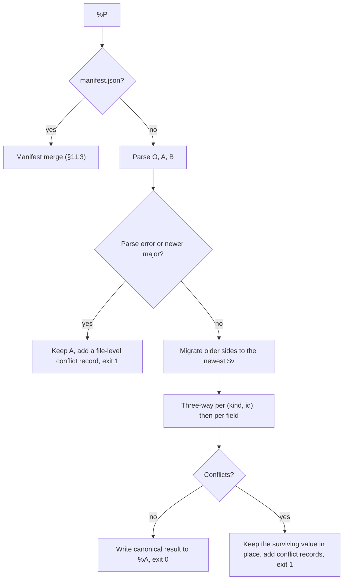

# Project format and persistence: versions and migration, git and .ewz transport

A chapter of [Project format and persistence](05-project-format-and-persistence.md), whose table says where each section lives.

---

## 10. Format versioning and migration

### 10.1 Versions and reader decisions

- **Version scheme** (ADR-0011): `format` is `major.minor`. Minors are additive, majors break.
- **Before 1.0:** formats are `0.x`, and every step counts as breaking.

In the table, R is the reader's format, F the file's format and M its `min_reader`:

| Condition | Behaviour |
|---|---|
| M > R | Refuse; nothing written |
| Same major, F ≤ R | Normal. A save writes `format = max(F, R)` and recomputes `min_reader` |
| Same major, F > R, M ≤ R | Read-write with a banner: "written by a newer ElektraWatt; unknown data preserved". The stamp stays F |
| F.major > R.major, M ≤ R | Read-only |
| F.major < R.major | Migrate in memory. The first save asks first and writes `<name>.ew.pre-<F>.ewz` beside the project (NFR-REL-06) |
| `unstable: true` in a release build | Read-only with a warning |

An
older-major project (each `0.x` is its own major) opens migrated in memory through the loader's `Access::Migrate`,
and a missing step refuses the open. The consent gate stands in the store's save, so every writer meets it: `ew
upgrade` asks for the word `upgrade` on a terminal or takes `--yes`; the window asks in a consent dialog ("Convert this project to the current format?"). Once confirmed, `Session::save` first packs the project's files and the manifest's
bytes as found as `<project folder>.pre-<from>.ewz` beside the project folder (`-2`, `-3` and so on past a name that
holds other bytes, a name holding the same bytes reused), reads it back, and then saves in this build's format,
rewriting only the files a step changed; a failed backup refuses the save with nothing written. The
file's `unstable` flag is kept under `keep_format`, a migrated library document that ends opaque is
refused, and a migrated copy's hash is recomputed.

**Unknown derivation profile** (ADR-0003 amendment 1). A project whose `derivation_profile`
this build does not ship (a newer file or a hand edit) opens under the rules above, but the pin is never silently
replaced: it stays as stored, EW-CORE-018 reports it as an error and blocks release, and the newest shipped profile is used for
display only. Every profile-dependent command (device and wire numbering, renumbering, every upgrade except the profile
upgrade) is refused until the opt-in, previewed profile upgrade resolves the pin.

### 10.2 Per-kind versions and migrations

- **`$v` bumps.** A `$v` bump breaks its kind, so it is allowed only in a format major: after 1.0, only in the
  yearly window (FR-COL-011). Within a major, kinds change only by additions.
- **Migrations.** Each is a pure function `fn(serde_json::Value) -> Result<Value>`, one per kind and step. Migrations
  run after parsing and before typed deserialisation. They are never deleted (NFR-REL-05). Error paths are JSON
  Pointers: typed reading in `ew-schema` reports the path of the failing value itself (`SchemaError::path`), and a
  migration step reports its own (ADR-0011 amendment 3).
- **`$v` check.** Typed deserialisation (`ew-schema`) accepts only the registry's `$v` of each kind and rejects any
  other ("migrate first"). A record whose `$v` is newer than the registry's can come only from a newer major, which
  this reader opens read-only (§10.1); it is kept verbatim like a record of an unknown kind (§10.3) and reported as
  EW-CORE-016 (ADR-0011 amendment 2).
- **Small upgrade diffs.** A major that changes only connections rewrites only connection records, so `ew upgrade`
  yields a small git diff (FR-EXT-008).
- **Same chain everywhere.** Macros, catalogue items and archives carry `$v` and use the same chain.

The chain is `ew_format::migrate`: kind steps
(`$v` n to n + 1, the chain setting `$v`, each naming the format whose files first carry `$v` n + 1) and format
steps (one on the manifest's `Value`, one on each record's and library document's), run on the `Value` between a
line's parse and its typed reading, only on an older-major open. They interleave: at each format the way reaches, a
value takes the kind steps that format allows, then the record step to the next format, so a record step sees the
`$v` its own format wrote. The
shipped chain (`MIGRATIONS`) is empty while 0.1 is the first format, and tests pass their own. A step's error
carries its JSON Pointer and the loader adds the file and the line. A clipboard fragment of an older format
migrates through the same chain (`ew-api`'s `parse_fragment`).

### 10.3 Additive change rules and preservation

The schema-steward rule (ARCH §7.6) requires every format PR to ship a migration, a fixture, regenerated schemas and
docs. Additive changes also follow four rules (rules 1 and 3 and the original-line preservation below are ADR-0011
amendment 1):

1. **New members** are optional with a default, are **appended** after the existing members of their kind, and
   carry `since = "1.n"`, which feeds `min_reader`.
2. **New kinds** take a new rank and declare their ownership.
   (ADR-0011 amendment 4.) A kind that the registry already reserves with a rank and ownership (§2.2), and a device aspect or part section that this document already names, may get its typed table within the current unreleased 0.x format: no format bump, no `$v` bump, and `schemas/0.1` is re-blessed. This is additive. An older 0.1 build keeps such records verbatim (a reserved kind) or their members in `extra`, but it does not enforce their links: an older build that deletes a module leaves its channels dangling. The typed assembly aspect adds the unlink cascade of `configs[].covers[]` and the forbid link of `configs[].part.copy`. An older 0.1 build that deletes a covered device leaves a dangling cover, and `Model::from_records` then refuses the project (`OpenError::Model`); the current build must open it, report the dangling cover and then unlink it. No earlier build wrote covers. The reserved kind `revision` (rank 60, `revisions.jsonl`) is typed. A `revisions.jsonl` of an earlier build opens as typed records with every member kept, is reported not canonical (info) and is rewritten at the next save; one whose revisions break EW-INV-016, EW-INV-018 or EW-INV-019 fails to open with `OpenError::Model`, accepted for the unreleased 0.1 because no released build wrote revisions. After a format release, typing a reserved kind that adds cascade links or other semantics an older reader must apply is a minor bump that raises `min_reader`; typing without such semantics stays additive. The rule applies again to the reserved kinds `page_item` and `structure_box` (§2.2). An older 0.1 build keeps their records verbatim and does not enforce their delete links (the cascade of a deleted page, the wire marker's connection list), so the current build opens a project whose marker lists a deleted connection or one on another page, reports it and ignores the stale entry; it neither refuses the project nor rewrites the record. The rule
   applies to the reserved kinds `macro_instance`, `macro` and `manufacturer` (§2.2) and to the part members of
   [07](07-symbols-parts-macros.md) §2.5 that the document already named. The new part members take their places in
   07 §2.5's member order rather than being appended, which was possible only while 0.1 was unreleased: a
   part copy of an older build that carries them in `extra` is read typed, reported not canonical (info) and rewritten
   in the typed order at the next save, with its stored `sha256` kept, so EW-CORE-014 reports the copy where the
   canonical order differs; this is accepted within 0.1. The rule applies again to the fluid members of 0.1, each optional with a catch-all: `CpDef.port_role`, `ConnectionKind::Fluid` with its `line_kind`, `CpOverride.closure` (a new link to a part copy, which an older 0.1 build does not enforce), `PartSections.fluid` with `solenoids` and `TextSlot.fallback`, additions only. The format locks at the 0.1.0 release (ADR-0011 amendment 6).
3. **Enums.** Every persisted enum has an `Unknown(serde_json::Value)` catch-all, so adding a variant is additive.
   Derivations treat `Unknown` conservatively: an unknown connection kind joins no net and is drawn grey and dashed.
   It blocks release where it affects outputs, as here (EW-CORE-016).
4. **No breaking edits.** Within a major, no member changes type, meaning or unit, or moves to another kind.

Unknown data is preserved as follows:

| Unknown | Handling |
|---|---|
| Member of a known kind | Kept in `extra` and written after the known members. While the record is untouched, its **original line** is written verbatim, so a file from a newer minor survives a save byte-identical, whatever member order that minor used (FR-COL-010) |
| Kind | The line is kept verbatim in the file it was read from, since its ownership rule is unknown. It sorts after the known kinds by the `$k` text byte-wise, then in ID order; a reserved kind with a rank sorts by its rank (§3.3) |
| Enum variant | `Unknown(Value)`: the record stays editable, and the value is written back unchanged. A value whose tag names a *known* variant but whose payload does not parse is kept the same way and reported as EW-CORE-017, because a known variant's payload never changes within a major |
| File listed in the manifest | Never rewritten or deleted; EW-CORE-016 |
| `plugin.<id>.*` keys | Kept in `extra`, merged per key, and kept without the plugin (FR-EXT-021) |

Original lines are held only for records with unknown content. A project in the current format costs no extra
memory.

Unknown kinds and the lines of EW-CORE-007 and EW-CORE-017 are
kept byte for byte, but an untouched record with unknown *members* is re-emitted canonically (its members kept in
`extra`, in byte-wise order) instead of by its original line; the original-line rule above is not built.
`min_reader` is written equal to `format` (§4, §10.4); the computed value is not built.

The four project-level commands add no record kind and change no
schema: `frames` and `checks` (in `ProjectSettings.extra`) and `ew.company` (in `Project.extra`) are existing `extra`
members that commands write, and the company is an ordinary `Party` of role `panel_builder`. Their stored shapes
are in [03](03-domain-model.md) §5.1. `ew.company` is a provisional member (the basic project's company data, with the
logo and the title-block notice), so the work package that types it must read old files that carry
it in `extra`, written by these commands or by the importer, without a migration step. A command that writes into one of
these members merges into the existing object, so members it does not know survive (the rule above).

The logo of the provisional `ew.company` member is an asset reference:
`"logo": {"sha256": "sha256:<64 hex>", "format": "svg" | "png" | "jpeg", "size": [w, h]}`, with `size` absent when the
intrinsic size is unknown, written by `project.company.set` and naming the file `assets/<sha256>.<ext>` (ext `svg`,
`png` or `jpg`, §13.3). The bare form `"logo": "sha256:<64 hex>"` of an older file (a PNG of unknown size) is read, and it is kept byte for byte on re-save: the command rewrites the `logo` member only
when it sets or removes the logo. A bare reference takes its format and size from the held asset when the title block
reads it (`Q::logo_asset`), so a bare hash that names an SVG file prints as SVG. The `logo` object is an existing
`extra` member's value, not a schema change, like the other members of this paragraph.

Implementing a reserved kind changes how an older build's lines read: an earlier build kept `page_item` and `structure_box` records as reserved kinds and wrote their members in byte-wise order, so this build loads them typed, reports the file with a `NonCanonical` finding (info) and schedules its rewrite in the typed kinds' member order (`Loaded::rewrite`; the revision precedent); a canonical line, and an unknown `page_item` variant, are written back byte for byte. A newer build's file read by the older build follows the reserved-kind path and is kept line for line.

### 10.4 Schemas, fixtures and development builds

- **JSON Schemas** (FR-COL-012). `ew-schema` generates JSON Schema 2020-12 (schemars 1.2.3; the draft is
  schemars 1.x's default **(verify)**) under `schemas/<format>/`, licensed MIT OR Apache-2.0:
  - `manifest.schema.json`;
  - `record.schema.json`, a `oneOf` keyed by `$k`;
  - one schema per kind and per library document.

  Additional members are allowed. Format 0.1 publishes no "strict" variant that forbids them: the typed reader is
  the strict check (ADR-0011 amendment 3). The `Unknown` catch-alls are omitted:
  the schemas of a format describe the variants it defines, and a newer minor's variant validates against that
  minor's schemas (ADR-0011 amendment 2). The schemas also go into the generated format specification (NFR-DOC-06) and into every as-built archive (NFR-REL-10).
- **Permissive-only reader.** A sample reader built on the permissive crates alone validates a project
  (SC-11).
- **Fixture corpus.** `fixtures/format/<version>/` holds the reference project (frozen) and the QET-derived
  examples as each released format wrote them; a format released after 0.1 holds the sample project (ADR-0011
  amendment 7). Every build opens them, saves them and compares the result with the expected migration output
  (NFR-REL-05).
- **Development builds** with an unreleased schema write `"unstable": true` and warn on every save. Release builds
  open such projects read-only, because an unreleased member may still be renamed.

A save writes `unstable: true` when the released list
(`RELEASED_FORMATS`) is not empty and lacks the format it writes; the warning on every such save is not built. The
steward check is `ew_format::migrate::steward_problems`, run as a test in `ew-format` and `ew-store`; the corpus test
opens, saves and compares each `fixtures/format/<format>/<project>/`.

---

## 11. Git integration

### 11.1 Repository files and configuration

EW maintains a marked block in the project's own `.gitattributes` and `.gitignore`. Nested attribute files work, so
a project can live inside a larger repository. Lines that users add outside the block are kept.

```gitattributes
# >>> ElektraWatt (managed) >>>
*.jsonl          text eol=lf merge=elektrawatt diff=elektrawatt
lib/**/*.json    text eol=lf merge=elektrawatt diff=elektrawatt
manifest.json    text eol=lf merge=elektrawatt
rules/**         text eol=lf
reports/*.sql    text eol=lf
assets/*         binary
# <<< ElektraWatt (managed) <<<
```

From 1.0 the block adds `scripts/** text eol=lf`, `jobs/** text eol=lf` and `lib/profiles/*.toml text eol=lf`
(ADR-0010 amendment 2). The managed
`.gitignore` block lists `.ew/`, `.~ew.lock`, `.~ew.lock.stale-*`, `.~ew.requests/` and `*.tmp-*` (which covers
the intent `manifest.json.tmp-<g>`). `eol=lf` protects the manifest hashes from `core.autocrlf`.

Git never takes driver definitions from a repository, which is a security property. `ew git setup [--global]
[--hooks]` writes them after the user agrees (FR-COL-024). The status bar shows "merge driver not
configured" for a project in a worktree without them.

```ini
[merge "elektrawatt"]
    name = ElektraWatt record merge
    driver = ew merge-driver %O %A %B %L %P
[diff "elektrawatt"]
    textconv = ew diff --textconv
    cachetextconv = true
```

This five-argument form is the canonical configuration (ADR-0012 amendment 2, FR-COL-014,
[17](17-extensibility.md) §3.3); the older four-argument form `%O %A %B %P` stays accepted. `cachetextconv` caches
per blob, so cached labels can lag a later renumbering; `ew diff` (§11.6) is always exact.

### 11.2 Merge driver

- **When git calls it:** only for paths changed on both sides.
- **Arguments:** `%O`, `%A` and `%B` are temporary files holding the ancestor, ours (where the result goes) and
  theirs. `%L` (the marker size) is used where a conflict is rendered as text; the driver itself writes conflict
  records instead of markers. `%P` selects the handling.



**Record level** (value of the key in O, A, B; − = absent):

| O | A | B | Result |
|---|---|---|---|
| − | a | − | a (and symmetrically b when only B added) |
| − | a | b | a when a = b (the same v5 import or library copy on both sides), else a field merge with an empty base |
| o | − | − | deleted |
| o | − | b | deleted if b = o, else a **delete/modify conflict** that keeps b (symmetric for A) |
| o | a | b | field merge |

**Field level**, by `ew-schema` annotation:

| Strategy | Used for | Rule |
|---|---|---|
| `object` | Structs and string-keyed maps: `overrides`, `tag`, aspects, `settings`, `extra`, `MlText` languages | Recursive, member by member; an absent member counts as its default |
| `atomic` | Leaves: scalars, enums, `Pt2`, `Pose3`, ordered sequences (`route`, `Junction.sequence`); `MlText` switching between neutral and multilingual | a = o → b; b = o → a; a = b → a; else conflict |
| `keyed(<member>)` | `cp_overrides` (idx), `tech_data` (key), `parties` (role) | Merged as a map by key, written sorted |
| `set` | `aliases` | (o ∩ a ∩ b) ∪ (a ∖ o) ∪ (b ∖ o), sorted |
| `max` | `Project.master.edited` (FR-PRJ-029) | max(a, b) |

**Conflict records.** The target keeps **ours** (or the surviving side of a delete/modify), so the file stays
loadable. One conflict record per target, sorted last, holds only the conflicting members as partial objects. A
deleted side is `"deleted"`. In library documents the conflict becomes a top-level `"$conflict"` member. The
example is W20 after both branches of §11.7 changed its colour:

```json
{"$k":"conflict","id":"5e07c3b9-1a4d-5f82-a6c3-90d8e2b71f4c","kind":"connection","base":{"overrides":{"colour":["DBU"]}},"ours":{"overrides":{"colour":["BU"]}},"theirs":{"overrides":{"colour":["WH"]}}}
```

When a side does not parse or comes from a newer major, the driver keeps A (B if A is the failing side) and
appends one **file-level** conflict record,
`{"$k":"conflict","id":v5(path),"kind":"file","side":"theirs","lines":[…]}`, holding the other side's lines
verbatim as strings, so nothing is lost and the file still loads.

**Exit codes and tests.** 0 = clean; 1 = conflict records written; 129 = caught internal error (any failure exits
with 129 or higher), which git treats as a failure rather than a conflict. This is the one exception to the 0/1/2
scheme of FR-EXT-002 ([17](17-extensibility.md) §3.2), because git reads any non-zero code up to 128 as "conflicts
written" (ADR-0012 amendment 2). The driver is fuzzed (NFR-SEC-03), and CI
checks `merge(o,a,a) = a` and `merge(o,o,b) = b` (ARCH §13).

### 11.3 Manifest merge

The driver writes:
- `generation = max(a, b) + 1`;
- `format` and `min_reader` as the maximum of both sides, and `generator` from ours;
- `files` merged three-way per path, with `"sha256:pending"` where both sides changed;
- `merged: true`;
- no `base`: a merged manifest is not the result of a save, and the next save records the hash of the merged
  manifest's bytes as its `base` (§4).

The open path treats the result as in §6.2, and the next save writes a clean manifest. That save
restarts at generation 1 after a conflicted manifest instead of continuing at max(ours, theirs) + 1.

### 11.4 Without the driver

GitHub web merges and clones without `ew git setup` fall back to git's text merge:
- **Merges mostly succeed:** one record per line, ordered by random bits, keeps conflicts rare (ADR-0012).
- **The manifest conflicts** on the `generation` and `base` lines. It stays tracked, because a clone needs its
  format, `min_reader` and hashes, and an untracked generation would lose the detection of an interrupted save on
  shares. Any
  resolution of these two lines is acceptable: either side, or `base` dropped; the next save records the hash of
  the resolved manifest's bytes, and an interrupted save whose `base` still matches those bytes rolls forward
  (§5.3). The resolution does not make other files acceptable: only the files the resolved manifest lists are
  read, an unlisted file is EW-CORE-004, and a later save moves an unlisted file at a path it writes aside instead
  of overwriting it (§5.2 step 4). A manifest left with conflict markers is EW-CORE-001 (rebuild it).
- **Leftover markers become conflict records.** The loader reads each hunk's ours and theirs lines as complete
  records, plus the base when the diff3 style is used, and turns them into conflict records (EW-CORE-006,
  FR-COL-025). The project then opens in the merge panel instead of failing.

### 11.5 Post-merge integrity

Git merges file by file, so whole-project semantics are checked afterwards: on open, or through a `post-merge` hook
installed by `ew git setup --hooks`.

- **Cross-file move.** Branch A moves a representation from folio 101 to 102, and branch B changes its symbol
  variant on 101. The page-101 driver run sees a delete/modify, so it keeps B's record and adds a conflict record;
  the page-102 file holds A's record. On load, the duplicate ID together with that conflict record is reconciled by
  a field merge: page and position from A, variant from B. The result is shown for confirmation (EW-CORE-009;
  FR-COL-016, 1.0).
- **Branch-safe counters** (ARCH risk 9). Two branches each add a device on folio 103 that numbers as -103F1.
  EW-CORE-013 offers renumbering the newer one to -103F2 (FR-CHK-012, MVP).

### 11.6 textconv and `ew diff`

- **`ew diff --textconv <file>`.** Git passes only a single blob, so EW renders one record per line in file order,
  with labels derived from the **working tree**, e.g. `connection -102G1:+ → -102F1:1 (folio 102)
  overrides.csa="1.5" overrides.colour=DBU`. Historic tags may therefore print as they read today. Git does not
  pass the path either, so `ew` finds the project by looking the record IDs up in the `*.ew` projects of the
  current worktree; unknown IDs print as kind and short ID.
- **`ew diff [<from>] [<to>] [--queries bom,wires,terminals,plc,xref] [--json]`** is exact (FR-COL-013).
  - Each side can be a directory, an `.ewz`, an `.ewarchive`, `git:<rev>` (read through gix) or `rev:<label>`.
  - Both models are built, and `diff_model` and `diff_query` run with tags derived on each side.
  - The JSON output feeds the visual review of FR-COL-017.

### 11.7 Worked example (AC-41)

The base: W20 (-102G1:+#1 → -102F1:1, folio 102) carries `overrides {csa "1.5", colour DBU}`.
- Branch A changes -102F2's function text (a device shard) and W20's colour to BU (the page-102 file).
- Branch B changes W20's cross-section to 2.5.

On merge:
- git takes the device shard from A, because only A changed it;
- the manifest goes through §11.3;
- the driver merges the page-102 file: `object` recursion into `overrides` yields csa "2.5" from B and colour BU
  from A, with exit 0.

If B had also set the colour, to WH, BU would stay in place, the conflict record of §11.2 would be written and the
driver would exit 1. EW then opens with EW-CORE-011, and resolving the conflict is one undoable transaction
(FR-COL-015).

### 11.8 Local history (1.x)

The optional local history (FR-COL-020) commits each save to a private repository under the OS state directory
(gix 0.89.0). It applies KiCad-style retention limits on count, age and size. A state restores as a separate
read-only project. The user's own repository is never touched.

---

## 12. `.ewz` transport

`.ewz` is a deterministic ZIP of the project directory (FR-COL-009, NFR-REL-07):

```text
J-E-2416.ewz
  mimetype        "application/vnd.elektrawatt.project+zip": first entry, stored, no extra field
  manifest.json   second entry
  …               the files the manifest lists, and .gitattributes and .gitignore when present, sorted byte-wise
                  by path, Deflate; never .ew/, the lock files, .~ew.requests/, temps, strays or .git/
```

The file is one verified generation, the one
`Store::read_generation` reads back from the disk, never a model in memory; `pack` reads its bytes back through the
reader before it hands them out and refuses an archive the reader would refuse.

- **Determinism.** Every entry has DOS time 1980-01-01 00:00:00 (always; the date rule of
  [09](09-reports-forms-output.md) §4.3 is not used); mode 0644 and the UTF-8 flag. No extended timestamps, no
  comments. The Deflate level is fixed and the compressor is pinned through `Cargo.lock`, so bytes are identical for
  the same project and EW version.
- **Opening.**
  - "Extract and open" unpacks into `<name>.ew/` beside the file or into a chosen folder, and never into an
    existing one. `ew extract <file.ewz> [--into <dir>]`: the default is `<stem>.ew` beside the archive; the
    target must not exist; the extract is all or nothing: it writes through the `Vfs` seam into a staging directory
    `<target>.tmp-ewz` that it creates exclusively, creates, syncs and reads back every file, checks the target's
    absence again and renames the directory, so no half project ever stands under the target's name and a failure
    removes what the call created (if the parent folder cannot be synced after the rename, the target is moved back
    first). The race that is left, an empty directory made at the target between the check and the rename on Linux or
    macOS, is accepted: nothing of anyone's is lost.
  - "Open read-only" opens the archive from memory (`Session::open_ewz`), with no cache directory, no lock and no
    journal; editing then requires Save As.
  - The CLI's readers
    (`check`, `sql` and `sql dump`, the row and page exports, `export table`, `print`, `render`, `verify-derived`,
    `query`, `fmt --check`) accept an `.ewz`, opened read-only, and every other subcommand, `apply --preview`, `assets purge --preview` and
    `import table` included, refuses it: "an .ewz opens read-only; extract it first".
  - A path is an `.ewz` by its extension (`ewz`, any case) when it is not a directory.
- **Limits** (FR-IMP-005, NFR-SEC-02).
  - At most 100,000 entries, 2 GiB expanded and 512 MiB per entry, with a compression-ratio cap of 200 : 1 per
    entry, as for every archive reader ([14](14-interop.md) §11). The writer has no ZIP64 and writes at
    most 65,535 entries; the reader takes `ZipLimits::default()` (the ratio applies above a 64 KiB floor).
  - The extractor rejects `..`, absolute paths, drive letters, backslashes, `:` and NUL in names, duplicate names
    (exact or case-insensitive), symbolic-link and encrypted entries, and paths outside the layout of §2.1. The reader also refuses names that Windows cannot hold, a manifest that lists a path that is not a project file (a
    lock, a temporary, `.git/…`, `.ew/…`, a stray or a foreign name), a first entry that is not `mimetype` with its
    value, stored, an entry that is not deflated, entries not in strictly increasing byte order from the third on, a
    file or git file the manifest does not list, a listed file that is missing and a hash that does not match.
  - The extracted manifest must verify.
- **Uses.**
  - Hand-over by e-mail (a project of the reference set's size packs to about 200 KB, estimated).
  - The format-upgrade backup (§10.1).
  - `ew export ewz [--omit-personal-data]`. With the flag it replaces the fields marked as personal data with
    placeholders on a fork before packing (FR-OUT-025, MVP). `ew export ewz [<project>] --out <file.ewz>` takes
    `--out`, required, and no `--omit-personal-data`; it packs the saved generation (a dirty session's export packs
    the saved state and says so) and refuses a file that differs from the manifest and a pending hash.
  - The repair's backup (§6.3, `ew fmt --repair`): the generation's files as found, a file edited outside EW since the
    last save included, with its manifest the loaded one and each listed file's hash set to those bytes, so that it
    verifies and extracts to the project as the repair found it. It is the one `.ewz` that is not a verified
    generation; `ew export ewz` still refuses a file that differs from the manifest.

**The project fragment `#ew-fragment v1`** (ARCH §5.5). Copy, cut, duplicate and paste carry records as text: UTF-8, LF line ends (CRLF is read), line 1 `#ew-fragment v1`, line 2 the header `{"$fragment": {"format", "project", "grid", "page_kind", "anchor", "ghost", "free"?}}` (`free`: the indices of the ghost rectangles that are free texts and graphics, which may lie outside the drawing area; an older reader ignores it), then one canonical record line per record (§3.1) in (kind rank, position, ID) order, then one `{"$lib": …}` line per library copy (the `lib/` form) in (kind, copy ID) order, then one `{"$node": {"id", "aspect", "path", "aliases"}}` line per referenced structure node in ID order. Within v1 the header is open (unknown members are ignored) and a `$node` line closed; a leading byte-order mark and empty lines are skipped. The records keep their source IDs as data; `edit.paste` mints new IDs, remaps the references by `ew_model::LINKS` and their delete policy, drops a record's import lineage (`source_ref`); a fragment of an older `format` or `$v` migrates through the chain of §10.2 and a newer one is refused. The parser's limits are 4 MiB, 10,000 records, 1 MiB per line and nesting 64. The fragment also carries page items and structure boxes (ranks 43/44); marker associations retain and remap copied connections, empty markers/unknown variants are skipped and counted, and cross-project structure-box paste clears `external`. Copy remains partial-selection tolerant; Cut refuses an incomplete selected page-item transfer before side effects.

