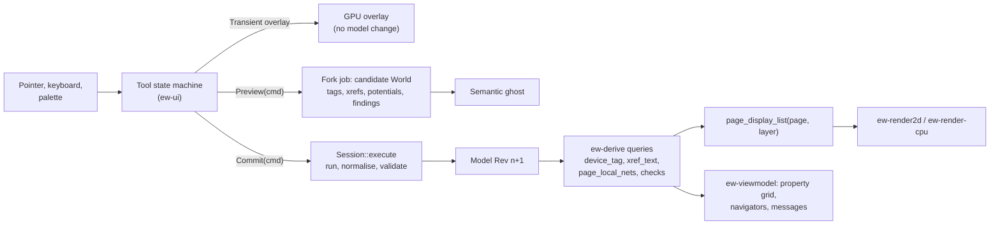

# Schematic editor: position and concepts

A chapter of [Schematic editor](06-schematic-editor.md), whose table says where each section lives.

---

## 1. Position in the architecture

The schematic editor is a **thin interactive client of the command layer**. Every gesture ends in a `Command`
(ARCH §5.1), and every visible string is a query result (ARCH §1.2, ADR-0001). The editor holds no domain logic that
`ew script` or `ew mcp` could not reproduce. A drawing made with the mouse can be replayed from the journal, and a
drawing made by a script can be undone in the GUI.



| Concern | Owner | This document |
|---|---|---|
| Tools, canvas host, keymaps, hit handles | `ew-ui` | §4, §6 |
| Property-grid rows, selection model, navigator rows | `ew-viewmodel` | §3.7, §6 |
| Display lists, spatial index, text shaping, frames | `ew-scene` | §2.4, §5.1, §7 |
| Commands, normalisers (numbering, autoconnect, junction clean-up, split), orthogonal auto-route | `ew-commands` | §3.1, §3.2, §5.4 |
| Tags, anchor cells, xref texts, nets, potentials | `ew-derive` | §2.8, §5 |
| Online rules | `ew-checks` | §3.10 |
| Symbol search and embedding | `ew-library` | §3.3 |

Out of scope here, with their owners: symbol and FnDef authoring and macros ([07](07-symbols-parts-macros.md)); wire
property inheritance, terminal strip editor and cable definition lines ([08](08-connections-terminals-cables.md));
frame and title-block form layout, PDF ([09](09-reports-forms-output.md)); PLC overview content and topology
semantics ([10](10-plc-and-bus.md)); fluid semantics ([11](11-fluid-power.md)); panel layout pages
([12](12-panel-layout.md)); canvas comments, waivers and page change marks
([15](15-checks-revisions-collaboration.md)); shell, docking and keymap infrastructure ([16](16-ux-ui.md)).

**Non-goals** (consistent with ARCH §16): autoconnect as model semantics; real-time co-editing; PDF optional-content
layers; an own UI toolkit.

---

## 2. Concepts and data

### 2.1 Entities the editor writes

The editor writes only authored records (Kind **A** in [domain model](03-domain-model.md) §1.1) and deliberate frozen
values (Kind **F**, e.g. the typed tag "S51"). It never writes a derived tag text, a cross-reference text, a
potential or a title-block value (FR-NUM-001, FR-XRF-001).

| Record | What the editor does with it | File ([05](05-project-format-and-persistence.md) §2.2) |
|---|---|---|
| `Page`, `Section` | create, copy, renumber, set type, frame, scale, grid, title, structure | `pages/<uuid>.jsonl`, `structure.jsonl` |
| `Device`, `Function` | created on placement or from a part; tag spec, role, CP overrides, technical data | `devices/<xx>.jsonl` |
| `Representation` | position, orientation, variant, representation type, pin map, text-slot overrides | page file |
| `Connection` | endpoints, route, kind, overrides (CDP) | page file; a device shard when `page = None` (undrawn rows, [03](03-domain-model.md) §9) |
| `Junction` | point, style (Dot, Bevel), wiring (Chain, Star; added in [03](03-domain-model.md) §1.2), sequence | page file |
| Interruption point | `Function{kind: Ip(IpSpec), device: None}` plus its representation | page file of its representation (both rows) |
| `StructureBox` | outline, line style, caption, assignment, external reference | page file |
| `PageItem` | graphic, free text, image, wire marker | page file |
| `PotentialDef`, `NetDef` | name, type and properties at an endpoint | shard of the device owning `at`; a junction endpoint puts it in the junction's page file |
| `ReportBlock` (embedded) | position and filter of PART DATA boxes; content derived ([09](09-reports-forms-output.md)) | page file (`embedded.page`) |

**Session state that is not model data** lives in the git-ignored per-user folder `.ew/u-<hash>/` or in memory
(FR-UI-033, [05](05-project-format-and-persistence.md) §1): open tabs, viewports, jump history, the active tool and
its sticky options, selection, highlight set, grid display toggles. It is never journalled, never merged and never
part of undo, although undo entries record page, viewport and selection so that undo can restore them (ARCH §5.3).

### 2.2 Page types and their semantics

The page type governs what a page can contain and what drawing means on it (FR-PAG-001, FR-PAG-002).

| Page type | Representation types offered | Wire tool creates | Autoconnect | Joins nets | Reference folios |
|---|---|---|---|---|---|
| MultiLine | MultiLine, ContactImage, StripSegment, Graphic (cable markers, black boxes) | `Wire` (electrical) | on | yes | 101, 102, 103, 106 |
| SingleLine | SingleLine | MVP: `Overview` kind; 1.0: `SingleLine{conductors}` connection (FR-CON-044, FR-CON-029) | on | MVP: no; 1.0: mapped onto the multi-line connections | — |
| Overview | Overview | `Overview` | off | no | — |
| AssemblyOverview | Overview of an assembly member (break marks derived) | `Overview` | off | no | 201, 202 |
| BusTopology | Topology (bus ports, connectors, single-line bus cables), Graphic (cable markers) | `Bus` | on, bus ports only | bus nets | 3 |
| Fluid | Fluid, MultiLine (electrical parts drawn in a fluid diagram, the CPX blocks on 203–206) | `Fluid` with line kind | on, fluid ports only | fluid graph only (FR-FLU-002) | 203–206 |
| Graphic | Graphic | nothing (graphics tools only) | off | no | — |
| TitlePage | cover form content, page items | nothing | off | no | 1 |
| PanelLayout | `SurfaceView` of placements (derived; [12](12-panel-layout.md)) | nothing | off | no | 902 |
| ModelView (1.0), ExternalDocument (1.x) | — | nothing | off | no | — |
| TableOfContents, SectionDivider, Report | generated, read-only | edits refused with a link to the report block or section (FR-PAG-002) | — | — | 2, 100, 200, 900, 901, 903–911 |

A line drawn between two CPs on folio 201 is an `Overview` connection and joins no potential (FR-CON-002). A
single-line connection must not join nets either: a device drawn single-line and multi-line would otherwise produce
its wires twice in the wire list. The tool palette changes with the page type, so a user cannot pick the wire tool
on a graphic page.

The reference drawings place cable markers and black boxes as graphics on multi-line and bus-topology pages and draw the CPX blocks multi-line on the fluid pages, so the table offers those combinations; every other combination is still refused at placement. The builder DSL of AC-15 path (b) found the restriction (the "(a) ≠ (b)" gap class, [18](18-quality-security-release.md) §3.10).

*As built.* The editing tools refuse a page whose type takes no symbols or wires (TitlePage, PanelLayout, ModelView, ExternalDocument and the generated pages) with the text "This page type takes no symbols or wires: draw on a schematic page" (`reason-page-type-no-symbols`); the table above gave no wording. *As built:* the refusal names the page's kind in words where a key exists for it: "A section divider takes no symbols or wires: draw on a schematic page", and likewise "A title page", "A table of contents", "A report page" and "A panel layout page" (`reason-page-type-no-symbols-divider`, `-title`, `-contents`, `-report`, `-panel`); every other such page type keeps the generic text. A page type that takes symbols offers in the picker only the symbols whose representation type it allows; the others are listed disabled with their reason, which names the page types that take the symbol as New page lists them ("Goes on a page of type Fluid"). **Every row of the Insert symbol list does something** (the owner's hands-on test of 0.1.0): a choice arms a tool or opens a chooser, or the row is greyed with its reason in words. A symbol with a tool of its own arms that tool: Wire marker the Wire marker tool, Interruption point and Interruption point, incoming the Interruption tool in that direction. What the program draws with what it belongs to (a junction's dot or bevel, a cable's marker, the arrow of an external reference; the function categories `Graphic` and `ExternalReference`) is no row; `place.pick` with a letter still places one. A symbol whose category maps to no letter code is greyed with "Give a letter code: the symbol's category maps to none".

*As built.* The Wire tool draws the column "Wire tool creates" where it is built: a `Wire` on MultiLine pages and an `Overview` connection on SingleLine (the MVP kind), Overview and AssemblyOverview pages; on BusTopology and Fluid pages, and on every type whose Wire tool creates nothing, `tool.wire` is disabled with "The Wire tool does not draw this page type's connections yet" (`reason-no-wire-kind`) until the `Bus` and `Fluid` kinds are drawn (FT-434). Autoconnect proposals are offered on MultiLine and SingleLine pages only, a narrowing of the column "Autoconnect": a table connection point carries no discipline yet (FT-434).

### 2.3 Folios, sections and page names

- **Folio** = `{section?, number: u32, label?: Ident}` ([03](03-domain-model.md) §6). Folios are sparse and never
  renumbered implicitly (FR-PAG-005). Labels allow sub-pages (101.1, 101a), sorted naturally: 101, 101.1, 101.2,
  101.10, 102 (FR-PAG-006, FR-NUM-018).
- **Sections** `{number, folio_range, title, divider}` (FR-PAG-008). With `divider = true`, the first folio of the
  range is a generated divider page whose description is derived: "=P01+J-E-2416 - Section 1 - Page 100 - 199 -
  Wiring Definition" (FR-PAG-009). Folios 100, 200 and 900 of the reference project are generated this way and
  cannot be edited; the page navigator shows them with a lock badge and opens the section properties on edit.
- **Full page name** `=P01+J-E-2416/101` is derived from the page structure and folio. Duplicates are a prevent rule
  (FR-PAG-012).
- **Page order** is `page_order()`, which merges drawn pages, dividers and report pages. Prev/Next, TOC, outline and
  `/PageLabels` come from it (FR-PAG-013). A report block that overflows continues on sub-pages `<folio>.<n>`
  (FR-PAG-030).
- **Page title and description.** The page title ("Power Supply 1 - Main Current") is `Page.title`; the title-block
  "Description" inherits the project description unless `description_override` is set, which a check reports
  (FR-PAG-010, FR-REP-036; field split per [03](03-domain-model.md) OQ1).

### 2.4 Frames, sheet and grids

A page has three distinct geometric systems. Mixing them up is the most common source of off-by-one cells.

| System | Defined by | Used for | Reference project |
|---|---|---|---|
| **Frame grid** (columns, rows) | the frame `FormDef`: column count, start index, width; row count, labels, height; header bands (FR-PAG-014) | anchor cells and cross-reference texts | 17 columns 0–16 of 60 px, 8 rows A–H of 80 px, 20 px header bands (FR-PAG-015) |
| **Snap grids** | `Page.grid` (connection grid) plus a fine grid | CPs, wire bends (connection grid); graphics and texts (fine grid) | QET 10 px = `7_937_500/3` nm on imported pages; native 4 mm proposed (ADR-0027) |
| **Sheet transform** | the frame form's page-to-sheet transform (`FormDef.page_to_sheet`, QET-compatible frames only; FR-PAG-029) | paper output only | scale 0.986282578, offset 9.79 mm; native frames scale 1 |

Shipped frames:
- **QET-compatible A4 landscape**, grid and no-grid variants with one title block (FR-PAG-015, FR-PAG-017). Golden
  folios 1, 2, 100, 200, 900, 901 and the generated pages use the no-grid variant.
- **ISO 5457** A4–A0 with 50 mm grid fields and centring marks, and an A3 frame with 10 numbered columns
  (FR-PAG-016, 1.0).

Frames are assigned by project default, page-type default and page override (FR-PAG-018). The frame editor
(FR-PAG-027) belongs to [09](09-reports-forms-output.md).

**Snap grids per page.** The active connection grid is shown in the status bar and as a page badge; QET-grid pages
carry a "10 px" marker (FR-PAG-021, FR-UI-018). CPs of symbols are always on the page's connection grid
(FR-SYM-009). Graphics and texts snap to the fine grid: on native pages 0.5 mm for graphics and 1 mm for texts
(ADR-0027 recommendation 1), on QET pages 1 px (`793_750/3` nm); Alt suppresses snapping for them. Converting a QET
page to the native grid is a 1.x command (FR-PAG-022).

### 2.5 Representations: variants, orientation, text slots

A placed symbol is a `Representation{functions, page, symbol, variant, pos, orient, rep_type, pin_map,
text_slots}` ([03](03-domain-model.md) §6). The editor exposes three independent choices while placing:

1. **Orientation variant A–H** (FR-SYM-004, FR-SYM-015), mapped onto `Orient2`:

   | Variant | A | B | C | D | E | F | G | H |
   |---|---|---|---|---|---|---|---|---|
   | `Orient2` | R0 | R90 | R180 | R270 | M0 | M90 | M180 | M270 |

   Rn rotates clockwise as seen on the sheet (y down), so QET's `orientation` steps 1–3 map to R90–R270 (the QET
   importer's mapping, [14](14-interop.md) §4.2; QET's mirror order is still to be verified on rendered corpus pages). M
   mirrors about the symbol's vertical axis before rotating. CP indices never change; a
   mirror swaps positions, not designations. Whether EPLAN's letters use the same order is unverified.
2. **Symbol variant** for the same function: contact-image variant, CP variant (FR-SYM-004).
3. **Representation type**: multi-line, overview, fluid … filtered by page type (§2.2) and by the FnDef's symbols
   (FR-SYM-006).

**Text slots** (FR-SYM-011) render tag, function text, technical data, manufacturer, part number, CP designations,
xref, PLC address and user properties. A **property arrangement** chooses which slots show (FR-SYM-012). Slot text
is always derived; the representation stores only overrides of position, rotation, alignment and visibility. Text
height comes from the text style bound to the slot kind (FR-SYM-013, D-29), so dragging a label moves it but never
resizes it. A text stays upright: turning or mirroring a symbol never turns its texts (owner, 2026-11-15), which keep
the angle they have in the unturned symbol, read from the bottom or the right of the sheet (common drawing practice;
the governing clause is unverified); a mirror never mirrors glyphs. The anchor moves with the symbol and the
alignment is chosen so the text keeps its side of the symbol and of its connection point (the table for all eight
variants is in [07](07-symbols-parts-macros.md) §4.1). A symbol turned a quarter has its texts placed anew round its
body: lying flat, its tag centred above it and its data and cross-reference centred below it, line under line, its
pins' numbers at its pins (owner, 2026-11-22; [07](07-symbols-parts-macros.md) §4.1). A device tag the page would put on a wire or another text is never turned to
make room: it moves, upright, to the other side of its symbol, above or below what is in its way, or centred above or
below its symbol, and stays where it is when none of these is free. It never moves onto its own symbol; where a symbol
turned by a half turn and a neighbour's tag or body meet, the tag moves off the body and takes no place on a body
(rc.3).

*As built (0.3).* With one symbol (or black box) selected, each of its texts can be grabbed (the pointer shows a grab
hand over it) and dragged alone; the tag of a symbol that is not selected is grabbed the same way, the tag under the
pointer winning over a symbol's body (rc.3), and so is a pin's label (the text of a connection point's designation,
FT-1796), and a click on either selects its symbol; a click without a drag on a selected symbol's text that is a
cross-reference follows it, as with nothing selected (FT-1911). This rule covers every text of a symbol a drag moves
alone, pin labels included: the anchor snaps to the fine grid (Alt: free), the Rotate key turns the text a quarter
counter-clockwise while it is dragged (its box turns about its anchor; turned, the text takes its new angle's
alignment, so the anchor that snaps is the one that prints that box, and the text lands where its ghost showed it,
FT-2099), and the drop commits `rep.text_set {rep, slot, pos?, angle?, visible?}`, the
representation's `SlotOverride` in symbol coordinates (one undo step). Hide text in the menu over a text sets
`visible: false`; Put the text back, in the menu over a text (greyed with its reason while the texts stand where the
symbol puts them) and in the symbol's menu (`rep.texts_reset {reps}`), removes the positions and angles of its overrides
and keeps a hidden text hidden.

### 2.6 Devices, functions, main and auxiliary

The editor follows the Device / Function / Representation triad (ADR-0006, FR-DEV-001 … FR-DEV-005):

- **One device, one main function** (structural invariant, FR-DEV-004). The main function's part template
  ([07](07-symbols-parts-macros.md)) says which function is main: the pole set of an MCB, the box of a PSU, the coil
  of a contactor.
- **Auxiliary functions** reference their device and print "(main location)"; the main prints "∞ aux locations"
  (FR-XRF-015).
- **Several representations of one function** (overview and multi-line, topology and power) cross-reference as
  "same function" relations (FR-XRF-016). -201U1 has its main representation on 201 (assembly view) and auxiliary
  functions on 3 (bus port) and 106 (power connector).
- **Unplaced** is derived from the absence of a representation. The device navigator lists unplaced functions and
  accepts them as drag sources (FR-DEV-018, FR-UI-007).

### 2.7 Black boxes, device connection points and structure boxes

| Box | Model | Containment | Reference |
|---|---|---|---|
| **Black box** | `Function{kind: BlackBox}` whose CPs come from the part's CP pattern or are added by hand as device CPs (FR-DEV-013); two-sided device CPs have an internal and an external side (FR-DEV-014) | **Authored at placement**: a new function, or one without a device tag of its own, placed inside the outline gets `Function.device` = the box's device and becomes an auxiliary function (as in EPLAN); a function of another device keeps its device; moving a joined function out later asks whether to detach | -102G1 (L, N, PE, +#1, +#2, −#1, −#2), -102F2, CPX power blocks of -201U1/-202U1 on 106 |
| **Structure box** | `StructureBox{outline, line style, caption, assigns, external?}` (FR-PRJ-020) | **Derived**: a representation whose anchor lies inside the outline takes the box's structure slots | "External Connection" boxes on 3 and 101 (+J-E-206) |

The difference is deliberate. `Function.device` is authored data and must not change when a symbol is nudged across
a box edge; structure assignment is a derived default that EPLAN users expect to follow the box.

**Black-box geometry.** A black box has no library symbol: its outline, the positions of its device CPs on the
outline and its inner graphics ("AC ~ / 24 VDC" on -102G1, the "24VDC" and "GND" fields of -102F2) are page
geometry, stored in `Representation.box: BoxSpec` ([03](03-domain-model.md) §6; FR-DEV-039). CPs stay on the
connection grid and on the outline; resizing the box moves its CPs along the outline and connections follow. A box
whose device has no part has pins of its own (rc.5): each box CP may carry a `name` (`BoxCp.name`, an optional member,
ADR-0011 amendment 6), and the black-box function then has a CP of that index printed with that name
(`ew_derive::FunctionCps`); the window adds, names, renames and removes them on the box (Add pin, a wire to a free point
of its edge, a double click on a pin, Remove pin), each one `box.reshape`. A box of a part draws the part's pins, edited
in its device box; `box.reshape` refuses a name there. An
auxiliary function drawn inside its own device's box (the 13-14 contact of -102F2) prints no cross-reference.

### 2.8 Cross-reference display

Cross-references are relations between representations; their texts are derived by `xref_text(rep)` from the
target's anchor cell and the project's format ([03](03-domain-model.md) §10, FR-XRF-001). The editor never stores
xref text. The format is a project scheme (FR-PRJ-008), persisted as `ProjectSettings.xref_format`
([03](03-domain-model.md) §5.1):

```toml
[xref]
ip          = "{page}-{row}{column}"     # interruption-point partner: "102-A1" (QET %F-%l%c)
aux_to_main = "({page}-{row}{column})"   # on an auxiliary function: "(201-E1)"
main_to_aux = "∞ {list}"                 # on the main function: "∞ 3-B2, 106-G3"; list items use `ip`
structure   = "when-different"           # "+J-E-206/…" only when the target page's structure differs (FR-XRF-004)
same_page   = "full"                     # or "zone-only" (FR-XRF-025, IEC 61082-1 style "/H16")
matrix      = { per_row = 3, max = 9, overflow = "…" }   # one-to-many points (FR-XRF-008)
```

| Token | Meaning | QET variable (FR-XRF-003) |
|---|---|---|
| `{page}` | folio label of the target page | `%F` |
| `{page_index}` | position in page order, counting every page record but not report continuation pages (FR-XRF-003) | `%f` |
| `{row}`, `{column}` | target anchor cell on the target page's frame (FR-XRF-021) | `%l`, `%c` |
| `{function}`, `{location}` | structure of the target (`=`, `+`) | `%M`, `%LM` |

| Preset | Example at L-1 on folio 101 | Use |
|---|---|---|
| QET style (pilot basic project) | `102-A1`; aux `(201-E1)`; main `∞ 203-B4` | Golden A, migrated projects (C-15) |
| EPLAN column | `/102.1` | native A3 projects without rows |
| EPLAN cell | `/102.A1` | native projects with rows |
| Full structure | `=P01+J-E-2416/102.A1` | targets in another structure |

The EPLAN presets follow the notation in [standards](../research/standards.md) §2.2 (`/7.8`, `/101.H16`); EPLAN's
exact option set (separators, order of row and column) is unverified.

Switching presets re-renders every xref in one commit and loses nothing, because nothing was stored (FR-XRF-002).
Xref texts are freshness class I: every move, renumber and frame change updates them in the same commit
(FR-XRF-020).

**Text placement** per relation kind (FR-XRF-011, FR-XRF-022): IP partner text below the arrow, right-aligned, style
`data.small`, and so is the partner text of an external arrow; aux text `(…)` under the device tag and the main
list after the tag, both style `xref.device` (as built: the xref slots of the IEC contact and coil symbols,
`ew.ovw.module`, `ew.bus.dp-port` and `ew.gen.blackbox` name it). Every xref text is a link on screen and in the PDF (FR-XRF-019, FR-OUT-005).

**Interruption-point glyph.** The arrow shows signal flow, not page side (FR-XRF-009): a **Source** point draws its
tip away from the wire, a **Target** point draws its tip at the wire. L-1 on 101 (Source, wire from the left) and
L-1 on 102 (Target, wire to the right) are both ▷; PE-1.1 on 103 (Target, wire to the left) is ◁. The glyph variant
is derived from `IpSpec.direction` and the side of its CP, so rotating the symbol cannot invert the meaning.

**Contact images** (FR-XRF-017, FR-XRF-018). For a main function with auxiliary contacts (contactor coil, motor
protection switch) the scene derives a contact image:

```toml
[contact_image]
placement   = "in-path"            # below the main symbol in its column; or "on-component" | "none"
show_unused = true                 # free contacts of the part's contact data (FR-PRT-009)
row         = "{glyph} {designations} {xref}"   # "13-14 /105.3"
```

Rows come from the auxiliary functions (sorted by contact sequence digit, then designation) plus unused part
contacts. Glyphs come from each FnDef's contact-image variant. The golden project has no contactor; the acceptance
case is the test contactor -K1 of FR-XRF-017 ("13-14 /105.3, 21-22 /106.5").

