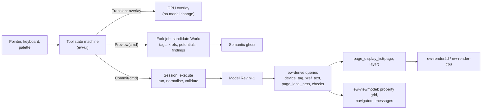
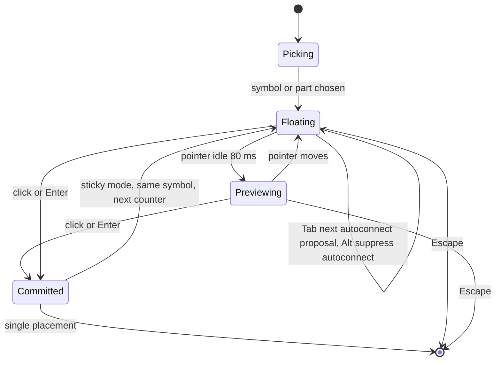
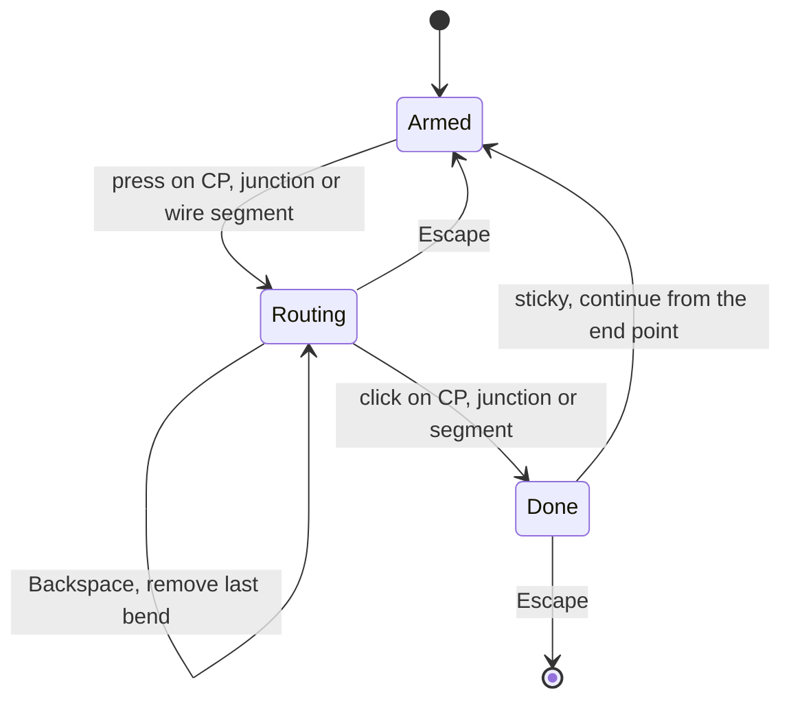

# Schematic editor

**Status:** Draft v0.1 · **Date:** 2026-10-18 · **Part of:** ElektraWatt design document set

**Purpose.** This document specifies how ElektraWatt (EW) edits schematic pages: multi-line, single-line, overview,
bus-topology, fluid and graphic pages, together with their frames, folios and sections. It covers symbol placement,
devices and main/auxiliary functions, black boxes and structure boxes, connections and junctions, interruption
points, cross-reference display, texts and graphics, property editing, clipboard, snapping, tools, shortcuts, undo
and online checks. It refines the accepted [architecture](04-architecture.md) (§5 commands, §6 queries, §8
rendering, §9 UI) and the [domain model](03-domain-model.md) (§6, §7, §9, §10) for the interactive canvas. It ends
with a walkthrough that draws folios 101 and 102 of the reference project.

**Contents**
1. [Position in the architecture](#1-position-in-the-architecture)
2. [Concepts and data](#2-concepts-and-data)
3. [Behaviour and rules](#3-behaviour-and-rules)
4. [Editing tools as state machines](#4-editing-tools-as-state-machines)
5. [Algorithms](#5-algorithms)
6. [UI and UX touchpoints](#6-ui-and-ux-touchpoints)
7. [Outputs](#7-outputs)
8. [Edge cases and pitfalls](#8-edge-cases-and-pitfalls)
9. [Walkthrough: drawing folios 101 and 102](#9-walkthrough-drawing-folios-101-and-102)
10. [Reference defects this editor prevents](#10-reference-defects-this-editor-prevents)
11. [Scope by release](#11-scope-by-release)
12. [Dependencies](#12-dependencies)
13. [Requirements covered](#requirements-covered)
14. [Open questions](#open-questions)

---

## 1. Position in the architecture

The schematic editor is a **thin interactive client of the command layer**. Every gesture ends in a `Command`
(ARCH §5.1), and every visible string is a query result (ARCH §1.2, ADR-0001). The editor holds no domain logic that
`ew script` or `ew mcp` could not reproduce. A drawing made with the mouse can be replayed from the journal, and a
drawing made by a script can be undone in the GUI.



| Concern | Owner | This document |
|---|---|---|
| Tools, canvas host, keymaps, hit handles | `ew-ui` | §4, §6 |
| Property-grid rows, selection model, navigator rows | `ew-viewmodel` | §3.7, §6 |
| Display lists, spatial index, text shaping, frames | `ew-scene` | §2.4, §5.1, §7 |
| Commands, normalisers (numbering, autoconnect, junction clean-up, split), orthogonal auto-route | `ew-commands` | §3.1, §3.2, §5.4 |
| Tags, anchor cells, xref texts, nets, potentials | `ew-derive` | §2.8, §5 |
| Online rules | `ew-checks` | §3.10 |
| Symbol search and embedding | `ew-library` | §3.3 |

Out of scope here, with their owners: symbol and FnDef authoring and macros ([07](07-symbols-parts-macros.md)); wire
property inheritance, terminal strip editor and cable definition lines ([08](08-connections-terminals-cables.md));
frame and title-block form layout, PDF ([09](09-reports-forms-output.md)); PLC overview content and topology
semantics ([10](10-plc-and-bus.md)); fluid semantics ([11](11-fluid-power.md)); panel layout pages
([12](12-panel-layout.md)); canvas comments, waivers and page change marks
([15](15-checks-revisions-collaboration.md)); shell, docking and keymap infrastructure ([16](16-ux-ui.md)).

**Non-goals** (consistent with ARCH §16): autoconnect as model semantics; real-time co-editing; PDF optional-content
layers; an own UI toolkit.

---

## 2. Concepts and data

### 2.1 Entities the editor writes

The editor writes only authored records (Kind **A** in [domain model](03-domain-model.md) §1.1) and deliberate frozen
values (Kind **F**, e.g. the typed tag "S51"). It never writes a derived tag text, a cross-reference text, a
potential or a title-block value (FR-NUM-001, FR-XRF-001).

| Record | What the editor does with it | File ([05](05-project-format-and-persistence.md) §2.2) |
|---|---|---|
| `Page`, `Section` | create, copy, renumber, set type, frame, scale, grid, title, structure | `pages/<uuid>.jsonl`, `structure.jsonl` |
| `Device`, `Function` | created on placement or from a part; tag spec, role, CP overrides, technical data | `devices/<xx>.jsonl` |
| `Representation` | position, orientation, variant, representation type, pin map, text-slot overrides | page file |
| `Connection` | endpoints, route, kind, overrides (CDP) | page file; a device shard when `page = None` (undrawn rows, [03](03-domain-model.md) §9) |
| `Junction` | point, style (Dot, Bevel), wiring (Chain, Star; added in [03](03-domain-model.md) §1.2), sequence | page file |
| Interruption point | `Function{kind: Ip(IpSpec), device: None}` plus its representation | page file of its representation (both rows) |
| `StructureBox` | outline, line style, caption, assignment, external reference | page file |
| `PageItem` | graphic, free text, image, wire marker | page file |
| `PotentialDef`, `NetDef` | name, type and properties at an endpoint | shard of the device owning `at`; a junction endpoint puts it in the junction's page file |
| `ReportBlock` (embedded) | position and filter of PART DATA boxes; content derived ([09](09-reports-forms-output.md)) | page file (`embedded.page`) |

**Session state that is not model data** lives in the git-ignored per-user folder `.ew/u-<hash>/` or in memory
(FR-UI-033, [05](05-project-format-and-persistence.md) §1): open tabs, viewports, jump history, the active tool and
its sticky options, selection, highlight set, grid display toggles. It is never journalled, never merged and never
part of undo, although undo entries record page, viewport and selection so that undo can restore them (ARCH §5.3).

### 2.2 Page types and their semantics

The page type governs what a page can contain and what drawing means on it (FR-PAG-001, FR-PAG-002).

| Page type | Representation types offered | Wire tool creates | Autoconnect | Joins nets | Reference folios |
|---|---|---|---|---|---|
| MultiLine | MultiLine, ContactImage, StripSegment, Graphic (cable markers, black boxes; decision log ID-385) | `Wire` (electrical) | on | yes | 101, 102, 103, 106 |
| SingleLine | SingleLine | MVP: `Overview` kind; 1.0: `SingleLine{conductors}` connection (FR-CON-044, FR-CON-029) | on | MVP: no; 1.0: mapped onto the multi-line connections | — |
| Overview | Overview | `Overview` | off | no | — |
| AssemblyOverview | Overview of an assembly member (break marks derived, decision log ID-373) | `Overview` | off | no | 201, 202 |
| BusTopology | Topology (bus ports, connectors, single-line bus cables), Graphic (cable markers; ID-385) | `Bus` | on, bus ports only | bus nets | 3 |
| Fluid | Fluid, MultiLine (electrical parts drawn in a fluid diagram, the CPX blocks on 203–206; ID-385) | `Fluid` with line kind | on, fluid ports only | fluid graph only (FR-FLU-002) | 203–206 |
| Graphic | Graphic | nothing (graphics tools only) | off | no | — |
| TitlePage | cover form content, page items | nothing | off | no | 1 |
| PanelLayout | `SurfaceView` of placements (derived; [12](12-panel-layout.md)) | nothing | off | no | 902 |
| ModelView (1.0), ExternalDocument (1.x) | — | nothing | off | no | — |
| TableOfContents, SectionDivider, Report | generated, read-only | edits refused with a link to the report block or section (FR-PAG-002) | — | — | 2, 100, 200, 900, 901, 903–911 |

A line drawn between two CPs on folio 201 is an `Overview` connection and joins no potential (FR-CON-002). A
single-line connection must not join nets either: a device drawn single-line and multi-line would otherwise produce
its wires twice in the wire list. The tool palette changes with the page type, so a user cannot pick the wire tool
on a graphic page.

*Owner ruling (2026-10-22; decision log ID-385, amending ID-55).* The reference drawings place cable markers and black boxes as graphics on multi-line and bus-topology pages and draw the CPX blocks multi-line on the fluid pages, so the table offers those combinations; every other combination is still refused at placement. The builder DSL of AC-15 path (b) found the restriction (the "(a) ≠ (b)" gap class, [18](18-quality-security-release.md) §3.10).

### 2.3 Folios, sections and page names

- **Folio** = `{section?, number: u32, label?: Ident}` ([03](03-domain-model.md) §6). Folios are sparse and never
  renumbered implicitly (FR-PAG-005). Labels allow sub-pages (101.1, 101a), sorted naturally: 101, 101.1, 101.2,
  101.10, 102 (FR-PAG-006, FR-NUM-018).
- **Sections** `{number, folio_range, title, divider}` (FR-PAG-008). With `divider = true`, the first folio of the
  range is a generated divider page whose description is derived: "=P01+J-E-2416 - Section 1 - Page 100 - 199 -
  Wiring Definition" (FR-PAG-009). Folios 100, 200 and 900 of the reference project are generated this way and
  cannot be edited; the page navigator shows them with a lock badge and opens the section properties on edit.
- **Full page name** `=P01+J-E-2416/101` is derived from the page structure and folio. Duplicates are a prevent rule
  (FR-PAG-012).
- **Page order** is `page_order()`, which merges drawn pages, dividers and report pages. Prev/Next, TOC, outline and
  `/PageLabels` come from it (FR-PAG-013). A report block that overflows continues on sub-pages `<folio>.<n>`
  (FR-PAG-030; [20-golden-project](20-golden-project.md) §16).
- **Page title and description.** The page title ("Power Supply 1 - Main Current") is `Page.title`; the title-block
  "Description" inherits the project description unless `description_override` is set, which a check reports
  (FR-PAG-010, FR-REP-036; field split per [03](03-domain-model.md) OQ1).

### 2.4 Frames, sheet and grids

A page has three distinct geometric systems. Mixing them up is the most common source of off-by-one cells.

| System | Defined by | Used for | Reference project |
|---|---|---|---|
| **Frame grid** (columns, rows) | the frame `FormDef`: column count, start index, width; row count, labels, height; header bands (FR-PAG-014) | anchor cells and cross-reference texts | 17 columns 0–16 of 60 px, 8 rows A–H of 80 px, 20 px header bands (FR-PAG-015) |
| **Snap grids** | `Page.grid` (connection grid) plus a fine grid | CPs, wire bends (connection grid); graphics and texts (fine grid) | QET 10 px = `7_937_500/3` nm on imported pages; native 4 mm proposed (ADR-0027) |
| **Sheet transform** | the frame form's page-to-sheet transform (`FormDef.page_to_sheet`, QET-compatible frames only; FR-PAG-029) | paper output only | scale 0.986282578, offset 9.79 mm; native frames scale 1 |

Shipped frames:
- **QET-compatible A4 landscape**, grid and no-grid variants with one title block (FR-PAG-015, FR-PAG-017). Golden
  folios 1, 2, 100, 200, 900, 901 and the generated pages use the no-grid variant.
- **ISO 5457** A4–A0 with 50 mm grid fields and centring marks, and an A3 frame with 10 numbered columns
  (FR-PAG-016, 1.0).

Frames are assigned by project default, page-type default and page override (FR-PAG-018). The frame editor
(FR-PAG-027) belongs to [09](09-reports-forms-output.md).

**Snap grids per page.** The active connection grid is shown in the status bar and as a page badge; QET-grid pages
carry a "10 px" marker (FR-PAG-021, FR-UI-018). CPs of symbols are always on the page's connection grid
(FR-SYM-009). Graphics and texts snap to the fine grid: on native pages 0.5 mm for graphics and 1 mm for texts
(ADR-0027 recommendation 1), on QET pages 1 px (`793_750/3` nm); Alt suppresses snapping for them. Converting a QET
page to the native grid is a 1.x command (FR-PAG-022).

### 2.5 Representations: variants, orientation, text slots

A placed symbol is a `Representation{functions, page, symbol, variant, pos, orient, rep_type, pin_map,
text_slots}` ([03](03-domain-model.md) §6). The editor exposes three independent choices while placing:

1. **Orientation variant A–H** (FR-SYM-004, FR-SYM-015), mapped onto `Orient2`:

   | Variant | A | B | C | D | E | F | G | H |
   |---|---|---|---|---|---|---|---|---|
   | `Orient2` | R0 | R90 | R180 | R270 | M0 | M90 | M180 | M270 |

   Rn rotates clockwise as seen on the sheet (y down), so QET's `orientation` steps 1–3 map to R90–R270 (the QET
   importer's mapping, [14](14-interop.md) §4.2; QET's mirror order is still to be verified on rendered corpus pages,
   14 Open question 12). M mirrors about the symbol's vertical axis before rotating. CP indices never change; a
   mirror swaps positions, not designations. Whether EPLAN's letters use the same order is unverified (Open
   question 4).
2. **Symbol variant** for the same function: contact-image variant, CP variant (FR-SYM-004).
3. **Representation type**: multi-line, overview, fluid … filtered by page type (§2.2) and by the FnDef's symbols
   (FR-SYM-006).

**Text slots** (FR-SYM-011) render tag, function text, technical data, manufacturer, part number, CP designations,
xref, PLC address and user properties. A **property arrangement** chooses which slots show (FR-SYM-012). Slot text
is always derived; the representation stores only overrides of position, rotation, alignment and visibility. Text
height comes from the text style bound to the slot kind (FR-SYM-013, D-29), so dragging a label moves it but never
resizes it. Texts stay readable from the bottom or the right of the sheet (common drawing practice; the governing
clause is unverified), so slot text never renders at R180 or R90: on a symbol at R180 it renders at R0, on a symbol
at R90 at R270 (reading bottom to top); a mirror never mirrors glyphs. Instead the text's alignment flips: left ↔
right when the readable rotation turns the text by 180°, top ↔ bottom when exactly one of that turn and a mirror
applies, so the text keeps its side of the symbol and stays readable (decision log ID-49; the table for all eight
variants is in [07](07-symbols-parts-macros.md) §4.1).

### 2.6 Devices, functions, main and auxiliary

The editor follows the Device / Function / Representation triad (ADR-0006, FR-DEV-001 … FR-DEV-005):

- **One device, one main function** (structural invariant, FR-DEV-004). The main function's part template
  ([07](07-symbols-parts-macros.md)) says which function is main: the pole set of an MCB, the box of a PSU, the coil
  of a contactor.
- **Auxiliary functions** reference their device and print "(main location)"; the main prints "∞ aux locations"
  (FR-XRF-015).
- **Several representations of one function** (overview and multi-line, topology and power) cross-reference as
  "same function" relations (FR-XRF-016). -201U1 has its main representation on 201 (assembly view) and auxiliary
  functions on 3 (bus port) and 106 (power connector).
- **Unplaced** is derived from the absence of a representation. The device navigator lists unplaced functions and
  accepts them as drag sources (FR-DEV-018, FR-UI-007).

### 2.7 Black boxes, device connection points and structure boxes

| Box | Model | Containment | Reference |
|---|---|---|---|
| **Black box** | `Function{kind: BlackBox}` whose CPs come from the part's CP pattern or are added by hand as device CPs (FR-DEV-013); two-sided device CPs have an internal and an external side (FR-DEV-014) | **Authored at placement**: a new function, or one without a device tag of its own, placed inside the outline gets `Function.device` = the box's device and becomes an auxiliary function (as in EPLAN); a function of another device keeps its device; moving a joined function out later asks whether to detach | -102G1 (L, N, PE, +#1, +#2, −#1, −#2), -102F2, CPX power blocks of -201U1/-202U1 on 106 |
| **Structure box** | `StructureBox{outline, line style, caption, assigns, external?}` (FR-PRJ-020) | **Derived**: a representation whose anchor lies inside the outline takes the box's structure slots | "External Connection" boxes on 3 and 101 (+J-E-206) |

The difference is deliberate. `Function.device` is authored data and must not change when a symbol is nudged across
a box edge; structure assignment is a derived default that EPLAN users expect to follow the box.

**Black-box geometry.** A black box has no library symbol: its outline, the positions of its device CPs on the
outline and its inner graphics ("AC ~ / 24 VDC" on -102G1, the "24VDC" and "GND" fields of -102F2) are page
geometry, stored in `Representation.box: BoxSpec` ([03](03-domain-model.md) §6; FR-DEV-039). CPs stay on the
connection grid and on the outline; resizing the box moves its CPs along the outline and connections follow. An
auxiliary function drawn inside its own device's box (the 13-14 contact of -102F2) prints no cross-reference.

### 2.8 Cross-reference display

Cross-references are relations between representations; their texts are derived by `xref_text(rep)` from the
target's anchor cell and the project's format ([03](03-domain-model.md) §10, FR-XRF-001). The editor never stores
xref text. The format is a project scheme (FR-PRJ-008), persisted as `ProjectSettings.xref_format`
([03](03-domain-model.md) §5.1):

```toml
[xref]
ip          = "{page}-{row}{column}"     # interruption-point partner: "102-A1" (QET %F-%l%c)
aux_to_main = "({page}-{row}{column})"   # on an auxiliary function: "(201-E1)"
main_to_aux = "∞ {list}"                 # on the main function: "∞ 3-B2, 106-G3"; list items use `ip`
structure   = "when-different"           # "+J-E-206/…" only when the target page's structure differs (FR-XRF-004)
same_page   = "full"                     # or "zone-only" (FR-XRF-025, IEC 61082-1 style "/H16")
matrix      = { per_row = 3, max = 9, overflow = "…" }   # one-to-many points (FR-XRF-008)
```

| Token | Meaning | QET variable (FR-XRF-003) |
|---|---|---|
| `{page}` | folio label of the target page | `%F` |
| `{page_index}` | position in page order, counting every page record but not report continuation pages (FR-XRF-003) | `%f` |
| `{row}`, `{column}` | target anchor cell on the target page's frame (FR-XRF-021) | `%l`, `%c` |
| `{function}`, `{location}` | structure of the target (`=`, `+`) | `%M`, `%LM` |

| Preset | Example at L-1 on folio 101 | Use |
|---|---|---|
| QET style (pilot basic project) | `102-A1`; aux `(201-E1)`; main `∞ 203-B4` | Golden A, migrated projects (C-15) |
| EPLAN column | `/102.1` | native A3 projects without rows |
| EPLAN cell | `/102.A1` | native projects with rows |
| Full structure | `=P01+J-E-2416/102.A1` | targets in another structure |

The EPLAN presets follow the notation in [standards](../research/standards.md) §2.2 (`/7.8`, `/101.H16`); EPLAN's
exact option set (separators, order of row and column) is unverified.

Switching presets re-renders every xref in one commit and loses nothing, because nothing was stored (FR-XRF-002).
Xref texts are freshness class I: every move, renumber and frame change updates them in the same commit
(FR-XRF-020).

**Text placement** per relation kind (FR-XRF-011, FR-XRF-022): IP partner text below the arrow, right-aligned, style
`data.small`, and so is the partner text of an external arrow; aux text `(…)` under the device tag and the main
list after the tag, both style `xref.device` (as built: the xref slots of the IEC contact and coil symbols,
`ew.ovw.module`, `ew.bus.dp-port` and `ew.gen.blackbox` name it, decision log ID-266; sizes in
[20](20-golden-project.md) §17.5). Every xref text is a link on screen and in the PDF (FR-XRF-019, FR-OUT-005).

**Interruption-point glyph.** The arrow shows signal flow, not page side (FR-XRF-009): a **Source** point draws its
tip away from the wire, a **Target** point draws its tip at the wire. L-1 on 101 (Source, wire from the left) and
L-1 on 102 (Target, wire to the right) are both ▷; PE-1.1 on 103 (Target, wire to the left) is ◁. The glyph variant
is derived from `IpSpec.direction` and the side of its CP, so rotating the symbol cannot invert the meaning.

**Contact images** (FR-XRF-017, FR-XRF-018). For a main function with auxiliary contacts (contactor coil, motor
protection switch) the scene derives a contact image:

```toml
[contact_image]
placement   = "in-path"            # below the main symbol in its column; or "on-component" | "none"
show_unused = true                 # free contacts of the part's contact data (FR-PRT-009)
row         = "{glyph} {designations} {xref}"   # "13-14 /105.3"
```

Rows come from the auxiliary functions (sorted by contact sequence digit, then designation) plus unused part
contacts. Glyphs come from each FnDef's contact-image variant. The golden project has no contactor; the acceptance
case is the test contactor -K1 of FR-XRF-017 ("13-14 /105.3, 21-22 /106.5").

---

## 3. Behaviour and rules

### 3.1 Editor commands

Every command has a stable dotted name and a JSON Schema (FR-EXT-015). `Cost::Bulk` commands always run as preview
jobs (ARCH §5.1). The Bulk threshold of `edit.delete` counts the records affected, which is the size of the delete
plan, not the number of selected targets (decision log ID-55).

*v0* (WP-S1.04; decision log ID-45, ID-55). 25 commands are registered, all exposure `Edit`, stability `Preview`
and undoable: those of the table except `page.copy`, `page.move`, `rep.exchange_symbol`, `ip.arrange`, `box.*`,
`item.place`, `edit.paste` and `macro.insert`, which arrive with their work packages, plus `connection.delete`,
`structure.create_node`, `section.create`, `report_block.create`, `device.create`, `terminal.add`, `cable.create`,
`conductor.add`, `project.settings.set` (cycle 11) and `terminal.designate` (cycle 12). The alias `device.place_from_part` stays unregistered until parts exist (WP-S1.19a). A
placement whose `rep_type` the page type does not allow is refused (§2.2), and an autoconnect hint whose target
vanished is dropped and reported in the outcome's notices.

*As built (cycle 15, lane C; the golden builder of WP-S6.01).* Three commands join, all `Edit`, `Preview`, undoable,
with committed schemas: `box.black` (`PlaceBlackBox`: page, black-box symbol, pos, orient, rep type, optional `box:
BoxSpec`, and the placement target of `device.place`; the created function is of kind `black_box`, an existing one must
be; an outline has at least three points, box CP indexes are distinct and on the grid; the containment gesture of
§2.7 is the place tool's, not this command's), `bond.create` (`CreateBond`: a, b as CP or junction, kind, optional
`via`; the label is derived; the PELV and type rules stay checks) and `external_ref.create` (`CreateExternalRef`:
location node of the location aspect, device, optional connection and project). 29 commands are registered. The
page-type admission of ID-55 is amended by the owner ruling of cycle 15: MultiLine and BusTopology pages also take
graphic representations (cable markers) and Fluid pages multi-line ones (the CPX black boxes of a valve terminal), as
the reference drawings show (`allowed_rep_types`; AC-15 path (b), [20](20-golden-project.md) §22).

*As built (cycle 16, lane A; FT-169, FT-270, FT-167).* Seven commands join, all `Edit`, `Preview`, Interactive,
undoable, with committed schemas; 36 commands are registered. `assembly.attach` (`AttachChildren`: parent and
children with optional 1-based positions; sets `Device.parent`/`position`; a held position, two children at one
position or an ancestor as child are refused, no push insert; a child tag whose counter equals its old position
follows the new position, N-FL-2); `valve.add` ([11](11-fluid-power.md) §4.3: module,
position (default the lowest free), part use, letter (default Q), FnDef of the main function, structure; the valve
gets the child tag scheme with its counter equal to its position); `device.link` ([11](11-fluid-power.md) §4.3:
from, to, kind; no self-link, no duplicate); `plc.config_project.create` (name unique, profile `id@version`,
optional CPU); `plc.bind_channel` ([10](10-plc-and-bus.md) §3.9: channel and a CP of the function's FnDef on the
channel's module or one of its descendants, or `null` to unbind; another channel on the same CP is unbound in the
same transaction, FR-PLC-005); `project.supply.set` (v0: only `origin.source`, by owner ruling; the electrical
members wait for an ADR-0008 amendment that makes them Bulk with a preview; a project without a supply is
refused); `library.embed` (library documents of kind part, symbol, fndef or form, each with its lineage: the ID
must be the copy identity `v5(NS_LIBCOPY, library_id ‖ item_id)`, the `sha256` must be consistent with the item, a
project-local item or an item already embedded is refused). `fields.set` gains `tag.scheme` and the device aspects
`assembly`, `plc_station`, `plc_module` (as a whole or member by member; a cover that the edit adds outside the
assembly device's subtree is refused, one already out of scope is a check, ID-371). Normaliser row 3 (N1) is built (§3.2). The golden builder of AC-15 path (b)
builds the valve-terminal assembly, the PLC records and the supply origin with them.

| Command (`NAME`) | Parameters (abridged) | Cost | Notes |
|---|---|---|---|
| `page.create` | folio, kind, section, structure, title, form?, grid | Interactive | folio proposal §5.6 |
| `page.copy`, `page.move`, `page.delete` | pages, target section or folio | Bulk | delete leaves devices unplaced unless chosen (FR-PAG-025) |
| `page.renumber` | scope, start, step, keep_gaps | Bulk | FR-PAG-007; Golden B2 |
| `device.place` (`PlaceSymbol`) | page, symbol, pos, orient, rep_type, target, autoconnect hints | Interactive | §3.3; part-first placement is `target = FromPart`; `device.place_from_part` and `symbol.place` are `CommandMeta.aliases` ([17](17-extensibility.md) §2.1), and the journal records `device.place` |
| `rep.move`, `rep.transform` | reps, delta or page; rotate, mirror, variant | Interactive | routes follow (FR-CON-004) |
| `rep.exchange_symbol` | rep, symbol, CP mapping | Interactive | FR-SYM-022 |
| `rep.set_anchor_policy` | reps, anchor (origin, graphic centre, slot, named point) | Interactive | FR-SYM-010; the MF-13 quick fix of EW-CORE-053 (D-14). As built (cycle 14; decision log ID-351): it writes `Representation.anchor`, a per-representation override of the policy of the symbol copy (null resets it to the copy's policy); it does not touch the symbol copy, so other representations of the same copy keep their policy |
| `connection.draw` (`Connect`) | a, b (CP, junction or point on a connection), route, kind | Interactive | §4.4 |
| `connection.route` | connection, route | Interactive | FR-CON-007 |
| `junction.edit` | style, wiring, sequence | Interactive | FR-CON-005 |
| `ip.place`, `ip.continue`, `ip.arrange` | name, direction, star source, scope; target page; sort key | Interactive | FR-XRF-006 … FR-XRF-014 |
| `box.black`, `box.structure` | outline, device or assignment, caption, external ref | Interactive | §2.7 |
| `item.place` | graphic, text, image, wire marker | Interactive | §3.8 |
| `potential.define` | endpoint, name, type, voltage, props | Interactive | FR-CON-010 |
| `fields.set` (`SetFields`) | targets, field path, value | Interactive | property grid, multi-select |
| `edit.delete`, `edit.paste` | selection; fragment, anchor, options | Interactive; Bulk above 500 records | §3.6 |
| `macro.insert` (`InsertMacro`) | macro, at, value set | Bulk | [07](07-symbols-parts-macros.md), FR-MAC-005 |
| `numbering.renumber` (`RenumberDevices`) | scope, scheme, options | Bulk | FR-NUM-008, FR-NUM-009 |
| `terminal.designate` | assignments (terminal, designation), at least one | Interactive | one transaction, swaps without temporary names; uniqueness by the prevent rule EW-TERM-002 (FR-TRM-022, [08](08-connections-terminals-cables.md) §6.8) |

### 3.2 Normalisers that run behind the editor

Normalisers add ops to the same transaction, at most three passes (ARCH §5.2). ARCH §5.2 lists the normaliser
families and names this table as their **registry**: a new normaliser is added here, with its owner, before it
ships. The order is the order within one pass; a normaliser whose input another one creates in the same pass sees
it in the next pass. All are deterministic and break ties by ID. "At most three passes" means three productive passes
plus one confirming pass that changes nothing; a fourth pass that still changes something is non-convergence,
reported as `CmdError::Internal`, and the command is refused (decision log ID-44). Each normaliser converges within
one run for its own cascades, so the passes only carry effects from one normaliser to another: junction clean-up,
for example, works through a worklist, so a dissolve that leaves another junction with two connections is handled in
the same run.

**v0** (WP-S1.04; decision log ID-44). `ew-commands` runs rows 2, 4, 7, 8 and 12 in this order (`ORDER`, asserted by
a test). Row 2 records nothing, because CPs are derived and no override exists yet. Row 4 numbers within the scope
(page of the main representation, letter) and skips devices with a terminal aspect, a frozen tag or a scheme other
than the page-based default (ID-48). Row 7 splits by an exact integer point-on-route test; W′ keeps its ID and
number and W″ is new and `Unassigned`. Row 8 keeps, when a junction dissolves, the member that carries an assigned
wire number (rows 8 and 11, FR-NUM-023); if both members carry different assigned numbers the command is rejected
rather than losing one (ID-60). Row 12 leaves every new connection `Unassigned` until a wire-numbering scheme exists
(WP-S1.11). The other rows arrive with their owners' work packages. The prevent hook of the validate step stays
unwired until WP-S1.15, so M1 accepts, for example, duplicate terminal designations; this is a documented known gap
(ID-58). *Cycle 16:* row 3 (N1, `channel_instantiation`) runs between rows 2 and 4: a device of the transaction
that is new with a `plc_module` aspect, gained one, or changed its parts or `part_use` gets the channels 0 … n−1 of
its part's channel spec with v5 IDs; existing channels are kept and surplus ones are not removed (FR-PLC-053's
confirmation is not built).

**Explicit counter edits** (FR-NUM-029; decision log ID-53). Row 4 renumbers only collisions that the edit itself
creates by placing a new device, moving a main representation or changing a page. A `fields.set` that sets a tag's
letter or counter to a value that collides on the page is rejected in the strict style of ADR-0009, with the next
free counter proposed, and is never silently replaced. Duplicates that already exist in a lenient project stay
findings.

| # | Normaliser | Effect | Owner |
|---|---|---|---|
| 1 | **Valve functions from the part** (N-FL-1) | Creates or removes a valve's valve and coil functions per the part's `solenoids` | [11](11-fluid-power.md) §4.2 |
| 2 | **CP instantiation** | Creates the CPs of new functions from FnDef or part pattern (FR-DEV-002); only overrides persist | this document; [07](07-symbols-parts-macros.md) §4.2 |
| 3 | **Channel instantiation** (N1) | Creates a module's channels with v5 IDs from the part's `channels` | [10](10-plc-and-bus.md) §3.3 |
| 4 | **Online numbering** | New devices get the next free counter in their scope (FR-NUM-007). Moving a main representation that makes a page-based tag collide assigns the next free counter in the same transaction (FR-NUM-029): -101F1 dragged to folio 102 becomes -102F3 | this document |
| 5 | **Valve position and child counter** (N-FL-2) | Lowest free or requested position in the module; the child counter follows the position | [11](11-fluid-power.md) §4.2 |
| 6 | **Autoconnect hint conversion** | Hints accepted in the ghost become `Connection` ops after re-validation against the candidate snapshot (ADR-0007); a hint whose target vanished is dropped and reported in the toast | this document |
| 7 | **Connection split** | A symbol dropped onto a wire splits it (FR-CON-008, §5.3) | this document |
| 8 | **Junction clean-up** | A junction left with two connections dissolves into one connection; a junction left with one connection is deleted together with it, and the preview lists both (invariant CI-04) | this document; [08](08-connections-terminals-cables.md) §3.1 |
| 9 | **Conductor assignment** | Wires crossed by a cable definition line become cores | [08](08-connections-terminals-cables.md) §7.2 |
| 10 | **Clamp pick** | A wire ending on a terminal without a clamp gets the first free clamp of the drawn side | [08](08-connections-terminals-cables.md) §6.3 |
| 11 | **Number transfer** | When an edit changes a physical wire's carrier connection, moves its `NumberSpec`, its `WireOverrides.ends` and `WireOverrides.length` to the new carrier and rewrites records keyed by the old wire ID (`Bond.via`) | [08](08-connections-terminals-cables.md) §5.1; end overrides [13](13-manufacturing-outputs.md) §2.3 |
| 12 | **Online wire numbering** | New wires get the next number of the active wire-numbering scheme when online numbering is on, otherwise they stay `Unassigned` and print "?" (FR-NUM-019, FR-NUM-021) | [08](08-connections-terminals-cables.md) §5.2 |
| 13 | **Solenoid binding** (N2 = N-FL-3) | Binds each declared solenoid's coil to the channel the part's position map assigns, if that channel is unbound; an explicit binding in the command wins | [10](10-plc-and-bus.md) §3.3 |
| 14 | **Module pin binding** (N3) | Binds a new physical channel to the module pin of the part's channel map | [10](10-plc-and-bus.md) §3.3 |
| 15 | **Logical-net inheritance** (N4) | A bus connection to a port without a logical net assigns the net of the other port | [10](10-plc-and-bus.md) §3.3 |
| 16 | **Drives link** (N-FL-4) | The first tube from a valve working port to a consumer port of another device adds `DeviceLink{Drives}` | [11](11-fluid-power.md) §4.2 |
| 17 | **Tube counter** (N-FL-5) | A new tube connection gets its counter when a line-tag scheme is active | [11](11-fluid-power.md) §4.2 |

Auto-routing (§5.4) is not a normaliser: it runs inside `connection.draw` and `rep.move` themselves, so a script
gets the same route as the mouse.

### 3.3 Placing symbols and assigning devices

`PlaceSymbol.target` decides which device the new representation belongs to:

```rust
pub enum PlaceTarget {
    NewDevice { letter: Option<Ident> },           // letter from the FnDef category via the identifier set (FR-NUM-004)
    FromPart { part: PartRef },                    // device + template functions; the chosen one is placed (FR-DEV-017)
    Function(Id<Function>),                        // another representation of an existing function (FR-DEV-003)
    JoinDevice { device: Id<Device>, role: Role }, // the user typed the tag of an existing device (FR-DEV-038)
}
pub struct AutoconnectHint { pub cp: u16, pub to: HintTarget }
pub enum HintTarget {
    Cp { function: Id<Function>, idx: u16 },          // a facing free CP
    Split { connection: Id<Connection>, at: Pt2 },     // insert into an existing wire (FR-CON-008)
    Junction(Id<Junction>),
}
```

Rules:
- **From the symbol library** (search by name, category, IEC 60617 reference, FR-SYM-021): a new device whose letter
  comes from the FnDef category; the ghost label shows the tag the fork predicts ("-102F3") before the click.
- **From a part** (IDEA-016, FR-UI-017): the part's function template creates all functions; the one matching the
  chosen symbol is placed and the rest appear as unplaced entries under the new device. Part texts (manufacturer,
  number, rating) appear through text slots with no typing (FR-DEV-016).
- **Typing a tag** in the tag field after placement: the text is parsed by `ew-rds`. If it names an existing device,
  the editor offers to join it as an auxiliary function, or as another representation of an existing function with
  the same FnDef and CP designations. If it parses under the device's scheme, it sets letter and counter. Otherwise
  it becomes a frozen tag after confirmation ("S51 does not match `{page}{letter}{counter}`; keep as frozen tag?"),
  reported at info (FR-NUM-010, FR-CHK-025).
- **Displayed tag**: the canvas prints the displayed tag, which suppresses structure identifiers equal to the
  page's (FR-NUM-002); the property grid shows the full tag `=P01+J-E-2416-102F1` beside it, read-only.
- **Representation type mismatch**: placing an overview symbol on a multi-line page is refused with the list of
  allowed types (§2.2).
- **Black box inside the drop point**: the function joins the box's device (§2.7).

### 3.4 Move, rotate and delete

- **Moves never change connectivity** (FR-CON-004). Route vertices adjacent to moved CPs are re-solved (§5.4); other
  vertices stay. Live potential highlighting during a drag uses page-local nets only (NFR-PERF-05).
- **Cross-page move** (dragging a representation onto a page tab, or `rep.move` with a target page) keeps
  identities and, because it is a move, connectivity (FR-CON-004): each connection whose other end stays behind is
  replaced by an IP pair whose name is proposed from the potential ("24VDC-1" or the next free name of its series),
  listed and editable in the preview. The user may instead drop those connections; the preview then lists them as
  removed, so the connectivity change is explicit, never silent (FR-CON-043). **Cut and paste** is delete plus
  paste and follows §3.6: connections to outside the selection are not copied. *v0* (WP-S1.04, decision log ID-46)
  rejects a cross-page move that would leave a connection end behind, and leaves page-less connections (bridges)
  untouched; the IP-pair replacement arrives with WP-S1.07, which carries FR-CON-043.
- **Structure follows the page** unless the device has an explicit slot; moving the only representation of a device
  to a page of another location asks whether to keep the old location as an explicit slot (FR-PRJ-019).
- **Deleting a representation** leaves its function unplaced; deleting a device follows the delete policies and
  previews every function, representation and connection removed (FR-DEV-030). Deleting a page lists its IPs and
  devices left unplaced (FR-PAG-025).

### 3.5 Connections, junctions, interruption points and potentials

- **Explicit connections.** A connection joins two endpoints: a CP or a junction (FR-CON-001). Several connections on
  one CP are a daisy chain whose order is preserved (FR-CON-006). Where two connections of one CP share a route
  section and then diverge, the scene draws a 45° bevel at the divergence: the reference's notation on the 101 top
  bus, as presentation only (D-20).
- **Junctions.** Ending a wire on the interior of another connection's segment creates a `Junction` and splits that
  connection. Style defaults to Dot; wiring defaults to Star for Dot and Chain for Bevel ([03](03-domain-model.md)
  OQ7). `sequence` stores connection IDs; the editor shows each member by its far endpoint, e.g. (+#1, -102F1:1,
  +#2) for J3. The initial sequence lists the two parts of the split connection ordered by flow distance from the
  potential's source ([08](08-connections-terminals-cables.md) §3.2, §3.6), with reading order (row, then column of
  the far endpoints' anchor cells) as the tie-break, so the feeding device comes first, and appends the new branch;
  the M2 usability test confirms this default (PQ-27). The junction's property page shows its sequence as a
  reorderable list together with the
  **physical wires it produces** ("W13 F55:2 → E55:L; W14 F55:2 → E56:X2"), so the user edits the wiring order the
  shop will cut, not a graphic. A junction whose feed cannot be determined is reported by EW-POT-011
  ([15](15-checks-revisions-collaboration.md) §4.4).
- **Interruption points.** An IP is a `Function{kind: Ip}` with one CP. It is placed on its own and wired afterwards,
  or created at the free end of a wire being routed (`P`, §4.4). The name field proposes the potential's name,
  then the next name in a numbered series ("24VDC-2" after "24VDC-1"). The direction defaults to Source at the
  right or bottom edge of the drawing area and Target at the left or top edge, and is toggled with `D`.
  Pairing (star or chain, scope) follows the project's `ip_pairing` setting with per-name overrides (FR-XRF-007,
  FR-XRF-010). "Continue on page…" creates the partner on a chosen page at the opposite edge in the same row, with
  the direction reversed (FR-XRF-014). "Arrange" sorts a page's IP stack by name or potential (FR-XRF-013, D-39).
- **External connection points** are IPs with `external = Some(ExternalRef)`. They never pair and print the external
  target ("+J-E-206 / JE-N1000-03") in the xref slot (FR-XRF-012).
- **Potential definition points** name and type a potential at an endpoint, a CP or a junction (FR-CON-010); they
  may be drawn as a flag symbol or kept undrawn and edited in the potential navigator, which lists each potential's
  CPs, devices, pages and IP aliases (FR-CON-012, FR-CON-027).
- **Connection definition points and wire markers.** The marker tool is drawn across one or more parallel
  connections. It sets the chosen overrides (cross-section, colour) on each crossed connection and creates one
  `WireMarker` page item that positions the group (FR-CON-023). The marker's text is derived: the cross-section at
  the left, one colour code per conductor ("2.5 BK BU"). The project's marker mode decides which connections show
  markers (all, deviations, explicit overrides, none; FR-CON-024). In modes that show markers for connections
  without a `WireMarker` item, the scene places them at a derived position. A group marker over several connections
  is one `PageItem::WireMarker{connections}`, whose list order is the printed order ([03](03-domain-model.md) §6,
  FR-CON-039). Colour fields accept only IEC 60757 codes and profile-declared company codes such as DBU
  (FR-CON-019); typing "BR" offers "BN" (D-17).
- **Wire numbers on the canvas** are derived texts placed by the project's display rule (each segment, once per
  page or at both ends, FR-CON-026); unassigned connections show "?" (FR-NUM-021). The editor never stores the
  printed number, so a page renumber or a route edit cannot leave a stale number behind (FR-NUM-023).

### 3.6 Copy, paste and duplicate

The clipboard carries a **project fragment** in the macro format ([07](07-symbols-parts-macros.md), ARCH §5.5): JSONL
records of the selection, the embedded library copies they use (symbols, FnDefs, parts, with their copy metadata
`{library_id, item_id, version, sha256}`), the structure nodes they reference (by aspect and code) and a format
stamp. arboard 3.7.0 offers text and images only ([rust-ecosystem](../research/rust-ecosystem.md)), so at MVP the
fragment travels as **text** behind a `#ew-fragment v1` header line; another EW instance recognises the header, any
other application sees JSON Lines (FR-UI-040). "Copy tag list" (TSV) and "Copy as image" (PNG) are separate
commands. A multi-format clipboard (fragment, TSV, PNG and a vector flavour at once) needs platform code and is 1.0
(FR-UI-051). A pasted fragment is untrusted
input: it is schema-validated with the importer's size limits and never carries rule packs, reports or scripts.

Paste (`edit.paste`, FR-DEV-029, FR-UI-036):
1. **Identity.** Every record gets a new UUIDv7. References inside the fragment are remapped.
2. **Numbering.** Tag counters are re-assigned by the target's scheme through the online-numbering normaliser, in
   the order of the fragment's anchor cells, so the result does not depend on record or creation order
   (FR-NUM-028). Frozen tags are not copied: a pasted "S51" is derived like any new device. The ghost shows the
   resulting tags.
3. **Structure.** Nodes rebind by (aspect, code) or alias; unknown nodes map to the target page's structure, and the
   ghost lists the mapping.
4. **Library copies.** A copy of an item the target already embeds in the same version (same `sha256`) is reused,
   and a copy of an item it does not embed is added. For another version of an embedded item the paste asks for
   one of three choices ([07](07-symbols-parts-macros.md) §2.1): update the existing copy (a previewed "update from
   library", FR-SYM-016), adapt the pasted records to the existing copy, or keep both, which mints the
   version-qualified copy ID `v5(NS_LIBCOPY, library_id ‖ item_id ‖ version)` for the second copy.
5. **Connections** are copied only when both ends are copied. The ghost counts the dropped ones ("3 connections not
   copied: one end outside the selection").
6. **IP names** are kept and may pair with points already in the target. The ghost lists new pairings so that an
   accidental star with a foreign "L-1" is visible before commit.

**Paste as representation** (paste special) creates new representations of the copied functions instead of new
devices, for example to draw an existing device on an overview page.

### 3.7 Selection, multi-select and bulk edit

- The selection is a set of entity references (representations, connections, junctions, page items, boxes) that
  stays in sync with the navigators in both directions (FR-UI-007).
- Selection filters: only connections, only representations, same device, same symbol, same potential, all
  representations of the device (FR-DEV-019: for -201U1 the list shows 201-E1, 3-B2, 106-G3 and the folio-902
  placement).
- The property grid shows the fields common to the selection, `‹varies›` where values differ, and derived values
  greyed with their provenance ("0.75 mm² · from potential 24VDC-1 via profile 'DBU/WH 24 V'") plus "reset to
  derived" (FR-UI-009, FR-UI-010, FR-CON-025).
- One edit over a multi-selection is **one** `SetFields` command (FR-DEV-031): setting the part of 20 selected
  -X1031 terminals is one undo step.
- Find and replace across tags, function texts, technical data, part numbers and user properties is a previewed
  transaction (FR-DEV-032, FR-UI-020).
- Identifier fields are NFC-normalised and flagged for confusables on input (FR-NUM-016). `MlText` fields edit the
  neutral text or the project languages, with mutual exclusion (FR-I18N-001).

### 3.8 Texts and graphics

`PageItem` kinds ([03](03-domain-model.md) §6): `Graphic` (line, polyline, rectangle, circle, ellipse, arc, polygon;
stroke widths and dash patterns of FR-SYM-003), `FreeText` (multilingual, styled, or bound to a project or page
property, FR-SYM-024), `Image` (content-addressed SVG or PNG, FR-SYM-025) and `WireMarker`. Dimensions are 1.0
(FR-SYM-026). Graphics have no electrical meaning (FR-SYM-023) and sit on the graphic layer; layers with visibility
and print flags are 1.0 (FR-PAG-026).

A **path function text** is a free text tied to a column range. It becomes the automatic function text of the
representations in those columns unless they carry a manual text (FR-DEV-011). It is a `FreeText` with role
`PathFunction{columns}` ([03](03-domain-model.md) §6).

Mechanical linkages between related functions (an actuator and its contacts; a valve and a process valve) are
derived dashed lines, not graphics (FR-SYM-014, FR-DEV-028). Dragging the actuator moves its linkage, and the
linkage cannot be selected as a free line.

### 3.9 Undo granularity

One user gesture is one transaction (ARCH §5.3, G3). The history panel names each entry by its command and origin
(FR-UI-023).

| Gesture | Transactions | Coalescing |
|---|---|---|
| Place a symbol, including its autoconnect connections and online numbering | 1 | none |
| Drag a selection (press to release) | 1 | one per drag |
| Keyboard nudges of the same selection | 1 | merge until the selection changes or another command runs |
| Rotate, mirror or cycle variant of a placed selection | 1 | consecutive presses on the same selection merge |
| Draw a wire with intermediate bend clicks | 1 at the final click | bends are transient |
| Edit one property field | 1 | keystrokes merge until focus leaves (FR-UI-009) |
| Edit one field over a multi-selection | 1 | as above |
| Paste, duplicate, insert macro, quick fix | 1 each | none |
| Page renumber, device renumber, find and replace | 1 each, committed from the preview | none |
| Junction sequence reorder | 1 | consecutive reorders of one junction merge |
| Zoom, pan, page change, selection, highlight | 0 | not model changes |

Escape cancels any tool without a model change (FR-UI-016, NFR-UX-07).

### 3.10 Online checks while drawing

Online rules are memoised queries `checks(scope)` over page, potential, strip and station scopes, so a wire edit
re-evaluates only its page and potential (ADR-0019). Findings show in the message panel (FR-CHK-008, FR-UI-021) and
on the canvas as a severity icon at the target's anchor plus a patterned halo (FR-UI-025). Hovering shows the
message, the rule ID and the quick fixes.

Rule IDs, kinds and scopes are those of the [15](15-checks-revisions-collaboration.md) §4 catalogue, whose Kind
column (kinds per 15 §2.3) decides the pending display below; this document defines only how each kind is shown
while drawing. A scope is the memo key of `checks(scope)` (15 §2.3); prevent rules are evaluated at commit, on the
candidate snapshot, not as a memo scope.

| Rule (requirement) | Kind | Scope | Shown | Reference example |
|---|---|---|---|---|
| Prevent rules: EW-RDS-004 tag unique (FR-NUM-012), EW-TERM-001/-002 terminal designation non-empty and unique (FR-TRM-002), EW-CORE-052 at most one star source per IP name and scope, an even count in chain mode (FR-CHK-017) | conflict | device; strip; potential; evaluated at commit | the commit is refused with the reason (strict mode) | a second -102F1 under `=P01+J-E-2416` |
| EW-POT-013 N switching (FR-CHK-019) | safety | potential | immediately, error | T55 and S56 on 101 (EF-01, D-13) |
| EW-POT-001 type conflict without bond (FR-CHK-028) | conflict | potential | immediately, with quick fix "declare bond" | 0V wired to -X1032 on 103 (D-22) |
| EW-POT-006 PE smaller than line (FR-CHK-020) | safety | potential | immediately, error | W6 on 101 (EF-06, D-38) |
| EW-CORE-051 unpaired IP (FR-CHK-017) | completeness | potential | pending while the page is being edited | PE-1.1 before 103 exists |
| EW-POT-009 unconnected CP (FR-CHK-018) | completeness | page | pending while the page is being edited | -102F2:13, :14 (EF-09, D-23) |
| EW-CORE-041 device without part (FR-CHK-024) | completeness | device | pending while the page is being edited | S56, E56 (EF-04) |
| EW-CORE-034 external connection without cable (FR-CHK-033) | completeness | page | pending while the page is being edited | J-E-206 → 1X1 (EF-07, D-19) |
| EW-CORE-053 xref target cell empty or outside the frame (FR-CHK-035) | hygiene | page (one finding per cross-reference) | immediately, warning | "3-B0" (D-14) |
| EW-NUM-001 frozen tag deviates (FR-CHK-025); EW-RDS-003 letter code (FR-CHK-026) | hygiene | device | info; warning | S51 … 1X1 (EF-15); T55 (EF-18) |
| EW-CORE-061 printed cap height below minimum (FR-CHK-023) | hygiene | project (one finding per text style) | immediately, warning | styles `cp.small`, `marker` (EF-12, D-31) |
| EW-CORE-071 graphic line ending on a CP (FR-CON-001) | hygiene | page | info, quick fix "convert to connection" | a QET-imported line drawn onto a CP (§8 pitfall 5) |

**Pending findings.** Completeness rules (unconnected CP, unpaired IP, missing part, missing cable) fire on every
half-drawn circuit. On the page being edited they show in a muted "pending" style and do not raise the error
counter until the user leaves the page or runs a check; they always appear at full severity in check runs, exports
and the release gate (FR-UI-041, Open question 7). This is the `drafting` scheme of
[15](15-checks-revisions-collaboration.md) §4.9. Safety and conflict rules are never muted. An online rule has a
budget of 5 ms per commit (NFR-PERF-09); one that exceeds it three times in 100 commits is demoted to deferred for
the session and logged (FR-CHK-013, 15 §3.1).

---

## 4. Editing tools as state machines

### 4.1 The tool contract

Tools are state machines that return one output per input event (ARCH §9, FR-UI-016):

```rust
pub enum ToolOutput {
    None,
    Transient(Overlay),          // screen only: rubber band, snap marker, GPU transform of the selection
    Preview(Box<dyn DynCommand>), // semantic ghost: the command evaluated on a fork
    Commit(Box<dyn DynCommand>),  // handed to Session::execute
    Cancel,                       // Escape: drop overlay and preview; model revision unchanged
}
// `Command` (ARCH §5.1) has an associated const and serde supertraits, so it is not dyn-compatible.
// `DynCommand` is its object-safe companion with a blanket impl (ARCH §5.1, Open question 15).
pub trait DynCommand: Send {
    fn name(&self) -> &'static str;
    fn cost(&self) -> Cost;
    fn run(&self, tx: &mut TxBuilder<'_>) -> Result<Outcome, CmdError>;
    fn to_json(&self) -> serde_json::Value;      // journal, macro recorder, `AnyCommand` (17 §2.1)
}
impl<C: Command> DynCommand for C { /* forwards to Command */ }
pub trait Tool {
    // cx: World snapshot, page, view transform, snapper, hit index
    fn on_event(&mut self, ev: &CanvasEvent, cx: &ToolCx) -> ToolOutput;
    // shown in the status bar and read by screen readers
    fn status_hint(&self) -> FluentKey;
}
```

**Two-stage ghosts.** Every frame, the tool produces a **geometric ghost** (the dragged display list under a GPU
transform plus dashed autoconnect stubs), which costs no model work and stays inside the 16 ms frame
(NFR-PERF-04). After 80 ms without pointer movement, or immediately for paste and macro insertion, it emits
`Preview(cmd)`: the real command runs on an O(1) fork in the job pool and returns the **semantic ghost**: predicted
tags, xref texts, potential highlight and finding deltas. Commit sends the same command, so what the ghost showed is
what the commit produces (preview + commit = execute, NFR-REL-08). A semantic ghost computed on an older revision
carries a staleness badge and is recomputed.

### 4.2 Place tool



Outputs: `Floating` emits `Transient`; `Previewing` emits `Preview(PlaceSymbol)`; `Committed` emits
`Commit(PlaceSymbol)` with the accepted hints.

### 4.3 Select and move tool

| State | Event | Next state | Output |
|---|---|---|---|
| Idle | hover | Idle | `Transient` (hover highlight, xref hover preview after 300 ms) |
| Idle | press on object | Pressed | none |
| Idle | press on empty canvas | RubberBand | `Transient` |
| Pressed | release within 3 px | Idle | selection change (no command) |
| Pressed | drag beyond 3 px | Dragging | `Transient` (GPU transform, route stubs) |
| Dragging | idle 80 ms | Dragging | `Preview(rep.move)` (tag changes, xref changes) |
| Dragging | release | Idle | `Commit(rep.move)` |
| Dragging | Escape | Idle | `Cancel` |
| RubberBand | release | Idle | selection change; left-to-right selects enclosed objects, right-to-left touched objects |
| any | double-click on a text slot | TextEdit | inline editor; `Commit(fields.set)` on Enter or focus loss |

### 4.4 Wire tool



- **Start and end targets** are, in priority order: a CP, a junction, a point on a connection segment (creates a
  junction, §3.5), the CP of an interruption point. An end on empty canvas is not allowed: every connection has two
  endpoints (structural invariant). `P` while routing places an IP at the current point and ends the wire there;
  wire and IP are one `connection.draw` transaction.
- **Discipline.** The tool offers only endpoints of a compatible discipline: electrical CPs on multi-line pages,
  fluid ports on fluid pages, bus ports on topology pages (structural invariant on `Connection.kind`).
- **Keyboard wiring** (FR-UI-015): arrow keys move the grid cursor, `]` and `[` jump to the next and previous CP,
  `N` to the next unconnected CP, Enter acts as a click. A kittest flow draws -102F1:2 → -102F2:24VDC#1 on folio 102
  without the pointer.

### 4.5 Other tools

| Tool | States (abridged) | Commits |
|---|---|---|
| Interruption point | Armed → Floating (name, direction, star source) → Committed | `ip.place` |
| Box (black or structure) | Armed → Outline (rectangle or polygon clicks) → Assign (device or structure, external ref) → Committed | `box.black`, `box.structure` |
| Marker (CDP) | Armed → Crossing (rubber line across wires) → Fields (size, colours) → Committed | `item.place` + `fields.set` in one transaction |
| Graphic, Text, Image | Armed → Drawing → Committed | `item.place` |
| Route edit | Grip selected → Dragging segment (stays orthogonal) → Committed | `connection.route` |
| Measure | Armed → Measuring | none (transient) |
| Pan, zoom | — | none |

---

## 5. Algorithms

### 5.1 Anchor cell by integer arithmetic

`rep_anchor_cell(rep)` takes the anchor point from the symbol's anchor policy (origin, label, centre or named
point; FR-SYM-010, FR-XRF-005), never from rendered geometry (D-14), and maps it on the target page's frame
(FR-PAG-020, FR-XRF-021). Frame geometry is rational in nm. For a frame whose drawing area starts at `x0 = a/b`
and whose columns are `w = c/d` wide:

```text
column(x) = start_index + floor( (x·b·d − a·d) / (c·b) )       evaluated in i128, exact
row(y)    = row_labels[ floor( (y·b'·d' − a'·d') / (c'·b') ) ]
outside the drawing area → None, reported by FR-CHK-035
```

- A point exactly on a boundary belongs to the right or lower cell, the documented rule (FR-PAG-020).
- **Pitfall.** A stored coordinate is rounded to the nearest nm, so a point on a QET boundary can land up to
  0.5 nm to its left. Anchors always sit on the page's connection grid `g`, so the lookup first converts the point
  to its grid index `k = round(x / g)` and evaluates the formula on the exact rational `k·g`, which rounding cannot
  move across a boundary. On the QET frame with the 10 px grid this reduces to [03](03-domain-model.md) §6's
  `column = ⌊(k_x − 2)/6⌋`, `row = "ABCDEFGH"[⌊(k_y − 2)/8⌋]`: the L-1 anchor at (1010 px, 620 px) gives
  `k = (101, 62)` and cell H16. A point on the native 4 mm grid is an exact integer in nm, so the formula applies to
  it without any rounding. Only off-grid points (free texts) use the stored nm value directly. "On the grid" means
  within the rounding window: a point less than 1 nm from its nearest grid point `k·g` is evaluated at `k·g`, and
  any other point at its exact nm value, never snapped (decision log ID-100).
- **Where it lives** (2026-10-18). The exact lookup is the cold derivation `cell_of(point, page) -> Option<Cell>` in
  `ew-derive`: the page supplies its frame form and its connection grid, and the function replaces a point within
  the rounding window by its grid point before evaluating the formula above. `rep_anchor_cell`, the cursor's cell readout (FR-UI-034) and
  the empty-cell check call it. `ew-units` provides only the integer primitives (`Grid::snap` and the plain
  Euclidean `Grid::cell(x, origin)`), which know nothing about frames or the snap-first rule; calling
  `Grid::cell` on a stored nm value directly is the pitfall above.

### 5.2 Autoconnect candidate search

Autoconnect is an assistant that proposes explicit connections; it is never model semantics (ADR-0007).

```text
proposals(rep_ghost):
  if page.kind disables autoconnect: return []
  for each CP c of rep_ghost that has no connection (ascending idx):
    ray = from c.pos along c.dir, on the connection-grid line, clipped to the drawing area
    hit = first object on ray via page_spatial_index:
          symbol body or text of another rep   → obstacle, stop
          CP q with q.dir == −c.dir, q free, same discipline  → Cp(q)
          connection segment on the ray's line → stop (the line is occupied)
          connection segment crossing the ray   → continue (a crossing is not a contact)
    if hit: push Hint{cp: c.idx, to: hit}
  if two CPs of rep_ghost lie on one segment of connection W and face its two ends:
    replace their hints by Split{W, at}                       (insert into a wire, FR-CON-008)
  tie-break equal distances by CP id (v5 of function and idx)  (deterministic, NFR-REL-07)
  return proposals; Tab cycles alternatives (next hit further along each ray)
```

- **On placement**, accepted proposals are committed by default; Alt suppresses them for one placement.
- **On move**, proposals for free CPs are shown but committed only when the user presses `C` during the drag. A move
  never adds a connection silently (FR-CON-004; Open question 5 asks the M2 usability test to confirm this default,
  PQ-27).
- **Cost:** one spatial-index ray per free CP, O(CPs · log n), well inside the frame budget.

### 5.3 Splitting a connection

Dropping a symbol with two facing CPs onto connection W (between A and B) replaces W by W′ (A → c1) and
W″ (c2 → B):
- W′ keeps W's UUID, so the original wire number and a frozen number stay with it (FR-NUM-023);
- W″ gets a new UUIDv7 and, with online wire numbering on, the next number of the scheme (FR-NUM-019); otherwise
  it stays unassigned and prints "?" (FR-NUM-021);
- both keep W's overrides (FR-CON-008);
- the preview names both resulting wires (FR-CON-008).

### 5.4 Orthogonal auto-route

New connections and the route parts touched by a move are routed on the connection grid:
1. Leave each CP along its direction by one grid step (the stub).
2. Search for the path from stub to stub with A* over grid nodes (a small in-house search in `ew-commands`; the
   `pathfinding` 4.16.0 crate that `ew-panel` already uses is an option), with costs of 1 per step and 4 per bend,
   and symbol bodies inflated by one grid step as obstacles. The search is bounded to the bounding box of both CPs
   plus 4 grid steps; outside that box, the fallback is an L or Z route.
3. Break ties lexicographically on (bends, length, first-turn direction), so routes are deterministic.
4. A user-edited route keeps its interior vertices; only the segments adjacent to a moved CP are re-solved.

Routes are stored as nm vertices (FR-CON-007). Wire crossings render as plain crossings or hops by project setting
(FR-CON-031).

### 5.5 Physical wires behind junctions and IPs

The editor previews what [03](03-domain-model.md) §9.2 derives: a junction in Star wiring joins its first sequence
member to every other member, and one in Chain wiring joins consecutive members. Through an IP pair, the drawn parts
on both pages form one wire with the ID of the target-side connection. The junction property page renders the
resulting rows from `physical_wires_of(potential)` (ARCH §6.4; [08](08-connections-terminals-cables.md) §3.8)
before commit.

### 5.6 Folio proposal for a new page

```text
propose_folio(after):
  n = after.number + 1
  if n is inside after's section range and no drawn page, divider or report block uses n: return n
  else: return {number: after.number, label: [after.label + "."] + smallest free k}   (sub-page, sorts directly after `after`)
```

Inserting after 103 in the reference project proposes 104; inserting after 101 while 102 exists proposes 101.1, and
no other folio changes (FR-PAG-005). The user may type any free folio; a folio outside the section range, or one
that collides with a report block, is reported (FR-CHK-038, FR-REP-041).

### 5.7 Hit-testing and snapping

`page_spatial_index(page)` (rstar) returns candidates; exact picking uses kurbo geometry (ARCH §8.2). Pick priority
depends on the tool:
- **Select:** text slot > representation > junction > connection > page item > structure-box edge;
- **Wire:** CP > junction > connection segment > grid point.

Snap targets within 8 screen px win over the grid. Alt means one thing per tool: in the Place tool it suppresses
autoconnect proposals, in the graphic, text and route-edit tools it suspends object snaps and the fine grid. CPs
never leave the connection grid in any tool. All snapping works on grid indices, never on float equality
(ADR-0005). The grid rule binds every origin, scripts, command logs and MCP included (decision log ID-54): a command
rejects a position off the page's connection grid (`Page.grid`, ADR-0027) and a route with a point off the grid or
an end that does not meet its CP. GUI tools snap before they issue the command, so they never meet the rejection.

---

## 6. UI and UX touchpoints

**Canvas navigation.**
- Zoom from 5 % to 5000 % of paper size, in √2 steps, around the cursor. Pan with the middle button, Space-drag or
  Ctrl+arrows; fit page and fit selection.
- Page Up and Page Down walk the page order, generated pages included (read-only).
- Pages open as tabs, and two pages can be viewed side by side with their own viewports (FR-UI-035).
- Clicking an xref or IP text jumps to its target; Back and Forward walk the jump history with the previous
  viewport (FR-UI-019, FR-XRF-019). Hovering an xref for 300 ms shows a CPU-rendered preview of the target region.
- **Go to** (Ctrl+G) accepts a page or a cell in the project's xref format: "103-A1" opens folio 103 with cell A1
  centred (FR-UI-039).
- The status bar shows the cursor in mm and as a cell ("103-A1"), the grid, snap mode, selection count, render
  backend and running jobs (FR-UI-034, FR-UI-028).
- Level of detail: text below 2 px renders as a bar, and hairlines clamp to 1 px (ARCH §8.2). Panning and zooming a
  dense A3 page (about 5,000 primitives) keeps ≥ 60 fps on the baseline machine, and an A4 page ≥ 30 fps on the
  baseline machine without GPU (CPU renderer; NFR-PERF-06).
- **Display language.** Each canvas view renders `MlText` (function texts, page titles, free texts) in a display
  language chosen per view; a missing translation falls back to the source text and is marked (FR-I18N-005).
  Identifiers never change with the language.

**Panels the editor drives** ([16](16-ux-ui.md) owns their layout): the page navigator, where drag to reorder opens
the renumber preview (FR-PAG-024); the device navigator with unplaced functions as drag sources; the IP and potential
navigators, which highlight a potential on all pages with pattern plus colour (FR-UI-018); the property grid, message
and history panels; the bulk preview dialog (FR-UI-022); and the command palette with EPLAN and QET aliases such as
"folio report" and "master/slave" (FR-UI-012, NFR-UX-03).

**Keyboard shortcuts** (canvas set; presets per FR-UI-013; "EPLAN-like" ships at 1.0 once two EPLAN users confirm
it, FR-UI-014). On macOS, Ctrl reads Cmd, except where [16](16-ux-ui.md) §4.4 sets a macOS binding (find and
replace is ⌥⌘F because ⌘H is reserved). Punctuation keys bind by physical key (16 §4.4), so `[` and `]` stay
reachable without AltGr on QWERTZ and AZERTY layouts.

| Action | EW preset | KiCad-like preset |
|---|---|---|
| Command palette | Ctrl+K | Ctrl+K |
| Insert symbol (search) | I | A |
| Insert device from part | Shift+I | — |
| Draw connection | W | W |
| Interruption point (while routing: end here) | P | Ctrl+L |
| Potential definition point | Shift+P | — |
| Connection definition point / wire marker | Shift+W | — |
| Black box, structure box | B, Shift+B | — |
| Text, graphic line | T, L | T, — |
| Move selection | M or drag | M, G |
| Rotate 90° clockwise / anticlockwise | R / Shift+R | R / Shift+R |
| Mirror horizontally / vertically | X / Y | X / Y |
| Next orientation variant / representation type | V / Shift+V | Alt+V / Alt+Shift+V |
| Next autoconnect proposal / suppress / connect during move | Tab / hold Alt / C | Tab / hold Alt / C |
| IP direction toggle | D | D |
| Properties of selection | E, Alt+Enter | E |
| Follow xref under cursor; Back; Forward | F; Alt+←; Alt+→ | F; Alt+←; Alt+→ |
| Go to page or cell | Ctrl+G | Ctrl+G |
| Next / previous page in page order | Page Down / Page Up | Page Down / Page Up |
| Next CP, previous CP, next unconnected CP | ], [, N | ], [, N |
| Highlight potential of selection | H | `` ` `` (backtick) |
| Show all representations of the device | Alt+D | Alt+D |
| Find, find and replace | Ctrl+F, Ctrl+H | Ctrl+F, Ctrl+H |
| Undo, redo | Ctrl+Z, Ctrl+Shift+Z (Ctrl+Y on Windows) | Ctrl+Z, Ctrl+Y |
| Copy, cut, paste, paste as representation, duplicate | Ctrl+C, Ctrl+X, Ctrl+V, Ctrl+Shift+V, Ctrl+D | Ctrl+C, Ctrl+X, Ctrl+V, —, Ctrl+D |
| Delete | Del | Del |
| Fit page, fit selection | Home, Shift+Home | Home, — |
| Cancel tool, clear selection | Esc | Esc |

All bindings are data in the keymap file with conflict detection. Beyond the four bindings FR-UI-013 fixes for the
KiCad-like preset (M, R, W, E), the table is a proposal, validated in the M2 usability test (NFR-UX-01). The
KiCad-like column must be checked against KiCad's own hotkey list before it ships, in particular the rotation
direction of R and which of X and Y mirrors horizontally **(verify)**; where KiCad differs, the preset follows
KiCad.

**Accessibility.** Every tool is operable from the keyboard (NFR-A11Y-01). The selected object is announced as a live
region ("-102G1, power supply 24 V DC, 7 connection points, 9 wires"; FR-UI-026, NFR-A11Y-02), and the navigators
are the accessible representation of the page. Highlights and findings use pattern plus colour (NFR-A11Y-03). Wire
colours always show their IEC 60757 code.

---

## 7. Outputs

| Output | Content | Consumer |
|---|---|---|
| Transactions | command, ops, origin, page, viewport, selection | undo stack, journal, macro recorder, `ew diff` (ADR-0008) |
| Display-list layers | frame, symbols, wires, labels (derived texts), highlights (session only) | `ew-render2d`, `ew-render-cpu`, PDF, SVG (ADR-0015) |
| Link sources and targets | every xref text a `LinkSource`; every anchor a named destination (v5 IDs) | PDF links, screen jumps (FR-OUT-005, FR-OUT-007) |
| View state | tabs, viewports, jump history, tool options | `.ew/u-<hash>/` (never committed; FR-UI-033) |

The editor writes no derived value. A PDF exported while a tool is active is rendered from the snapshot taken at
export start (FR-OUT-001).

---

## 8. Edge cases and pitfalls

1. **Frame change re-targets xrefs.** Assigning folio 106 a 10-column frame changes every xref into 106 and no
   other (FR-XRF-021). `fields.set` on `Page.form` shows a toast with the count of changed xref texts and an undo
   button.
2. **Anchors outside the drawing area.** A drop is clamped so that the anchor stays inside; imported violations are
   reported by FR-CHK-035.
3. **Mixed grids.** Pasting from a QET-grid page onto a native page keeps nm geometry. The fragment's insertion point
   snaps to the native grid, but its CPs stay on the 10 px lattice, so autoconnect cannot align them with native
   symbols. The ghost warns ("12 CPs off the page grid"). The remedies are to keep QET symbols on QET pages or to
   convert the page (FR-PAG-022, 1.x).
4. **QET anchors.** QET-imported symbols keep QET's element-origin anchor so that imported texts match the source,
   including "3-B0"; FR-CHK-035 then reports the empty cell (FR-IMP-038).
5. **Graphic lines used as wires** (a QET habit). A graphic line ending on a CP has no meaning; the lint EW-CORE-071
   (kind hygiene, online, MVP) reports it at info with the quick fix "convert to connection".
6. **Two CPs at one point.** Hit-testing offers a chooser after a short hold.
7. **Junction dissolution.** Deleting one branch of a three-way junction merges the remaining two connections into
   one, which keeps the UUID of the connection first in the sequence. If both carried frozen numbers, the dropped
   number is reported (FR-NUM-022).
8. **Star source deleted.** Deleting the star source of an IP name leaves its targets unpaired. The finding offers
   "make this point the star source".
9. **Chain with an odd count.** A third "L-1" in chain mode pairs with nothing until a fourth exists (FR-XRF-007);
   the pending finding names the expected partner.
10. **External change while a tool is active.** A git pull lands as an undoable transaction (ARCH §7.4); the ghost
    is recomputed, and the tool cancels if the entity under it vanished.
11. **Assembly overviews are generated.** Dragging a valve onto folio 202 is refused with "edit -202U2's children
    in the device navigator" (FR-DEV-023, D-10).
12. **Main representation moves change tags.** Dragging -101F1's symbol to folio 102 changes its tag to -102F3. The
    ghost label shows the new tag before release, and the toast offers "freeze previous tag", which creates a frozen
    tag reported at info.
13. **Black box resize.** CPs slide along the outline and cannot leave it; a CP on a removed polygon edge moves to
    the nearest remaining edge and is listed in the preview.
14. **Large pastes.** Above 500 records `edit.paste` becomes `Cost::Bulk` and previews as a job (NFR-PERF-08,
    NFR-PERF-19). Autoconnect, routing, folio proposals and paste numbering break ties by ID, never by hash-map order
    or wall clock (NFR-REL-07).
15. **Fragments from another EW version.** The `#ew-fragment` header carries the format version. An older fragment
    runs through the per-kind upgrade chain before paste (ADR-0011); a newer one is refused with "copied from EW
    x.y, which writes a newer format", never pasted partially.
16. **Generated pages in the clipboard.** Copying from folio 901 or 2 copies nothing editable; the editor offers
    "copy as image" and "copy table as TSV" instead.

---

## 9. Walkthrough: drawing folios 101 and 102

The engineer starts from the pilot basic project (FR-PRJ-009, NFR-UX-08), which supplies:
- sections 1/2/9 with dividers, the QET-compatible frame and the title block;
- the "DBU/WH 24 V" colour profile and the 0.75 / 1.5 mm² size profile;
- page-based numbering `{page}{letter}{counter}`, with the strip rule `{letter}{page}{counter}`;
- the xref format `{page}-{row}{column}`, IP pairing in chain mode, and wire markers in mode "only explicit
  overrides";
- structure nodes =P01, +J-E-2416 and +J-E-206, and the external reference JE-N1000-03.

New pages use the native connection grid (Golden A itself is built on the QET grid, ADR-0027; the walkthrough shows
the native-grid case a pilot user meets when drawing a new project). Anchor cells depend only on the frame, so every
cell below equals the golden project ([20](20-golden-project.md) §6 and §15) as long as each symbol is dropped in the
same cell. The walkthrough uses the starter library (FR-SYM-007).

### 9.1 Folio 101: Power Supply 1, Main Current

| # | Engineer does | Command (ops) | EW derives |
|---|---|---|---|
| 1 | Page navigator, section 1, "New page" | `page.create` folio 101, MultiLine, title "Power Supply 1 - Main Current" (1 Page row) | Folio proposal 101 (100 is the divider). Title block "Page: 101", "Prev: 100", "=P01", "+J-E-2416", "Revision:" with the current revision label (V2.0 in Golden A) |
| 2 | Box tool, Shift+B, drag F0–H5; assign +J-E-206 and external ref JE-N1000-03 | `box.structure` | Caption "External Connection (J-E-206 / JE-N1000-03)" from the bound reference |
| 3 | IP tool inside the box at G0: J-E-206-L, J-E-206-N, J-E-206-PE, Target, external connection L, N, PE | 3 × `ip.place` | ▷ glyphs with the tip at the wire; xref slot "+J-E-206 / JE-N1000-03" (FR-XRF-012); structure +J-E-206 by containment |
| 4 | Place three terminals at D2, typing strip "1X1" and designations 1, 2, PE (PE terminal symbol) | 3 × `device.place` | Strip 1X1 created; "1X1" does not parse under the strip rule, so it is frozen after confirmation (sign hidden; info EF-15) |
| 5 | Wire tool W: each external point to the field side of 1X1 | 3 × `connection.draw` | W1–W3 in potentials L, N, PE. Pending finding: external connection without cable (EF-07) |
| 6 | Potential navigator: define L and N (230 V AC, 50 Hz) at 1X1:1 and 1X1:2 and PE at 1X1:PE, all undrawn (a `PotentialDef` sits at an endpoint, not on a wire) | `potential.define` × 3 | W1–W3 are typed L, N, PE. As devices are added, types propagate through S51, -101F1, F55 and T55 by FnDef pass-through pairs (FR-CON-011). Until step 20, downstream potentials carry their first source IP's name or the fallback `<tag>:<CP>` ([03](03-domain-model.md) §9.4) |
| 7 | Insert the 2-pole switch at B2, variant A (pins 1/3 top, 2/4 bottom) | `device.place` with 2 hints | Ghost: CPs 2 and 4 face down onto 1X1:1 and 1X1:2; commit creates W4, W5. Online numbering proposes -101S1; typing "S51" freezes it |
| 8 | Assign part Eaton 533356 | `fields.set` | "Eaton", "533356" and "40A" from part and technical data (FR-DEV-016) |
| 9 | Marker tool across W4, W5 below S51: size 2.5 | `item.place` + overrides | Marker "2.5 BK BU": the size is the override, the colours come from the profile (FR-CON-039; [20](20-golden-project.md) §8.1) |
| 10 | Insert part A9P52610 at B8 | `device.place` (from part) | Device -101F1 (letter F from the MCB category, first F on 101); CPs 1, 2, N#1, N#2 printed "N" (FR-DEV-006) |
| 11 | Wire S51:1 → -101F1:1 and S51:3 → -101F1:N#1 over row A; marker above S51 (2.5) | 2 × `connection.draw`, `item.place` | W7, W9 |
| 12 | Insert part 5SY4204-7 at B12, type "F55"; wire -101F1:1 → F55:1 and -101F1:N#1 → F55:N#1 | `device.place`, 2 × `connection.draw` | W8, W10 are second connections on the -101F1 CPs (daisy chain, FR-CON-006); the scene draws the reference's bevels where the routes diverge |
| 13 | Insert thermostat SK 3110.000 at C12 below F55's N pole, type "T55" | `device.place` with 1 hint | Ghost connects T55:5 to F55:N#2 (facing CPs) |
| 14 | Insert heater SK 3102.000 at E12, type "E55" | `device.place` with 2 hints | W17 (T55:3 → E55:N) and a direct F55:2 → E55:L. **EW-POT-013 fires immediately** on T55: the potential at T55:3 (N-55T after step 20) is "N, switched" and E55's line is unswitched (EF-01, D-13) |
| 15 | Insert position switch at D14 ("S56") and lamp at E14 ("E56"), no parts | 2 × `device.place` | S56:14 → E56:X1 autoconnected (W18). Pending: devices without part (EF-04) |
| 16 | Wire S56:13 onto the F55:N#2–T55:5 segment; wire E56:X2 onto the F55:2–E55:L segment | 2 × `connection.draw` | Junctions J2 and J1 (Dot, Star). The junction pages show W15/W16 and W13/W14 from F55:N#2 and F55:2. EW-POT-013 now also lists S56 |
| 17 | Earth symbol at D5; wire 1X1:PE → -XPE | `device.place`, `connection.draw` | -XPE by its class rule, tag hidden. W6 gets 1.5 mm² GNYE by rule: **PE smaller than line** (EF-06, D-38) with the quick fix "set W6 to 2.5 mm²" |
| 18 | Wire E55:PE down to G15; `P` ends the wire in IP "PE-1.1", Source | `connection.draw` ending in a new IP (1 transaction) | Pending: unpaired IP |
| 19 | Wire -101F1:2 and -101F1:N#2 to H16, each ending in an IP: "L-1", "N-1", Source | 2 × `connection.draw` ending in a new IP | Pending: two unpaired IPs. Potentials L-1 and N-1 take the IP names |
| 20 | Potential navigator: name L-S at S51:1, N-S at S51:3, L-55 at F55:2, N-55 at F55:N#2, N-55T at T55:3 and N-55S at S56:14, all undrawn, names only (`ptype` unset, [03](03-domain-model.md) §9.4) | `potential.define` × 6 | The golden names of [20](20-golden-project.md) §7.3; the types stay derived, so N-55T and N-55S remain "N, switched" |

About 45 transactions, each one undo step. Folio 101 now shows the error findings EF-01 and EF-06 at once; the
completeness findings stay pending until the engineer leaves the page.

### 9.2 Folio 102: Power Supply 2, Control Current

This page is also the timed task of NFR-UX-04: a QET user draws -102G1, -102F1 and -102F2 with their wires and
exports a PDF within 30 minutes.

| # | Engineer does | Command (ops) | EW derives |
|---|---|---|---|
| 1 | Select L-1 and N-1 on 101, "Continue on page…", new page 102 "Power Supply 2 - Control Current"; drag the two partners to A1 | `page.create`, `ip.continue` (2 IP functions + reps), `rep.move` | Partners appear at the left edge in row H, Target. The texts on 101 first print that H-row cell and change to "102-A1" in the commit of the drag; both points on 102 print "101-H16" (golden §15). Title block 101 "Next: 102" |
| 2 | Insert part 2904602 at B6 | `device.place` (from part, black box) | -102G1 (letter G); box from the part's CP pattern with L, N, PE top and +#1, +#2, −#1, −#2 bottom; inner "AC ~ / 24 VDC"; "20A" |
| 3 | Wire L-1 → -102G1:L and N-1 → -102G1:N | 2 × `connection.draw` | Physical wires W11, W12 span both pages and take the IDs of the 102-side connections |
| 4 | Wire -102G1:PE to A15, `P` ends it in IP "PE-1.2", Source | `connection.draw` ending in a new IP | Pending: unpaired until 103 |
| 5 | Insert part A9F78116 at C7 under -102G1:+#1 | `device.place` with 1 hint | -102F1 with "1 / L1" and "2 / T1" (FR-DEV-007); autoconnect W20 |
| 6 | Wire -102G1:+#2 onto W20; set the junction style to Bevel (wiring Chain); the default sequence is (+#1, -102F1:1, +#2) | `connection.draw`, `junction.edit` | J3; the junction page shows W20 and W21 both landing on -102F1:1 (two conductors in one clamp, checked by FR-CHK-021 at 1.0) |
| 7 | Insert part MICO 4.10 at E7 | `device.place` (from part) with 3 hints | -102F2 box with 24VDC#1/#2, GND#1/#2, Out1–Out4 ("6A" each). The ghost proposes 24VDC#1 → -102F1:2 (W24), GND#1 → −#1 (W22) and GND#2 → −#2 (W23); the ray from 24VDC#2 stops at W21, which occupies its line. W22, W23 lie in one potential of type M (the PSU's "−" potential role), named 0V in step 13. The 13-14 contact is listed unplaced under -102F2 (FR-UI-017) |
| 8 | Drag the 13-14 function from the device navigator into the box | `device.place` (target: function) | Auxiliary representation inside its own box: no xref printed. Pending: -102F2:13, :14 unconnected (EF-09) |
| 9 | Wire 24VDC#2 onto W24; reorder the Bevel junction's sequence to (24VDC#1, -102F1:2, 24VDC#2), Chain | `connection.draw`, `junction.edit` | J4: W24 and W25 both start at -102F1:2; the default order (feeding device first) would have chained 24VDC#1 → 24VDC#2, which the sequence preview shows before the reorder |
| 10 | Wire from W23 to C15 ending in IP "0VDC", and from W22 to D15 ending in IP "PE-0VDC"; set both junctions to style Bevel, wiring Star | 2 × `connection.draw` ending in a new IP, 2 × `junction.edit` | J6 (W23, W26) and J5 (W22, W27) start at the PSU terminal, the first sequence member, as the shop wires it |
| 11 | Marker tool across W20–W23 below -102G1 and across W24, W25 above -102F2: size 1.5 | 2 × (`item.place` + overrides) | Markers "1.5 DBU DBU WH WH" and "1.5 DBU DBU"; provenance "1.5 mm² · CDP; DBU · profile 'DBU/WH 24 V'" (FR-UI-010) |
| 12 | Wire Out1 … Out4 to H15, H15, G15, G15, each ending in an IP "24VDC-1" … "24VDC-4", Source | 4 × `connection.draw` ending in a new IP | Names auto-increment; potentials 24VDC-1 … -4 take the IP names (first source IP, [03](03-domain-model.md) §9.4) |
| 13 | Potential navigator: define +24V at -102G1:+#1, +24V-F at -102F1:2 and 0V at -102G1:−#1 (24 V DC), undrawn | `potential.define` × 3 | Golden names ([20](20-golden-project.md) §7.3); types L+ and M come from the PSU's potential roles; without the definition 0V would be named after its first source IP "0VDC", which now becomes an alias next to 0VDC-AIR1 … AIR4 |

When folio 103 is drawn and its IPs exist, folio 102 prints "103-G6", "103-A1", "103-G1", "103-A1", "103-C1",
"103-D1" and "103-F1", exactly golden §15. Wiring PE-0VDC's partner to -X1032:2 on folio 103 then makes 0V meet PE.
EW-POT-001 (FR-CHK-028) reports the type conflict immediately, and its quick fix "declare PELV bond via this wire"
(FR-CON-014) creates `Bond{a: -102G1:−#1, b: -X1032:2, kind: Pelv0vPe, via: W27}` (D-22). Two further
interactions:
- **Copying to another project.** Copying the F55/T55/E55/S56/E56 group into another project pastes new devices
  numbered by that project's rule (frozen tags are not copied), with J1 and J2. The ghost reports W8, W10 and W19 as
  not copied, because one end of each lies outside the selection.
- **Following and returning.** Clicking "102-A1" at L-1 on 101 jumps to 102-A1; Back returns to 101 with the
  previous viewport (AC-28).

---

## 10. Reference defects this editor prevents

| Defect | How the editor prevents it |
|---|---|
| D-01 stale -4W1 | Tags are never typed into texts; page renumber is a previewed command from the navigator, and its diff lists -3W1 → -4W1 everywhere (AC-20) |
| D-02 layout tags "T51" | "Show all representations" and selection sync bind every drawing to one device; no free-text tag exists |
| D-03 mixed schemes, "+JE2416" | A typed tag outside the scheme becomes a reported frozen tag; structure nodes are picked, not typed; paste maps aliases |
| D-04 parts missing (S56, E56) | "Device without part" is a pending finding while drawing and a full warning on leaving the page (EW-CORE-041); part-first placement makes the part the default |
| D-06 description drift | Page properties offer the title, not the title-block description; an override is explicit and reported (EW-CORE-023) |
| D-07 no links | Every xref text is a link source with a named destination (§7) |
| D-08 free-text wire rule | Wire markers display connection data and profile-derived values; no free text can look like a marker |
| D-10 5 valves in the overview | Assembly overviews are generated; the canvas refuses drawing on them |
| D-11, D-12 terminal designations | Prevent rules refuse empty and duplicate designations at commit in strict mode |
| D-13 N switching | EW-POT-013 fires while the circuit is being drawn, not at release |
| D-14 "3-B0" | Cells come from anchor policies; an empty target cell is reported at once |
| D-17 core colour "BR" | Colour fields accept only IEC 60757 codes and profile codes; "BR" is offered as "BN" |
| D-19 supply without cable | Wiring an external connection point without a cable core raises the pending finding EW-CORE-034 |
| D-20 junction notation | Junctions are objects with a wiring sequence and a preview of the physical wires |
| D-22 0 V–PE wire | The type conflict appears on the connecting gesture, with a bond quick fix |
| D-23 unconnected 13-14 | Pending, then full finding; "mark unused" quick fix sets the CP override `unused` (FR-DEV-008) and drops the finding to info |
| D-24 five names on one net | Highlight and property grid show the canonical potential with its IP aliases |
| D-29, D-31 text sizes | Slot text heights come from styles and cannot be resized per text; the minimum-height rule (EW-CORE-061) runs online |
| D-38 PE smaller than line | EW-POT-006 fires when the PE wire is drawn, with the quick fix "set W6 to 2.5 mm²" |
| D-39 IP order | "Arrange" sorts IP stacks |
| D-41 assembly tagged from two pages | Folio 202 holds a continuation segment of -201U1's generated assembly view, so the drawing shows one assembly; child order is edited in the device navigator (`Device.position`), never by drawing on the generated segments (FR-DEV-022, FR-DEV-023) |
| D-42 strip drawn twice | Strip segments and "paste as representation" draw one device in several places without a second tag or BOM row |

---

## 11. Scope by release

| Capability | MVP | 1.0 | 1.x | Later |
|---|---|---|---|---|
| Page types and semantics; sparse folios; sections and generated dividers; sub-pages; page navigator; renumber preview | ● | | | |
| QET-compatible frame (grid and no-grid); per-page grid badge | ● | | | |
| ISO 5457 frames A4–A0 and A3 with 10 columns; frame editor; page layers | | ● | | |
| Convert a QET-grid page to the native grid | | | ● | |
| Canvas navigation, tabs, side by side, jump history, hover preview, go to cell | ● | | | |
| Symbol placement with variants A–H, representation types, part-first placement | ● | | | |
| Autoconnect assistant with two-stage ghosts; split on insert | ● | | | |
| Explicit connections, orthogonal auto-route, route editing, crossings or hops | ● | | | |
| Junctions with style, wiring and sequence editor | ● | | | |
| Interruption points (star, chain, matrix, external), continue on page, arrange | ● | | | |
| Xref formats and presets; main/aux and same-function xrefs; contact images | ● | | | |
| Potential cross-reference list (FR-XRF-023) | | ● | | |
| Pair cross-references (FR-DEV-035) | | | ● | |
| Black boxes with device CPs; structure boxes | ● | | | |
| Texts, graphics, images; property arrangements; path function texts | ● | | | |
| Dimensions (FR-SYM-026) | | ● | | |
| Wire markers (CDP) including groups | ● | | | |
| Single-line pages drawn without net semantics | ● | | | |
| Single-line conductor counts and multi-line mapping (FR-CON-029) | | ● | | |
| Wire-number display, "?" placeholders, online wire numbering | ● | | | |
| Property grid with provenance; multi-select; find and replace; display language per view | ● | | | |
| "Why this value?" view (FR-UI-011) | | ● | | |
| Copy and paste within and across projects (fragment as clipboard text); paste as representation | ● | | | |
| Multi-format clipboard (fragment, TSV, PNG, vector flavour at once) | | ● | | |
| Macro insertion with ghost and conflict list (FR-MAC-005) | ● | | | |
| Macro placeholders with re-applicable value sets (FR-MAC-008) | | ● | | |
| Keymaps "EW" and "KiCad-like" (FR-UI-013) | ● | | | |
| Keymap "EPLAN-like" (FR-UI-014) | | ● | | |
| Online checks with pending style | ● | | | |
| Agent proposals as ghosts (FR-EXT-018) | | | ● | |
| Symbol families (FR-SYM-027) | | | ● | |
| IEC to NFPA symbol exchange (FR-SYM-028) | | | | ● |

---

## 12. Dependencies

| Depends on | For |
|---|---|
| [04-architecture](04-architecture.md) §5, §6, §8, §9; ADR-0001, ADR-0005, ADR-0006, ADR-0007, ADR-0008, ADR-0009, ADR-0014, ADR-0015, ADR-0019 | command pipeline, queries, display lists, egui shell, connection model, prevent rules |
| [03-domain-model](03-domain-model.md) §6, §7, §9, §10 | records, anchor arithmetic, junction wiring, IP pairing |
| [05-project-format-and-persistence](05-project-format-and-persistence.md) §1, §2.2 | page files and record ownership, `.ew/u-<hash>/` view state, journal |
| [17-extensibility](17-extensibility.md) §2.1 | command registry, names, aliases, `AnyCommand` |
| [07-symbols-parts-macros](07-symbols-parts-macros.md) | symbol and FnDef definitions, anchor policies, part templates, macro fragments |
| [08-connections-terminals-cables](08-connections-terminals-cables.md) | wire properties and provenance, strip editor, cable definition lines |
| [09-reports-forms-output](09-reports-forms-output.md) | frame forms, title block, page-to-sheet transform, PDF links |
| [10-plc-and-bus](10-plc-and-bus.md), [11-fluid-power](11-fluid-power.md), [12-panel-layout](12-panel-layout.md) | topology, fluid and panel page tools |
| [15-checks-revisions-collaboration](15-checks-revisions-collaboration.md) §2.3, §3.1, §4 | rule IDs and kinds, demotion, `drafting` scheme, waivers, page change status |
| [16-ux-ui](16-ux-ui.md) | docking, navigators, keymap infrastructure, usability test protocol |
| [20-golden-project](20-golden-project.md) | anchor cells, xref table, wire table, expected findings |
| ADR-0027 (proposed) | native connection grid; QET-grid policy |

---

## Requirements covered

This document elaborates the interactive part of:
- **PAG:** FR-PAG-001, FR-PAG-002, FR-PAG-005 … FR-PAG-010, FR-PAG-012 … FR-PAG-015, FR-PAG-017, FR-PAG-018,
  FR-PAG-020, FR-PAG-021, FR-PAG-022, FR-PAG-024, FR-PAG-025.
- **SYM (placement):** FR-SYM-004, FR-SYM-006, FR-SYM-009, FR-SYM-010, FR-SYM-011, FR-SYM-012, FR-SYM-013,
  FR-SYM-014, FR-SYM-015, FR-SYM-018, FR-SYM-021, FR-SYM-022, FR-SYM-023, FR-SYM-024, FR-SYM-025, FR-SYM-026.
- **DEV:** FR-DEV-001 … FR-DEV-009, FR-DEV-011, FR-DEV-013, FR-DEV-014, FR-DEV-016, FR-DEV-017, FR-DEV-018,
  FR-DEV-019, FR-DEV-022, FR-DEV-023, FR-DEV-028 … FR-DEV-032, FR-DEV-035, FR-DEV-038, FR-DEV-039.
- **NUM (editor side):** FR-NUM-001, FR-NUM-002, FR-NUM-004, FR-NUM-007, FR-NUM-008, FR-NUM-010, FR-NUM-012,
  FR-NUM-016, FR-NUM-021, FR-NUM-022, FR-NUM-023, FR-NUM-028, FR-NUM-029.
- **XRF:** FR-XRF-001 … FR-XRF-025.
- **CON (drawing interaction; semantics in 08):** FR-CON-001 … FR-CON-008, FR-CON-010, FR-CON-012, FR-CON-014,
  FR-CON-019, FR-CON-023, FR-CON-024, FR-CON-025, FR-CON-026, FR-CON-027, FR-CON-031, FR-CON-039, FR-CON-043,
  FR-CON-044.
- **PRJ, MAC:** FR-PRJ-019, FR-PRJ-020, FR-PRJ-021; FR-MAC-005.
- **CHK (online display):** FR-CHK-008, FR-CHK-013, FR-CHK-017, FR-CHK-018, FR-CHK-019, FR-CHK-020,
  FR-CHK-023, FR-CHK-024, FR-CHK-025, FR-CHK-026, FR-CHK-028, FR-CHK-033, FR-CHK-035.
- **UI (canvas):** FR-UI-007, FR-UI-009, FR-UI-010, FR-UI-012, FR-UI-013, FR-UI-015, FR-UI-016, FR-UI-017,
  FR-UI-018, FR-UI-019, FR-UI-020, FR-UI-021, FR-UI-022, FR-UI-023, FR-UI-025, FR-UI-026, FR-UI-028, FR-UI-033,
  FR-UI-034, FR-UI-035, FR-UI-036, FR-UI-039, FR-UI-040, FR-UI-041, FR-UI-051.
- **Non-functional:** NFR-PERF-04, NFR-PERF-05, NFR-PERF-06, NFR-PERF-08, NFR-PERF-09, NFR-PERF-19, NFR-REL-07,
  NFR-REL-08, NFR-A11Y-01, NFR-A11Y-02, NFR-A11Y-03, NFR-UX-01, NFR-UX-03, NFR-UX-04, NFR-UX-07, NFR-UX-08.

Referenced here and elaborated elsewhere: FR-PAG-003 ([12](12-panel-layout.md)); FR-PAG-004, FR-PAG-011,
FR-PAG-016, FR-PAG-019, FR-PAG-023, FR-PAG-026, FR-PAG-027, FR-PAG-028, FR-PAG-029, FR-PAG-030, FR-REP-036,
FR-REP-041, FR-OUT-001,
FR-OUT-005, FR-OUT-007 ([09](09-reports-forms-output.md)); FR-SYM-003, FR-SYM-007, FR-SYM-016, FR-SYM-027,
FR-SYM-028, FR-PRT-009, FR-MAC-008 ([07](07-symbols-parts-macros.md)); FR-CON-011, FR-CON-029, FR-NUM-009,
FR-NUM-018, FR-NUM-019, FR-TRM-002, FR-CHK-021 ([08](08-connections-terminals-cables.md)); FR-CHK-038
([15](15-checks-revisions-collaboration.md)); FR-FLU-002 ([11](11-fluid-power.md)); FR-PRJ-008, FR-PRJ-009
([16](16-ux-ui.md) §9.2); FR-UI-011, FR-UI-014 ([16](16-ux-ui.md)); FR-IMP-038 ([14](14-interop.md));
FR-EXT-015, FR-EXT-018 ([17](17-extensibility.md)); FR-I18N-001, FR-I18N-005.

### Proposed new requirements

The eleven rows this document proposed are in the catalogues:
- joining an existing device by typing its tag → **FR-DEV-038** ([02a](02a-requirements-core.md));
- black-box outline, device-CP positions and inner graphics on the representation → **FR-DEV-039** (02a);
- one wire marker over a group of connections → **FR-CON-039** (02a);
- split keeps UUID and number on the `a` part → covered by the existing **FR-CON-008** (02a), which now carries the
  rule;
- cross-page move keeps connectivity through IP pairs → **FR-CON-043** (02a);
- single-line connections join no net → **FR-CON-044** (02a);
- same-page cross-reference form → **FR-XRF-025** (02a);
- "Go to" a folio or cell → **FR-UI-039** ([02b](02b-requirements-extended.md), one row with
  [16](16-ux-ui.md)'s proposal);
- fragment on the clipboard as text, "Copy tag list" and "Copy as image" → **FR-UI-040** (02b);
- multi-format clipboard → **FR-UI-051** (02b);
- pending completeness findings → **FR-UI-041** (02b).

## Open questions

1. **Black-box geometry in the model.** [Domain model](03-domain-model.md) §7 makes black boxes functions of kind
   `BlackBox` but gave `Representation` no place for an outline, CP positions or inner graphics.
   **Resolved:** the schema-steward batch (ARCH §7.6) adds `Representation.box: Option<BoxSpec{outline: Vec<Pt2>,
   cps: Vec<(idx, Pt2, dir)>, inner: Vec<Primitive>}>` with the built-in symbol `ew.gen.blackbox` to 03 §6
   (FR-DEV-039); part box macros fill it on placement, laying out the part's CP pattern on the outline in pattern
   order ([07](07-symbols-parts-macros.md) §4.2).
2. **Wire-marker groups.** `PageItem::WireMarker{connection, fields}` covered one connection; the reference draws
   groups ("2.5 BK BU" across two conductors, "1.5 DBU DBU WH WH" across four). **Resolved:**
   `PageItem::WireMarker{connections: Vec<Id<Connection>>, fields}`, with the order defining the printed order
   (03 §6, FR-CON-039).
3. **Path function texts.** FR-DEV-011 needs a free text that applies to a column range. **Resolved:** `FreeText`
   has a role `Plain | PathFunction{columns}` (03 §6); the derived automatic function text reads it.
4. **Variant letters.** The A–H mapping to `Orient2` (A–D rotations clockwise, E–H mirrored) is our choice; EPLAN's
   letter order is unverified. *Recommendation:* keep the mapping as data in the keymap-independent symbol settings
   and confirm it with two EPLAN users in the M2 test (PQ-27).
5. **Autoconnect on move.** ADR-0007 requires validation before M2. This draft commits proposals on placement by
   default and on move only with `C`. *Recommendation:* test both defaults with two EPLAN users and one QET user
   (PQ-27, NFR-UX-01) and make the move default a user setting either way.
6. **Grid for new pages in the pilot's projects.** FR-PAG-021 puts new pages on the native grid, while migrated
   pages keep the QET grid, so one project mixes grids (pitfall 3). *Recommendation:* add a basic-project setting
   "grid for new pages" restricted to the native grid or the QET 10 px grid, default native, and let the pilot
   choose (PQ-06, ADR-0027).
7. **Pending findings.** Muting completeness findings during editing reduces noise but could hide problems. The
   pending style is adopted as FR-UI-041. *Recommendation:* measure in the M2 test whether users miss pending
   findings; keep pending findings visible as muted icons on the canvas in any case.
8. **Override granularity of the golden markers.** [20-golden-project](20-golden-project.md) §8.2 listed W4, W5,
   W7, W9 and W20–W25 as "size, colour (CDP)", but each colour equals the profile value, which the redundant-override
   rule EW-POT-016 ([08](08-connections-terminals-cables.md) §4.5) would report. **Resolved:** these wires carry
   a cross-section override only, and their colours stay at level 2 (profile). Markers print the effective colour,
   so the drawing is unchanged and EW-POT-016 stays silent on Golden A; 20 §8.1 and §8.2 read the same.
9. **IP direction default.** The edge heuristic fits the reference but not every drawing style.
   *Recommendation:* keep it as the default, add "direction from the potential's source" as an option, and revisit
   after importing the QET corpus, whose folio reports carry explicit directions.
10. **Contact-image default for native projects.** The pilot draws no contactors, so no house style exists.
    *Recommendation:* "in path" with the EPLAN cell format ("13-14 /105.A3") for native basic projects; the QET style
    in the pilot basic project.
11. **Cross-page moves of connected symbols.** Turning cut connections into IP pairs invents names, but dropping
    them would let a move change connectivity, which FR-CON-004 forbids. **Resolved** (FR-CON-043): a move
    generates IP pairs by default, proposes names from the potential and lists them in the preview with "drop these
    connections" as the explicit alternative; cut and paste stays delete plus paste.
12. **Naming-only potential definitions.** The walkthrough names L-S … N-55S without fixing their types, so that
    N-55T and N-55S stay "N, switched" by propagation. [03](03-domain-model.md) §9 gave `PotentialDef.ptype` no
    "not set" value besides `Undefined`. **Resolved:** `ptype` is optional (`None` = name only); 03 §9.4 states that
    a definition's type, when set, wins over propagation, while `switched` is always derived from opening
    pass-through pairs.
    *Status (cycle 6):* only N-55T and N-55S stay naming-only; L-S, N-S, L-1, N-1, L-55 and N-55 carry type,
    voltage and class in the golden tables (decision log ID-69), which equals what propagation gives.
13. **Single-line connection kind.** `ConnectionKind` ([03](03-domain-model.md) §9) had no single-line member, and
    a `Wire` drawn on a single-line page would join nets and duplicate physical wires. **Resolved** (FR-CON-044):
    at MVP single-line pages draw connections as kind `Overview` (no nets); 1.0 adds `SingleLine{conductors: u8}`,
    excluded from nets and wire lists and mapped onto the multi-line connections by FR-CON-029
    ([08](08-connections-terminals-cables.md) §2.3).
14. **Command name for part-first placement.** [07](07-symbols-parts-macros.md) §5 and [16](16-ux-ui.md) §4.8 used
    `device.place_from_part`; this document uses `device.place` with `target = FromPart`. **Resolved:** one command,
    `device.place` (`PlaceSymbol` with `PlaceTarget`); `device.place_from_part` and `symbol.place` are registered in
    its `CommandMeta.aliases` ([17](17-extensibility.md) §2.1), so palette, CLI and MCP accept them and the journal
    records `device.place`.
15. **Object safety of `Command`.** Arch §5.1 declared `trait Command: Serialize + DeserializeOwned + Send` with a
    `const NAME` and used `&dyn Command` in `Session::preview`; such a trait is not dyn-compatible in Rust.
    **Resolved:** `Command` stays for typed handlers, and the object-safe `DynCommand` of §4.1 is added with a
    blanket impl; `Session::preview`, `Session::execute` and the tools take `&dyn DynCommand` /
    `Box<dyn DynCommand>`, and `AnyCommand` (17 §2.1) implements it after schema validation (ARCH §5.1).
