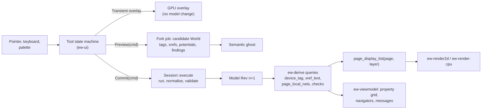
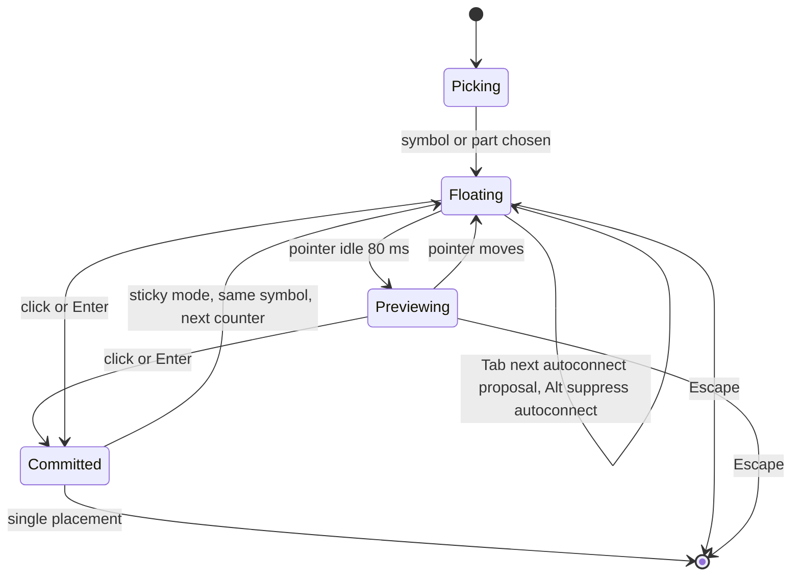
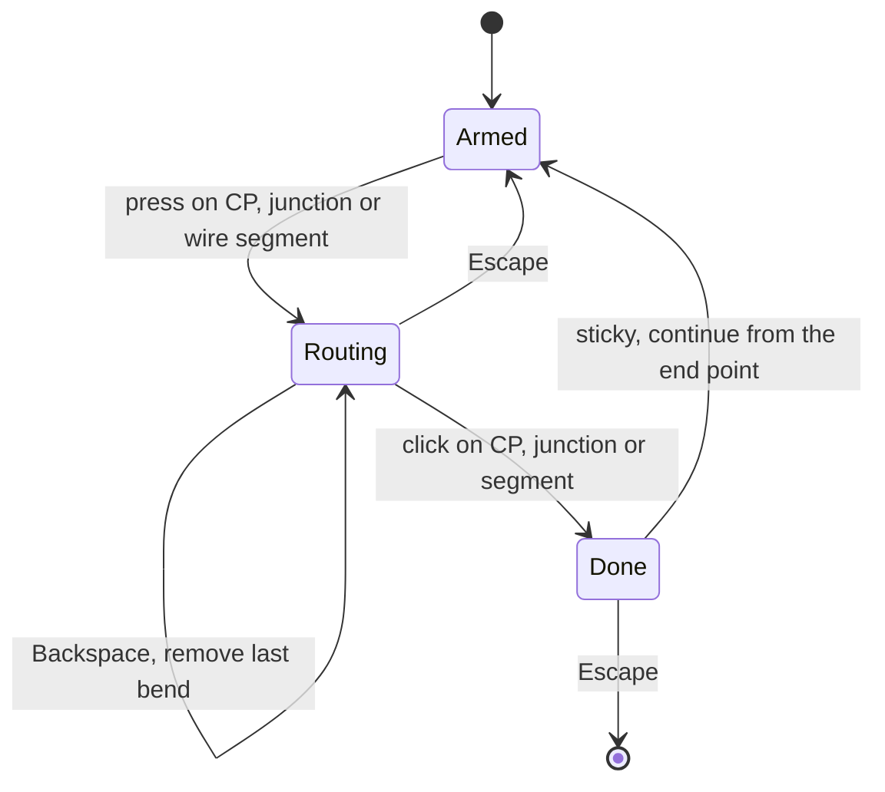

# Schematic editor

**Status:** Draft v0.1

**Purpose.** This document specifies how ElektraWatt (EW) edits schematic pages: multi-line, single-line, overview,
bus-topology, fluid and graphic pages, together with their frames, folios and sections. It covers symbol placement,
devices and main/auxiliary functions, black boxes and structure boxes, connections and junctions, interruption
points, cross-reference display, texts and graphics, property editing, clipboard, snapping, tools, shortcuts, undo
and online checks. It refines the accepted [architecture](04-architecture.md) (§5 commands, §6 queries, §8
rendering, §9 UI) and the [domain model](03-domain-model.md) (§6, §7, §9, §10) for the interactive canvas. It ends
with a walkthrough that draws folios 101 and 102 of the reference project.

**Contents**
1. [Position in the architecture](#1-position-in-the-architecture)
2. [Concepts and data](#2-concepts-and-data)
3. [Behaviour and rules](#3-behaviour-and-rules)
4. [Editing tools as state machines](#4-editing-tools-as-state-machines)
5. [Algorithms](#5-algorithms)
6. [UI and UX touchpoints](#6-ui-and-ux-touchpoints)
7. [Outputs](#7-outputs)
8. [Edge cases and pitfalls](#8-edge-cases-and-pitfalls)
9. [Walkthrough: drawing folios 101 and 102](#9-walkthrough-drawing-folios-101-and-102)
10. [Reference defects this editor prevents](#10-reference-defects-this-editor-prevents)

---

## 1. Position in the architecture

The schematic editor is a **thin interactive client of the command layer**. Every gesture ends in a `Command`
(ARCH §5.1), and every visible string is a query result (ARCH §1.2, ADR-0001). The editor holds no domain logic that
`ew script` or `ew mcp` could not reproduce. A drawing made with the mouse can be replayed from the journal, and a
drawing made by a script can be undone in the GUI.



| Concern | Owner | This document |
|---|---|---|
| Tools, canvas host, keymaps, hit handles | `ew-ui` | §4, §6 |
| Property-grid rows, selection model, navigator rows | `ew-viewmodel` | §3.7, §6 |
| Display lists, spatial index, text shaping, frames | `ew-scene` | §2.4, §5.1, §7 |
| Commands, normalisers (numbering, autoconnect, junction clean-up, split), orthogonal auto-route | `ew-commands` | §3.1, §3.2, §5.4 |
| Tags, anchor cells, xref texts, nets, potentials | `ew-derive` | §2.8, §5 |
| Online rules | `ew-checks` | §3.10 |
| Symbol search and embedding | `ew-library` | §3.3 |

Out of scope here, with their owners: symbol and FnDef authoring and macros ([07](07-symbols-parts-macros.md)); wire
property inheritance, terminal strip editor and cable definition lines ([08](08-connections-terminals-cables.md));
frame and title-block form layout, PDF ([09](09-reports-forms-output.md)); PLC overview content and topology
semantics ([10](10-plc-and-bus.md)); fluid semantics ([11](11-fluid-power.md)); panel layout pages
([12](12-panel-layout.md)); canvas comments, waivers and page change marks
([15](15-checks-revisions-collaboration.md)); shell, docking and keymap infrastructure ([16](16-ux-ui.md)).

**Non-goals** (consistent with ARCH §16): autoconnect as model semantics; real-time co-editing; PDF optional-content
layers; an own UI toolkit.

---

## 2. Concepts and data

### 2.1 Entities the editor writes

The editor writes only authored records (Kind **A** in [domain model](03-domain-model.md) §1.1) and deliberate frozen
values (Kind **F**, e.g. the typed tag "S51"). It never writes a derived tag text, a cross-reference text, a
potential or a title-block value (FR-NUM-001, FR-XRF-001).

| Record | What the editor does with it | File ([05](05-project-format-and-persistence.md) §2.2) |
|---|---|---|
| `Page`, `Section` | create, copy, renumber, set type, frame, scale, grid, title, structure | `pages/<uuid>.jsonl`, `structure.jsonl` |
| `Device`, `Function` | created on placement or from a part; tag spec, role, CP overrides, technical data | `devices/<xx>.jsonl` |
| `Representation` | position, orientation, variant, representation type, pin map, text-slot overrides | page file |
| `Connection` | endpoints, route, kind, overrides (CDP) | page file; a device shard when `page = None` (undrawn rows, [03](03-domain-model.md) §9) |
| `Junction` | point, style (Dot, Bevel), wiring (Chain, Star; added in [03](03-domain-model.md) §1.2), sequence | page file |
| Interruption point | `Function{kind: Ip(IpSpec), device: None}` plus its representation | page file of its representation (both rows) |
| `StructureBox` | outline, line style, caption, assignment, external reference | page file |
| `PageItem` | graphic, free text, image, wire marker | page file |
| `PotentialDef`, `NetDef` | name, type and properties at an endpoint | shard of the device owning `at`; a junction endpoint puts it in the junction's page file |
| `ReportBlock` (embedded) | position and filter of PART DATA boxes; content derived ([09](09-reports-forms-output.md)) | page file (`embedded.page`) |

**Session state that is not model data** lives in the git-ignored per-user folder `.ew/u-<hash>/` or in memory
(FR-UI-033, [05](05-project-format-and-persistence.md) §1): open tabs, viewports, jump history, the active tool and
its sticky options, selection, highlight set, grid display toggles. It is never journalled, never merged and never
part of undo, although undo entries record page, viewport and selection so that undo can restore them (ARCH §5.3).

### 2.2 Page types and their semantics

The page type governs what a page can contain and what drawing means on it (FR-PAG-001, FR-PAG-002).

| Page type | Representation types offered | Wire tool creates | Autoconnect | Joins nets | Reference folios |
|---|---|---|---|---|---|
| MultiLine | MultiLine, ContactImage, StripSegment, Graphic (cable markers, black boxes) | `Wire` (electrical) | on | yes | 101, 102, 103, 106 |
| SingleLine | SingleLine | MVP: `Overview` kind; 1.0: `SingleLine{conductors}` connection (FR-CON-044, FR-CON-029) | on | MVP: no; 1.0: mapped onto the multi-line connections | — |
| Overview | Overview | `Overview` | off | no | — |
| AssemblyOverview | Overview of an assembly member (break marks derived) | `Overview` | off | no | 201, 202 |
| BusTopology | Topology (bus ports, connectors, single-line bus cables), Graphic (cable markers) | `Bus` | on, bus ports only | bus nets | 3 |
| Fluid | Fluid, MultiLine (electrical parts drawn in a fluid diagram, the CPX blocks on 203–206) | `Fluid` with line kind | on, fluid ports only | fluid graph only (FR-FLU-002) | 203–206 |
| Graphic | Graphic | nothing (graphics tools only) | off | no | — |
| TitlePage | cover form content, page items | nothing | off | no | 1 |
| PanelLayout | `SurfaceView` of placements (derived; [12](12-panel-layout.md)) | nothing | off | no | 902 |
| ModelView (1.0), ExternalDocument (1.x) | — | nothing | off | no | — |
| TableOfContents, SectionDivider, Report | generated, read-only | edits refused with a link to the report block or section (FR-PAG-002) | — | — | 2, 100, 200, 900, 901, 903–911 |

A line drawn between two CPs on folio 201 is an `Overview` connection and joins no potential (FR-CON-002). A
single-line connection must not join nets either: a device drawn single-line and multi-line would otherwise produce
its wires twice in the wire list. The tool palette changes with the page type, so a user cannot pick the wire tool
on a graphic page.

The reference drawings place cable markers and black boxes as graphics on multi-line and bus-topology pages and draw the CPX blocks multi-line on the fluid pages, so the table offers those combinations; every other combination is still refused at placement. The builder DSL of AC-15 path (b) found the restriction (the "(a) ≠ (b)" gap class, [18](18-quality-security-release.md) §3.10).

*As built.* The editing tools refuse a page whose type takes no symbols or wires (TitlePage, PanelLayout, ModelView, ExternalDocument and the generated pages) with the text "This page type takes no symbols or wires: draw on a schematic page" (`reason-page-type-no-symbols`); the table above gave no wording. *As built:* the refusal names the page's kind in words where a key exists for it: "A section divider takes no symbols or wires: draw on a schematic page", and likewise "A title page", "A table of contents", "A report page" and "A panel layout page" (`reason-page-type-no-symbols-divider`, `-title`, `-contents`, `-report`, `-panel`); every other such page type keeps the generic text. A page type that takes symbols offers in the picker only the symbols whose representation type it allows; the others are listed disabled with their reason, which names the page types that take the symbol as New page lists them ("Goes on a page of type Fluid"). **Every row of the Insert symbol list does something** (the owner's hands-on test of 0.1.0): a choice arms a tool or opens a chooser, or the row is greyed with its reason in words. A symbol with a tool of its own arms that tool: Wire marker the Wire marker tool, Interruption point and Interruption point, incoming the Interruption tool in that direction. What the program draws with what it belongs to (a junction's dot or bevel, a cable's marker, the arrow of an external reference; the function categories `Graphic` and `ExternalReference`) is no row; `place.pick` with a letter still places one. A symbol whose category maps to no letter code is greyed with "Give a letter code: the symbol's category maps to none".

*As built.* The Wire tool draws the column "Wire tool creates" where it is built: a `Wire` on MultiLine pages and an `Overview` connection on SingleLine (the MVP kind), Overview and AssemblyOverview pages; on BusTopology and Fluid pages, and on every type whose Wire tool creates nothing, `tool.wire` is disabled with "The Wire tool does not draw this page type's connections yet" (`reason-no-wire-kind`) until the `Bus` and `Fluid` kinds are drawn (FT-434). Autoconnect proposals are offered on MultiLine and SingleLine pages only, a narrowing of the column "Autoconnect": a table connection point carries no discipline yet (FT-434).

### 2.3 Folios, sections and page names

- **Folio** = `{section?, number: u32, label?: Ident}` ([03](03-domain-model.md) §6). Folios are sparse and never
  renumbered implicitly (FR-PAG-005). Labels allow sub-pages (101.1, 101a), sorted naturally: 101, 101.1, 101.2,
  101.10, 102 (FR-PAG-006, FR-NUM-018).
- **Sections** `{number, folio_range, title, divider}` (FR-PAG-008). With `divider = true`, the first folio of the
  range is a generated divider page whose description is derived: "=P01+J-E-2416 - Section 1 - Page 100 - 199 -
  Wiring Definition" (FR-PAG-009). Folios 100, 200 and 900 of the reference project are generated this way and
  cannot be edited; the page navigator shows them with a lock badge and opens the section properties on edit.
- **Full page name** `=P01+J-E-2416/101` is derived from the page structure and folio. Duplicates are a prevent rule
  (FR-PAG-012).
- **Page order** is `page_order()`, which merges drawn pages, dividers and report pages. Prev/Next, TOC, outline and
  `/PageLabels` come from it (FR-PAG-013). A report block that overflows continues on sub-pages `<folio>.<n>`
  (FR-PAG-030).
- **Page title and description.** The page title ("Power Supply 1 - Main Current") is `Page.title`; the title-block
  "Description" inherits the project description unless `description_override` is set, which a check reports
  (FR-PAG-010, FR-REP-036; field split per [03](03-domain-model.md) OQ1).

### 2.4 Frames, sheet and grids

A page has three distinct geometric systems. Mixing them up is the most common source of off-by-one cells.

| System | Defined by | Used for | Reference project |
|---|---|---|---|
| **Frame grid** (columns, rows) | the frame `FormDef`: column count, start index, width; row count, labels, height; header bands (FR-PAG-014) | anchor cells and cross-reference texts | 17 columns 0–16 of 60 px, 8 rows A–H of 80 px, 20 px header bands (FR-PAG-015) |
| **Snap grids** | `Page.grid` (connection grid) plus a fine grid | CPs, wire bends (connection grid); graphics and texts (fine grid) | QET 10 px = `7_937_500/3` nm on imported pages; native 4 mm proposed (ADR-0027) |
| **Sheet transform** | the frame form's page-to-sheet transform (`FormDef.page_to_sheet`, QET-compatible frames only; FR-PAG-029) | paper output only | scale 0.986282578, offset 9.79 mm; native frames scale 1 |

Shipped frames:
- **QET-compatible A4 landscape**, grid and no-grid variants with one title block (FR-PAG-015, FR-PAG-017). Golden
  folios 1, 2, 100, 200, 900, 901 and the generated pages use the no-grid variant.
- **ISO 5457** A4–A0 with 50 mm grid fields and centring marks, and an A3 frame with 10 numbered columns
  (FR-PAG-016, 1.0).

Frames are assigned by project default, page-type default and page override (FR-PAG-018). The frame editor
(FR-PAG-027) belongs to [09](09-reports-forms-output.md).

**Snap grids per page.** The active connection grid is shown in the status bar and as a page badge; QET-grid pages
carry a "10 px" marker (FR-PAG-021, FR-UI-018). CPs of symbols are always on the page's connection grid
(FR-SYM-009). Graphics and texts snap to the fine grid: on native pages 0.5 mm for graphics and 1 mm for texts
(ADR-0027 recommendation 1), on QET pages 1 px (`793_750/3` nm); Alt suppresses snapping for them. Converting a QET
page to the native grid is a 1.x command (FR-PAG-022).

### 2.5 Representations: variants, orientation, text slots

A placed symbol is a `Representation{functions, page, symbol, variant, pos, orient, rep_type, pin_map,
text_slots}` ([03](03-domain-model.md) §6). The editor exposes three independent choices while placing:

1. **Orientation variant A–H** (FR-SYM-004, FR-SYM-015), mapped onto `Orient2`:

   | Variant | A | B | C | D | E | F | G | H |
   |---|---|---|---|---|---|---|---|---|
   | `Orient2` | R0 | R90 | R180 | R270 | M0 | M90 | M180 | M270 |

   Rn rotates clockwise as seen on the sheet (y down), so QET's `orientation` steps 1–3 map to R90–R270 (the QET
   importer's mapping, [14](14-interop.md) §4.2; QET's mirror order is still to be verified on rendered corpus pages). M
   mirrors about the symbol's vertical axis before rotating. CP indices never change; a
   mirror swaps positions, not designations. Whether EPLAN's letters use the same order is unverified.
2. **Symbol variant** for the same function: contact-image variant, CP variant (FR-SYM-004).
3. **Representation type**: multi-line, overview, fluid … filtered by page type (§2.2) and by the FnDef's symbols
   (FR-SYM-006).

**Text slots** (FR-SYM-011) render tag, function text, technical data, manufacturer, part number, CP designations,
xref, PLC address and user properties. A **property arrangement** chooses which slots show (FR-SYM-012). Slot text
is always derived; the representation stores only overrides of position, rotation, alignment and visibility. Text
height comes from the text style bound to the slot kind (FR-SYM-013, D-29), so dragging a label moves it but never
resizes it. A text stays upright: turning or mirroring a symbol never turns its texts (owner, 2026-11-15), which keep
the angle they have in the unturned symbol, read from the bottom or the right of the sheet (common drawing practice;
the governing clause is unverified); a mirror never mirrors glyphs. The anchor moves with the symbol and the
alignment is chosen so the text keeps its side of the symbol and of its connection point (the table for all eight
variants is in [07](07-symbols-parts-macros.md) §4.1). A symbol turned a quarter has its texts placed anew round its
body: lying flat, its tag centred above it and its data and cross-reference centred below it, line under line, its
pins' numbers at its pins (owner, 2026-11-22; [07](07-symbols-parts-macros.md) §4.1). A device tag the page would put on a wire or another text is never turned to
make room: it moves, upright, to the other side of its symbol, above or below what is in its way, or centred above or
below its symbol, and stays where it is when none of these is free. It never moves onto its own symbol; where a symbol
turned by a half turn and a neighbour's tag or body meet, the tag moves off the body and takes no place on a body
(rc.3).

*As built (0.3).* With one symbol (or black box) selected, each of its texts can be grabbed (the pointer shows a grab
hand over it) and dragged alone; the tag of a symbol that is not selected is grabbed the same way, the tag under the
pointer winning over a symbol's body (rc.3), and so is a pin's label (the text of a connection point's designation,
FT-1796), and a click on either selects its symbol; a click without a drag on a selected symbol's text that is a
cross-reference follows it, as with nothing selected (FT-1911). This rule covers every text of a symbol a drag moves
alone, pin labels included: the anchor snaps to the fine grid (Alt: free), the Rotate key turns the text a quarter
counter-clockwise while it is dragged (its box turns about its anchor; turned, the text takes its new angle's
alignment, so the anchor that snaps is the one that prints that box, and the text lands where its ghost showed it,
FT-2099), and the drop commits `rep.text_set {rep, slot, pos?, angle?, visible?}`, the
representation's `SlotOverride` in symbol coordinates (one undo step). Hide text in the menu over a text sets
`visible: false`; Put the text back, in the menu over a text (greyed with its reason while the texts stand where the
symbol puts them) and in the symbol's menu (`rep.texts_reset {reps}`), removes the positions and angles of its overrides
and keeps a hidden text hidden.

### 2.6 Devices, functions, main and auxiliary

The editor follows the Device / Function / Representation triad (ADR-0006, FR-DEV-001 … FR-DEV-005):

- **One device, one main function** (structural invariant, FR-DEV-004). The main function's part template
  ([07](07-symbols-parts-macros.md)) says which function is main: the pole set of an MCB, the box of a PSU, the coil
  of a contactor.
- **Auxiliary functions** reference their device and print "(main location)"; the main prints "∞ aux locations"
  (FR-XRF-015).
- **Several representations of one function** (overview and multi-line, topology and power) cross-reference as
  "same function" relations (FR-XRF-016). -201U1 has its main representation on 201 (assembly view) and auxiliary
  functions on 3 (bus port) and 106 (power connector).
- **Unplaced** is derived from the absence of a representation. The device navigator lists unplaced functions and
  accepts them as drag sources (FR-DEV-018, FR-UI-007).

### 2.7 Black boxes, device connection points and structure boxes

| Box | Model | Containment | Reference |
|---|---|---|---|
| **Black box** | `Function{kind: BlackBox}` whose CPs come from the part's CP pattern or are added by hand as device CPs (FR-DEV-013); two-sided device CPs have an internal and an external side (FR-DEV-014) | **Authored at placement**: a new function, or one without a device tag of its own, placed inside the outline gets `Function.device` = the box's device and becomes an auxiliary function (as in EPLAN); a function of another device keeps its device; moving a joined function out later asks whether to detach | -102G1 (L, N, PE, +#1, +#2, −#1, −#2), -102F2, CPX power blocks of -201U1/-202U1 on 106 |
| **Structure box** | `StructureBox{outline, line style, caption, assigns, external?}` (FR-PRJ-020) | **Derived**: a representation whose anchor lies inside the outline takes the box's structure slots | "External Connection" boxes on 3 and 101 (+J-E-206) |

The difference is deliberate. `Function.device` is authored data and must not change when a symbol is nudged across
a box edge; structure assignment is a derived default that EPLAN users expect to follow the box.

**Black-box geometry.** A black box has no library symbol: its outline, the positions of its device CPs on the
outline and its inner graphics ("AC ~ / 24 VDC" on -102G1, the "24VDC" and "GND" fields of -102F2) are page
geometry, stored in `Representation.box: BoxSpec` ([03](03-domain-model.md) §6; FR-DEV-039). CPs stay on the
connection grid and on the outline; resizing the box moves its CPs along the outline and connections follow. A box
whose device has no part has pins of its own (rc.5): each box CP may carry a `name` (`BoxCp.name`, an optional member,
ADR-0011 amendment 6), and the black-box function then has a CP of that index printed with that name
(`ew_derive::FunctionCps`); the window adds, names, renames and removes them on the box (Add pin, a wire to a free point
of its edge, a double click on a pin, Remove pin), each one `box.reshape`. A box of a part draws the part's pins, edited
in its device box; `box.reshape` refuses a name there. An
auxiliary function drawn inside its own device's box (the 13-14 contact of -102F2) prints no cross-reference.

### 2.8 Cross-reference display

Cross-references are relations between representations; their texts are derived by `xref_text(rep)` from the
target's anchor cell and the project's format ([03](03-domain-model.md) §10, FR-XRF-001). The editor never stores
xref text. The format is a project scheme (FR-PRJ-008), persisted as `ProjectSettings.xref_format`
([03](03-domain-model.md) §5.1):

```toml
[xref]
ip          = "{page}-{row}{column}"     # interruption-point partner: "102-A1" (QET %F-%l%c)
aux_to_main = "({page}-{row}{column})"   # on an auxiliary function: "(201-E1)"
main_to_aux = "∞ {list}"                 # on the main function: "∞ 3-B2, 106-G3"; list items use `ip`
structure   = "when-different"           # "+J-E-206/…" only when the target page's structure differs (FR-XRF-004)
same_page   = "full"                     # or "zone-only" (FR-XRF-025, IEC 61082-1 style "/H16")
matrix      = { per_row = 3, max = 9, overflow = "…" }   # one-to-many points (FR-XRF-008)
```

| Token | Meaning | QET variable (FR-XRF-003) |
|---|---|---|
| `{page}` | folio label of the target page | `%F` |
| `{page_index}` | position in page order, counting every page record but not report continuation pages (FR-XRF-003) | `%f` |
| `{row}`, `{column}` | target anchor cell on the target page's frame (FR-XRF-021) | `%l`, `%c` |
| `{function}`, `{location}` | structure of the target (`=`, `+`) | `%M`, `%LM` |

| Preset | Example at L-1 on folio 101 | Use |
|---|---|---|
| QET style (pilot basic project) | `102-A1`; aux `(201-E1)`; main `∞ 203-B4` | Golden A, migrated projects (C-15) |
| EPLAN column | `/102.1` | native A3 projects without rows |
| EPLAN cell | `/102.A1` | native projects with rows |
| Full structure | `=P01+J-E-2416/102.A1` | targets in another structure |

The EPLAN presets follow the notation in [standards](../research/standards.md) §2.2 (`/7.8`, `/101.H16`); EPLAN's
exact option set (separators, order of row and column) is unverified.

Switching presets re-renders every xref in one commit and loses nothing, because nothing was stored (FR-XRF-002).
Xref texts are freshness class I: every move, renumber and frame change updates them in the same commit
(FR-XRF-020).

**Text placement** per relation kind (FR-XRF-011, FR-XRF-022): IP partner text below the arrow, right-aligned, style
`data.small`, and so is the partner text of an external arrow; aux text `(…)` under the device tag and the main
list after the tag, both style `xref.device` (as built: the xref slots of the IEC contact and coil symbols,
`ew.ovw.module`, `ew.bus.dp-port` and `ew.gen.blackbox` name it). Every xref text is a link on screen and in the PDF (FR-XRF-019, FR-OUT-005).

**Interruption-point glyph.** The arrow shows signal flow, not page side (FR-XRF-009): a **Source** point draws its
tip away from the wire, a **Target** point draws its tip at the wire. L-1 on 101 (Source, wire from the left) and
L-1 on 102 (Target, wire to the right) are both ▷; PE-1.1 on 103 (Target, wire to the left) is ◁. The glyph variant
is derived from `IpSpec.direction` and the side of its CP, so rotating the symbol cannot invert the meaning.

**Contact images** (FR-XRF-017, FR-XRF-018). For a main function with auxiliary contacts (contactor coil, motor
protection switch) the scene derives a contact image:

```toml
[contact_image]
placement   = "in-path"            # below the main symbol in its column; or "on-component" | "none"
show_unused = true                 # free contacts of the part's contact data (FR-PRT-009)
row         = "{glyph} {designations} {xref}"   # "13-14 /105.3"
```

Rows come from the auxiliary functions (sorted by contact sequence digit, then designation) plus unused part
contacts. Glyphs come from each FnDef's contact-image variant. The golden project has no contactor; the acceptance
case is the test contactor -K1 of FR-XRF-017 ("13-14 /105.3, 21-22 /106.5").

---

## 3. Behaviour and rules

### 3.1 Editor commands

Every command has a stable dotted name and a JSON Schema (FR-EXT-015). `Cost::Bulk` commands always run as preview
jobs (ARCH §5.1). The Bulk threshold of `edit.delete` counts the records affected, which is the size of the delete
plan, not the number of selected targets.

The commands are generated from their registry, and so is their reference: `ew commands` lists them with their
exposure, cost and stability, and the user guide's command reference (`docs/book/src/reference/commands/`, written by
`cargo xtask docs-gen` from the parameter schemas) has one page per command with its parameters and the description
that states what it does and what it refuses. What holds for all of them:

- A placement whose `rep_type` the page type does not allow is refused (§2.2, `allowed_rep_types`), and an
  autoconnect hint whose target vanished is dropped and reported in the outcome's notices.
- A new optional parameter member is left out when absent, so existing command logs serialise unchanged.
- A new project is made without a supply: a supply guessed at its creation would print on its cover before the
  person chose it. A schematic project without one takes the default supply with the first member that
  `project.supply.set` sets, so Properties can give it one; a basic or macro project has none.
- A part change of a PLC module in the window goes through `plc.set_module_part`, which removes the channels the new
  part does not have; `fields.set` on `parts` never removes a channel ([10](10-plc-and-bus.md) §3.3).

### 3.2 Normalisers that run behind the editor

Normalisers add ops to the same transaction, at most three passes (ARCH §5.2). ARCH §5.2 lists the normaliser
families and names this table as their **registry**: a new normaliser is added here, with its owner, before it
ships. The order is the order within one pass; a normaliser whose input another one creates in the same pass sees
it in the next pass. All are deterministic and break ties by ID. "At most three passes" means three productive passes
plus one confirming pass that changes nothing; a fourth pass that still changes something is non-convergence,
reported as `CmdError::Internal`, and the command is refused. Each normaliser converges within
one run for its own cascades, so the passes only carry effects from one normaliser to another: junction clean-up,
for example, works through a worklist, so a dissolve that leaves another junction with two connections is handled in
the same run.

**v0**. `ew-commands` runs rows 2, 4, 7, 8 and 12 in this order (`ORDER`, asserted by
a test); row 3 runs between rows 2 and 4 (six rows). Row 2 records nothing, because CPs are derived and no override exists yet. Row 4 numbers within the scope
(page of the main representation, letter) and skips devices with a terminal aspect, a frozen tag or a scheme other
than the page-based default. Row 7 splits by an exact integer point-on-route test; W′ keeps its ID and
number and W″ is new and `Unassigned`. Row 8 keeps, when a junction dissolves, the member that carries an assigned
wire number (rows 8 and 11, FR-NUM-023); if both members carry different assigned numbers the command is rejected
rather than losing one. Row 12 leaves every new connection `Unassigned` until a wire-numbering scheme exists
(WP-S1.11). The other rows arrive with their owners' work packages; the notes of this paragraph
give the current order. The prevent hook of the validate step stays
unwired until WP-S1.15, so M1 accepts, for example, duplicate terminal designations; this is a documented known gap
. Row 3 (N1, `channel_instantiation`) runs between rows 2 and 4: a device of the transaction
that is new with a `plc_module` aspect, gained one, or changed its parts or `part_use` gets the channels 0 … n−1 of
its part's channel spec with v5 IDs; a channel exists when one with the same (module, number) exists and existing
channels are kept with their authored members. Row 5 (N-FL-2) is not a normaliser yet: its counter rule is applied
inside `valve.add` and `assembly.attach`, and its push insert is FT-273. Rows 13 (N2, `solenoid_binding`) and 14 (N3, `module_pin_binding`) run after row 12, so `ORDER`
holds eight rows: 2, 3, 4, 7, 8, 12, 13, 14. Row 3 now applies the part's channel kind to existing channels
and names surplus channels in a notice; it still removes none, because FR-PLC-053 removes them only through the
preview of the Bulk command `plc.set_module_part` (§3.1). N2 binds a declared coil to the channel the part's
position map assigns when both are free and considers only the valves and channels the transaction touches; N3 binds
a new channel to the pin its part's `pin_of` names ([10](10-plc-and-bus.md) §2.6, §3.3). Normaliser notices are merged
once into the command's outcome. Row 1 (N-FL-1) is not built.

**Explicit counter edits** (FR-NUM-029). Row 4 renumbers only collisions that the edit itself
creates by placing a new device, moving a main representation or changing a page. A `fields.set` that sets a tag's
letter or counter to a value that collides on the page is rejected in the strict style of ADR-0009, with the next
free counter proposed, and is never silently replaced. Duplicates that already exist in a lenient project stay
findings.

*As built (G-PP finding 6).* The refusal of a colliding letter edit offers the
proposal: the window shows "<refusal>. Use <tag> to accept it." with a "Use <tag>" button under the error, and the hidden
parameterless action `props.accept_tag_proposal` accepts it in one step (the counter cleared and the letter set in one
`fields.set_many`, so online numbering assigns the counter and the tag stays unfrozen). A script or blind-run failure
message reads "<refusal>. Use <tag> to accept it: props.accept_tag_proposal takes it." The proposal is computed from the
preview's tag diff, never parsed from the refusal's text: the tag is the device's printed tag after the proposal and the
toast's counter is the device's `tag.counter` in the preview's after-state. It is cleared when the selection changes,
and accepted only while its refusal is still under the field on the same revision; otherwise the action is refused with
`reason-no-tag-proposal`.

| # | Normaliser | Effect | Owner |
|---|---|---|---|
| 1 | **Valve functions from the part** (N-FL-1) | Creates or removes a valve's valve and coil functions per the part's `solenoids` | [11](11-fluid-power.md) §4.2 |
| 2 | **CP instantiation** | Creates the CPs of new functions from FnDef or part pattern (FR-DEV-002); only overrides persist | this document; [07](07-symbols-parts-macros.md) §4.2 |
| 3 | **Channel instantiation** (N1) | Creates a module's channels with v5 IDs from the part's `channels` | [10](10-plc-and-bus.md) §3.3 |
| 4 | **Online numbering** | New devices get the next free counter in their scope (FR-NUM-007). Moving a main representation that makes a page-based tag collide assigns the next free counter in the same transaction (FR-NUM-029): -101F1 dragged to folio 102 becomes -102F3 | this document |
| 5 | **Valve position and child counter** (N-FL-2) | Lowest free or requested position in the module; the child counter follows the position | [11](11-fluid-power.md) §4.2 |
| 6 | **Autoconnect hint conversion** | Hints accepted in the ghost become `Connection` ops after re-validation against the candidate snapshot (ADR-0007); a hint whose target vanished is dropped and reported in the toast | this document |
| 7 | **Connection split** | A symbol dropped onto a wire splits it (FR-CON-008, §5.3) | this document |
| 8 | **Junction clean-up** | A junction left with two connections dissolves into one connection; a junction left with one connection is deleted together with it, and the preview lists both (invariant CI-04) | this document; [08](08-connections-terminals-cables.md) §3.1 |
| 9 | **Conductor assignment** | Wires crossed by a cable definition line become cores | [08](08-connections-terminals-cables.md) §7.2 |
| 10 | **Clamp pick** | A wire ending on a terminal without a clamp gets the first free clamp of the drawn side | [08](08-connections-terminals-cables.md) §6.3 |
| 11 | **Number transfer** | When an edit changes a physical wire's carrier connection, moves its `NumberSpec`, its `WireOverrides.ends` and `WireOverrides.length` to the new carrier and rewrites records keyed by the old wire ID (`Bond.via`) | [08](08-connections-terminals-cables.md) §5.1; end overrides [13](13-manufacturing-outputs.md) §2.3 |
| 12 | **Online wire numbering** | New wires get the next number of the active wire-numbering scheme when online numbering is on, otherwise they stay `Unassigned` and print "?" (FR-NUM-019, FR-NUM-021) | [08](08-connections-terminals-cables.md) §5.2 |
| 13 | **Solenoid binding** (N2 = N-FL-3) | Binds each declared solenoid's coil to the channel the part's position map assigns, if that channel is unbound and no channel binds the coil; an existing binding wins, and only the valves and channels of the transaction are considered (FR-PLC-051) | [10](10-plc-and-bus.md) §3.3 |
| 14 | **Module pin binding** (N3) | Binds a new physical channel to the module pin whose designation the part's channel → pin map gives | [10](10-plc-and-bus.md) §3.3 |
| 14a | **Bus ports** (N5) | On a new device or a changed bus part, or a bus-port function (FnDef contact kind `bus_port`) added to or moved onto a device with a bus part: the part's ports that no function of the device carries (by interface and label) go in list order to its port-less bus-port functions by ID, address `tbd` (`not_applicable` when passive), the part's termination, no nets. Never rewrites or removes a port; a disagreement gives a notice; a part port without a function seeds nothing. Duplicates are dropped first and unknown buses or roles filtered after, so a newer-format first port drops its whole (interface, label) pair. Runs after `module_pin_binding` | WP-S1.21 spec §8a.2 |
| 14b | **Bus nets** (N6) | On a new or changed `Bus` line between CPs of two functions with bus ports of one bus system: the ports of its segment (reached over bus lines) join one logical net, the one net they name (when it exists), else, with two ports or more, a new `LogicalNet` named for the bus system (`PROFIBUS DP`, `PROFIBUS DP 2` …) whose master is the CP of the one `master` or `controller` port. A passive port passes the net through and takes none. Never changes a net a port names; ports in different nets stay (EW-BUS-010). Runs after `bus_ports` | persona round of M3 (doc 10 §2.7) |
| 15 | **Logical-net inheritance** (N4) | A bus connection to a port without a logical net assigns the net of the other port | [10](10-plc-and-bus.md) §3.3 |
| 16 | **Drives link** (N-FL-4) | The first tube from a valve working port to a consumer port of another device adds `DeviceLink{Drives}` | [11](11-fluid-power.md) §4.2 |
| 17 | **Tube counter** (N-FL-5) | A new tube connection gets its counter when a line-tag scheme is active | [11](11-fluid-power.md) §4.2 |
| 18 | **Interruption-point form** (`ip_form`) | An interruption point drawn with one of EW's two arrow forms whose direction the transaction changed takes the other form, the one of its new direction, with the default orientation; a project that does not hold that form refuses the change: "the project does not hold the incoming arrow of symbol Interruption point: place one interruption point of that direction first" | this document §3.5 |
| 18a | **Texts of a symbol** (`bound_texts`) | A free text of a symbol (`of`) that the transaction did not change takes the displacement and the page of its symbol when the transaction moved it; a text the command moved itself is not moved twice | this document §3.8 |

**Routing is one pure function, `ew_drafting::route` ([06a](06a-drafting.md) §3), reached through `ew_api::routing`, and
the tools call it; the commands do not.** The Wire tool computes its ghost with it and passes the result as the `route` of
`connection.draw`, which **stores the route it is given and stays unchanged**: an empty route stays route-less
(*unrouted*, below). `rep.move` moves the route's vertices by `geometry::follow_end` (WP-S2.04 §5.2) and takes the
routes the Select tool re-solved (§5.4). A script therefore gets the mouse's route by calling the same function and passing the result, not by a
command that routes. **Normaliser 7 (connection split) works on routes**, so it splits a connection that has a stored
route, which every connection drawn with the Wire tool has; a route-less connection has no route to test, and the
route editor's first edit stores its drawn polyline (WP-S2.04 §8.4).

[ADR-0033](../adr/0033-schematic-routing-model.md) governs routing. A connection is drawn along its stored route, the full
vertex list with both ends, and a page connection without a route is *unrouted*:
drawn as a dashed right-angled line (below), not split by normaliser 7, not read by EW-TERM-006, reported by
EW-CORE-073. **The unrouted line is never a diagonal** (the owner's hands-on test of 0.1.0: a diagonal read as a
route the router had drawn askew): ends on one horizontal or vertical line are joined straight, else by one corner
made of the ends' own coordinates, the first leg along the first end's direction, else the last leg along the second
end's, else horizontal first. It takes no notice of what lies under it and is no route: the page draws it dashed in
the thinnest pen, and the Wire tool's ghost and the router's own result for a request without a route are the same
line (`ew_api::routing::unrouted_line`). The
commands still never route: the router runs in the tools and in Route, which stores its plan with `layout.apply`
(06a §2.6); autoconnect hints store their straight run; `rep.move` takes the routes the Select tool re-solved (FT-18). A new row 18,
*interruption-point form*, gives an interruption point drawn with EW's IP symbol the arrow form of its direction
(WP-S2.19 specification D16).

*As built.* The commands that store a route are `connection.draw`,
`connection.draw_many`, `connection.draw_to_ip`, `connection.route`, `layout.apply` (06a §2.6) and `rep.move` with its
optional `routes`, each checked by
`require_route` (on the grid, the first vertex at end `a`'s point and the last at end `b`'s, a junction end included);
`device.place`'s hints and `rep.move`'s optional `connect` hints store the straight run between their two ends, and a
hint whose ends are not aligned stays unrouted. `rep.move`'s `connect` hint names its connection point by function,
`{rep, cp: {function, idx}, to}`, not by symbol CP: the window knows a placed representation's points by function,
and a black box draws points no symbol CP indexes. Normaliser 7 splits routed connections only; row 18 runs
after row 16, before the revision normaliser of [15](15-checks-revisions-collaboration.md) §5.3.

*As built.* Rows 1 and 16 are built: N-FL-1
as `valve_functions`, first in `ORDER`, and N-FL-4 as `drives_link`, after `bus_ports` (doc 11 §4.2 as built); row 1
neither replaces nor removes a valve function on a part change (notice T21).

### 3.3 Placing symbols and assigning devices

`PlaceSymbol.target` decides which device the new representation belongs to:

```rust
pub enum PlaceTarget {
    NewDevice { letter: Option<Ident> },           // letter from the FnDef category via the identifier set (FR-NUM-004)
    FromPart { part: PartRef },                    // device + template functions; the chosen one is placed (FR-DEV-017)
    Function(Id<Function>),                        // another representation of an existing function (FR-DEV-003)
    JoinDevice { device: Id<Device>, role: Role }, // the user typed the tag of an existing device (FR-DEV-038)
}
pub struct AutoconnectHint { pub cp: u16, pub to: HintTarget }
pub enum HintTarget {
    Cp { function: Id<Function>, idx: u16 },          // a facing free CP
    Split { connection: Id<Connection>, at: Pt2 },     // insert into an existing wire (FR-CON-008)
    Junction(Id<Junction>),
}
```

Rules:
- **From the symbol library** (search by name, category, IEC 60617 reference, FR-SYM-021): a new device whose letter
  comes from the FnDef category; the ghost label shows the tag the fork predicts ("-102F3") before the click.
- **From a part** (IDEA-016, FR-UI-017): the part's function template creates all functions; the one matching the
  chosen symbol is placed and the rest appear as unplaced entries under the new device. Part texts (manufacturer,
  number, rating) appear through text slots with no typing (FR-DEV-016).
- **Typing a tag** in the tag field after placement: the text is parsed by `ew-rds`. If it names an existing device,
  the editor offers to join it as an auxiliary function, or as another representation of an existing function with
  the same FnDef and CP designations. If it parses under the device's scheme, it sets letter and counter. Otherwise
  it becomes a frozen tag after confirmation ("S51 does not match `{page}{letter}{counter}`; keep as frozen tag?"),
  reported at info (FR-NUM-010, FR-CHK-025).
- **Displayed tag**: the canvas prints the displayed tag, which suppresses structure identifiers equal to the
  page's (FR-NUM-002); the property grid shows the full tag `=P01+J-E-2416-102F1` beside it, read-only.
- **Representation type mismatch**: placing an overview symbol on a multi-line page is refused with the list of
  allowed types (§2.2).
- **Black box inside the drop point**: the function joins the box's device (§2.7); a valve inside a valve terminal's
  box is a new device that joins the terminal at its next free position ([11](11-fluid-power.md) §4.3).

*As built.* **Joining an existing device has two paths
in the design and one built.** Both are `device.place`: with `existing_function` while the device has an unplaced
function of the symbol's FnDef (a template slot, filled first), else with `join_device {device, role: aux}`; one undo
step per placement. **Before placing (built, D2):** while the armed symbol can be an auxiliary function, the Place
tool's HUD offers "J Join device…"; J opens the Join chooser ([16a](16a-design-language.md) §6.22): "New device", then
the slots ("slot 13-14"), then the devices whose family takes auxiliary functions, in natural tag order with
type-ahead. Enter arms the target (ghost label `join -K1`), which stays sticky; Escape keeps it; "New device" restores
the default. The text interface takes `place.pick device=<tag>` and `function=<tag>[:<slot>]`. **After placing (D3):**
`rep.join_device` moves a placed symbol's one function to another device, its wires kept, when its own device has that
function alone, no part and no other symbol. J on one selected symbol, or Join device… in the page's right-click menu,
opens the Join chooser of the devices it can join, one row per device (its first slot, else "auxiliary"); typing an
existing device's tag into the Tag row proposes the same join. **A second symbol of a device's own:** a
symbol of another kind than a contact (a lamp, a supply drawn once for its input and once for its outputs, an element
brought in from another program) joins any device but a terminal or a strip as an auxiliary function, by J, by
`place.pick device=<tag>` and by `rep.join_device` (the Tag row proposes a contact's join only, as the row means
another thing for a valve's solenoid or a taken tag); a contact keeps D2's family rule, and a terminal, an
interruption point and a graphic join no device. A library symbol's address `library:<library>:<item>` names it before
and after its first placement. **A part's function that a device of the part has
unplaced fills that device** (FT-1658): the browser's function row names it ("join -K1"), the Place tool arms that
join with the part's new device as its "New device", and once the device has no more of that function the next
placement is a new device of the part. **From a part:** the picker and the Parts row list the generic starter parts of a system library after the
project's embedded copies ([07](07-symbols-parts-macros.md) §2.1); a placement from one embeds it with its closure in a
`library.embed` before the placement, two undo steps (FT-656). Every starter symbol has a tested path to a usable
device (`crates/ew-viewmodel/tests/starter_symbols.rs`).

*As built.* **Device from part lists the
project's own part copies and the libraries' parts in one order**, by maker and part number, so a library part keeps
its row once it is embedded (its Library column then says "In this project"): the rows do not move between two
placements (persona round). The tree has All, then In this project once the project holds a part (rc.5: not
before), then the heading Library with the trades and their groups under it, so that the library's categories do not
read as the project's; and
its empty state names Edit ▸ Choose part…. **A part without a function template** is placed through the symbols it
can take: `device.place` with `from_part` accepts such a part at template entry 0 and gives the new device the part
and one main function of the chosen symbol's function definition. **A black-box entry with a symbol of its own**
(FT-1865): a symbol drawn for the entry's own function definition, such as a power supply drawn for the starter's
`ew.fn.psu-ac-dc`, is placed by the Place tool like any symbol, and the entry's function is then a normal one; an
entry on the generic `ew.fn.blackbox`, or one no own symbol draws, stays the Black box tool's; placed from the Place
tool, its hint says that the part has no symbol of its own and is drawn as a box (FT-1808), and a toast says it as the
tool changes, naming the part, or the device whose box is placed again ("EW-GEN-PSU-1 has no symbol of its own and is
drawn as a box, by the Black box tool: …"; a persona run clicked before reading the hint). `place.pick` names an
installed library's symbol by its key as well as by its address, before its first placement and after it.

### 3.4 Move, rotate and delete

- **Moves never change connectivity** (FR-CON-004). Route vertices adjacent to moved CPs are re-solved (§5.4); other
  vertices stay. Live potential highlighting during a drag uses page-local nets only (NFR-PERF-05).
- **A turned or mirrored symbol stays where it stands** (rc.3): `rep.transform` turns it about the grid point nearest
  the middle of its body (its graphics' bounding box, a black box's outline), not about its insertion point, so a
  turned cylinder no longer lands on its neighbour. Four quarter turns bring it back exactly; its wires and tubes
  follow its connection points; a drawing made before is not moved, only the act of turning changed.
- **Cross-page move** (dragging a representation onto a page tab, or `rep.move` with a target page) keeps
  identities and, because it is a move, connectivity (FR-CON-004): each connection whose other end stays behind is
  replaced by an IP pair whose name is proposed from the potential ("24VDC-1" or the next free name of its series),
  listed and editable in the preview. The user may instead drop those connections; the preview then lists them as
  removed, so the connectivity change is explicit, never silent (FR-CON-043). **Cut and paste** is a move of the
  devices and follows §3.6: the devices the cut left unplaced come back as themselves, and the wires the cut took to
  outside the selection are not pasted. *v0*
  rejects a cross-page move that would leave a connection end behind, and leaves page-less connections (bridges)
  untouched; the IP-pair replacement arrives with WP-S1.07, which carries FR-CON-043.
- **Structure follows the page** unless the device has an explicit slot; moving the only representation of a device
  to a page of another location asks whether to keep the old location as an explicit slot (FR-PRJ-019).
- **Deleting a representation** leaves its function unplaced; deleting a device follows the delete policies and
  previews every function, representation and connection removed (FR-DEV-030). Deleting a page lists its IPs and
  devices left unplaced (FR-PAG-025).
- **Delete on a page takes the wires drawn to the deleted symbols** (0.3.5, a persona run met a wire drawn nowhere it
  could not click): Delete (`edit.delete_selection`, and Cut through it) also deletes, in the same step, every
  connection on the page that ends at a connection point the deleted symbols draw, so no connection stays whose end's
  symbol went; the toast counts them. A terminal it leaves drawn by no symbol stays in its strip and the lists (a
  terminal is never deleted with its symbol, below); the toast says how many, with Remove them from the project beside
  Undo, one `edit.delete` of those terminals and of a strip it leaves with no terminal and no segment. The Devices
  tree's menu of a device or a strip has Delete (`navigator.delete`). Cut's toast says what it took instead ("Cut 12
  terminals. 14 wires that ended at them are removed with them; a paste keeps the wires between the cut items only."),
  with Undo and no Remove (its paste brings the terminals back).
- **Delete removes an orphaned device.** Deleting a device's last representation (Delete, and Cut through the same
  path) deletes the device in the same `edit.delete` step, so one undo restores the device, its part use and the
  representation. "Last" means every representation of every function of the device is among the deleted ones,
  panel-front and contact-image representations included (a function no representation draws, such as a part's other
  contacts, keeps nothing), so a device that keeps a panel-front representation is kept and EW-CORE-047 reports it.
  The device is also kept when it has another role (a function the deletion leaves drawn, a terminal or strip role,
  child devices, or a cable, assembly or PLC aspect) or when one of its functions carries other intent: a CP of the
  device holds a potential definition, a bond, or a connection that is page-less or lies on another page than the
  deleted representations. A kept device stays unplaced and is left to EW-CORE-047
  ([15](15-checks-revisions-collaboration.md) §4.2).
- **A PLC card without settings is no other role.** A module whose `plc_module` aspect holds no setting (what the
  aspect normaliser N0 gives a card's device: positional slot, automatic starts, no part use, not integrated) goes
  with its last symbol, and its channels with it, so deleting a card to draw it again leaves no `-?A1`. A station, or
  a module with a set slot, start, part use or integrated I/O, is kept. When a run gives a device `plc_station` and
  the project then holds exactly one station that is no valve terminal, N0 attaches every module that waits for a
  station (not integrated, no station above it) to it, in the order of the modules' anchor cells, in the same
  transaction; with several stations EW-PLC-008 asks the user.

### 3.5 Connections, junctions, interruption points and potentials

- **Explicit connections.** A connection joins two endpoints: a CP or a junction (FR-CON-001). Several connections on
  one CP are a daisy chain whose order is preserved (FR-CON-006). Wires of one CP may share their run out of it and
  part with a 45° bevel, without a dot: a potential wired from pin to pin is then a rail with drops
  ([06a](06a-drafting.md) §3.4, D-20); a symbol is not dropped on a shared run.
- **Junctions.** Ending a wire on the interior of another connection's segment creates a `Junction` and splits that
  connection. Style defaults to Bevel; the Wire tool's dot key (`.`) asks for a Dot (owner, drafting step 2,
  [06a](06a-drafting.md) §7.4). Wiring defaults to Star for Dot and Chain for Bevel ([03](03-domain-model.md)
  OQ7). `sequence` stores connection IDs; the editor shows each member by its far endpoint, e.g. (+#1, -102F1:1,
  +#2) for J3. The initial sequence lists the two parts of the split connection ordered by flow distance from the
  potential's source ([08](08-connections-terminals-cables.md) §3.2, §3.6), with reading order (row, then column of
  the far endpoints' anchor cells) as the tie-break, so the feeding device comes first, and appends the new branch;
  the M2 usability test confirms this default (PQ-27). The junction's property page shows its sequence as a
  reorderable list together with the
  **physical wires it produces** ("W13 F55:2 → E55:L; W14 F55:2 → E56:X2"), so the user edits the wiring order the
  shop will cut, not a graphic. A junction whose feed cannot be determined is reported by EW-POT-011
  ([15](15-checks-revisions-collaboration.md) §4.4).
- **Interruption points.** An IP is a `Function{kind: Ip}` with one CP. It is placed on its own and wired afterwards,
  or created at the free end of a wire being routed (`P`, §4.4). The name field proposes the potential's name,
  then the next name in a numbered series ("24VDC-2" after "24VDC-1"). The direction defaults to Source at the
  right or bottom edge of the drawing area and Target at the left or top edge, and is toggled with `D`. *As built
  (a persona run, 0.3.5):* a direction chosen (D, Source | Target) holds until the person chooses another; a chosen
  Target stays after a target whose name has no source yet (the tool turned to Source by itself and every later mark
  became a source), and the bar says "next: one more target of 24V, which has no source yet (D makes this point its
  source)"; only a chosen Source turns to Target after the source, as a name has one source. EW-CORE-051 names where
  the mark stands and what it lacks: a target its one source, where the potential comes from; a source its targets,
  where it goes on.
  Pairing (star or chain, scope) follows the project's `ip_pairing` setting with per-name overrides (FR-XRF-007,
  FR-XRF-010). "Continue on page…" creates the partner on a chosen page at the opposite edge in the same row, with
  the direction reversed (FR-XRF-014). "Arrange" sorts a page's IP stack by name or potential (FR-XRF-013, D-39).
  *As built.* EW's interruption-point symbol comes in two
  forms, both with the arrow pointing right and its tip at the origin: the source form (`ew.gen.ip` 0.2.0), the wire
  on the tail and the CP one grid step left of the tip, leaving left; the target form (`ew.gen.ip-target` 0.1.0), the
  wire on the tip and the CP at the tip, leaving right; each with its `@qet10` twin. The name sits above the arrow and
  the cross-reference below it: right-aligned at the tip on a source, left-aligned at the tail on a target, so that it
  runs into the sheet. Where the point's own wire runs through that place (it leaves the tail and turns down under
  the arrow), the cross-reference takes the free side: in line with the arrow beyond its tip, else before its tail,
  else above the name (`ew_scene::page`, "Slot text collisions" rule 5; the tool's footprint keeps the place below,
  since the wire is not drawn when the point is placed). A point drawn with these forms is never turned: its form is
  its direction's (an undirected point takes either), D swaps the form with the direction (source and target, to
  and fro; undirected is a choice of a placed point's Direction in Properties, since D on a point the tool had
  already made a target used to give an undirected one), and the rotate and mirror
  keys are not offered. The tool takes the name first when it is chosen from the bar or a menu (the name field has
  the keys, its name selected; chosen by its key with the pointer on the sheet, the keys stay with the tool), a typed
  name without a source starts with its source where the page's quarters say nothing, a typed name stays until it is
  changed, so that after the pair each click places one more target of the same source (rc.5: no "24V-1" of nothing),
  the pointer as near a pin as the Wire tool catches one puts the point's CP on it, in either form (a source's CP is at its tail), but on a drawn box's pin the arrow never lies along or in the box (0.3.5, FT-1798): on the box's lower side the point stands one grid step below the pin and on its upper side two steps above it (its cross-reference under the arrow needs the room), joined to the pin by a straight wire (`connection.draw_to_ip` with that route; the ghost shows it there), on its left side a target and on its right side a source stand on the pin, and a source on the left side or a target on the right side, whose arrow would point into the box, is refused in words (Alt places it free), a drop on a pin is not refused for room, Alt places a point unjoined and a point left within 6 mm of a pin without a wire says so on placing (EW-POT-009 then offers to join the two), a free point too close to another is refused with the grid steps and millimetres the two must stand apart, the HUD says before the click when the next point is the other half of a name ("next: where 24V arrives (its
  source is drawn)"), and a point whose arrow, name or
  cross-reference would print over another point's is refused with the reason, Alt placing it anyway: the name
  stands above the arrow and the cross-reference below, each as wide as its text, so a point in another's footprint
  prints over it (the footprint is reckoned by rule of thumb, 1.4 mm a character, and the cross-reference's room is
  kept before the point has a partner). `ip.place` refuses a turned form ("an interruption point's arrow points the way its signal
  flows: change its direction instead") and the other direction's form ("a source interruption point is drawn with
  the outgoing arrow, a target with the incoming arrow"); `rep.transform` refuses the first; `ip.continue` gives the
  partner the other form and refuses in words when the project lacks it; a direction change swaps the form by row 18.
  Making a point the source (`fields.set` of its direction, the Direction row of Properties) makes the other sources
  of its name and scope targets in the same step, unless the name has a star source: one source per name, without a
  second edit. While the Wire tool routes, P picks the form by the direction at the end point. Imported points, company symbols
  and the external arrow keep a free orientation.
- **External connection points** are IPs with `external = Some(ExternalRef)`. They never pair and print the external
  target ("+J-E-206 / JE-N1000-03") in the xref slot (FR-XRF-012).
- **What an external point's reference holds** (0.3.5, FT-1876). A drawing set whose signals come from another
  cabinet names each mark at the head of a current path for its signal ("Valve 1 open") and prints under it where the
  signal comes from: often an address alone ("Q4.1"), sometimes nothing, because the far end is not known yet.
  - *Fields.* `ExternalRef.location` and `ExternalRef.device` are optional, as `project` and `connection` were: a
    reference holds what is known of the far end, the device or an address in `device`. One that holds neither is a
    far end not known. A project of 0.3.0 reads unchanged. 0.3.0 takes both as required: it opens a project with a
    reference that holds no location or no device for editing, sets that reference's line aside (EW-CORE-007),
    reports the points that name it and writes the line back unchanged on save (ADR-0011 amendment 8).
  - *What prints* (the point's xref slot, a structure box's caption, a bus partner): the parts the reference holds,
    the location and the device joined by " / " ("+J-E-206 / JE-N1000-03"), the device or address alone ("Q4.1"),
    the location alone ("+MCC2"), and nothing for a far end not known; another project's name in front as before. The
    connection prints in the wire list's end, as before. The person chooses what prints by what the reference holds.
  - *Making one.* Supply comes in here… (`ip.supply_in`) keeps its two fields, the location and the device there; a
    field left empty is not known, so the device alone is an address and two empty fields a far end not known (a
    script that leaves a field out takes the proposal, as before). The location is taken with or without its sign
    (`+UP` and `UP` are one node, FT-1901). `external_ref.create` takes any of them or none.
    The Interruption tool's external field names a reference by its printed device (and connection); one without a
    device is named by its ID.
  - *What the checks ask.* EW-CORE-034 still asks that the wires of an external point be a cable's cores; its finding
    names the place by the reference's location, else by what the reference prints ("Q4.1 → -1K2"), else says the
    connection comes from a place not known. EW-CORE-051 never asks to pair an external point. Nothing asks for a
    location or a device.
  - *Not built:* a reference that holds a location but prints only its device (the person leaves the location out of
    it instead); the stale check against the other project (FR-PRJ-022, 1.0).
- **Potential definition points** name and type a potential at an endpoint, a CP or a junction (FR-CON-010); they
  may be drawn as a flag symbol or kept undrawn and edited in the potential navigator, which lists each potential's
  CPs, devices, pages and IP aliases (FR-CON-012, FR-CON-027).
- **Connection definition points and wire markers.** The marker tool is drawn across one or more parallel
  connections. It sets the chosen overrides (cross-section, colour) on each crossed connection and creates one
  `WireMarker` page item that positions the group (FR-CON-023). The marker's text is derived: the cross-section at
  the left, one colour code per conductor ("2.5 BK BU"). The project's marker mode decides which connections show
  markers (all, deviations, explicit overrides, none; FR-CON-024). *As built:* a wire whose Wire marker box is
  ticked (`overrides.show_marker`) always prints a marker, except in the mode none: with the mode absent (Per wire,
  a new project's) it prints the cross-section and colour the wire states itself, and what the wire is where it
  states neither; in a rule mode the tick adds the wire to those the rule selects. In modes that show markers for connections
  without a `WireMarker` item, the scene places them at a derived position. A group marker over several connections
  is one `PageItem::WireMarker{connections}`, whose list order is the printed order ([03](03-domain-model.md) §6,
  FR-CON-039). Colour fields accept only IEC 60757 codes and profile-declared company codes such as DBU
  (FR-CON-019); typing "BR" offers "BN" (D-17).
- **Wire numbers on the canvas** are derived texts placed by the project's display rule (each segment, once per
  page or at both ends, FR-CON-026); unassigned connections show "?" (FR-NUM-021). The editor never stores the
  printed number, so a page renumber or a route edit cannot leave a stale number behind (FR-NUM-023).

### 3.6 Copy, paste and duplicate

The clipboard carries a **project fragment** in the macro format ([07](07-symbols-parts-macros.md), ARCH §5.5): JSONL
records of the selection, the embedded library copies they use (symbols, FnDefs, parts, with their copy metadata
`{library_id, item_id, version, sha256}`), the structure nodes they reference (by aspect and code) and a format
stamp. arboard 3.7.0 offers text and images only ([rust-ecosystem](../research/rust-ecosystem.md)), so at MVP the
fragment travels as **text** behind a `#ew-fragment v1` header line; another EW instance recognises the header, any
other application sees JSON Lines (FR-UI-040). "Copy tag list" (TSV) and "Copy as image" (PNG) are separate
commands. A multi-format clipboard (fragment, TSV, PNG and a vector flavour at once) needs platform code and is 1.0
(FR-UI-051). A pasted fragment is untrusted
input: it is schema-validated with the importer's size limits and never carries rule packs, reports or scripts.

Paste (`edit.paste`, FR-DEV-029, FR-UI-036):
1. **Identity.** Every pasted record gets a new UUIDv7, and references inside the fragment are remapped. After a Cut
   the devices the cut left unplaced are the exception: a cut and its paste are a move, and they come back with
   their IDs (below).
2. **Numbering.** Tag counters are re-assigned by the target's scheme through the online-numbering normaliser, in
   the order of the fragment's anchor cells, so the result does not depend on record or creation order
   (FR-NUM-028). Frozen tags are not copied: a pasted "S51" is derived like any new device. The ghost shows the
   resulting tags.
3. **Structure.** Nodes rebind by (aspect, code) or alias; unknown nodes map to the target page's structure, and the
   ghost lists the mapping.
4. **Library copies.** A copy of an item the target already embeds in the same version (same `sha256`) is reused,
   and a copy of an item it does not embed is added. For another version of an embedded item the paste asks for
   one of three choices ([07](07-symbols-parts-macros.md) §2.1): update the existing copy (a previewed "update from
   library", FR-SYM-016), adapt the pasted records to the existing copy, or keep both, which mints the
   version-qualified copy ID `v5(NS_LIBCOPY, library_id ‖ item_id ‖ version)` for the second copy.
5. **Connections** are copied only when both ends are copied. The ghost counts the dropped ones ("3 connections not
   copied: one end outside the selection").
6. **IP names** are kept and may pair with points already in the target. The ghost lists new pairings so that an
   accidental star with a foreign "L-1" is visible before commit.

**Paste as representation** (paste special), specified and not built, creates new representations of the copied
functions instead of new devices, for example to draw an existing device on an overview page.

*As built.* Copy, Cut, Paste, Duplicate and Copy tag list exist on the canvas (Ctrl+C, Ctrl+X, Ctrl+V, Ctrl+D; Copy tag list on the Edit menu), with the fragment as built in [05](05-project-format-and-persistence.md) §12. Items 1, 3, 5 and 6 hold as written (item 1 with the move after a Cut); item 2's copies are numbered by online numbering in the order of their anchor cells (FR-NUM-028); item 4's three-way choice is a follow-up, and a copy the project holds in another version is refused ("update from library first"). **Cut leaves the device unplaced** (decided): Cut is Copy and then the deletion of the selected representations (with the wires drawn to them, §3.4), so the device and its functions stay in the project, unplaced (FR-DEV-003). **A cut and its paste are a move** (0.3.5, after a persona run left a ghost strip of twelve unused terminals that could not be deleted): `edit.paste` brings back a device of the project that the fragment's symbols drew and no symbol draws any more (effect 8): the device, its functions and the strip of such a terminal keep their IDs, parts, frozen tags, levels and data, nothing is made anew, and what the cut left of them goes in the paste's step (the fragment's wires and junctions the project still holds, a wire on another page left open at them); the paste's notice, in its preview's label and its toast beside Undo, says how many such wires go and on which page ("6 wires on page 102 that ended at the moved devices are removed"). On the page the paste lands on, a wire from a device the cut did not take to one that comes back follows its new pin in the same step as a dragged symbol's wires do (`rep.move`: the route's end moves with its pin, `geometry::follow_end`, a dog-leg where the end's segment would leave its axis), so no wire is drawn to the spot where the device stood; the router is not run. A paste after a Copy, whose devices are still drawn, makes new devices as before; a second paste after a cut too. Where the page changes a tag (a strip's `{page}`), the paste's label says so before the click ("-X1011 becomes -X1021: a tag follows the page its device is drawn on"), and the toast, which says first what the paste moved ("Moved 12 terminals of -X1021 to page 102.") in place of the Cut's toast, names the old and the new tag with Keep -X1011 beside Undo, which freezes the old tag (`fields.set_many` of `tag.frozen`, one step; Keep the old tags when several changed). A strip whose terminals a cut or a delete left behind is deleted with them, their wires and bridges from the Devices tree when none of them is drawn by a symbol of its own (such a wire is drawn on no page); otherwise `edit.delete` refuses in words, naming the terminal and the page that draws it. The identity-keeping move of a symbol across pages is `rep.move` (§3.4). On Windows, Shift+Delete also cuts (egui-winit turns it into the Cut event, §6). A fragment representation off its own grid is refused, a fragment of another grid than the page's is fitted to it (§8 item 3, rc.5), and a paste on a page that takes no symbols is refused with its reason. The pasted fragment floats with its middle at the pointer, its anchor snapped to the grid (it hung from its top-left corner, so it landed below and right of the click, FT-1659), moved in to stand two grid steps inside the drawing area where it fits, its numbers clear of the frame (0.3.5: a block put down by the frame touched its edge); Duplicate starts two grid steps from the copied anchor. The clipboard is text through egui's clipboard (arboard), whose Wayland and X11 behaviour is a manual check.

The fragment also carries page items and structure boxes (ranks 43/44); marker associations retain and remap copied connections, empty markers/unknown variants are skipped and counted, and cross-project structure-box paste clears `external`. Copy remains partial-selection tolerant; Cut refuses an incomplete selected page-item transfer before side effects. `CopiedFragment::incomplete_page_items` counts each selected page item omitted or copied with fewer marker associations once. Cut performs one copy and, when that count is nonzero, refuses with `reason-cut-incomplete-items` before any clipboard/outbox, selection, model or revision change: “Cut would lose page items or marker connections; include every marker wire or use Copy”. A complete Cut keeps one delete/undo step and the device-left-unplaced rule. The existing translated `reason-cut-incomplete-items` text is displayed through banner-if-none, preserving Failed precedence, other Refused behavior and the side-effect-free guard. The shipped clipboard feature is enabled and guarded: on the Windows build, keyboard Ctrl+C and Edit ▸ Cut each publish the fragment to the OS clipboard, and Ctrl+V plus placement renders changed external fragment text. An incomplete Ctrl+X or Edit ▸ Cut shows the exact reason and preserves the marker, selection and OS clipboard; ordinary-text Ctrl+V stays quiet.

#### Paste in place (FT-1862)

Edit ▸ Paste in place (`edit.paste_in_place`) puts the clipboard's block down with its anchor where the copy's anchor
was: at the same page coordinates, so a block copied from one page lands on another page of the same frame exactly
where it stood. It is one `edit.paste` with `at` the fragment's anchor, one undo step, and Select takes over with the
pasted symbols selected, as after a paste. On a page of another connection grid the block is fitted to that grid as
every paste is (§8 item 3). On a page of another size the block keeps its coordinates; where a part of it would then
lie outside the page's drawing area it is refused in words, as Paste refuses it, and the block hangs on the pointer by
its middle to be placed by hand. It has no shortcut: Ctrl+Shift+V is kept for paste as representation.

**What may lie outside the drawing area.** A block's free texts and graphics may lie anywhere on the sheet, the frame's
bands included, as the Text tool puts them; only its symbols, wire markers and structure boxes must lie inside the
drawing area, and Paste is refused only for them (it was refused for a text in the header band). The fragment's header
names the ghost rectangles of free texts and graphics (`free`, doc 05 §12); a fragment without it keeps every rectangle
inside the drawing area.

#### A copy of pages (FT-1862)

A second, identical installation is the same pages again with new folios, new tags and, where the set uses one, a new
structure node. Page ▸ Copy pages… makes it in one step that keeps together what belongs together. It is the page
macro's fragment of the pages ([07](07-symbols-parts-macros.md) §3.5), widened by what an installation needs and
pasted by `edit.paste`'s engine with the pages' positions kept: no second machine.

**What a person does.** Mark the pages in the Pages navigator (else the page under its cursor) and choose Copy pages…
(Page tab; the page row's right-click menu). The form asks for the rule:
- **Folio offset**: a whole number added to each copied page's folio number (1000 makes 6001 into 7001; a label that
  begins with the folio number follows it, 6001.1 becomes 7001.1). The copy goes into the section whose folio range
  holds its new folio; a page of no section stays in none. Without an offset, **After** names the page after which the
  copies go, default the last copied page, and the folios are proposed after it as a page macro's are (§5.6). The two
  are one choice: typing into one clears the other (a persona run filled both, and nothing said the offset won).
- **Structure**: a structure node the copied pages or their devices name, and the code of the copy's node (CAB and
  CAB2): the copy names the node of that code beside it (same aspect, same parent), which is created in the same step
  when there is none.
- **Rename**: pairs of an old and a new text for the copies' page titles and descriptions, frozen tags and
  interruption-point names (6 and 7; 24V and 24V.2; Inst 1 and Inst 2), as the line over the table says. The table
  opens with one empty row, its old text's field showing a hint, and a row added is empty too (a prefilled "Set 1" read
  as a label); the card lists the titles that change, old → new. Every occurrence is replaced, at each place the longest old text first, in one pass: 26 → 27 and 6 → 7 together
  turn 26K6 into 27K7. Its rows are named for a screen reader by the table's own word, as its add button is: "New
  text, text to change 2", "Remove text to change 2" (FT-1965; Save as macro…'s rows read "value set 2").

The Preview card names the new pages and tags and what the copy leaves out; Apply makes the copy, one undo step, and a
toast names the new folios. A copied bus device (a valve terminal's bus node, a PLC station) joins no bus and takes no
address of its own: the card lists the bus devices, and the toast says to draw their bus line and give each its address
(a persona run's copied valve terminal joined the PLC and no finding said what it still lacked). A script runs `pages.copy {pages, offset | after, node, code, rename: {old: new}}`; the
command it commits is `page.copy` (`CopyPages`), whose parameters are the pages as a fragment (built by
`Session::copy_pages`) and the rule, so a command log replays it exactly.

**What the copy keeps together.**
- A **device** drawn on a copied page comes whole: all its functions, its part and its data, and every representation
  of it on a copied page. A coil and its contacts on copied pages are one device in the copy, and their
  cross-references point between the copies. A function drawn only on pages that are not copied is in the copy without
  a place: the card names those devices (decided: not refused, since an installation may share a page with another; the
  person sees which copies to complete).
- A **strip** comes with its terminals on the copied pages, which keep their designations, order and bridges; its
  terminals on other pages stay with the original strip only.
- A **cable** with a core on a copied page comes whole with all its conductors; its cores on the copied pages are the
  copy's cores, its cores elsewhere stay the original's. A bus line keeps its cable the same way.
- A **bond** whose two ends are copied comes along, and so do PLC channels and device links between copied devices, as
  a page macro takes them.
- **Interruption points** keep their names unless Rename changes them; external points keep their name and their
  reference, since they never pair. The copy is refused, naming the points, where a copied point would join the points
  it was copied from: a name whose points all lie on the copied pages, or whose copied points include a source, that
  neither Rename nor the structure rule (a new node in the aspect the project's pairing is scoped by) gives a pairing of
  its own. A copied target of a name whose source stays outside the copy (a supply both installations share) continues
  it, and the card says so. So does a name with no source anywhere in the project whose copied points are all targets,
  whether or not the copy takes all of its points: a supply that comes in from outside the drawing (L, N, PE drawn as
  targets only) feeds the copy too, and Rename still gives the copy its own name where the person wants one.
- **Parts** stay the project's copies. **Texts**, graphics and wire markers come at their places; a text bound to the
  folio or the title shows the copy's. A free text whose whole text is the printed tag a copied device had before the
  copy, with or without its sign (the strip's name beside its first terminal, a cable's name at its cores, as an
  imported set writes them), prints the copy's tag in the same form, and one whose whole text is the name of a copied
  interruption point that Rename changes prints the new name; a text that only holds a tag inside a longer text, or
  names a record outside the copy, stays as it is, and so does one whose tag several copied devices shared and their
  copies no longer share, which the card names. The card counts the texts that change. A **report block** embedded on
  a copied page comes with it; report blocks that make pages of their own are not copied: they list the whole project,
  the copy included.
- What the project holds is copied **as it holds it**: positions as they stand (a symbol off the grid too), symbol
  types on a page of their source's kind, as many records as the pages hold, and a state a check reports in the
  source (two terminals of one designation on a strip, a bridge group that breaks CI-06, a core on two wires, a core
  colour the profile does not know, two valves at one position) is reported in the copy too instead of refusing it. A
  copy can only reproduce those states, so their prevent rules (EW-TERM-001, EW-TERM-002, EW-TERM-004, EW-CORE-031,
  EW-CORE-036, EW-FL-013) do not judge it.

**How tags are made new.** Every numbered device keeps its counter, so its tag follows the project's numbering scheme
from its new page (-6001K2 becomes -7001K2); online numbering gives the next free counter only where two copies would
meet on one page. A frozen tag is renamed by Rename and stays frozen. One that Rename leaves as it was stays frozen too
where the copy stands in a structure node of its own (the structure rule gives the device, or the strip, parent, box or
page it takes its structure from, another node), since its full designation differs from its original's (+CAB2-X5
beside +CAB-X5); it is cleared only where the copy's full designation would equal its original's, so the copy takes
the scheme's tag from its new page (a copy never prints its original's designation), and the card counts those. A
terminal prints its strip's tag and its designation, a child its parent's tag, a cable the page of its first core: a tag
that carries no page is therefore a frozen one.

**Refused in words**, nothing copied, each with "Copy pages:" before it: no page; a page named twice; a page that
takes no symbols (title page, panel layout, model view, external document) or a generated one; pages of different
connection grids (a choice of pages, not a state: copy each grid's pages with the same rule); a new folio that a page,
a section's divider or a report block holds, or one that no section's range holds where the page had a section; an
offset and After together; a structure node the copied pages do not name, or a code that is no identifier; the
interruption points above; and the prevent rules a copy can break anew: a second source of a name (EW-CORE-052), a
manual PLC address, symbol or slot met again in the project's one configuration project (EW-PLC-001, EW-PLC-007,
EW-PLC-011), a name Rename makes confusable (EW-RDS-009).

**What it does not do.** Copy into another project (copy and paste a page's content, or save and insert a page macro);
give the copies other counters (Tools ▸ Renumber devices… afterwards); a folio rule other than an offset or After;
change texts other than frozen tags, interruption-point names and the free texts that are a copied device's tag or a
renamed point's name (titles and other texts: Find and replace afterwards); keep a wire's frozen number (the copy's
wires are numbered anew, as pasted ones are, so no number prints twice);
copy a panel layout (the second cabinet is laid out on its own); give the copy its own PLC configuration project or bus
net (a copied PLC station joins the project's as a pasted one does, doc 10, and a copied bus port is on no net until it
is joined to one).

### 3.7 Selection, multi-select and bulk edit

- The selection is a set of entity references (representations, connections, junctions, page items, boxes) that
  stays in sync with the navigators in both directions (FR-UI-007).
- Selection filters: only connections, only representations, same device, same symbol, same potential, all
  representations of the device (FR-DEV-019: for -201U1 the list shows 201-E1, 3-B2, 106-G3 and the folio-902
  placement).
- The property grid shows the fields common to the selection, `‹varies›` where values differ, and derived values
  greyed with their provenance ("0.75 mm² · from potential 24VDC-1 via profile 'DBU/WH 24 V'") plus "reset to
  derived" (FR-UI-009, FR-UI-010, FR-CON-025).
- One edit over a multi-selection is **one** `SetFields` command (FR-DEV-031): setting the part of 20 selected
  -X1031 terminals is one undo step.
- Find and replace across tags, function texts, technical data, part numbers and user properties is a previewed
  transaction (FR-DEV-032, FR-UI-020).
- Identifier fields are NFC-normalised and flagged for confusables on input (FR-NUM-016). `MlText` fields edit the
  neutral text or the project languages, with mutual exclusion (FR-I18N-001).

### 3.8 Texts and graphics

`PageItem` kinds ([03](03-domain-model.md) §6): `Graphic` (line, polyline, rectangle, circle, ellipse, arc, polygon;
stroke widths and dash patterns of FR-SYM-003), `FreeText` (multilingual, styled, or bound to a project or page
property, FR-SYM-024), `Image` (content-addressed SVG or PNG, FR-SYM-025) and `WireMarker`. Dimensions are 1.0
(FR-SYM-026). Graphics have no electrical meaning (FR-SYM-023) and sit on the graphic layer; layers with visibility
and print flags are 1.0 (FR-PAG-026).

A **path function text** is a free text tied to a column range. It becomes the automatic function text of the
representations in those columns unless they carry a manual text (FR-DEV-011). It is a `FreeText` with role
`PathFunction{columns}` ([03](03-domain-model.md) §6).

Mechanical linkages between related functions (an actuator and its contacts; a valve and a process valve) are
derived dashed lines, not graphics (FR-SYM-014, FR-DEV-028). Dragging the actuator moves its linkage, and the
linkage cannot be selected as a free line.

**Texts the schematic carries** (FT-1875). A drawing carries texts beside its symbols that a person reads as part of
the model: a cable's name and type, the core numbers at its wires, a strip's name, a device's function text over its
current path, a note. Each is one of these, and only the last follows nothing:

| Text | What it is | It follows | In the window | By command |
|---|---|---|---|---|
| A cable's name and type, a core's number at a wire | the cable mark: a wire marker across the cable's cores ([08](08-connections-terminals-cables.md) §4.5; doc 06a §5.2) | a rename of the cable, its part's type, a core's designation; its line moves with the mark | the Wire marker tool across the cores | `marker.place` |
| A strip's name, once on a page | the strip's tag that the program prints at its first terminal on the page ([08](08-connections-terminals-cables.md) §6.7), or, where the person wants it elsewhere, a **text of a symbol** bound to `strip.tag` | a rename or renumbering of the strip; a move of its terminal | Name the terminal strip here, in the canvas menu over one terminal: the text right-aligned one step left of the terminal, level with it, to be dragged where the drawing wants it | `item.place {free_text: {bind: "strip.tag", of: <the terminal's symbol>, at}}` |
| A device's function text over its current path | a **text of a symbol** bound to `device.function_text` (the symbol's own function-text slot prints beside the symbol, where its author put it) | a change of the function text; a move of the symbol | Function text over its path, in the canvas menu over one symbol of a device with a function text: the text centred on the symbol's column, its baseline a step above the highest wire or symbol of that column (over its current path), to be dragged where the drawing wants it | `item.place {free_text: {bind: "device.function_text", of: <the symbol>, at}}` |
| A note on a page | a free text | nothing: it is the person's words about the page, which no record holds | the Text tool | `item.place {free_text: {text, at}}` |

A **text of a symbol** is a free text whose optional member `of` names a representation on its page. It moves with
that symbol whichever command moves it (normaliser 18a, §3.2), goes with it when it is deleted (a cascade link,
load-tolerant: an older build keeps `of` and leaves the text, which then stands alone and prints a symbol's binding
empty), and with one of the symbol's two names prints that symbol's value: `device.function_text` its device's
function text, `strip.tag` the tag of the strip whose terminal it draws, as the page prints that tag. A strip named on
a page by such a text is named there by it alone: the program prints that strip's tag on that page no more, so the
name stands once. The QElectroTech import writes an element's own texts that show no slot of its symbol as texts of
that symbol ([14](14-interop.md) §4.4.2), so they follow the element as its slots do.

*Refused in words:* a symbol's name without its symbol ("`device.function_text` belongs to a symbol: name the symbol it
prints for"), a page's name with one, a symbol that does not exist or stands on another page than the text, a strip's
name of a symbol that is no terminal of a strip; Function text over its path on a device without a function text
("type it in Properties first").

*Where a person finds it (a persona run, 0.3.5):* the device's Function text row says in its help where the text prints
(the lists; beside the tag where the symbol has a place for it; else over the path with Function text over its path),
and its … menu offers Function text over its path while one of the device's symbols is selected.

*What it does not do:* bind a text to a cable or a core (the cable mark is that text), to a page column range (the path
function text of FR-DEV-011, below, is not built), or to any other value of a device; turn with its symbol (a turn
moves it by the symbol's displacement only); and it adds no setting: where the text placer may place a text is doc
06a §5.4's rule.

Text, Text edit, Graphic, Wire marker and Structure box are implemented through the tool host (§4.5); Image remains part 5.

### 3.9 Undo granularity

One user gesture is one transaction (ARCH §5.3, G3). The history panel names each entry by its command and origin
(FR-UI-023).

| Gesture | Transactions | Coalescing |
|---|---|---|
| Place a symbol, including its autoconnect connections and online numbering | 1 | none |
| Drag a selection (press to release) | 1 | one per drag |
| Keyboard nudges of the same selection | 1 | merge until the selection changes or another command runs |
| Rotate, mirror or cycle variant of a placed selection | 1 | consecutive presses on the same selection merge |
| Draw a wire with intermediate bend clicks | 1 at the final click | bends are transient |
| Edit one property field | 1 | keystrokes merge until focus leaves (FR-UI-009) |
| Edit one field over a multi-selection | 1 | as above |
| Paste, duplicate, insert macro, quick fix | 1 each | none |
| Page renumber, device renumber, find and replace | 1 each, committed from the preview | none |
| Junction sequence reorder | 1 | consecutive reorders of one junction merge |
| Zoom, pan, page change, selection, highlight | 0 | not model changes |

Escape cancels any tool without a model change (FR-UI-016, NFR-UX-07).

The "Coalescing" column above is not
built: **there is no undo coalescing**, so each keyboard nudge, each rotate press and each junction reorder
is one undo step, in the window and headless alike. Headless commits go through `run_script`, which carries no
coalescing key, and equal undo stacks in the two front ends weigh more than the merging; FT-372 restores the merging
for the window and for headless together (a key that `run_script` also carries), before G-PP or with WP-S2.05. The other
rows are unchanged: a drag, a placement with its autoconnect connections and a wire with bend clicks are one transaction
each.

*As built.* A placement is one transaction; placing a starter symbol first embeds it with its function definition as its own undo step (`library.embed`), so the first placement of a starter symbol is two steps and the next is one. A drag, each keyboard move (M, then the arrow keys and Enter), each rotate, mirror or variant press and each exchange is one step, with no coalescing. **A property edit is one commit:** the grid writes nothing while keys are typed and commits one `fields.set` (or one `project.settings.set` member, from its preview card) when the field is left or Enter is pressed, so the row "Edit one property field" holds without coalescing; a multi-selection edit is one command with every target; Enter without a change writes nothing. A commit on several records shows a toast whose Undo takes back that one step.

*As built.* A wire drawn with bend clicks is one `connection.draw` at the final click (an end on a wire adds the junction and the split in the same transaction); a segment drag, a bend drag or a keyboard route edit is one `connection.route`; each junction reorder, style or wiring change is one `junction.edit`, with no coalescing (FT-372); the crossings toggle is one `project.drawing.set`. A replace of find and replace is one `fields.set_many` committed from its card, one undo step however many records it changes; Freeze on several devices likewise.

### 3.10 Online checks while drawing

Online rules are memoised queries `checks(scope)` over page, potential, strip and station scopes, so a wire edit
re-evaluates only its page and potential (ADR-0019). Findings show in the message panel (FR-CHK-008, FR-UI-021) and
on the canvas as a severity icon at the target's anchor plus a patterned halo (FR-UI-025). Hovering shows the
message, the rule ID and the quick fixes.

Rule IDs, kinds and scopes are those of the [15](15-checks-revisions-collaboration.md) §4 catalogue, whose Kind
column (kinds per 15 §2.3) decides the pending display below; this document defines only how each kind is shown
while drawing. A scope is the memo key of `checks(scope)` (15 §2.3); prevent rules are evaluated at commit, on the
candidate snapshot, not as a memo scope.

| Rule (requirement) | Kind | Scope | Shown | Reference example |
|---|---|---|---|---|
| Prevent rules: EW-RDS-004 tag unique (FR-NUM-012), EW-TERM-001/-002 terminal designation non-empty and unique (FR-TRM-002), EW-CORE-052 at most one star source per IP name and scope, an even count in chain mode (FR-CHK-017) | conflict | device; strip; potential; evaluated at commit | the commit is refused with the reason (strict mode) | a second -102F1 under `=P01+J-E-2416` |
| EW-POT-013 N switching (FR-CHK-019) | safety | potential | immediately, error | T55 and S56 on 101 (EF-01, D-13) |
| EW-POT-001 type conflict without bond (FR-CHK-028) | conflict | potential | immediately, with quick fix "declare bond" | 0V wired to -X1032 on 103 (D-22) |
| EW-POT-006 PE smaller than line (FR-CHK-020) | safety | potential | immediately, error | W6 on 101 (EF-06, D-38) |
| EW-CORE-051 unpaired IP (FR-CHK-017) | completeness | potential | pending while the page is being edited | PE-1.1 before 103 exists |
| EW-POT-009 unconnected CP (FR-CHK-018) | completeness | page | pending while the page is being edited | -102F2:13, :14 (EF-09, D-23) |
| EW-CORE-041 device without part (FR-CHK-024) | completeness | device | pending while the page is being edited | S56, E56 (EF-04) |
| EW-CORE-034 external connection without cable (FR-CHK-033) | completeness | page | pending while the page is being edited | J-E-206 → 1X1 (EF-07, D-19) |
| EW-CORE-053 xref target cell empty or outside the frame (FR-CHK-035) | hygiene | page (one finding per cross-reference) | immediately, warning | "3-B0" (D-14) |
| EW-NUM-001 frozen tag deviates (FR-CHK-025); EW-RDS-003 letter code (FR-CHK-026) | hygiene | device | info; warning | S51 … 1X1 (EF-15); T55 (EF-18) |
| EW-CORE-061 printed cap height below minimum (FR-CHK-023) | hygiene | project (one finding per text style) | immediately, warning | styles `cp.small`, `marker` (EF-12, D-31) |
| EW-CORE-071 graphic line ending on a CP (FR-CON-001) | hygiene | page | info, quick fix "convert to connection" | a QET-imported line drawn onto a CP (§8 pitfall 5) |

**Pending findings.** Completeness rules (unconnected CP, unpaired IP, missing part, missing cable) fire on every
half-drawn circuit. On the page being edited they show in a muted "pending" style and do not raise the error
counter until the user leaves the page or runs a check; they always appear at full severity in check runs, exports
and the release gate (FR-UI-041). This is the `drafting` scheme of
[15](15-checks-revisions-collaboration.md) §4.9. Safety and conflict rules are never muted. An online rule has a
budget of 5 ms per commit (NFR-PERF-09); one that exceeds it three times in 100 commits is demoted to deferred for
the session and logged (FR-CHK-013, 15 §3.1).

---

## 4. Editing tools as state machines

### 4.1 The tool contract

Tools are state machines that return one output per input event (ARCH §9, FR-UI-016):

```rust
pub enum ToolOutput {
    None,
    Transient(Overlay),          // screen only: rubber band, snap marker, GPU transform of the selection
    Preview(Box<dyn DynCommand>), // semantic ghost: the command evaluated on a fork
    Commit(Box<dyn DynCommand>),  // handed to Session::execute
    Cancel,                       // Escape: drop overlay and preview; model revision unchanged
}
// `Command` (ARCH §5.1) has an associated const and serde supertraits, so it is not dyn-compatible.
// `DynCommand` is its object-safe companion with a blanket impl (ARCH §5.1).
pub trait DynCommand: Send {
    fn name(&self) -> &'static str;
    fn cost(&self) -> Cost;
    fn run(&self, tx: &mut TxBuilder<'_>) -> Result<Outcome, CmdError>;
    fn to_json(&self) -> serde_json::Value;      // journal, macro recorder, `AnyCommand` (17 §2.1)
}
impl<C: Command> DynCommand for C { /* forwards to Command */ }
pub trait Tool {
    // cx: World snapshot, page, view transform, snapper, hit index
    fn on_event(&mut self, ev: &CanvasEvent, cx: &ToolCx) -> ToolOutput;
    // shown in the status bar and read by screen readers
    fn status_hint(&self) -> FluentKey;
}
```

**Two-stage ghosts.** Every frame, the tool produces a **geometric ghost** (the dragged display list under a GPU
transform plus dashed autoconnect stubs), which costs no model work and stays inside the 16 ms frame
(NFR-PERF-04). After 80 ms without pointer movement, or immediately for paste and macro insertion, it emits
`Preview(cmd)`: the real command runs on an O(1) fork in the job pool and returns the **semantic ghost**: predicted
tags, xref texts, potential highlight and finding deltas. Commit sends the same command, so what the ghost showed is
what the commit produces (preview + commit = execute, NFR-REL-08). A semantic ghost computed on an older revision
carries a staleness badge and is recomputed.

Two points of the contract above
change. **`ToolCx` carries no `World`:** it carries the prepared page tables (the display list, the entity rectangles,
the cross-reference links, the cell table, the grid and the connection points of the page) with the snapper and the
selection, so no `ew-model` name reaches a tool (architecture §3 rule 3) and the same tool runs headless; a tool never
calls the `Session`, and the tool host in `ew-viewmodel` does (doc 16 §4.5). **Previews run on the UI thread, not in
the job pool, for now:** after the pointer has rested 80 ms (the action `canvas.dwell`, an input rather than model
state) the host evaluates the tool's `Preview(cmd)` through `Session::preview`, a dry run on a fork, and the semantic
ghost is that preview's derived diff; a fork job off the UI thread is not built yet. `Select` and `Follow`
join the outputs for the Select tool's result and for a click on a link.

*As built (delivered).* A tool's context reads the per-page content below the shell: the display list, the entity rectangles, the cross-reference links with their resolved
targets, the cell table and the grid, fetched once per (epoch, revision) and page (doc 16 §2.5). The connection points
of the page (`page_cps`) join it.

*As built.* The contract is built as decided above. The
events are `CanvasEvent`, with `Mods` and `Button`. The
outputs are `ToolOutput`, including `Select` (the Select tool's result) and `Follow` (a click on a link). The trait
`Tool` has `name`, `state`, `on_event`, `status_hint` and `wants_hover`. `ToolCx` is `{ page, points_per_nm, pane,
snapper, selection }` and has no `World`. A tool returns one output per event, and its overlay is made of the items
`Line`, `Polyline`, `Rect`, `Ghost`, `Marker` and `Label`. The page's connection points and their snapper are fetched
once per (revision, folio) with the page content. Previews run on the UI thread through `Session::preview_with` after
the 80 ms dwell action (`canvas.dwell`); the fork job off the UI thread is not built yet. The host, the commit paths and the
preview rules are in doc 16 §4.5. The only tools shipped are Select and Measure, and neither previews nor commits.

### 4.2 Place tool



Outputs: `Floating` emits `Transient`; `Previewing` emits `Preview(PlaceSymbol)`; `Committed` emits
`Commit(PlaceSymbol)` with the accepted hints.

### 4.3 Select and move tool

| State | Event | Next state | Output |
|---|---|---|---|
| Idle | hover | Idle | `Transient` (hover highlight, xref hover preview after 300 ms) |
| Idle | press on object | Pressed | none |
| Idle | press on empty canvas | RubberBand | `Transient` |
| Pressed | release within 3 px | Idle | selection change (no command) |
| Pressed | drag beyond 3 px | Dragging | `Transient` (GPU transform, route stubs) |
| Dragging | idle 80 ms | Dragging | `Preview(rep.move)` (tag changes, xref changes) |
| Dragging | release | Idle | `Commit(rep.move)` |
| Dragging | Escape | Idle | `Cancel` |
| RubberBand | release | Idle | selection change; left-to-right selects enclosed objects, right-to-left touched objects |
| any | double-click on a text slot | TextEdit | inline editor; `Commit(fields.set)` on Enter or focus loss |

*As built.* The one row of this table that exists after part 1 is the
click on a cross-reference: a primary press and release within 3 points on a link follows it, and F follows the link at
the grid cursor, else under the pointer. Both are the shell's action `nav.follow`, because the Select tool is part 2;
nothing is selected and nothing is committed. The drag rows (`rep.move` on release, the route edit by segment) are
WP-S2.04's, and its merged Select table replaces the drag rows above when
they are built.

*As built.* The Select tool is the default tool and has
three states: idle, pressed and rubber-band. A click (press and release within 3 points) selects the entity under the
pointer, Shift adds it and Ctrl toggles it. A left-to-right drag draws a solid band that selects what it encloses, a
right-to-left drag a dashed band that selects what it touches; an entity with several rectangles is enclosed only if all
of them are inside the band and touched if any one is. The enclosing band reads an entity's drawing without its texts
(0.3.5: a terminal printing the strip's designation beside it was left out of a band over its row); an entity that
draws texts only is enclosed by them. A click on empty canvas clears the selection (Shift keeps it).
A click on a link follows it (the `Follow` output; the 3-point slope above), which replaces the shell action `nav.follow` for the pointer; F stays the shell's action. Activate (Enter, `canvas.activate`) is
a press and a release at the grid cursor, so a keyboard user selects as the pointer does. Escape leaves the band, then
returns to Select, then clears the selection (the chain is in doc 16 §4.2). The drag-move rows are not built: they
remain WP-S2.04 part 1's, with the probe tool (tests only) as the pattern.

### 4.4 Wire tool



- **Start and end targets** are, in priority order: a CP, a junction, a point on a connection segment (creates a
  junction, §3.5), the CP of an interruption point. An end on empty canvas is not allowed: every connection has two
  endpoints (structural invariant). `P` while routing places an IP at the current point and ends the wire there;
  wire and IP are one `connection.draw` transaction.
- **Discipline.** The tool offers only endpoints of a compatible discipline: electrical CPs on multi-line pages,
  fluid ports on fluid pages, bus ports on topology pages (structural invariant on `Connection.kind`).
- **Keyboard wiring** (FR-UI-015): arrow keys move the grid cursor, `]` and `[` jump to the next and previous CP,
  `N` to the next unconnected CP, Enter acts as a click. A kittest flow draws -102F1:2 → -102F2:24VDC#1 on folio 102
  without the pointer.
- **The route** the ghost shows and the wire stores is the drafting design's: `ew_drafting::route_wire`, the search of
  [06a](06a-drafting.md) §3.6 against the page as drawn (§7.4 there, which also says when a route counts as the
  program's). A junction that already joins three wires is not an end target.
- *As built.* Without a way the ghost is the dashed right-angled line of an unrouted wire, the line the page then
  draws, and the HUD says "No clear route: the wire stays a dashed line without a route. Click free points to lead
  it, or route it later with Route."; a commit then stores the wire without a route. After a fixed bend from which no
  clear route leads on, the wire is routed from its start as if drawn anew (its fixed bends dropped), else stored
  unrouted. Where the route crosses a text the HUD says "The route crosses a text: keeping clear of it is a far longer
  way." After a click that places a bend the HUD says "Bend placed: click a connection point to end the wire." While
  routing, the HUD says what a click at the point does: over a wire, a tee (Alt+Click a bend); over the start,
  nothing; elsewhere "Click a connection point to end, a free point for a bend". Over a junction that already joins
  three wires it says "This junction already joins three wires: end on a wire to make a new junction."
- *As built (0.3.5 persona re-test).* A wire whose commit brings a new open error finding of the online check (L
  joined to N) says so in a toast in the error's tone, "The wire makes an error: " and the finding's message in the
  UI language, with Undo; the online report is memoised per revision, so the comparison costs no second check (a
  persona run joined L and N by two missed clicks, and only the red wire and "1 Error" in Properties showed it).
- *As built (rc.2 persona runs).* A click inside a symbol's body or a black box's outline places no bend (a bend there
  draws the wire through the symbol, rule (c) of ADR-0033): it is refused in words, "A bend cannot sit inside a
  symbol; click one of its connection points, or a free point outside it", and the wire keeps routing. A run that
  entered the symbol over one of its connection points takes the bend (a wire drawn through a free terminal, §5.3),
  and a box that holds another symbol's connection point is an outline drawn around it, as the router treats it. A
  persona aiming at a power supply's pin clicked its pin text inside the box and got a wire through the box. Before a
  wire starts, the HUD says that free points clicked while drawing lead the wire: "Click or Enter on a connection
  point, a junction or a wire to start, then on free points to lead the wire through them".

### 4.5 Other tools

| Tool | States (abridged) | Commits |
|---|---|---|
| Interruption point | Armed → Floating (name, direction, star source) → Committed | `ip.place` (§3.5; WP-S2.04 §9.1) |
| Black box | Armed → Outline → Assign device → Committed | `box.black` (WP-S2.04 §9.4) |
| Structure box | Armed → Outline → Fields → Committed | `box.structure` |
| Wire marker (CDP) | Armed → Crossing (rubber line across wires) → Fields (size, colours) → Committed | `marker.place` |
| Graphic, Text | Armed → Drawing/Typing → Committed | `item.place`; Text edit uses `fields.set` |
| Image (part 5, open) | Planned placement flow | planned `item.place` path |
| Route edit | Grip selected → Dragging segment (stays orthogonal) → Committed | `connection.route` |

*As built (M2.5-Fix; the owner's hands-on test of 0.1.0: a route is edited with the mouse, by dots on the sections
of the wire).* While Select is idle and one connection is selected, the page shows a handle on every axis-parallel
segment of its line and a dashed one on every bend. A press on a segment of a selected connection drags it across
itself; a press on a bend drags the corner, which moves its two segments. The ends never move: a first or last
segment keeps a stub of one grid step at its end (none when it is no longer than a step) and jogs after it, so a
straight wire becomes a bracket. An unrouted connection's dashed line drags the same way, and the release stores
its first route. A press that does not move is a click on what a click there picks (a junction on the wire, the next
wire of an overlap), and a press inside a representation's rectangle belongs to the representation. Before, only the
segments between the first and the last moved, so a straight wire and an L had nothing to drag.
| Measure | Armed → Measuring | none (transient) |
| Pan, zoom | — | none |

*As built.* **Measure** (Tools ▸ Measure) goes from armed to
measuring on a press (or Activate at the grid cursor) and shows a line from the first point to the pointer with the
readout chip `dx … dy … mm, d mm`. Its points snap to a connection point within 9.5 points, or to the grid while Alt is
held. It never previews and never commits, and it does not want hover, so the entity hover outline and the link hover
and preview are not drawn under it. The readout is announced through the canvas's live region on Press and on Activate
(doc 16 §4.5).

*A text clicked on a wire* (FT-1870). A point within 1.5 mm of a straight stretch of a wire is a code written for
that wire: the Text tool sets the text beside it, as a wire's code is written, on its baseline 1 mm above a
horizontal line or 1 mm right of a vertical one, and shows it there while it is typed. Set by its middle at the
point, it lay on the wire.

*As built.* Text/Text edit input updates the ghost while typing and the 80 ms dwell preview before an explicit Enter commit; Escape cancels. Bound Text commits at its press. Graphic and Structure box use Shift+Enter or a double click for tool.finish; a two-corner box outline becomes a rectangle before its fields/Enter step. Marker fields determine the ghost and commit text, and angle is 90 degrees only when all crossed segments are horizontal. A new drawing-tool activation, including the same action and page/project reset, resets the displayed marker/structure drafts to that tool's defaults; editable drafts survive ordinary frames and outline transitions. Changing the page cancels every part-4b tool. These statements describe accepted corrected code. Text edit uses F2/double click on free text and refuses a read-only page. Select moves and deletes mixed representations, page items and structure boxes together in one command. `strip.bridge` (Edit ▸ Bridge terminals, no shortcut) uses the lowest CP of the first part use with a shaft-1 bridge entry, checks bridge connectivity/group selection and draws one page-less connection in one undo step. Disabled reasons distinguish selection, strip, shaft and already-connected conditions.

---

## 5. Algorithms

### 5.1 Anchor cell by integer arithmetic

`rep_anchor_cell(rep)` takes the anchor point from the symbol's anchor policy (origin, label, centre or named
point; FR-SYM-010, FR-XRF-005), never from rendered geometry (D-14), and maps it on the target page's frame
(FR-PAG-020, FR-XRF-021). Frame geometry is rational in nm. For a frame whose drawing area starts at `x0 = a/b`
and whose columns are `w = c/d` wide:

```text
column(x) = start_index + floor( (x·b·d − a·d) / (c·b) )       evaluated in i128, exact
row(y)    = row_labels[ floor( (y·b'·d' − a'·d') / (c'·b') ) ]
outside the drawing area → None, reported by FR-CHK-035
```

- A point exactly on a boundary belongs to the right or lower cell, the documented rule (FR-PAG-020).
- **Pitfall.** A stored coordinate is rounded to the nearest nm, so a point on a QET boundary can land up to
  0.5 nm to its left. Anchors always sit on the page's connection grid `g`, so the lookup first converts the point
  to its grid index `k = round(x / g)` and evaluates the formula on the exact rational `k·g`, which rounding cannot
  move across a boundary. On the QET frame with the 10 px grid this reduces to [03](03-domain-model.md) §6's
  `column = ⌊(k_x − 2)/6⌋`, `row = "ABCDEFGH"[⌊(k_y − 2)/8⌋]`: the L-1 anchor at (1010 px, 620 px) gives
  `k = (101, 62)` and cell H16. A point on the native 4 mm grid is an exact integer in nm, so the formula applies to
  it without any rounding. Only off-grid points (free texts) use the stored nm value directly. "On the grid" means
  within the rounding window: a point less than 1 nm from its nearest grid point `k·g` is evaluated at `k·g`, and
  any other point at its exact nm value, never snapped.
- **Where it lives** (2026-10-18). The exact lookup is the cold derivation `cell_of(point, page) -> Option<Cell>` in
  `ew-derive`: the page supplies its frame form and its connection grid, and the function replaces a point within
  the rounding window by its grid point before evaluating the formula above. `rep_anchor_cell`, the cursor's cell readout (FR-UI-034) and
  the empty-cell check call it. `ew-units` provides only the integer primitives (`Grid::snap` and the plain
  Euclidean `Grid::cell(x, origin)`), which know nothing about frames or the snap-first rule; calling
  `Grid::cell` on a stored nm value directly is the pitfall above.

### 5.2 Autoconnect candidate search

Autoconnect is an assistant that proposes explicit connections; it is never model semantics (ADR-0007).

```text
proposals(rep_ghost):
  if page.kind disables autoconnect: return []
  for each CP c of rep_ghost that has no connection (ascending idx):
    ray = from c.pos along c.dir, on the connection-grid line, clipped to the drawing area
    hit = first object on ray via page_spatial_index:
          symbol body or text of another rep   → obstacle, stop
          CP q with q.dir == −c.dir, q free, same discipline  → Cp(q)
          connection segment on the ray's line → stop (the line is occupied)
          connection segment crossing the ray   → continue (a crossing is not a contact)
    if hit: push Hint{cp: c.idx, to: hit}
  if two CPs of rep_ghost lie on one segment of connection W and face its two ends:
    replace their hints by Split{W, at}                       (insert into a wire, FR-CON-008)
  tie-break equal distances by CP id (v5 of function and idx)  (deterministic, NFR-REL-07)
  return proposals; Tab cycles alternatives (next hit further along each ray)
```

A terminal's CP never proposes a CP of a terminal of its own strip: two terminals of one strip are joined by a bridge,
never by an autoconnected wire.

- **On placement**, accepted proposals are committed by default; Alt suppresses them for one placement.
- **On move**, proposals for free CPs are shown and committed with the move; Alt at the release suppresses them and
  `C` turns the behaviour off or on for the session (FR-CON-004).
- **Cost:** one spatial-index ray per free CP, O(CPs · log n), well inside the frame budget.

The proposals are computed in `ew-viewmodel` from the prepared page tables (not from a spatial index) and drawn as
dashed overlay stubs. Placement: the accepted proposals become the `connect` hints of the committed `device.place`,
and Alt at the commit sends none.

*As built (ADR-0007 amendment 3).* A move connects the proposals its drag shows by default. They commit with the move as `rep.move`'s `connect`
hints, `{rep, cp: {function, idx}, to}` (the CP named by function, as the window knows a placed representation's CPs),
each making its wire as a `device.place` hint does, in the move's one undo step. Alt held at the release moves without
them; `tool.connect_on_move` (C) turns connect on move off or on for the session, and the move's HUD and the status
bar say "C Connect on move: on" or "off", the key from the keymap. The keyboard move (M) connects by the session's
setting.

### 5.3 Splitting a connection

Dropping a symbol with two facing CPs onto connection W (between A and B) replaces W by W′ (A → c1) and
W″ (c2 → B):
- the part toward the From end of W's physical wire (doc 08 §3.8, the end its number is counted from, as the
  drawing stood before the drop) keeps W's UUID, so the original wire number and a frozen number stay with it
  (FR-NUM-023); a derived number is counted from the From end, so it stays on that part too unless the part's new
  To end moves it in the count (§5.2 of doc 08). W′ keeps the UUID where the From end cannot be told;
- the other part gets a new UUIDv7 and, with online wire numbering on, the next number of the scheme (FR-NUM-019);
  otherwise it stays unassigned and prints "?" (FR-NUM-021);
- both keep W's overrides (FR-CON-008);
- the preview names both resulting wires (FR-CON-008).

### 5.4 Routing

Routing is the drafting design's: [06a](06a-drafting.md) §3 (the method, the jobs, the search and its prices), §7.2
(Route) and §7.4 (the Wire tool, connecting on placement, a move's re-solve), decided by
[ADR-0034](../adr/0034-schematic-drafting.md). The router is `ew_drafting::route`, reached through `ew_api::routing`; it
runs in the tools, in Route and in `ew route`, and the commands store its routes and never route (§3.2). What this
document keeps of it:

- Routes are stored as nm vertices, the full list from end to end (FR-CON-007, ADR-0033 decision 2); a connection
  point's point is the grid's own number of its position (06a §2.1).
- Crossings render as plain crossings or as hops by the project's `crossings` setting (`project.drawing.set`,
  FR-CON-031): each proper crossing of a horizontal and a vertical segment of two connections is a half circle of 1 mm
  radius above the horizontal one; a crossing closer than 2 mm to a segment end or to another hop is drawn plain.
- The Wire tool refuses an end that already sits on one line with its start, in words where its hint stands ("These
  two points already sit on one line; click a point of another line, or Esc"), and keeps routing for another end: a
  point on a connection that ends at the start (or the start on one that ends there), and, for a tube, the other end
  of a tube that joins the two already. Two wires between the same points stay allowed (they may double a
  cross-section).
- A route is edited by hand with the selected wire's round handles (Select's segment and bend drag, doc 16a §7.1).
- The layout findings are the check rules EW-CORE-067 to -070 and -072 to -077
  ([15](15-checks-revisions-collaboration.md) §4.2); they call a fluid line a tube ("Tube -201Q1:4 → -201M1:B has no
  route").

### 5.5 Physical wires behind junctions and IPs

The editor previews what [03](03-domain-model.md) §9.2 derives: a junction in Star wiring joins its first sequence
member to every other member, and one in Chain wiring joins consecutive members. Through an IP pair, the drawn parts
on both pages form one wire with the ID of the target-side connection. The junction property page renders the
resulting rows from `physical_wires_of(potential)` (ARCH §6.4; [08](08-connections-terminals-cables.md) §3.8)
before commit.

### 5.6 Folio proposal for a new page

```text
propose_folio(after):
  n = after.number + 1
  if n is inside after's section range and no drawn page, divider or report block uses n: return n
  else: return {number: after.number, label: printed(after) + "." + smallest k such that no page of the section prints that folio}
                                          (sub-page, sorts directly after `after`; printed(p) = p.label, else p.number)
```

Inserting after 103 in the reference project proposes 104; inserting after 101 while 102 exists proposes 101.1 (then 101.2; after 101.1 the
proposal is 101.1.1), and no other folio changes (FR-PAG-005). The user may type any free folio; `page.create` refuses a typed folio
that another page of the section prints, one outside the section range, the section's divider folio, or one that a report block of the
section generates (FR-PAG-012); collisions in imported data are reported (FR-CHK-038, FR-REP-041).

*As built (a persona run, 0.3.5).* New page…'s proposal follows the Type chosen in the form; a type the front matter
does not hold (a panel layout, chosen on the title page) keeps the section the form proposed and never moves into the
front matter (it became 3 there where 101 had been proposed).

### 5.7 Hit-testing and snapping

`page_spatial_index(page)` (rstar) returns candidates; exact picking uses kurbo geometry (ARCH §8.2). Pick priority
depends on the tool:
- **Select:** text slot > representation > junction > connection > page item > structure-box edge;
- **Wire:** CP > junction > connection segment > grid point.

Snap targets within 9.5 screen points win over the grid, at every zoom (rc.5, FT-1800: at eight points a click nine
points off a port placed a bend; a little under ten, as at 100 % a step of the QET grid is ten points and the grid point
beside a pin stays one for a bend); what Select rings and the Wire tool's snap marker rings is what a click takes. A
click of the Wire or Tube tool that takes nothing and leaves a free point right beside a connection point (within that
reach or one grid step, whichever is more) says so at once in the status line: a start that took nothing, a bend
beside the point, and a wire that ended elsewhere with such a bend. The Tube tool is the Wire tool on a fluid page (a
click on a port ends the tube as one on a pin ends a wire); its hints say "port" and "tube" where the Wire tool's say
"connection point" and "wire" (a persona run could not tell which of his clicks ended a tube). Alt means one thing per tool: in the Place tool it suppresses
autoconnect proposals, in the graphic, text and route-edit tools it suspends object snaps and the fine grid. CPs
never leave the connection grid in any tool. All snapping works on grid indices, never on float equality
(ADR-0005). The grid rule binds every origin, scripts, command logs and MCP included: a command
rejects a position off the page's connection grid (`Page.grid`, ADR-0027) and a route with a point off the grid or
an end that does not meet its CP (a route's corner may stand half way between two grid lines, where the router steps
between close pins: ADR-0033 amendment 3). GUI tools snap before they issue the command, so they never meet the rejection.

*As built.* Picking is on the display list's entity
rectangles, as in WP-S2.02's hover, until the spatial index: `page_spatial_index` with exact kurbo picking and the
per-tool priorities of the list above are FT-359, narrowed to that and the rich announcement. Part 1 adds one pick: a
cross-reference link, found in the link rectangle inflated by 4 points at the current zoom, the smallest area winning
and the later in paint order breaking a tie; a link wins over the entity under it. Snapping with its indicators is below, and the Alt rules of the tools are WP-S2.04's.

*As built.* **Picking** is still on WP-S2.02's entity
rectangles, inflated by 4 points: the smallest area containing the point wins. `selected_rects` and the band
selection are O(n·m) over entities and rectangles, and are not measured. **Snapping** follows the specification of WP-S2.03: `Snapper::snap` returns `{at_nm, page_nm,
grid_index, kind, label}`; a connection point within 8 points wins unless Alt is held, else the point snaps to the grid
on grid indices in i128, and `page_nm` lies on the page's connection grid. The indicators are overlay markers: a ring
for a connection point (9 pixels), a cross for a grid point (7 pixels) and a square for a junction. **The mark scale**: today the markers are fixed at 7 and 9 pixels while lines double at a
scale of 2 or more. The rule is one integer overlay factor `s = max(1, floor(ppp))` for every tool mark: lines `s`
pixels wide, dashes 4s on and 4s off, the grid cross and the junction square 6s+1 pixels, the connection-point ring
8s+1 pixels, so that marks keep a centre pixel and their proportions and snapshots stay pixel-exact; the selection
outline is 2s pixels. Until it is built the as-built sizes hold.

**Moves are in grid steps.**
`rep.move` gains `steps: [kx, ky]`: each moved representation's position becomes the grid point at its index plus the
steps, exactly, per axis, and the tools always send `steps`, computed from the pointer's page displacement as
`k = round(displacement × den / num)`. A uniform nm delta cannot keep several representations on `round(k·g)` on the QET
grid (WP-S1.04's D3 refuses them), and grid indices are this section's rule. `steps` and a non-zero `delta` are mutually
exclusive, `steps` with `page` (a cross-page move) is rejected, and a representation whose position is off the grid
cannot be moved by steps. A route vertex on the grid moves by the same steps, and a CP-exact coordinate moves with its
CP (`follow_end` with the moving CP's own displacement). The member is absent from every logged command that does not
use it (`skip_serializing_if`), so the existing command logs serialise unchanged.

---

## 6. UI and UX touchpoints

**Canvas navigation.**
- Zoom from 5 % to 5000 % of paper size, in √2 steps, around the cursor. Pan with the middle button, Space-drag or
  Ctrl+arrows; fit page and fit selection.
- Page Up and Page Down walk the page order, generated pages included (read-only).
- Pages open as tabs, and two pages can be viewed side by side with their own viewports (FR-UI-035).
- Clicking an xref or IP text jumps to its target; Back and Forward walk the jump history with the previous
  viewport (FR-UI-019, FR-XRF-019). Hovering an xref for 300 ms shows a CPU-rendered preview of the target region.
- **Go to** (Ctrl+G) accepts a page or a cell in the project's xref format: "103-A1" opens folio 103 with cell A1
  centred (FR-UI-039).
- The status bar shows the cursor in mm and as a cell ("103-A1"), the grid, snap mode, selection count, render
  backend and running jobs (FR-UI-034, FR-UI-028).
- Level of detail: text below 2 px renders as a bar, and hairlines clamp to 1 px (ARCH §8.2). Panning and zooming a
  dense A3 page (about 5,000 primitives) keeps ≥ 60 fps on the baseline machine, and an A4 page ≥ 30 fps on the
  baseline machine without GPU (CPU renderer; NFR-PERF-06).
- **Display language.** Each canvas view renders `MlText` (function texts, page titles, free texts) in a display
  language chosen per view; a missing translation falls back to the source text and is marked (FR-I18N-005).
  Identifiers never change with the language.

*As built.* The viewer implements this list
except the hover preview of a cross-reference (below) and the snap mode, the selection count and
the running jobs in the status bar (the fields are in doc 16 §3.6). **Tabs:** at most 32 over one or two groups, each tab with its
own history and a viewport per page. **Following:** a click or F on a cross-reference jumps to its target page in the
same tab and centres the target point at no less than twice the zoom that fits the target page (the previous zoom if it
is larger, the jump view); Alt+← and Alt+→ restore the exact previous view of the tab's history, a fitted view
refitting. Page Up and Page Down walk the page order and add no history entry. **Go to** (Ctrl+G) takes a folio, which
opens the page, or a cell in the project's xref format ("103-A1"), which opens the page with the cell's centre shown and
the grid cursor on it; a target that lacks a non-empty row part or a non-empty column part is read as a page name, so
"103-A" is "not found" rather than "no such cell", because folios can carry hyphenated suffixes. **The grid
cursor** (`CanvasModel.cursor`, a sheet point on the page's connection grid): the arrow keys move it one grid step
(without a cursor it appears at the grid point nearest to the view centre), Shift+Arrow moves it by one cell (the page's
column width or row height, then the nearest grid point; ten grid steps on a page without cells), and after each move the
view pans by the least amount that brings it inside the pane inset by 10 % of each side, the zoom never changing.
Shift+F and Ctrl+Shift+F put the cursor on the next or previous cross-reference in reading order (by cell, then
position), so a keyboard user reaches every link. The cursor is a crosshair over every other overlay, and the canvas
announces the cursor's cell, its position and a link at it (doc 16 §10.1). Selecting by pointer, and the connection-point
jumps with `]`, `[` and N, are built (§4.3, §5.7; keys in doc 16 §4.4). The 300 ms
hover preview of a link is a 320 × 200 point popup beside the pointer while the active tool wants hover (Select yes,
Measure no), as built in doc 16 §4.5.

**Panels the editor drives** ([16](16-ux-ui.md) owns their layout): the page navigator, where drag to reorder opens
the renumber preview (FR-PAG-024); the device navigator with unplaced functions as drag sources; the IP and potential
navigators, which highlight a potential on all pages with pattern plus colour (FR-UI-018); the property grid, message
and history panels; the bulk preview dialog (FR-UI-022); and the command palette with EPLAN and QET aliases such as
"folio report" and "master/slave" (FR-UI-012, NFR-UX-03).

**Keyboard shortcuts.** The bindings of the canvas and of every other shell context are data of the action registry
with conflict detection; the generated keymap reference (`docs/book/src/reference/keymaps.md`, written by
`cargo xtask docs-gen`) lists them per preset, and [the action map](../map/actions.md) per action. The rules they
follow:

- The presets are "EW" and "KiCad-like" (FR-UI-013, which fixes M, R, W and E for the KiCad-like one); "EPLAN-like"
  ships only once EPLAN users confirm its bindings (FR-UI-014). Where KiCad's own hotkeys differ, the KiCad-like preset
  follows KiCad.
- A chord is unique within its shell context and may mean something else in another (Shift+Enter finishes the
  active tool on the canvas and opens the multi-language editor in the property grid).
- Punctuation keys bind by physical key ([16](16-ux-ui.md) §4.4), so they stay reachable without AltGr on QWERTZ and
  AZERTY layouts. On macOS Ctrl reads Cmd where [16](16-ux-ui.md) §4.4 sets no macOS binding; macOS is not a
  supported platform and this is not tested.
- A pane takes its own navigation keys: the picker Up, Down, Home, End and Enter; the property grid the arrows, Home,
  End, Enter, Space (a checkbox) and the keys that start an edit; the find pane Enter (search, or jump on a result),
  Up, Down, Home, End and Tab. Escape stays the global dismiss.

**Accessibility.** Every tool is operable from the keyboard (NFR-A11Y-01). The selected object is announced as a live
region ("-102G1, power supply 24 V DC, 7 connection points, 9 wires"; FR-UI-026, NFR-A11Y-02), and the navigators
are the accessible representation of the page. Highlights and findings use pattern plus colour (NFR-A11Y-03). Wire
colours always show their IEC 60757 code.

---

## 7. Outputs

| Output | Content | Consumer |
|---|---|---|
| Transactions | command, ops, origin, page, viewport, selection | undo stack, journal, macro recorder, `ew diff` (ADR-0008) |
| Display-list layers | frame, symbols, wires, labels (derived texts), highlights (session only) | `ew-render2d`, `ew-render-cpu`, PDF, SVG (ADR-0015) |
| Link sources and targets | every xref text a `LinkSource`; every anchor a named destination (v5 IDs) | PDF links, screen jumps (FR-OUT-005, FR-OUT-007) |
| View state | tabs, viewports, jump history, tool options | `.ew/u-<hash>/` (never committed; FR-UI-033) |

The editor writes no derived value. A PDF exported while a tool is active is rendered from the snapshot taken at
export start (FR-OUT-001).

---

## 8. Edge cases and pitfalls

1. **Frame change re-targets xrefs.** Assigning folio 106 a 10-column frame changes every xref into 106 and no
   other (FR-XRF-021). `fields.set` on `Page.form` shows a toast with the count of changed xref texts and an undo
   button.
2. **Anchors outside the drawing area.** A drop is clamped so that the anchor stays inside; imported violations are
   reported by FR-CHK-035.
3. **Mixed grids.** Pasting from a QET-grid page onto a native page keeps nm geometry. The fragment's insertion point
   snaps to the native grid, but its CPs stay on the 10 px lattice, so autoconnect cannot align them with native
   symbols. The ghost warns ("12 CPs off the page grid"). The remedies are to keep QET symbols on QET pages or to
   convert the page (FR-PAG-022, 1.x). *As built (rc.5):* a paste onto a page of another grid is fitted to it: each
   symbol moves so that its first pin lies on the nearest grid point of the page (a symbol whose own pin spacing does
   not fit keeps its other pins where its spacing puts them), junctions and structure-box corners go to their nearest
   grid points, page items keep their place with the rest, and the pasted wires are routed anew between the same pins
   in the paste's undo step; a toast says the paste was fitted, how many items moved and that the wires were redrawn.
   A page's Connection grid changed in Properties while it holds items asks first (what moves, that the wires are
   redrawn; Change and fit or Cancel) and fits the whole page the same way (`page.set_grid`), one undo step.

   *The fit parts what it would push together (FT-1817).* Each item going to its nearest grid point alone put two
   symbols on one another and two pins so close that a wire found no way. The fit moves the symbols and junctions of
   the page (of the paste) together, one function for `page.set_grid`, `edit.paste` and `macro.insert`
   (`geometry::fit`), axis by axis, x first. Each item takes the box of its body and its pins and goes onto the grid by
   its point (a symbol's first pin, a junction's own point): to the nearest grid point, then, taken in the order of
   their left (top) edges, as many whole steps further right (down) as keep the gap to every item before it that
   faces it: a gap of a step of the new grid or more (room for a wire) at least what it was, or two steps where it was
   more; a narrower gap at least open. Two items face each other along x where their boxes share some height, along y
   where they share some width after the x pass. *It keeps* the order of the things that face each other along each
   axis; two things that stood apart do not overlap; two pins more than a step apart keep a grid line between them for
   a wire. *It gives up* the exact nearest point of an item pushed on (a row of wide symbols whose pitch the new grid
   does not hold spreads to whole steps; a strip of terminals closer than a step may close up to touching), and the
   line-up of things that do not face each other (a column above a row may part from it by a step; its wires, routed
   anew, take the turn). Items that overlapped along an axis before keep no rule between them there. *A row keeps
   one pitch (FT-1935).* Three or more items of one box height (width, for a column) whose points stood at one pitch
   along the axis are a row: the first goes to its nearest grid point and the others follow at one pitch of whole
   steps, the old pitch's nearest that keeps the gaps between every two of them by the rule above (twelve narrow
   symbols 5.29 mm apart on a 4 mm grid stand 8 mm apart throughout, not by turns 4 and 8 mm); another item before the
   row still pushes a member on where it would be overlapped.
   *A pin's wire keeps its way (FT-2010).* The gaps alone left wires without a way: a card whose pins face the drawing
   area's edge ended 2.3 steps from it, and the router keeps a step from both the edge and a body; a terminal wired
   straight up to a contactor's pin ended five ticks beside it, so its wire needed a column, which a neighbour a
   quarter step from the terminal's line closed. So `page.set_grid` takes the page's drawing area as the router reads
   it (`area`, which the window fills): a symbol with pins on a side of its box that faces an edge of the area (the
   pins on that side, their wires leaving towards the edge) whose wires turn along that edge, which stood a step of the
   new grid or more from that edge, keeps a grid line for each of those pins, a step from the edge, from one another
   and from its box; a pin whose wire runs straight on to its other end (a mark in line with it) needs none. From the
   left (top) edge it is pushed on, from the right (bottom) edge taken back by whole steps as far as the gaps before it
   allow. With one line for both, L+ and M of the sample's output card on 104 shared it: M took it and L+ went over
   the card and through its tag. Two pins wired straight that stood in line (a
   wire without a route, or one along their line) stay as near in line as the grid allows: the later of their symbols
   along the axis goes to the grid point nearest the line of the other's pin as fitted (field devices under a card's
   channels follow the card when it is pushed on). Where the pin of only one of them lands on the grid (the other's
   symbol has its own spacing), the wire cannot stay straight; what stands beside that pin's line between the two pins
   keeps a step from it, so the wire's step has a column. A `page.set_grid` without `area` keeps no room at the edges;
   a paste and a macro fit by the gaps alone.
   Structure
   boxes take their corners' nearest grid points and page items keep their places, as before. A copy of pages is no
   fit: it keeps every position as its source holds it (§3.6).
4. **QET anchors.** QET-imported symbols keep QET's element-origin anchor so that imported texts match the source,
   including "3-B0"; FR-CHK-035 then reports the empty cell (FR-IMP-038).
5. **Graphic lines used as wires** (a QET habit). A graphic line ending on a CP has no meaning; the lint EW-CORE-071
   (kind hygiene, online, MVP) reports it at info with the quick fix "convert to connection".
6. **Two CPs at one point.** Hit-testing offers a chooser after a short hold.
7. **Junction dissolution.** Deleting one branch of a three-way junction merges the remaining two connections into
   one, which keeps the UUID of the connection first in the sequence. If both carried frozen numbers, the dropped
   number is reported (FR-NUM-022).
8. **Star source deleted.** Deleting the star source of an IP name leaves its targets unpaired. The finding offers
   "make this point the star source".
9. **Chain with an odd count.** A third "L-1" in chain mode pairs with nothing until a fourth exists (FR-XRF-007);
   the pending finding names the expected partner.
10. **External change while a tool is active.** A git pull lands as an undoable transaction (ARCH §7.4); the ghost
    is recomputed, and the tool cancels if the entity under it vanished.
11. **Assembly overviews are generated.** Dragging a valve onto folio 202 is refused with "edit -202U2's children
    in the device navigator" (FR-DEV-023, D-10).
12. **Main representation moves change tags.** Dragging -101F1's symbol to folio 102 changes its tag to -102F3. The
    ghost label shows the new tag before release, and the toast offers "freeze previous tag", which creates a frozen
    tag reported at info.
13. **Black box resize.** CPs slide along the outline and cannot leave it; a CP on a removed polygon edge moves to
    the nearest remaining edge and is listed in the preview. *As built (rc.5):* the CPs of a side keep their order and
    spacing and stay centred on it as a group, on grid points, a grid step clear of each corner; on a shorter side the
    spacing closes up to one step, and below that the grip stops and the status line says why (`box.reshape` refuses
    it in words); across the box it goes no lower than its longest top pin text and its longest bottom pin text
    together need, and no narrower than its longest left and right pin texts together need, each with a gap, one rule
    for the four sides (FT-1839), and the grip stops there (the texts stay as they were drawn: turned a quarter on the
    top and bottom sides, horizontal on the left and right). The representation's position follows the outline's top-left corner, so the box's texts keep their
    place relative to it. A CP never moves onto a corner; Centre the pins (the box's right-click, `box.reshape` with
    `centre`) re-centres a box stored with one there.
14. **Large pastes.** Above 500 records `edit.paste` becomes `Cost::Bulk` and previews as a job (NFR-PERF-08,
    NFR-PERF-19). Autoconnect, routing, folio proposals and paste numbering break ties by ID, never by hash-map order
    or wall clock (NFR-REL-07).
15. **Fragments from another EW version.** The `#ew-fragment` header carries the format version. An older fragment
    runs through the per-kind upgrade chain before paste (ADR-0011); a newer one is refused with "copied from EW
    x.y, which writes a newer format", never pasted partially.
16. **Generated pages in the clipboard.** Copying from folio 901 or 2 copies nothing editable; the editor offers
    "copy as image" and "copy table as TSV" instead.

---

## 9. Walkthrough: drawing folios 101 and 102

No walkthrough on a reference project is kept: the sample project (`fixtures/sample/`) is drawn by its script
through the window's own actions, and the tools are specified in §3 and §4.

---

## 10. Reference defects this editor prevents

| Defect | How the editor prevents it |
|---|---|
| D-01 stale -4W1 | Tags are never typed into texts; page renumber is a previewed command from the navigator, and its diff lists -3W1 → -4W1 everywhere (AC-20) |
| D-02 layout tags "T51" | "Show all representations" and selection sync bind every drawing to one device; no free-text tag exists |
| D-03 mixed schemes, "+JE2416" | A typed tag outside the scheme becomes a reported frozen tag; structure nodes are picked, not typed; paste maps aliases |
| D-04 parts missing (S56, E56) | "Device without part" is a pending finding while drawing and a full warning on leaving the page (EW-CORE-041); part-first placement makes the part the default |
| D-06 description drift | Page properties offer the title, not the title-block description; an override is explicit and reported (EW-CORE-023) |
| D-07 no links | Every xref text is a link source with a named destination (§7) |
| D-08 free-text wire rule | Wire markers display connection data and profile-derived values; no free text can look like a marker |
| D-10 5 valves in the overview | Assembly overviews are generated; the canvas refuses drawing on them |
| D-11, D-12 terminal designations | Prevent rules refuse empty and duplicate designations at commit in strict mode |
| D-13 N switching | EW-POT-013 fires while the circuit is being drawn, not at release |
| D-14 "3-B0" | Cells come from anchor policies; an empty target cell is reported at once |
| D-17 core colour "BR" | Colour fields accept only IEC 60757 codes and profile codes; "BR" is offered as "BN" |
| D-19 supply without cable | Wiring an external connection point without a cable core raises the pending finding EW-CORE-034 |
| D-20 junction notation | Junctions are objects with a wiring sequence and a preview of the physical wires |
| D-22 0 V–PE wire | The type conflict appears on the connecting gesture, with a bond quick fix |
| D-23 unconnected 13-14 | Pending, then full finding; "mark unused" quick fix sets the CP override `unused` (FR-DEV-008) and drops the finding to info |
| D-24 five names on one net | Highlight and property grid show the canonical potential with its IP aliases |
| D-29, D-31 text sizes | Slot text heights come from styles and cannot be resized per text; the minimum-height rule (EW-CORE-061) runs online |
| D-38 PE smaller than line | EW-POT-006 fires when the PE wire is drawn, with the quick fix "set W6 to 2.5 mm²" |
| D-39 IP order | "Arrange" sorts IP stacks |
| D-41 assembly tagged from two pages | Folio 202 holds a continuation segment of -201U1's generated assembly view, so the drawing shows one assembly; child order is edited in the device navigator (`Device.position`), never by drawing on the generated segments (FR-DEV-022, FR-DEV-023) |
| D-42 strip drawn twice | Strip segments draw one device in several places without a second tag or BOM row |
