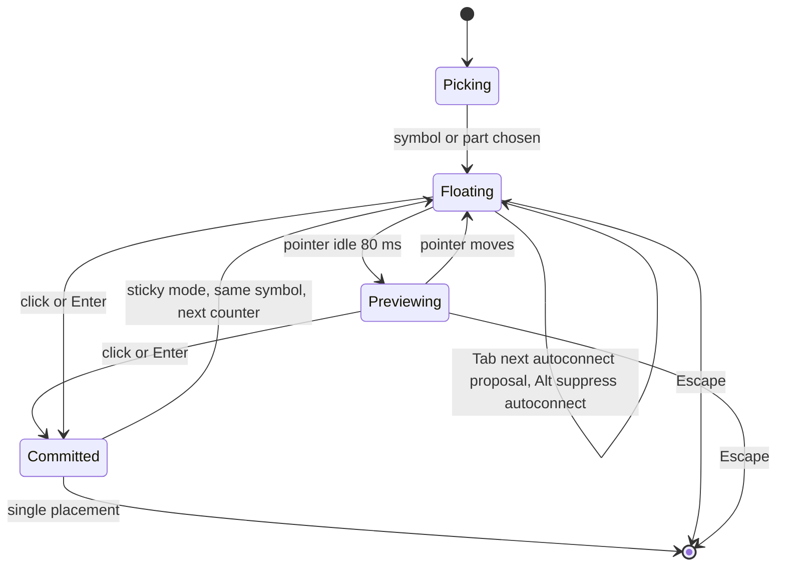
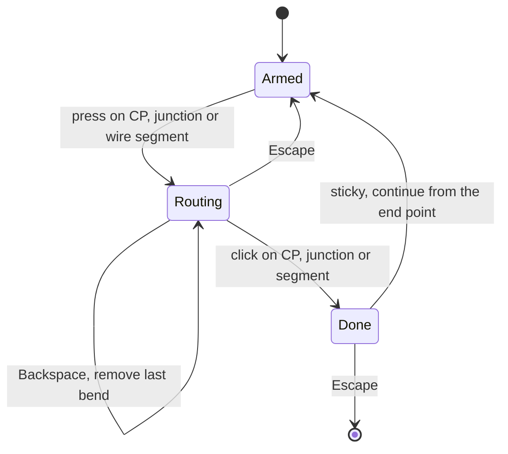

# Schematic editor: editing tools and algorithms

A chapter of [Schematic editor](06-schematic-editor.md), whose table says where each section lives.

---

## 4. Editing tools as state machines

### 4.1 The tool contract

Tools are state machines that return one output per input event (ARCH §9, FR-UI-016):

```rust
pub enum ToolOutput {
    None,
    Transient(Overlay),          // screen only: rubber band, snap marker, GPU transform of the selection
    Preview(Box<dyn DynCommand>), // semantic ghost: the command evaluated on a fork
    Commit(Box<dyn DynCommand>),  // handed to Session::execute
    Cancel,                       // Escape: drop overlay and preview; model revision unchanged
}
// `Command` (ARCH §5.1) has an associated const and serde supertraits, so it is not dyn-compatible.
// `DynCommand` is its object-safe companion with a blanket impl (ARCH §5.1).
pub trait DynCommand: Send {
    fn name(&self) -> &'static str;
    fn cost(&self) -> Cost;
    fn run(&self, tx: &mut TxBuilder<'_>) -> Result<Outcome, CmdError>;
    fn to_json(&self) -> serde_json::Value;      // journal, macro recorder, `AnyCommand` (17 §2.1)
}
impl<C: Command> DynCommand for C { /* forwards to Command */ }
pub trait Tool {
    // cx: World snapshot, page, view transform, snapper, hit index
    fn on_event(&mut self, ev: &CanvasEvent, cx: &ToolCx) -> ToolOutput;
    // shown in the status bar and read by screen readers
    fn status_hint(&self) -> FluentKey;
}
```

**Two-stage ghosts.** Every frame, the tool produces a **geometric ghost** (the dragged display list under a GPU
transform plus dashed autoconnect stubs), which costs no model work and stays inside the 16 ms frame
(NFR-PERF-04). After 80 ms without pointer movement, or immediately for paste and macro insertion, it emits
`Preview(cmd)`: the real command runs on an O(1) fork in the job pool and returns the **semantic ghost**: predicted
tags, xref texts, potential highlight and finding deltas. Commit sends the same command, so what the ghost showed is
what the commit produces (preview + commit = execute, NFR-REL-08). A semantic ghost computed on an older revision
carries a staleness badge and is recomputed.

Two points of the contract above
change. **`ToolCx` carries no `World`:** it carries the prepared page tables (the display list, the entity rectangles,
the cross-reference links, the cell table, the grid and the connection points of the page) with the snapper and the
selection, so no `ew-model` name reaches a tool (architecture §3 rule 3) and the same tool runs headless; a tool never
calls the `Session`, and the tool host in `ew-viewmodel` does (doc 16 §4.5). **Previews run on the UI thread, not in
the job pool, for now:** after the pointer has rested 80 ms (the action `canvas.dwell`, an input rather than model
state) the host evaluates the tool's `Preview(cmd)` through `Session::preview`, a dry run on a fork, and the semantic
ghost is that preview's derived diff; a fork job off the UI thread is not built. `Select` and `Follow`
join the outputs for the Select tool's result and for a click on a link.

A tool's context reads the per-page content below the shell: the display list, the entity rectangles, the cross-reference links with their resolved
targets, the cell table and the grid, fetched once per (epoch, revision) and page (doc 16 §2.5). The connection points
of the page (`page_cps`) join it.

The
events are `CanvasEvent`, with `Mods` and `Button`. The
outputs are `ToolOutput`, including `Select` (the Select tool's result) and `Follow` (a click on a link). The trait
`Tool` has `name`, `state`, `on_event`, `status_hint` and `wants_hover`. `ToolCx` is `{ page, points_per_nm, pane,
snapper, selection }` and has no `World`. A tool returns one output per event, and its overlay is made of the items
`Line`, `Polyline`, `Rect`, `Ghost`, `Marker` and `Label`. The page's connection points and their snapper are fetched
once per (revision, folio) with the page content. Previews run on the UI thread through `Session::preview_with` after
the 80 ms dwell action (`canvas.dwell`); the fork job off the UI thread is not built. The host, the commit paths and the
preview rules are in doc 16 §4.5.

### 4.2 Place tool



Outputs: `Floating` emits `Transient`; `Previewing` emits `Preview(PlaceSymbol)`; `Committed` emits
`Commit(PlaceSymbol)` with the accepted hints.

### 4.3 Select and move tool

| State | Event | Next state | Output |
|---|---|---|---|
| Idle | hover | Idle | `Transient` (hover highlight, xref hover preview after 300 ms) |
| Idle | press on object | Pressed | none |
| Idle | press on empty canvas | RubberBand | `Transient` |
| Pressed | release within 3 px | Idle | selection change (no command) |
| Pressed | drag beyond 3 px | Dragging | `Transient` (GPU transform, route stubs) |
| Dragging | idle 80 ms | Dragging | `Preview(rep.move)` (tag changes, xref changes) |
| Dragging | release | Idle | `Commit(rep.move)` |
| Dragging | Escape | Idle | `Cancel` |
| RubberBand | release | Idle | selection change; left-to-right selects enclosed objects, right-to-left touched objects |
| any | double-click on a text slot | TextEdit | inline editor; `Commit(fields.set)` on Enter or focus loss |

The Select tool is the default tool and has
three states: idle, pressed and rubber-band. A click (press and release within 3 points) selects the entity under the
pointer, Shift adds it and Ctrl toggles it. A left-to-right drag draws a solid band that selects what it encloses, a
right-to-left drag a dashed band that selects what it touches; an entity with several rectangles is enclosed only if all
of them are inside the band and touched if any one is. The enclosing band reads an entity's drawing without its texts, so a terminal printing the strip's designation beside
it is enclosed by a band over its row; an entity that draws texts only is enclosed by them. A click on empty canvas clears the selection (Shift keeps it).
A click on a link follows it (the `Follow` output; the 3-point slope above), which replaces the shell action `nav.follow` for the pointer; F stays the shell's action. Activate (Enter, `canvas.activate`) is
a press and a release at the grid cursor, so a keyboard user selects as the pointer does. Escape leaves the band, then
returns to Select, then clears the selection (the chain is in doc 16 §4.2). A drag of a selected representation moves
it (`rep.move` on release, doc 16 §4.5).

### 4.4 Wire tool



- **Start and end targets** are, in priority order: a CP, a junction, a point on a connection segment (creates a
  junction, §3.5), the CP of an interruption point. An end on empty canvas is not allowed: every connection has two
  endpoints (structural invariant). `P` while routing places an IP at the current point and ends the wire there;
  wire and IP are one `connection.draw` transaction.
- **Discipline.** The tool offers only endpoints of a compatible discipline: electrical CPs on multi-line pages,
  fluid ports on fluid pages, bus ports on topology pages (structural invariant on `Connection.kind`).
- **Keyboard wiring** (FR-UI-015): arrow keys move the grid cursor, `]` and `[` jump to the next and previous CP,
  `N` to the next unconnected CP, Enter acts as a click. A kittest flow draws -102F1:2 → -102F2:24VDC#1 on folio 102
  without the pointer.
- **The route** the ghost shows and the wire stores is the drafting design's: `ew_drafting::route_wire`, the search of
  [06a](06a-drafting.md) §3.6 against the page as drawn (§7.4 there, which also says when a route counts as the
  program's). A junction that already joins three wires is not an end target.
- Without a way the ghost is the dashed right-angled line of an unrouted wire, the line the page then
  draws, and the HUD says "No clear route: the wire stays a dashed line without a route. Click free points to lead
  it, or route it later with Route."; a commit then stores the wire without a route. After a fixed bend from which no
  clear route leads on, the wire is routed from its start as if drawn anew (its fixed bends dropped), else stored
  unrouted. Where the route crosses a text the HUD says "The route crosses a text: keeping clear of it is a far longer
  way." After a click that places a bend the HUD says "Bend placed: click a connection point to end the wire." While
  routing, the HUD says what a click at the point does: over a wire, a tee (Alt+Click a bend); over the start,
  nothing; elsewhere "Click a connection point to end, a free point for a bend". Over a junction that already joins
  three wires it says "This junction already joins three wires: end on a wire to make a new junction."
- A wire whose commit brings a new open error finding of the online check (L
  joined to N) says so in a toast in the error's tone, "The wire makes an error: " and the finding's message in the
  UI language, with Undo; the online report is memoised per revision, so the comparison costs no second check.
- A click inside a symbol's body or a black box's outline places no bend (a bend there
  draws the wire through the symbol, rule (c) of ADR-0033): it is refused in words, "A bend cannot sit inside a
  symbol; click one of its connection points, or a free point outside it", and the wire keeps routing. A run that
  entered the symbol over one of its connection points takes the bend (a wire drawn through a free terminal, §5.3),
  and a box that holds another symbol's connection point is an outline drawn around it, as the router treats it. Before a
  wire starts, the HUD says that free points clicked while drawing lead the wire: "Click or Enter on a connection
  point, a junction or a wire to start, then on free points to lead the wire through them".

### 4.5 Other tools

| Tool | States (abridged) | Commits |
|---|---|---|
| Interruption point | Armed → Floating (name, direction, star source) → Committed | `ip.place` (§3.5) |
| Black box | Armed → Outline → Assign device → Committed | `box.black` |
| Structure box | Armed → Outline → Fields → Committed | `box.structure` |
| Wire marker (CDP) | Armed → Crossing (rubber line across wires) → Fields (size, colours) → Committed | `marker.place` |
| Graphic, Text | Armed → Drawing/Typing → Committed | `item.place`; Text edit uses `fields.set` |
| Image (part 5, open) | Planned placement flow | planned `item.place` path |
| Route edit | Grip selected → Dragging segment (stays orthogonal) → Committed | `connection.route` |

A route is edited with the mouse, by handles on the sections of the wire. While Select is idle and one connection is selected, the page shows a handle on every axis-parallel
segment of its line and a dashed one on every bend. A press on a segment of a selected connection drags it across
itself; a press on a bend drags the corner, which moves its two segments. The ends never move: a first or last
segment keeps a stub of one grid step at its end (none when it is no longer than a step) and jogs after it, so a
straight wire becomes a bracket. An unrouted connection's dashed line drags the same way, and the release stores
its first route. A press that does not move is a click on what a click there picks (a junction on the wire, the next
wire of an overlap), and a press inside a representation's rectangle belongs to the representation.
| Measure | Armed → Measuring | none (transient) |
| Pan, zoom | — | none |

**Measure** (Tools ▸ Measure) goes from armed to
measuring on a press (or Activate at the grid cursor) and shows a line from the first point to the pointer with the
readout chip `dx … dy … mm, d mm`. Its points snap to a connection point within 9.5 points, or to the grid while Alt is
held. It never previews and never commits, and it does not want hover, so the entity hover outline and the link hover
and preview are not drawn under it. The readout is announced through the canvas's live region on Press and on Activate
(doc 16 §4.5).

*A text clicked on a wire.* A point within 1.5 mm of a straight stretch of a wire is a code written for
that wire: the Text tool sets the text beside it, as a wire's code is written, on its baseline 1 mm above a
horizontal line or 1 mm right of a vertical one, and shows it there while it is typed, never on the wire.

Text/Text edit input updates the ghost while typing and the 80 ms dwell preview before an explicit Enter commit; Escape cancels. Bound Text commits at its press. Graphic and Structure box use Shift+Enter or a double click for tool.finish; a two-corner box outline becomes a rectangle before its fields/Enter step. Marker fields determine the ghost and commit text, and angle is 90 degrees only when all crossed segments are horizontal. A new drawing-tool activation, including the same action and page/project reset, resets the displayed marker/structure drafts to that tool's defaults; editable drafts survive ordinary frames and outline transitions. Changing the page cancels every drawing tool. Text edit uses F2/double click on free text and refuses a read-only page. Select moves and deletes mixed representations, page items and structure boxes together in one command. `strip.bridge` (Edit ▸ Bridge terminals, no shortcut) uses the lowest CP of the first part use with a shaft-1 bridge entry, checks bridge connectivity/group selection and draws one page-less connection in one undo step. Disabled reasons distinguish selection, strip, shaft and already-connected conditions.

---

## 5. Algorithms

### 5.1 Anchor cell by integer arithmetic

`rep_anchor_cell(rep)` takes the anchor point from the symbol's anchor policy (origin, label, centre or named
point; FR-SYM-010, FR-XRF-005), never from rendered geometry (D-14), and maps it on the target page's frame
(FR-PAG-020, FR-XRF-021). Frame geometry is rational in nm. For a frame whose drawing area starts at `x0 = a/b`
and whose columns are `w = c/d` wide:

```text
column(x) = start_index + floor( (x·b·d − a·d) / (c·b) )       evaluated in i128, exact
row(y)    = row_labels[ floor( (y·b'·d' − a'·d') / (c'·b') ) ]
outside the drawing area → None, reported by FR-CHK-035
```

- A point exactly on a boundary belongs to the right or lower cell, the documented rule (FR-PAG-020).
- **Pitfall.** A stored coordinate is rounded to the nearest nm, so a point on a QET boundary can land up to
  0.5 nm to its left. Anchors always sit on the page's connection grid `g`, so the lookup first converts the point
  to its grid index `k = round(x / g)` and evaluates the formula on the exact rational `k·g`, which rounding cannot
  move across a boundary. On the QET frame with the 10 px grid this reduces to [03](03-domain-model.md) §6's
  `column = ⌊(k_x − 2)/6⌋`, `row = "ABCDEFGH"[⌊(k_y − 2)/8⌋]`: the L-1 anchor at (1010 px, 620 px) gives
  `k = (101, 62)` and cell H16. A point on the native 4 mm grid is an exact integer in nm, so the formula applies to
  it without any rounding. Only off-grid points (free texts) use the stored nm value directly. "On the grid" means
  within the rounding window: a point less than 1 nm from its nearest grid point `k·g` is evaluated at `k·g`, and
  any other point at its exact nm value, never snapped.
- **Where it lives.** The exact lookup is the cold derivation `cell_of(point, page) -> Option<Cell>` in
  `ew-derive`: the page supplies its frame form and its connection grid, and the function replaces a point within
  the rounding window by its grid point before evaluating the formula above. `rep_anchor_cell`, the cursor's cell readout (FR-UI-034) and
  the empty-cell check call it. `ew-units` provides only the integer primitives (`Grid::snap` and the plain
  Euclidean `Grid::cell(x, origin)`), which know nothing about frames or the snap-first rule; calling
  `Grid::cell` on a stored nm value directly is the pitfall above.

### 5.2 Autoconnect candidate search

Autoconnect is an assistant that proposes explicit connections; it is never model semantics (ADR-0007).

```text
proposals(rep_ghost):
  if page.kind disables autoconnect: return []
  for each CP c of rep_ghost that has no connection (ascending idx):
    ray = from c.pos along c.dir, on the connection-grid line, clipped to the drawing area
    hit = first object on ray via page_spatial_index:
          symbol body or text of another rep   → obstacle, stop
          CP q with q.dir == −c.dir, q free, same discipline  → Cp(q)
          connection segment on the ray's line → stop (the line is occupied)
          connection segment crossing the ray   → continue (a crossing is not a contact)
    if hit: push Hint{cp: c.idx, to: hit}
  if two CPs of rep_ghost lie on one segment of connection W and face its two ends:
    replace their hints by Split{W, at}                       (insert into a wire, FR-CON-008)
  tie-break equal distances by CP id (v5 of function and idx)  (deterministic, NFR-REL-07)
  return proposals; Tab cycles alternatives (next hit further along each ray)
```

A terminal's CP never proposes a CP of a terminal of its own strip: two terminals of one strip are joined by a bridge,
never by an autoconnected wire.

- **On placement**, accepted proposals are committed by default; Alt suppresses them for one placement.
- **On move**, proposals for free CPs are shown and committed with the move; Alt at the release suppresses them and
  `C` turns the behaviour off or on for the session (FR-CON-004).
- **Cost:** one spatial-index ray per free CP, O(CPs · log n), well inside the frame budget.

The proposals are computed in `ew-viewmodel` from the prepared page tables (not from a spatial index) and drawn as
dashed overlay stubs. Placement: the accepted proposals become the `connect` hints of the committed `device.place`,
and Alt at the commit sends none.

A move connects the proposals (ADR-0007 amendment 3) its drag shows by default. They commit with the move as `rep.move`'s `connect`
hints, `{rep, cp: {function, idx}, to}` (the CP named by function, as the window knows a placed representation's CPs),
each making its wire as a `device.place` hint does, in the move's one undo step. Alt held at the release moves without
them; `tool.connect_on_move` (C) turns connect on move off or on for the session, and the move's HUD and the status
bar say "C Connect on move: on" or "off", the key from the keymap. The keyboard move (M) connects by the session's
setting.

### 5.3 Splitting a connection

Dropping a symbol with two facing CPs onto connection W (between A and B) replaces W by W′ (A → c1) and
W″ (c2 → B):
- the part toward the From end of W's physical wire (doc 08 §3.8, the end its number is counted from, as the
  drawing stood before the drop) keeps W's UUID, so the original wire number and a frozen number stay with it
  (FR-NUM-023); a derived number is counted from the From end, so it stays on that part too unless the part's new
  To end moves it in the count (§5.2 of doc 08). W′ keeps the UUID where the From end cannot be told;
- the other part gets a new UUIDv7 and, with online wire numbering on, the next number of the scheme (FR-NUM-019);
  otherwise it stays unassigned and prints "?" (FR-NUM-021);
- both keep W's overrides (FR-CON-008);
- the preview names both resulting wires (FR-CON-008).

### 5.4 Routing

Routing is the drafting design's: [06a](06a-drafting.md) §3 (the method, the jobs, the search and its prices), §7.2
(Route) and §7.4 (the Wire tool, connecting on placement, a move's re-solve), decided by
[ADR-0034](../adr/0034-schematic-drafting.md). The router is `ew_drafting::route`, reached through `ew_api::routing`; it
runs in the tools, in Route and in `ew route`, and the commands store its routes and never route (§3.2). What this
document keeps of it:

- Routes are stored as nm vertices, the full list from end to end (FR-CON-007, ADR-0033 decision 2); a connection
  point's point is the grid's own number of its position (06a §2.1).
- Crossings render as plain crossings or as hops by the project's `crossings` setting (`project.settings.set`, member `drawing`,
  FR-CON-031): each proper crossing of a horizontal and a vertical segment of two connections is a half circle of 1 mm
  radius above the horizontal one; a crossing closer than 2 mm to a segment end or to another hop is drawn plain.
- The Wire tool refuses an end that already sits on one line with its start, in words where its hint stands ("These
  two points already sit on one line; click a point of another line, or Esc"), and keeps routing for another end: a
  point on a connection that ends at the start (or the start on one that ends there), and, for a tube, the other end
  of a tube that joins the two already. Two wires between the same points stay allowed (they may double a
  cross-section).
- A route is edited by hand with the selected wire's round handles (Select's segment and bend drag, doc 16a §7.1).
- The layout findings are the check rules EW-CORE-067 to -070 and -072 to -077
  ([15](15-checks-revisions-collaboration.md) §4.2); they call a fluid line a tube ("Tube -201Q1:4 → -201M1:B has no
  route").

### 5.5 Physical wires behind junctions and IPs

The editor previews what [03](03-domain-model.md) §9.2 derives: a junction in Star wiring joins its first sequence
member to every other member, and one in Chain wiring joins consecutive members. Through an IP pair, the drawn parts
on both pages form one wire with the ID of the target-side connection. The junction property page renders the
resulting rows from `physical_wires_of(potential)` (ARCH §6.4; [08](08-connections-terminals-cables.md) §3.8)
before commit.

### 5.6 Folio proposal for a new page

```text
propose_folio(after):
  n = after.number + 1
  if n is inside after's section range and no drawn page, divider or report block uses n: return n
  else: return {number: after.number, label: printed(after) + "." + smallest k such that no page of the section prints that folio}
                                          (sub-page, sorts directly after `after`; printed(p) = p.label, else p.number)
```

Inserting after 103 in the reference project proposes 104; inserting after 101 while 102 exists proposes 101.1 (then 101.2; after 101.1 the
proposal is 101.1.1), and no other folio changes (FR-PAG-005). The user may type any free folio; `page.create` refuses a typed folio
that another page of the section prints, one outside the section range, the section's divider folio, or one that a report block of the
section generates (FR-PAG-012); collisions in imported data are reported (FR-CHK-038, FR-REP-041).

New page…'s proposal follows the Type chosen in the form; a type the front matter
does not hold (a panel layout, chosen on the title page) keeps the section the form proposed and never moves into the
front matter.

### 5.7 Hit-testing and snapping

`page_spatial_index(page)` (rstar) returns candidates; exact picking uses kurbo geometry (ARCH §8.2). Pick priority
depends on the tool:
- **Select:** text slot > representation > junction > connection > page item > structure-box edge;
- **Wire:** CP > junction > connection segment > grid point.

Snap targets within 9.5 screen points (`CP_SNAP_PT`) win over the grid, at every zoom (a little under ten, as at
100 % a step of the QET grid is ten points and the grid point beside a pin stays one for a bend); what Select rings and the Wire tool's snap marker rings is what a click takes. A
click of the Wire or Tube tool that takes nothing and leaves a free point right beside a connection point (within that
reach or one grid step, whichever is more) says so at once in the status line: a start that took nothing, a bend
beside the point, and a wire that ended elsewhere with such a bend. The Tube tool is the Wire tool on a fluid page (a
click on a port ends the tube as one on a pin ends a wire); its hints say "port" and "tube" where the Wire tool's say
"connection point" and "wire". Alt means one thing per tool: in the Place tool it suppresses
autoconnect proposals, in the graphic, text and route-edit tools it suspends object snaps and the fine grid. CPs
never leave the connection grid in any tool. All snapping works on grid indices, never on float equality
(ADR-0005). The grid rule binds every origin, scripts, command logs and MCP included: a command
rejects a position off the page's connection grid (`Page.grid`, ADR-0027) and a route with a point off the grid or
an end that does not meet its CP (a route's corner may stand half way between two grid lines, where the router steps
between close pins: ADR-0033 amendment 3). GUI tools snap before they issue the command, so they never meet the rejection.

Picking is on the display list's entity
rectangles, as the hover is; a spatial index with exact kurbo picking and the per-tool priorities of the list above
are not built. A cross-reference link is picked found in the link rectangle inflated by 4 points at the current zoom, the smallest area winning
and the later in paint order breaking a tie; a link wins over the entity under it. An entity rectangle is inflated by 4 points: the smallest area containing the
point wins. `selected_rects` and the band
selection are O(n·m) over entities and rectangles, and are not measured. **Snapping:** `Snapper::snap` returns `{at_nm, page_nm,
grid_index, kind, label}`; a connection point within 9.5 points wins unless Alt is held, else the point snaps to the grid
on grid indices in i128, and `page_nm` lies on the page's connection grid. The indicators are overlay markers: a ring
for a connection point (9 pixels), a cross for a grid point (7 pixels) and a square for a junction. **The mark scale**: the markers are fixed at 7 and 9 pixels while lines double at a
scale of 2 or more. The intended rule, not built, is one integer overlay factor `s = max(1, floor(ppp))` for every tool mark: lines `s`
pixels wide, dashes 4s on and 4s off, the grid cross and the junction square 6s+1 pixels, the connection-point ring
8s+1 pixels, so that marks keep a centre pixel and their proportions and snapshots stay pixel-exact; the selection
outline is 2s pixels.

**Moves are in grid steps.**
`rep.move` takes `steps: [kx, ky]`: each moved representation's position becomes the grid point at its index plus the
steps, exactly, per axis, and the tools always send `steps`, computed from the pointer's page displacement as
`k = round(displacement × den / num)`. A uniform nm delta cannot keep several representations on `round(k·g)` on the QET
grid, and grid indices are this section's rule. `steps` and a non-zero `delta` are mutually
exclusive, `steps` with `page` (a cross-page move) is rejected, and a representation whose position is off the grid
cannot be moved by steps. A route vertex on the grid moves by the same steps, and a CP-exact coordinate moves with its
CP (`follow_end` with the moving CP's own displacement). The member is absent from every logged command that does not
use it (`skip_serializing_if`).

