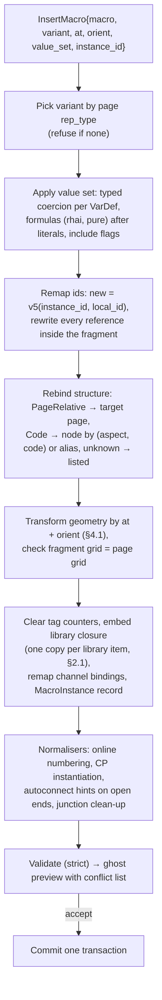
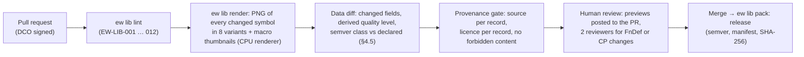

# Symbols, parts and macros: behaviour, algorithms, the window and library governance

A chapter of [Symbols, parts and macros](07-symbols-parts-macros.md), whose table says where each section lives.

---

## 3. Behaviour and rules

### 3.1 Embedding and the copy life cycle

**Embed closure.**
- `PlaceSymbol`, `AssignPart` and `InsertMacro` embed the item together with its `LibRef` closure: the symbol's
  FnDef, the part's accessories, template FnDefs and manufacturer, and the macro's symbols and parts.
- Within a project a `LibRef{library, item, version_req}` resolves to the embedded copy of `(library, item)`.
  If that copy's version does not satisfy `version_req`, the embedding command stops and proposes "update from
  library" instead of embedding a second copy silently (§2.1, keeping two versions).
- `library.embed` takes the
  copies themselves; `ew-api`'s `embed_command` builds them from library references with their closure.
  `part.assign` carries the missing closure in its `copies` and embeds it in its own transaction, reusing a held copy
  of the same hash. The tables
  bootstrap and the parts import write one project-local manufacturer copy per manufacturer name, and part references
  name it with no `key` (a legacy `key` is still read). A part chosen from a system library in the Parts row is one
  `part.assign` that carries the closure; from the picker it is a `library.embed` before the placement, two undo steps.

**Unused copies stay until purged.**
- A copy whose last reference disappears is **not** deleted implicitly, so undo and basic-project palettes stay
  intact.
- `library.purge_unused` lists unreferenced, unpinned copies in a preview and removes them as one transaction; the
  release dialog offers it too ([05](05-project-format-and-persistence.md) §13.2).
- An info finding counts the unused copies.

**Local edits fork the item.**
- Editing an embedded symbol or part in a project creates a **project-local fork**: a new item in the project's
  implicit library with `meta.source = ForkOf{library, item, version}`.
- The library item is never edited from inside a project. "Promote to company library" is a separate library write
  that is confirmed and not undoable (ARCH §5.3).

**Update from library** (FR-SYM-016, FR-PRT-014, FR-MAC-010) is a `Cost::Bulk` command previewed on a fork. The
preview shows:
- the field diff per copy;
- the rendered before/after pages for symbols;
- the BOM and wire-list `diff_query`;
- every representation or device touched.

**The update is classified by semantic version, and the classification is checked, not trusted (§4.5):**

| Change | Example | Update behaviour |
|---|---|---|
| patch: graphics, texts, metadata, with CP and anchor offsets unchanged | lamp symbol redrawn | applies; pages re-render |
| minor: additive (new slot, arrangement, variant, section, accessory) or a moved anchor | ETIM class added to A9P52610 | applies; a moved anchor lists every changed xref text in the preview |
| major: CP removed or re-indexed, FnDef changed, function template changed | MICO pattern "Out1" → "Out 1" | needs a CP mapping (by index, then designation) in the preview; unmapped CPs with connections **block** the update until mapped or the connections are removed explicitly |

### 3.2 Symbol rules

1. **Grid.** CPs of native symbols lie on the native connection grid (ADR-0027, proposed 4 mm, not yet decided).
   Graphics use a 0.5 mm and text slots a 1 mm fine grid (ADR-0027 recommendation 1, FR-SYM-009). The editor
   refuses an off-grid CP at save (FR-SYM-009). A symbol is placeable only on pages
   of its own grid: QET-import symbols keep their 10 px grid (`7_937_500/3` nm) and stay on QET-grid pages until
   the page conversion of v1.x (FR-PAG-022).
2. **QET-grid edition of the starter set.** A project migrated from QET sits on the QET 10 px grid, and its
   QET-import symbols are exchanged for starter symbols on QET-grid pages. The starter set therefore ships a second, **generated**
   edition with `grid = QET 10 px`: every CP offset keeps its count of grid steps (`k·g` → `k·7_937_500/3` nm),
   graphics and slot positions scale by the same ratio and round to the nm, and text heights stay style-driven. The
   scaling is `v · 7_937_500 / 12_000_000` rounded with ties toward zero; 0.5 mm becomes 1.25 px, so the edition's
   graphics lie on no whole-pixel grid, and its lint requires instead that every graphic, slot and link-point
   coordinate equals the scaled value of its native twin, while every CP lies exactly on the QET 10 px grid. Its pens are QET px, not scaled house pens (§2.3). The
   edition has its own item IDs (key suffix `@qet10`), is linted like the native edition and is never drawn by hand (FR-SYM-030; ADR-0027 recommendation 8). The full 1.0 library gets no such edition.
3. **CP direction.** Every CP has a direction (N, E, S, W), which autoconnect and routing use. A CP must lie on the
   symbol outline or on a line end.
4. **Representation type.** A symbol has exactly one `rep_type`. Placement offers only the symbols of the function's
   FnDef whose `rep_type` the page type allows (FR-SYM-006).
5. **Anchor.** Every symbol declares its anchor policy explicitly; the symbol editor proposes `GraphicCentre`.
   Interruption points anchor at the arrow tip, the -201U1 bus port at its graphics ("3-B2"), the CPX power box at
   its left edge ("106-G3"). The xref cell comes from the anchor, never from the
   bounding box (D-14). The resolved anchor offset is snapped to the symbol's connection grid at save (ties toward
   the origin), because the integer cell lookup of [06](06-schematic-editor.md) §5.1 requires anchors on the grid.
6. **Text readability.** Text primitives and slots are never mirrored and never turned by the symbol's variant:
   turning or mirroring a placement leaves every text at the angle it has in the unturned symbol (owner,
   2026-11-15: "it should always remain upright"), made readable from the bottom or the right of the sheet
   ([06](06-schematic-editor.md) §2.5). The anchor moves with the symbol and the alignment is chosen as §4.1 decides
   for all eight variants, so the text stays on the same side of the symbol and of its connection point. Turned a
   quarter, a symbol's slot texts are placed anew round its body (§4.1).
7. **Exchange** (FR-SYM-022) maps CPs by `fn_cp`, then by designation. The preview lists unmapped CPs, and a CP that
   carries a connection must be mapped.
8. **Linkages** (FR-SYM-014) are derived lines between `link_points` of the functions related by a `DeviceLink`
   or by one device's actuator and contacts. A symbol without a link point gets its anchor as the fallback. A
   `SymbolDef` never draws a mechanical linkage in its graphics: pole to pole, pole to handle, actuator to contacts
   and actuator to process valve are all derived. A multi-pole symbol therefore declares a link
   point per pole and one for its actuator: `ew.iec.switch-2p-manual` declares `pole1`, `pole2` and `handle` at
   (11, 6) mm, and the derived chain runs pole1 → pole2 → handle. The one exception is the internal pole linkage
   of the MCB, which is part of the MCB graphic (0.13 mm, dashed 4:2).
9. **Licence.** Every symbol has an SPDX licence. Shipped symbols carry `CC-BY-SA-4.0 WITH
   KiCad-libraries-exception` if counsel confirms that the SPDX-listed exception covers control-cabinet projects
   and machine files, otherwise a project-specific exception (`AdditionRef-…`, SPDX 3.0 syntax, verify)
   (ADR-0024; [19](19-open-source-governance.md) LR-07). They carry no IEC description text (FR-SYM-019,
   NFR-LIC-07).
10. **Pole-count families (generated)**. One family source generates the
    concrete pole-count variants at content-build time; there is no run-time parameter and no new record kind.
    - *Source.* `content/families/<family>.json` declares the pole template (one pole's graphics, CPs and slots, and
      the pole pitch in connection-grid steps), the actuator and internal-linkage geometry, the pole counts to
      generate, the key pattern (`<base>-<n>p`, e.g. `ew.iec.switch-disconnector-4p`) and the FnDef template
      (`PassThrough{opens: true}` per pole, `ew:poles` = n, link points `pole1` … `pole<n>` and `handle`).
    - *Expansion.* `cargo xtask symbols-qet10` expands each family into ordinary SymbolDef and FnDef documents before
      sealing, then generates their `@qet10` twins as for every symbol (rule 2). The generated documents are committed;
      the lint regenerates them and fails on any difference, as for the `@qet10` edition.
    - *Items.* Each generated variant is an ordinary library item with its own key and item ID, linted like a
      hand-drawn item. Members of a family carry the keyword `family.<base>`, so pickers can group them.
    - *Existing keys.* The hand-drawn keys `ew.iec.mcb-1p`, `ew.iec.mcb-1pn` and `ew.iec.switch-2p-manual` stay
      hand-authored; a key moves into a family only when the generator reproduces its sealed document byte for byte
      (content hash).
    - *Unchanged.* ADR-0021 is unchanged: importers and `symbol-map.csv` rows reference concrete keys. FR-SYM-027
      (user-authored parametric families in the symbol editor, 1.x) is unchanged and may later reuse the source format.
    - *Trade-off.* The library holds one item per pole count (more items, more twins) in exchange for no schema change,
      no run-time geometry generation and unchanged import and placement paths.

### 3.3 Part assignment and selection rules

`AssignPart{device, part, variant, qty, mode: Keep | Align}` (FR-PRT-015, FR-DEV-015):

1. **Embed.** The part's closure is embedded, its accessories (§2.5) with it.
2. **Device with no functions yet** (part-first placement, IDEA-016). The template functions are created unplaced,
   with IDs `v5(device_id, template_index)` ([03](03-domain-model.md) §4.1; ADR-0004 amendment 2). The
   function matching the chosen symbol is placed (FR-DEV-017, FR-UI-017).
3. **Device with existing functions.** Template functions are matched to existing ones by FnDef category, then by
   CP designations (natural, normalised).
   - Each match sets `Function.def` to the template FnDef copy and drops CP overrides made redundant by the
     pattern.
   - Unmatched existing functions stay and are reported by FR-CHK-036 if they exceed the part's contacts.
   - Unmatched template functions are created unplaced.
4. **Derived texts.** Part text slots (manufacturer, part number, type), technical data defaults and the
   description default refresh in the same commit (FR-DEV-016). The device's own `tech_data` wins over the part's.
5. **Quantity** is in the part's order unit: `-3W1` uses 6XV1830-0EH10 in metres. A cable's conductors are
   generated from the part's cable-core section (FR-CBL-004).
6. **Several part uses per device** are allowed (a valve terminal and its bus node). Each use is matched separately.
   The first use that provides the main function is the device's main part.
7. **Variant.** `part.assign` takes `variant`, a key the part holds (another is refused in words), and writes it
   into the part use's reference (`PartRef.variant`). Properties ▸ Parts ▸ Variant and the strip editor's Variant
   cell change it alone, with `fields.set` of the device's `parts`; the device keeps its functions and connections.
8. **Accessories.** Nothing is written on the device: its accessories are derived (§2.5). Replacing a part drops the
   device's accessory choices that the new part does not name, in the same step.

**Replace part** (FR-PRT-023) is `AssignPart` over a set of devices, as one previewed transaction. **Configured
products** (FR-PRT-006) assign like parts; their components feed the component-mode BOM (FR-REP-005).

The command is **`part.assign`** `{devices, part,
copies?, mode?, from?, qty?}` with `mode` `append` (the default: a further part use), `replace_all` (the part becomes
the devices' only use) or `replace` with `from` (each use of `from` swapped, its quantity kept); it is Interactive below
50 devices and `Bulk` from 50. It carries the library documents it needs in `copies` and never reads a library, so it
replays without one; it embeds what the project lacks, reuses a held copy of the same hash and refuses a held copy of another version ("update
from library first"). A device's main part is the part use whose template provides the main function (rule 6). The Properties Parts row sends `part.assign` (`replace_all`) when its new value is one use of a system
library's part the project does not hold, else its own `fields.set`. Rules 2 and 3's matching is not changed by the
command. A function made from a template records its entry index (`Function.template_entry`, an
optional member appended within 0.1 under ADR-0011 amendment 1), and the CP derivation reads that entry, falling back
to the first entry of the function's FnDef when the member is absent or names no such entry; an entry whose `cps` list
as many pattern CPs as its FnDef has CPs pairs them by position, so each function keeps the FnDef's CP indices (a
symbol's `fn_cp`, the FnDef's internal links) and prints the pattern's designations. A part may therefore template
several functions of one FnDef: the generic relay and contactor template their contacts.

**A part whose type is not known**.
The drawing shows that a part belongs to a device and nobody knows which yet. The model's placeholder part serves:
a part copy numbered `TBD` (`PLACEHOLDER_PART_NUMBER`, `Part::is_placeholder`; FR-CHK-034). No new member and no new
record kind.
- *Command.* `part.placeholder {devices, description, mode?, from?}` makes a project-local part copy numbered `TBD`
  with the person's words as its description, no manufacturer (its reference names the project library and no item)
  and the kind `terminal` when every device is a terminal, else `device`, and gives it to the devices as
  `part.assign` with that `mode` and `from` does, in one undo step. A project-local placeholder of the same kind and
  description is reused, so four grey terminals given "Grey terminal" in one step or in four share one copy. An empty
  description is refused in words.
- *Window.* In the part dialog (Properties ▸ Part ▸ Choose…, a strip's terminals without a part), Type not known yet…
  opens a field for what the part is and Use as placeholder (or Enter) gives it; the placeholder is a held part of the
  project from then on, so the dialog lists it among the project's parts for the next device. Type not known yet… is also in the Parts row's … menu beside Choose part… and in the command search (under
  placeholder, stand-in, not known, undecided, TBD: the glossary's Stand-in part), each opening the part dialog of the
  selection with the field open; Make variable in that menu says on hover that it is a macro's variable, not a stand-in
  part. Remove from my parts library… is in the command search too (delete part, remove part) for the selected device's
  part or the Libraries navigator's row, and New part… is in New station…'s split on the PLC tab.
- *What prints.* The parts list has its row: no manufacturer, part number TBD, the description, the count of its
  devices; the terminal diagram's Part column prints TBD.
- *The check.* The device has a part, so EW-CORE-041 is silent. EW-CORE-043 reports the placeholder as info online (a
  decision the person recorded, not a gap) and as an error in release mode, an open item that blocks release
  (FR-CHK-034). EW-CORE-042 does not ask a placeholder for a manufacturer.
- *Replaced in one step.* A real part chosen in the part dialog for a device that carries a placeholder replaces it on
  every device that carries it (`part.assign` with mode `replace`, `from` the placeholder, over its devices); a script
  sends that `part.assign`. The placeholder copy then has no user and stays in the project until it is purged.
- *Copied.* A copy of pages and a paste carry the part use as they carry any: the devices of the copy name the same
  placeholder.
- *Not built.* A placeholder of a cable sold by the metre (it is a piece); a placeholder offered from the library.

### 3.4 Data quality levels

The quality level is **derived, never stored** (FR-PRT-021). For each category a requirement profile (data, editable
per company) lists the mandatory fields per level. The level is the highest one whose requirements, and those of all
lower levels, are met:

| Level | Requirements (MCB example) | Effect when missing |
|---|---|---|
| **basic** | L0 complete, licence and source present | below basic: cannot be saved to a company library (FR-PRT-022) |
| **schematic-ready** | template with FnDef per function and CP designations; `ew:rated_current`, `ew:characteristic`, `ew:poles`; contact data if the category has contacts | FR-CHK-024 "incomplete mandatory data" |
| **layout-ready** | W×H×D, mount kind, rail offset for rail parts, 2D outline or footprint | placing on folio 902 warns; EW-LAY-001 still counts the device |
| **production-ready** | clamp type and cross-section ranges per CP; 3D model or generated box (FR-LAY-023); 3D CP data; marker carriers; accessories for terminals | lengths flagged `estimated` (FR-LAY-053); ferrule selection falls back to defaults |

The part browser shows the level as a four-step ladder with the missing fields. Library CI reports level changes in
every pull request (§6.2).

### 3.5 Macro creation and insertion rules

**Save as macro** (FR-MAC-001, FR-MAC-002):
- The selection is copied into a fragment with local IDs, together with its embedded closure and its structure
  references.
- **Structure.** References equal to the page's structure become `PageRelative`, so the macro rebinds wherever it is
  inserted (FR-MAC-003).
- **Tags.** Frozen tags are cleared (S51 becomes a derived tag), unless the user marks a device "keep tag"; a kept
  tag makes every insertion a tag conflict, and EW-LIB-012 warns about it in shared libraries.
- **Open ends.** Connections to objects outside the selection are dropped; their CPs become the macro's open ends.
- **Insertion point.** The user picks it; it is snapped to the macro's grid.

A page macro's pages named by folio (`macros.save {pages}`) need no selection and no marked page,
and without a kind they make a page macro. A copy of pages ([06](06-schematic-editor.md) §3.6) starts from the same
fragment of the pages, widened by the cables, bonds and connections a second installation keeps together; the page
macro itself does not carry them. A page macro's records keep their positions as the pages held them, a symbol off
the grid too (it was refused as off the grid, though nothing moves it).

**Variables are created by picking.**
1. Select an object property in the property grid.
2. Choose "make variable".
3. Name it, then fill value sets in a table. CSV import and export of that table arrive at 1.0 (FR-MAC-014).

**`InsertMacro{macro, variant, at, orient, value_set | values, instance_id}`** is the pipeline of §4.6:
- one undoable transaction after a ghost preview (FR-MAC-005);
- `instance_id` is minted by the caller, so replaying from the journal reproduces the same IDs;
- page macros propose folios after the target page (FR-MAC-002, [06](06-schematic-editor.md) §5.6).

**Conflicts listed before commit:**
- duplicate frozen tags, and interruption-point names that would pair with existing points;
- PLC addresses already in use: manual ones, and derived ones that collide because a value set puts a module on
  an occupied slot of the same station. Inserting the folio-203 typical a second time with value set 1 doubles
  slots 1 and 2 and lists the eight bound addresses Q0.1, Q0.3 … Q1.7 (FR-MAC-005);
- duplicate process tags (exact duplicates at MVP; EW-PRC-001 with its scheme check from 1.0);
- occupied CPs under autoconnect;
- a macro grid that differs from the page grid (refused);
- a `rep_type` that is illegal on the page (refused).

### 3.6 Imports into libraries

All importers are pure functions from bytes to `ew-schema` records (FR-IMP-001). They write into a **user or
company library**, never directly into a project. A project then picks the result up through assignment or update.

| Source | Release | Mapping | Rules |
|---|---|---|---|
| CSV/XLSX parts | MVP | column mapper with saved mappings; dedupe on (manufacturer, normalised part number) | report of new, updated and rejected rows (FR-PRT-016) |
| QET project elements | MVP | `.elmt` definitions embedded in a `.qet` become symbols in the project's "QET import" library, on their native grid with source element name and UUID (FR-SYM-018, FR-IMP-008) | never leaves the project unless the user forks it; keeps QET's element-origin anchor so imported xrefs equal QET's (MF-13); the library's `library_id` is the project ID and its key `qet-import` ([05](05-project-format-and-persistence.md) §13.2) |
| QET element collection on demand | 1.0 (FR-SYM-029) | a user-selected directory of `.elmt` files (the user's QET installation) becomes a **user** library, `meta.licence = LicenseRef-QET-elements` with QET's `ELEMENTS.LICENSE` attached and the flag `foreign_terms` | QET's terms allow use in diagrams freely and redistribution under CC-BY 3.0 with a no-ML-training clause ([oss-landscape](../research/oss-landscape.md) §2.6). Those terms are incompatible with EW's CC-BY-SA-4.0 packs, so such items are never bundled, never merged into an EW pack (`ew lib pack` refuses `foreign_terms`), and never used for model training (NFR-LIC-06) |
| `symbol-map.csv` | MVP | QET element UUID or path → EW symbol key + CP map; generalises the pneumatic table of FR-IMP-018 | used by FR-SYM-022 exchange |
| EDZ (7-Zip or ZIP) | 1.0 | `*.part.xml`: `P_ARTICLE_PARTNR`, `_MANUFACTURER`, `_ORDERNR`, `_TYPENR`, `_DESCR1/2` (`de_DE@…;en_US@…;` → `MlText`, FR-I18N-008); `<functiontemplate>` pins (`connectionDesignation`, `connectiondescription`, `terminalNr`, `functiondefinition`) → CP pattern and template FnDefs through the `functiondefcategory/group/id` mapping table; drilling positions, CP patterns and accessories where present (FR-IMP-025/027) | **terms notice** before the first EDZ import of a session (FR-IMP-026); `.ema` geometry never reproduced; `.e3d` ignored; pictures stored only in the user library; source file hash and import date recorded |
| EPLAN parts XML | 1.0 | `partsmanagement` with variants, function templates, free properties, accessory lists, `length-unit` (FR-IMP-028) | into a company library |
| BMEcat 2005, ETIM xChange | 1.x | product identification, ETIM or ECLASS feature blocks (feature system name, class, feature name, value, unit), order and price details (element names to verify against the specification) | FR-PRT-020; prices go to L4 with source and as-of date |
| DXF blocks | 1.0 | DXF-to-symbol wizard (FR-IMP-034); vendor DXF as 2D front outline or drilling pattern (FR-IMP-035) | CPs snap to the target library's connection grid (FR-IMP-034) |

**EDZ and parts XML** are read by `ew-import-eplan` into part drafts, placed by
`ew-import-catalog`'s one placer (the dedupe on manufacturer and `pn_norm`, a new patch version with `--bump`), written by
`ew import edz|parts-xml --library` or from the window (Add to my parts library, the library `user-parts`); the pins,
descriptions, sizes, free properties and provenance are read, accessories and further variants kept in `extra`, the
picture and the drilling positions reported (14 §5.2). The previewed update of a project's part copy from a file is
`ew import edz --project` and the window's Update (14 §5.2, AC-38). **The QET element collection** is
`ew lib import qet-elements <library> <dir>`: the `.elmt` files below a folder become symbols and function definitions of
a writable library under `LicenseRef-QET-elements` with `foreign_terms`, the source path kept in `meta.sources`, the
folder's `ELEMENTS.LICENSE` named there by its SHA-256; the refusal to pack such a library (`ew lib pack`, LL-05) waits for
the command, which is not built.

The CSV/XLSX row is built in
`ew-import-catalog`: a column map (`member ← header`, saved as TOML per source key), a CSV reader (UTF-8 with or without
a BOM, comma or semicolon from the header line, RFC 4180 quoting), an own bounded XLSX reader (no calamine),
and rows into part copies with item IDs `v5(lineage(catalog, library), parts|<maker key>|<pn_norm>)`, deduplicated on
manufacturer and normalised part number; manufacturers resolve through the libraries' master list (every tier's,
the starter parts' "Generic" included), an alias reported EW-IMP-007, an unknown name EW-IMP-005, "A / B" split into two
flagged candidates, unmapped columns EW-IMP-004; every row is reported new, updated, unchanged, duplicate or rejected
with its line. Unlike the paragraph above, the import may also target a project (`ew import parts --map`), which embeds
the parts with project-local manufacturer copies; `ew lib import parts` writes a library and refuses changed content
under a held version unless `--bump`, taking a stale lock over only with `--take-over`. The window's column-mapping
card is not built.

**The EDZ terms notice reads, in substance:**
- files from the EPLAN Data Portal may be subject to terms that restrict their use to EPLAN products;
- EW imports only factual part data from files the user obtained;
- the user is responsible for complying with those terms.

The notice is shown once per session and logged in the import report. The network sandbox job asserts that an EDZ
import opens no connection (NFR-PRIV-01).

**Import dates are command parameters.** The UI fills `as_of` with today's date. This keeps commands deterministic
and replayable, and entities carry no writer timestamps (ARCH §7.3).

### 3.7 Distributor connectors (bring your own key)

Prices, stock and datasheet links from distributors come only through **connector plugins** (WASM, v1.x,
FR-EXT-019). Examples: Mouser, DigiKey, Nexar/Octopart, Farnell.

**Rules:**
- **Capabilities.** A connector holds a network capability granted at install time (NFR-SEC-07) and the user's own
  credentials (an API key, or an OAuth2 token for DigiKey, [interop-formats](../research/interop-formats.md) §9),
  kept in the OS credential store and read through the host capability `secret-get(name)`, which is granted per
  plugin at install and never readable by other plugins (ADR-0020 amendment 4; 1.x, before the first connector).
- **When it runs.** Only on an explicit action ("fetch prices for this BOM"), as NFR-PRIV-01 requires.
- **Where results go.** Results land in the user library's L4 section, with `source = connector id` and `as_of`, and
  are cached no longer than the provider's terms allow.
- **What never happens.** Results are never written into company or community libraries automatically, never
  shipped, and never fetched in the background.
- **Projects.** A project sees prices only through an explicit "update from library".

### 3.8 Licence and provenance rules

| Content | Licence | Shipped by EW |
|---|---|---|
| EW-drawn symbols, frames, forms, macros | CC-BY-SA-4.0 with the design exception | yes |
| Project-authored part data (starter catalogue facts), examples | CC0-1.0 | yes |
| Manufacturer packs | the vendor's explicit redistribution licence, per record | only with that licence |
| ETIM model (English) | `ODC-By-1.0`, with attribution | yes, as a data pack |
| ECLASS dictionary, IEC 60617 database, QET element collection, EDZ/Data Portal content, vendor STEP/DXF/images | — | **never** (NFR-LIC-06) |
| Converted QET elements, EDZ imports | the source's terms (QET: CC-BY 3.0 plus no-ML clause; EDZ: Data Portal terms) | stay in user or company libraries |

**The design exception** (KiCad's text if counsel confirms it fits, ADR-0024; see [19](19-open-source-governance.md))
waives Article 3 of CC-BY-SA-4.0 (attribution and ShareAlike) for designs, drawings, PDFs, reports, machine files
and projects that use or embed library items. NFR-LIC-09 states the same for EW outputs. Redistributing the
library itself, modified or not, stays under CC-BY-SA-4.0.

Every shipped record carries a
licence and a source: `ew-library`'s test `content_audit` reads every library document under `content/` and every copy
under `fixtures/sample/sample.ew/lib/` as bytes and fails, naming the file and the item, on a missing or empty
`meta.licence`, a licence other than its kind's row above (the record's, not its file's), or an empty `meta.sources`;
under `content/` the file's row in `ci/licence-map.toml` must allow it too. The CSV bootstrap (`ew import csv`) writes
`CC0-1.0` on its part and manufacturer copies; a user's `ew import parts` writes none, the licence being the user's to state.
`content/README.md` lists each shipped content set (folder, kind, licence, source, `verified`, the package that made
it), which the test keeps complete: RC-07's evidence.

---

## 4. Algorithms

### 4.1 Variant derivation and on-grid invariance

Variant `v ∈ {R0, R90, R180, R270, M0, M90, M180, M270}` maps a point by an integer matrix:
- R90 is `(x, y) → (−y, x)` in sheet coordinates with y down;
- M mirrors x before rotating.

Geometry, CP positions and CP directions transform exactly in `i64` nm. Arcs swap their sweep direction under
mirror. Text anchors transform; text glyphs do not.

**Text under a variant** (decided by the project owner for all eight variants; revised 2026-11-15: a text stays
upright). A text primitive or slot is laid out in the symbol frame with its anchor, rotation and alignment, and
placed in three steps:
1. The anchor transforms with the variant's matrix like any point.
2. The glyphs are never mirrored and never turned by the variant: the text renders at its own rotation, made
   readable (a rotation in (90°, 270°] is turned by 180°; `upright_angle` of `ew-scene`). A rotation that a person
   set (a representation's slot override with an angle, a free text) is kept the same way.
3. The alignment keeps the text's side: the direction from the anchor into the text's box (opposite to the
   alignment; a text aligned middle right lies left of its anchor) is mapped by the variant and read back in the
   printed text's frame; each component of at least half the length keeps its sign, a smaller one becomes centre or
   middle (`placed_align` of `ew-scene`). A text whose angle a representation's override sets keeps its own
   alignment instead (only the readability turn flips it): that angle is the sheet's. A connection point's designation that this brings centred above or below
   its point while the point's line leaves sideways runs along the line, away from the body, instead (`slot_align`).

So a tag left of its body that the turn brings above the body stands centred above it, and a designation beside a
connection point stays beside it on the side away from the line. For a text without its own rotation, aligned
middle right:

| Variant | A R0 | B R90 | C R180 | D R270 | E M0 | F M90 | G M180 | H M270 |
|---|---|---|---|---|---|---|---|---|
| Rendered as | R0 | R0 | R0 | R0 | R0 | R0 | R0 | R0 |
| Alignment | middle right | bottom centre | middle left | top centre | middle left | top centre | middle right | bottom centre |

Under A, C, E and G this is the earlier flip (left ↔ right under the plain mirror E, both under the half turn C).

**Texts of a symbol turned a quarter** (owner, 2026-11-22, from a sketch). Under B, D, F and H the texts that stand
under each other beside an upright symbol would stand side by side on one line and run into each other. So a symbol
with connection points turned a quarter places its slot texts that print level anew round its body (`slot_places` of
`ew-scene`), so that none stands on another or on the symbol:
- Lying flat (no pin leaves up or down), its tag stands centred above the body, and its other texts (technical data,
  cross-reference, function text, PLC address, part data) centred below it, line under line in the order they stand
  down the unturned symbol. A symbol drawn lying that a quarter turn stands up has all of them right-aligned left of
  its body from its top, the tag first.
- The body is the bounds of the graphics and of the static texts' anchors, and a step above or below the point of
  each pin's designation that prints there. Each text stands a quarter step clear of it and a line (a step and a half,
  the starter symbols' pitch) from the one before; only the texts that print take a line.
- A pin's designation keeps its place at its pin (step 3 above). A text a person dragged keeps its place and the
  alignment of its slot (`slot_align`), the alignment its position was stored with, so a project made before these
  places prints it where it did; a drop stores the anchor that gives that alignment the box the ghost showed
  (`SlotTextBox::drop_at`), so the text lands where it was dropped. A slot whose angle an override sets keeps its
  turned point.
  A symbol without connection points (a drawn box) keeps the steps above.

The symbol editor's strip "Turned and mirrored" and a page show the same places; on a page they are the texts' first
places, which the text placer leaves only where something stands there ([06a](06a-drafting.md) §5.2).

**Invariance.** Every CP offset and the anchor offset from the symbol origin are multiples of the connection grid
`g` (§3.2 rules 1 and 5), and the matrix entries are 0 or ±1. Every transformed offset is therefore again a
multiple of `g`. So a symbol placed with its origin on the grid has all CPs and its anchor on the grid in all eight
variants, with no rounding and no float comparison.

**Cost.** `symbol_geometry(symbol, variant)` is memoised at library durability (ARCH §6.2) and tessellated once per
(symbol, variant) for instanced drawing (ARCH §8.2).

### 4.2 CP instantiation and pin mapping

`function_cps(f)` builds the CP list. For each FnDef CP `i`:

```text
designation(i) = override(f, i) ?? part_pattern(template_fn(f), i).designation ?? fndef.cps[i].designation
```

It also applies `unused` and alias overrides ([03](03-domain-model.md) §7).

**Pin map.** A representation's `pin_map` maps symbol CPs to function CPs and is derived by default:
`symbol.cps[k].fn_cp`.
- An explicit `pin_map` is stored only when it deviates, for example a symbol reused for a part whose pattern
  orders its pins differently.
- Black boxes take all CPs from the part pattern and lay them out on the outline in pattern order. This is how the
  EDZ pin list of 2904602 becomes the -102G1 box.

### 4.3 Part search, ranking and compatibility

**Normalisation.** `pn_norm(s)` upper-cases `s` and removes spaces, `-`, `.`, `/` and `_`:
- "SK 3110.000" becomes "SK3110000";
- "5SY4 204-7" and "5SY4204-7" both become "5SY42047".

The stored part number stays verbatim. Duplicate detection uses (manufacturer, `pn_norm`).

**Index tables** (per user, rebuilt from libraries): the SQL schema `SCHEMA` of `crates/ew-library/src/index.rs`.
A part is a row of `part`, its words a row of the full-text table `part_text` (every language of its description),
its normalised number a row of the trigram table `part_pn` (substring hits on numbers) and its template functions
rows of `part_fn`, and its pattern's CPs rows of `part_cp` (the designation and the clamp's cross-section range,
for the fit below). Symbols, FnDefs and the other library items are rows of `item`, with their words in
`item_text`. A table of part properties (`Dec3` as a scaled integer) is specified; not built.

**Ranking.** Results are ordered by tier, then by score:
1. exact `pn_norm` match;
2. `pn_norm` prefix;
3. trigram match (queries of three or more characters; the trigram tokenizer cannot match shorter ones);
4. FTS5 `bm25` over `part_text`, with column weights in column order pn 10, type 6, manufacturer 3, aliases 3,
   descr 1, keywords 2, class_names 1.

Inside a tier, favourites and parts "used in this project" come first. Ties break by natural sort (`ew_natural`).

**What the part dialog searches and how it ranks.** A person types what a part is for ("sensor",
"normally open contact") as often as its words, and "sensor" found nothing while "normally open contact" ranked the
contactor first (its description names an auxiliary contact). The dialog searches what a part already carries; no
part gets new data and no list of synonyms is kept.
- *Its words:* the part number (tiers 1 to 3), and the type, the manufacturer, the description in every language and
  the keywords (tier 4; a held copy's description in every language too). A row shows the description in one
  language, the window's, else English, else the first (`ew_derive::text_in`), never every language joined;
  the device browser and Properties' list of library parts show it in the project's language by the same order.
- *What it is for:* the window reads from the text the function categories and contact kinds it names. A category is
  named when every typed word starts one of its words, or (from four letters) stands inside one, its words being its
  `function-category-<key>` text in English and Dutch and its key split at its capitals ("sensor" names Position
  sensors, Pressure sensors, Temperature sensors and `FluidSensor`); a contact kind likewise by its
  `symbol-kind-<kind>` texts ("normally open contact", "maakcontact" name `no`). A part is for it when its own
  category's first level, or its main function's FnDef's first category level or contact kind, is one of them. Such a
  part is found in tier 4 when its words are not (or keeps its better tier).
- *Order:* the fit to the target's function (with one), the tier, then inside a tier the parts found by what they are
  for before those found by their words only, then held before not held, favourites and recent parts, the full-text
  score and the natural part number.
- *No row is chosen for the person:* the list opens and refreshes with no active row; a click or Down chooses one,
  Choose and Enter wait for it (Enter took a first row nobody had looked at).

**What fits** (FR-PRT-015, FR-DEV-033). When a part is chosen for a device, an offer fits when its template has a
function that its main function can become (the same FnDef, else the same first two category levels and contact
kind), with every connection point the device has wired (its designation, natural-normalised), and each such clamp
takes the wires on it: their effective cross-sections ([08](08-connections-terminals-cables.md) §4) lie in its
`csa_min` … `csa_max`. A clamp without a range takes any wire, and the offer says that its clamp sizes are not
given. An offer that does not fit says why in one sentence, the first reason found in this order: its function
("A part of another kind: a contactor, not a circuit breaker"), a pin it lacks ("It has no pin 4; -101F1:4 is
wired"), a clamp's size ("Its clamp 2 takes 0.5 to 1.5 mm²; wire 102.1 is 2.5 mm²"). The order of offers puts
fitting ones first; Only parts that fit hides the rest, which otherwise stand greyed with their reason. The fit reads
`part_fn` and `part_cp` for a library part and the copy for a held one, and the device's wires through
`wire_props_of`; nothing is stored.

### 4.4 Quality level derivation

`part_quality(part, profile)` takes the requirement profile of the part's category: an ordered list of levels, each
with field predicates such as `tech has ew:rated_current` or `mech.whd present`. It returns the highest level whose
predicates hold, together with the list of missing fields of the next level.

It is a cold query in projects and is materialised as `part.quality` in the library index. A profile change
re-indexes only the parts of that category.

### 4.5 Update-from-library classification

For each embedded copy `c` with a newer library version `n`:
1. If `sha256(c) = sha256(n)`, nothing changes.
2. Compute the record diff. Classify it as **major** if any of these hold:
   - a CP disappears, or an index changes its designation;
   - `fndef` or `category` changes;
   - a template function is added to or removed from a part in use;
   - a variable is removed from a macro in use.

   Otherwise classify it as minor or patch, whatever the declared semver says. A semver lower than the observed
   class is a library lint error (EW-LIB-007).
3. For major changes, propose a CP mapping: by index if the designation is unchanged, else by designation. Every
   connected CP without a mapping blocks. The accepted mapping rewrites `cp_overrides` and the connection endpoints
   `Cp{function, idx}` of the affected functions (ADR-0004: CP identity is tied to `idx`).
4. Run the update on a fork: the copy file is replaced in place (same copy ID, §2.1), so referencing records change
   only where step 3 remaps them. Show `diff_model` (entities), `diff_query` (BOM, wires, xref texts) and the
   rendered pages that changed.

`classify_update` in `ew-commands` gives patch, minor or
major with the field diff: major by step 2's list (a CP gone or re-designated, a FnDef or category change, a template
function added or removed by FnDef reference, a macro variable removed), patch when only data that no derived structure
or geometry reads differs (`meta`, a part's manufacturer, numbers, description, technical data and free properties, a
symbol's name and keywords, every manufacturer member), else minor; the major rules apply whether or not the item is
in use. **`library.update`** `{copies, cp_maps?}` (`Bulk`, so always previewed) replaces held copies in place and maps
CPs by the explicit pairs, else by index with the same designation, else designation k-th to k-th; it rewrites
connection, potential, bond and channel endpoints and CP overrides, and refuses a connected CP left without a CP (an
overridden one does not block), a downgrade and a copy the project does not hold. `ew-api`'s `update_from_library`
plans it from a preview on a throwaway engine. It does not yet embed the new version's missing closure.

### 4.6 Macro insertion pipeline



**Determinism.** Value-set application is deterministic. The values are typed. Formulas run in sandboxed rhai with
no I/O and see only the other variables and the insertion context (`page.folio`, `instance.index`). The order is
the topological order of variable dependencies, and a cycle is a save-time error.

**Placeholder groups.** A `PlaceholderGroup` whose `include` variable is false is removed before the ID remap, with
every connection to it. Folio 206 uses this to omit the second module, and folios 204–206 to omit the field
devices that only folio 203 draws (§9.3).

`macro.insert` takes `orient` (default r0, left out of the log at r0) and turns the fragment about its anchor before the move: representations compose it, route vertices, junctions, page items and box outlines turn as points in whole grid steps, text and arc angles turn as directions, markers modulo 180°, and route ends follow their CPs. A page macro refuses a non-default orient at `/orient`. A record a `DeviceRef` variable names stays referenced, a child tag's counter stays when its parent comes along, and a module landing on an occupied slot lists the addresses it doubles in the conflict list.

### 4.7 Library index build

On start-up and on a watcher event:
1. Compare each library's manifest generation with the index.
2. For a changed library, diff the per-file SHA-256 of the manifest against the index's file table.
3. Re-parse only the changed shards and upsert their items in one SQLite transaction per library.
4. Rebuild the FTS rows of changed items.

A full rebuild is the same loop with an empty file table. The index stores `(library_id, generation)`, so a stale
index is detected, never trusted. The target is NFR-PERF-21.

The index is one SQLite FTS5 database per user in the
cache directory (rusqlite bundled), rebuilt by `ew lib index --rebuild`; search ranks by the specification's rank tiers
and tie-breaks, and `Session::part_search` marks the hits the project holds. The compiled-in libraries
are indexed under a pseudo path. IX-1 to IX-8 run in `crates/ew-library/tests/registry.rs`; the 500,000-part test IX-9
is `#[ignore]`d (not measured, the owner's rule).

---

## 5. UI and UX touchpoints

| Touchpoint | Behaviour | Persona, journey |
|---|---|---|
| **Symbol browser** (left dock tab, `Insert ▸ Symbol`, palette `device.place`, alias `symbol.place`) | tree by library and category, and search by name, category, IEC 60617 number and keyword (FR-SYM-021); previews of all 8 variants and extra variants; filtered by the current page's allowed representation types; drag onto the canvas | P1, J1 |
| **Part browser and selection** (the place browser: Insert ▸ Device from part, `device.place` with `target = FromPart`, alias `device.place_from_part`, the journal records `device.place`, [06](06-schematic-editor.md) §3.1; the part dialog: Properties ▸ Part ▸ Choose…) | one row in both: part number, maker, description in the reader's language, then what choosing it does, in words (below); the dialog adds the fit of §4.3; search with the ranking of §4.3; favourites, recently used, used in this project (FR-PRT-015); the active row's detail: its functions, its pins with each clamp's size range, its accessories and its variants as a choice | P1, J1 |
| **Part editor** | one dialog, its sections listed on its left and shown one at a time: Identity, Technical data, Pins and clamps, Size and mounting, Accessories, Variants, the kind's own section (Wire, Ferrule or Marker), Cable cores, PLC, Bus interfaces; a section the kind has not is not listed; Save previews; Delete part… for a part of one's own | P6 |
| **Symbol editor** (FR-SYM-017) | canvas on the symbol grid; tools for primitives, CPs, text slots, anchor and link points; FnDef panel with the CP table (`fn_cp` assignment by drag); live A–H strip; lint panel; "test place" on a scratch page; "fork from QET import" with FnDef assignment | P6 |
| **Macro browser and insert** | thumbnail and device list on hover (FR-MAC-006); value-set table to pick a row or edit ad hoc; ghost with conflict list (FR-MAC-005) | P1, J1 |
| **Save as macro** | selection → dialog: name, kind, target library, insertion point; "make variable" from property-grid rows; value-set table | P6 |
| **Library manager** | installed libraries with level, version, licence, writability and index state; in a project, every embedded copy with status (current, newer available, deprecated with successor, source missing, local fork), where-used, "update", "purge unused" | P6, J5 |
| **Company-standard wizard** (FR-PRJ-010, FR-UI-030) | steps: logo SVG, title-block form, colour and size profile (with stated basis, D-37), identifier set (ADR-0026 default), numbering rules, structure nodes, sections, revision format, languages, report blocks; writes a basic project and offers it as the default template | P1, J1 |
| **Import dialogs** | CSV/XLSX column mapper; EDZ with the terms notice; parts XML; BMEcat (1.x); each ends in an import report with jump-to-record | P6, J2 |

**What a part's row says it does.** A part is placed by the first of its functions that has a symbol on the page,
its main function first, and its row says which in words: "Places the circuit breaker", "Places the coil 14" (a
valve on an electrical page). A part whose function is a black box says "Drawn as a device box" and arms the box
tool, as its row said; a part none of whose functions has a symbol on the page stands greyed with why ("No symbol
draws a valve on a schematic page"). A row that opens to its functions says what it holds ("3 functions: coil, 2
contacts"). A part with variants places the variant chosen in its detail, the part's own numbers first. The browser
files a part under its trade by its category's row of the category table (`trade` beside the letter codes,
`crates/ew-rds/data/identifier-sets.toml`), which also names the part groups that are no function category (bus
cables, tubes): one table, no list of categories in the window.

**The part editor's sections are declared rows.** A section is a list of rows, each a member of the part by its path
(`sections.ferrule.csa_min`), its words and its kind of value (a length, a size in mm², a count, a choice of words,
a colour, a yes or no, a part); a table section (Accessories, Variants, the pins) is a list of such columns over a
member that is a list. The declaration hands out the reading of the text, its check with the message in words, the
writing into the draft and the one form renderer per kind of value, so a new member is one line. Size and mounting
is declared the same way; the bus, PLC and cable forms stay as they are.

**A part of one's own, once it is used.** Save of a part whose devices are drawn as boxes previews, and the card
names each box it draws anew and why ("-104A1-A1 on 104: a pin added"); a box drawn anew keeps its top-left corner
and stays inside the page's drawing area. Delete part… (the editor's footer, the Libraries navigator's row) removes a
part of the person's own; while devices use it, it is refused with their tags and Replace part… beside. The box
editor's Add pin offers Add bus interface…, which opens the part editor on Bus interfaces. A bus port without an
address offers Next free address in its Address row's menu and as the quick fix of its finding.

**Accessories and variants of a device.** Properties of a device or a strip show, under Parts, a Variant row (the
part's own numbers, then each variant by name and number) and an Accessories section: each accessory with its
quantity, the part it comes with and a switch to take it or leave it off; its menu offers Use another part…, which
writes the choice. The strip editor lists a strip's accessories at their places in the mounting order, those of its
parts in secondary text with the part they come from, and has a Variant column; Delete on such a row leaves the
accessory off for that strip. The place tool's options card shows Variant when the part it places has variants.

The **Macro browser** is the Macros navigator (`NavKind::Macros`): the macros of every tier, then the project's own macro copies under "In this project"; its detail shows name, version and library, description, the devices and the variables, with "No preview" where the thumbnail should be. Enter on a row, its drop on a canvas or Insert macro… (Draw ▸ Place) arms the macro tool; its click opens the `macro` card in the Preview tab with the value set and the conflicts, and Apply is one undo step; a held macro without an installed source is not inserted. **Save as macro** (Edit menu) is a window-only dialog of name, key, description and library, which is the confirmation of a write that cannot be undone; kind, insertion point and the value-set table are not built, and "make variable" is the hidden action `props.make_variable`. The **Library manager** is the Libraries navigator (`NavKind::Libraries`): the libraries by tier with version, licence, access and index state, then "In this project" with each copy's state in words (Current, Update available, Only in this project, Deprecated, Local fork), each with a hover text of what it means, and the devices that use it; Update… names how many items it updates, is disabled with its reason when they have none, and opens `library.update`'s bulk card; "purge unused" is not in it. Its rows show IDs rather than names.

The **Symbol editor** opens from
Draw ▸ Place ▸ Symbol editor… (`symbol.new`) and takes the place of the page, on a screen built as the main window is.
With nothing in hand it shows a **start card**: New symbol, Copy a library symbol…, Device box for a part…, Import a
file…, the draft in hand and the symbols edited lately; the draft in hand stands after the four ways in, which keep
their places. Copy a library symbol… lists the symbols in the
symbol browser's order, by the words of the function category each is filed under (Other last) and then by name, each
row naming that category and its library, with the browser's picture of the symbol under the pointer (else the first)
beside the list. With a symbol in hand: the **command bar** (Start; Select,
Line, Rectangle, Circle, More shapes, Text; Connection point, Text field, Other marks for the cross-reference point
and the mechanical link point; the drawing grid and Snap to grid; Test on a page, Save, the Draft menu and Close
editor); on the left the **outline** of the symbol (its connection points, texts and shapes, each row a click to the
thing, and To do, what keeps it from being saved, each sentence a click to the thing it is about, or Ready to save);
in the middle the **drawing** with the symbol turned and mirrored under it (A to H); on the right **Properties**, the
rows of what is selected, the rows several selected things share, or with nothing selected the symbol's own (Name,
What it is, Discipline, Listed under, Library folder; Ready-made function, Function type, Key, Version, Licence, Source
and the whole document under More). **What it is** asks in a panel builder's words (a device box, a contact, a coil,
a protective device, a lamp, a terminal) and sets the function type and the category together (`WHAT` in
`ew-viewmodel`); the model's word stays under More.

**What a person learned on a page works on the drawing.** The selection is the view-model's (`SymbolEditor.selection`),
so the outline, the drawing and Properties show the same things: a click selects, Shift adds, Ctrl toggles, a
rectangle dragged from empty paper takes what lies inside it (to the right) or what it touches (to the left), and
Ctrl+A takes everything. A shape that is not filled is met by its line (a click within a few points of it, a
rectangle that crosses it), a filled one, a text or a picture by its face: inside an empty box is empty paper. The page's own keys act on it whenever no field is typed into, through the keymap
(its context `symbol_editor` takes, of the canvas's keys, those of its tools and of what acts on its selection:
`keymap::context_takes`): the arrows move it one grid step (the connection grid's with a connection point selected), Delete
removes it (a connection point with its number's text and its pin), Ctrl+C, Ctrl+X, Ctrl+V and Ctrl+D copy, cut, paste
and duplicate, Escape ends a gesture, then returns to Select, then clears the selection, and Ctrl+Z and Ctrl+Y step the
editor's own history. A drag on a thing moves the selection with a ghost of where it lands; the one selected shape's
handles drag its ends and corners (`symbol.grip`); Line up puts several things on one edge (`symbol.align`). The
highlight and the handles are the page's (doc 16a §7.1). The tools draw as on a page: a shape by a drag or two clicks,
a text typed where it was clicked, a connection point on the connection grid with the next number and the text that
writes that number: inside the body one millimetre from the point, turned a quarter on an upper or lower edge
and level on a left or right one, where a device box prints a pin's name (§2.5; one rule,
`ew_scene::page::pin_text_place`), so a point on the lower edge has its number above it inside the box, not across
it; a point moved alone takes that text with it, and a point given another edge in Properties has it placed again by
the same rule; and the drawing shows the text the page prints (before, the drawing showed the point's name as an editor mark that
no page printed, and a number text clicked onto a lower point hung across it); a tool's options
stand on a card at the drawing's top left. The live A–H strip is drawn through the placement's own lowering. To do is
the editor's validation, shared with `ew symbol validate`, not the library lint. "Test place" is Test on a page
(`symbol.scratch`): a new page on the symbol's grid with an embedded test copy, one undo step for the page and one for
the placement. Draw by coordinates, the three tabs of the left column and Pin mapping's drag list are gone: a thing's
place and size are rows of Properties, and a connection point's function pin is its row under More.

**The device box** (§2.5) is the editor's second kind of thing, on the same screen: the pin table on the left (name,
potential, edge; a row dragged onto another takes its place; Add pin), the box as a device of the part is drawn in the
middle (a pin dragged along its edge or onto another one, any edge or corner dragged to size it: the pins on the
edge that moves go with it, the others stay where they stand, and the edge stops one step before the nearest pin), and
Properties of the selected pins or of the part. Its ways in: the start card (every part drawn as a box, the
project's and every installed library's, placed or not), Pins and box… in the part editor and under a box part in the
device browser, and Edit this device's box… on a placed box. A part that is not the person's own says in a line over
the box what Save makes of it: a library's part the project holds becomes the project's own copy, which its devices
take; one it does not hold opens as a new part copied from it (same number, manufacturer, pins and box, editable),
which Save keeps in My parts; a part of My parts that the project does not hold is embedded first. Save saves the part (a new part, a part of the project in place, a part of
My parts as its next version, a library's part as the project's own copy); where boxes of it are drawn already a
message says how many and offers Redraw them (`part.redraw_boxes`: one `box.redraw` of every
box, one undo step, all or none).
In the Insert symbol picker a symbol of another connection grid says so, naming both grids as the
status bar does ("4 mm", "QET 10 px"), and its Place puts it on the page in front: the project gets the
symbol's copy drawn on the page's grid (`SymbolDraft::on_grid`: every length scaled by the ratio of the grid steps,
every connection point on the page grid's point of its own index, as the starter library's QET edition), embedded
once (`library.embed`), and the place tool is armed with it. The editor's test placement on such a page is refused
in the same words and offers a new page with the symbol's grid: **Place on a new page with its grid** places the
published symbol there at 40/40 mm and selects it, from the editor while its draft is saved to a library and
unchanged (`symbol.new_page`) and as the picker's second choice (`picker.new_page`); for any other draft the editor
offers Test on a new page. Each is one undo
step for the page and one for the placement. New page (`page.new`) has a Connection grid, "4 mm" or "QET 10 px",
the current page's by default; on a page whose grid is neither (an imported one) the field is empty and the new page
still takes the current page's grid. A page's grid changes only while the page is empty. "Fork from QET import" is Fork existing symbol in the Library panel, over project copies and installed
libraries; Open or import reads QElectroTech `.elmt`, EPLAN EDZ/PXF and the supported SLK subset into a draft with
its import report, and an EPLAN draft saves only once its review is acknowledged. Every edit is a `symbol.*` action that scripts and AI tools share.

**Accessibility (NFR-A11Y-02).** Previews expose an accessible name built from the item name, its representation
type and its CP designations, for example "MCB 1P+N, multi-line, connection points 1, 2, N, N". Quality levels are
shown as text plus an icon, never as colour alone (FR-UI-025).

---

## 6. Library governance and the community library

### 6.1 Repositories and roles

The community library lives in its own repositories, separate from the application, with independent releases:

| Repository | Content | Licence (REUSE) |
|---|---|---|
| `elektrawatt-symbols` | `ew-iec60617` and `ew-iso1219` packs, FnDefs, frames and forms | CC-BY-SA-4.0 with the design exception |
| `elektrawatt-parts` | manufacturer master, starter catalogue, community part packs per manufacturer | CC0-1.0 for project-authored facts; vendor licence per record for vendor packs |
| `elektrawatt-macros` | typicals (motor starter, PSU block, valve module) and basic-project examples | CC-BY-SA-4.0 with the design exception |

**Roles:**
- **Library maintainers** (P6) have merge rights per pack.
- **Symbol and FnDef logic changes** need two reviewers, one of them a maintainer. A FnDef change alters nets and
  checks.
- **Cosmetic and part-data changes** need one reviewer.
- Contributions come under the DCO, with no CLA (NFR-LIC-03).

### 6.2 Contribution review



**Library lint rules.** These are the EW-LIB rules of [15](15-checks-revisions-collaboration.md) §4.11, which
registers them like every rule (codes, Fluent messages, rule pages). They run only in the library linter (the
symbol and part editors' lint panels, `ew lib lint`, this pipeline and `ew lib pack`), never in a project scheme:

| ID | Rule | Severity |
|---|---|---|
| EW-LIB-001 | CP off the symbol's connection grid (`SymbolDef.grid`); CP index not unique; CP not on outline or line end | error |
| EW-LIB-002 | Anchor policy missing; anchor outside the symbol's graphics or not on the connection grid | error |
| EW-LIB-003 | Required text slots missing for the category (tag; CP designations for multi-CP symbols) | error |
| EW-LIB-004 | `fn_cp` not in the FnDef; FnDef CP not drawn by any multi-line symbol | error / warning |
| EW-LIB-005 | Licence or source missing; licence not in the pack's allowlist; item flagged `foreign_terms` | error |
| EW-LIB-006 | IEC description text or QET element copied (geometry fingerprint matches a QET collection element) | error |
| EW-LIB-007 | Declared semver lower than the observed change class; content changed under an already published version | error |
| EW-LIB-008 | Part below "basic"; manufacturer not in the master; duplicate (manufacturer, `pn_norm`) | error |
| EW-LIB-009 | Rating or unit inside the description ("10A C", "50hz") (D-18, D-35) | warning |
| EW-LIB-010 | CP-pattern designations that differ from the template FnDef's only in spelling ("Out1" vs "Out 1"); template CP index not in the pattern | warning / error |
| EW-LIB-011 | Image, STEP or DXF asset without an explicit redistribution licence | error |
| EW-LIB-012 | Macro fragment with dangling references or a grid different from its declared grid (error); frozen tags kept with "keep tag" (warning) | error / warning |

**The QET fingerprint check (EW-LIB-006).** CI computes normalised geometry fingerprints of the public QET element
collection at build time, for comparison only, and never stores or ships them. A contributed symbol whose
fingerprint matches is rejected. This enforces "draw our own" ([standards](../research/standards.md) §4, §14)
without relying on reviewer memory. Comparing against the collection is use, not redistribution, and the
fingerprints never feed model training (QET's element licence, [oss-landscape](../research/oss-landscape.md) §2.6).

**Packs.** Packs are released with semver. A release note lists the major changes, so that projects can see in
advance which updates need a mapping. An installed pack is verified against its manifest hashes. Signed packs follow
the plugin-signing infrastructure in 1.x.

### 6.3 Shipped content plan

| Release | Symbols | Parts | Macros |
|---|---|---|---|
| MVP | starter set of about 40 symbols for the reference set (FR-SYM-007, §9.1) on the native grid, plus its generated QET 10 px edition (§3.2 rule 2); pole-count variants generated from family sources (§3.2 rule 10) | manufacturer master; starter catalogue with every part of the reference set as CC0 facts, sections flagged by confidence; `TEST-*` parts marked test | PSU block (folio 102), heater/thermostat/lamp group (folio 101), valve module and valve-manifold page (folios 203–206) |
| 1.0 | full IEC 60617-style control-cabinet set and ISO 1219 set (FR-SYM-008), linted in CI (FR-SYM-020) | ETIM data pack; first manufacturer pack under an explicit licence (B10, IDEA-091) | motor starter, contactor/relay, PLC I/O typicals with representation variants |
| 1.x | user-authored parametric families in the symbol editor (FR-SYM-027) | community packs (FR-PRT-030), BMEcat imports (FR-PRT-020) | rule-based project generation (FR-MAC-016) |

---

## 7. Outputs

| Output | Form | Consumers |
|---|---|---|
| Library directory (`.ewlib`) | canonical JSONL plus manifest, REUSE metadata | git, file shares, `ew lib` |
| Per-user search index | SQLite + FTS5 in the cache directory (derived) | browsers, part selection |
| Embedded copies | `lib/<kind>/<copy_id>.json` in the project | every query; the as-built archive (NFR-REL-10) |
| Part data in reports | BOM, device list, PART DATA blocks, enclosure legend (via `device_part_lines`) | [09](09-reports-forms-output.md) |
| Import reports | check-run style list with source locations | P6 |
| Lint and preview artefacts | JSON and JUnit lint results; PNG sheets of every symbol variant | CI, PR review |
| Value-set CSV (1.0) | header = variable names, one row per value set | engineers, I/O-list generation |
| Basic project | an `.ew` directory with `kind = Basic` | new projects |

---

## 8. Edge cases and pitfalls

| Case | Handling |
|---|---|
| Two "N" CPs on one MCB, two "+" on a PSU | internal index; occurrence printed where ambiguous (§2.4) |
| Symbol draws fewer CPs than the part pattern | the remaining CPs exist and can be wired from another representation; FR-CHK-018 reports them unless marked unused |
| Update removes a connected CP | blocked in the preview until mapped (§4.5); never a silent disconnect |
| Pasted records use another version of an embedded item | the paste asks: update, adapt to the existing copy, or keep both (§2.1); with "keep both" the library manager shows both and offers to unify them in one update |
| QET-grid symbol on a native-grid page, or native symbol on a QET-grid page | refused, with the hint to use the symbol's other grid edition (starter set), place it on a page of its grid, or fork it onto the other grid |
| Imported element with "3-B0"-style origin anchor | kept for fidelity to the QET file; FR-CHK-035 reports it; quick fix sets the anchor policy (MF-13) |
| "UK5N / ULSKG5" in one part-number field | split at "/" into two candidates and flagged; the importer cannot tell an alternative (FR-PRT-004) from a second part on another terminal. On 1X1 it is the latter: UK 5 N on terminals 1 and 2, USLKG 5 on PE (U-17). "ULSKG5" is resolved to USLKG 5 only by review (D-18) |
| "Murr Elektronik", "Schneider", "Eaton / Holec" | resolved through master aliases; an unknown name creates a draft manufacturer, never a silent new spelling |
| Same part number, different manufacturers | identity includes the manufacturer; search shows both |
| Configured product without decodable components | BOM in assembly mode only; component mode lists the configured row and a finding until components are entered (D-36) |
| EDZ or macro pin "Out 1" vs schematic "Out1" | mapping table per macro or part (FR-LAY-027); EW-LIB-010 in libraries |
| EDZ description with `;;` inside a language string | decoded as a literal separator, never as the start of a new language |
| 100k-row BMEcat import | streamed parse under the input limits (NFR-SEC-02); index build incremental and off the UI thread |
| Value-set type error ("Spare" into a `Part` variable) | refused at value-set edit time with the variable's type; a CSV import reports the row and column |
| Macro IP names pairing with existing points | listed in the ghost; optional per-instance name prefix variable |
| Macro inserted twice with the same value set | manual addresses, process tags, kept tags and doubled module slots (hence their derived addresses) conflict and are listed (FR-MAC-005, §3.5); derived tags simply number on |
| Company library edited by two maintainers at once | lock file as for projects; git branches merge per record (ADR-0012) |
| Library deleted while projects use it | projects unaffected; the copies read "Only in this project" |
| Vendor licence forbids embedding a mesh | part copy keeps only the hash and a re-download hint (FR-LAY-022) |
| Test data (`TEST-DOORSW-1`) in a release | allowed, but listed in the release report as test-confidence data |

---

## 9. The starter set

The tests open the sample project (`fixtures/sample/`). This section holds the
starter set's keys, the sample's parts library and the rules of an assembly's macros.

### 9.1 The starter set

A page on the QET 10 px grid places the `@qet10` edition of each key (§3.2 rule 2); a native-grid page places the
native edition.

| Symbol key | FnDef (CPs) and rules |
|---|---|
| `ew.iec.switch-2p-manual` | 2 poles, PassThrough{opens}, `switches_n_with_l` (1–2, 3–4); the dashed linkage is derived from the link points `pole1` → `pole2` → `handle` (§3.2 rule 8) |
| `ew.iec.mcb-1pn` | ProtectionOvercurrent, 1–2 and N–N pass-through (1, 2, N, N) |
| `ew.iec.mcb-1p` | 1–2 (1 alias L1, 2 alias T1 from part) |
| `ew.iec.thermostat-nc` | NC pass-through 5–3; text slots tag, technical data (the setpoint) and part number (D-33) |
| `ew.iec.position-switch-no` | NO 13–14 |
| `ew.iec.lamp`, `ew.iec.heater` | loads (X1, X2), (L, N, PE) |
| `ew.iec.terminal`, `ew.iec.terminal-pe`, `ew.gen.strip-segment` | feed-through `Short` per level; PE with rail contact; the segment gives each terminal it draws one CP per side, one grid step apart along its axis, terminals shared out over the strip's segments ([08](08-connections-terminals-cables.md) §6.7) |
| `ew.iec.pe`, `ew.iec.fe`, `ew.iec.plug-pin` | earth roles PE and FE; plug pin. PE is the earth sign inside a circle (IEC 60417-5019), FE the plain earth sign (IEC 60417-5018), not yet verified against the standard (like every `iec60617_ref`); their text slots sit at x = 6 mm (PE, clear of the circle) and 4 mm (FE), and a content lint guards the assignment |
| `ew.gen.blackbox` | from the part pattern; without drawn geometry the bootstrap derives the outline and CP positions from the pattern ([14](14-interop.md) §8.4); text slots tag, function text, cross-reference, part number and manufacturer (D-18) |
| `ew.gen.ip`, `ew.gen.external-arrow`, junction dot and bevel, cable marker, wire marker | built in (the interruption point's FnDef is `ew.fn.ip`, §2.3; it prints its pairing name in the function-text slot); the wire marker is the graphic of a `PageItem::WireMarker` ([03](03-domain-model.md) §6) |
| `ew.bus.dp-port`, `ew.bus.dp-connector` | BusPort; the anchor at the graphics gives the printed cell (D-14); the port's `manufacturer` and `order_code` slots (appended, slots 5 and 6) print the maker and the order code (D-36) |
| `ew.ovw.module`, `ew.ovw.valve-top` | overview of the assembly view |
| `ew.iso.valve-5-2-sol-spring` | fluid 5/2, ports 1–5, solenoid 14 with manual override, spring |
| `ew.iso.cylinder-double-acting`, `ew.iso.process-valve-2way` | fluid; linkage points |

Seven further symbols join the starter set for the pilot corpus (§2.3).

### 9.2 Parts and data

- **The sample's parts.** The sample project's catalogue parts ship as the system library `ew-sample-parts`
  (`content/libraries/ew-sample-parts.ewlib`, "Sample project parts", CC0-1.0), read by the installation's system
  tier and not compiled in. A part whose device has functions on starter function definitions carries a function
  template and a CP pattern from them; `meta.confidence` names each section (`part`, `mech`, `cp_pattern`,
  `function_template` and each data section) as `test` or `unverified`, never `verified`.
- **Manufacturer copies.** A project holds one manufacturer copy per manufacturer name, and its part copies name
  them with no `key`; the readers take the name from the held copy and fall back to a legacy `key`, so a file
  written with the `key` alone derives the same.
- **Typed data, not descriptions.** The symbol slots print the maker, the part number and the rating from typed
  data, never from the description (D-35); a PSU part's potential roles (+ = L+, − = M, PE = PE) type the 24 V
  potentials (FR-CON-011); a pin declared FE in a part pattern is checked against PE (FR-CHK-030, D-16); a cable
  part's cores generate its conductors (FR-CBL-004), and an imported "BR" is flagged (D-17); a valve module's
  solenoid-position map, with its confidence, decides EW-PLC-012 (D-26); a configured product prints its order
  code in assembly mode and its components in component mode (FR-PRT-006, D-04, D-36).
- **Accessories and variants.** The generic terminals `EW-GEN-TRM-1` and `EW-GEN-TRM-2` name the end plate
  `EW-GEN-EP-1` per strip and the end bracket `EW-GEN-EB-1` per rail group, `EW-GEN-TRM-3` the end plate
  `EW-GEN-EP-2`; the duct `EW-GEN-DUCT-1` names its cover `EW-GEN-COV-40` per metre. `EW-GEN-TRM-1` is grey
  (`colour` `GY`) and has the variant `BU`, blue, `EW-GEN-TRM-1-BU`; `EW-GEN-TRM-2` is green-yellow (`GNYE`).
  Plug-in bridges `EW-GEN-BRG-2`, `-3`, `-4` and `-10` serve the generic terminals. The terminals and the circuit
  breakers carry clamp data (type and cross-section range), as `test`.
- **The workshop stock.** Generic ferrules `EW-GEN-FER-0.5` … `-6` (insulated, single) and `EW-GEN-FER-2X0.5` …
  `-2X2.5` (twin), their colours those of DIN 46228-4 and flagged unverified; the markers `EW-GEN-MRK-1` (wire),
  `EW-GEN-MRK-2` (terminal, 5.2 mm) and `EW-GEN-MRK-3` (device). No wire part is shipped: a wire without one is
  listed and ordered by its size and colour. A new project takes the ferrules and markers as its stock (§2.5).

### 9.3 Macros of an assembly

- **A module typical** (window macro) holds a module device with its part, parent `$assembly` (a `DeviceRef`
  bound at insertion) and its place in the manifold: `position = $pos` and `plc_module.slot = $slot`, or, where
  the modules use positional slots (`SlotPath::Positional`), a position and a tag counter variable instead of the
  slot.
  Its valve children carry positions, states (`$state1 …`: used, spare) and function texts (`$fn1 …`), which a
  value set fills only with the manual text "Spare" for spare valves: a used valve carries no function text, and
  its FunctionText slot prints the automatic function text, else the process tag of the device it drives through
  `DeviceLink{Drives}` ([11](11-fluid-power.md)).
- **Coil bindings** are stored as drawn; the part's solenoid map decides whether a binding is right (EW-PLC-012).
- **A placeholder group** (`field`), included by a boolean variable (`$has_field`), holds field devices, each with
  a 2-way process-valve and a double-acting actuator function joined by a linkage, process tags (`$pt1 …`), a
  `DeviceLink{Drives}` from its valve, and the fluid lines from valve ports 2 and 4.
- **A page macro** holds module groups and boolean variables (`$has_b`, `$has_field`); one value set fills one
  page (FR-MAC-004).
- **On insertion** the valves get child tags (D-27, D-41), the addresses are derived from slots and bindings, and
  frozen tags are cleared (§3.5). The assembly's overview does not regenerate from the inserted children.
- **A window macro of devices with interruption points** shows in its ghost how the points will pair (an incoming
  point joins an existing outgoing one, an outgoing one may become a second source), and the user may set a
  name-prefix variable before the commit (FR-MAC-003).

### 9.4 Defects prevented

| Defect | Mechanism in this area |
|---|---|
| D-02 | Panel-front graphics from the part's macro (FR-PRT-027), drawn for a placement that references the device; panel-front representations are derived from placements, never stored ([12](12-panel-layout.md)) |
| D-04 | Parts on devices with quantities; configured products and their components; accessories from part data |
| D-10, D-41 | Macros create assembly children; overviews are generated from children |
| D-13 | FnDef `PassThrough{opens}` and `switches_n_with_l` give derived "switched" potentials |
| D-14 | Anchor policy per symbol; never the invisible origin |
| D-16 | Pin potential roles (FE vs PE) from part patterns |
| D-17 | Cable cores from the part; colour enum |
| D-18 | Manufacturer master with aliases; EW-LIB-009; split alternatives |
| D-23 | Part pattern exposes 13-14, so the unconnected-CP rule sees them |
| D-26 | Address and solenoid maps as part data with confidence |
| D-27 | Typicals create tagged valve children and process tags |
| D-29, D-31 | Text slots take styles by kind; the minimum height is checked on styles |
| D-35 | Description and technical data are separate part fields |
| D-36 | Configured product with order code and component BOM mode |
| D-40 | Configurator validation as a 1.x decoder plugin (FR-DEV-036) |
| D-42 | `ew.gen.strip-segment` draws one strip device in several places, so -X1031 is one BOM row |

