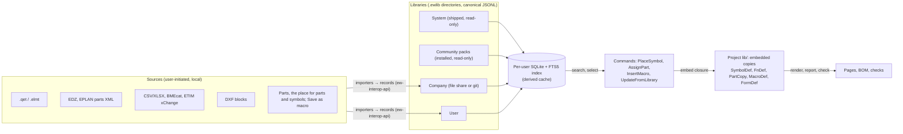

# Symbols, parts and macros: symbols, function definitions, parts and macros as data

A chapter of [Symbols, parts and macros](07-symbols-parts-macros.md), whose table says where each section lives.

---

## 1. Scope and position in the architecture

Master data is **reusable knowledge that a project embeds but does not own**. A symbol says how a function looks.
A FnDef says what it is. A part says what is bought. A macro is a reusable project fragment. A basic project
carries a company's conventions. All five follow one life cycle:

1. They are authored in a **library**.
2. A project uses an item by **embedding a copy** with `{library_id, item_id, version, sha256}` (ARCH §4.2, G2).
3. They change in a project only by a **previewed "update from library"** command (ARCH §5.4).

A project therefore opens, renders, checks and exports without any library installed (NFR-REL-11).



**Crates** (ARCH §3):
- `ew-schema` (permissive) defines every library record kind, so third parties can read libraries without GPL code
  ([vision](00-vision-and-scope.md) SC-11).
- `ew-format` (permissive) reads and writes library directories with the project writer.
- `ew-library` (GPL) owns the registry of installed libraries, the SQLite/FTS5 index, search and **closure
  resolution** (which items a `LibRef` pulls in). It depends only on `ew-schema` (ARCH §3) and is the only crate
  besides `ew-sqlview` that links rusqlite (NFR-MAINT-01).
- `ew-commands` holds `PlaceSymbol`, `AssignPart`, `InsertMacro` and `UpdateFromLibrary`. `ew-api` resolves the
  library items and passes their records **inside the command**, so a journal replay or a CI run reproduces the
  same transaction without the library installed. The update diff is the ordinary preview fork (ARCH §5.4).

**Out of scope here:**
- placing and wiring symbols on pages ([06](06-schematic-editor.md));
- frames and report forms, which are `FormDef` library items but are specified in
  [09](09-reports-forms-output.md);
- the importer internals ([14](14-interop.md));
- panel macros in 3D ([12](12-panel-layout.md)).

---

## 2. Concepts and data

### 2.1 Library levels and identity

| Level | Where | Writable by | Typical content |
|---|---|---|---|
| **System** | installation directory (NFR-PLAT-06) | nobody (FR-PRT-012) | starter symbols, FnDefs, starter catalogue, frames, manufacturer master, ETIM data pack |
| **Community pack** | user data directory, installed from a file or a git clone | nobody in EW; updated by reinstalling | `ew-iec60617`, `ew-iso1219`, manufacturer packs with explicit licences |
| **Company** | a directory on a file share or in a git repository | library maintainers (P6) | company parts, macros, basic project, symbol forks |
| **User** | OS data directory | the user | **My parts** (`user-parts`): the parts and symbols a person makes or keeps (§3.1); on-demand QET conversions |
| **Project** | `lib/` inside the project (ARCH §7.2) | only through commands | the embedded copies actually used |

**Identity:**
- Every library has a UUID (`library_id`).
- Every item has an `item_id` that stays the same across versions, a human key (`example.con-18-24`, `ew.iec.mcb-1pn`)
  and a semantic `version` (`MAJOR.MINOR.PATCH`). Authored items get UUIDv7; imported items get
  `v5(import namespace, source key)` (ADR-0004), so re-importing the same CSV or EDZ updates items in place. The
  version is stored once per document, never in `ItemMeta`: a library record carries it as its top-level `version`
  member after `id` (the item ID), an embedded copy in its copy metadata
  ([05](05-project-format-and-persistence.md) §13.2).
- **Identity is the pair `(library_id, item_id)`, never a name.** Two libraries may both contain a part called
  "CON-18-24" without either one shadowing the other.
- **Published versions are immutable.** `ew lib pack` refuses to publish different content under an existing
  version, so `(library_id, item_id, version)` determines the content.
- **Item status** (`ItemMeta.status`): `Draft | Released | Deprecated{successor: Option<LibRef>} | Withdrawn`.
  Selection dialogs hide deprecated and withdrawn items unless a filter shows them; a project copy of a deprecated
  item stays valid, and the library manager offers its successor through "update from library".

**Library items reference each other by `LibRef{library, item, version_req}`.** Examples: a symbol's FnDef, a
part's accessories, a macro's parts.

**Project records reference copies by copy ID.** Examples: `Representation.symbol`, `Function.def`,
`PartRef.copy`.

- **Copy ID** (ADR-0004 amendment 2; [05](05-project-format-and-persistence.md) §13.2):
  `copy_id = v5(NS_LIBCOPY, library_id ‖ item_id)`, one copy per item and project. "Update from library" rewrites
  that one `lib/` file and leaves every referencing record untouched, so diffs and merges stay small, and two
  branches that embed the same version write identical files.
- **Keeping two versions.** A cross-project paste of a different version ([06](06-schematic-editor.md) §3.6) asks:
  update the existing copy (a previewed update), adapt the pasted records to the existing copy, or keep both. Only
  "keep both" mints `v5(NS_LIBCOPY, library_id ‖ item_id ‖ version)` for the second copy; the library manager
  then lists both and offers to unify them.
- **Hash.** `sha256` is taken over the canonical compact JSON of the item's own fields, without `id`, `library` and
  the copy metadata (ARCH §7.3 writer rules; 05 §13.2, integrity rule EW-CORE-014), so the copy content equals the
  published library item.
- **Files.** Each copy is one pretty-printed file, `lib/<kind>/<copy_id>.json`: `$k`, `id` (the copy ID),
  `library_id`, `item_id`, `version`, `sha256`, then the item's fields (05 §3.4, example in §3.5). In Rust this is
  `LibCopy<T>{id, library_id, item_id, version, sha256, item: T}` (`id` is the copy ID, typed `Id<T>`) with `item`
  flattened on write.

The system tier holds two compiled-in
libraries: the starter (`ew-starter`: symbols, FnDefs, forms) and **`ew-starter-parts`**, the generic starter parts.
`ew-starter-parts` (`content/libraries/ew-starter-parts.ewlib`, version 0.1.0, CC0-1.0) holds the manufacturer
"Generic" and the generic parts, numbered `EW-GEN-<kind>-<n>`: the common kinds of a control cabinet (relays,
contactors, breakers, switches and lamps, a motor, a power supply, terminals, cables and plugs, PLC CPUs and cards),
of a pneumatic page (valves, valve terminals, cylinders, air preparation, tubes and fittings) and of a panel layout
(an enclosure, a rail, a duct). The test that writes the directory is the list; this paragraph names no part, so it
cannot fall behind. Each carries its template
functions on starter FnDefs, its CP pattern, contact data and the technical data the starter symbols print, and no
order or catalogue data; its description is in English and Dutch, as every starter symbol's name is but the junction dot's and bevel's (their seals belong to a derivation
profile), so a Dutch
project's lists and the symbol browser in Dutch read in Dutch; item IDs are `v5(library, "<kind>:<key>")`. The directory is written by a test
(`crates/ew-library/tests/starter_parts.rs`) with the library writer and compiled in, so every session holds it with
or without configured tiers; a directory library of the same ID replaces the compiled-in copy. The relay and the
contactor template their coil only and list their contacts as contact data.

### 2.2 Library directory and index

A library has the same on-disk form as a project. The same writer, manifest-last save, lock file and merge driver
apply (ADR-0010, ADR-0012):

```text
company-std.ewlib/                 # example name; content is UUID-named
  library.json                       # written LAST: id, name, version, default licence, format, min_reader,
                                     #   generation, depends [{library, version_req}], sha256 per file
  manufacturers.jsonl                # manufacturer master records
  fndefs/<xx>.jsonl                  # 256 shards by last id byte, as projects
  symbols/<xx>.jsonl  parts/<xx>.jsonl  macros/<xx>.jsonl  forms/<xx>.jsonl
  assets/<sha256>.svg|png            # previews, logos, part images whose licence allows storage
  REUSE.toml  LICENSES/              # per-path licences (NFR-LIC-01)
```

**The SQLite catalogue is a derived index.** `ew-library` builds one SQLite database with FTS5 per user. It lives
in the cache directory (NFR-PRIV-05) and covers all installed libraries. It is rebuilt incrementally when a
library's manifest generation changes, and from scratch when it is missing or corrupt.

- **Requirements met.** This is FR-PRT-012 (libraries at system, company and user level with full-text search
  through a derived index) and FR-PRT-028 (JSONL for version control), both at MVP.
- **Why not SQLite on the share.** A company library on an SMB share is never opened as a SQLite file. ADR-0010
  rejected SQLite on network shares for projects, for the same reason.
- **Read-only levels.** Writes to system and community levels are refused at the registry.
- **Hostile files.** Foreign catalogue databases are read-only imports, opened with `trusted_schema=OFF` and
  defensive mode (NFR-SEC-06).

ARCH §7.7 and the tier table of [05](05-project-format-and-persistence.md) §13.1 use the same form (Open
question 1).

`ew-library` opens the four tiers (system: the
compiled-in libraries of §2.1 and `content/libraries/*.ewlib`; community; company, from the settings' paths and a
repeatable `--company`; user). The `.ewlib` reader applies the project loader's limits and reads only the files `library.json` lists; a records
file of the directory that it does not list is a note of the library, which `ew lib list` prints. The writer writes the shards
first and `library.json` last; a library lock follows [05](05-project-format-and-persistence.md) §7.4: a live lock is
`Locked`, a stale one `Stale`, taken over only on explicit confirmation. The per-user SQLite FTS5 index lives in the
cache directory. A session opens the tiers at its first library use and falls back to the compiled-in libraries,
saying why, when they cannot be opened. `ew lib list|search|index --rebuild|create` drive it from the command line.

### 2.3 Symbols

A symbol is the library item kind `symbol`: the struct `SymbolDef` of `crates/ew-schema/src/library.rs`, with its
connection points (`SymbolCp`), text slots (`TextSlot`) and graphics (`Primitive`, each with its stroke and fill),
each member with what it holds; its stored form is the generated schema (`schemas/0.1/symbol.schema.json`). Its
`meta` holds the key (`ew.iec.mcb-1pn`), licence, sources and status of §2.1, and no version. Its `grid` is the
native connection grid (ADR-0027), or QET's 10 px for imports and the generated QET-grid edition of the starter set
(§3.2). Its `fndef` names exactly one FnDef (FR-SYM-005); its arrangements are named slot sets such as "full" or
"tag + rating" (FR-SYM-012); its `iec60617_ref` is an identifier of the form `S00nnn`, metadata only (FR-SYM-019). A
rectangle's `shadow` is the filled drop shadow of FR-SYM-003 (2.61 mm on the PART DATA boxes).

**Rules.**
- **Pens.** `Pen` is one of the house pens 0.13, 0.18, 0.26, 0.42, 0.52 and 1.30 mm, or an explicit `Nm` width.
  Dash patterns scale with pen width (FR-SYM-003), so the S51 linkage prints dash 1.04 / gap 0.52 mm at 0.26 mm. The patterns, as dash:gap ratios in units of the pen
  width, are `Dash42` 4:2, `Dot12` 1:2 and `DashDot` 4:2:1:2 (dash, gap, dot, gap), fixed by `ew-dl`. House pens
  default to butt caps and miter joins so dashes print at nominal length, and every writer sets the miter limit to 4.0
  explicitly because PDF defaults to 10 and SVG to 4. In the display list, `ew-dl`'s `Stroke` carries the stroke
  colour as a `brush` (default black); lowering resolves `ByLayer` to a concrete colour, so wire colours render
  (ADR-0015 amendment 4).
- **Pens on QET-grid pages**. The `@qet10` edition (§3.2 rule 2) expresses its pens
  in QET px rather than scaling the house pens: 0.26 mm becomes 1.0 px (264,583 nm), 0.13 mm 0.5 px and 0.52 mm
  2.0 px (and 0.18 mm 0.7 px, 0.42 mm 1.6 px, 1.30 mm 5.0 px), and wires and junction graphics
  on QET-grid pages use the 1.0 px pen. After the QET frame's page-to-sheet
  scale they print 0.261, 0.130 and 0.522 mm, the reference drawing's pens. Native-grid pages keep the
  house pens.
- **Orientation variants A–H are never stored.** They are derived from the source variant (§4.1, FR-SYM-004), with
  the letter mapping of [06](06-schematic-editor.md) §2.5. Only the contact-image and CP variants are stored as
  extra variants.
- **CP indices.** `SymbolCp.idx` is the symbol's own index. `fn_cp` points at the FnDef CP it draws. A symbol may
  draw a subset of the FnDef's CPs: a single-line MCB draws two of four.
- **Text slots** are typed. The kinds are:
  - Tag, FunctionText, TechData, Manufacturer, PartNumber, TypeDesignation;
  - CpDesignation(idx), Xref, PlcAddress, ProcessTag, UserProp(key), ContactImage;
  - OrderCode: the order code of the device's first assembly config (D-36).

  A slot prints only with `"visible": true`: `visible` is `false` when absent, and the canonical form leaves `false`
  out (`ew fmt` rewrites a written `"visible": false` to its absence).

  Text height comes from the project's text style bound to the slot kind (FR-SYM-013); a slot may name its own
  text style in the optional member `style`, which replaces that binding for the slot. A
  `style` that names no known text style falls back to the slot kind's style and is reported as a note naming the
  symbol, the slot and the name, never as an error: `style` is
  an optional identifier, absent by default, and `ew-scene` reports an unknown name as
  `PageFinding::UnknownSlotStyle`. The styles are `tag.main`,
  `data.small`, `cp.small` and the others of the built-in table, which removes D-29. A slot's `style` resolves
  ([ADR-0032](../adr/0032-per-project-text-styles.md)) against the project's effective table, so it may name a key the project's `text_styles` adds; the scene resolves keys through `ew_text::TextStyleTable::from_rows` over the rows its caller passes (the first row of a duplicated key wins).
- **Built-in symbols.** The interruption point `ew.gen.ip`, the black-box frame `ew.gen.blackbox` (its outline and
  CPs live in the representation's `box: BoxSpec`, [03](03-domain-model.md) §6, [06](06-schematic-editor.md) §2.7),
  the junction dot and bevel, and the derived linkage are system symbols with fixed keys. Importers and the engine
  rely on these keys.
- **Keys and item IDs of the starter library**. An item ID is v5(library, key), and a symbol
  and a FnDef must never share one, so FnDefs are keyed `ew.fn.<name>`: the interruption point is the symbol
  `ew.gen.ip` with the FnDef `ew.fn.ip`. Every starter item is version 0.1.0 with status `draft`. Importers
  reference a built-in FnDef by key with `version_req` `^0.1`: `ew-import-qet` has exactly one, `ew.fn.ip`
  ([14](14-interop.md) §4.3). The starter content and the importer use the `library_id`
  7202fd8b-1024-4bf1-9e99-670772eaa589, the system library's ID `ew_schema::starter::LIBRARY`.
- **Coverage of the pilot corpus** ([23](23-symbol-coverage-pilot-corpus.md)). Against the 81 QET element types that the
  pilot's three real projects use (2,170 placed elements), the 36-symbol starter set covers 37 types and 74 % of the uses,
  two more types (the nomenclature block and a mounting plate) are covered by report blocks and panel layout, 29 types
  (vendor PLC, valve-terminal and safety modules, plus 11 unproven elements) stay black boxes with the embedded QET
  graphics, and 13 types lack a symbol. One family dominates the gap: the female connector half (224 of 251 missing
  uses), followed by cable screen, temperature sensor, two-pole MCB, disconnectors, socket, RCD, power supply, emergency
  stop, electronic switch and level sensor. The note ranks the families, records the pilot's drawing style (wiring marks,
  terminal and interruption-point density, nomenclature blocks as bill of materials, slice-wise valve terminals,
  one-terminal-per-channel PLC modules) and proposes fifteen symbol tickets and nine importer mapping entries. It adds no
  requirement and changes no key. The seven types that a pilot project uses at least twice are to join the starter set
  (`ew.iec.plug-socket`, `ew.gen.screen`, `ew.iec.sensor-temp`, `ew.iec.mcb-2p`, `ew.iec.disconnector-1p`,
  `ew.iec.switch-disconnector-4p`, `ew.iec.socket`; of them `ew.iec.mcb-2p` has joined); the end-terminal and the other variants
  follow the same rule after inspection. A QET cross-section mark that disagrees with the derived wire property is
  reported as EW-IMP-123 with the mark's value ([14](14-interop.md) §4.12).

A text slot may carry `fallback: process_tag`: it prints the
function text and, when that is empty, the tracked target's process tag (doc 11 §3.3); `ew.iso.valve-5-2-sol-spring`
0.3.0 (both editions) sets it on its function-text slot. Pilot and drain lines are drawn with this section's `dashed`
pattern, `verified = false`.

`ew.iec.proximity-sensor-pnp` draws a three-wire PNP proximity sensor in IEC 60617 practice: a
box around a normally open contact worked by a proximity actuator (the rhombus, linked by the dashed line), its pins
the cores BN (L+, top), BK (the switched output, below the contact) and BU (M, beside it). Its FnDef
`ew.fn.proximity-sensor-pnp` (SensingPosition, contact kind NO) passes BN to BK when the contact closes; the starter
part EW-GEN-PRX-1 (24 V DC) is drawn on it.

### 2.4 Function definitions and connection-point designations

`FnDef` is defined in [03](03-domain-model.md) §7:
- `category` and `contact_kind`;
- `cps: Vec<CpDef{idx, designation, alias, discipline, potential_role, source_output, optional, level, side,
  clamp, port_role, physical}>`;
- `internal: Vec<{a, b, kind: Short | PassThrough{opens}}>`;
- `flags{switches_n_with_l, n_isolation}`;
- `valve_model`.

This document adds the library rules.

**The category drives three things:**
- the letter code through the identifier set (FR-NUM-004);
- part compatibility (§4.3);
- the quality profile (§3.4).

**Categories are data.** They form a native taxonomy with an optional ETIM class mapping, shipped in the system
FnDef library. A category key has the three levels category / group / definition that FR-SYM-005 requires, for
example `ProtectionOvercurrent / MCB / 1P+N` for -101F1 and F55. The identifier set and the part-compatibility
filter read the first two levels; EDZ `functiondefcategory/group/id` triples map onto these keys.

**Designation precedence.** The printed designation of an instantiated CP is resolved from the highest level that
sets it (lowest number wins):

| # | Source | Example |
|---|---|---|
| 1 | `Function.cp_overrides[idx].designation` (FR-DEV-008) | a re-labelled MICO output |
| 2 | Part CP pattern of the template function the device uses (FR-PRT-008) | 2904602: L, N, PE, +, +, −, − |
| 3 | `CpDef.designation` of the FnDef | MCB 1P+N: 1, 2, N, N |
| — | The symbol never designates; it only places `fn_cp` | — |

**Designation rules:**
- **Duplicates are legal.** Uniqueness lives in the internal index (REF-029, FR-DEV-006). The wire list prints the
  occurrence where it is ambiguous: `-102G1:+ #1`.
- **Aliases** print as "1 / L1" (FR-DEV-007).
- **Terminal CPs** carry level, side and clamp. PT 2.5-TWIN has level 1, clamp a on side 1 and clamps b and c on
  side 2 ([03](03-domain-model.md) §11).
- **Template-origin functions**. A function is template-origin when its device carries
  a part whose function template declares a function with the same FnDef (and role, if given). Its CP index space is
  then the part's CP pattern, not the FnDef's CPs: PT 2.5-TWIN gives a, b, c and the shaft, and the starter FnDef
  `ew.fn.terminal` with its two CPs applies only to a terminal without such a part
  ([08](08-connections-terminals-cables.md) §6.1). `function_cps` and the importers apply the rule now; a typed
  template marker on `Function`, tied to the `v5(device, template_index)` ID rule of ADR-0004 amendment 2, is a later
  format decision.
- **Contacts.** FnDefs default to IEC 60947-style function digits (13-14 NO, 21-22 NC, A1-A2 coil). A part's contact
  data (FR-PRT-009) overrides them and feeds contact images (FR-XRF-017).
- **Fluid ports** use the ISO 5599-3 port numbers 1/2/3/4/5/12/14/82/84 as designation and `port_role`
  (FR-FLU-001). ISO 5599-3 is withdrawn; [plc-bus-fluid](../research/plc-bus-fluid.md) cites ISO 11727 as the
  current source, edition unverified.
- **Non-physical CPs.** An internal CP (`physical = false`) is never drawn and never wired. The coil of a VMPA valve
  is the example: it is reached only through a channel binding.
- **Source outputs.** `CpDef.source_output` marks the output CPs of a source function: PSU + and −, a transformer
  secondary, a battery. Potential flow roots there, so -102G1:L is an ordinary member of L-1 and -101F1 stays its
  protective device ([08](08-connections-terminals-cables.md) §3.6). The starter library sets it on the PSU and
  transformer FnDefs.
- **Optional CPs.** `CpDef.optional` marks CPs that may stay free by design: the Out entry of a terminating bus
  connector, a parallel duplicate pin. The unconnected-CP rule EW-POT-009 skips them
  ([08](08-connections-terminals-cables.md) §8.2).

**Internal connectivity is the FnDef's job, not the symbol's.**
- A **feed-through terminal** declares `Short` between all CPs of a level.
- An **MCB pole, switch or contact** declares `PassThrough{opens: true}`. The thermostat FnDef declares 5–3 as an
  NC pass-through, so the nets on folio 101 split at T55 (FR-SYM-005), and its derived potential is "N, switched"
  (D-13, EW-POT-013).
- A **2-pole switch** that disconnects L and N sets `switches_n_with_l`.
- A **neutral isolating terminal** declares `PassThrough{opens: true}` and sets `n_isolation`, so EW-POT-013 reports
  it as info, not as an error ([08](08-connections-terminals-cables.md) §6.2, §8.2).
- A **load** (lamp, heater) declares nothing, so its two sides stay separate potentials.

### 2.5 Parts

**What a part is.** A part is the thing a person orders: a maker and a part number, and all the program knows of
it. What it is called; what it is on a schematic (the symbols it is drawn with, its pins, or its box with pins and
ports); what it is in the cabinet (its size, how it mounts, its front, its holes); what it is to a wire (its
clamps); what it is by its kind (a cabinet with its plate and doors, a terminal with levels, a cable with cores and
a diameter); what goes with it (what it comes with, the forms it is also sold in); and what its maker's sheet says
of it (technical data). Three words, and the window keeps to them:

- a **part** is what he orders;
- a **device** is one of them in this cabinet, with its tag;
- a **symbol** is how a part, or one piece of it, is drawn on a schematic page.

A device is of a part; the part says what the device is and has; a symbol draws it. The record's own words
(function template, function definition, contact data, part copy, fork, black box) are the model's and the file's,
and no surface a panel builder works on shows them: a part is **drawn as** pieces or as a box, each with **its
pins**, and it **lives** in My parts, in a library, or only in a project (§3.1).

**The record.** The library item `Part` is the full record, and a `PartCopy` ([03](03-domain-model.md) §7) is
`LibCopy<Part>`, the same record embedded in a project. Its members, each with what it holds, are the struct `Part`
of `crates/ew-schema/src/library.rs` and the sections of `part_sections.rs`; its stored form is the generated schema
(`schemas/0.1/part.schema.json`). What the code does not say: the part number is kept verbatim and search uses a
normalised form (§4.3); the description is a noun phrase, never ratings (FR-DEV-010); quantities in the order unit
are `Dec3` (FR-PRT-026); each section of `sections` is owned by its area (FR-PRT-010). The members stand in this
order, `meta, kind, manufacturer, part_number, type_designation, order_number, gtin, description, category,
tech_data, free_props, unit, cp_pattern, function_template, contacts, mech, sections, accessories, alternatives,
configured, variants, macros, box`, then `extra`, and the order is fixed: a copy's `sha256` is taken over the item's
compact JSON in member order, so a later re-ordering would re-hash every existing copy. A member that is added is
optional and absent by default, so a copy without it hashes as before.

**A part's data, by what it is.** The kind is what a person says first when he makes a part (§5.5), and it decides
which groups of data the part has. Nothing is asked of a part that its kind does not have.

| Group | Holds | The kinds that have it |
|---|---|---|
| Identity | maker, part number, type, order number, description in each language, kind, order unit | every part |
| On the schematic | what the part is drawn as: its pieces, each with its pins and its symbol, or its box with its pins | a device, a terminal, a pushbutton or lamp, a valve |
| In the cabinet | width, height, depth, how it mounts, the room kept free round it and in front of it, the rail line, the mass, the front (its shape or an outline) and its holes | every part that is mounted: a device, a terminal, an end bracket, an accessory |
| Connections | per pin: the kind of clamp, the cross-sections it takes, how many wires, whether a twin ferrule, where a wire reaches it | every part with pins |
| the kind's own | an enclosure's outer size, mounting plate, doors, edge margin and depth behind the door; a mounting plate's size; a rail's profile; a duct's outer and inner size; a cable's cores, outer diameter and the bus it is made for; a wire's cross-section, colour, class and outer diameter; a ferrule's range, sleeve, colour and stud; a marker's target, lines and characters; a gland's thread and clamping range; a valve's coil and ports; a tube's diameters, material and pressure; a PLC part's channels; a part's network ports | that kind |
| Technical data | the values the program computes with, by name, and any other value of the maker's sheet | every part |
| Goes with it | what it comes with, and the forms it is also sold in (below) | every part but a wire, a ferrule and a marker |
| About | where it came from, when it was last changed, its licence, where it is listed, and what is stored that the program does not ask for | every part |

**The fields of a part are declared once** (`ew_derive::part_fields`), and everything that shows, asks for, reads
or carries a part's datum is handed it from there. A field is a member of the record by its path
(`sections.ferrule.csa_min`, `cp_pattern[].clamp_type`, `tech_data.rated_current`) with:

- **its word**, one text key whichever surface shows it, and **its group** of the table above;
- **which parts have it**: by kind, by how the part mounts, by what it is drawn as;
- **how a person meets it**: a field typed or chosen, whose kind of value (a length, a cross-section, a count, a
  choice of words, a colour, a yes or no, a part) is the schema's; a column of a table over a list member; a member
  that one of the forms writes (the pieces, the terminal's grid of levels and clamps, the box, the cores, the
  network ports, the PLC channels, the holes, the maker by name); a value that is derived or brought by a file and
  only shown; or a member that is stored and not asked for, with the reason;
- **a limit** the schema's type does not say (a size is above zero);
- **its readers**: the features that read it, and for each what the feature does without it (it cannot use the
  part, it passes the part by, it takes a default, or it only prints the value) and the sentence that says so
  (§3.4).

The declaration hands out: the sheet of the place for parts (the fields a given part has, in order, each with its
reading and its check); what a part lacks (§3.4); the gate a feature asks before it uses a part; the columns of the
table import and export (§3.6); and the reference page of the guide that lists every field with its kinds and its
readers. No second list of a part's members, kinds or sections is kept anywhere.

**Nothing stored that cannot be entered, nothing entered that nothing reads.** Two tests hold it from the
structure. Every member of the part's schema, down to the members of its lists' items, has exactly one declared
field, and every declared field is a member: a member added to the record fails the build's tests until someone
says how a person meets it. And a field a person enters names at least one reader, while a member declared as
stored names none: so a datum is asked for from the day a feature reads it, and not before. A stored value that is
not asked for is kept, written back, and shown under About ▸ Also stored.

**Technical data** uses the one `TechValue{key, value}` encoding of [05](05-project-format-and-persistence.md) §3.2
on parts and devices alike. A key qualified by a classification scheme is spelled `"<scheme>:<id>"` inside `key`
(`etim:EF001234`; schemes `etim`, `eclass`, `iec_cdd`), and a plain key without a colon is a native or project
property. Booleans and enumeration values are `Ident` values.

*The values the program computes with are fields of their kind.* A person never has to know a key: the declaration
names each native key a feature reads, with its word, its unit and the parts that have it, and the sheet offers it
as a field under Technical data.

| Key | Word | Parts that have it | Read by |
|---|---|---|---|
| `rated_current` (A) | Rated current | a protective device, a switch, a contactor | the cross-section proposed for the wires a protective device protects, by the project's current table ([08](08-connections-terminals-cables.md) §4.2); the symbol's technical text |
| `characteristic` | Trip characteristic | a circuit breaker | the symbol's technical text, composed with the rated current ("C10") |
| `i_load` (A), `power` (W), `voltage` (V) | Load current, Power, Supply voltage | a device fed by a PLC supply | the load count of a supply ([10](10-plc-and-bus.md)) |
| `coil_voltage`, `rated_voltage`, `output_voltage`, `output_current`, `input_voltage`, `rated_power`, `channel_current`, `setpoint` | by their names | the kinds they belong to | the symbol's technical text |
| `colour` | Colour | a terminal, a lamp; a variant | the assembly list; a variant's own colour |

Any other value is a free row of a name and a value; it prints at the symbol like the others. A slot text follows
these rules: a device's own value wins over its variant's, which wins over its part's; a circuit breaker prints
characteristic and rated current composed; other values print as value and unit ("40 A", "15 °C"); several values
are joined with ", " in key order (`tech_data_text`, `main_part` and `manufacturer_name` of `ew-derive`). **What a
wire or a cable carries is the project's rule, not a part's datum:** the cross-section proposal reads the current
table of the project's size profile and names its basis; a part states no ampacity, because nothing would read it.
A cable part carries what the features read: its cores, each with its own cross-section, and its outer diameter.

**What a part is drawn as.** On a schematic a part is drawn as **pieces** or as **a box**.

- *Pieces.* A contactor is a coil and its contacts; a circuit breaker is its poles; a pushbutton is a contact. Each
  piece is one entry of `function_template` (a function definition and the pins of `cp_pattern` it takes) and, for
  a contact, one entry of `contacts`; the first piece is the main one, at which the device's tag stands. A person
  gives a piece as what it is, in his words, and its pins by name (§5.4); the program takes the starter's function
  definition for that kind of piece with that many pins, so that the standard's symbols draw it, and makes one of
  the person's own only where none fits. **A piece may name its symbol** (`TemplateFn.symbol`, an optional
  reference to a symbol): a device of the part is then drawn with that symbol where the page's grid has it or can
  take it by the picker's rule (§5.12), else, and when it names none, with a symbol of the piece's function as the
  browser offers them. So "this part draws like that" is said on the part, for the part; the embed closure of a
  part includes the symbols its pieces name.
- *A terminal* is drawn as a terminal with its levels: its pins carry `level`, `side` and `clamp`, one terminal
  function over them, each level passing through on its own ([08](08-connections-terminals-cables.md) §6).
- *A box.* **The device box.** A part whose main piece is a box is drawn as a rectangle with its pins on the
  edges. Its pins are its `cp_pattern`; `box` says where they stand: the box's size, and for each pin its edge and
  its distance along it. Placing the part draws that box with one click (`box.black`): the layout is read onto the
  page's connection grid in its order and on its sides, each distance (corner to pin, pin to pin, pin to corner)
  taken up to whole steps of that grid, so a box laid out on 4 mm comes out no tighter on a page of another grid and
  its pins stand on that page's grid points; every pin at least one step from the corners and from its neighbours,
  the box widened where the pins need it; a pin the layout does not list stands on the bottom edge after the
  others. A part without `box` is drawn by two clicks, the first half of its pins on top and the rest below. The
  placed box is the page's: its edges and pins are still dragged there (`box.reshape`), and a later change of the
  part's layout asks before it redraws, naming each box and why. A part with a PLC section or network ports takes
  its pins from its channels and ports: what is the pin's own on the box is its place, and its name, what it
  carries, its channel and its address are the channel's and the port's. **A network port's sockets stand on the
  same box:** a `box.pins[]` entry that names an `interface` (and its `port_label`, optional members) is socket `idx`
  of that interface (`P1` is 0; an interface without a socket count has the one socket 0), laid out by the same rule
  as a pin. A schematic page draws the box with its pins, a bus page with its sockets, on one outline
  ([10](10-plc-and-bus.md) §2.7). `box` is an optional member without cascade semantics (ADR-0011 amendment 6).

**Confidence and where a datum came from.** `ItemMeta.sources` lists where each section came from (a data sheet, a
parts file's hash, a table, typed by hand) and `ItemMeta.confidence` marks a section `verified`, `unverified` or
`test`: a clamp range copied from a data sheet is `unverified` until checked, and the generic starter parts' clamp
data, ferrule colours and widths are `test`. Findings computed from a non-verified section carry the marker "based
on non-verified part data", and the release report lists every such section in use (FR-PRT-031). Who may set
`verified` in a community pack is governed by [19](19-open-source-governance.md) §3.6.

**Makers** (FR-PRT-002) are records `{key (a short code), name, aliases, brands}`. Importers resolve a maker's
aliases to its record, and an unknown name makes a record in the library the import writes. A person types a
maker's name on a part's sheet, which offers the makers known. Projects embed the makers they use as copies under
`lib/manufacturers/` (kind `manufacturer`, [05](05-project-format-and-persistence.md) §2.2); a part references its
maker by `LibRef`.

**Specified and not typed:** a supply pin's load current in `cp_pattern`, `classification`, `model3d`, `cp3d`,
`commercial`, `logistics` and `docs` stay in `extra` until their work is built, and take their place in the member
order then.

Every new member is optional and default-omitted, every new enum keeps `Unknown(Value)` and every new object its own
`extra`. The members not built (above, and the thermal section) stay in `extra`, and take
their place in the member order when they are typed.
The `LibRef`s of these members name library items, not project records: the library resolves them. A copy that an
older build wrote, with such a member in `extra` (byte-wise member order), opens with the member typed, is reported
not canonical (info) and is rewritten in the member order above at the next save; its stored `sha256` is kept, so
EW-CORE-014 reports it where the canonical order differs, which is accepted within 0.1
([05](05-project-format-and-persistence.md) §10.3). The manufacturer is the kind `manufacturer`, `{meta, key, name:
MlText, aliases, brands}`, embedded under `lib/manufacturers/` by `library.embed` with the checks of the other kinds;
the slot texts take the manufacturer name from the embedded copy the `LibRef` resolves to, and fall back to the
`LibRef`'s `extra["key"]` only where the project holds no copy.
**The part bus section** `sections.bus` is typed
after `mounting_plate`: `{ports: [...], extra}`, each port written in the order `interface`, `port_label`, `bus`,
`role`, `termination`, then its `extra`; `interface`, `bus` and `role` are required and the enums keep `Unknown`. A
section `{"ports": []}` is written `{}`. A port also types its connector, rates, address range, IO-Link data and
signal map ([10](10-plc-and-bus.md) §2.6); the station address and the nets belong to the drawn port. An older
build's copy is rewritten canonically, and an older build reports EW-CORE-014 on a copy this build wrote.
EW-GEN-CPU-1 carries one port `DP`, `profibus_dp`, `master`.

The fluid section is typed whole ([11](11-fluid-power.md) §2.6); the k-th entry of `solenoids` is the part's k-th
template entry on a coil FnDef.

**Accessories: what a part brings with it** (FR-PRT-005, FR-REP-051). A part names what is mounted and ordered with
it: an end plate after the last terminal of a strip, the end brackets of a run of strips, the cover of a duct. Each
entry of `accessories` names the accessory part, how many (`qty`, in the accessory's order unit) and per what:

- `unit`: per piece of the part a device uses, or per metre of a part sold by the metre, so a duct's cover is as long
  as the duct;
- `strip`: once per terminal strip whose terminals use the part, standing after the last of those terminals; a
  strip whose terminals of two parts name the same accessory takes it once, after the last terminal that names it;
- `rail_group`: the end brackets of a run of strips on one rail: one before the run and one after each strip, so k
  abutting strips take k + 1 ([12](12-panel-layout.md) §3.4); a strip on no rail stands alone and takes two.

`kind` says what the accessory is to a strip, in the strip accessory's own words (End plate, End bracket, Partition
plate, Marker carrier, Cover): the assembly list prints it and the check finds the end plate by it. `optional` marks
an accessory a person may take that the part does not need; no list counts it until he takes it. A part of kind wire,
ferrule or marker is never an accessory: the consumables count it ([13](13-manufacturing-outputs.md) §3.6), and its
row under Goes with it refuses it in words. The accessory is a library reference, so embedding a part embeds its accessories
(its closure, §3.1). A declaration counts the project's own copy of the item it names where the project has corrected
that item (a fork, §3.1, whose `meta.source.fork_of` names that library and item; the first in copy ID order), else
the copy it names: the parts list, the assembly list, the checks and the strip on its rail (its length and its end
brackets' width) all count through that one resolver (`ew_derive::accessory_part`).

Two hands write it, the second above the first: the part (its sheet's Goes with it, §5.4); and, for one device,
that device's choice, `Device.accessory_choices: Vec<AccessoryChoice{of: Id<Part>, part?: PartRef}>` (a cable's gland is no accessory: it follows from the cable's diameter and the stock, and a cable's own choice of gland is `Device.gland`, [12](12-placement-pages.md) §3.9). A choice names the accessory
copy a declaration names (`of`), as the declaring part names it (`v5(NS_LIBCOPY, library ‖ item)` of its `LibRef`), and
a declaration and its choices are matched by that one key: `of` is a `LibRef` link, kept alive but never re-pointed,
so a part made from the accessory's part, a paste and an update leave the choice answering its declaration. Without `part` the device does not take it, with `part` it takes it as that part
(`of` itself takes an optional one, another part swaps it). A choice lives on the device the accessory is counted
for: a `unit` accessory on the device that uses the part, a `strip` and a `rail_group` accessory on the strip.
Replacing a part drops the choices of accessories the new parts do not name, whichever command replaced it
(`part.assign`, `fields.set` of `parts` from the Parts row or the strip editor's Part cell): the normaliser
`stale_choices` ([06](06-commands-connecting.md) §3.2 row 14a') holds the rule.

**One path.** `part_accessories(device)` of `ew-derive` gives every accessory of a device from its parts'
declarations and its choices: the accessory part, the quantity, the part it comes with and where it stands in a
strip. The parts list, the assembly list, a strip's length on its rail, the end brackets of the layout and the
checks read it and nothing else. Two other things name a part beside a device, each for a reason of its own:

- a strip's own accessories (`Strip.accessories`, the strip editor's Add accessory): an item the person puts at a
  place in one strip, a partition plate after terminal 4, an end plate where the terminal type changes, a bracket in
  the middle of a long strip; no part can name a place in one strip;
- a bridge's part (the `overrides.wire_part` of its group's carrier, [08](08-connections-terminals-cables.md) §2.3):
  a bridge is drawn where the circuit asks, over as many terminals as it asks, and its part is chosen for that bridge
  as a cable's is.

A strip that holds an end bracket as a part use of kind `end_bracket` (a project made before accessories) reads it
as that strip's choice of end bracket: the rails count it as before, and its terminals' declarations are not asked
for that strip. No command gives a strip such a part use: the part dialog of a strip offers no end bracket.

**Variants** (FR-PRT-003). A variant is the part as its maker also sells it, in another colour or rating, under its
own number: one record, the data shared, the numbers its own. It has a key (the `PartRef.variant` a part use
stores, `BU`), a name in the reader's language ("Blue") and what it changes: its part number, order number, type
designation, GTIN, description and technical values (the colour among them, the native key `colour`), each absent
where it is the part's. It changes nothing of the pins, the template, the size, the sections or the accessories, so
a device keeps its connection points when its variant changes. A variant gives at least one of its own part number,
order number or description, else the parts list could not tell it from the part, and its row refuses it in words.
Every list prints a variant's numbers and description where it gives them, else the part's, and its technical
values where the device has none of its own (a device's own value wins over its variant's, which wins over its
part's). One function hands out what a part use prints, `ew_derive::printed_part` (number, order number, type,
description and technical values, the variant's over the part's): the lists, the slot texts, the strip editor and the
SQL view read a part use through it, and a placement's row prints the variant its device names for the part use it
realises. A reader of a part copy itself (the libraries, the part dialog, an editable Parts row, a finding about a
copy) reads the copy. A part use naming a key its part does not hold prints the part and is reported (EW-CORE-085).

**The parts a wire consumes** (FR-PRT-035). The wire, the ferrule and the marker carry a section each, and every
member has a reader:

| Section | Member | Read by |
|---|---|---|
| `wire` | `csa` (mm²), `colour` | the stock match of a wire's part; EW-MFG-022 |
| | `class` (IEC 60228: 1, 2, 5, 6) | the treatment of the wire's ends ([13](13-manufacturing-outputs.md) §4) |
| `ferrule` | `csa_min`, `csa_max` | which ferrule an end takes ([13](13-manufacturing-outputs.md) §4.4) |
| | `twin` | two wires in one ferrule ([13](13-manufacturing-outputs.md) §4.3) |
| | `insulated` | the shop's choice of insulated ferrules |
| | `sleeve` | the strip length the wire list prints |
| | `colour` | the word the wire list and the consumables print for the ferrule the fitter takes |
| | `stud` | a ring lug for that stud (`M4`), worded Ring lug |
| `marker` | `marks` | the marker part of a label set |
| | `lines`, `chars` | whether a marker text fits (EW-MFG-004) |

A wire's size and colour come from the project's colour and size rules and the overrides
([08](08-connections-terminals-cables.md) §4), never from its part: the part is the stock it is cut from. A wire's
part is the one the chain names (on the wire, on its potential's definition, the project default), else the first
wire part of the workshop stock whose size and colour are the wire's, else none; a wire without a part is listed by
its size and colour. A wire part whose size or colour is not the wire's is reported (EW-MFG-022), and every list
prints the wire's colour, the one the drawing shows: a shop that cut by the part would cut the wrong one.

**The workshop stock.** `ProjectSettings.workshop: WorkshopSettings{stock: Vec<PartRef>, cut_increment?: Nm}`, a
typed member of the project's settings. `stock` holds the wire, ferrule, marker and gland parts the shop keeps, in its
order of preference: a wire takes the first stock wire part of its size and colour, an end the first stock ferrule
that fits it ([13](13-manufacturing-outputs.md) §4.4), a label set the first stock marker that marks it
([13](13-manufacturing-outputs.md) §5.3), a cable that leaves the cabinet the first stock gland that seals it
([12](12-placement-pages.md) §3.9). `cut_increment` is what the cut list rounds a piece up
to ([13](13-manufacturing-outputs.md) §9.3) and a computed wire length once (13 §3.3), 5 mm when absent. A new project starts with the starter's generic
ferrules, markers and glands as its stock (`file.new` embeds and names them in its one step, §9.2); a company's basic project
names its own; a project made before has none, and Project ▸ Add the generic stock (`workshop.add_generic`) adds the
starter's ferrules and markers the stock lacks after its own, in one step. The stock is seen and changed in the
place for parts (§5.10): the project's parts narrowed to its stock, in its order; a row moved, taken out or added is
one `workshop.stock`. Cut to is a row of Project properties ▸ Workshop. **Use this stock for new projects** keeps
the stock, in its order, as a setting of the window: a new project then starts with those parts as its stock, taken
from My parts, and with the starter's generic ones where the setting is empty.

### 2.6 Classification: ETIM bundled, ECLASS identifiers only

| Scheme | Shipped | Stored per part | Use |
|---|---|---|---|
| **ETIM** (English, `ODC-By-1.0`) | yes, as a versioned system data pack with attribution in About (FR-PRT-019) | class `EC…`, features `EF…` with values and units | categorising, faceted search, BMEcat/ETIM xChange import |
| **ECLASS** | **no** dictionary content (NFR-LIC-06) | class and property IRDIs as supplied by the user's files | ERP exchange, matching |
| **IEC CDD** | free attributes only | IRDIs | thermal and short-circuit properties |
| **Native** | yes | `ew:` keys (`ew:rated_current`, `ew:characteristic`, `ew:poles`, `ew:p_loss`) | everything checks and queries read |

**Checks and queries read only native keys.** A shipped mapping table translates ETIM features (and user-supplied
ECLASS mappings) into native keys at import time. A part that arrives with ETIM data therefore feeds the same
rules as one typed by hand ([standards](../research/standards.md) §10). ECLASS labels are shown only when the
imported file itself carried them.

### 2.7 Macros, variables, value sets and placeholders

A macro is the library item kind `macro`: the struct `MacroDef` of `crates/ew-schema/src/library.rs` with its
variants, variables, placeholder groups and value sets, each member with what it holds; its stored form is the
generated schema (`schemas/0.1/macro.schema.json`). A variant's key runs `A` to `P`: one variant at MVP, several per
representation type from 1.0 (FR-MAC-009); EPLAN's A–P range is unverified. A variable's 1.0 `formula` (a rhai
expression, FR-MAC-015) is specified; not built. A variant's fragment is the project fragment of ARCH §5.5 (the
struct `Fragment` of `crates/ew-commands/src/commands/paste.rs`): project-format records with IDs local to the
fragment, the library references of the closure its records name, and for a page macro its pages.

**Variable types:**
- `Text` (MlText), `Ident`, `Number` (Dec3 + unit), `Bool`;
- `State` (used, spare, reserved, not fitted), `Part` (a `LibRef`), `ProcessTag`;
- `ChannelBinding` (channel number in the module), `Address` (sets `AddrSpec::Manual`), `TagCounter`;
- `DeviceRef` (an existing device chosen at insertion, such as the assembly head a module is added to);
- `TextSlots`: a representation's text-slot
  overrides as a list, so a value set may move, turn, show or hide a symbol's texts; MC-4 keeps one `<group>_slots`
  variable per placeholder group.

A
`text_slots` value is typed and shown in words in the macro value table, in the window's language: "as the symbol"
for the empty list, else one clause per slot, "; " between clauses, each clause `slot <n>: at <x>; <y> mm, turned
<a>°, hidden` (or "shown") with every part optional and in any order, slots counted from 1. A number is written with
the project's decimal separator, and "; " separates the two coordinates in every language, so "at 10; -5,5 mm" and
"at 10; -5.5 mm" read the same, and the form written before ("at 10, -5.5") still reads back; a text that does not
read stays a text, which the command refuses in words.

A `FieldPath` is an `ew-schema` path such as `device.function_text`, `device.state`, `device.position`,
`device.parts[0].part` or `function.cp_overrides[3].designation`. Bindings are checked against the schema when the
macro is saved.

**A placed macro leaves a `MacroInstance`** `{macro: copy_id, variant, value_set, values, members: Vec<(local_id,
id)>}`. It is a record of [03](03-domain-model.md) §7, stored in the anchor page's file (kind `macro_instance`,
rank 46 of [05](05-project-format-and-persistence.md) §2.2), and gives the macro's provenance and "where used".
From 1.0 it is also the placeholder object that a different value set can be re-applied to (FR-MAC-008).

The kinds `macro` and `macro_instance` are
typed in `ew-schema` within format 0.1; `macros.save` writes a macro and `macro.insert` inserts one (§3.5).
- **`MacroDef`** is written in the member order of its struct: `meta, name, description, kind (window | symbol
  | page), variants, variables, groups, value_sets, thumbnail`, then `extra`. A variant is `{rep_type, key,
  fragment}`; the `fragment` is the `#ew-fragment v1` text format of ARCH §5.5, kept as JSON in the permissive schema
  crate and parsed by `ew-commands`, so `Fragment` is not a schema type. A variable is `{name, ty,
  bindings: Vec<{record (fragment-local ID), field}>, default?}` with `VarType` `text, ident, number, bool, state,
  part, process_tag, channel_binding, address, tag_counter, device_ref, text_slots` (`text_slots`, a representation's text slots as a list); the 1.0 `formula` stays in `extra`. A
  placeholder group is `{name, members (fragment-local IDs), include?}` and lives only inside the macro, so the
  project kind `placeholder_group` (rank 47) stays reserved. The copy lives under `lib/macros/` and
  `library.embed` embeds it with the checks of the other kinds.
- **`MacroInstance`** is `{id, $v?, macro, variant, value_set?, values, members, page}` in the anchor page's file.
  Its links are those of [03](03-domain-model.md) §7: the anchor page cascades, the macro copy is a forbid link (it
  cannot be removed while an instance names it), and each created member is a kind-erased unlink link, so deleting a
  member removes it from the list and the instance stays, also with an empty list.

**Addresses stay derived.** A value set normally sets the module position and the channel binding
("channel = 2*pos+1, module = {slot}", FR-MAC-015). Q0.1 then follows from `channel_addresses`; it is never typed
into the macro. Formula-computed `Address` variables exist for projects with manual addressing only (Open
question 8).

**Macro projects** (FR-MAC-013, Could, 1.0) are projects of kind `Macro` (FR-PRJ-026). A **macro box** is a page
item that names a macro key, kind, representation type, variant and target library and frames its content.
"Generate macros" saves every box as a macro version in one run (the acceptance: ten boxes, ten macros). Boxes
stay linked to the macros they generated, so a later run publishes new versions instead of duplicates; inserting
a macro never inserts its box.

### 2.8 Basic projects (company templates)

A basic project is an ordinary EW project with `Project.kind = Basic`. The `kind` field exists from MVP, because
FR-PRJ-009, FR-PRJ-010 and FR-MAC-011 need it; restricting commands by kind (FR-PRJ-026, for example "a basic
project cannot be released") is 1.0. It holds:
- the schemes and profiles of FR-PRJ-008: numbering (including per-class rules such as the pilot's strip rule
  `{letter}{page}{counter}`, which gives -X1031; the formatter adds the aspect sign), xref format, colour and size
  profile "DBU/WH 24 V", identifier set, check scheme and derivation profile;
- the grid for new pages: the native grid or the QET 10 px grid (ADR-0027 recommendation 4);
- frames and forms, text styles, sections with dividers, structure nodes;
- the revision format, languages, report blocks 903–911 and optional template pages;
- a **palette**: embedded copies pinned for use, such as favourite symbols, standard parts and macros.

It is produced by the company-standard wizard (FR-PRJ-010, FR-UI-030) or by "save as basic project", which can
leave out pages, devices or both (FR-MAC-011).

**Creating a project from a basic project** (FR-PRJ-009):
- copies every record, with new IDs `v5(new_project_id, source_id)` (instantiated records, ADR-0004), where
  `new_project_id` is the new project's UUIDv7;
- keeps library copies unchanged, because their IDs derive from library and item, not from the project;
- records `Project.basic_project = {id, version}` for later comparison.

The member is typed as
`Project.basic_project = {id, generation}`: the basic project's project ID and its manifest generation when it was
copied, because a basic project has no semantic version. A project made from a directory records it
(`Session::new_project`).

