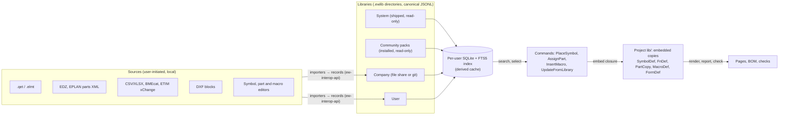
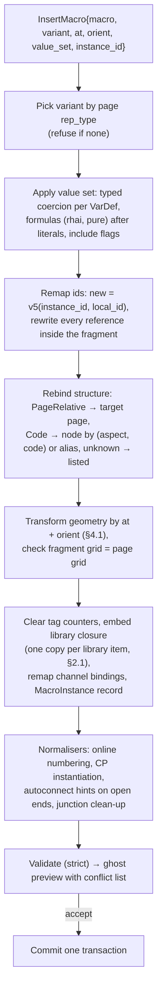

# Symbols, parts and macros

**Status:** Draft v0.1 · **Date:** 2026-10-18 · **Part of:** ElektraWatt design document set

**Purpose.** This document specifies ElektraWatt's (EW) master data: symbols and function definitions (FnDefs), the
parts database, macros with value sets, basic projects (company templates), and the libraries and governance that
hold them. It refines the [architecture](04-architecture.md) (§4.2 library copies, §5.5 macros, §7.7 catalogues)
and the [domain model](03-domain-model.md) (§6 `SymbolDef`, §7 `FnDef`, `PartCopy`, `MacroDef`), and elaborates the
SYM, PRT and MAC rows of [02a](02a-requirements-core.md). Every example comes from the reference project, the
cabinet J-E-2416, held as Golden A of the [golden project](20-golden-project.md).

**Contents**
1. [Scope and position in the architecture](#1-scope-and-position-in-the-architecture)
2. [Concepts and data](#2-concepts-and-data)
3. [Behaviour and rules](#3-behaviour-and-rules)
4. [Algorithms](#4-algorithms)
5. [UI and UX touchpoints](#5-ui-and-ux-touchpoints)
6. [Library governance and the community library](#6-library-governance-and-the-community-library)
7. [Outputs](#7-outputs)
8. [Edge cases and pitfalls](#8-edge-cases-and-pitfalls)
9. [The reference project](#9-the-reference-project)
10. [Scope by release](#10-scope-by-release)
11. [Dependencies](#11-dependencies)
12. [Requirements covered](#requirements-covered)
13. [Open questions](#open-questions)

---

## 1. Scope and position in the architecture

Master data is **reusable knowledge that a project embeds but does not own**. A symbol says how a function looks.
A FnDef says what it is. A part says what is bought. A macro is a reusable project fragment. A basic project
carries a company's conventions. All five follow one life cycle:

1. They are authored in a **library**.
2. A project uses an item by **embedding a copy** with `{library_id, item_id, version, sha256}` (ARCH §4.2, G2).
3. They change in a project only by a **previewed "update from library"** command (ARCH §5.4).

A project therefore opens, renders, checks and exports without any library installed (NFR-REL-11).



**Crates** (ARCH §3):
- `ew-schema` (permissive) defines every library record kind, so third parties can read libraries without GPL code
  ([vision](00-vision-and-scope.md) SC-11).
- `ew-format` (permissive) reads and writes library directories with the project writer.
- `ew-library` (GPL) owns the registry of installed libraries, the SQLite/FTS5 index, search and **closure
  resolution** (which items a `LibRef` pulls in). It depends only on `ew-schema` (ARCH §3) and is the only crate
  besides `ew-sqlview` that links rusqlite (NFR-MAINT-01).
- `ew-commands` holds `PlaceSymbol`, `AssignPart`, `InsertMacro` and `UpdateFromLibrary`. `ew-api` resolves the
  library items and passes their records **inside the command**, so a journal replay or a CI run reproduces the
  same transaction without the library installed. The update diff is the ordinary preview fork (ARCH §5.4).

**Out of scope here:**
- placing and wiring symbols on pages ([06](06-schematic-editor.md));
- frames and report forms, which are `FormDef` library items but are specified in
  [09](09-reports-forms-output.md);
- the importer internals ([14](14-interop.md));
- panel macros in 3D ([12](12-panel-layout.md)).

---

## 2. Concepts and data

### 2.1 Library levels and identity

| Level | Where | Writable by | Typical content |
|---|---|---|---|
| **System** | installation directory (NFR-PLAT-06) | nobody (FR-PRT-012) | starter symbols, FnDefs, starter catalogue, frames, manufacturer master, ETIM data pack |
| **Community pack** | user data directory, installed from a file or a git clone | nobody in EW; updated by reinstalling | `ew-iec60617`, `ew-iso1219`, manufacturer packs with explicit licences |
| **Company** | a directory on a file share or in a git repository | library maintainers (P6) | company parts, macros, basic project, symbol forks |
| **User** | OS data directory | the user | drafts, imports in progress, on-demand QET conversions |
| **Project** | `lib/` inside the project (ARCH §7.2) | only through commands | the embedded copies actually used |

**Identity:**
- Every library has a UUID (`library_id`).
- Every item has an `item_id` that stays the same across versions, a human key (`pxc.2904602`, `ew.iec.mcb-1pn`)
  and a semantic `version` (`MAJOR.MINOR.PATCH`). Authored items get UUIDv7; imported items get
  `v5(import namespace, source key)` (ADR-0004), so re-importing the same CSV or EDZ updates items in place. The
  version is stored once per document, never in `ItemMeta`: a library record carries it as its top-level `version`
  member after `id` (the item ID), an embedded copy in its copy metadata
  ([05](05-project-format-and-persistence.md) §13.2; decision log ID-14).
- **Identity is the pair `(library_id, item_id)`, never a name.** Two libraries may both contain a part called
  "2904602" without either one shadowing the other.
- **Published versions are immutable.** `ew lib pack` refuses to publish different content under an existing
  version, so `(library_id, item_id, version)` determines the content.
- **Item status** (`ItemMeta.status`): `Draft | Released | Deprecated{successor: Option<LibRef>} | Withdrawn`.
  Selection dialogs hide deprecated and withdrawn items unless a filter shows them; a project copy of a deprecated
  item stays valid, and the library manager offers its successor through "update from library".

**Library items reference each other by `LibRef{library, item, version_req}`.** Examples: a symbol's FnDef, a
part's accessories, a macro's parts.

**Project records reference copies by copy ID.** Examples: `Representation.symbol`, `Function.def`,
`PartRef.copy`.

- **Copy ID** (ADR-0004 amendment 2; [05](05-project-format-and-persistence.md) §13.2):
  `copy_id = v5(NS_LIBCOPY, library_id ‖ item_id)`, one copy per item and project. "Update from library" rewrites
  that one `lib/` file and leaves every referencing record untouched, so diffs and merges stay small, and two
  branches that embed the same version write identical files.
- **Keeping two versions.** A cross-project paste of a different version ([06](06-schematic-editor.md) §3.6) asks:
  update the existing copy (a previewed update), adapt the pasted records to the existing copy, or keep both. Only
  "keep both" mints `v5(NS_LIBCOPY, library_id ‖ item_id ‖ version)` for the second copy; the library manager
  then lists both and offers to unify them.
- **Hash.** `sha256` is taken over the canonical compact JSON of the item's own fields, without `id`, `library` and
  the copy metadata (ARCH §7.3 writer rules; 05 §13.2, integrity rule EW-CORE-014), so the copy content equals the
  published library item.
- **Files.** Each copy is one pretty-printed file, `lib/<kind>/<copy_id>.json`: `$k`, `id` (the copy ID),
  `library_id`, `item_id`, `version`, `sha256`, then the item's fields (05 §3.4, example in §3.5). In Rust this is
  `LibCopy<T>{id, library_id, item_id, version, sha256, item: T}` (`id` is the copy ID, typed `Id<T>`) with `item`
  flattened on write.

### 2.2 Library directory and index

A library has the same on-disk form as a project. The same writer, manifest-last save, lock file and merge driver
apply (ADR-0010, ADR-0012):

```text
company-std.ewlib/                 # example name; content is UUID-named
  library.json                       # written LAST: id, name, version, default licence, format, min_reader,
                                     #   generation, depends [{library, version_req}], sha256 per file
  manufacturers.jsonl                # manufacturer master records
  fndefs/<xx>.jsonl                  # 256 shards by last id byte, as projects
  symbols/<xx>.jsonl  parts/<xx>.jsonl  macros/<xx>.jsonl  forms/<xx>.jsonl
  assets/<sha256>.svg|png            # previews, logos, part images whose licence allows storage
  REUSE.toml  LICENSES/              # per-path licences (NFR-LIC-01)
```

**The SQLite catalogue is a derived index.** `ew-library` builds one SQLite database with FTS5 per user. It lives
in the cache directory (NFR-PRIV-05) and covers all installed libraries. It is rebuilt incrementally when a
library's manifest generation changes, and from scratch when it is missing or corrupt.

- **Requirements met.** This is FR-PRT-012 (libraries at system, company and user level with full-text search
  through a derived index) and FR-PRT-028 (JSONL for version control), both at MVP.
- **Why not SQLite on the share.** A company library on an SMB share is never opened as a SQLite file. ADR-0010
  rejected SQLite on network shares for projects, for the same reason.
- **Read-only levels.** Writes to system and community levels are refused at the registry.
- **Hostile files.** Foreign catalogue databases are read-only imports, opened with `trusted_schema=OFF` and
  defensive mode (NFR-SEC-06).

ARCH §7.7 and the tier table of [05](05-project-format-and-persistence.md) §13.1 use the same form (Open
question 1).

### 2.3 Symbols

```rust
pub struct SymbolDef {                       // library item kind "symbol"
    pub meta: ItemMeta,                      // key "ew.iec.mcb-1pn", licence, sources, status (§2.1); no version (§2.1)
    pub name: MlText, pub keywords: Vec<Ident>,
    pub rep_type: RepType,                   // MultiLine | SingleLine | Overview | Fluid | Topology
                                             //   | ContactImage | PanelFront | StripSegment | Graphic
    pub fndef: LibRef,                       // exactly one FnDef (FR-SYM-005)
    pub grid: Grid,                          // native connection grid (ADR-0027), or QET 10 px for imports and
                                             //   the generated QET-grid edition of the starter set (§3.2)
    pub graphics: Vec<Primitive>,            // nm, relative to the origin
    pub cps: Vec<SymbolCp>,                  // {idx, fn_cp: u16, pos: Pt2, dir: Dir4, discipline}
    pub text_slots: Vec<TextSlot>,           // {kind, pos, rot, align, visible, max_width?, style?}
    pub arrangements: Vec<Arrangement>,      // named slot sets: "full", "tag + rating" (FR-SYM-012)
    pub anchor: AnchorPolicy,                // Origin | Slot(kind) | GraphicCentre | Named(Pt2) (FR-SYM-010)
    pub link_points: Vec<NamedPoint>,        // ends of derived mechanical linkages (FR-SYM-014)
    pub extra_variants: Vec<ExtraVariant>,   // ContactImage | CpVariant, each with own graphics and cps
    pub iec60617_ref: Option<Ident>,         // IEC 60617 identifier of the form "S00nnn", metadata only (FR-SYM-019)
    pub iso1219_ref: Option<Ident>,
}
pub enum Primitive { Line, Polyline, Rect{rx, ry, shadow: Option<Nm>}, Circle, Ellipse, Arc, Polygon{closed},
                     Text(MlText), Image(Sha256) }
// each primitive carries Stroke{width: Pen, dash: Solid|Dash42|Dot12|DashDot, colour: ByLayer|Rgb} and Fill;
// Rect.shadow is the filled drop shadow of FR-SYM-003 (2.61 mm on the golden PART DATA boxes)
```

**Rules.**
- **Pens.** `Pen` is one of the house pens 0.13, 0.18, 0.26, 0.42, 0.52 and 1.30 mm, or an explicit `Nm` width.
  Dash patterns scale with pen width (FR-SYM-003), so the S51 linkage prints dash 1.04 / gap 0.52 mm at 0.26 mm. The patterns, as dash:gap ratios in units of the pen
  width, are `Dash42` 4:2, `Dot12` 1:2 and `DashDot` 4:2:1:2 (dash, gap, dot, gap), fixed by `ew-dl`. House pens
  default to butt caps and miter joins so dashes print at nominal length, and every writer sets the miter limit to 4.0
  explicitly because PDF defaults to 10 and SVG to 4. In the display list, `ew-dl`'s `Stroke` carries the stroke
  colour as a `brush` (default black); lowering resolves `ByLayer` to a concrete colour, so wire colours render
  (ADR-0015 amendment 4).
- **Pens on QET-grid pages** (2026-10-19, decision log ID-165). The `@qet10` edition (§3.2 rule 2) expresses its pens
  in QET px rather than scaling the house pens: 0.26 mm becomes 1.0 px (264,583 nm), 0.13 mm 0.5 px and 0.52 mm
  2.0 px (and 0.18 mm 0.7 px, 0.42 mm 1.6 px, 1.30 mm 5.0 px; decision log ID-183), and wires and junction graphics
  on QET-grid pages use the 1.0 px pen. After the QET frame's page-to-sheet
  scale they print 0.261, 0.130 and 0.522 mm, as [20](20-golden-project.md) §17.4 requires. Native-grid pages keep the
  house pens.
- **Orientation variants A–H are never stored.** They are derived from the source variant (§4.1, FR-SYM-004), with
  the letter mapping of [06](06-schematic-editor.md) §2.5. Only the contact-image and CP variants are stored as
  extra variants.
- **CP indices.** `SymbolCp.idx` is the symbol's own index. `fn_cp` points at the FnDef CP it draws. A symbol may
  draw a subset of the FnDef's CPs: a single-line MCB draws two of four.
- **Text slots** are typed. The kinds are:
  - Tag, FunctionText, TechData, Manufacturer, PartNumber, TypeDesignation;
  - CpDesignation(idx), Xref, PlcAddress, ProcessTag, UserProp(key), ContactImage.

  Text height comes from the project's text style bound to the slot kind (FR-SYM-013); a slot may name its own
  text style in the optional member `style`, which replaces that binding for the slot (decision log ID-197). The
  styles of the golden
  project are `tag.main`, `data.small`, `cp.small` and the others listed in [20](20-golden-project.md) §17.5, which
  removes D-29.
- **Built-in symbols.** The interruption point `ew.gen.ip`, the black-box frame `ew.gen.blackbox` (its outline and
  CPs live in the representation's `box: BoxSpec`, [03](03-domain-model.md) §6, [06](06-schematic-editor.md) §2.7),
  the junction dot and bevel, and the derived linkage are system symbols with fixed keys. Importers and the engine
  rely on these keys.
- **Keys and item IDs of the starter library** (decision log ID-33). An item ID is v5(library, key), and a symbol
  and a FnDef must never share one, so FnDefs are keyed `ew.fn.<name>`: the interruption point is the symbol
  `ew.gen.ip` with the FnDef `ew.fn.ip`. Every starter item is version 0.1.0 with status `draft`. Importers
  reference a built-in FnDef by key with `version_req` `^0.1`: `ew-import-qet` has exactly one, `ew.fn.ip`
  ([14](14-interop.md) §4.3). Until WP-S1.19a names the system library, the starter content and the importer use
  the provisional `library_id` 7202fd8b-1024-4bf1-9e99-670772eaa589 (open question 17).

### 2.4 Function definitions and connection-point designations

`FnDef` is defined in [03](03-domain-model.md) §7:
- `category` and `contact_kind`;
- `cps: Vec<CpDef{idx, designation, alias, discipline, potential_role, source_output, optional, level, side,
  clamp, port_role, physical}>`;
- `internal: Vec<{a, b, kind: Short | PassThrough{opens}}>`;
- `flags{switches_n_with_l, n_isolation}`;
- `valve_model`.

This document adds the library rules.

**The category drives three things:**
- the letter code through the identifier set (FR-NUM-004);
- part compatibility (§4.3);
- the quality profile (§3.4).

**Categories are data.** They form a native taxonomy with an optional ETIM class mapping, shipped in the system
FnDef library. A category key has the three levels category / group / definition that FR-SYM-005 requires, for
example `ProtectionOvercurrent / MCB / 1P+N` for -101F1 and F55. The identifier set and the part-compatibility
filter read the first two levels; EDZ `functiondefcategory/group/id` triples map onto these keys (Open question 12).

**Designation precedence.** The printed designation of an instantiated CP is resolved from the highest level that
sets it (lowest number wins):

| # | Source | Example |
|---|---|---|
| 1 | `Function.cp_overrides[idx].designation` (FR-DEV-008) | a re-labelled MICO output |
| 2 | Part CP pattern of the template function the device uses (FR-PRT-008) | 2904602: L, N, PE, +, +, −, − |
| 3 | `CpDef.designation` of the FnDef | MCB 1P+N: 1, 2, N, N |
| — | The symbol never designates; it only places `fn_cp` | — |

**Designation rules:**
- **Duplicates are legal.** Uniqueness lives in the internal index (REF-029, FR-DEV-006). The wire list prints the
  occurrence where it is ambiguous: `-102G1:+ #1`.
- **Aliases** print as "1 / L1" (FR-DEV-007).
- **Terminal CPs** carry level, side and clamp. PT 2.5-TWIN has level 1, clamp a on side 1 and clamps b and c on
  side 2 ([03](03-domain-model.md) §11).
- **Template-origin functions** (decision log ID-67, ID-108). A function is template-origin when its device carries
  a part whose function template declares a function with the same FnDef (and role, if given). Its CP index space is
  then the part's CP pattern, not the FnDef's CPs: PT 2.5-TWIN gives a, b, c and the shaft, and the starter FnDef
  `ew.fn.terminal` with its two CPs applies only to a terminal without such a part
  ([08](08-connections-terminals-cables.md) §6.1). `function_cps` and the importers apply the rule now; a typed
  template marker on `Function`, tied to the `v5(device, template_index)` ID rule of ADR-0004 amendment 2, is a later
  format decision (WP-S1.11).
- **Contacts.** FnDefs default to IEC 60947-style function digits (13-14 NO, 21-22 NC, A1-A2 coil). A part's contact
  data (FR-PRT-009) overrides them and feeds contact images (FR-XRF-017).
- **Fluid ports** use the ISO 5599-3 port numbers 1/2/3/4/5/12/14/82/84 as designation and `port_role`
  (FR-FLU-001). ISO 5599-3 is withdrawn; [plc-bus-fluid](../research/plc-bus-fluid.md) cites ISO 11727 as the
  current source, edition unverified.
- **Non-physical CPs.** An internal CP (`physical = false`) is never drawn and never wired. The coil of a VMPA valve
  is the example: it is reached only through a channel binding.
- **Source outputs.** `CpDef.source_output` marks the output CPs of a source function: PSU + and −, a transformer
  secondary, a battery. Potential flow roots there, so -102G1:L is an ordinary member of L-1 and -101F1 stays its
  protective device ([08](08-connections-terminals-cables.md) §3.6). The starter library sets it on the PSU and
  transformer FnDefs.
- **Optional CPs.** `CpDef.optional` marks CPs that may stay free by design: the Out entry of a terminating bus
  connector, a parallel duplicate pin. The unconnected-CP rule EW-POT-009 skips them
  ([08](08-connections-terminals-cables.md) §8.2).

**Internal connectivity is the FnDef's job, not the symbol's.**
- A **feed-through terminal** declares `Short` between all CPs of a level.
- An **MCB pole, switch or contact** declares `PassThrough{opens: true}`. The thermostat FnDef declares 5–3 as an
  NC pass-through, so the nets on folio 101 split at T55 (FR-SYM-005), and its derived potential is "N, switched"
  (D-13, EW-POT-013).
- A **2-pole switch** that disconnects L and N sets `switches_n_with_l` (02a Open question 9).
- A **neutral isolating terminal** declares `PassThrough{opens: true}` and sets `n_isolation`, so EW-POT-013 reports
  it as info, not as an error ([08](08-connections-terminals-cables.md) §6.2, §8.2).
- A **load** (lamp, heater) declares nothing, so its two sides stay separate potentials.

### 2.5 Parts and their data levels

The library item `Part` is the full record. A `PartCopy` (03 §7) is `LibCopy<Part>`, the same record embedded.

```rust
pub struct Part {
    pub meta: ItemMeta,                    // key, licence, sources, as_of, confidence per section, status
    pub kind: PartKind,                    // Device | Terminal | Cable | Wire | Ferrule | Marker | Duct | Rail
                                           //   | Busbar | EndBracket | Enclosure | MountingPlate | Tube
                                           //   | Accessory | Configured
    pub manufacturer: LibRef,              // manufacturer master record (FR-PRT-002)
    pub part_number: Ident,                // verbatim, e.g. "SK 3110.000"; search uses a normalised form (§4.3)
    pub type_designation: Option<Ident>,   // "PT 2.5-TWIN"
    pub order_number: Option<Ident>, pub gtin: Option<Ident>,
    pub description: MlText,               // a noun phrase, never ratings (D-35, FR-DEV-010)
    pub category: CategoryKey, pub classification: Vec<ClassRef>,   // {scheme: Etim|Eclass|IecCdd|Native, id, version}
    pub tech_data: Vec<TechValue>,         // {key: Ident, value: Quantity | Ident}: key "<scheme>:<id>" or native (below)
    pub free_props: Vec<FreeProp>,         // {key: Ident, value: MlText}: EPLAN <freeproperty>, user fields
    pub unit: OrderUnit,                   // Piece | Metre | Set; quantities are Dec3 (FR-PRT-026)
    pub cp_pattern: Vec<CpData>,           // {idx, designation, potential_role, level, side, clamp, csa ranges,
                                           //   max_conductors, twin_ferrule, i_load?} (FR-PRT-008; 03 §7, 05 §3.5);
                                           //   i_load: optional load current of a supply CP, Dec3 in A
    pub function_template: Vec<TemplateFn>,// {fndef: LibRef, main: bool, cps: Vec<u16> into cp_pattern} (FR-PRT-007)
    pub contacts: Vec<ContactData>,        // FR-PRT-009
    pub mech: Option<MechData>,            // W×H×D, mass, mount kind, rail offset, clearance, 2D front outline
    pub model3d: Option<Model3dRef>,       // STEP sha256, source, embeddable flag (FR-LAY-022)
    pub cp3d: Vec<Cp3d>,                   // 3D connection points (FR-LAY-026)
    pub drilling: Option<FeaturePattern>,
    pub sections: PartSections,            // plc address map, thermal, cable cores, wire, ferrule, duct, rail,
                                           //   enclosure, tube; each owned by its area (FR-PRT-010)
    pub accessories: Vec<AccessoryRef>,    // {part, qty, required, per: Part | StripEnd | Strip | Group}
    pub alternatives: Vec<AlternativeRef>, // {part, kind: Equivalent | Successor | Approved} (FR-PRT-004)
    pub configured: Option<Configured>,    // {order_code, components: Vec<(LibRef, Dec3)>} (FR-PRT-006)
    pub variants: Vec<PartVariant>,        // {key, overrides of sections and macros} (FR-PRT-003)
    pub macros: Vec<MacroLink>,            // {rep_type, macro} (FR-PRT-027)
    pub commercial: Option<Commercial>,    // suppliers, supplier numbers, prices {Dec3, currency, as_of}
    pub logistics: Option<Logistics>,      // pack quantity, minimum order, customs code, origin, lifecycle
    pub docs: Vec<DocRef>,                 // datasheet references as text; images only as asset hashes
}
```

**Technical-data keys** (decided 2026-10-18, decision log ID-15). `tech_data` uses the one `TechValue{key, value}`
encoding of [05](05-project-format-and-persistence.md) §3.2 on parts and devices alike. A key qualified by a
classification scheme is spelled `"<scheme>:<id>"` inside `key` (`etim:EF001234`; schemes `etim`, `eclass`,
`iec_cdd`), and a plain key without a colon is a native or project property (`i_out`, `curve`). Booleans and
enumeration values are `Ident` values (`"true"`, `"false"`, the enumeration member) until a typed form is needed. One
encoding for every property keeps the v0 schema small; ETIM features arrive only with WP-S1.28 (FR-PRT-018), which
may append a typed value variant without changing stored keys.

Part data is organised in **data levels**. Each level lists its consumers and the release that first needs it:

| Level | Fields | Consumers | Needed from |
|---|---|---|---|
| L0 identity | manufacturer, part number, type, order number, GTIN, description, kind, unit | BOM (FR-REP-004), search | MVP |
| L1 technical | `tech_data` (native keys), contact data, CP pattern (designation, potential role, level, side, clamp, cross-section range, max conductors, twin ferrule, optional load current per supply CP), function template; ETIM/ECLASS classification | symbol texts, CP instantiation, contact images, potential types, FR-CHK-021; load currents: the load summary and `api_v1_cp.i_load` (ADR-0017 amendment 3) | MVP (classification FR-PRT-018, clamp checks FR-CHK-021 and load currents: 1.0) |
| L2 domain sections | PLC address map and solenoid map (FR-PLC-011), cable cores (FR-CBL-004), thermal P_n/I_n (FR-THM-001), tube data | `channel_addresses`, cable conductors, thermal | MVP (PLC, cores); 1.0 (thermal, tubes) |
| L3 mechanical | W×H×D, mass, mount kind, rail offset, clearance, 2D front outline | folio 902 placements (FR-LAY-007, FR-PRT-011) | MVP |
| L4 commercial and logistics | suppliers, prices, order unit, packaging, customs code, lifecycle, successor | order lists, ERP export (FR-EXP-005) | 1.0 (FR-PRT-025) |
| L5 3D | STEP reference by hash, mounting frames, drilling and cut-out patterns, keep-outs | 3D, collision, NC data | 1.0 |
| L6 3D connection points | per CP: position, insertion direction, clamp type, cross-section ranges, strip length, insertion depth, torque, test access | routing, wire lengths, ferrules, wiring viewer | 1.0 |

**Provenance and confidence.**
- `ItemMeta.sources` lists where each section came from: a datasheet reference, an EDZ file hash, a BMEcat file, a
  CSV import, or manual entry.
- `ItemMeta.confidence` marks each section `verified`, `unverified` or `test`. The golden 533361 solenoid map H1 is
  `test`. The vendor's clamp range of PT 2.5-TWIN is `unverified` until checked. The golden test parts
  `TEST-DOORSW-1` and `TEST-LAMP-1` are `test` ([20](20-golden-project.md) §2.4).
- Findings computed from non-verified sections carry a "based on non-verified part data" marker. The release
  report lists every non-verified section in use (FR-PRT-031). Who may set `verified` in
  a community pack is governed by [19](19-open-source-governance.md) §3.6.

**Manufacturer master** (FR-PRT-002) records are `{key (short code, e.g. "PXC"), name, aliases, brands}`:
- `Murrelektronik` has the alias "Murr Elektronik";
- `Schneider Electric` has the alias "Schneider";
- `Eaton` has the alias "Eaton / Holec" and the brand Holec.

Importers resolve aliases. An unknown manufacturer creates a draft record for the maintainer to merge (D-18).
Projects embed the manufacturers they use as copies under `lib/manufacturers/` (kind `manufacturer`,
[05](05-project-format-and-persistence.md) §2.2); a part references its manufacturer by `LibRef`, as in the part
copy example of 05 §3.5.

### 2.6 Classification: ETIM bundled, ECLASS identifiers only

| Scheme | Shipped | Stored per part | Use |
|---|---|---|---|
| **ETIM** (English, `ODC-By-1.0`) | yes, as a versioned system data pack with attribution in About (FR-PRT-019) | class `EC…`, features `EF…` with values and units | categorising, faceted search, BMEcat/ETIM xChange import |
| **ECLASS** | **no** dictionary content (NFR-LIC-06) | class and property IRDIs as supplied by the user's files | ERP exchange, matching |
| **IEC CDD** | free attributes only | IRDIs | thermal and short-circuit properties |
| **Native** | yes | `ew:` keys (`ew:rated_current`, `ew:characteristic`, `ew:poles`, `ew:p_loss`) | everything checks and queries read |

**Checks and queries read only native keys.** A shipped mapping table translates ETIM features (and user-supplied
ECLASS mappings) into native keys at import time. A part that arrives with ETIM data therefore feeds the same
rules as one typed by hand ([standards](../research/standards.md) §10). ECLASS labels are shown only when the
imported file itself carried them.

### 2.7 Macros, variables, value sets and placeholders

```rust
pub struct MacroDef {
    pub meta: ItemMeta, pub name: MlText, pub description: MlText,
    pub kind: MacroKind,                     // Window | Symbol | Page (FR-MAC-001/002/012)
    pub variants: Vec<MacroVariant>,         // {rep_type, key: 'A'..'P', fragment}; one variant at MVP, several
                                             //   per rep_type from 1.0 (FR-MAC-009); EPLAN's A–P range is unverified
    pub variables: Vec<VarDef>,              // {name, ty, bindings: Vec<Binding{record, field: FieldPath}>,
                                             //   default, formula: Option<RhaiExpr>} (FR-MAC-004, FR-MAC-015)
    pub groups: Vec<PlaceholderGroup>,       // {name, members, include: Option<VarName>} (FR-MAC-018)
    pub value_sets: Vec<ValueSet>,           // {name, values: BTreeMap<VarName, Value>}
    pub thumbnail: Option<Sha256>,
}
pub struct Fragment {                        // project-format records, ids local to the fragment
    pub records: Vec<AnyRecord>,             // devices, functions, reps, connections, junctions, page items,
                                             //   part uses, channels and bindings, IP functions, DeviceLinks
    pub lib: Vec<LibRef>,                    // closure of symbols, FnDefs, parts it uses
    pub structure: Vec<StructRef>,           // PageRelative | Code{aspect, code}
    pub origin: Pt2, pub grid: Grid, pub pages: Vec<PageSpec>,   // pages only for page macros
}
```

**Variable types:**
- `Text` (MlText), `Ident`, `Number` (Dec3 + unit), `Bool`;
- `State` (used, spare, reserved, not fitted), `Part` (a `LibRef`), `ProcessTag`;
- `ChannelBinding` (channel number in the module), `Address` (sets `AddrSpec::Manual`), `TagCounter`;
- `DeviceRef` (an existing device chosen at insertion, such as the assembly head a module is added to).

A `FieldPath` is an `ew-schema` path such as `device.function_text`, `device.state`, `device.position`,
`device.parts[0].part` or `function.cp_overrides[3].designation`. Bindings are checked against the schema when the
macro is saved.

**A placed macro leaves a `MacroInstance`** `{macro: copy_id, variant, value_set, values, members: Vec<(local_id,
id)>}`. It is a record of [03](03-domain-model.md) §7, stored in the anchor page's file (kind `macro_instance`,
rank 46 of [05](05-project-format-and-persistence.md) §2.2), and gives the macro's provenance and "where used".
From 1.0 it is also the placeholder object that a different value set can be re-applied to (FR-MAC-008).

**Addresses stay derived.** A value set normally sets the module position and the channel binding
("channel = 2*pos+1, module = {slot}", FR-MAC-015). Q0.1 then follows from `channel_addresses`; it is never typed
into the macro. Formula-computed `Address` variables exist for projects with manual addressing only (Open
question 8).

**Macro projects** (FR-MAC-013, Could, 1.0) are projects of kind `Macro` (FR-PRJ-026). A **macro box** is a page
item that names a macro key, kind, representation type, variant and target library and frames its content.
"Generate macros" saves every box as a macro version in one run (the acceptance: ten boxes, ten macros). Boxes
stay linked to the macros they generated, so a later run publishes new versions instead of duplicates; inserting
a macro never inserts its box.

### 2.8 Basic projects (company templates)

A basic project is an ordinary EW project with `Project.kind = Basic`. The `kind` field exists from MVP, because
FR-PRJ-009, FR-PRJ-010 and FR-MAC-011 need it; restricting commands by kind (FR-PRJ-026, for example "a basic
project cannot be released") is 1.0. It holds:
- the schemes and profiles of FR-PRJ-008: numbering (including per-class rules such as the pilot's strip rule
  `{letter}{page}{counter}`, which gives -X1031; the formatter adds the aspect sign, [20](20-golden-project.md)
  §4.4), xref format, colour and size
  profile "DBU/WH 24 V", identifier set, check scheme and derivation profile;
- the grid for new pages: the native grid or the QET 10 px grid (ADR-0027 recommendation 4);
- frames and forms, text styles, sections with dividers, structure nodes;
- the revision format, languages, report blocks 903–911 and optional template pages;
- a **palette**: embedded copies pinned for use, such as favourite symbols, standard parts and macros.

It is produced by the company-standard wizard (FR-PRJ-010, FR-UI-030) or by "save as basic project", which can
leave out pages, devices or both (FR-MAC-011).

**Creating a project from a basic project** (FR-PRJ-009):
- copies every record, with new IDs `v5(new_project_id, source_id)` (instantiated records, ADR-0004), where
  `new_project_id` is the new project's UUIDv7;
- keeps library copies unchanged, because their IDs derive from library and item, not from the project;
- records `Project.basic_project = {id, version}` for later comparison.

---

## 3. Behaviour and rules

### 3.1 Embedding and the copy life cycle

**Embed closure.**
- `PlaceSymbol`, `AssignPart` and `InsertMacro` embed the item together with its `LibRef` closure: the symbol's
  FnDef, the part's accessories, template FnDefs and manufacturer, and the macro's symbols and parts.
- Within a project a `LibRef{library, item, version_req}` resolves to the embedded copy of `(library, item)`.
  If that copy's version does not satisfy `version_req`, the embedding command stops and proposes "update from
  library" instead of embedding a second copy silently (§2.1, keeping two versions).

**Unused copies stay until purged.**
- A copy whose last reference disappears is **not** deleted implicitly, so undo and basic-project palettes stay
  intact.
- `library.purge_unused` lists unreferenced, unpinned copies in a preview and removes them as one transaction; the
  release dialog offers it too ([05](05-project-format-and-persistence.md) §13.2).
- An info finding counts the unused copies.

**Local edits fork the item.**
- Editing an embedded symbol or part in a project creates a **project-local fork**: a new item in the project's
  implicit library with `meta.source = ForkOf{library, item, version}`.
- The library item is never edited from inside a project. "Promote to company library" is a separate library write
  that is confirmed and not undoable (ARCH §5.3).

**Update from library** (FR-SYM-016, FR-PRT-014, FR-MAC-010) is a `Cost::Bulk` command previewed on a fork. The
preview shows:
- the field diff per copy;
- the rendered before/after pages for symbols;
- the BOM and wire-list `diff_query`;
- every representation or device touched.

**The update is classified by semantic version, and the classification is checked, not trusted (§4.5):**

| Change | Example | Update behaviour |
|---|---|---|
| patch: graphics, texts, metadata, with CP and anchor offsets unchanged | lamp symbol redrawn | applies; pages re-render |
| minor: additive (new slot, arrangement, variant, section, accessory) or a moved anchor | ETIM class added to A9P52610 | applies; a moved anchor lists every changed xref text in the preview |
| major: CP removed or re-indexed, FnDef changed, function template changed | MICO pattern "Out1" → "Out 1" | needs a CP mapping (by index, then designation) in the preview; unmapped CPs with connections **block** the update until mapped or the connections are removed explicitly |

### 3.2 Symbol rules

1. **Grid.** CPs of native symbols lie on the native connection grid (ADR-0027, proposed 4 mm; Open question 9).
   Graphics use a 0.5 mm and text slots a 1 mm fine grid (ADR-0027 recommendation 1, FR-SYM-009). The editor
   refuses an off-grid CP at save (FR-SYM-009). A symbol is placeable only on pages
   of its own grid: QET-import symbols keep their 10 px grid (`7_937_500/3` nm) and stay on QET-grid pages until
   the page conversion of v1.x (FR-PAG-022).
2. **QET-grid edition of the starter set.** Golden A sits on the QET 10 px grid ([20](20-golden-project.md) §2.1),
   yet FR-SYM-007 requires folios 3–206 to render from the starter library, and Golden C step 3 exchanges
   QET-import symbols for starter symbols on QET-grid pages. The starter set therefore ships a second, **generated**
   edition with `grid = QET 10 px`: every CP offset keeps its count of grid steps (`k·g` → `k·7_937_500/3` nm),
   graphics and slot positions scale by the same ratio and round to the nm, and text heights stay style-driven. The
   scaling is `v · 7_937_500 / 12_000_000` rounded with ties toward zero; 0.5 mm becomes 1.25 px, so the edition's
   graphics lie on no whole-pixel grid, and its lint requires instead that every graphic, slot and link-point
   coordinate equals the scaled value of its native twin, while every CP lies exactly on the QET 10 px grid
   (decision log ID-34). Its pens are QET px, not scaled house pens (§2.3, decision log ID-165). The
   edition has its own item IDs (key suffix `@qet10`), is linted like the native edition, is never drawn by hand,
   and is checked visually on the Golden A pages before the starter set is frozen (FR-SYM-030; ADR-0027
   recommendation 8). The full 1.0 library gets no such edition.
3. **CP direction.** Every CP has a direction (N, E, S, W), which autoconnect and routing use. A CP must lie on the
   symbol outline or on a line end.
4. **Representation type.** A symbol has exactly one `rep_type`. Placement offers only the symbols of the function's
   FnDef whose `rep_type` the page type allows (FR-SYM-006).
5. **Anchor.** Every symbol declares its anchor policy explicitly; the symbol editor proposes `GraphicCentre`.
   Interruption points anchor at the arrow tip, the -201U1 bus port at its graphics ("3-B2"), the CPX power box at
   its left edge ("106-G3", [20](20-golden-project.md) §4.4). The xref cell comes from the anchor, never from the
   bounding box (D-14). The resolved anchor offset is snapped to the symbol's connection grid at save (ties toward
   the origin), because the integer cell lookup of [06](06-schematic-editor.md) §5.1 requires anchors on the grid.
6. **Text readability.** Text primitives and slots are never mirrored and never render at R180 or R90: on a symbol
   at R180 they render at R0, on a symbol at R90 at R270, reading from the bottom or the right of the sheet
   ([06](06-schematic-editor.md) §2.5). Under a mirroring variant the glyphs stay unmirrored; instead the text's
   alignment flips as §4.1 decides for all eight variants (left ↔ right for the plain mirror E), so the text stays
   on the same side of the symbol and readable (decision log ID-49).
7. **Exchange** (FR-SYM-022) maps CPs by `fn_cp`, then by designation. The preview lists unmapped CPs, and a CP that
   carries a connection must be mapped.
8. **Linkages** (FR-SYM-014) are derived lines between `link_points` of the functions related by a `DeviceLink`
   or by one device's actuator and contacts. A symbol without a link point gets its anchor as the fallback. A
   `SymbolDef` never draws a mechanical linkage in its graphics: pole to pole, pole to handle, actuator to contacts
   and actuator to process valve are all derived (decision log ID-35). A multi-pole symbol therefore declares a link
   point per pole and one for its actuator: `ew.iec.switch-2p-manual` declares `pole1`, `pole2` and `handle` at
   (11, 6) mm, and the derived chain runs pole1 → pole2 → handle. The one exception is the internal pole linkage
   of the MCB, which is part of the MCB graphic ([20](20-golden-project.md) §17.4: 0.13 mm, dashed 4:2).
9. **Licence.** Every symbol has an SPDX licence. Shipped symbols carry `CC-BY-SA-4.0 WITH
   KiCad-libraries-exception` if counsel confirms that the SPDX-listed exception covers control-cabinet projects
   and machine files, otherwise a project-specific exception (`AdditionRef-…`, SPDX 3.0 syntax, verify)
   (ADR-0024; [19](19-open-source-governance.md) LR-07). They carry no IEC description text (FR-SYM-019,
   NFR-LIC-07).

### 3.3 Part assignment and selection rules

`AssignPart{device, part, variant, qty, mode: Keep | Align}` (FR-PRT-015, FR-DEV-015):

1. **Embed.** The part's closure is embedded.
2. **Device with no functions yet** (part-first placement, IDEA-016). The template functions are created unplaced,
   with IDs `v5(device_id, template_index)` ([03](03-domain-model.md) §4.1; ADR-0004 amendment 2). The
   function matching the chosen symbol is placed (FR-DEV-017, FR-UI-017).
3. **Device with existing functions.** Template functions are matched to existing ones by FnDef category, then by
   CP designations (natural, normalised).
   - Each match sets `Function.def` to the template FnDef copy and drops CP overrides made redundant by the
     pattern.
   - Unmatched existing functions stay and are reported by FR-CHK-036 if they exceed the part's contacts.
   - Unmatched template functions are created unplaced.
4. **Derived texts.** Part text slots (manufacturer, part number, type), technical data defaults and the
   description default refresh in the same commit (FR-DEV-016). The device's own `tech_data` wins over the part's.
5. **Quantity** is in the part's order unit: `-3W1` uses 6XV1830-0EH10 in metres. A cable's conductors are
   generated from the part's cable-core section (FR-CBL-004).
6. **Several part uses per device** are allowed (-201U1: 195740 and 550208). Each use is matched separately. The
   first use that provides the main function is the device's main part.

**Replace part** (FR-PRT-023) is `AssignPart` over a set of devices, as one previewed transaction. **Configured
products** (FR-PRT-006) assign like parts; their components feed the component-mode BOM (FR-REP-005).

### 3.4 Data quality levels

The quality level is **derived, never stored** (FR-PRT-021). For each category a requirement profile (data, editable
per company) lists the mandatory fields per level. The level is the highest one whose requirements, and those of all
lower levels, are met:

| Level | Requirements (MCB example) | Effect when missing |
|---|---|---|
| **basic** | L0 complete, licence and source present | below basic: cannot be saved to a company library (FR-PRT-022) |
| **schematic-ready** | template with FnDef per function and CP designations; `ew:rated_current`, `ew:characteristic`, `ew:poles`; contact data if the category has contacts | FR-CHK-024 "incomplete mandatory data" |
| **layout-ready** | W×H×D, mount kind, rail offset for rail parts, 2D outline or footprint | placing on folio 902 warns; EW-LAY-001 still counts the device |
| **production-ready** | clamp type and cross-section ranges per CP; 3D model or generated box (FR-LAY-023); 3D CP data; marker carriers; accessories for terminals | lengths flagged `estimated` (FR-LAY-053); ferrule selection falls back to defaults |

The part browser shows the level as a four-step ladder with the missing fields. Library CI reports level changes in
every pull request (§6.2).

### 3.5 Macro creation and insertion rules

**Save as macro** (FR-MAC-001, FR-MAC-002):
- The selection is copied into a fragment with local IDs, together with its embedded closure and its structure
  references.
- **Structure.** References equal to the page's structure become `PageRelative`, so the macro rebinds wherever it is
  inserted (FR-MAC-003).
- **Tags.** Frozen tags are cleared (S51 becomes a derived tag), unless the user marks a device "keep tag"; a kept
  tag makes every insertion a tag conflict, and EW-LIB-012 warns about it in shared libraries.
- **Open ends.** Connections to objects outside the selection are dropped; their CPs become the macro's open ends.
- **Insertion point.** The user picks it; it is snapped to the macro's grid.

**Variables are created by picking.**
1. Select an object property in the property grid.
2. Choose "make variable".
3. Name it, then fill value sets in a table. CSV import and export of that table arrive at 1.0 (FR-MAC-014).

**`InsertMacro{macro, variant, at, orient, value_set | values, instance_id}`** is the pipeline of §4.6:
- one undoable transaction after a ghost preview (FR-MAC-005);
- `instance_id` is minted by the caller, so replaying from the journal reproduces the same IDs;
- page macros propose folios after the target page (FR-MAC-002, [06](06-schematic-editor.md) §5.6).

**Conflicts listed before commit:**
- duplicate frozen tags, and interruption-point names that would pair with existing points;
- PLC addresses already in use: manual ones, and derived ones that collide because a value set puts a module on
  an occupied slot of the same station. Inserting the folio-203 typical a second time with value set 1 doubles
  slots 1 and 2 and lists the eight bound addresses Q0.1, Q0.3 … Q1.7 (FR-MAC-005);
- duplicate process tags (exact duplicates at MVP; EW-PRC-001 with its scheme check from 1.0);
- occupied CPs under autoconnect;
- a macro grid that differs from the page grid (refused);
- a `rep_type` that is illegal on the page (refused).

### 3.6 Imports into libraries

All importers are pure functions from bytes to `ew-schema` records (FR-IMP-001). They write into a **user or
company library**, never directly into a project. A project then picks the result up through assignment or update.

| Source | Release | Mapping | Rules |
|---|---|---|---|
| CSV/XLSX parts | MVP | column mapper with saved mappings; dedupe on (manufacturer, normalised part number) | report of new, updated and rejected rows (FR-PRT-016) |
| QET project elements | MVP | `.elmt` definitions embedded in a `.qet` become symbols in the project's "QET import" library, on their native grid with source element name and UUID (FR-SYM-018, FR-IMP-008) | never leaves the project unless the user forks it; keeps QET's element-origin anchor so imported xrefs equal QET's (Golden C, MF-13); the library's `library_id` is the project ID and its key `qet-import` ([05](05-project-format-and-persistence.md) §13.2) |
| QET element collection on demand | 1.0 (FR-SYM-029) | a user-selected directory of `.elmt` files (the user's QET installation) becomes a **user** library, `meta.licence = LicenseRef-QET-elements` with QET's `ELEMENTS.LICENSE` attached and the flag `foreign_terms` | QET's terms allow use in diagrams freely and redistribution under CC-BY 3.0 with a no-ML-training clause ([oss-landscape](../research/oss-landscape.md) §2.6). Those terms are incompatible with EW's CC-BY-SA-4.0 packs, so such items are never bundled, never merged into an EW pack (`ew lib pack` refuses `foreign_terms`), and never used for model training (NFR-LIC-06) |
| `symbol-map.csv` | MVP | QET element UUID or path → EW symbol key + CP map; generalises the pneumatic table of FR-IMP-018 | used by FR-SYM-022 exchange; Golden C step 3 |
| EDZ (7-Zip or ZIP) | 1.0 | `*.part.xml`: `P_ARTICLE_PARTNR`, `_MANUFACTURER`, `_ORDERNR`, `_TYPENR`, `_DESCR1/2` (`de_DE@…;en_US@…;` → `MlText`, FR-I18N-008); `<functiontemplate>` pins (`connectionDesignation`, `connectiondescription`, `terminalNr`, `functiondefinition`) → CP pattern and template FnDefs through the `functiondefcategory/group/id` mapping table (Open question 12); drilling positions, CP patterns and accessories where present (FR-IMP-025/027) | **terms notice** before the first EDZ import of a session (FR-IMP-026); `.ema` geometry never reproduced; `.e3d` ignored; pictures stored only in the user library; source file hash and import date recorded |
| EPLAN parts XML | 1.0 | `partsmanagement` with variants, function templates, free properties, accessory lists, `length-unit` (FR-IMP-028) | into a company library |
| BMEcat 2005, ETIM xChange | 1.x | product identification, ETIM or ECLASS feature blocks (feature system name, class, feature name, value, unit), order and price details (element names to verify against the specification) | FR-PRT-020; prices go to L4 with source and as-of date |
| DXF blocks | 1.0 | DXF-to-symbol wizard (FR-IMP-034); vendor DXF as 2D front outline or drilling pattern (FR-IMP-035) | CPs snap to the target library's connection grid (FR-IMP-034) |

**The EDZ terms notice reads, in substance:**
- files from the EPLAN Data Portal may be subject to terms that restrict their use to EPLAN products;
- EW imports only factual part data from files the user obtained;
- the user is responsible for complying with those terms.

The notice is shown once per session and logged in the import report. The network sandbox job asserts that an EDZ
import opens no connection (NFR-PRIV-01).

**Import dates are command parameters.** The UI fills `as_of` with today's date. This keeps commands deterministic
and replayable, and entities carry no writer timestamps (ARCH §7.3).

### 3.7 Distributor connectors (bring your own key)

Prices, stock and datasheet links from distributors come only through **connector plugins** (WASM, v1.x,
FR-EXT-019). Examples: Mouser, DigiKey, Nexar/Octopart, Farnell.

**Rules:**
- **Capabilities.** A connector holds a network capability granted at install time (NFR-SEC-07) and the user's own
  credentials (an API key, or an OAuth2 token for DigiKey, [interop-formats](../research/interop-formats.md) §9),
  kept in the OS credential store and read through the host capability `secret-get(name)`, which is granted per
  plugin at install and never readable by other plugins (ADR-0020 amendment 4; 1.x, before the first connector;
  Open question 15).
- **When it runs.** Only on an explicit action ("fetch prices for this BOM"), as NFR-PRIV-01 requires.
- **Where results go.** Results land in the user library's L4 section, with `source = connector id` and `as_of`, and
  are cached no longer than the provider's terms allow.
- **What never happens.** Results are never written into company or community libraries automatically, never
  shipped, and never fetched in the background.
- **Projects.** A project sees prices only through an explicit "update from library".

### 3.8 Licence and provenance rules

| Content | Licence | Shipped by EW |
|---|---|---|
| EW-drawn symbols, frames, forms, macros | CC-BY-SA-4.0 with the design exception | yes |
| Project-authored part data (starter catalogue facts), examples, Golden A | CC0-1.0 | yes |
| Manufacturer packs | the vendor's explicit redistribution licence, per record | only with that licence |
| ETIM model (English) | `ODC-By-1.0`, with attribution | yes, as a data pack |
| ECLASS dictionary, IEC 60617 database, QET element collection, EDZ/Data Portal content, vendor STEP/DXF/images | — | **never** (NFR-LIC-06) |
| Converted QET elements, EDZ imports | the source's terms (QET: CC-BY 3.0 plus no-ML clause; EDZ: Data Portal terms) | stay in user or company libraries |

**The design exception** (KiCad's text if counsel confirms it fits, ADR-0024; see [19](19-open-source-governance.md))
waives Article 3 of CC-BY-SA-4.0 (attribution and ShareAlike) for designs, drawings, PDFs, reports, machine files
and projects that use or embed library items. NFR-LIC-09 states the same for EW outputs. Redistributing the
library itself, modified or not, stays under CC-BY-SA-4.0.

---

## 4. Algorithms

### 4.1 Variant derivation and on-grid invariance

Variant `v ∈ {R0, R90, R180, R270, M0, M90, M180, M270}` maps a point by an integer matrix:
- R90 is `(x, y) → (−y, x)` in sheet coordinates with y down;
- M mirrors x before rotating.

Geometry, CP positions and CP directions transform exactly in `i64` nm. Arcs swap their sweep direction under
mirror. Text anchors transform; text glyphs do not.

**Text under a variant** (decision log ID-49, decided by the project owner for all eight variants). A text
primitive or slot is laid out in the symbol frame with its
anchor, rotation and alignment, and placed in three steps:
1. The anchor transforms with the variant's matrix like any point.
2. The glyphs are never mirrored. The text renders at its *readable* rotation: the transformed baseline direction
   if that reads left to right or bottom to top, otherwise turned by 180° (§3.2 rule 6; `readable_angle` of
   `ew-scene`).
3. The horizontal alignment (left ↔ right; centre stays) flips exactly when step 2 turned the text by 180°. The
   vertical alignment (top ↔ bottom; middle and baseline stay) flips when exactly one of "step 2 turned the text"
   and "the variant mirrors" applies.

The text then occupies the box that the variant maps its unrotated box to, so it keeps its side of the anchor and
of the symbol and stays readable. For a text without its own rotation:

| Variant | A R0 | B R90 | C R180 | D R270 | E M0 | F M90 | G M180 | H M270 |
|---|---|---|---|---|---|---|---|---|
| Rendered as | R0 | R270 | R0 | R270 | R0 | R270 | R0 | R270 |
| Horizontal alignment | kept | flipped | flipped | kept | flipped | kept | kept | flipped |
| Vertical alignment | kept | flipped | flipped | kept | kept | flipped | flipped | kept |

For the plain mirror E this is the left ↔ right flip. Under F and G the transformed baseline already reads
correctly, so no turn applies: the horizontal alignment stays and only the mirrored axis flips (top ↔ bottom).

**Invariance.** Every CP offset and the anchor offset from the symbol origin are multiples of the connection grid
`g` (§3.2 rules 1 and 5), and the matrix entries are 0 or ±1. Every transformed offset is therefore again a
multiple of `g`. So a symbol placed with its origin on the grid has all CPs and its anchor on the grid in all eight
variants, with no rounding and no float comparison.

**Cost.** `symbol_geometry(symbol, variant)` is memoised at library durability (ARCH §6.2) and tessellated once per
(symbol, variant) for instanced drawing (ARCH §8.2).

### 4.2 CP instantiation and pin mapping

`function_cps(f)` builds the CP list. For each FnDef CP `i`:

```text
designation(i) = override(f, i) ?? part_pattern(template_fn(f), i).designation ?? fndef.cps[i].designation
```

It also applies `unused` and alias overrides ([03](03-domain-model.md) §7).

**Pin map.** A representation's `pin_map` maps symbol CPs to function CPs and is derived by default:
`symbol.cps[k].fn_cp`.
- An explicit `pin_map` is stored only when it deviates, for example a symbol reused for a part whose pattern
  orders its pins differently.
- Black boxes take all CPs from the part pattern and lay them out on the outline in pattern order. This is how the
  EDZ pin list of 2904602 becomes the -102G1 box.

### 4.3 Part search, ranking and compatibility

**Normalisation.** `pn_norm(s)` upper-cases `s` and removes spaces, `-`, `.`, `/` and `_`:
- "SK 3110.000" becomes "SK3110000";
- "5SY4 204-7" and "5SY4204-7" both become "5SY42047".

The stored part number stays verbatim. Duplicate detection uses (manufacturer, `pn_norm`).

**Index tables** (per user, rebuilt from libraries):
```sql
CREATE TABLE part(id INTEGER PRIMARY KEY, lib TEXT, item TEXT, version TEXT, sha256 TEXT,
                  manufacturer TEXT, pn TEXT, pn_norm TEXT, type TEXT, kind TEXT, category TEXT,
                  quality INTEGER, status TEXT, licence TEXT);
CREATE VIRTUAL TABLE part_text USING fts5(pn, type, manufacturer, aliases, descr, keywords, class_names,
                  tokenize = 'unicode61 remove_diacritics 2', prefix = '2 3');
CREATE VIRTUAL TABLE part_pn USING fts5(pn_norm, tokenize = 'trigram');     -- substring hits on numbers
CREATE TABLE part_prop(part INTEGER, key TEXT, num INTEGER, unit TEXT, txt TEXT);  -- Dec3 as scaled integer
CREATE TABLE part_fn(part INTEGER, fn_idx INTEGER, category TEXT, contact_kind TEXT, cp_count INTEGER, fndef TEXT);
CREATE TABLE part_cp(part INTEGER, fn_idx INTEGER, desig_norm TEXT, csa_min INTEGER, csa_max INTEGER); -- Dec3 mm²
```
`descr` holds every language of the `MlText`. Symbols, FnDefs and macros have analogous tables.

**Ranking.** Results are ordered by tier, then by score:
1. exact `pn_norm` match;
2. `pn_norm` prefix;
3. trigram match (queries of three or more characters; the trigram tokenizer cannot match shorter ones);
4. FTS5 `bm25` over `part_text`, with column weights in column order pn 10, type 6, manufacturer 3, aliases 3,
   descr 1, keywords 2, class_names 1.

Inside a tier, favourites and parts "used in this project" come first. Ties break by natural sort (`ew_natural`).

**Compatibility filter.** When a part is chosen for a function `f`, a part is compatible if its template contains a
function with:
- the same category (first two levels) and the same contact kind (MVP, FR-PRT-015);
- at least the CP designations that `f` has connected, natural-normalised, and clamp cross-section ranges that
  cover the connected wires (1.0, FR-DEV-033).

The filter is a SQL `EXISTS` over `part_fn`, joined with `part_cp` from 1.0. Assigning a part to F55 therefore
offers MCB 1P+N parts first, and an "incompatible" toggle shows the rest greyed.

### 4.4 Quality level derivation

`part_quality(part, profile)` takes the requirement profile of the part's category: an ordered list of levels, each
with field predicates such as `tech has ew:rated_current` or `mech.whd present`. It returns the highest level whose
predicates hold, together with the list of missing fields of the next level.

It is a cold query in projects and is materialised as `part.quality` in the library index. A profile change
re-indexes only the parts of that category.

### 4.5 Update-from-library classification

For each embedded copy `c` with a newer library version `n`:
1. If `sha256(c) = sha256(n)`, nothing changes.
2. Compute the record diff. Classify it as **major** if any of these hold:
   - a CP disappears, or an index changes its designation;
   - `fndef` or `category` changes;
   - a template function is added to or removed from a part in use;
   - a variable is removed from a macro in use.

   Otherwise classify it as minor or patch, whatever the declared semver says. A semver lower than the observed
   class is a library lint error (EW-LIB-007).
3. For major changes, propose a CP mapping: by index if the designation is unchanged, else by designation. Every
   connected CP without a mapping blocks. The accepted mapping rewrites `cp_overrides` and the connection endpoints
   `Cp{function, idx}` of the affected functions (ADR-0004: CP identity is tied to `idx`).
4. Run the update on a fork: the copy file is replaced in place (same copy ID, §2.1), so referencing records change
   only where step 3 remaps them. Show `diff_model` (entities), `diff_query` (BOM, wires, xref texts) and the
   rendered pages that changed.

### 4.6 Macro insertion pipeline



**Determinism.** Value-set application is deterministic. The values are typed. Formulas run in sandboxed rhai with
no I/O and see only the other variables and the insertion context (`page.folio`, `instance.index`). The order is
the topological order of variable dependencies, and a cycle is a save-time error.

**Placeholder groups.** A `PlaceholderGroup` whose `include` variable is false is removed before the ID remap, with
every connection to it. Folio 206 uses this to omit the second module, and folios 204–206 to omit the field
devices that only folio 203 draws (§9.3).

### 4.7 Library index build

On start-up and on a watcher event:
1. Compare each library's manifest generation with the index.
2. For a changed library, diff the per-file SHA-256 of the manifest against the index's file table.
3. Re-parse only the changed shards and upsert their items in one SQLite transaction per library.
4. Rebuild the FTS rows of changed items.

A full rebuild is the same loop with an empty file table. The index stores `(library_id, generation)`, so a stale
index is detected, never trusted. The target is NFR-PERF-21.

---

## 5. UI and UX touchpoints

| Touchpoint | Behaviour | Persona, journey |
|---|---|---|
| **Symbol browser** (left dock tab, `Insert ▸ Symbol`, palette `device.place`, alias `symbol.place`) | tree by library and category, and search by name, category, IEC 60617 number and keyword (FR-SYM-021); previews of all 8 variants and extra variants; filtered by the current page's allowed representation types; drag onto the canvas | P1, J1 |
| **Part browser and selection** (property grid "Part …", device navigator, `device.place` with `target = FromPart`, alias `device.place_from_part`; the journal records `device.place`, [06](06-schematic-editor.md) §3.1) | search box with the ranking of §4.3 and facets (category, manufacturer, library level, quality level, numeric ranges such as rated current); compatibility toggle; favourites, recently used, used in this project (FR-PRT-015); preview pane with data-level ladder, template functions and CP pattern, symbol preview, provenance and licence | P1, J1 |
| **Part editor** | tabs Identity, Technical, Functions & CPs, Sections (PLC, cable, thermal), Mechanical, Commercial & Logistics, 3D, Provenance & Licence; schema-driven units and enums; save refused below "basic" (FR-PRT-022); side-by-side compare of up to 10 parts (FR-PRT-029, 1.x) | P6 |
| **Symbol editor** (FR-SYM-017) | canvas on the symbol grid; tools for primitives, CPs, text slots, anchor and link points; FnDef panel with the CP table (`fn_cp` assignment by drag); live A–H strip; lint panel; "test place" on a scratch page; "fork from QET import" with FnDef assignment | P6 |
| **Macro browser and insert** | thumbnail and device list on hover (FR-MAC-006); value-set table to pick a row or edit ad hoc; ghost with conflict list (FR-MAC-005) | P1, J1 |
| **Save as macro** | selection → dialog: name, kind, target library, insertion point; "make variable" from property-grid rows; value-set table | P6 |
| **Library manager** | installed libraries with level, version, licence, writability and index state; in a project, every embedded copy with status (current, newer available, deprecated with successor, source missing, local fork), where-used, "update", "purge unused" | P6, J5 |
| **Company-standard wizard** (FR-PRJ-010, FR-UI-030) | steps: logo SVG, title-block form, colour and size profile (with stated basis, D-37), identifier set (ADR-0026 default), numbering rules, structure nodes, sections, revision format, languages, report blocks; writes a basic project and offers it as the default template | P1, J1 |
| **Import dialogs** | CSV/XLSX column mapper; EDZ with the terms notice; parts XML; BMEcat (1.x); each ends in an import report with jump-to-record | P6, J2 |

**Accessibility (NFR-A11Y-02).** Previews expose an accessible name built from the item name, its representation
type and its CP designations, for example "MCB 1P+N, multi-line, connection points 1, 2, N, N". Quality levels are
shown as text plus an icon, never as colour alone (FR-UI-025).

---

## 6. Library governance and the community library

### 6.1 Repositories and roles

The community library lives in its own repositories, separate from the application, with independent releases:

| Repository | Content | Licence (REUSE) |
|---|---|---|
| `elektrawatt-symbols` | `ew-iec60617` and `ew-iso1219` packs, FnDefs, frames and forms | CC-BY-SA-4.0 with the design exception |
| `elektrawatt-parts` | manufacturer master, starter catalogue, community part packs per manufacturer | CC0-1.0 for project-authored facts; vendor licence per record for vendor packs |
| `elektrawatt-macros` | typicals (motor starter, PSU block, valve module) and basic-project examples | CC-BY-SA-4.0 with the design exception |

**Roles:**
- **Library maintainers** (P6) have merge rights per pack.
- **Symbol and FnDef logic changes** need two reviewers, one of them a maintainer. A FnDef change alters nets and
  checks.
- **Cosmetic and part-data changes** need one reviewer.
- Contributions come under the DCO, with no CLA (NFR-LIC-03).

### 6.2 Contribution review


**Library lint rules.** These are the EW-LIB rules of [15](15-checks-revisions-collaboration.md) §4.11, which
registers them like every rule (codes, Fluent messages, rule pages). They run only in the library linter (the
symbol and part editors' lint panels, `ew lib lint`, this pipeline and `ew lib pack`), never in a project scheme:

| ID | Rule | Severity |
|---|---|---|
| EW-LIB-001 | CP off the symbol's connection grid (`SymbolDef.grid`); CP index not unique; CP not on outline or line end | error |
| EW-LIB-002 | Anchor policy missing; anchor outside the symbol's graphics or not on the connection grid | error |
| EW-LIB-003 | Required text slots missing for the category (tag; CP designations for multi-CP symbols) | error |
| EW-LIB-004 | `fn_cp` not in the FnDef; FnDef CP not drawn by any multi-line symbol | error / warning |
| EW-LIB-005 | Licence or source missing; licence not in the pack's allowlist; item flagged `foreign_terms` | error |
| EW-LIB-006 | IEC description text or QET element copied (geometry fingerprint matches a QET collection element) | error |
| EW-LIB-007 | Declared semver lower than the observed change class; content changed under an already published version | error |
| EW-LIB-008 | Part below "basic"; manufacturer not in the master; duplicate (manufacturer, `pn_norm`) | error |
| EW-LIB-009 | Rating or unit inside the description ("10A C", "50hz") (D-18, D-35) | warning |
| EW-LIB-010 | CP-pattern designations that differ from the template FnDef's only in spelling ("Out1" vs "Out 1"); template CP index not in the pattern | warning / error |
| EW-LIB-011 | Image, STEP or DXF asset without an explicit redistribution licence | error |
| EW-LIB-012 | Macro fragment with dangling references or a grid different from its declared grid (error); frozen tags kept with "keep tag" (warning) | error / warning |

**The QET fingerprint check (EW-LIB-006).** CI computes normalised geometry fingerprints of the public QET element
collection at build time, for comparison only, and never stores or ships them. A contributed symbol whose
fingerprint matches is rejected. This enforces "draw our own" ([standards](../research/standards.md) §4, §14)
without relying on reviewer memory. Comparing against the collection is use, not redistribution, and the
fingerprints never feed model training (QET's element licence, [oss-landscape](../research/oss-landscape.md) §2.6).

**Packs.** Packs are released with semver. A release note lists the major changes, so that projects can see in
advance which updates need a mapping. An installed pack is verified against its manifest hashes. Signed packs follow
the plugin-signing infrastructure in 1.x.

### 6.3 Shipped content plan

| Release | Symbols | Parts | Macros |
|---|---|---|---|
| MVP | starter set of about 40 symbols for the golden project (FR-SYM-007, §9.1) on the native grid, plus its generated QET 10 px edition (§3.2 rule 2) | manufacturer master; starter catalogue with every golden part as CC0 facts, sections flagged by confidence; `TEST-*` parts marked test | PSU block (folio 102), heater/thermostat/lamp group (folio 101), valve module and valve-manifold page (folios 203–206) |
| 1.0 | full IEC 60617-style control-cabinet set and ISO 1219 set (FR-SYM-008), linted in CI (FR-SYM-020) | ETIM data pack; first manufacturer pack under an explicit licence (B10, IDEA-091) | motor starter, contactor/relay, PLC I/O typicals with representation variants |
| 1.x | parametric families (FR-SYM-027) | community packs (FR-PRT-030), BMEcat imports (FR-PRT-020) | rule-based project generation (FR-MAC-016) |

---

## 7. Outputs

| Output | Form | Consumers |
|---|---|---|
| Library directory (`.ewlib`) | canonical JSONL plus manifest, REUSE metadata | git, file shares, `ew lib` |
| Per-user search index | SQLite + FTS5 in the cache directory (derived) | browsers, part selection |
| Embedded copies | `lib/<kind>/<copy_id>.json` in the project | every query; the as-built archive (NFR-REL-10) |
| Part data in reports | BOM, device list, PART DATA blocks, enclosure legend (via `device_part_lines`) | [09](09-reports-forms-output.md) |
| Import reports | check-run style list with source locations | P6 |
| Lint and preview artefacts | JSON and JUnit lint results; PNG sheets of every symbol variant | CI, PR review |
| Value-set CSV (1.0) | header = variable names, one row per value set | engineers, I/O-list generation |
| Basic project | an `.ew` directory with `kind = Basic` | new projects |

---

## 8. Edge cases and pitfalls

| Case | Handling |
|---|---|
| Two "N" CPs on one MCB, two "+" on a PSU | internal index; occurrence printed where ambiguous (§2.4) |
| Symbol draws fewer CPs than the part pattern | the remaining CPs exist and can be wired from another representation; FR-CHK-018 reports them unless marked unused |
| Update removes a connected CP | blocked in the preview until mapped (§4.5); never a silent disconnect |
| Pasted records use another version of an embedded item | the paste asks: update, adapt to the existing copy, or keep both (§2.1); with "keep both" the library manager shows both and offers to unify them in one update |
| QET-grid symbol on a native-grid page, or native symbol on a QET-grid page | refused, with the hint to use the symbol's other grid edition (starter set), place it on a page of its grid, or fork it onto the other grid |
| Imported element with "3-B0"-style origin anchor | kept for Golden C fidelity; FR-CHK-035 reports it; quick fix sets the anchor policy (MF-13) |
| "UK5N / ULSKG5" in one part-number field | split at "/" into two candidates and flagged; the importer cannot tell an alternative (FR-PRT-004) from a second part on another terminal. On 1X1 it is the latter: UK 5 N on terminals 1 and 2, USLKG 5 on PE ([20](20-golden-project.md) §9, U-17). "ULSKG5" is resolved to USLKG 5 only by review (D-18) |
| "Murr Elektronik", "Schneider", "Eaton / Holec" | resolved through master aliases; an unknown name creates a draft manufacturer, never a silent new spelling |
| Same part number, different manufacturers | identity includes the manufacturer; search shows both |
| Configured product without decodable components | BOM in assembly mode only; component mode lists the configured row and a finding until components are entered (D-36) |
| EDZ or macro pin "Out 1" vs schematic "Out1" | mapping table per macro or part (FR-LAY-027); EW-LIB-010 in libraries |
| EDZ description with `;;` inside a language string | decoded as a literal separator, never as the start of a new language |
| 100k-row BMEcat import | streamed parse under the input limits (NFR-SEC-02); index build incremental and off the UI thread |
| Value-set type error ("Spare" into a `Part` variable) | refused at value-set edit time with the variable's type; a CSV import reports the row and column |
| Macro IP names pairing with existing points | listed in the ghost; optional per-instance name prefix variable |
| Macro inserted twice with the same value set | manual addresses, process tags, kept tags and doubled module slots (hence their derived addresses) conflict and are listed (FR-MAC-005, §3.5); derived tags simply number on |
| Company library edited by two maintainers at once | lock file as for projects; git branches merge per record (ADR-0012) |
| Library deleted while projects use it | projects unaffected; update shows "source missing" |
| Vendor licence forbids embedding a mesh | part copy keeps only the hash and a re-download hint (FR-LAY-022) |
| Test data (`TEST-DOORSW-1`) in a release | allowed, but listed in the release report as test-confidence data |

---

## 9. The reference project

### 9.1 Starter set mapped to the golden folios

Golden A, whose pages sit on the QET 10 px grid, places the `@qet10` edition of each key (§3.2 rule 2); new
native-grid projects place the native edition.

| Symbol key | FnDef (CPs) | Golden use |
|---|---|---|
| `ew.iec.switch-2p-manual` | 2 poles, PassThrough{opens}, `switches_n_with_l` (1–2, 3–4) | S51, folio 101; dashed linkage derived from the link points `pole1` → `pole2` → `handle` (§3.2 rule 8) |
| `ew.iec.mcb-1pn` | ProtectionOvercurrent, 1–2 and N–N pass-through (1, 2, N, N) | -101F1, F55 |
| `ew.iec.mcb-1p` | 1–2 (1 alias L1, 2 alias T1 from part) | -102F1 |
| `ew.iec.thermostat-nc` | NC pass-through 5–3 ▲U-12 | T55; splits N-55 into N-55T (EF-01) |
| `ew.iec.position-switch-no` | NO 13–14 | S56 |
| `ew.iec.lamp`, `ew.iec.heater` | loads (X1, X2), (L, N, PE) | E56, E55 |
| `ew.iec.terminal`, `ew.iec.terminal-pe`, `ew.gen.strip-segment` | feed-through `Short` per level; PE with rail contact; the segment gives each terminal it draws one CP per side, one grid step apart along its axis, terminals shared out over the strip's segments ([08](08-connections-terminals-cables.md) §6.7, decision log ID-143, ID-180) | 1X1 (three terminal symbols), -X1031 (two segments at 103-A3 and 103-A10), -X1032 |
| `ew.iec.pe`, `ew.iec.fe`, `ew.iec.plug-pin` | earth roles PE and FE; plug pin. PE is the earth sign inside a circle (IEC 60417-5019), FE the plain earth sign (IEC 60417-5018), as the ruling of decision log ID-36 identifies them (not yet verified against the standard, like every `iec60617_ref`); their text slots sit at x = 6 mm (PE, clear of the circle) and 4 mm (FE), and a content lint guards the assignment | folio 101 earth ([reference drawing](../research/reference-drawing.md) §1.5); CPX FE screw; X1 pins on 106 |
| `ew.gen.blackbox` | from the part pattern; without drawn geometry the bootstrap derives the outline and CP positions from the pattern ([14](14-interop.md) §8.4, decision log ID-181) | -102G1, -102F2, CPX power blocks on 106 |
| `ew.gen.ip`, `ew.gen.external-arrow`, junction dot and bevel, cable marker, wire marker | built in (the interruption point's FnDef is `ew.fn.ip`, §2.3; it prints its pairing name in the function-text slot, decision log ID-166); the wire marker is the graphic of a `PageItem::WireMarker` ([03](03-domain-model.md) §6) | L-1, N-1, 24VDC-1 …; J-E-206 points; -106W1 marker; "2.5 BK" on W7 |
| `ew.bus.dp-port`, `ew.bus.dp-connector` | BusPort | -201U1 on folio 3; anchor at graphics gives "3-B2" (D-14) |
| `ew.ovw.module`, `ew.ovw.valve-top` | overview of the assembly view | generated overview on 201/202 |
| `ew.iso.valve-5-2-sol-spring` | fluid 5/2, ports 1–5, solenoid 14 with manual override, spring | 28 valves, 203–206 |
| `ew.iso.cylinder-double-acting`, `ew.iso.process-valve-2way` | fluid; linkage points | TA05-V-15 … TA05-V-37 on 203 |

### 9.2 Parts and data

**Starter catalogue part data used by Golden A:**
- **-101F1.** A9P52610 has L0 data (Schneider Electric through the master), `ew:rated_current 10 A`,
  `ew:characteristic C`, `ew:poles 1P+N` and template CPs 1, 2, N, N. The symbol slots print "Schneider
  Electric", "A9P52610" and "C10" (▲U-32) from typed data, never from the description (D-35).
- **-102G1.** 2904602 defines a PSU function with L, N, PE, +, +, −, −. The potential roles are + = L+, − = M and
  PE = PE, so the 24 V potentials get their type from the part (FR-CON-011). The same pin list arrives from a vendor
  EDZ at 1.0 (AC-38).
- **-201U1.** 195740 + 550208: two part uses on one device. The 550208 pattern declares pin 3 as FE (▲U-18), so
  FR-CHK-030 reports -201U1:3 on PE (EF-10, D-16).
- **-106W1, -106W2.** NEBU-G78W5-K-2-N-LE5 has the cable cores BK, BU, GNYE, WH, BN. Conductors are generated from
  them (FR-CBL-004). "BR" cannot be stored, and an imported "BR" is flagged (MF-11, D-17).
- **The valve modules.** 533361 carries the PLC section: 8 DO channels, linear channel map, and solenoid-position
  map H1 with confidence `test` (▲U-23). Choosing H1 or H2 is a part-data edit that turns EW-PLC-012 from 28
  findings to none (AC-29, D-26).
- **The valves.** 571334 declares solenoids `[14]` and the 5/2 valve model.
- **The order codes.** Order code 2 (32P-VGL-R-…-28MS) is a configured product with components 552286, 533361 × 7,
  571334 × 28 and 533354 × 2 (FR-PRT-006). The BOM prints the two order-code rows in assembly mode and the
  components in component mode (AC-07, D-04, D-36).
- **-X1031.** PT 2.5-TWIN has three clamps on level 1 (a, then b and c); the pattern counts physical terminals
  (FR-TRM-005). Accessories at MVP: end brackets are derived from rail occupancy wherever strips are placed (one
  group of abutting strips on one rail, k strips, needs k + 1 brackets; [12](12-panel-layout.md) §3.4); unplaced
  strips and bridges use authored part uses, the bridge parts on their `BridgeSpec` connections
  ([08](08-connections-terminals-cables.md) §2.3). Part-data accessory lists (FR-PRT-005) arrive at 1.0 and must
  reproduce the same golden counts (EF-17, ▲U-27).
- **1X1.** UK 5 N × 2 and USLKG 5 (▲U-17); the imported "UK5N / ULSKG5" is split (MF-12).
- **-UC1.** NSYPLA1074G is an enclosure part and NSYPMM107 a mounting plate, with dimensions from the test value of
  ▲U-26. Without dimensions they stay below "layout-ready" and folio 902 warns.
- **S56, E56.** They have no parts, so FR-CHK-024 reports them (EF-04). Golden A-R assigns `TEST-DOORSW-1` and
  `TEST-LAMP-1` with confidence `test`.

### 9.3 Macros on the golden project

- **PSU block.** -102G1, -102F1 and -102F2 with their wires and interruption points (L-1, N-1 incoming; 0VDC and
  24VDC-1 … 4 outgoing) form one window macro. Inserted on folio 105, it yields -105G1, -105F1 and -105F2
  (FR-MAC-003). The ghost lists the pairings: the incoming L-1/N-1 join 101's outgoing points, and the outgoing
  24VDC-1 … 4 would become second sources next to folio 102's. The user sets the name-prefix variable before
  commit.
- **Heater group on folio 101** (F55, T55, E55, S56, E56). Saved as a macro, it inserts with derived tags, because
  frozen tags are cleared (§3.5).
- **Valve module typical** (window macro), following the device tree of [20](20-golden-project.md) §6.2. It
  contains:
  - a module device with part 533361, parent `$assembly` (a `DeviceRef` bound at insertion), `position = $pos`
    (manifold order) and `plc_module.slot = $slot`;
  - four valve children with part 571334, positions 1–4, states `$state1 … $state4` (used, spare) and function
    texts `$fn1 … $fn4`, which a value set fills only with the manual text "Spare" for spare valves: a used valve
    carries no function text, and its FunctionText slot prints the automatic function text, else the process tag
    of the device it drives through `DeviceLink{Drives}` ([11](11-fluid-power.md));
  - each valve's coil bound to channel `2p + 1` for position index p = 0 … 3, as drawn; the part's solenoid map
    decides whether that binding is right (EW-PLC-012, §9.2);
  - a placeholder group `field`, included by `$has_field`: four field devices, each with a 2-way process-valve and
    a double-acting actuator function joined by a linkage, process tags `$pt1 … $pt4`, a `DeviceLink{Drives}`
    from its valve, and the fluid lines from valve ports 2 and 4 ([20](20-golden-project.md) §12);
  - its aux module symbol and four valve symbols.
- **Valve-manifold page** (page macro). It contains two module groups, A and B, and the variables `$has_b` and
  `$has_field`. Four value sets reproduce folios 203–206 (FR-MAC-004); the texts are the field devices' process
  tags on 203 (`$pt1 … $pt4` per group, printed by the valves that drive them) and the manual function text
  "Spare" on 204–206:

  | Value set | Folio | Group A | Group B | `$has_field` |
  |---|---|---|---|---|
  | 1 | 203 | slot 1 (-201U3): TA05-V-15, -33, -18, -17 | slot 2 (-201U4): TA05-V-36, -38, -16, -37 | true |
  | 2 | 204 | slot 3 (-201U5): Spare × 4 | slot 4 (-201U6): Spare × 4 | false |
  | 3 | 205 | slot 5 (-201U7): Spare × 4 | slot 6 (-201U8): Spare × 4 | false |
  | 4 | 206 | slot 7 (-202U2): Spare × 4 | `$has_b = false` | false |

  The addresses Q0.1 … Q6.7 are derived from slots and bindings. The overview on 201/202 regenerates from the new
  children (D-10). The valves get child tags -201U3-Q1 … (D-27, D-41) and the field devices page-based tags
  -203Q1 … -203Q8. At 1.0 the same typicals feed I/O-list generation from a 28-row CSV (B5, FR-MAC-017).
- **The pilot basic project** from the wizard gives the QET-compatible frame, the text styles of
  [20](20-golden-project.md) §17.5, "DBU/WH 24 V", the strip rule, sections 1/2/9 and blocks 903–911. Golden A then
  reproduces from defaults plus that basic project (NFR-UX-08).
- **Golden C.** The QET import holds every element in the project's "QET import" library, for example the heater
  element of E55 with its source name (FR-SYM-018). Step 3 of `c-fix.ewcmd` exchanges the elements for the
  `@qet10` starter symbols through `symbol-map.csv`, keeping CPs by index, and step 5 assigns starter-catalogue
  parts ([20](20-golden-project.md) §20.2).

### 9.4 Defects prevented

| Defect | Mechanism in this area |
|---|---|
| D-02 | Panel-front graphics from the part's macro (FR-PRT-027), drawn for a placement that references the device; panel-front representations are derived from placements, never stored ([12](12-panel-layout.md)) |
| D-04 | Parts on devices with quantities; configured products and their components; accessories (1.0) |
| D-10, D-41 | Macros create assembly children; overviews are generated from children |
| D-13 | FnDef `PassThrough{opens}` and `switches_n_with_l` give derived "switched" potentials |
| D-14 | Anchor policy per symbol; never the invisible origin |
| D-16 | Pin potential roles (FE vs PE) from part patterns |
| D-17 | Cable cores from the part; colour enum |
| D-18 | Manufacturer master with aliases; EW-LIB-009; split alternatives |
| D-23 | Part pattern exposes 13-14, so the unconnected-CP rule sees them |
| D-26 | Address and solenoid maps as part data with confidence |
| D-27 | Typicals create tagged valve children and process tags |
| D-29, D-31 | Text slots take styles by kind; the minimum height is checked on styles |
| D-35 | Description and technical data are separate part fields |
| D-36 | Configured product with order code and component BOM mode |
| D-40 | Configurator validation as a 1.x decoder plugin (FR-DEV-036) |
| D-42 | `ew.gen.strip-segment` draws one strip device in several places, so -X1031 is one BOM row |

---

## 10. Scope by release

| Capability | MVP | 1.0 | 1.x | Later |
|---|---|---|---|---|
| Symbol model, variants A–H, text slots, arrangements, anchors, link points | ● | | | |
| Starter set of about 40 symbols (FR-SYM-007), native edition and generated QET 10 px edition (FR-SYM-030) | ● | | | |
| Full IEC 60617-style and ISO 1219 library; symbol lint in CI (FR-SYM-008, FR-SYM-020) | | ● | | |
| Symbol editor (Should) | ● | | | |
| QET project elements → "QET import" library; `symbol-map.csv` | ● | | | |
| QET element collection conversion on demand (FR-SYM-029) | | ● | | |
| Parametric symbol families | | | ● | |
| IEC → NFPA symbol exchange | | | | ● |
| Library directories, per-user FTS5 index, embed and update with semver classification, item status (FR-PRT-034), section confidence (FR-PRT-031) | ● | | | |
| Part L0–L3 data, CP patterns, contact data, PLC and cable sections, configured products, alternatives | ● | | | |
| Carrier part kinds: duct, rail, end bracket, enclosure, mounting plate (FR-PRT-024); end brackets derived from rail occupancy | ● | | | |
| Accessory lists (FR-PRT-005), variants, ETIM pack and ECLASS/ETIM ids, quality levels, consumable kinds wire, ferrule, marker (FR-PRT-035), load current per supply CP | | ● | | |
| L4 commercial and logistics, L5 3D, L6 3D CPs | | ● | | |
| CSV/XLSX import | ● | | | |
| EDZ and EPLAN parts XML import | | ● | | |
| BMEcat/ETIM xChange import; community part packs; part comparison | | | ● | |
| Distributor connectors (BYO key, plugins; FR-PRT-033) | | | ● | |
| Online parts service | | | | ● |
| Window and page macros, value sets, include flags, conflict ghost, basic project and wizard | ● | | | |
| Placeholder re-apply, representation variants, macro update, symbol macros, value-set CSV, rhai formulas, macro projects | | ● | | |
| I/O-list generation from typicals (FR-MAC-017) | | ● | | |
| Rule-based project generation (FR-MAC-016) | | | ● | |
| `ew lib lint` / `render` / `pack` (FR-PRT-032); community review pipeline | | ● | | |

---

## 11. Dependencies

| Depends on | For |
|---|---|
| [04-architecture](04-architecture.md) §3, §4.2, §5.4–§5.5, §6.2, §7.7, §10.3–§10.6; ADR-0004, ADR-0005, ADR-0008, ADR-0010, ADR-0012, ADR-0020, ADR-0021, ADR-0024, ADR-0026, ADR-0027 | identity, copies, previews, catalogue storage, sandboxing, licences, grid |
| [03-domain-model](03-domain-model.md) §6, §7, §11–§13, §15 | SymbolDef, FnDef, PartCopy, MacroDef, terminals, cables, PLC and fluid records |
| [05-project-format-and-persistence](05-project-format-and-persistence.md) §3.4, §13 | `lib/` file naming and copy metadata, copy identity, writer, manifest, merge driver reused for `.ewlib` |
| [06-schematic-editor](06-schematic-editor.md) | placement, `PlaceTarget::FromPart`, paste of fragments, black-box geometry |
| [08-connections-terminals-cables](08-connections-terminals-cables.md) | terminal CP patterns, cable cores |
| [09-reports-forms-output](09-reports-forms-output.md) | FormDef, BOM, PART DATA blocks, text styles |
| [10-plc-and-bus](10-plc-and-bus.md), [11-fluid-power](11-fluid-power.md), [12-panel-layout](12-panel-layout.md), [13-manufacturing-outputs](13-manufacturing-outputs.md) | owners of the part data sections L2, L5 and L6 |
| [14-interop](14-interop.md) | QET, EDZ, parts XML, BMEcat and DXF importers |
| [16-ux-ui](16-ux-ui.md), [17-extensibility](17-extensibility.md), [19-open-source-governance](19-open-source-governance.md) | dialogs and personas; `ew lib`, plugins, rhai; design-exception wording and repository governance |
| Crates | `ew-schema`, `ew-format`, `ew-interop-api`, `ew-library`, `ew-commands`, `ew-derive`, `ew-scene`, `ew-render-cpu` (`ew lib render`), `ew-checks`, `ew-import-qet`, `ew-import-eplan`, `ew-import-dxf`, `ew-import-catalog` (CSV/XLSX parts at MVP, BMEcat and ETIM xChange at 1.x; csv, calamine, quick-xml; behind `ew-interop-api`), `ew-script`, `ew-plugin-host`, `ew-api`, `ew-viewmodel`, `ew-ui`, `ew` |

---

## Requirements covered

**Elaborated:**
- **SYM:** FR-SYM-001 … FR-SYM-014, FR-SYM-016 … FR-SYM-022, FR-SYM-027, FR-SYM-029, FR-SYM-030. Touched here and
  elaborated in [06](06-schematic-editor.md): FR-SYM-015, FR-SYM-023, FR-SYM-024, FR-SYM-025, FR-SYM-026. Scope
  only: FR-SYM-028 (Later).
- **PRT:** FR-PRT-001 … FR-PRT-035.
- **MAC:** FR-MAC-001 … FR-MAC-018.

**Related rows:**
- **PRJ, DEV:** FR-PRJ-008, FR-PRJ-009, FR-PRJ-010, FR-PRJ-026; FR-DEV-002, FR-DEV-006, FR-DEV-007, FR-DEV-008,
  FR-DEV-010, FR-DEV-013, FR-DEV-015, FR-DEV-016, FR-DEV-017, FR-DEV-020, FR-DEV-033, FR-DEV-036.
- **NUM, CON, CBL, TRM, XRF, CHK, REP:** FR-NUM-004; FR-CON-011; FR-CBL-004; FR-TRM-005; FR-XRF-017; FR-CHK-018,
  FR-CHK-021, FR-CHK-024, FR-CHK-030, FR-CHK-035, FR-CHK-036; FR-REP-004, FR-REP-005.
- **PAG, PLC, FLU, THM, LAY:** FR-PAG-021, FR-PAG-022; FR-PLC-011; FR-FLU-001, FR-FLU-022; FR-THM-001; FR-LAY-002,
  FR-LAY-004, FR-LAY-005, FR-LAY-007, FR-LAY-022, FR-LAY-023, FR-LAY-026, FR-LAY-027, FR-LAY-053.
- **IMP, EXP:** FR-IMP-001, FR-IMP-008, FR-IMP-018, FR-IMP-025, FR-IMP-026, FR-IMP-027, FR-IMP-028, FR-IMP-034,
  FR-IMP-035; FR-EXP-005.
- **UI, EXT, I18N:** FR-UI-017, FR-UI-025, FR-UI-030; FR-EXT-013, FR-EXT-019; FR-I18N-008.
- **Non-functional:** NFR-LIC-01, NFR-LIC-03, NFR-LIC-06, NFR-LIC-07, NFR-LIC-09, NFR-REL-10, NFR-REL-11,
  NFR-PRIV-01, NFR-PRIV-05, NFR-PRIV-07, NFR-SEC-02, NFR-SEC-06, NFR-SEC-07, NFR-MAINT-01, NFR-PLAT-06,
  NFR-A11Y-02, NFR-UX-08, NFR-PERF-21.

### Proposed new requirements

The eleven rows this document proposed are in the catalogues:
- library directories as the canonical catalogue form with a derived per-user SQLite FTS5 index → covered by the
  reworded existing **FR-PRT-012**, with **FR-PRT-028** moved to MVP ([02a](02a-requirements-core.md));
- confidence and source per part data section, marked findings, non-verified sections in the release report →
  **FR-PRT-031** (02a);
- library item status with successor → **FR-PRT-034** (02a);
- `ew lib lint`, `render` and `pack` → **FR-PRT-032** (02a);
- distributor data only through connector plugins with the user's own credentials → **FR-PRT-033** (02a);
- generated QET 10 px edition of the starter library → **FR-SYM-030** (02a);
- QET element collection converted on demand into a user library with `foreign_terms` → **FR-SYM-029** (02a);
- boolean value-set variable that includes or omits a placeholder group → **FR-MAC-018** (02a);
- macro instantiated once per row of a CSV/XLSX table → covered by the existing **FR-MAC-017** (02a, one row with
  the [brainstorm](01-brainstorm.md) proposal);
- configurator decoder extension point → covered by the existing **FR-DEV-036** (02a, one row with the brainstorm
  proposal);
- part search and index rebuild budgets → **NFR-PERF-21** ([02c](02c-nonfunctional-requirements.md)).

## Open questions

1. **Canonical catalogue form.** ARCH §7.7 said catalogues "are SQLite" and their git form is JSONL, and an
   earlier draft of [05](05-project-format-and-persistence.md) §13.1 specified SQLite `.ewcat` tiers with a
   versioned publication scheme on shares. This document makes JSONL library directories canonical at every tier
   and SQLite a derived per-user index (§2.2), because company libraries live on SMB shares and in git, and
   ADR-0010 rejected SQLite on shares. **Resolved:** this form is adopted. 05 §13.1 carries it as its tier table,
   ARCH §7.7 states it, FR-PRT-012 is reworded to "libraries at system, company and user level with full-text
   search through a derived index", and FR-PRT-028 moves to MVP.
2. **Copy identity.** The first draft of this document used content-addressed copy IDs (`v5(sha256)`), which let
   two versions coexist but make every update rewrite every referencing record. **Resolved** (ADR-0004
   amendment 2; 05 §13.2): copies are `v5(NS_LIBCOPY, library_id ‖ item_id)`, and only an explicit "keep both"
   after a cross-project paste mints `v5(NS_LIBCOPY, library_id ‖ item_id ‖ version)` (§2.1). The hash excludes
   `id`, `library` and the copy metadata. [06](06-schematic-editor.md) §3.6 step 4 offers the three paste choices.
3. **Schema additions.** `MacroInstance`, `PlaceholderGroup`, the macro-box page item, `ItemMeta.status`, the
   `foreign_terms` flag, `Part.free_props`, `Representation.arrangement` and a `lib/manufacturers/` copy kind were
   not in ARCH §4.2 or [03](03-domain-model.md), and 03's `MacroDef` named value-set members `vars`.
   **Resolved:** the schema-steward batch before `ew-schema` v0 freezes adds them to 03 §6–§7, together with
   `CpDef.source_output`, `CpDef.optional` and `FnFlags.n_isolation` (§2.4); value sets name their members
   `values`, and `MacroInstance` lives in the anchor page's file (rank 46 of 05 §2.2).
4. **Carrier part kinds at MVP.** FR-PRT-024 (part kinds for enclosure, plate, rail, duct …) was 1.0, but the MVP
   folio 902 (FR-LAY-002, FR-LAY-004, FR-LAY-005) needs enclosure, plate, rail and duct parts. **Resolved:**
   FR-PRT-024 now holds the carrier kinds (duct, rail, end bracket, enclosure, mounting plate) at MVP, and
   FR-PRT-035 the consumable kinds (wire, ferrule, marker) at 1.0.
5. **Accessories at MVP.** Golden folio 901 lists bridges and end brackets (rows 24–25), while FR-PRT-005 is 1.0.
   **Resolved:** at MVP, end brackets are derived from rail occupancy wherever strips are placed (k abutting
   strips on one rail need k + 1 brackets, [12](12-panel-layout.md)); unplaced strips and bridges use authored
   part uses, the bridge parts on their `BridgeSpec` connections. The part-data accessory lists of FR-PRT-005 stay
   1.0 and must reproduce the same golden counts (§9.2).
6. **ETIM redistribution.** ETIM's licence permits bundling with attribution, but ETIM asks that only one maintained
   copy exist. *Recommendation:* ship ETIM as a separately versioned system data pack that replaces itself per ETIM
   release, and confirm the arrangement with ETIM International before 1.0.
7. **Library pack downloads.** NFR-PRIV-01 does not list library downloads as a permitted flow. *Recommendation:*
   install packs from local files or git clones only at 1.0. A user-initiated "download pack" flow needs an ADR and
   a PRIVACY.md entry (NFR-PRIV-07) in 1.x.
8. **Address variables in value sets.** FR-MAC-015's example computed "Q{module}.{2*pos-1}", which bypasses derived
   addresses and would hide D-26. **Resolved:** typicals bind channel numbers and module positions
   ("channel = 2*pos+1, module = {slot}"), so addresses stay `Auto`; formula-computed `Address` variables are only
   for projects with manual addressing. FR-MAC-015 carries the reworded example.
9. **Native connection grid.** The starter set cannot be drawn until ADR-0027 (4 mm or 2.5 mm) is decided
   (PQ-06). *Recommendation:* decide the connection grid before spine week 2, as 02a Open question 14 asks. The fine
   grids are settled: 0.5 mm for graphics (arrow heads and small arcs of IEC 60617-style symbols need it) and 1 mm
   for text slots (ADR-0027 recommendation 1, FR-SYM-009); only the connection grid stays open.
10. **Starter catalogue legality.** Shipping facts about some 25 vendor parts as CC0 is low-risk under the EU
    database right, but images, 3D models and descriptions copied from catalogues are not. *Recommendation:* author
    the descriptions ourselves, record a datasheet reference per record, ship no vendor assets, and invite the
    manufacturers of the reference set to review (IDEA-091, PQ-32).
11. **Sharing converted QET elements.** QET's element licence allows redistribution outside diagrams under
    CC-BY 3.0 with its no-ML-training clause ([oss-landscape](../research/oss-landscape.md) §2.6), so a company may
    share a converted collection internally. Open is whether EW-converted geometry counts as an adaptation that
    must keep those terms, and whether CC-BY 3.0 covers the EU database right. *Recommendation:* allow export to a
    company library with `ELEMENTS.LICENSE` attached and the `foreign_terms` flag kept; never into EW packs; ask
    QET's maintainers (PQ-34).
12. **EDZ function-definition mapping.** EPLAN `functiondef` category/group/id values must map to EW FnDefs.
    *Recommendation:* ship a mapping table as data; unknown IDs fall back to a generic black-box FnDef with a review
    list in the import report. *Note (2026-10-18):* `ew-rds` ships its identifier sets as data
    (`crates/ew-rds/data/identifier-sets.toml`) with 37 project-defined category keys, every row `verified = false`.
    The category keys must be aligned with the FnDef library taxonomy when WP-S1.19a / WP-S7.02 define it, and the
    IEC 60750 letters and several 2009/2019 rows await verification against the standards (PQ-08) before the pilot
    preview. Nothing is decided about the taxonomy itself.
13. **Quality profiles per category.** The criteria of §3.4 are EW defaults. *Recommendation:* ship them as
    editable data per category and confirm the "production-ready" criteria with the pilot's shop policies (PQ-22).
14. **QET-grid edition of the starter set.** Golden A is on the QET 10 px grid (20 §2.1), FR-SYM-007 requires it to
    render from the starter library, and ADR-0027 lets symbols sit only on pages of their own grid, while G4 says
    "never use the QET grid for new symbols". The generated `@qet10` edition of §3.2 rule 2 reconciles these: no
    symbol is drawn on the QET grid, yet Golden A, Golden C step 3 and companies that keep QET-grid basic projects
    (ADR-0027 recommendation 4) get starter symbols. Scaled graphics are about 0.66 times the native size at 4 mm
    (1.06 at 2.5 mm), which matches QET's density by construction. **Resolved:** adopted as FR-SYM-030 and recorded
    as ADR-0027 recommendation 8 (ADR-0027 itself stays Proposed until the owner decides the connection grid). The
    edition is generated, never drawn by hand, linted like the native one and checked visually on the Golden A pages
    before the starter set is frozen; only the starter set gets an edition, the full 1.0 library does not.
15. **Secrets for connector plugins.** BYO-key distributor connectors (§3.7) need the user's API key or OAuth2
    token, but the WIT world `elektrawatt:plugin@1` ([17](17-extensibility.md), ARCH §10.4) had no secret
    capability. **Resolved** (ADR-0020 amendment 4): a host capability `secret-get(name)` backed by the OS
    credential store, granted per plugin at install and never readable by other plugins, arrives at 1.x before the
    first connector ships.
16. **Crate for catalogue importers.** ARCH §3 assigned QET, EPLAN and DXF importers to crates but not the CSV/XLSX
    parts importer (MVP) or BMEcat and ETIM xChange (1.x). **Resolved:** the GPL crate `ew-import-catalog` (csv,
    calamine, quick-xml) behind `ew-interop-api` is added to ARCH §3, so that it obeys the importer rules of ARCH §3
    rule 4 and NFR-MAINT-01.
17. **System library identity.** Imported references to built-in items (the interruption-point FnDef that QET
    folio reports map to, [14](14-interop.md) §4.3 and §4.6) need the system library's `library_id`, which no
    document names yet; `ew-import-qet` uses a provisional constant (`BUILTIN_LIBRARY`). *Recommendation:*
    WP-S1.19a mints the system library's fixed UUID, held by `ew-ids` beside `NS_LIBCOPY`, before format 0.1 is
    released; the importer then switches to it, which changes the copy IDs of imported built-in references once,
    while no released file exists (decision log ID-24). *Still open (2026-10-18):* the starter content of WP-S7.02
    uses the same provisional UUID 7202fd8b-1024-4bf1-9e99-670772eaa589 for its symbols and FnDefs, so content and
    importer switch together; the importer's one built-in FnDef key is `ew.fn.ip` with `version_req` `^0.1`
    (decision log ID-33).
