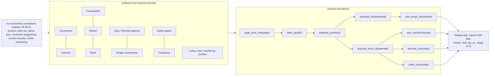

# Connections, terminals and cables

**Status:** Draft v0.1 · **Date:** 2026-10-18 · **Part of:** ElektraWatt design document set

**Purpose.** This document specifies how ElektraWatt (EW) turns drawn connections into electrical meaning. It covers
connection points, connections and junctions, the three connectivity levels (net, signal, potential) with stable
identities, potential types, flow and bonds, the wire-property inheritance chain with its colour and size profiles,
and wire numbering. It then specifies terminal strips and cables, the check rules of this area and the row sources
behind the terminal, cable, wire and potential reports. It elaborates the CON, TRM and CBL areas and the
wire-numbering part of NUM in [02a](02a-requirements-core.md). It builds on the records of the
[domain model](03-domain-model.md) §9, §11 and §12 and follows the accepted [architecture](04-architecture.md)
(ADR-0001, ADR-0006, ADR-0007).

**Notation.** W1 … W44, J1 … J6 and BR1 … BR6 are the physical wires, junctions and bridges of the golden project
([20](20-golden-project.md) §8). ▲ and ▲U-nn mark golden test inputs that the reference set does not determine
([20](20-golden-project.md) §1.2). EF-nn and MF-nn are expected findings ([20](20-golden-project.md) §18, §20). PQ-nn
are questions for the pilot user ([brainstorm](01-brainstorm.md)).

**Contents**
1. [Scope and position](#1-scope-and-position)
2. [Concepts and data](#2-concepts-and-data)
3. [Connectivity semantics](#3-connectivity-semantics)
4. [Wire properties](#4-wire-properties)
5. [Wire numbering](#5-wire-numbering)
6. [Terminal strips and terminals](#6-terminal-strips-and-terminals)
7. [Cables and conductors](#7-cables-and-conductors)
8. [Check rules](#8-check-rules)
9. [UI and UX touchpoints](#9-ui-and-ux-touchpoints)
10. [Outputs](#10-outputs)
11. [Performance and determinism](#11-performance-and-determinism)
12. [Edge cases and pitfalls](#12-edge-cases-and-pitfalls)
13. [The reference project](#13-the-reference-project)
14. [Scope by release](#14-scope-by-release)
15. [Dependencies](#15-dependencies)

---

## 1. Scope and position

Only facts a human decided are stored. These are connections and their routes, junction sequences, definition
points, bonds, overrides, strips, terminals, bridges, cables and conductors. Nets, signals, potentials, physical wires,
effective wire properties, printed wire numbers, terminal rows and cable rows are derived queries in `ew-derive`
(ARCH §6.4, ADR-0001, ADR-0002). None of them is ever persisted. `potential_flow(potential)` and
`physical_wires_of(potential)` are rows of the ARCH §6.4 catalogue. ARCH §6.3 makes the potential, not the net, the
finest memo key, so both are keyed per potential, as in [03](03-domain-model.md) §9.2 and
[06](06-schematic-editor.md) §5.5.

| Topic | Decided here | Decided elsewhere |
|---|---|---|
| Record names and fields | Detail, plus the additions in §2.3 | [03](03-domain-model.md) §9, §11, §12 |
| Drawing wires, junction tool, marker tool, IP placement | Semantics only | [06](06-schematic-editor.md) §3.5, §4.4 |
| FnDef internal links, CP patterns, clamp and cable-core data | What the queries read | [07](07-symbols-parts-macros.md) §2.4, §2.5 |
| Interruption-point pairing, xref texts | Use of the pairs for connectivity | [06](06-schematic-editor.md) §2.8, [03](03-domain-model.md) §10 |
| Report forms, pagination | Row sources | [09](09-reports-forms-output.md) |
| Bus ports, networks | Single-line bus cables | [10](10-plc-and-bus.md) |
| Routing and routed lengths | Length sources, PE through carriers | [12](12-panel-layout.md) |
| Wire records, ferrules, markers, machine files | Physical-wire identity, orientation and properties | [13](13-manufacturing-outputs.md) |
| QET mapping | Connectivity rules that the importer must reproduce | [14](14-interop.md) |
| Rule engine, final rule IDs, waivers | Rule content (§8) | [15](15-checks-revisions-collaboration.md) |



---

## 2. Concepts and data

### 2.1 Vocabulary

| Term | Meaning in EW | Example (reference project) |
|---|---|---|
| Connection point (CP) | An instantiated point of a function, derived from the FnDef or part pattern (`v5(function, idx)`) | -101F1:N#1, -X1031:1 clamp b |
| Connection | An explicit logical edge between two endpoints (CP or junction), with a route (ADR-0007) | the drawn line S51:1 → -101F1:1 |
| Junction | A T-node with a style (Dot, Bevel), a wiring mode (Star, Chain) and an ordered sequence | J1 at F55:2 |
| Daisy chain | Several connections on one CP, without a junction (FR-CON-006) | W7 and W8 on -101F1:1 |
| Net | CPs joined by wires, cores, bus lines, internal links, junctions and IP pairs | W29 plus the IP 24VDC-1 |
| Signal | Nets joined through `Short` links inside one function: terminal levels, plug pins, duplicated pins | W29 and the BN core through -X1031:1 |
| Potential | Signals joined by bridges and rail bonding: the electrically equal set | 24VDC-1 over -X1031:1–4 |
| Physical wire | What the shop cuts: one CP-to-CP piece, resolved through junctions and IP pairs | W11 across L-1 |
| Bond | A declared link of two potentials that does not merge them | B1, 0V ⇄ PE via W27 |
| CDP | Connection definition point: the explicit overrides of one connection, drawn as a wire marker | "2.5 BK BU" on W4/W5 |
| Strip, terminal | Devices with the `Strip` and `Terminal` aspects. A terminal is a device | -X1031 and its 20 terminals |
| Level, clamp, side | The CP locus on a terminal. Side 1 is internal and side 2 is external by default | -X1031:1 (1/a) |
| Bridge | A `Connection{kind: Bridge}` between terminal CPs. It joins potentials and is never a wire | BR1 over -X1031:1–4 |
| Cable, conductor | A device with the `Cable` aspect and its cores or shield | -106W1, core BN |

### 2.2 Records used

| Record | Fields this document relies on | Kind, file |
|---|---|---|
| `Connection` | `a`, `b: Endpoint`, `page?`, `route`, `kind`, `overrides: WireOverrides`, `number: NumberSpec` | A; page file, or the shard of the device owning `a` when `page = None` ([05](05-project-format-and-persistence.md) §2.2) |
| `Junction` | `page`, `at`, `style: Dot \| Bevel`, `wiring: Star \| Chain`, `sequence: Vec<ConnectionId>` | A; page file |
| `PotentialDef` | `at`, `name`, `ptype?` (`None` = name only), `voltage`, `env` (with `earthing?`), `circuit_class?`, `props` | A; shard |
| `NetDef` | `at`, `scope: Signal \| Net`, `props` | A; shard |
| `Bond` | `a`, `b`, `kind: Pelv0vPe \| FePe \| Equipotential \| Shield`, `via?: WireId` | A; shard |
| `Function.cp_overrides` | `designation`, `alias`, `unused` | A |
| `Terminal` aspect | `strip`, `seq`, `designation`, `levels`, `rail_bonded`, plus `Device.state` and `function_text` | A; shard |
| `Strip` aspect | `label_mode`, `designation_scheme?`, `accessories`, `tag_print`, `groups`, `field_side` | A; shard |
| `Cable` aspect | `length: LengthSource`, `core_id_mode`, `pre_assembled` | A; shard |
| `Conductor` | `cable`, `core`, `colour?: ColourSpec`, `csa?: Csa`, `shield`, `pair?` | A; the cable's shard |
| `ColourProfile`, `SizeProfile`, `WireNumberingScheme` | §4.2, §5.2 | A; in `ProjectSettings` (`project.jsonl`), record shapes in [03](03-domain-model.md) §5.1 |
| `CpDef` (library) | `designation`, `discipline`, `potential_role`, `source_output`, `optional`, `level`, `side`, `clamp`, `physical` | L; [07](07-symbols-parts-macros.md) §2.4 |
| `FnDef` (library) | `category`, `internal: [{a, b, Short \| PassThrough{opens}}]`, `flags{switches_n_with_l, n_isolation}` | L |

### 2.3 Detail and schema additions

These refine [03](03-domain-model.md) without changing its concepts. They are part of the schema-steward batch
(ARCH §7.6) that 03 §1.2 records before `ew-schema` v0 freezes; Open questions 2–6 and 15 keep the record of how
they were decided, and `SingleLine` is the kind of [06](06-schematic-editor.md) OQ13 (FR-CON-044).

```rust
pub enum ConnectionKind {
    Wire,                          // one conductor
    Core(Id<Conductor>),           // a cable core or shield
    Bridge(BridgeSpec),            // terminal bridge; joins potentials; never a wire
    Fluid(FluidLine),              // see 11
    Bus(BusLine),                  // single-line bus connection between bus-port CPs
    Overview,                      // excluded from nets; MVP stand-in for single-line power lines (06 OQ13)
    Internal,                      // link between CPs of two functions of one part's template that no FnDef declares
    SingleLine { conductors: u8 }, // 1.0 (FR-CON-029): excluded from nets, mapped onto multi-line connections
}
pub struct BridgeSpec { kind: BridgeKind /* PlugIn | Saddle | Wire | InterLevel */, group: u16, shaft: u8 }
pub struct BusLine    { cable: Option<Id<Device>> }      // the cable that carries the line (FR-CBL-008)
pub enum ClampKey     { Clamp(char) /* a, b, c */, Shaft(u8) /* bridge shaft */, RailFoot }
// Strip aspect additions
pub struct TerminalGroup { from_seq: u32, to_seq: u32, label: MlText }   // "Pneumatics", "Spare" (FR-TRM-010)
//   Strip { …, groups: Vec<TerminalGroup>, field_side: Side1 | Side2 }
// Env addition on PotentialDef
//   env { ac_dc, frequency, earthing: Option<Pelv | Selv | Floating> }
// WireOverrides additions (on the carrier connection, moved by the number-transfer normaliser, §5.1)
//   length: Option<Nm>                       // manual wire length; works without a layout space
//   ends: SmallVec<[EndOverride{at: CpRef, treatment?, part?, strip_len?, marker?, no_marker}; 2]>   // see 13
```

- **No connection for PLC bindings.** A channel binds the coil's non-physical CP directly (`Channel.binding`,
  [10](10-plc-and-bus.md) §3.3), so wire lists and length calculations have nothing to exclude. `Internal` is kept
  for the other device-internal links: links between CPs of two functions of one part, declared by the part's
  function template ([07](07-symbols-parts-macros.md) §2.5), which no single FnDef can declare.
- **`BridgeSpec.group`** makes a multi-pole comb one object. The Bridge connections of one group lie on one strip,
  between consecutive `seq` values on one shaft. Only the first connection carries the bridge part. It is stored in
  `overrides.wire_part` as in [03](03-domain-model.md) §11, but read as level-6 intrinsic data, because no profile
  level applies to bridges. Reports print one row per group and the BOM counts the part once per group. The
  strip editor creates BR1 (-X1031:1–4) as three connections 1–2, 2–3 and 3–4 with group 1.
- **`ClampKey`.** Wires end on clamps. Plug-in bridges end on shaft CPs. Rail-bonded PE terminals have a rail-foot
  CP for carrier bonding at 1.0. A shaft and a rail foot are joined to the level's clamps by FnDef `Short` links.
- **Strip groups** label ranges of terminals. The terminal's own `function_text` holds its printed label ("1+").
  This follows [20](20-golden-project.md) §9, where "1+" is the printed function text and "Pneumatics" is the group
  label.
- **`Strip.field_side`** says which terminal side faces the field when a strip is mounted the other way round. The
  default is Side2 (FR-TRM-012).
- **Part data read here** ([07](07-symbols-parts-macros.md) §2.5, levels L1 and L2):
  - clamp data per CP: cross-section ranges, maximum conductors, twin-ferrule permission (FR-CON-028, 1.0);
  - `cable_cores`: core ID, colour, csa, shield, pair, the connector pin per end, a fixed length for pre-assembled
    cables, and the outer diameter;
  - bridge parts: pole count and pitch.

---

## 3. Connectivity semantics

### 3.1 Connections and endpoints

| ID | Invariant | Class | Behaviour |
|---|---|---|---|
| CI-01 | Both endpoints exist and differ (no self-loop on one CP) | S | Reject |
| CI-02 | `Fluid` joins fluid CPs; `Bus` joins bus-discipline CPs; `Wire`, `Core`, `Bridge`, `Internal` and `SingleLine` join electrical CPs | S | Reject |
| CI-03 | A `Bridge` joins two terminal CPs of one strip, or of two strips on the same carrier for saddle bridges (1.0) | S | Reject |
| CI-04 | Every connection ending at a junction is in its `sequence`, and the reverse. A junction has at least three connections | S | The junction clean-up normaliser restores it in the same transaction. A two-connection junction dissolves into one connection that keeps the lower ID ([06](06-schematic-editor.md) §3.2) |
| CI-05 | `Core(c)`: the conductor exists. Two connections that are not parts of one physical wire do not use the same conductor | P | Strict rejects. Lenient reports EW-CORE-036 |
| CI-06 | A Bridge group runs over consecutive `seq` on one shaft, and groups do not overlap on a shaft | P | Strict rejects. Lenient reports EW-TERM-004 |
| CI-07 | `Overview` and `SingleLine` connections never take part in nets (FR-CON-002, FR-CON-029) | S | — |

Moving representations never changes an endpoint. Only routes follow (FR-CON-004). Connectivity therefore never
depends on geometry, except through the explicit commands that create connections: autoconnect, splitting and the
cable definition line (ADR-0007).

### 3.2 Junctions and wiring sequence

A junction tells the shop **which CP is wired to which**. A dot or a bevel only says that a T exists (D-20).

- **Arm order.** The arms of a junction are its connections in `sequence` order. **Arm 1 is the feed arm**.
- **Star.** The CP reached through arm 1 is wired to the first CP of every other arm.
- **Chain.** The CP reached through arm 1 is wired to the first CP of arm 2. The last CP of arm 2 is wired to the
  first CP of arm 3, and so on.
- **Nested junctions.** An arm that leads to another junction *enters* it: the sub-junction receives the current CP
  as its entering CP and resolves its own non-feed arms. Under Chain the parent continues from the last CP the
  sub-junction reached. Under Star the sub-junction's arms are spurs of the entering CP. Every arm that ends at a CP
  yields exactly one wire, except the feed arm of the root junction, whose CP is the entering CP. The root is the
  junction whose feed arm ends at a CP.
- **Ambiguous feed.** An arm between two junctions must be the feed arm of exactly one of them. If it is the feed arm
  of both or of neither, EW roots the tree at the junction with the lowest ID and reports EW-POT-011 with the quick
  fix "reorder sequence".
- **Defaults.** A Dot junction defaults to Star and a Bevel junction to Chain ([03](03-domain-model.md) OQ7). A
  junction is created by ending a wire on another connection. Its default sequence lists the two parts of the split
  connection, the part nearer the potential's source first (flow distance, §3.6, with reading order as tie-break),
  and then appends the new branch. [06](06-schematic-editor.md) §3.5 uses the same rule, and the M2 usability test
  confirms it (PQ-27, Open question 7).
- **Daisy chain versus junction.** Two connections on one CP are a daisy chain (FR-CON-006). Their order is the
  order in which the shop lands them on the clamp. It is ascending connection ID unless a junction sequence fixes it.
  The bevels of the folio 101 top bus are daisy chains on -101F1:1 and -101F1:N#1 that the scene draws as bevels
  ([20](20-golden-project.md) §8.3).

| Junction (golden) | Style, wiring | Sequence (arm 1 first) | Physical wires |
|---|---|---|---|
| J1, folio 101 | Dot, Star | F55:2, E55:L, E56:X2 | W13 F55:2 → E55:L; W14 F55:2 → E56:X2 |
| J2, folio 101 | Dot, Star | F55:N#2, T55:5, S56:13 | W15, W16 |
| J3, folio 102 | Bevel, Chain | -102G1:+#1, -102F1:1, -102G1:+#2 | W20, W21: two conductors on -102F1:1 |
| J4, folio 102 | Bevel, Chain | -102F2:24VDC#1, -102F1:2, -102F2:24VDC#2 | W24, W25: both start at -102F1:2 |
| J5, folio 102 | Bevel, Star | -102G1:−#1, -102F2:GND#1, IP PE-0VDC | W22; W27 (the bond wire) |
| J6, folio 102 | Bevel, Star | -102G1:−#2, -102F2:GND#2, IP 0VDC | W23; W26 |

J5 and J6 are Bevel junctions set to Star, as drawn in the walkthrough of [06](06-schematic-editor.md) §9.2 step 10.

### 3.3 Net, signal, potential

| Level | Joined by | Bounded by | Used for |
|---|---|---|---|
| Net | `Wire`, `Core`, `Bus` and `Internal` connections; junctions; IP pairs | function CPs | physical wires, net definitions (level 5), live highlight during drags |
| Signal | nets plus FnDef `Short` links (terminal levels, plug pins, +#1/+#2) | bridges, rail bonds, pass-through pairs | net extension in numbering (FR-NUM-020), net definitions (level 4) |
| Potential | signals plus `Bridge` connections and rail bonding (FR-CON-015) | pass-through pairs, loads, bonds | names, types, wire properties, checks, highlight, potential overview |

```text
page_local_nets(page)                            // memo per page, union-find over the page's CPs and junctions
  union a and b of every page-owned connection with kind ∈ {Wire, Core, Bus, Internal},
        except a connection named as Bond.via    // the bond cut, §3.7
stitch_graph()                                   // memo; nodes: local nets, plus CPs touched only by page-less links
  NET       edges: IP pairs (xref pairing), page-less Wire/Core/Internal connections
  SIGNAL    edges: FnDef Short links within one function
  POTENTIAL edges: Bridge connections (drawn or page-less); rail bonds (§3.7)
  non-joining:     Bond edges; PassThrough pairs (flow edges, §3.6)
potential_partition()                            // memo; one union-find, three snapshots
  apply NET edges → snapshot nets; apply SIGNAL edges → snapshot signals; apply POTENTIAL edges → potentials
  edges are applied in (level, kind, min endpoint ID) order, so the result never depends on load order
```

The stitch graph has one node per local net, about 10–15 % of all CPs (ARCH §6.4). ARCH §6.7 estimates 5–10 ms per
committed wire edit in its XL-A estimate case, inside the NFR-PERF-05 budget of 20 ms. Live highlighting during a
drag uses `page_local_nets` only.

### 3.4 Stable identities

| Object | ID | Stable under | Changes when |
|---|---|---|---|
| Net, signal | minimum member CP ID | moves, renumbering, property edits, edits elsewhere | the minimum member leaves the set |
| Potential | minimum `PotentialDef` ID among its definitions, else the minimum member CP ID | the same, plus adding or removing other members | its last definition is removed, or the potential is split away from it |
| Physical wire | ID of its carrier connection (§3.8) | moves, route edits, renumbering, adding unrelated wires | the carrier connection is deleted or the decomposition changes (§5.1 moves its number) |

This is the rule of [03](03-domain-model.md) §9.4 and the ARCH §6.4 `PotentialId` (Open question 4). Taking the
minimum definition ID keeps the identity when a user adds a second, equal definition symbol. The IDs key the
per-potential memos (`wire_props_of`), highlight state, `api_v1_potential` rows and finding fingerprints. A wire edit
that leaves membership unchanged keeps every PotentialId, so dependent memos are backdated and stay green
(ARCH §6.2). When two potentials merge, the merged potential's ID follows the same rule: the smaller definition ID if
either side has a definition, else the smaller CP ID. A potential with a definition therefore never loses its ID to
an undefined one.

### 3.5 Names and aliases

- **Canonical name.** It is the first of these:
  1. the `PotentialDef.name`;
  2. the name of the first source IP in page order;
  3. a fallback `<displayed tag>:<CP designation>` of the member CP that comes first in (page order, row, column,
     CP ID).
- **Aliases.** Every other distinct IP name on the potential is an alias, in natural order (FR-CON-012, D-24).
- **Signals** take the first IP name inside them.
- **Bond paths.** IPs that lie on a bond's `via` path are named on the bond, not on either potential. "PE-0VDC"
  therefore names B1 and is neither an alias of 0V nor of PE.
- **Conflicts.** Two definitions with different names in one potential produce EW-POT-017. The first definition in
  ID order wins.

Golden: 24VDC-1 has no definition and takes the name of its source IP on folio 102. Its aliases are 24VDC-AIR1 …
AIR4. 0V is defined, with aliases 0VDC and 0VDC-AIR1 … AIR4. PE is defined, with 7 aliases: J-E-206-PE, PE-1.1 …
PE-1.4, PE-AIR1 and PE-AIR2.

### 3.6 Types, voltage, circuit class and flow

`potential_flow(potential)` runs after the partition. It derives each potential's type, its flow from the supply,
its switched state and its protective device. Each potential's memo holds its entry of one BFS over the whole
partition, which reruns only when the partition or a pass-through pair changes.

```text
potential_flow(potential):                              // memo per potential; the BFS below runs once per partition
  roots (distance 0): potentials that contain a supply source:
     external connection points (IpSpec.external) of the incoming supply;
     CPs whose CpDef sets source_output (PSU +/−, transformer secondary, battery; 07 §2.4);
     input CPs of a source (PSU L, N, PE) are ordinary members, so L-1 is reached through -101F1, not a root
  type(P) := PotentialDef.ptype, else the potential_role of member CPs ("+" → L+, "−" → M, PE pin → PE), else Undefined
  BFS over PassThrough pairs in (distance, function ID, pair index) order:
     pair (u, d, opens) of function f, P_u reached, P_d not yet reached:
        distance(P_d) = distance(P_u) + 1;   upstream(P_d) = (f, pair)
        type, voltage, env of P_d := those of P_u unless set by a definition or a member CP role   (FR-CON-011)
        (a name-only definition, ptype = None per 03 §9.4, does not stop propagation)
        switched(P_d)     = switched(P_u) or (opens and f.category ∉ Protection* and not f.flags.switches_n_with_l)
        protected_by(P_d) = f if f.category ∈ Protection*, else protected_by(P_u)
  unreached potentials: distance ∞; orientation and numbering fall back to page order
```

- **Switched.** `switched` marks functional switching: contacts, switches, thermostats. MCBs, fuses and electronic
  circuit breakers are protection, so their outputs are not "switched". All-pole switching devices such as S51 do
  not set it either. On the golden project exactly N-55T (via T55) and N-55S (via S56) are "N, switched", as
  [20](20-golden-project.md) §7.3 requires.
- **Protected by.** `protected_by` names the nearest upstream protective device. 24VDC-1 is protected by the Out1
  channel of -102F2. This feeds the load summary (FR-REP-026) and D-25.
- **Circuit class** (FR-CON-022) comes from the size profile's class rules, unless `PotentialDef.circuit_class` sets
  it. The rules are evaluated in order and the first match wins. The company profile uses:
  1. PE, PEN and FE are Pe;
  2. bus-discipline potentials are Bus;
  3. analogue-flagged signals are Analogue;
  4. AC at 50 V or more is Mains;
  5. all other AC and all DC is Control.
- **Voltage classes** for colour rows are named ranges in the profile data: "24 VDC" is DC from 0 to 120 V,
  "230 VAC" is AC from 50 to 250 V, "400 VAC" is AC above 250 V up to 1,000 V. These bounds are the company
  profile's choice (the ELV and LV limits), not quoted standard text.
- **Conflicts.** Two types or voltages meeting in one potential produce EW-POT-001 (FR-CHK-028). So do a defined
  type that contradicts a member CP role, and a pass-through pair whose two reached sides have different types
  without a converting function. Nothing merges silently.

### 3.7 Bonds and rail bonding

- **Bond cut.** A `Bond{a, b, kind, via}` adds a non-joining edge. Its `via` connection (the carrier of the bond
  wire) is left out of union at both levels. B1 (`Pelv0vPe`, via W27) keeps 0V and PE as two potentials (FR-CON-014,
  D-22). The bond wire is still a physical wire: physical-wire extraction runs on the full drawing graph, including
  via connections (§3.8). The wire list shows W27 with potential "0V ⇄ PE".
- **PELV and SELV.** An M-type potential is PELV when it has a `Pelv0vPe` bond or `env.earthing = Pelv`.
  EW-POT-002 requires exactly one such bond. A potential declared `Selv` must have none (FR-CHK-028).
- **FE to PE.** An `FePe` bond declares a deliberate FE–PE link. Without one, FE-role CPs on the PE potential are
  reported (EW-POT-003, D-16). In the golden test part data only CPX pin 3 carries role FE (▲U-18); the earth
  screws -201U1:FE and -202U1:FE are the devices' intended earthing points with role PE, so EF-10 has exactly two
  targets.
- **Rail bonding at MVP.** Each location node (`+J-E-2416`) has a virtual "location PE node". The PE CPs of every
  rail-bonded terminal of that location join it as a POTENTIAL edge (FR-CON-015, FR-TRM-017). In the golden project
  1X1:PE (USLKG 5) and -X1032:1–5 are rail-bonded. -X1032 therefore joins 1X1:PE, and through W6 the PE bar -XPE, in
  one PE potential although no wire runs between folio 101 and the -X1032 strip on folio 103 (D-21).
- **Rail bonding at 1.0.** When a layout space exists for the location, the partition replaces the location node.
  A rail-bonded terminal then joins PE only through a carrier and surface that both declare `pe_bond` (FR-LAY-058).
  A difference between the two models is reported on migration ([03](03-domain-model.md) OQ10).

### 3.8 Physical wires

Connections are drawing edges. The shop needs CP-to-CP pieces. `physical_wires_of(potential)` extracts them from the
drawing graph. Its nodes are the potential's CPs, its junctions and its IP CPs. Its edges are the `Wire` and `Core`
connections, plus the IP-pair links, including bond-via connections. Potentials joined by a bond-via connection are
extracted together. `Bridge`, `Internal`, `Bus`, `Fluid`, `Overview` and `SingleLine` connections never form
physical wires.

```text
physical_wires_of(potential):                              // memo per potential (granularity rule, ARCH §6.3)
  hubs  = junctions ∪ star IP groups with more than two members (feed arm = the star source's drawn connection)
  transparent nodes = IP CPs with one drawn connection and one pair link (chain pairs are plain links)
  resolve(h, entering):                                   // §3.2
     cur = entering
     for each non-feed arm a of h in sequence order:
        if a ends at a CP c:   emit wire(Star ? entering : cur, c, carrier = connection of a that touches c)
                               if Chain: cur = c
        if a ends at a hub h2: last = resolve(h2, Star ? entering : cur);  if Chain: cur = last
     return Chain ? cur : entering
  for each root hub (feed arm ends at a CP): resolve(root, that CP)
  every hub-free path between two physical CPs: one wire; carrier = the end constituent whose adjacent IP is a
     Target (IpSpec.direction); if both or neither end is next to a Target IP, the end constituent with the smaller
     connection ID; a path without IPs is a single connection, which is its own carrier
  wire.id      = wire.carrier.id       // the target-side connection; stable UUID, FR-MFG-001
  wire.constituents = the connections on the path, in order from the first end
  wire.core    = the conductor if any constituent is Core(c); every Core constituent must name the same c (EW-POT-014)
  ring (a cycle in the drawing graph): broken at its highest connection ID; EW-POT-012
```

- **Examples.** W11 (-101F1:2 → L-1 → -102G1:L) is one wire carried by the folio-102 connection, the leg at the
  Target point of L-1. In J1, W13 and W14
  are carried by the J1 → E55:L and J1 → E56:X2 connections. The F55:2 → J1 arm is shared by both wires and carries
  neither. W26 is carried by the folio-103 connection IP 0VDC → -X1031:11/a.
- **Carrier is not orientation.** The carrier is chosen from the junction sequence, the IP directions and IDs, all
  authored, so page renumbering, flow changes and moves never change a wire's ID. "Carrier connection" is unrelated
  to the layout `Carrier` (rail, duct) of [12](12-panel-layout.md).
- **Orientation (From/To)** is a presentation rule. It does not affect identity.
  1. If the two ends are on different pages, From is the end on the earlier page in page order.
  2. On one page, From is the end with the smaller flow distance: hops over the potential's wires, bridges and
     terminal shorts, from the CPs where the potential enters (roots of §3.6, or the downstream side of its upstream
     pass-through pair).
  3. Ties are broken by the anchor cell (row, column) and then by CP ID.

  This reproduces every From/To pair of [20](20-golden-project.md) §8.2. Examples: 1X1:1 → S51:2, because the supply
  enters at J-E-206-L; -102G1:+#2 → -102F1:1; E55:PE → -X1032:1/b, by page order.
- **Wire-end locus.** A terminal end prints `strip:terminal (level/clamp)`, for example "-X1031:1 (1/a)"
  (FR-TRM-006, FR-MFG-002). A device end prints `tag:designation`, with `#n` only where printed designations repeat
  (`-102G1:+ #1`).

*As built (cycle 7, WP-S1.07; decision log ID-146 to ID-151).* The families of §3.3 to §3.8 exist in `ew-derive`,
Memo by policy and cold in phase 1. Decisions the code had to fix:
- An interruption-point group without `ip_pairing` is a star with project scope; its source is the point flagged
  `star_source`, else the single Source point, else the point with the lowest ID.
- A terminal FnDef without pass-through links joins all CPs of one level; duplicated pins of one function are one
  signal unless a declared pass-through links them.
- Only a bond's `via` connection is cut, and the IPs on the `via` path name the bond (§3.5); drawn bridges join at
  the potential level only (§3.3); there is no separate conductor edge, because `Core` connections and the IP pairing
  suffice.
- `Partition.ptype` holds the definition's type and the role types; N-55S and N-55T take their type from the flow.

---

## 4. Wire properties

### 4.1 The inheritance chain

The effective value of each property comes from the highest level that sets it. Each value carries **provenance**:
the level and the defining entity (FR-CON-017, FR-CON-025, D-08). This is the chain of
[03](03-domain-model.md) §9.5 and ARCH §6.4, unchanged.

| Level | Source | Can set | Golden example |
|---|---|---|---|
| 1 | Project default (`ProjectSettings.wire_default`) | all | used only by Undefined potentials |
| 2 | Profile rule: colour row × size row, plus the PE-class rule and the bond rule (§4.2) | colour, csa, wire part (1.0), insulation | W29: 0.75 mm², DBU |
| 3 | `PotentialDef.props` | any | — |
| 4 | `NetDef{scope: Signal}` (1.0, FR-CON-016) | any, including shielded and twisted | — |
| 5 | `NetDef{scope: Net}` (1.0) | any | — |
| 6 | Intrinsic data of the connection: `Conductor` colour and csa, bridge part | colour, csa, part | W39: BN from the -106W1 core |
| 7 | CDP: `Connection.overrides` | any | W20: 1.5 mm²; its DBU still comes from level 2 ([20](20-golden-project.md) §8.1) |

- **Fields.** Each wire has `csa: Csa`, `colour: ColourSpec`, `wire_part`, `insulation`, `function` and
  `flags{shielded, twisted}`. Its length is a separate value (§7.6, [12](12-panel-layout.md)).
- **Granularity.** `wire_props_of(potential)` returns one map per physical wire, computed per potential. The
  property grid's accessor for a single wire is a cold lookup into that map (ARCH §6.3).
- **Overrides along one wire.** A physical wire made of several connections takes level 7 from all of them. If two
  constituents set different values, the carrier's value wins and EW-POT-014 reports the conflict.
- **Shared drawn connections.** A connection that belongs to two wires, such as the feed arm of a star junction,
  shows `‹varies›` when the two wires differ. An override on it applies to both wires.

```text
$ ew query wire_props W29 --explain
csa     0.75 mm²  level 2  size profile "0.75/1.5" row control      (24VDC-1: L+, 24 V DC → class Control)
colour  DBU       level 2  colour profile "DBU/WH 24 V" row "24 VDC / Positive" (L+, DC, 0–120 V)
part    —         level 1  project default (wire parts per profile from 1.0, FR-CON-033)
```

### 4.2 Profile rules

```toml
# Company colour profile, shipped as the sample of the pilot basic project
[profile]
id = "company.dbu-wh-24v"
name = "DBU/WH 24 V"
basis = "company-convention"          # standard | company-convention (D-37)
basis_note = "codes per IEC 60757; DBU is a company code (BU, dark shade)"
verified = true
codes = [
  { code = "DBU", base = "BU", shade = "dark", export_as = "DBU", names = { "en-GB" = "Dark Blue", "nl-NL" = "Donkerblauw" } },
]                                     # names: FR-I18N-013 (1.0)
rows = [
  { group = "24 VDC",           function = "Positive", select = { ptype = "L+", ac_dc = "DC", u_max = "120" },     colour = "DBU" },
  { group = "24 VDC",           function = "0V",       select = { ptype = "M", ac_dc = "DC", u_max = "120" },      colour = "WH" },
  { group = "230 VAC",          function = "Neutral",  select = { ptype = "N", ac_dc = "AC", u_min = "50", u_max = "250" }, colour = "BU" },
  { group = "230 VAC",          function = "Earth",    select = { ptype = "PE" },                                   colour = "GNYE" },
  { group = "Analogue Signals", function = "Earth",    select = { ptype = "PE" },                                   colour = "GNYE" },
  # … 15 rows in total ([20] §7.1); the three PE rows overlap and agree
]

# Size profile "0.75/1.5"
[sizes]
class_rules = [                       # first match wins (§3.6)
  { ptype = ["PE", "PEN", "FE"], class = "pe" },
  { discipline = "bus", class = "bus" },
  { analogue = true, class = "analogue" },
  { ac_dc = "AC", u_min = "50", class = "mains" },
  { class = "control" },
]
pe_class = "highest-at-ends"          # FR-CON-038
bond_rule = { colour_from = "PE", class_from = "non-PE side" }
rows = [ { class = "control", csa = "0.75" }, { class = "mains", csa = "1.5" } ]
```

- **Matching.** The most specific row wins: the row with the most constrained selector fields. Overlapping rows of
  equal specificity must assign the same code; the three PE rows (230 VAC, 400 VAC, Analogue) and the two N rows of
  the company profile do. Overlapping rows that disagree are a profile error, reported when the profile is loaded,
  never at query time. The `group` and `function` fields only lay out the cover table. Switched potentials use the
  row of their base type, so N switched is BU.
- **PE class rule.** A PE wire takes the highest circuit class at its two ends, ranked Mains > Control > Analogue >
  Bus, with Pe ignored. At a device end the class comes from the device's own potentials. At a terminal end it comes
  from the potentials on the terminal's strip. W6
  (1X1:PE → -XPE) is therefore Mains (1X1 carries L and N) and gets 1.5 mm². W33 (-X1032:3/b → -201U1:FE) is Control
  and gets 0.75 mm².
- **Bond rule.** A bond wire takes the PE colour and the class of its non-PE potential. W27 is 0.75 mm² GNYE.
- **Cores and bridges** take colour and csa from level 6. The profile never recolours a vendor core.
- **Cover tables.** Folio 1's CABLE COLOUR DEFINITIONS and standard-size tables are embedded report blocks over
  these rows (FR-REP-028, REF-005). In marker mode "only explicit overrides" the cover also prints the note "If size
  or sign is not indicated in diagram, standard size or sign is to be used." That note is derived text, not a rule.

### 4.3 Shipped profiles

Profiles are versioned data ([vision](00-vision-and-scope.md) PR-10), cited by standard and clause, never copied
text (NFR-COMP-05). Entries marked (verify) ship with `verified = false`. Findings that depend on them carry an
"unverified data" marker, and from 1.0 their severity is capped at warning until a reviewed change sets the flag
([15](15-checks-revisions-collaboration.md) §9 item 7). The same policy applies to the PE sizing table of
EW-POT-006 (§8.2).

| Potential (type, class) | EN 60204-1 machine (13.2) | IEC 60445 installation | Company "DBU/WH 24 V" | NFPA 79 (1.x, data only) |
|---|---|---|---|---|
| L, L1–L3, AC power | BK | L1 BN, L2 BK, L3 GY (verify); L BN (verify) | BK | BK |
| N | BU (light blue) | BU | BU | WH or GY (verify) |
| PE | GNYE | GNYE | GNYE | GN or GNYE (verify) |
| PEN | — | GNYE with BU marking | — | — |
| FE | — | PK (preferred) | — | — |
| AC control, L | RD | as AC line | BK ("230 VAC signal") | RD |
| DC control, L+ | BU | RD | DBU | BU |
| DC control, M (0 V) | BU (verify) | WH, as L− (verify) | WH | WH with BU stripe (verify) |
| Excepted circuits | OG | — | — | OG (external interlock) |
| Analogue +, − | — | — | GY, WH | — |
| Bus | from the cable part | from the cable part | from the cable part | from the cable part |

The EN 60204-1 column follows 13.2.4's recommendation of BU for DC control circuits of both polarities. IEC 60445
assigns BU to the mid-point conductor M and WH to L−; EW types a 2-wire PSU's 0 V as M (the PSU's "−" role), so the
IEC 60445 profile maps that M like L−. Both entries are therefore marked (verify).

*Built-in defaults* (2026-10-19, decision log ID-150). Without a project profile, colours follow the EN 60204-1
column (L BK, N BU, PE GNYE, FE PK, DC BU, AC signal RD) and sizes are Mains 1.5 mm² and Control, Analogue and Bus
0.75 mm²; a potential of unknown voltage or AC/DC never matches a selector that constrains them. The levels as built
are override > conductor > potential definition > colour and size rows > project default > built-in default; net
definitions are WP-S1.26 (decision log ID-146).

Size profiles for the standards ship as data with `verified = false` until they have been checked against licensed
copies. The company size profile is the golden one: Control 0.75 mm², Mains 1.5 mm², PE by class. NFPA 79 is
data-only at 1.x. Its rule pack is Later, as [vision](00-vision-and-scope.md) §9 says for UL 508A and NFPA 79.

### 4.4 Company codes

- **What a company code is.** It is declared by its profile with a base IEC 60757 code and a shade (DBU = BU,
  dark), plus multilingual names. "BR" and other free text cannot be stored as a colour in a strict project
  (FR-CON-019, D-17); a lenient import keeps such a code as `ColourCode::Foreign`, which the prevent rule
  EW-CORE-031 reports with the quick fix "use BN" ([03](03-domain-model.md) §3.4).
- **Checks compare exact codes.** DBU is not BU, so the "BU on non-N conductors" rule (EW-POT-005) does not fire on
  the DBU 24 V wires. It does fire on vendor cores that really are BU on 0V.
- **Exports.** `export_as` and the machine profiles decide whether a company code leaves EW as "DBU" or as its base
  code ([13](13-manufacturing-outputs.md)).
- **Display.** Colour codes always appear as text next to any colour swatch, and GNYE is striped (FR-UI-025,
  NFR-A11Y-03).

### 4.5 Markers and overrides

- **What a marker is.** A wire marker (`PageItem::WireMarker`) displays connection data and stores none of its own
  (FR-CON-023).
- **Marker modes** (FR-CON-024):
  - all wires;
  - deviations, meaning values set at levels 3–7 except cores, whose colours the cable marker already prints;
  - only explicit overrides (level 7);
  - none.

  The mode only selects which wires carry a marker. The marker text always prints effective values: the
  cross-section, then one colour code per covered wire, whatever level set them ([06](06-schematic-editor.md)
  §3.5). Golden A uses "only explicit overrides", so exactly the four reference groups print: "2.5 BK BU" below and
  above S51, "1.5 DBU DBU WH WH" below -102G1 and "1.5 DBU DBU" above -102F2. Only the cross-sections of these ten
  wires are level 7; their colours are level 2, so EW-POT-016 stays silent (MF-07 counts 10 CDPs).
- **Quick fixes.**
  - "Remove override". It is offered when an override equals the value below it (EW-POT-016, info). The QET import
    drops such overrides directly (FR-IMP-012).
  - "Move override to profile". It is offered when at least five wires of one (type, voltage, class) key carry the
    same override. It proposes a profile row, as a previewed command.
- **Reset to derived** removes the level-7 value (FR-CON-025).

### 4.6 Units

`Csa = Mm2(Dec3) | Awg(i8) | Kcmil(Dec3)` keeps the unit as entered; `Awg` encodes 1/0 as 0, 2/0 as −1 and so on.
It is shown with its metric equivalent, for example "14 AWG (2.08 mm²)" (FR-CON-032, 1.0). Comparisons between
units use the active standard's own table and never a float round trip. Mixing units within one potential is
reported as a warning at 1.0 (EW-POT-019, §8.1).

---

## 5. Wire numbering

### 5.1 Where the number lives

`Connection.number: NumberSpec = Unassigned | Assigned{counter} | Frozen(Ident)` ([03](03-domain-model.md) §8.7).

- **Carrier.** The number of a physical wire is stored on its **carrier connection**. All other constituents stay
  `Unassigned` and print the wire's number. The number is bound to connection identity, so moves, route edits and
  splits change it only through the numbering rule (FR-NUM-023, FR-NUM-031). A split keeps the UUID and the number
  on the `a` part (FR-CON-008, [06](06-schematic-editor.md) §5.3).
- **Number transfer.** An edit can change which connection carries a wire, for example a junction sequence change or
  a redrawn IP leg. The number-transfer normaliser then moves the `NumberSpec` to the new carrier of the wire with
  the same two end CPs, in the same transaction, and with it the wire's `WireOverrides.ends` (the per-end overrides
  of [13](13-manufacturing-outputs.md) §2.3) and `WireOverrides.length` (a manual length). It rewrites every other
  record keyed by the old wire ID the same way, such as `Bond.via`. Reordering J1 to
  (E55:L, F55:2, E56:X2) is the example: W13 keeps its ends F55:2 and E55:L, but its carrier becomes the F55:2 → J1
  connection, and its number moves there. A number that finds no matching wire stays where it is and is reported as
  an orphaned wire number (info).

### 5.2 Schemes

A `WireNumberingScheme` holds format groups, an order, a counter scope and an online flag.

| Element | Values | Release |
|---|---|---|
| Orientation | connection-oriented (each physical wire its own number); potential-oriented (one number per potential) | MVP (FR-NUM-019) |
| Scope with net extension | signal: one number per signal, kept across terminal levels and plug pins | 1.0 (FR-NUM-020) |
| Tokens | `{page}` `{column}` `{row}` `{counter}` `{subcounter}` `{potential}` `{signal}` `{src_tag}` `{src_cp}` `{dst_tag}` `{dst_cp}` `{prefix}` | `{subcounter}`, `{signal}` and the src/dst tokens at 1.0 |
| Format groups | selector (circuit class, potential type, connection group, cores yes/no) → format, scope | 1.0 |
| Counter scope | page, potential, project | MVP |
| Formulas | sandboxed rhai (FR-NUM-026) | 1.0 |

- **Numbering order** (FR-NUM-028): the page of the wire's From end, then the From end's cell (column, then row),
  then the To end's cell, then the wire ID. Counters are assigned once and stored. `{page}` and `{column}` are tokens
  evaluated from the From end. A page renumber therefore changes page-based numbers only through its preview, as it
  does for tags.
- **Commands.** `NumberWires{scope, scheme, mode: All | Unassigned | NonConforming, include_frozen: false}` is
  `Cost::Bulk` and runs as a previewed fork (ADR-0008). Online numbering numbers new wires at commit when the scheme
  sets `online = true`. Otherwise they print "?" (FR-NUM-021).
- **Excluded.** Bridges are never numbered. Cores are numbered only if the format-group selector includes them.
- **Display** (FR-CON-026): on each segment, once per page or at both ends, with the text style `wire.number`.
- **Golden** (▲U-33): connection-oriented `{page}.{counter}` (the `{page}` token prints the folio label; it is the
  one page token of every format), counter scope page, cores not numbered, not printed. W1–W34 receive 34 unique
  numbers, listed in the derived "No." column of [20](20-golden-project.md) §8.2: W29 gets 102.5 and W33 103.1. The
  acceptance runner generates `expected/wires.csv` with this rule; it holds the exact counters where 20 marks a
  tie (Open question 12).
- **Potential-oriented example** (1.0): `{potential}.{subcounter}` with net extension gives W29 and the BN core of
  -106W1 one number, "24VDC-1.1", because terminal 1 is one signal. The WH core on terminal 2 is in another signal
  and gets "24VDC-1.2", because bridges bound signals.

### 5.3 Frozen on purpose

- **Freezing.** `FreezeNumbers{scope}` turns `Assigned` into `Frozen(text)`. `ReleaseRevision` runs it on request
  (FR-NUM-011, ADR-0003).
- **Effect.** Frozen numbers survive renumbering (FR-NUM-022). The numbering report lists each one with its
  rule-derived value (FR-REP-022), and EW-NUM-002 reports deviations as info (FR-CHK-037,
  [15](15-checks-revisions-collaboration.md) §4.3).
- **Import.** A QET `num` imports as a frozen number (FR-IMP-012).
- **Uniqueness.** The numbering unit is the scheme's scope: a physical wire (connection-oriented), a signal (signal
  scope) or a potential (potential-oriented). One printed number on two units, or two numbers within one unit,
  produce EW-POT-015 (error). Under potential orientation every wire of 24VDC-1 legitimately prints the same number.
  The machine pre-flight EW-MFG-005 ([13](13-manufacturing-outputs.md)) repeats the duplicate test on the export
  set, for duplicates that the export mapping creates; EW-POT-015 supersedes it per target.

---

## 6. Terminal strips and terminals

### 6.1 Model

- **Strip.** A strip is a device with the `Strip` aspect (-X1031).
- **Terminals.** Each terminal is a device with the `Terminal` aspect `{strip, seq, designation, levels,
  rail_bonded}` (FR-TRM-001, ADR-0006).
  - `seq` is the mounting and drawing order. It is independent of the designation (FR-TRM-003).
  - Parts may differ from terminal to terminal (FR-TRM-018). 1X1 uses UK 5 N × 2 and USLKG 5.
  - Physical terminals are counted from parts, never from symbol instances (FR-TRM-005).
- **Terminal CPs** come from the part's CP pattern: level, side, clamp, shaft and rail foot. PT 2.5-TWIN is level 1
  with clamp a on side 1, clamps b and c on side 2, and bridge shafts as its part data declares them (unverified).
  It has no rail foot. PT 2.5-TWIN-PE adds a rail foot.
- **CP index space of a terminal** (decision log ID-67, ID-108). A terminal function is template-origin when its
  device carries a part whose function template declares a function with the same FnDef (and role, if given); the
  template's CP pattern then defines the function's CP indexes and count, not the FnDef: the golden PT 2.5-TWIN
  terminal has the CPs a, b, c and the shaft. The starter FnDef `ew.fn.terminal` keeps its two CPs, which apply to a
  terminal without such a part; no twin FnDef is needed.
- **Printed label.** `Strip.label_mode = Designation | FunctionText` decides what the terminal symbol prints
  (FR-TRM-021). Golden -X1031 is designated 1–20 and prints "1+", "2+", … "4-".
- **Groups.** `Strip.groups` prints "Pneumatics" and "Spare" once per range (FR-TRM-010).
- **Structure.** A terminal always takes its strip's structure assignment, never its page's. A terminal drawn on a
  page of another location still prints `=P01+J-E-2416-X1031:n` (FR-TRM-027).

### 6.2 Terminal types and internal connectivity

| Type (FR-TRM-019) | FnDef internal links (FR-TRM-020) | Effect |
|---|---|---|
| Feed-through | `Short` over all CPs of a level, shaft included | W29 (clamp a) and the BN core (clamp b) of -X1031:1 form one signal |
| PE | `Short` over clamps, shaft and rail foot; `rail_bonded` default true | joins the location PE node (§3.7) |
| Multi-level | `Short` per level; levels separate | an `InterLevel` bridge joins two levels |
| Disconnect, N isolating | `PassThrough{opens: true}`; N isolating sets `n_isolation` | splits potentials; EW-POT-013 reports N isolating terminals as info, not error |
| Fuse | `PassThrough{opens: true}`, category Protection | the downstream potential is `protected_by` the terminal |
| Diode, LED, sensor/actuator | `PassThrough` as declared by the part | type propagation only |

### 6.3 Multi-level and twin terminals

- **Multi-level.** A 3-level installation terminal has CPs 1a, 1b, 2a, 2b, 3a and 3b. It is one terminal with
  three rows in the terminal diagram (FR-TRM-004). The EPLAN report-spreadsheet importer folds consecutive
  same-designation terminals with rising levels into one multi-level terminal (EW-IMP-207,
  [14](14-interop.md) §5.4).
- **Twin.** On PT 2.5-TWIN two wires on side 2 use clamps b and c. A third wire on side 2 needs a twin ferrule on b
  or c, which the clamp data must permit (FR-CON-028, FR-MFG-006, 1.0).
- **Where to land a wire (clamp pick).** A wire that ends on a terminal names a clamp. If the drawing leaves it
  open, the clamp-pick normaliser picks the first free clamp of the drawn side in clamp order and records it as a
  `cp` endpoint. The pick is never re-run behind the user's back. On -X1031:1 it gives W29 clamp a (side 1) and the
  BN core of -106W1 clamp b (side 2); clamp c stays free.

### 6.4 PE terminals

PE terminals are rail-bonded by default. Clearing the flag cuts their rail join. At MVP an island then appears as a
second PE potential in the location, which EW-POT-008 reports. At 1.0 the full continuity rule EW-POT-007 traces
wires, bridges, rail feet, carriers and surfaces to the main PE point (§8.2). FR-TRM-017 asks for exactly this:
"the PE continuity check needs no drawn wire to the rail".

### 6.5 Bridges versus wires

| | Bridge | Wire |
|---|---|---|
| Record | `Connection{kind: Bridge(BridgeSpec)}`; `page = None` when made in the strip editor, `Some` when drawn | `Connection{kind: Wire \| Core}` |
| Kinds | PlugIn (shaft), Saddle (1.0), Wire bridge, InterLevel | — |
| Joins | signals into one potential | CPs into nets |
| Appears in | terminal diagrams, assembly list, BOM (one part per group), wire list as a *bridge row* | wire list as a wire row, wire records, machine files |
| Numbered | never | by the scheme |

The printed wire list (FR-REP-014) shows bridges as a separate block of rows of kind "bridge": golden folio 907 has
44 wires and 6 bridges. Bridges are never wire rows, never wire records and never in machine files (FR-TRM-007,
FR-TRM-026, FR-MFG-016; Open question 17). At 1.0
the strip editor proposes bridges between adjacent terminals of one potential (FR-TRM-008). On a copy of -X1032
without BR6 it proposes one 5-pole plug-in bridge over 1–5. Strip segments draw the bridges as the familiar vertical
bus with dots. That drawing is derived from the bridge connections.

### 6.6 Spares and reserves

- **Spare is authored.** It is the terminal's `Device.state = Spare` (FR-TRM-009). A terminal with no connection at
  all is *unused* (derived). It is reported only through strip statistics, never as an unconnected CP.
- **Golden counts.** Golden -X1031 has 12 spares (5–10, 15–20). Spares 5, 7 and 9 receive the feeds W30–W32 on side
  1, so a spare may be fed. A spare wired on its field side produces EW-TERM-003.
- **Unplaced terminals.** A terminal may exist unplaced, appear in the terminal diagram and be placed later from the
  strip editor (FR-TRM-015).

### 6.7 Segments on several pages

- **One device.** A strip is drawn as one or more `StripSegment` representations of its main function. Each segment
  lists the terminals it shows (FR-TRM-011). -X1031 at 103-A3 (24 V group) and 103-A10 (0 V group) is one device with
  one BOM row (D-42).
- **Tag printing.** `tag_print = PerSegment` prints "-X1031" at both segments. `PerPage` prints it once per page.
- **Terminal CPs of a segment** (2026-10-19, decision log ID-143). A segment gives each terminal it draws one CP on
  each side, the terminals one connection-grid step apart along the segment axis; wires end at those CPs, so a
  terminal shown by a segment needs no representation of its own. The exact rule (which terminals a segment shows,
  the position of the first, how a side's clamps map onto its CP) is recorded here once the cycle-7 fix round has
  implemented it (FT-55).
- **Terminals drawn alone** (decision log ID-162). A terminal with its own representation (1X1) prints its
  designation or function text (`label_mode`), never the full tag; on a page without a segment of its strip, the
  strip tag is printed once, at the first terminal representation in (row, column, ID) order.
- **Page token.** The strip's `{page}` comes from its first segment in (page order, row, column, ID). A strip
  without a segment takes it from its first terminal representation (FR-NUM-032): 1X1, drawn only as three
  terminal symbols at 101-D2, derives the rule value -X1011, which the numbering report shows next to its frozen tag
  "1X1" (EF-15). Moving the first segment of -X1031 to folio 104 makes the strip -X1041 everywhere, unless its tag is
  frozen ([03](03-domain-model.md) §8.4).

### 6.8 Designation uniqueness (D-11, D-12)

- **Prevent rule.** The designation must be non-empty and unique within the strip (FR-TRM-002, ADR-0009). It is an
  NFC plain string that is never translated (FR-I18N-002). Comparison uses the project's case setting
  (FR-NUM-016, FR-NUM-017). The rule is evaluated on the candidate snapshot at transaction end, so swaps,
  re-designations and inserts need no temporary names (FR-TRM-022).
- **Strict mode** rejects the transaction with the duplicate set listed in the error.
- **Lenient mode** (imports) commits and reports EW-TERM-001 (empty) and EW-TERM-002 (duplicate). For the reference
  set these are MF-08 and MF-09 ([20](20-golden-project.md) §20.1). The quick fix "renumber 1–n, keep labels as
  function text" is the conversion that turns the drawing's "1+ ×4" into terminals 1–4 that print "1+".
- **Generating designations** (FR-TRM-014): a pattern of prefix, start, step, numeric or alphanumeric and per level,
  as a preview. Schemes per profile follow at 1.0 (FR-NUM-024). Sorting uses natural order: 1, 2, … 10, never 1, 10,
  2 (FR-NUM-018).

### 6.9 Terminal reports linkage

`terminal_rows(strip)` (memo per strip) is the single row source for the terminal diagram (FR-REP-009, folios
903–905), the strip overview (FR-REP-010), the line-up diagram (FR-REP-011, 1.0) and the terminal assembly list
(FR-MFG-016, 1.0).

```text
TerminalRow { seq, designation, label (printed), group, level, part, potential (canonical name), state,
              side1: [Target], side2: [Target],                        // internal / external, per Strip.field_side
              bridges: [{group, kind, from_seq, to_seq}], rail_bonded, page refs }
Target      { device tag, CP, level/clamp, cable tag?, core?, wire number?, wire id }
```

Golden row 1 of folio 904:

> 1 · "1+" · Pneumatics · PT 2.5-TWIN · 24VDC-1 · used · side 1: -102F2:Out1 (W29), BR1 1–4 · side 2: -201U1:5 via
> -106W1 BN

Strip statistics are one value per strip. -X1031 has 20 terminals and 12 spares, its levels and parts. At 1.0 the
strip length is the sum of terminal and accessory widths (FR-TRM-024).

### 6.10 Plugs (1.0)

Plugs and sockets reuse the terminal model: the plug plays the strip's role, its pins are terminal-like devices with
male or female ends, and plug diagrams use the same row source (FR-TRM-023, FR-REP-024). The 7/8" socket of -106W1
is the golden candidate at 1.0. The PROFIBUS connector -3X1 is not a plug in this sense: it is a bus connector with
a port function, In entry A1/B1 and Out entry A2/B2 ([10](10-plc-and-bus.md) §2.7).

---

## 7. Cables and conductors

### 7.1 Model

- **Cable.** A cable is a device with the `Cable` aspect `{length, core_id_mode: Number | Colour | Both,
  pre_assembled}` (FR-CBL-001, FR-CBL-006).
- **Conductors.** Each core and the shield is a `Conductor{core, colour, csa, shield, pair?}`. Assigning the cable
  part generates the conductors from the part's `cable_cores` (FR-CBL-004). Colours are checked against IEC 60757 and
  the part (FR-CBL-005).
- **Pairs.** Twisted pairs group cores at 1.0 (FR-CBL-019).
- **Catalogue.** A cable-type catalogue (H05VV-F, control, bus) supplies core definitions at 1.0 (FR-CBL-017).

### 7.2 Cable definition line and conductor assignment

The cable's main function is drawn as the cable definition line with its marker (tag, part, core codes). Drawing the
line runs `cable.assign{cable, page, line, mode}` (FR-CBL-002, FR-CBL-003). Assignment is stored. Moving the line
later never re-assigns. Only the explicit "re-assign" command does.

```text
crossings = Wire/Core connections whose route crosses the line on this page, sorted by the crossing parameter t
mode ByOrder:  cores in part order → crossings in t order
mode ByColour: core colour = the crossing's effective colour (level 7 marker or imported text)
mode Manual:   edit-cable table
crossings > free cores → error, nothing assigned;   fewer → the remaining cores stay spare (FR-CBL-011)
each assigned connection becomes Core(conductor); a core may continue through IPs on other pages (FR-CBL-014)
```

On folio 106 the -106W1 line crosses five wires left to right, so ByOrder gives BK → pin 1 (W35), BU → 2 (W36), GNYE
→ 3 (W37), WH → 4 (W38) and BN → 5 (W39). An edit-cable table lists the cores with assignment, colour, targets and
potential. Swapping two cores is one transaction (FR-CBL-016).

### 7.3 Pre-assembled cables

The NEBU-G78W5-K-2-N-LE5 part declares a 7/8" socket on end B with a pin per core (BK 1, BU 2, GNYE 3, WH 4, BN 5,
▲U-18), an open end A and a fixed length (2 m, ▲) (FR-CBL-013).

- EW-CORE-035 reports a core whose end-B CP designation differs from the part's pin.
- The research note says common 7/8" practice is 1 BK, 2 BU, 3 GNYE, 4 BN, 5 WH (D-17, unverified). If vendor data
  confirms that, the corrected part data makes EW-CORE-035 report the drawn WH/BN assignment. That is the intended
  effect.
- At 1.0 a pre-assembled cable routes as one object and is checked as route length ≤ part length minus connector
  allowances (FR-LAY-050).

### 7.4 Shields

- **Model.** A shield is a conductor with `shield = true` (FR-CBL-007). Its terminations are ordinary `Core`
  connections to a shield clamp, FE or PE, or to a connector shell CP.
- **Single-ended shielding** is legal. A shield connected at neither end produces EW-CORE-037 (warning). The rule
  skips cables carried only by single-line `Bus` lines (§7.5), where the bus connectors terminate the shield. The
  -3W1 shield is terminated by the connector -3X1 to FE (FR-CBL-007, ▲U-21).
- **Bonds.** A shield bonded to PE at a cabinet entry may use `Bond{kind: Shield}`, so that FE and PE stay distinct
  where required.

### 7.5 Bus cables, single-line

On topology pages a bus line is one `Connection{kind: Bus(BusLine{cable})}` between bus-port CPs (FR-CBL-008). -3W1
on folio 3 is one line with its marker, from the In entry of -3X1 to the external point "DP" (JE-N1000-03 in
+J-E-206). Its cable diagram lists the cores A, B and shield from the part (Siemens 6XV1830-0EH10). A single-line
cable's ends are the line's two endpoints, ordered by the rules of §3.8: -3X1 is end A and the external reference
is end B (FR-CBL-015). Per-core pins are resolved only where a multi-line representation of the port exists. Port
signal maps belong to [10](10-plc-and-bus.md) (Open question 5). Bus lines form no physical wires: they appear in
cable rows and in the bus cable list (FR-BUS-008).

### 7.6 Lengths

`LengthSource = Manual(Nm) | FromPart | Estimated(C) | Routed(C) | Missing` (FR-CBL-009).

| Source | Release | Rule |
|---|---|---|
| Manual, FromPart, Missing | MVP | Missing is an error and blocks release (EW-CORE-033, FR-CHK-033) |
| Routed | 1.0 | a committed computation from `RouteWires`; stale once its input hash changes (EW-LAY-011, FR-CBL-010) |
| Estimated | 1.0 | from footprints and duct paths, flagged (FR-LAY-053) |

Golden: -106W1 and -106W2 are FromPart (2 m, ▲). -3W1 is Missing (EF-08). The cable length is the cable's value.
Single-wire lengths belong to [12](12-panel-layout.md) and [13](13-manufacturing-outputs.md).

**Voltage drop (1.x).** With a length, a core cross-section and the load current of the potential (FR-REP-026 data),
a cable's voltage drop is computed per core pair and checked against a per-profile threshold (EW-POT-020,
FR-CHK-059). The relevant case is a long 24 V field cable between cabinets such as the J-E-206 links. Limit values are
unverified (IEC 60364-5-52 informative), so the table ships with `verified = false`.

### 7.7 Cable ends and reports

- **Ends** are derived (FR-CBL-012). End A is the set of devices at the From ends of its cores, and end B the set at
  the To ends (§3.8), each with its location. -106W1 runs from `+J-E-2416` -X1031/-X1032 to -201U1.
- **External end.** A cable end may be an external reference (FR-CBL-015): the Golden A-R supply cable -101W1 runs
  from `+J-E-206` to 1X1. Wires to an external connection point that are not cores of a cable produce EW-CORE-034,
  one finding per external reference (EF-07).

```text
CableRow { tag, part, type, cores, csa, length + source, end A, end B, spare count }
CoreRow  { core, colour code, csa, shield, pair, from (tag:CP level/clamp), to, potential, state, wire id }
```

`cable_rows(cable)` feeds the cable diagram (FR-REP-012) and the cable overview (FR-REP-013) on folio 906: 3 cables,
13 cores and 4 headings, 20 rows.

---

## 8. Check rules

### 8.1 Catalogue

This document owns the content of these rules. [15](15-checks-revisions-collaboration.md) §4.4 adopts the IDs
unchanged, assigns each rule its kind and scope, and §2.2 gives their six-digit codes: EW-POT in class 005
(connections and potentials, EW-POT-013 → `005013`), EW-TERM in class 001 (terminals), and the cable rules in
EW-CORE's 03x block of class 003, mirroring the EPLAN class topics ([research](../research/eplan-features.md) §9).
15 adds EW-POT-018 (load versus rating, FR-CHK-041, 1.0). EW-POT-019 (mixed units, 1.0) and EW-POT-020 (voltage
drop, 1.x) were proposed by this document and are in 15's catalogue. The modes are o = online, f = offline,
p = prevent and r = release.

| Rule | Checks | Req. | Modes | Severity | Golden A |
|---|---|---|---|---|---|
| EW-POT-001 | Type or voltage conflict in one potential without a bond | FR-CHK-028 | o r | error | 0 (B1 declared) |
| EW-POT-002 | PELV potential without exactly one 0 V–PE bond; SELV potential with any | FR-CHK-028 | o r | error | 0 |
| EW-POT-003 | FE-role CP on a PE potential without an FePe bond | FR-CHK-030 | o r | warning | EF-10: -201U1:3, -202U1:3 |
| EW-POT-004 | GNYE on a non-PE potential (bond wires exempt) | FR-CHK-031 | o r | error | 0 (W27 is a bond wire) |
| EW-POT-005 | Exact code BU on a non-N conductor in a project with an N potential | FR-CHK-031 | o r | warning | EF-11: W36, W41 |
| EW-POT-006 | PE cross-section below the sizing table for its associated line conductors | FR-CHK-020 | o r | error | EF-06: W6 |
| EW-POT-007 | PE continuity to the main PE point through wires, bridges, rails, carriers (1.0) | FR-CHK-029 | f r | error | 0 (EF-23) |
| EW-POT-008 | More than one PE potential in one location (PE island) | FR-CHK-055 | o r | warning | 0 |
| EW-POT-009 | Unconnected electrical CP of a placed function, not `unused` (fluid ports: EW-FL-001) | FR-CHK-018 | o r | warning; info if `unused` | EF-09: -102F2:13, :14 |
| EW-POT-010 | Conductors or csa on a CP beyond its clamp data (1.0) | FR-CHK-021 | o r | error | 0 |
| EW-POT-011 | Junction feed ambiguous (§3.2) | FR-CON-041 | o | warning | 0 |
| EW-POT-012 | Ring in the drawing graph of a net | FR-CON-005, FR-CON-035 | o | warning | 0 |
| EW-POT-013 | Opening pass-through pair carrying N without the associated L (§8.2) | FR-CHK-019 | o r | error | EF-01: T55, S56 |
| EW-POT-014 | Physical wire with constituents on different conductors or with conflicting overrides | FR-CHK-057 | o r | error | 0 |
| EW-POT-015 | One wire number on two numbering units, or two numbers within one unit (§5.3) | FR-NUM-019, FR-NUM-020 | o r | error | 0 |
| EW-POT-016 | Override equal to the value below it | FR-CON-025 | o | info | 0 |
| EW-POT-017 | Two definitions with different names in one potential | FR-CON-012 | o r | warning | 0 |
| EW-POT-019 | Cross-section units mixed within one potential (mm², AWG, kcmil) (1.0) | FR-CON-032 | o | warning | 0 |
| EW-POT-020 | Voltage drop of a cable above the profile's threshold; threshold table unverified (1.x, §7.6) | FR-CHK-059 | f r | warning | 0 |
| EW-TERM-001 | Terminal without designation | FR-TRM-002, FR-CHK-016 | p o r | error | 0 (C: MF-08) |
| EW-TERM-002 | Duplicate designation within a strip | FR-TRM-002, FR-CHK-016 | p o r | error | 0 (C: MF-09) |
| EW-TERM-003 | Spare terminal wired on its field side | FR-TRM-009 | o | warning | 0 |
| EW-TERM-004 | Bridge group not consecutive, overlapping, or across strips | FR-TRM-007 | p o | error | 0 |
| EW-TERM-005 | `rail_bonded` set on a non-PE terminal | FR-TRM-017 | o | error | 0 |
| EW-CORE-031 | Core colour not an IEC 60757 or profile code; a prevent rule, so only a lenient import stores a foreign code such as "BR", with the quick fix "use BN" | FR-CHK-032 | p o r | error | 0 (C: MF-11) |
| EW-CORE-032 | Core differs from the cable part's core definition | FR-CHK-032 | o r | warning | 0 |
| EW-CORE-033 | Cable without length (blocks release) | FR-CHK-033 | o r | error | EF-08: -3W1 |
| EW-CORE-034 | External connection without a cable | FR-CHK-033 | o r | warning | EF-07: +J-E-206 → 1X1 |
| EW-CORE-035 | Pre-assembled core on a pin other than the part's pin map | FR-CHK-056 | o r | warning | 0 |
| EW-CORE-036 | Core assigned to two wires, or more assignments than cores (invariant CI-05) | FR-CBL-003, FR-CBL-011 | p o | error | 0 |
| EW-CORE-037 | Shield connected at neither end | FR-CBL-007 | o | warning | 0 |

These rows reproduce EF-01, EF-06 … EF-11 and EF-23 of [20](20-golden-project.md) §18 and add nothing else to the
golden finding set. Frozen wire numbers deviating from the scheme are reported by EW-NUM-002 (FR-CHK-037). The
PLC-specific card supply rule EW-PLC-013 supersedes EW-POT-003 at 1.0 (EF-22). The opt-in EW-EN60204 pack
([15](15-checks-revisions-collaboration.md) §4.7) includes EW-POT-004, -005, -006, -007 and -010 with clause
references and adds overcurrent coordination (I_b ≤ I_n ≤ I_z, EW-EN60204-007) over the effective cross-sections of
§4.

### 8.2 Algorithms of the safety rules

**EW-POT-013, switching only the neutral (D-13)** (pack EW-POT, scope potential, online):

```text
for each function f, for each PassThrough pair p = (u, d, opens = true) of f.def.internal:
  P_up = upstream side of p (potential_flow)
  if ptype(P_up) ∈ {N, PEN}:
     ok = f.def.flags.switches_n_with_l and f has an opening pair whose upstream type ∈ {L, L1, L2, L3}
     if f.def.flags.n_isolation: report info "N isolating terminal" and continue
     if not ok: report error {function f, potential P_up → P_d, loads}
  loads = devices with CPs in P_d whose line CPs lie in a potential that f does not switch
```

- **Golden.** T55 is reported: pair 5–3 opens N-55 into N-55T, and E55:L stays on L-55, which T55 does not switch.
  S56 is reported: pair 13–14 opens N-55 into N-55S, and E56:X2 stays on L-55.
- **Not reported:** S51 (2-pole, flag set, opens L as well) and the MCBs -101F1 and F55 (1P+N, flag set).
- **Message:** "T55 switches the neutral N-55 → N-55T; load E55 stays connected to L-55." There is no automatic
  quick fix, because the correct wiring is a human decision (▲U-11). A waiver needs a reason.
- **Scope.** A single-pole fuse in N is reported the same way.

**EW-POT-007, PE continuity (1.0, offline)**:

```text
main = PE CP of the location's main earthing terminal (device role MainPe, -XPE), else the incoming-supply PE terminal
graph: PE-typed CPs; non-bond physical wires and bridges of the PE potential; terminal Shorts; rail feet of
       rail-bonded terminals → their carrier if carrier.pe_bond; carrier → surface if surface.pe_bond; surface → main
BFS from main; every PE-typed CP not reached → error with the nearest reached node and the missing link kind
```

- **Golden.** No finding (EF-23). -X1032, 1X1:PE, -XPE and the CPX FE screws reach the plate through the bonded
  rails R1–R3.
- **Test.** Clearing `rail_bonded` on -X1032 cuts off an island: the five -X1032 terminals and the PE CPs wired to
  them (E55:PE via W19, -102G1:PE via W28, -201U1:3, -201U1:FE, -202U1:3 and -202U1:FE). EW-POT-007 reports each
  unreached CP once, grouped in one finding per island with the missing link kind "rail foot not bonded". At MVP
  the same edit yields one EW-POT-008 warning naming the two PE potentials of +J-E-2416.
- **Checklist.** The same traversal feeds the EN 60204-1 18.2.2 continuity checklist (FR-MFG-036).

**EW-POT-006, PE sizing (D-38).**

- **Associated line conductors.** For each PE wire they are, at each end:
  - at a terminal end, the line-type wires on the same side of the same strip;
  - at a device end, the line-type wires on the device's CPs.
- **Rule.** The required PE csa comes from the sizing data pack (copper: equal up to 16 mm², then 16, then S/2;
  IEC 60364-5-54 and EN 60204-1 8.2, values marked (verify), [02a](02a-requirements-core.md) OQ8). The default
  parameter `line_types = [L, L1, L2, L3]` excludes L+ (Open question 8).
- **Golden.** W6 at 1X1:PE (internal side) has W4 at 2.5 mm² next to it and is reported. W3 at 1X1:PE (field side)
  has only the 1.5 mm² W1 next to it and is not.

**EW-POT-009, unconnected CPs (D-23).** The rule leaves out:
- terminal CPs, which strip statistics cover;
- CPs of unplaced functions;
- non-physical CPs;
- CPs whose CpDef is optional (`CpDef.optional`, [07](07-symbols-parts-macros.md) §2.4), such as the outgoing
  entry of a terminating bus connector or a parallel duplicate pin (Open question 6).

Marking a CP `unused` turns the warning into an info.

---

## 9. UI and UX touchpoints

The interaction design is in [16](16-ux-ui.md), canvas tools in [06](06-schematic-editor.md). This area needs:

| Touchpoint | Content | Req. |
|---|---|---|
| Potential navigator | potential → signals → nets → CPs, each with canonical name, aliases, type, voltage, class, switched, protected by, colour, size, pages and member count; "define potential", "trace" (all CPs, devices, pages, IPs), "highlight" with pattern plus colour | FR-CON-027, FR-UI-005, FR-UI-018 |
| Property grid for a wire | effective csa, colour and part with provenance, override marker, "reset to derived", wire ID, number, From/To, constituents, carrier | FR-CON-025, FR-UI-010 |
| "Why this value?" | the full 7-level trail of §4.1 | FR-UI-011 (1.0) |
| Junction page | sequence as a reorderable list with the resulting physical wires | FR-CON-005 |
| Strip editor | table of seq, designation, label, group, level/clamp layout, part, potential, side 1, side 2, bridge comb column, state, rail-bonded. Insert, delete, move, re-designate, bridge a range, add accessory, generate levels, place unplaced: each one transaction, with prevent-rule violations shown in the ghost before commit | FR-TRM-013 |
| Edit-cable table | cores with colour, csa, shield, pair, assignment (From → To), potential, spare; swap; "assign by order" and "assign by colour" | FR-CBL-016 |
| Wire list table | the connection navigator in table mode (one of the MVP navigators of FR-UI-005), keyed by wire ID, with Excel round trip | FR-UI-005, FR-UI-008, FR-EXP-004 |
| Quick fixes | "declare PELV bond via this wire", "set core colour BN", "renumber 1–n, keep labels", "mark CP unused", "create supply cable", "remove override", "move override to profile" | FR-CHK-010 |

Wire colours are never shown by colour alone (FR-UI-025, NFR-A11Y-03). The keyboard path from CP to CP is in
[06](06-schematic-editor.md) §4.4.

---

## 10. Outputs

Report kind names are those of [09](09-reports-forms-output.md) §2.4.

| Output (report kind) | Row source | Golden | Req. |
|---|---|---|---|
| Wire list `wire_list` (folio 907, `ew export wires`) | physical wires plus bridge rows: number, From/To with level/clamp, potential, csa, colour, wire part, length and source, cable and core, page references, provenance | 44 + 6 rows on 907, 907.1, 907.2 | FR-REP-014, FR-CON-034 |
| Terminal diagrams `terminal_diagram` (903–905, `ew export terminals`) | `terminal_rows` | 3, 20 and 5 rows | FR-REP-009 |
| Strip overview `terminal_overview` | strip statistics | -X1031: 20 terminals, 12 spare | FR-REP-010 |
| Cable overview and diagrams `cable_overview_diagrams` (906, `ew export cables`) | `cable_rows` | 20 rows | FR-REP-012, FR-REP-013 |
| Potential overview `potential_overview` (909) | partition and flow: name, aliases, type, voltage, class, colour, default csa, switched, protected by, bonds, member counts, pages | 19 potentials plus B1 | FR-REP-016 |
| Numbering report `numbering_report` | frozen numbers with derived values | — in Golden A | FR-REP-022 |
| Cover tables `profile_tables` (folio 1) | profile rows | 15 colour rows, size table | FR-REP-028, FR-REP-038 |
| Device connection diagram `device_connection` (1.0) | `function_cps` per device joined with `physical_wires_of` | -102G1: 7 CPs, 9 wires | FR-REP-015 |
| Load summary `load_summary` (1.0) | `potential_flow` (`protected_by`), the CP role classification of `api_v1_cp.role` (`source`, `through`, `load`, `other`; [17](17-extensibility.md) §6.1, ADR-0017 amendment 3) and the optional part load current per supply CP (`i_load`, [07](07-symbols-parts-macros.md) §2.5) | MICO Out1 feeding -201U1 and -202U1 (EF-24) | FR-REP-026 |
| SQL projection | `api_v1_wire`, `_terminal`, `_cable`, `_conductor`, `_potential` | — | FR-EXT-007 |
| Manufacturing (1.0) | `WireRecord` per physical wire ID, without bridges | W29: -102F2:Out1 → -X1031:1 (1/a) | FR-MFG-001, FR-MFG-002 |

`api_v1_wire` columns ([17](17-extensibility.md) §6 owns the list): `id`, `number`, `kind` (wire, core, bridge),
`from_device_id`, `from_tag`, `from_cp`, `from_level`, `from_clamp`, `to_device_id`, `to_tag`, `to_cp`, `to_level`,
`to_clamp`, `potential_id`, `potential_name`, `csa`, `csa_unit`, `colour`, `colour_iec`, `wire_part`, `length_nm`,
`length_source`, `cable_id`, `cable_tag`, `core`, `pages`, `prov_csa`, `prov_colour`.

PDF, XLSX, CSV and `.ewpp` read the same row source, so the printed list and the machine file cannot disagree
(FR-REP-030, ADR-0018).

---

## 11. Performance and determinism

| Query | Policy | Budget link |
|---|---|---|
| `page_local_nets(page)` | memo per page | live highlight inside the 16 ms frame (NFR-PERF-04) |
| `stitch_graph`, `potential_partition` | memo, global | commit of a wire gesture: p99 S/M ≤ 5 ms, XL ≤ 20 ms (NFR-PERF-05) |
| `potential_flow(potential)` | memo per potential over one BFS per partition change | the same commit budget (NFR-PERF-05) |
| `physical_wires_of`, `wire_props_of` | memo per potential | profile change of "24 V DC" at XL, about 60k wires, ≤ 100 ms (NFR-PERF-07) |
| `terminal_rows`, `cable_rows` | memo per strip or cable | report pagination (NFR-PERF-10) |
| checks of §8 | online per potential, strip or cable; EW-POT-007 offline | ≤ 5 ms per rule per commit, else demoted; full check (NFR-PERF-09) |

Determinism (NFR-REL-07, FR-NUM-028) has four sources:
- union-find edges are applied in a fixed key order;
- every tie is broken by ID;
- profiles reject ambiguous rows at load time;
- numbering order never uses creation order.

The oracle compares memoised results with cold recomputation after every sampled transaction (NFR-REL-08). Pinned
derivation profiles keep wire numbers and properties byte-identical across EW releases (NFR-REL-09).

---

## 12. Edge cases and pitfalls

1. **Two wires on one CP pair** are two physical wires with two IDs. The clamp count is 2. They are never merged.
2. **A wire across one contact** (a jumper over a pass-through) is legal. Both sides join one potential, and flow
   treats the contact as bypassed.
3. **A junction left with two connections** dissolves into one connection, which keeps the lower ID (CI-04). If the
   removed connection was the carrier, the number-transfer normaliser moves the wire's number onto the survivor
   (§5.1).
4. **Junction on junction** with disagreeing feed arms is resolved deterministically and reported (EW-POT-011).
5. **Odd chain-mode IPs.** The unpaired point keeps its wire open-ended. The wire record is marked "open end" and is
   excluded from machine export (FR-CHK-017).
6. **Wires to an external connection point** print the external target as their From end ("+J-E-206 /
   JE-N1000-03 (L)"). They are field wiring and are excluded from machine export by default.
7. **A core whose wire continues** through an IP as a `Wire` connection on another page is still a core. The `Wire`
   constituent inherits the conductor and must not override its colour (EW-POT-014).
8. **A bridge between two defined potentials** merges them and raises EW-POT-001 if their types differ. It is never
   silently renamed.
9. **Net extension stops** at disconnect and fuse terminals (PassThrough) and continues across feed-through levels
   (Short).
10. **Case and NFC.** "pe" and "PE" are duplicates only in case-insensitive projects. A Cyrillic "Р" in "PE" is
    flagged as a confusable (FR-NUM-016).
11. **A strip used by mains and control** gives all its PE wires the Mains class. Individual wires can be
    overridden.
12. **Fallback names.** A potential-oriented number built from a fallback name (`-102F2:Out1`) changes on renumber.
    The numbering preview lists these, and an info suggests a definition point.
13. **A machine without company codes** receives the base code through `export_as`. The label keeps the company code.
14. **QET imports.** A QET junction element (one terminal, three or more conductors) becomes `Junction{Dot, Star}`
    with the info EW-IMP-118 "junction wiring assumed" ([14](14-interop.md) §4.7). "2,5" with a decimal comma parses
    as 2.5 mm². "BR" is kept as a foreign code, BN proposed (EW-CORE-031, MF-11). Strips come from QET 0.100+ strip
    data or are inferred from label prefixes
    (FR-IMP-013); cables come from QET 0.200 cable data or are inferred (FR-IMP-014); both are listed for review.
15. **A spare core with one end terminated** is listed as spare with that end.
16. **Undo of a profile change** restores every derived colour in one step, because no wire stored the old value.

---

## 13. The reference project

| Folio | What the model holds | What EW derives |
|---|---|---|
| 1 | colour profile "DBU/WH 24 V" (15 rows, basis "company convention"), size profile 0.75/1.5 | the cover tables and note (FR-REP-028); provenance for every rule-derived wire |
| 101 | W1–W19, J1, J2, daisy chains on -101F1, CDPs 2.5 on W4, W5, W7, W9; definitions L, N, PE, L-S, N-S, L-55, N-55, N-55T, N-55S | L-1 and N-1 protected by -101F1; N-55T and N-55S switched → EW-POT-013 on T55 and S56 (EF-01); W6 1.5 mm² GNYE by the PE class rule → EW-POT-006 (EF-06); W1–W3 without cable → EW-CORE-034 (EF-07) |
| 102 | W20–W32, J3–J6, CDPs 1.5 on W20–W25, bond B1 via W27, definitions +24V, +24V-F, 0V | two conductors on -102F1:1 (J3); 0V type M from the PSU role; W27 0.75 mm² GNYE by the bond rule; -102F2:13/:14 unconnected (EF-09) |
| 103 | -X1031: 20 terminals, labels "1+" … "4-", groups, BR1–BR5, two segments. -X1032: 5 × PT 2.5-TWIN-PE, rail-bonded, BR6 | 24VDC-1 = 4 signals with aliases AIR1–AIR4; 0V with 0VDC, AIR1–AIR4; PE one potential through the location PE node; folios 904 and 905 |
| 106 | -106W1 and -106W2 assigned by order, cores BK, BU, GNYE, WH, BN | W35–W44 as cores; BU cores on 0V → EW-POT-005 (EF-11); FE pin 3 on PE → EW-POT-003 (EF-10); cable diagrams on 906 |
| 3 | -3W1 as a `Bus` line with cable, length Missing | EW-CORE-033 (EF-08), blocks release |

Counts: 19 potentials plus bond B1, 44 physical wires, 6 bridges, 6 junctions, 3 strips with 3 + 20 + 5 terminals,
and 13 conductors in Golden A (16 in A-R) ([20](20-golden-project.md) AC-09, AC-10, AC-11).

**Defects prevented or detected:**

| Defect | Class | Mechanism here |
|---|---|---|
| D-04 (partly) | S | one strip is one BOM row; bridges counted per group; cables are devices with parts |
| D-08 free-text wire rule | S | profile rules with provenance (§4); cover tables generated |
| D-09 missing lists and numbers | S | wire list, terminal and cable diagrams, potential overview, wire numbering (§5, §10) |
| D-11, D-12 designations | I | prevent rule at transaction end; lenient import with quick fix (§6.8) |
| D-13 N switching | C | EW-POT-013 on derived flow (§8.2) |
| D-16 FE vs PE | C | EW-POT-003 from part roles; FePe bond |
| D-17 "BR" | S + C | `ColourCode` enum; EW-CORE-031, EW-CORE-032 |
| D-19 missing cable and lengths | C | EW-CORE-033, EW-CORE-034; length sources |
| D-20 junction notation | S | junction wiring and sequence, physical wires (§3.2, §3.8) |
| D-21 PE continuity | S + C | rail bonding (§3.7); EW-POT-008 at MVP, EW-POT-007 at 1.0 |
| D-22 0V–PE by a wire | S | `Bond` with `via`; EW-POT-001 and EW-POT-002 |
| D-23 unconnected 13-14 | C | EW-POT-009 |
| D-24 five names on one net | S | canonical name and aliases (§3.5) |
| D-25 crossed supply pairs | C | `protected_by` per potential feeds the load summary (FR-REP-026) and EW-POT-018 (FR-CHK-041, 1.0) |
| D-37 profile basis | S | `basis` on every profile |
| D-38 PE smaller than line | C | EW-POT-006 |
| D-42 strip drawn twice | S | segments of one strip device (§6.7) |

---

## 14. Scope by release

| Capability | MVP | 1.0 | 1.x | Later |
|---|---|---|---|---|
| Connection kinds Wire, Core, Bridge, Bus, Overview, Internal (Fluid: [11](11-fluid-power.md)); invariants CI-01 … CI-07 | ● | | | |
| `SingleLine{conductors}` kind mapped onto multi-line connections (FR-CON-029) | | ● | | |
| Junction style, wiring and sequence; nested feed semantics; daisy chains | ● | | | |
| Nets, signals, potentials; stable IDs; names and aliases | ● | | | |
| Potential flow: types, switched, protected by; circuit classes; bonds; PELV/SELV | ● | | | |
| Rail bonding through the location PE node | ● | | | |
| Rail bonding through carriers and surfaces | | ● | | |
| Physical wires, IDs, orientation, wire-end locus | ● | | | |
| Inheritance levels 1–3, 6, 7 with provenance; PE-class and bond rules | ● | | | |
| Net definitions (levels 4–5, FR-CON-016) | | ● | | |
| Profiles: company "DBU/WH 24 V", EN 60204-1, IEC 60445; company codes; cover tables | ● | | | |
| NFPA 79 colour profile (data only) | | | ● | |
| NFPA 79 / UL 508A rule packs | | | | ● |
| Wire markers in four modes; quick fixes on overrides | ● | | | |
| AWG/kcmil (FR-CON-032, EW-POT-019); wire part per profile (FR-CON-033); connection groups (FR-CON-030) | | ● | | |
| Clamp data and clamp capacity (FR-CON-028, EW-POT-010) | | ● | | |
| Wire numbering connection- and potential-oriented; online; "?"; frozen; number transfer | ● | | | |
| Format groups, signal scope with net extension, sub-counters, rhai formats | | ● | | |
| Strips, terminals, levels, twin, PE, groups, label mode, spares, segments, unique designations, strip editor | ● | | | |
| Plug-in and wire bridges with groups | ● | | | |
| Saddle bridges; bridge proposals (FR-TRM-008); accessories (FR-TRM-016); strip length (FR-TRM-024); plugs (FR-TRM-023); designation schemes (FR-NUM-024) | | ● | | |
| Terminal-configurator export (FR-TRM-025) | | | ● | |
| Cables, conductors from part, definition line, assignment by order, colour or manually, edit-cable table, shields, bus single-line, pre-assembled pin maps, external ends, lengths Manual/FromPart/Missing | ● | | | |
| Routed and estimated lengths; cable catalogue; twisted pairs; automatic cable generation (FR-CBL-018, Could) | | ● | | |
| Voltage drop on cables (EW-POT-020, FR-CHK-059) | | | ● | |
| Checks EW-POT-001 … 006, 008, 009, 011 … 017; EW-TERM-001 … 005; EW-CORE-031 … 037 | ● | | | |
| EW-POT-007 PE continuity; EW-POT-010 clamp capacity; EW-POT-018 load versus rating (FR-CHK-041, [15](15-checks-revisions-collaboration.md)); EW-POT-019 mixed units | | ● | | |
| Reports: wire list, terminal diagrams, strip overview, cable reports, potential overview, numbering report | ● | | | |
| Line-up diagram (FR-REP-011), device connection diagram (FR-REP-015), plug diagrams (FR-REP-024), load summary (FR-REP-026) | | ● | | |
| Graphical terminal connection diagram (FR-REP-043) | | | ● | |

---

## 15. Dependencies

| Depends on | For |
|---|---|
| [04-architecture](04-architecture.md) §4, §5.2, §6.2–§6.7, §7.6, §12, §14; ADR-0001, ADR-0002, ADR-0003, ADR-0006, ADR-0007, ADR-0008, ADR-0009, ADR-0017, ADR-0018, ADR-0019 | records, normalisers, queries, granularity, freshness, cost estimates, schema steward, invariants, previews, SQL projection, row sources, rule engine |
| [03-domain-model](03-domain-model.md) §3.4, §8.7, §9, §11, §12, §16 | records, colour codes, chain, PE through carriers |
| [05-project-format-and-persistence](05-project-format-and-persistence.md) §2.2 | where page-less bridges and connections are stored |
| [06-schematic-editor](06-schematic-editor.md) §3.5, §4.4, §5.3, §5.5, §9 | wire tool, junction page, split rule, golden walkthrough |
| [07-symbols-parts-macros](07-symbols-parts-macros.md) §2.4, §2.5 | FnDef links and flags, CP patterns, clamp and cable-core data |
| [09-reports-forms-output](09-reports-forms-output.md) §2.4 | report kinds, forms and pagination for folios 903–909 |
| [10-plc-and-bus](10-plc-and-bus.md) §2.7, §3.3, [11-fluid-power](11-fluid-power.md), [12-panel-layout](12-panel-layout.md), [13-manufacturing-outputs](13-manufacturing-outputs.md), [14-interop](14-interop.md) §4.7, §5.4, [15-checks-revisions-collaboration](15-checks-revisions-collaboration.md) §2.2, §4.4, §4.7, [16-ux-ui](16-ux-ui.md), [17-extensibility](17-extensibility.md) §6 | bus connectors and channel bindings, fluid lines, carriers and lengths, wire records, QET and EPLAN mapping, rule codes and packs, panels, `api_v1` columns |
| [20-golden-project](20-golden-project.md) §7–§10, §18 | expected potentials, wires, junctions, bridges, strips, cables, findings |
| Crates | `ew-schema`, `ew-model` (invariants CI-01 … CI-07), `ew-derive` (§3–§7 queries), `ew-commands` (normalisers, `NumberWires`, `FreezeNumbers`, `cable.assign`, strip-editor commands), `ew-checks` (§8), `ew-reports`, `ew-sqlview`, `ew-viewmodel` and `ew-ui` (tables of §9), `ew-import-qet`; at 1.0 `ew-panel` and `ew-mfg` |

---

## Requirements covered

- **CON:** FR-CON-001 … FR-CON-034, FR-CON-040, FR-CON-041, FR-CON-042, FR-CON-045, for their semantics. The
  drawing interaction of FR-CON-003, FR-CON-007, FR-CON-008 and FR-CON-031 is in [06](06-schematic-editor.md).
- **NUM (wire numbers and terminal designations):** FR-NUM-011, FR-NUM-016, FR-NUM-017, FR-NUM-018, FR-NUM-019,
  FR-NUM-020, FR-NUM-021, FR-NUM-022, FR-NUM-023, FR-NUM-024, FR-NUM-026, FR-NUM-028, FR-NUM-031, FR-NUM-032.
- **TRM:** FR-TRM-001 … FR-TRM-027.
- **CBL:** FR-CBL-001 … FR-CBL-019.
- **CHK (rule content):** FR-CHK-016, FR-CHK-018, FR-CHK-019, FR-CHK-020, FR-CHK-021, FR-CHK-028, FR-CHK-029,
  FR-CHK-030, FR-CHK-031, FR-CHK-032, FR-CHK-033, FR-CHK-037, FR-CHK-055, FR-CHK-056, FR-CHK-057, FR-CHK-059.
- **REP (row sources):** FR-REP-009, FR-REP-010, FR-REP-011, FR-REP-012, FR-REP-013, FR-REP-014, FR-REP-015,
  FR-REP-016, FR-REP-022, FR-REP-026, FR-REP-028.
- **02b:** FR-MFG-002, FR-MFG-016 (bridge rows), FR-LAY-050, FR-LAY-058, FR-IMP-012, FR-IMP-013, FR-IMP-014,
  FR-UI-005, FR-UI-010, FR-UI-018, FR-UI-025, FR-EXT-003, FR-EXT-007, FR-I18N-002, FR-I18N-013.
- **Non-functional ([02c](02c-nonfunctional-requirements.md)):** NFR-PERF-04, NFR-PERF-05, NFR-PERF-07,
  NFR-PERF-09, NFR-PERF-10, NFR-REL-07, NFR-REL-08, NFR-REL-09, NFR-A11Y-03, NFR-COMP-05.
- **Adopted from other documents and specified here:** FR-CON-035 (physical wires), FR-CON-036 (signals) and
  FR-CON-037 (bond via) of [03](03-domain-model.md), and FR-CON-038 (PE circuit class at the ends, with this
  document's terminal-end rule of §4.2) of [20](20-golden-project.md).

### Proposed new requirements

The fifteen rows this document proposed are in [02a](02a-requirements-core.md):
- From/To orientation by page order and flow distance → **FR-CON-040**;
- arm 1 as feed arm, nested junctions, disagreeing feeds reported → **FR-CON-041**;
- one multi-pole bridge group with one part → **FR-TRM-026**;
- bond-wire colour and size from the bond rule → **FR-CON-042**;
- exact-code colour checks and the export code of company codes → covered by the existing **FR-CON-019**, which now
  carries the rule;
- flow distance, protective device and switched flag per potential → covered by the existing **FR-CON-011**;
- wire number stored on the carrier and moved with it → **FR-NUM-031**;
- wire-counter order → covered by the existing **FR-NUM-028**;
- page token of a strip without a segment → **FR-NUM-032**;
- terminals take their strip's structure → **FR-TRM-027**;
- PE island (EW-POT-008) → **FR-CHK-055**;
- pre-assembled core on the wrong pin (EW-CORE-035) → **FR-CHK-056**;
- physical-wire conflicts (EW-POT-014) → **FR-CHK-057**;
- carrier, and so wire ID, chosen only from authored data → **FR-CON-045**;
- cable voltage drop (EW-POT-020) → **FR-CHK-059**.

---

## Open questions

1. **Folio 101 top bus.** [03](03-domain-model.md) §9.2 modelled W7/W8 as a Bevel junction in Chain mode.
   [20](20-golden-project.md) §8.3 and [06](06-schematic-editor.md) §9.1 model it as daisy chains on the -101F1
   CPs. The physical wires are identical. **Resolved:** daisy chains on the -101F1 CPs, as in 20.
2. **`BridgeSpec{kind, group, shaft}`.** 03 had `Bridge(BridgeKind)` with the part in `overrides.wire_part`, which
   cannot express one comb over four terminals. **Resolved:** `ConnectionKind::Bridge(BridgeSpec{kind, group,
   shaft})` is part of the schema-steward batch before `ew-schema` v0 freezes (03 §9).
3. **Group labels.** 03 §11 listed "Pneumatics" as a terminal function text; 20 §9 treats it as a group label.
   **Resolved:** `Strip.groups` (group labels such as "Pneumatics" and "Spare") and `Strip.field_side` are added,
   and the terminal's `function_text` keeps the printed label ("1+").
4. **PotentialId with several definitions.** ARCH §6.4 and 03 §9.4 used "the definition point if exactly one, else
   the minimum CP". **Resolved:** `PotentialId` is the minimum `PotentialDef` ID when the potential has one or more
   definitions, else the minimum CP ID. It is more stable when users add a second definition symbol. 03 §9.4 and
   the ARCH §6.4 row, which also lists `physical_wires_of(potential)` and `potential_flow(potential)`, read the same.
5. **Single-line bus cables.** `Bus(BusLine{cable})` attaches -3W1 to its line. **Resolved:** adopted in the
   schema batch; [10](10-plc-and-bus.md) defines the port signal maps that resolve per-core pins.
6. **Optional CPs.** EW-POT-009 must skip CPs that may stay free by design (bus-connector Out entry, parallel
   duplicate pins). **Resolved:** `CpDef.optional: bool`, `CpDef.source_output: bool` and the FnDef flag
   `n_isolation` for neutral isolating terminals are added ([07](07-symbols-parts-macros.md) §2.4, 03 §7).
7. **Default junction sequence.** An earlier draft of [06](06-schematic-editor.md) §3.5 ordered the two parts of a
   split connection by reading order. This document puts the part nearer the source first and uses reading order
   only as a tie-break. Both give the same defaults for J1–J6; they differ only on pages drawn bottom-up, where flow
   matches the shop's wiring better. **Resolved:** the flow rule, now also in 06 §3.5 and
   [20](20-golden-project.md) §8.3; the M2 usability test confirms it (NFR-UX-01, PQ-27).
8. **PE sizing scope.** Whether L+ counts as an associated line conductor changes results on DC devices, and the
   NEBU core cross-sections are unknown (▲U-18). *Recommendation:* default `line_types = [L, L1, L2, L3]`, ship the
   table as unverified data and confirm it against the licensed standard ([02a](02a-requirements-core.md) OQ8).
9. **Unverified profile entries.** M colours in EN 60204-1 and IEC 60445, the L1–L3 colours and all NFPA 79 rows
   are unverified. *Recommendation:* ship them with `verified = false` and decide the pilot's default together with
   PQ-05.
10. **Bond cut point.** The cut sits at the via connection. IPs on the bond path name the bond and still print their
    xrefs. **Resolved:** kept; the bond-path naming rule of §3.5 is part of [03](03-domain-model.md) §9.6.
11. **Vendor core colours under FR-CHK-031.** EF-11 reports the BU cores of the Festo cables on 0V.
    *Recommendation:* keep the warning, allow a waiver per cable part, and let [15](15-checks-revisions-collaboration.md)
    decide on an exemption for part-defined cores ([20](20-golden-project.md) OQ6).
12. **Golden wire numbers.** 20 §8.2 had W indices but no derived number column (▲U-33). **Resolved:** 20 §8.2
    has a derived wire-number column (connection-oriented `{page}.{counter}`, ordered as in §5.2), and
    `expected/wires.csv` is generated from it; numbers are not printed on pages. The pilot's format is confirmed
    together with [02a](02a-requirements-core.md) OQ10 (PQ-22).
13. **NFPA 79 profile timing.** The vision puts NFPA 79 at Later. *Recommendation:* ship only the colour profile as
    unverified data at 1.x, on top of the AWG support that lands at 1.0 (FR-CON-032), and keep the rule pack Later.
14. **Location PE node versus carriers.** *Recommendation:* at 1.0 use carriers wherever a layout space exists for
    the location, report every terminal whose PE membership differs between the two models, and confirm the shop's
    rail bonding practice with the pilot (PQ-24).
15. **Source output CPs.** `potential_flow` roots only the output CPs of source functions (§3.6), but `CpDef`
    ([07](07-symbols-parts-macros.md) §2.4) could not say which CPs are outputs. Without that, -102G1:L would root
    L-1 and hide -101F1 as its protective device. **Resolved:** `CpDef.source_output: bool` is added (03 §7, 07
    §2.4), set on PSU +/− and transformer secondaries in the starter library.
16. **Override granularity of the golden markers.** This document, [06](06-schematic-editor.md) OQ8 and FR-IMP-012
    store only the cross-section on W4, W5, W7, W9 and W20–W25, while earlier drafts of [03](03-domain-model.md)
    §9.5, [20](20-golden-project.md) §8.2, its D-08 test and the FR-CON-017 criterion read as if the colour were
    explicit. **Resolved:** these wires carry a cross-section override only, and their colours stay at level 2, so
    the markers print the effective colour and EW-POT-016 stays silent on Golden A (20 §8.1).
17. **Bridge rows in the wire list.** FR-REP-014, [09](09-reports-forms-output.md) §2.4 and 20 §16 put 44 wires plus
    6 bridge rows on folio 907, while the FR-TRM-007 and FR-MFG-016 criteria said the wire list has no bridge rows.
    **Resolved:** folio 907 prints the 44 wires and a separate bridge block of 6 rows (what the shop checks against
    the strip); bridges are never wire rows, never `WireRecord`s and never in machine files, as FR-TRM-007 and
    FR-MFG-016 now read.
