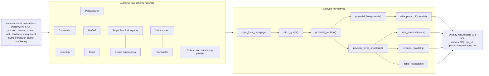

# Connections, terminals and cables: connectivity and wire properties

A chapter of [Connections, terminals and cables](08-connections-terminals-cables.md), whose table says where each section lives.

---

## 1. Scope and position

Only facts a human decided are stored. These are connections and their routes, junction sequences, definition
points, bonds, overrides, strips, terminals, bridges, cables and conductors. Nets, signals, potentials, physical wires,
effective wire properties, printed wire numbers, terminal rows and cable rows are derived queries in `ew-derive`
(ARCH §6.4, ADR-0001, ADR-0002). None of them is ever persisted. `potential_flow(potential)` and
`physical_wires_of(potential)` are rows of the ARCH §6.4 catalogue. ARCH §6.3 makes the potential, not the net, the
finest memo key, so both are keyed per potential, as in [03](03-domain-model.md) §9.2 and
[06](06-schematic-editor.md) §5.5.

| Topic | Decided here | Decided elsewhere |
|---|---|---|
| Record names and fields | Detail, plus the additions in §2.3 | [03](03-domain-model.md) §9, §11, §12 |
| Drawing wires, junction tool, marker tool, IP placement | Semantics only | [06](06-schematic-editor.md) §3.5, §4.4 |
| FnDef internal links, CP patterns, clamp and cable-core data | What the queries read | [07](07-symbols-parts-macros.md) §2.4, §2.5 |
| Interruption-point pairing, xref texts | Use of the pairs for connectivity | [06](06-schematic-editor.md) §2.8, [03](03-domain-model.md) §10 |
| Report forms, pagination | Row sources | [09](09-reports-forms-output.md) |
| Bus ports, networks | Single-line bus cables | [10](10-plc-and-bus.md) |
| Routing and routed lengths | Length sources, PE through carriers | [12](12-panel-layout.md) |
| Wire records, ferrules, markers, machine files | Physical-wire identity, orientation and properties | [13](13-manufacturing-outputs.md) |
| QET mapping | Connectivity rules that the importer must reproduce | [14](14-interop.md) |
| Rule engine, final rule IDs, waivers | Rule content (§8) | [15](15-checks-revisions-collaboration.md) |



---

## 2. Concepts and data

### 2.1 Vocabulary

| Term | Meaning in EW | Example (reference project) |
|---|---|---|
| Connection point (CP) | An instantiated point of a function, derived from the FnDef or part pattern (`v5(function, idx)`) | -101F1:N#1, -X1031:1 clamp b |
| Connection | An explicit logical edge between two endpoints (CP or junction), with a route (ADR-0007) | the drawn line S51:1 → -101F1:1 |
| Junction | A T-node with a style (Dot, Bevel), a wiring mode (Star, Chain) and an ordered sequence | J1 at F55:2 |
| Daisy chain | Several connections on one CP, without a junction (FR-CON-006) | W7 and W8 on -101F1:1 |
| Net | CPs joined by wires, cores, bus lines, internal links, junctions and IP pairs | W29 plus the IP 24VDC-1 |
| Signal | Nets joined through `Short` links inside one function: terminal levels, plug pins, duplicated pins | W29 and the BN core through -X1031:1 |
| Potential | Signals joined by bridges and rail bonding: the electrically equal set | 24VDC-1 over -X1031:1–4 |
| Physical wire | What the shop cuts: one CP-to-CP piece, resolved through junctions and IP pairs | W11 across L-1 |
| Bond | A declared link of two potentials that does not merge them | B1, 0V ⇄ PE via W27 |
| CDP | Connection definition point: the explicit overrides of one connection, drawn as a wire annotation | "2.5 BK BU" on W4/W5 |
| Strip, terminal | Devices with the `Strip` and `Terminal` aspects. A terminal is a device | -X1031 and its 20 terminals |
| Level, clamp, side | The CP locus on a terminal. Side 1 is internal and side 2 is external by default | -X1031:1 (1/a) |
| Bridge | A `Connection{kind: Bridge}` between terminal CPs. It joins potentials and is never a wire | BR1 over -X1031:1–4 |
| Cable, conductor | A device with the `Cable` aspect and its cores or shield | -106W1, core BN |

### 2.2 Records used

The members of each record, with what each holds, are its struct in `ew-schema` and its generated schema
(`schemas/0.1/`); this table says where each record lives.

| Record | Kind, file |
|---|---|
| `Connection` | A; page file, or the shard of the device owning `a` when it has no page ([05](05-project-format-and-persistence.md) §2.2) |
| `Junction` | A; page file |
| `PotentialDef` (a `ptype` absent: a name only) | A; shard |
| `NetDef` (not built) | A; shard |
| `Bond` | A; shard |
| `Function.cp_overrides` | A |
| `Terminal` aspect, with `Device.state` and `function_text` | A; shard |
| `Strip` aspect | A; shard |
| `Cable` aspect | A; shard |
| `Conductor` | A; the cable's shard |
| `ColourProfile`, `SizeProfile`, `WireNumberingScheme` (§4.2, §5.2) | A; in `ProjectSettings` (`project.jsonl`), record shapes in [03](03-domain-model.md) §5.1 |
| `CpDef` (library) | L; [07](07-symbols-parts-macros.md) §2.4 |
| `FnDef` (library) | L |

### 2.3 Detail and schema additions

These refine [03](03-domain-model.md) without changing its concepts. They are part of the schema-steward batch
(ARCH §7.6) that 03 §1.2 records before `ew-schema` v0 freezes; `SingleLine` is the connection kind of
FR-CON-044.

A connection is of one kind (`ConnectionKind`, `crates/ew-schema/src/connect.rs`): a wire (one conductor), a cable
core or shield, a terminal bridge (it joins potentials and is never a wire), a fluid line ([11](11-fluid-power.md)), a
single-line bus connection between bus-port CPs (its cable, FR-CBL-008), an overview line (excluded from nets: the
stand-in for single-line power lines, FR-CON-044), or an internal link between CPs of two functions of one part's
template that no FnDef declares. A single-line connection of several conductors, excluded from nets and mapped onto
multi-line connections, is 1.0 (FR-CON-029). The members of a bridge (`BridgeSpec`), a clamp key, a strip's terminal
groups and field side, a potential's environment (its earthing among them) and a wire's overrides (its manual
`length`, which works without a layout space, moved by the number-transfer normaliser of §5.1) are the structs of
`ew-schema`, and the stored forms are the generated schemas (`schemas/0.1/`).

- **No connection for PLC bindings.** A channel binds the coil's non-physical CP directly (`Channel.binding`,
  [10](10-plc-and-bus.md) §3.3), so wire lists and length calculations have nothing to exclude. `Internal` is kept
  for the other device-internal links: links between CPs of two functions of one part, declared by the part's
  function template ([07](07-symbols-parts-macros.md) §2.5), which no single FnDef can declare.
- **`BridgeSpec.group`** makes a multi-pole comb one object. The Bridge connections of one group lie on one strip,
  between consecutive `seq` values on one shaft. Only the first connection carries the bridge part. It is stored in
  `overrides.wire_part` as in [03](03-domain-model.md) §11, but read as level-6 intrinsic data, because no profile
  level applies to bridges. Reports print one row per group and the BOM counts the part once per group. The
  strip editor creates BR1 (-X1031:1–4) as three connections 1–2, 2–3 and 3–4 with group 1.
- **`ClampKey`.** Wires end on clamps. Plug-in bridges end on shaft CPs. Rail-bonded PE terminals have a rail-foot
  CP for carrier bonding at 1.0. A shaft and a rail foot are joined to the level's clamps by FnDef `Short` links.
  A terminal whose part has no shaft, or that has no part yet, is bridged at
  the lowest side-1 CP of its function definition, so bridges can be drawn before parts are chosen; Bridge terminals
  (`strip.bridge`, on the Draw tab) draws the chain over two or more selected terminals of one strip (consecutive in `seq` order) in one
  undo step, one `connection.draw` for a pair and one `connection.draw_many` for a longer chain ([06](06-schematic-editor.md) §3.1).
  A bridge between terminals
  without a part shaft is stored as a plug-in bridge on shaft 1 at their lowest side-1 CPs.
  **A bridge joins terminals, not CPs**, for every editor rule: two
  terminals are bridged when a bridge connection joins any CP of one to any CP of the other, so Bridge terminals
  keeps such a pair and refuses when every selected pair is bridged. The stored CPs stay what was drawn (a side-1 fallback bridge stays on its clamps when a part with a shaft
  is chosen later); re-seating onto the shaft waits for the terminal assembly list (FR-MFG-016, 1.0). **A block's level is bridged on
  its own:** selecting the level-2 symbols bridges at the level-2 CP of the
  same side, on shaft 2 (shaft = level), and a bridge joins terminals at its own level only, so a level-1 bridge does
  not refuse a level-2 one. In the Terminal strips table a row of a block is one level (`terminal:<id>:<level>` from
  level 2) and selects that level's symbol; F2 on the Bridge cell over two or more marked terminal rows bridges them,
  and on one row the cell says how a bridge is made; a single terminal's menu shows Bridge terminals greyed with
  "Select two or more terminals of one strip". **The bridge's
  part** is the `overrides.wire_part` of its group's **carrier**: the group's first connection with a part, else its
  first connection, in (lower `seq` of its two terminal ends, connection ID) order. The memoised derived query
  `strip_bridges(strip)` (`StripBridges`) groups a strip's bridge connections by `BridgeSpec.group` (a connection
  belongs to the strip of its first terminal end, `a` then `b`) and gives per group its kind, terminals (in `seq`
  order), connections, carrier and part. `device_part_lines(strip)` appends one BOM line of quantity 1 per group
  with a part (`LineSource::Bridge`, after the strip's accessory lines, in group order), so the BOM counts a bridge
  part once per group by construction.
- **Strip groups** label ranges of terminals. The terminal's own `function_text` holds its printed label ("1+").
  So "1+" is the printed function text and "Pneumatics" is the group label.
- **`Strip.field_side`** says which terminal side faces the field when a strip is mounted the other way round. The
  default is Side2 (FR-TRM-012).
- **Part data read here** ([07](07-symbols-parts-macros.md) §2.5, levels L1 and L2):
  - clamp data per CP: cross-section ranges, maximum conductors, twin-ferrule permission (FR-CON-028, 1.0);
  - `cable_cores`: core ID, colour, csa, shield, pair, the connector pin per end, a fixed length for pre-assembled
    cables, and the outer diameter;
  - bridge parts: pole count and pitch.

---

## 3. Connectivity semantics

### 3.1 Connections and endpoints

| ID | Invariant | Class | Behaviour |
|---|---|---|---|
| CI-01 | Both endpoints exist and differ (no self-loop on one CP) | S | Reject |
| CI-02 | `Fluid` joins fluid CPs; `Bus` joins bus-discipline CPs; `Wire`, `Core`, `Bridge`, `Internal` and `SingleLine` join electrical CPs | S | Reject |
| CI-03 | A `Bridge` joins two terminal CPs of one strip, or of two strips on the same carrier for saddle bridges (1.0) | S | Reject |
| CI-04 | Every connection ending at a junction is in its `sequence`, and the reverse. A junction has at least three connections | S | The junction clean-up normaliser restores it in the same transaction. A two-connection junction dissolves into one connection that keeps the lower ID ([06](06-schematic-editor.md) §3.2) |
| CI-05 | `Core(c)`: the conductor exists. Two connections that are not parts of one physical wire do not use the same conductor | P | Strict rejects. Lenient reports EW-CORE-036 |
| CI-06 | A Bridge group runs over consecutive `seq` on one shaft, and groups do not overlap on a shaft | P | Strict rejects. Lenient reports EW-TERM-004 |
| CI-07 | `Overview` and `SingleLine` connections never take part in nets (FR-CON-002, FR-CON-029) | S | — |

Moving representations never changes an endpoint. Only routes follow (FR-CON-004). Connectivity therefore never
depends on geometry, except through the explicit commands that create connections: autoconnect, splitting and the
cable definition line (ADR-0007).

A page connection without a stored route whose ends lie at
two points is **unrouted**. It keeps its connectivity (its potential, its wire number, its rows in the wire list), but
it has no wire geometry: it is drawn as a dashed right-angled line between its ends on the canvas and in every export,
normaliser 7 does not split it, EW-TERM-006 and autoconnect do not see it, and EW-CORE-073 reports it (an info, an
error in release mode) as drawn dashed for want of a route. Route draws it where a clear way exists. A route-less
connection whose ends meet is drawn as nothing and is not unrouted.

### 3.2 Junctions and wiring sequence

A junction tells the shop **which CP is wired to which**. A dot or a bevel only says that a T exists (D-20).

- **Arm order.** The arms of a junction are its connections in `sequence` order. **Arm 1 is the feed arm**.
- **Star.** The CP reached through arm 1 is wired to the first CP of every other arm.
- **Chain.** The CP reached through arm 1 is wired to the first CP of arm 2. The last CP of arm 2 is wired to the
  first CP of arm 3, and so on.
- **Nested junctions.** An arm that leads to another junction *enters* it: the sub-junction receives the current CP
  as its entering CP and resolves its own non-feed arms. Under Chain the parent continues from the last CP the
  sub-junction reached. Under Star the sub-junction's arms are spurs of the entering CP. Every arm that ends at a CP
  yields exactly one wire, except the feed arm of the root junction, whose CP is the entering CP. The root is the
  junction whose feed arm ends at a CP.
- **Ambiguous feed.** An arm between two junctions must be the feed arm of exactly one of them. If it is the feed arm
  of both or of neither, EW roots the tree at the junction with the lowest ID and reports EW-POT-011 with the quick
  fix "reorder sequence".
- **Defaults.** A Dot junction defaults to Star and a Bevel junction to Chain (ADR-0007). A
  junction is created by ending a wire on another connection. Its default sequence lists the two parts of the split
  connection, the part nearer the potential's source first (flow distance, §3.6, with reading order as tie-break),
  and then appends the new branch. [06](06-schematic-editor.md) §3.5 uses the same rule (PQ-27).
- **Daisy chain versus junction.** Two connections on one CP are a daisy chain (FR-CON-006). Their order is the
  order in which the shop lands them on the clamp. It is ascending connection ID unless a junction sequence fixes it.

The wire list prints (D-20) how a wire is joined in its Via column: the junction it passes by
its place and effective wiring, "101-C11 star at F55:2" (Star: the entering CP) or "102-C6 chain on -102F1:1"
(Chain: the wire's ends shared with another wire of the junction), and its daisy chains, "chain on -101F1:1" (a
device CP that two drawn `Wire` or `Core` connections touch). `ew-derive`'s `wire_join` derives it; the style (dot,
bevel) stays drawing notation. `api_v1_wire` carries the same facts (`junction_id`, `junction_style`,
`junction_wiring`, `junction_cell`, `junction_cps`, `chain_cps`, Preview additions). A daisy chain is reported at a
device CP only: a terminal CP touched by two wires is not a chain, because a terminal joins its wires through its
levels and clamps (§6) and the code excludes terminals. Every CP in the Via text, in `junction_cps` and in `chain_cps`
is printed by the one label rule `cp_label` (§3.8 "Wire-end locus").

### 3.3 Net, signal, potential

| Level | Joined by | Bounded by | Used for |
|---|---|---|---|
| Net | `Wire`, `Core`, `Bus` and `Internal` connections; junctions; IP pairs | function CPs | physical wires, net definitions (level 5), live highlight during drags |
| Signal | nets plus FnDef `Short` links (terminal levels, plug pins, +#1/+#2) | bridges, rail bonds, pass-through pairs | net extension in numbering (FR-NUM-020), net definitions (level 4) |
| Potential | signals plus `Bridge` connections and rail bonding (FR-CON-015) | pass-through pairs, loads, bonds | names, types, wire properties, checks, highlight, potential overview |

```text
page_local_nets(page)                            // memo per page, union-find over the page's CPs and junctions
  union a and b of every page-owned connection with kind ∈ {Wire, Core, Bus, Internal},
        except a connection named as Bond.via    // the bond cut, §3.7
stitch_graph()                                   // memo; nodes: local nets, plus CPs touched only by page-less links
  NET       edges: IP pairs (xref pairing), page-less Wire/Core/Internal connections
  SIGNAL    edges: FnDef Short links within one function
  POTENTIAL edges: Bridge connections (drawn or page-less); rail bonds (§3.7)
  non-joining:     Bond edges; PassThrough pairs (flow edges, §3.6)
potential_partition()                            // memo; one union-find, three snapshots
  apply NET edges → snapshot nets; apply SIGNAL edges → snapshot signals; apply POTENTIAL edges → potentials
  edges are applied in (level, kind, min endpoint ID) order, so the result never depends on load order
```

The stitch graph has one node per local net, about 10–15 % of all CPs (ARCH §6.4). ARCH §6.7 estimates 5–10 ms per
committed wire edit in its XL-A estimate case, inside the NFR-PERF-05 budget of 20 ms. Live highlighting during a
drag uses `page_local_nets` only.

### 3.4 Stable identities

| Object | ID | Stable under | Changes when |
|---|---|---|---|
| Net, signal | minimum member CP ID | moves, renumbering, property edits, edits elsewhere | the minimum member leaves the set |
| Potential | minimum `PotentialDef` ID among its definitions, else the minimum member CP ID | the same, plus adding or removing other members | its last definition is removed, or the potential is split away from it |
| Physical wire | ID of its carrier connection (§3.8) | moves, route edits, renumbering, adding unrelated wires | the carrier connection is deleted or the decomposition changes (§5.1 moves its number) |

This is the rule of [03](03-domain-model.md) §9.4 and the ARCH §6.4 `PotentialId`. Taking the
minimum definition ID keeps the identity when a user adds a second, equal definition symbol. The IDs key the
per-potential memos (`wire_props_of`), highlight state, `api_v1_potential` rows and finding fingerprints. A wire edit
that leaves membership unchanged keeps every PotentialId, so dependent memos are backdated and stay green
(ARCH §6.2). When two potentials merge, the merged potential's ID follows the same rule: the smaller definition ID if
either side has a definition, else the smaller CP ID. A potential with a definition therefore never loses its ID to
an undefined one.

### 3.5 Names and aliases

- **Canonical name.** It is the first of these:
  1. the `PotentialDef.name` (of the first definition in rank order, §3.6);
  2. the name of the first source IP in page order;

     2b. the supply's name `<root>/<tag>:<designation>` of a potential entered through the pass-through pair of a
     function f (its flow `upstream`, §3.6): `<root>` is the name of the nearest upstream potential named by step 1
     or 2 (the walk passes through potentials named by step 2b), `<tag>` is f's displayed tag without its leading
     aspect sign and `<designation>` is the pair's downstream CP, for example `L/S51:2`. A potential without an
     upstream, or whose walk reaches a potential named by step 3, takes step 3;

     2c. the name of the first interruption point of another direction (a target, an undirected point) in page
     order, non-external points before external ones: a point names the potential it carries whichever its
     direction, so a supply drawn at the page's left edge as a target with no source yet, or one
     coming in from elsewhere (Supply comes in here…), names its wires. Its own rule still reports it unpaired.
  3. a fallback `<displayed tag>:<CP designation>` of the member CP that comes first in (page order, row, column),
     ties by that fallback text in natural order, then by CP ID (so two CPs of one anchor cell, such as a terminal's two sides, give the same name in every fresh copy of a project, whose IDs are random; blind replay, §6 item 3).
     A protective earth (type PE) whose first CP is an earth connection's, which has no tag, is `PE`, not that pin's
     designation (an imported earth point's `1`).

  An external source interruption point counts as a source IP for step 2.
  A potential named only by step 3 may be **offered** a name, never given one: the window
  shows a card at the selected wire, and Accept is an ordinary `potential.define`. It reasons only from a member CP's
  own `potential_role`, or from the A2 of a coil whose A1 is on a potential of type L+ (A2 is then M) or of one phase
  (A2 is then N); every such CP must agree. The project's one potential of that type named by steps 1 to 2b gives
  the name; where it has none, the offer is a new potential of that type named by the type's printed word (`0V` for
  M, `N`, `PE`, `L+`, with `-2`, `-3` where another potential bears it); two or more offer nothing
  (`Session::potential_offer`). A part's coil voltage (`coil_voltage`, 24 V) does not say AC or DC, so a coil whose
  A1 has no type gives no reason. A potential without a type whose name (steps 1 to 2b) is a type's own word (`N`,
  `PE`, `L1`, `L2`, `L3`, `L`, `L+`, `L-`, `M`, `0V`) counts as that type, for a coil's feed ("fed from L1") and for
  the project's potentials of a type; such a potential, its wire selected, is itself offered the type ("Type L1?"),
  since the type gives its wires their colour and cross-section, and Accept defines it with its name and that type.
  A declined offer is not shown again for that wire in the session.
- **Aliases.** Every other distinct IP name on the potential is an alias, in natural order (FR-CON-012, D-24).
- **Signals** take the first IP name inside them.
- **Bond paths.** IPs that lie on a bond's `via` path are named on the bond, not on either potential. "PE-0VDC"
  therefore names B1 and is neither an alias of 0V nor of PE.
- **Conflicts.** Two definitions with different names in one potential produce EW-POT-017. The first definition in
  rank order (§3.6: natural order of the name) wins.
- On a Potentials row known only at its CPs, the **Name** cell is a
  defining cell: typing a name compiles to one `potential.define {at: the row's CP, name}`, with the Type, Voltage
  and `env.ac_dc` typed in the same gesture. Type, Voltage or `env.ac_dc` alone on such a row refuse in the cell with
  "Name the potential first".
- Step 2b lives in `potential_name`, between the source point and the
  fallback; the walk is guarded against a revisit (the flow is a tree). Supply names over a fuse and a switch are
  equal over two runs and under permuted IDs.

Example: 24VDC-1 has no definition and takes the name of its source IP on folio 102. Its aliases are 24VDC-AIR1 …
AIR4. 0V is defined, with aliases 0VDC and 0VDC-AIR1 … AIR4. PE is defined, with 7 aliases: J-E-206-PE, PE-1.1 …
PE-1.4, PE-AIR1 and PE-AIR2.

### 3.6 Types, voltage, circuit class and flow

`potential_flow(potential)` runs after the partition. It derives each potential's type, its flow from the supply,
its switched state and its protective device. Each potential's memo holds its entry of one BFS over the whole
partition, which reruns only when the partition or a pass-through pair changes.

```text
potential_flow(potential):                              // memo per potential; the BFS below runs once per partition
  roots (distance 0): potentials that contain a supply source:
     external connection points (IpSpec.external) of the incoming supply;
     CPs whose CpDef sets source_output (PSU +/−, transformer secondary, battery; 07 §2.4);
     input CPs of a source (PSU L, N, PE) are ordinary members, so L-1 is reached through -101F1, not a root
  type(P) := PotentialDef.ptype, else the potential_role of member CPs ("+" → L+, "−" → M, PE pin → PE), else Undefined
  BFS over PassThrough pairs in (distance, function ID, pair index) order:
     pair (u, d, opens) of function f, P_u reached, P_d not yet reached:
        distance(P_d) = distance(P_u) + 1;   upstream(P_d) = (f, pair)
        type, voltage, env of P_d := those of P_u unless set by a definition or a member CP role   (FR-CON-011)
        (a name-only definition, ptype = None per 03 §9.4, does not stop propagation)
        switched(P_d)     = switched(P_u) or (opens and not protection(f) and not f.flags.switches_n_with_l)
        protected_by(P_d) = f if protection(f), else protected_by(P_u)
  protection(f): f's category carries the `protection` flag of the category table (ew-rds data/identifier-sets.toml)
  unreached potentials: distance ∞; orientation and numbering fall back to page order
```

- **Switched.** `switched` marks functional switching: contacts, switches, thermostats. MCBs, fuses and electronic
  circuit breakers are protection, so their outputs are not "switched". All-pole switching devices such as S51 do
  not set it either. In the example exactly N-55T (via T55) and N-55S (via S56) are "N, switched".
- **Protected by.** `protected_by` names the nearest upstream protective device. 24VDC-1 is protected by the Out1
  channel of -102F2. This feeds the load summary (FR-REP-026) and D-25.
- **Circuit class** (FR-CON-022) comes from the size profile's class rules, unless `PotentialDef.circuit_class` sets
  it. The rules are evaluated in order and the first match wins. The company profile uses:
  1. PE, PEN and FE are Pe;
  2. bus-discipline potentials are Bus;
  3. analogue-flagged signals are Analogue;
  4. AC at 50 V or more is Mains;
  5. all other AC and all DC is Control.
- **Voltage classes** for colour rows are named ranges in the profile data: "24 VDC" is DC from 0 to 120 V,
  "230 VAC" is AC from 50 to 250 V, "400 VAC" is AC above 250 V up to 1,000 V. These bounds are the company
  profile's choice (the ELV and LV limits), not quoted standard text.
- **Conflicts.** Two types or voltages meeting in one potential produce EW-POT-001 (FR-CHK-028). So do a defined
  type that contradicts a member CP role (compatible roles excepted: FE on PE or PEN, PE or N on PEN, L on any one
  phase L1, L2 or L3, as a single-phase input fed from one phase), definitions that disagree on voltage,
  environment or class, and a
  pass-through pair whose two reached sides have different types without a converting function. They are errors; the
  first definition in natural order still gives the value. Nothing merges silently.
  Member roles that disagree on a potential without a
  definition are ranked by a fixed role order (PE, PEN, FE, N, L1, L2, L3, L, L+, L−, M, signal, undefined), never by
  CP or ID order, and the finding targets every member function; the definition half still follows ID order. A role
  compatible with the first by the list above (an L pin beside an L1 pin) is no conflict there either.
  Which member roles may meet on one potential, either order: **nothing to report**
  for equal roles, FE on PE or PEN, PE or N on PEN, L on one phase, M with L− (two names of one 0 V), a signal on any
  conductor but an earth (a signal pin wired straight to a supply is a fixed level), and an undefined role or one of a
  newer format with anything; **a bond** for 0 V (M or L−) on PE, which a drawn wire declares (§3.7, the drawn bond);
  **a fault** for every other pair: a live conductor (L1, L2, L3, L, L+) on PE, PEN, FE, N, 0 V or another live
  conductor, N on PE or FE, AC with DC, a signal on an earth. The conflicts are records of the derivation (the
  definitions or member CPs and the attribute), and EW-POT-001 words each as a sentence in the trade's words: what is
  wired to what, on which page, why that is a fault and what to do ("-G1:+ (L+) is wired to -X1:N (N) on
  page 3: a wire joins two different potentials. Take that wire away.").
  A potential's definitions are **ranked** by natural order of the
  name, then the defining point's printed text (`<tag>:<designation>` of its CP; a junction's after every CP's), then
  the ID, which decides only between two definitions that print alike. The first applies its values and names the
  potential, every definition is a target of the finding, and the conflict texts name definitions and member CPs by
  their printed text in that order, never by ID. So a 0V and a PE definition merged by a plain wire, without a bond,
  give one potential named 0V in every fresh copy of the project.
  *Ruled.* Such a merged potential keeps the name 0V but does **not** take 0V's
  colour: an unbonded merged 0 V/PE potential shows the PE colour, and EW-POT-001's
  conflict colour overrides it on the canvas ([16a](16a-design-language.md) §7.5). Not built.
- **Loads** (FR-REP-026). A load of a potential is a consuming function on it: the upstream
  feeding function and every function with a pass-through pair touching the potential are excluded, and end
  consumers such as coils, lamps and PLC inputs are loads.

### 3.7 Bonds and rail bonding

- **Bond cut.** A `Bond{a, b, kind, via}` adds a non-joining edge. Its `via` connection (the carrier of the bond
  wire) is left out of union at both levels. B1 (`Pelv0vPe`, via W27) keeps 0V and PE as two potentials (FR-CON-014,
  D-22). The bond wire is still a physical wire: physical-wire extraction runs on the full drawing graph, including
  via connections (§3.8). The wire list shows W27 with potential "0V ⇄ PE". `bond.create` refuses a `via` that does
  not run between the bond's two ends, naming the two points it does join; a bond a saved project holds is read as it
  is.
- **The drawn bond.** A wire drawn on a page from a 0 V point to a protective-earth point is the
  bond itself: whoever draws it has declared it, and no second declaration is asked. `page_local_nets` joins the page
  without the connections that end on a PE-role CP first; then such a connection with exactly one end on a PE-role CP
  whose other end lies in a net holding an M- or L−-role CP is an **earth wire**: it is cut like a bond's `via` and
  both its ends stay nodes of the page. The partition lists every earth wire as a bond (`BondLink::drawn`, kind
  `Pelv0vPe`, its ID the connection's, `a` the 0 V side), so the 0 V keeps its own name, type and colour, the wire
  list shows the wire as "0V ⇄ PE" and EW-POT-002 counts it (a PELV 0 V with one earth wire is satisfied, with two it
  is reported). A point says what it is by a pin's role, else a potential definition's type there, else (no
  type) a definition or an interruption point named by the type's word (`0V`, `M`, `L-`; `PE`, `FE`), so a 0 V
  typed from the list, a potential named 0V and a 0 V carried in by an interruption point named 0V are earthed alike.
  A 0 V point is also a definition or an interruption point whose name's head (the part
  before a dash with something after it, spaces aside) is `0V`, `0VDC`, `M` or `L-` (`0VDC-6`, `0 V DC`; the supply
  marks' panel proposes the kind M for such a name): an imported supply whose pins say nothing, its 0 V named by its
  mark, stays 0 V when it is earthed. And the rule follows the potential over the page links: the derived
  `zero_volt_ips` holds every interruption point whose net, joined without the connections to earth points, holds a
  0 V point, or reaches one through the pairs of interruption points, net by net and page by page; such a point is a
  0 V point of its own page, so the wire from it to an earth point is the bond wherever the 0 V was named.
  A wire to **functional earth** (an FE pin or the functional earth symbol) is the 0 V earthed for function: the two
  stay apart (`BondLink` kind `Equipotential`), it is no PELV bond, and EW-POT-002 tells a PELV 0 V that goes to
  functional earth only that its bond belongs on protective earth. Only a 0 V that reaches the earth wire through a
  point that says nothing and joins no page (a terminal's other side), or that nothing names 0 V anywhere, still
  meets PE, and the declared bond below is the way to say which wire bonds it.
- **PELV and SELV.** An M-type potential is PELV when it has a `Pelv0vPe` bond or `env.earthing = Pelv`.
  EW-POT-002 requires exactly one such bond. A potential declared `Selv` must have none (FR-CHK-028).
- **The 0 V–PE quick fix.** When a potential's member CPs
  (interruption points aside) carry both a 0 V role (M or L−) and the role PE, its EW-POT-001 finding carries the
  quick fix
  "Declare 0 V–PE bond (PELV)": one `bond.create {a, b, kind: pelv_0v_pe, via}` on the potential's **carrier**, which
  then keeps 0 V and PE as two potentials and satisfies EW-POT-002. The carrier comes from the derived query
  `bond_carrier(potential)`: a connection whose removal splits the potential's connection graph (its member CPs and
  junctions; the joining connections minus those a bond already cuts; the shorts inside a function, the
  interruption-point pairs and each location's rail bonds) into one part holding every M-role member CP and one
  holding every PE-role member CP. The bridges of that graph are found by one depth-first search (Tarjan), so
  parallel wires are never a carrier. The candidates order on printed keys only: one end on a PE-role CP first, then
  the displayed wire number in natural order (an unnumbered wire last), then the two ends' `tag:designation` texts;
  `a` is the M-side end, `b` the PE-side end. With no candidate, a disconnected graph or a tie between the first two
  on every key there is no fix, and the sentence says to declare the bond with Draw ▸ Connect ▸ Bond. The query is
  **Cold**, not memoised; only EW-POT-001 asks for it, and everything it reads is memoised.
- **FE to PE.** An `FePe` bond declares a deliberate FE–PE link. Without one, FE-role CPs on the PE potential are
  reported (EW-POT-003, D-16). A device's intended earthing point (an earth screw) carries role PE, not FE.
- **Rail bonding at MVP.** Each location node (`+J-E-2416`) has a virtual "location PE node". The PE CPs of every
  rail-bonded terminal of that location join it as a POTENTIAL edge (FR-CON-015, FR-TRM-017). In the example
  1X1:PE (USLKG 5) and -X1032:1–5 are rail-bonded. -X1032 therefore joins 1X1:PE, and through W6 the PE bar -XPE, in
  one PE potential although no wire runs between folio 101 and the -X1032 strip on folio 103 (D-21). Only CPs with
  clamp `RailFoot` or role PE or PEN join the location node. A rail-bonded terminal without
  any PE CP is EW-TERM-005; one without a location is skipped and reported as EW-POT-008.
  A terminal without a location belongs, for rail bonding, to the
  project's implicit main location while the project has at most one own location (a location node that no
  external reference names; `+J-E-206` of an external point is not one): it joins the only own location's PE node,
  or an implicit main-location PE node when the project has none. It is skipped and reported as EW-POT-008 only
  when the project has two or more own locations. The own locations are the
  location nodes that no external reference names, or that an own device or page assigns as its location (a node
  both named by an external reference and assigned by an own device or page is own).
- **Rail bonding at 1.0.** When a layout space exists for the location, the partition replaces the location node.
  A rail-bonded terminal then joins PE only through a carrier and surface that both declare `pe_bond` (FR-LAY-058).
  A difference between the two models is reported on migration.

### 3.8 Physical wires

Connections are drawing edges. The shop needs CP-to-CP pieces. `physical_wires_of(potential)` extracts them from the
drawing graph. Its nodes are the potential's CPs, its junctions and its IP CPs. Its edges are the `Wire` and `Core`
connections, plus the IP-pair links, including bond-via connections. Potentials joined by a bond-via connection are
extracted together. `Bridge`, `Internal`, `Bus`, `Fluid`, `Overview` and `SingleLine` connections never form
physical wires.

```text
physical_wires_of(potential):                              // memo per potential (granularity rule, ARCH §6.3)
  hubs  = junctions ∪ star IP groups with more than two members (feed arm = the star source's drawn connection)
  transparent nodes = IP CPs with one drawn connection and one pair link (chain pairs are plain links)
  resolve(h, entering):                                   // §3.2
     cur = entering
     for each non-feed arm a of h in sequence order:
        if a ends at a CP c:   emit wire(Star ? entering : cur, c, carrier = connection of a that touches c)
                               if Chain: cur = c
        if a ends at a hub h2: last = resolve(h2, Star ? entering : cur);  if Chain: cur = last
     return Chain ? cur : entering
  for each root hub (feed arm ends at a CP): resolve(root, that CP)
  every hub-free path between two physical CPs: one wire; carrier = the end constituent whose adjacent IP is a
     Target (IpSpec.direction); if both or neither end is next to a Target IP, the end constituent with the smaller
     connection ID; a path without IPs is a single connection, which is its own carrier
  wire.id      = wire.carrier.id       // the target-side connection; stable UUID, FR-MFG-001
  wire.constituents = the connections on the path, in order from the first end
  wire.core    = the conductor if any constituent is Core(c); every Core constituent must name the same c (EW-POT-014)
  ring (a cycle in the drawing graph): broken at its highest connection ID; EW-POT-012
```

- **Examples.** W11 (-101F1:2 → L-1 → -102G1:L) is one wire carried by the folio-102 connection, the leg at the
  Target point of L-1. In J1, W13 and W14
  are carried by the J1 → E55:L and J1 → E56:X2 connections. The F55:2 → J1 arm is shared by both wires and carries
  neither. W26 is carried by the folio-103 connection IP 0VDC → -X1031:11/a.
- **Carrier is not orientation.** The carrier is chosen from the junction sequence, the IP directions and IDs, all
  authored, so page renumbering, flow changes and moves never change a wire's ID. "Carrier connection" is unrelated
  to the layout `Carrier` (rail, duct) of [12](12-panel-layout.md).
- **Orientation (From/To)** is a presentation rule. It does not affect identity.
  1. If the two ends are on different pages, From is the end on the earlier page in page order.
  2. On one page, From is the end with the smaller flow distance: hops over the potential's wires, bridges and
     terminal shorts, from the CPs where the potential enters (roots of §3.6, or the downstream side of its upstream
     pass-through pair).
  3. Ties are broken by the anchor cell (row, column) and then by CP ID. A terminal drawn only by a strip segment
     has no anchor of its own: its anchor cell is the cell of its CP in the segment (§6.7).
     The anchor cell of an end is the smallest cell (row, column)
     of its function's representations on the wire's page;
     ties then go to the CP label in natural order, then to the places the function is drawn at (page order, cell),
     and the CP IDs come last, so no minted ID decides an orientation that the print can decide.

  Examples: 1X1:1 → S51:2, because the supply
  enters at J-E-206-L; -102G1:+#2 → -102F1:1; E55:PE → -X1032:1/b, by page order.

  `ew-derive`'s `orient_wire` applies the
  three rules. Rule 2 reads the memo query `cp_flow_distance(potential)`: a breadth-first walk from the entry CPs (a
  root potential's external points and source outputs; otherwise the `to` CP of its upstream pass-through pair)
  over the potential's physical wires, bridges and the `Short` links of any function (terminal levels and declared
  shorts alike); duplicated pins of a black box count as one point (the same distance). A rail bond is not a hop, so
  a rail-bonded island that the walk reaches only through the rail stays unreached and its wires fall through to
  rule 3. It decides only when both ends lie in the wire's one potential and the walk reaches both with different
  distances (a bond wire and an unreached potential fall through to rule 3). Rule 2 decides before the anchor cell;
  W1 to W5 start at the supply side. The point and cell of every CP come from one owner, `cp_point` and
  `cp_cell` (the page scene restates them).
- **Wire-end locus.** A terminal end prints `strip:terminal (level/clamp)`, for example "-X1031:1 (1/a)"
  (FR-TRM-006, FR-MFG-002). A device end prints `tag:designation`, with `#n` only where printed designations repeat
  (`-102G1:+ #1`). `cp_label` of `ew-derive` is the one owner
  of this label; the From/To CP columns of the wire list (`conn::end_text` in `ew-reports`) still drop `#n` and are to
  converge on it. A terminal end whose function repeats a clamp letter within one level
  prints `#n` after the clamp, the n-th CP of that level and clamp in index order (`-X1:1/a#2`); `cp_label` owns it. The starter terminal FnDefs give side 1 clamp `a` and side 2 clamp `b` (§6.1, §6.3), so 1X1 prints `1X1:1/a` and `1X1:1/b`; the rule applies only to third-party
  FnDefs that repeat a letter.

The families of §3.3 to §3.8 are in `ew-derive`,
Memo by policy and cold in phase 1. Decisions the code had to fix:
- An interruption-point group without `ip_pairing` is a star with project scope; its source is the point flagged
  `star_source`, else the single Source point, else the point with the lowest ID.
- A terminal FnDef without pass-through links joins all CPs of one level; a terminal with a declared pass-through
  (disconnect or fuse terminal) still shorts its clamps of the same level and side, and the pass-through links the
  sides. Equal pin designations of one function are one signal only for black-box and
  part-pattern-origin functions, never for terminals and never across levels.
- The carrier of a junction arm is the connection of the arm that touches the end CP, as the pseudo-code above
  says, also when the arm crosses an IP pair; the Target-IP rule applies only to hub-free paths, which fixes wire
  IDs.
- A connection to a missing function still forms one physical wire, which ends at the missing CP; accepted for now
 .
- Only a bond's `via` connection is cut, and the IPs on the `via` path name the bond (§3.5); drawn bridges join at
  the potential level only (§3.3); there is no separate conductor edge, because `Core` connections and the IP pairing
  suffice.
- `Partition.ptype` holds the definition's type and the role types; N-55S and N-55T take their type from the flow.

---

## 4. Wire properties

### 4.1 The inheritance chain

The effective value of each property comes from the highest level that sets it. Each value carries **provenance**:
the level and the defining entity (FR-CON-017, FR-CON-025, D-08). This is the chain of
[03](03-domain-model.md) §9.5 and ARCH §6.4, unchanged.

| Level | Source | Can set | Example |
|---|---|---|---|
| 1 | Project default (`ProjectSettings.wire_default`) | all | used only by Undefined potentials |
| 2 | Profile rule: colour row × size row, plus the PE-class rule, the bond rule and the protecting device's rating (§4.2) | colour, csa, wire part (1.0), insulation | W29: 0.75 mm², DBU |
| 3 | `PotentialDef.props` | any | — |
| 4 | `NetDef{scope: Signal}` (1.0, FR-CON-016) | any, including shielded and twisted | — |
| 5 | `NetDef{scope: Net}` (1.0) | any | — |
| 6 | Intrinsic data of the connection: `Conductor` colour and csa, bridge part | colour, csa, part | W39: BN from the -106W1 core |
| 7 | CDP: `Connection.overrides` | any | W20: 1.5 mm²; its DBU still comes from level 2 |

- **Fields.** Each wire has `csa: Csa`, `colour: ColourSpec`, `wire_part`, `insulation`, `function` and
  `flags{shielded, twisted}`. Its length is a separate value (§7.6, [12](12-panel-layout.md)).
- **Granularity.** `wire_props_of(potential)` returns one map per physical wire, computed per potential. The
  property grid's accessor for a single wire is a cold lookup into that map (ARCH §6.3).
- **Overrides along one wire.** A physical wire made of several connections takes level 7 from all of them, each
  member from the first that sets it: the wire's own connections (those no other wire stands for, the carrier first),
  then the carrier, then the others in path order. If two constituents set different values, that first one wins and
  EW-POT-014 reports the conflict. The provenance of an override names the constituent connection that carries the
  value, not the carrier.
- **Shared drawn connections.** A connection that belongs to two wires, such as the feed arm of a star junction,
  shows `‹varies›` when the two wires differ. An override on it applies to both wires, where a wire's own connection
  sets none; a change of the wiring keeps it there only while every wire through it has that value
  ([13](13-manufacturing-outputs.md) §2.3).

```text
$ ew query wire_props W29 --explain
csa     0.75 mm²  level 2  size profile "0.75/1.5" row control      (24VDC-1: L+, 24 V DC → class Control)
colour  DBU       level 2  colour profile "DBU/WH 24 V" row "24 VDC / Positive" (L+, DC, 0–120 V)
part    —         level 1  project default (wire parts per profile from 1.0, FR-CON-033)
```

### 4.2 Profile rules

```toml
# Company colour profile, shipped as the sample of the pilot basic project
[profile]
id = "company.dbu-wh-24v"
name = "DBU/WH 24 V"
basis = "company-convention"          # standard | company-convention (D-37)
basis_note = "codes per IEC 60757; DBU is a company code (BU, dark shade)"
verified = true
codes = [
  { code = "DBU", base = "BU", shade = "dark", export_as = "DBU", names = { "en-GB" = "Dark Blue", "nl-NL" = "Donkerblauw" } },
]                                     # names: FR-I18N-013 (1.0)
rows = [
  { group = "24 VDC",           function = "Positive", select = { ptype = "L+", ac_dc = "DC", u_max = "120" },     colour = "DBU" },
  { group = "24 VDC",           function = "0V",       select = { ptype = "M", ac_dc = "DC", u_max = "120" },      colour = "WH" },
  { group = "230 VAC",          function = "Neutral",  select = { ptype = "N", ac_dc = "AC", u_min = "50", u_max = "250" }, colour = "BU" },
  { group = "230 VAC",          function = "Earth",    select = { ptype = "PE" },                                   colour = "GNYE" },
  { group = "Analogue Signals", function = "Earth",    select = { ptype = "PE" },                                   colour = "GNYE" },
  # … 15 rows in total; the three PE rows overlap and agree
]

# Size profile "0.75/1.5"
[sizes]
class_rules = [                       # first match wins (§3.6)
  { ptype = ["PE", "PEN", "FE"], class = "pe" },
  { discipline = "bus", class = "bus" },
  { analogue = true, class = "analogue" },
  { ac_dc = "AC", u_min = "50", class = "mains" },
  { class = "control" },
]
pe_class = "highest-at-ends"          # FR-CON-038
bond_rule = { colour_from = "PE", class_from = "non-PE side" }
rows = [ { class = "control", csa = "0.75" }, { class = "mains", csa = "1.5" } ]
```

- **Matching.** The most specific row wins: the row with the most constrained selector fields. Overlapping rows of
  equal specificity must assign the same code; the three PE rows (230 VAC, 400 VAC, Analogue) and the two N rows of
  the company profile do. Overlapping rows that disagree are a profile error, reported when the profile is loaded,
  never at query time. The `group` and `function` fields only lay out the cover table. Switched potentials use the
  row of their base type, so N switched is BU.
- **A phase is AC mains.** A potential of type L1, L2 or L3 is a phase of an AC supply: when it states no AC or DC
  it matches as AC, and when its voltage is not known its circuit class is mains (as a class of its own definition
  would be). A wire given only the type L1 therefore takes the mains cross-section (1.5 mm² built in) and the phase's
  colour of the colour profile (IEC 60445: BN), not the control circuit's 0.75 mm². A phase with a known
  voltage below 50 V is matched by the class rules. *A new wire's cross-section from its circuit.*
  What is read is the circuit class: a single phase L and the neutral N are conductors of an AC supply too, so
  without a known voltage they are of the mains class as well, and a new wire shows that class's cross-section in Properties before anything is set.
- **A cross-section from the protecting device's rating.** Below level 3, a wire whose protecting device is rated above what its cross-section
  carries takes the least cross-section that carries the rating, by the current table
  `content/profiles/current/ew.current.iec60204-1-b2.toml`.
  - *The table* holds the values of IEC/EN 60204-1:2016 Table 6, installation method B2, PVC-insulated copper, 40 °C
    ambient, cross-checked against manufacturers' published tables of the same standard: 0.75 mm² 8.5 A, 1 mm² 10.1 A,
    1.5 mm² 13.1 A, 2.5 mm² 17.4 A, 4 mm² 23 A, 6 mm² 30 A, 10 mm² 40 A, 16 mm² 54 A, 25 mm² 70 A, 35 mm² 86 A.
    Derating for another ambient temperature or for grouping is not applied, and a rating above 86 A proposes nothing
    from the table. What a size carries is its own row's current, or that of the largest row below it (2 mm² carries
    what 1.5 mm² does); a size below the first row (0.5 mm²), whose current the table does not give, is not raised.
  - *The rating* is the `rated_current` (a quantity in A) of the technical data of the potential's nearest upstream
    protective device (its flow's `protected_by`, §3.6), the device's own value over its part's. A PE wire takes the
    highest rating at its two ends, read as the PE class rule reads the class there (the potentials of each end's
    function and of its device or strip, `end_rating`), so it is never proposed below the line conductors it goes with
    (EW-POT-006 sizes a PE wire equal to them up to 16 mm²; above, this proposal is larger than EW-POT-006 asks). A bond
    wire keeps its rule.
  - *What wins.* The rating only raises the size the size profile's row, the project default or the built-in default
    gives (a wire whose class's size carries the rating keeps it); a potential definition's cross-section, a cable
    core's and the wire's own override win over it. So it is a proposal the person changes in Properties, whose chip
    names its source: "potential 24V/102F1:2 · protected by -102F1, rated 16 A · IEC 60204-1:2016 Table 6, method B2,
    PVC-insulated copper, 40 °C"; its link goes to the protecting device's Parts row.
  - *What a draughtsman is told.* The protecting device is found by the flow from a supply, so where no rating sizes
    a wire whose size comes from below level 3, its Cross-section row says why at the size (`unrated`): chip "no
    supply" with "no supply found upstream of -101F1, so its rating is not used" where it ends on a rated protective
    device that no supply reaches, else "no supply found upstream, so no protective device sizes it", or chip "no
    protection" with "no protective device upstream sizes it" (a PE wire, sized by its ends, is not said). The row is
    its own override: a click types the wire's own size, as Enter does, and Reset in its menu takes it back. A size set
    by hand is checked against the same rating the derived size reads (EW-POT-022, `wire_rating`), so behind a breaker
    no supply reaches the rating neither sizes nor checks the wire, and the row says so beside a size set by hand too.
  - *A size set by hand below it* (0.3.5). A wire whose own cross-section (level 7, in mm²) is below the least size
    the current table gives for its protecting device's rating is EW-POT-022 (warning, online and at release; a size
    below the table's first row is reported where the rating is above what that row carries). Its fix "Take the
    proposed size" removes the override where the size without it carries the rating, else sets the proposed size.
  - *What it does not do.* Size by the load's current, by the length (voltage drop) or by a short-circuit check; read a
    motor-protective device's setting range; choose another installation method or table.
- **Which value wins:** the wire's own override (level 7), else the core of its cable (level 6,
  the conductor's colour and cross-section; a core's conductor wins over the wire's override for
  these two, so a wire made a core takes them at once however it got there, Properties names the cable and core as
  their source and offers no override: they are changed at the cable), else its potential's definition (level 3), else the profile rows of
  its potential's type, AC/DC, voltage and class (level 2), else the project default (level 1), else the built-in
  default of the class (level 0). A new wire carries no value of its own, so it follows its potential's type until a
  person sets one.
- **PE class rule.** A PE wire takes the highest circuit class at its two ends, ranked Mains > Control > Analogue >
  Bus, with Pe ignored. At a device end the class comes from the device's own potentials. At a terminal end it comes
  from the potentials on the terminal's strip. W6
  (1X1:PE → -XPE) is therefore Mains (1X1 carries L and N) and gets 1.5 mm². W33 (-X1032:3/b → -201U1:FE) is Control
  and gets 0.75 mm².
- **Bond rule.** A bond wire takes the PE colour and the class of its non-PE potential. W27 is 0.75 mm² GNYE.
- **Cores and bridges** take colour and csa from level 6. The profile never recolours a vendor core.
- **Cover tables.** Folio 1's CABLE COLOUR DEFINITIONS and standard-size tables are embedded report blocks over
  these rows (FR-REP-028, REF-005). In marker mode "only explicit overrides" the cover also prints the note "If size
  or sign is not indicated in diagram, standard size or sign is to be used." That note is derived text, not a rule.
  The `profile_tables` kind draws the colour and size tables; their
  display order is the profile's `order`, the cover prints the profile's `standards` text and keeps the basis note
  as metadata, and the note is part of the size-table block, printed whenever the cover has a table (the kind does not
  read the marker mode).

### 4.3 Shipped profiles

Profiles are versioned data ([vision](00-vision-and-scope.md) PR-10), cited by standard and clause, never copied
text (NFR-COMP-05). Entries marked (verify) ship with `verified = false`. Findings that depend on them carry an
"unverified data" marker, and from 1.0 their severity is capped at warning until a reviewed change sets the flag
([15](15-checks-revisions-collaboration.md) §9 item 7). The same policy applies to the PE sizing table of
EW-POT-006 (§8.2).

| Potential (type, class) | EN 60204-1 machine (13.2) | IEC 60445 installation | Company "DBU/WH 24 V" | NFPA 79 (1.x, data only) |
|---|---|---|---|---|
| L, L1–L3, AC power | BK | L1 BN, L2 BK, L3 GY (verify); L BN (verify) | BK | BK |
| N | BU (light blue) | BU | BU | WH or GY (verify) |
| PE | GNYE | GNYE | GNYE | GN or GNYE (verify) |
| PEN | — | GNYE with BU marking | — | — |
| FE | — | PK (preferred) | — | — |
| AC control, L | RD | as AC line | BK ("230 VAC signal") | RD |
| DC control, L+ | BU | RD | DBU | BU |
| DC control, M (0 V) | BU (verify) | WH, as L− (verify) | WH | WH with BU stripe (verify) |
| Excepted circuits | OG | — | — | OG (external interlock) |
| Analogue +, − | — | — | GY, WH | — |
| Bus | from the cable part | from the cable part | from the cable part | from the cable part |

The EN 60204-1 column follows 13.2.4's recommendation of BU for DC control circuits of both polarities. IEC 60445
assigns BU to the mid-point conductor M and WH to L−; EW types a 2-wire PSU's 0 V as M (the PSU's "−" role), so the
IEC 60445 profile maps that M like L−. Both entries are therefore marked (verify).

*Built-in defaults*. Without a project profile, colours follow the EN 60204-1
column and honour the circuit class (L BK, N BU, PE GNYE, FE PK, DC BU, AC control L RD), and sizes are Mains
1.5 mm² and Control, Analogue and Bus 0.75 mm²; a potential of unknown voltage or AC/DC never matches a selector that
constrains them. Two colour rows of equal specificity that disagree are a profile load error. The levels
are override > conductor > potential definition > colour and size rows > project default > built-in default; net
definitions (levels 4 and 5) have no record in this format.

Size profiles for the standards ship as data with `verified = false` until they have been checked against licensed
copies. The company size profile is the sample project's: Control 0.75 mm², Mains 1.5 mm², PE by class. NFPA 79 is
data-only at 1.x. Its rule pack is Later, as [vision](00-vision-and-scope.md) §9 says for UL 508A and NFPA 79.

Two of the columns of the table above ship as data in
`content/profiles/colour/`: **"EN 60204-1 machine"** (`ew.colour.en60204-1-machine.json`) and **"IEC 60445
installation"** (`ew.colour.iec60445-installation.json`), which the company-standard wizard offers at step 3
([16](16-ux-ui.md) §9.2) and writes through `project.settings.set` (`colour_profile`). They are **our own tables**,
taken from this section, **citing only the standard and the clause** (`basis: "standard"`, `standards`, the codes of
IEC 60757); no text, table or figure of a standard was copied (NFR-COMP-05), the group, function and colour names are
the project's own words, and both ship `verified: false`, with the rows marked (verify) saying so in their function
text, until a reviewed change checks them against licensed copies. Findings that depend on them carry the "unverified
data" marker (above). No size profile ships: the wizard's step 4 has a default, not a choice of shipped profiles.
- **What a selector cannot express.** A profile row selects by potential type, AC or DC, voltage range and the
  analogue flag, **not by circuit class**. The AC control row of EN 60204-1 (red) therefore applies to a potential
  typed `signal` on AC; an AC control line typed `L` takes the line row and stays **black instead of red** (the
  built-in default, which knows the circuit class, would print red). The **excepted circuits in orange** have no
  selector and are left out of the profile. Both gaps close when a selector can name the circuit class.
- **The wizard's default stays the sample's convention** ("DBU/WH 24 V"), not EN 60204-1,
  until the shipped profiles are verified and a profile can select by circuit class: a company default over a standard
  whose shipped table would print such a line black.

The sample project's company
profiles ship as content too: the colour profile "DBU/WH 24 V" as `content/profiles/colour/company.dbu-wh-24v.json`
and the size profile "0.75/1.5" as `content/profiles/size/company.0.75-1.5.json`, each byte for byte the value the
setting stores, the wizard's constants `include_str!` of the files, with their rows in
`content/profiles/README.md` (basis: company convention, `verified: true`). No standard-based size profile ships: its cross-sections would need a licensed copy of the standard to choose and to
mark verified, and the built-in defaults stay code.

### 4.4 Company codes

- **What a company code is.** It is declared by its profile with a base IEC 60757 code and a shade (DBU = BU,
  dark), plus multilingual names. "BR" and other free text cannot be stored as a colour in a strict project
  (FR-CON-019, D-17); a lenient import keeps such a code as `ColourCode::Foreign`, which the prevent rule
  EW-CORE-031 reports with the quick fix "use BN" ([03](03-domain-model.md) §3.4).
- **Checks compare exact codes.** DBU is not BU, so the "BU on non-N conductors" rule (EW-POT-005) does not fire on
  the DBU 24 V wires. It does fire on vendor cores that really are BU on 0V.
- **Exports.** `export_as` and the machine profiles decide whether a company code leaves EW as "DBU" or as its base
  code ([13](13-manufacturing-outputs.md)).
- **Display.** Colour codes always appear as text next to any colour swatch, and GNYE is striped (FR-UI-025,
  NFR-A11Y-03).

### 4.5 Markers and overrides

- **What a marker is.** A wire annotation (`PageItem::WireMarker`) displays connection data and stores none of its own
  (FR-CON-023).
- **Marker modes** (FR-CON-024):
  - all wires;
  - deviations, meaning values set at levels 3–7 except cores, whose colours the cable marker already prints;
  - only explicit overrides (level 7);
  - none.

  The mode only selects which wires carry a marker. The marker text always prints effective values: the
  cross-section, then one colour code per covered wire, whatever level set them ([06](06-schematic-editor.md)
  §3.5). In the example "only explicit overrides" prints four groups: "2.5 BK BU" below and
  above S51, "1.5 DBU DBU WH WH" below -102G1 and "1.5 DBU DBU" above -102F2.
- **How a marker prints.** A marker stands clear of its wires, as drawing practice has it: a short line
  across the wires it marks, 1.5 mm past the outer ones, and its text 1 mm beyond the line's end: right of a line
  across vertical wires, reading upwards from the top of a line across horizontal ones (a group marker turned 90°),
  and above the line across a single horizontal wire (a ticked wire's own marker). No wire runs through the text.
- **Quick fixes.**
  - "Remove override". It is offered when an override equals the value below it (EW-POT-016, info). The QET import
    drops such overrides directly (FR-IMP-012).
  - "Move override to profile". It is offered when at least five wires of one (type, voltage, class) key carry the
    same override. It proposes a profile row, as a previewed command.
- **Reset to derived** removes the level-7 value (FR-CON-025).

The marker mode is a **project setting**,
`settings.extra.drawing.marker_mode` (`all`, `deviations`, `explicit` or `none`), set by `project.settings.set`, member `drawing`
([17](17-extensibility.md) §2.1); **absent means** a connection shows a marker when its
`WireOverrides.show_marker` is set, and the four modes are values a project opts into. The group marker text follows
FR-CON-039: the distinct effective cross-sections of the
listed connections in list order joined by `/`, then one colour code per connection in list order, each as the
per-connection marker prints it, separated by spaces (`2.5 BK BU`, `1.5 DBU DBU WH WH`); a connection listed by a
wire annotation item draws no marker of its own. The per-page mode of FR-CON-024 is not decided.

### 4.6 Units

`Csa = Mm2(Dec3) | Awg(i8) | Kcmil(Dec3)` keeps the unit as entered; `Awg` encodes 1/0 as 0, 2/0 as −1 and so on,
and prints with its zeros wherever it prints (`AWG2/0`, `ew_derive::csa_text`). At 1.0 it is shown with its metric
equivalent, for example "14 AWG (2.08 mm²)" (FR-CON-032). Comparisons between units use the active standard's own
table and never a float round trip. Mixing units within one potential is reported as a warning at 1.0 (EW-POT-019,
§8.1). A colour prints its codes as written, a code of a newer format as `?`, in every place
(`ew_derive::colour_text`).

