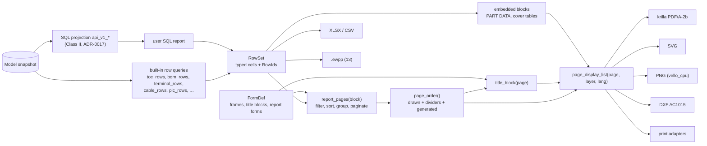

# Reports, forms and page output

**Status:** Draft v0.1 · **Date:** 2026-10-18 (amended 2026-10-24, cycle-24 design pass: which renderers draw the logo, §2.6, decision log ID-605; amended 2026-10-23, cycle-23 design pass: `report_block.create` with `form_copies` and the wizard's golden layout in §2.2, the logo reference in §2.6, decision log ID-572, ID-573, ID-576; amended 2026-10-22, cycle-22 design pass: the stored frame defaults, the notice member and the frame fall-through rule as built, §2.6, §2.7, decision log ID-545, ID-547; amended 2026-10-22, cycle-19 design pass: the shell's PDF export as built, §4.3, decision log ID-485; amended 2026-10-22, cycle-20 design pass: the export still synchronous after WP-S2.01 part 2, §4.3, ID-504) · **Part of:** ElektraWatt design document set

> **Anonymization note:** dates and the manufacturing year of the reference project in this document are synthetic placeholders, not the original values.

**Purpose.** This document specifies how ElektraWatt (EW) turns the model into documents. It covers the built-in
report kinds and user SQL reports, the declarative forms engine (report forms, frames, title blocks, cover pages),
report blocks whose pages are derived and join the page order, and the single display-list pipeline that feeds
PDF/A-2b, SVG, PNG, DXF and printing, plus XLSX/CSV tables from the same row source. It elaborates the REP and OUT
areas of [02a](02a-requirements-core.md) and the output side of I18N in [02b](02b-requirements-extended.md), within
the accepted [architecture](04-architecture.md) (§8, §10.2, §11; ADR-0015, ADR-0017, ADR-0018).

**Contents**
1. [Scope and context](#1-scope-and-context)
2. [Concepts and data](#2-concepts-and-data)
3. [Behaviour and rules](#3-behaviour-and-rules)
4. [Page output pipeline](#4-page-output-pipeline)
5. [UI and UX touchpoints](#5-ui-and-ux-touchpoints)
6. [Outputs](#6-outputs)
7. [Edge cases and pitfalls](#7-edge-cases-and-pitfalls)
8. [The reference project](#8-the-reference-project)
9. [Scope by release](#9-scope-by-release)
10. [Dependencies](#10-dependencies)
11. [Requirements covered](#requirements-covered)
12. [Open questions](#open-questions)

---

## 1. Scope and context

### 1.1 What this document decides

- **Reports** are typed row queries (built-in) or SQL over the read-only projection (user reports). Both produce
  one `RowSet` that every consumer reads: report pages, embedded tables, XLSX, CSV and the production package
  (ADR-0018).
- **Report blocks are model data; report pages are derived.** No report page is stored, no "update reports" step
  exists, and TOC, Prev/Next, the PDF outline and `/PageLabels` always include generated pages (FR-REP-001).
- **Forms** (`FormDef`) are declarative nm geometry with typed placeholders. Title blocks are frame forms whose every
  cell is bound; per-page free-text title-block fields do not exist (FR-REP-035).
- **One display-list IR** (`ew-dl`) feeds screen, PDF, SVG, DXF, PNG and print, so all outputs agree (FR-OUT-018).
- **Determinism.** The same model, settings, EW version and derivation profile give byte-identical PDF, SVG, XLSX
  and CSV on every platform (FR-OUT-019, NFR-REL-07).

**Out of scope here, with owners:** row *content* of PLC, bus and fluid reports ([10](10-plc-and-bus.md),
[11](11-fluid-power.md)); layout legends and model views ([12](12-panel-layout.md)); wire-list variants, labels,
machine profiles and `.ewpp` ([13](13-manufacturing-outputs.md)); QET title-block and `graphics_table` import
([14](14-interop.md)); check-report content, revision comparison and the release gate
([15](15-checks-revisions-collaboration.md)); shell and dialogs ([16](16-ux-ui.md)); CLI catalogue and `api_v1`
view schemas ([17](17-extensibility.md)). Frame *grid semantics* (cell lookup, xref anchors) are in
[06](06-schematic-editor.md) §2.4 and §5.1; this document owns frame and title-block *forms* and the frame editor.

**Non-goals in v1:** PDF optional-content layers (ARCH §16, C-11; FR-OUT-023, Later); DWG page export (FR-OUT-016,
Later); 3D PDF (FR-OUT-024, Later); HPGL (ARCH §16); stored report pages (ADR-0018); a user-writable SQL path
(ARCH §16, ADR-0017).

### 1.2 Pipeline



### 1.3 Crates

| Crate | Role here |
|---|---|
| `ew-derive` | `page_order`, `toc_rows`, `title_block`, `device_part_lines`, `bom_rows`, `terminal_rows`, `cable_rows`, `plc_rows`, `potential_partition` (ARCH §6.4) |
| `ew-text` | fonts and the memoised `shaped_text` query (parley 0.12.0, fontique 0.12.0, harfrust 0.14.0, skrifa 0.48.0), below `ew-reports` and `ew-scene`, so pagination and paper measure text with one stack |
| `ew-reports` | `RowSet`, report-kind registry, filters, sorting, grouping, pagination into `GeneratedPage`s, user SQL reports through the sandboxed query API of `ew-sqlview` (it never links rusqlite, ARCH §3 rule 2), XLSX (rust_xlsxwriter 0.100.0) and CSV (csv 1.4.0) writers |
| `ew-scene` | forms engine: frame, title-block, cover and report-form layout; text through `ew-text`; `page_display_list` |
| `ew-dl` (permissive) | IR items including `LinkSource`, `LinkTarget`, `EntityRef` |
| `ew-export` | PDF (krilla 0.8.2, krilla-svg 0.8.1), SVG writer, DXF (dxf 0.6.2), PNG through `ew-render-cpu` (vello_cpu 0.3.0) |
| `ew-print` | OS print adapters with per-OS features (§4.5); depends on `ew-export` and `ew-render-cpu` |
| `ew-sqlview` | projection and sandbox for user reports (rusqlite 0.40.2) |
| `ew-library` | form catalogues; projects embed `FormDef` copies under `lib/forms/` |
| `ew-ui` | report-block panel, export and print dialogs, forms editor (1.0) |

---

## 2. Concepts and data

### 2.1 Authored versus derived

| Kind | Records | Persisted in |
|---|---|---|
| Authored (A) | page-oriented `ReportBlock` | `report-blocks.jsonl` ([05](05-project-format-and-persistence.md) §2.2) |
| Authored (A) | embedded `ReportBlock` (anchored by `embedded.page`), `Page.form` override, `Page.title`, `Page.description_override` | the page file `pages/<uuid>.jsonl` |
| Authored (A) | `Section.divider`, text styles, export schemes (project level) | `structure.jsonl`, `project.jsonl` |
| Library copy (L) | `FormDef` (frame, title block, cover, report, divider, label) | `lib/forms/<copy_id>.json` |
| Project SQL | user report queries | `reports/<uuid>.sql` (untrusted until the project is trusted, NFR-SEC-05) |
| Derived (D) | `RowSet`, `GeneratedPage`, page order, Prev/Next, TOC, title-block values, display lists, PDF and table files | never stored; frozen copies only in the as-built archive (FR-REV-011) |

### 2.2 `ReportBlock`

The [domain model](03-domain-model.md) §6 record, with the fields this document needs (fields marked + were added
by the schema-steward batch, Open question 7):

```rust
pub struct ReportBlock {
    pub id: Id<ReportBlock>,                 // UUIDv7; generated pages are v5(id, page_index) (ADR-0004)
    pub source: ReportSource,                // Kind(ReportKind) | SqlQuery { api: "v1", file } (reports/<uuid>.sql)
    pub manual: ManualSelection,             // + include / exclude entity IDs (FR-REP-027)
    pub sort: SmallVec<SortKey>,             // { key, descending }; natural collation
    pub group: Option<GroupSpec>,            // { key, break: None | NewPage | NewFolio }
    pub form: Id<FormDef>,                   // first-page form; its `continuation` names the next form
    pub section: Option<Id<Section>>,
    pub first_folio: Option<u32>,            // 907; required for page-oriented blocks, ignored when embedded
    pub continuation: ContinuationPolicy,    // + SubPage (907, 907.1, …; default, FR-PAG-030) | NextFolio
    pub title: MlText,                       // + page-title format: "Wire List {n}", "Terminal Diagram {group}"
    pub empty: EmptyPolicy,                  // + OmitPages | OnePage("No entries")
    pub embedded: Option<EmbedSpec>,         // { page, rect } for page-embedded tables (§3.4)
    pub source_ref: Option<SourceRef>,       // import provenance (14 §2.3)
    // later, appended (kept in `extra` until then): params, filter (WP-S3.03)
}
```

**As built (cycle 12; decision log ID-319).** The cover block is the report kind `profile_tables` (`ew-reports`), drawn by the
`embedded` module of `ew-scene` into the tables layer; its layout (proportions in 560ths of the block width, 24 rows) is
hard-coded in `ew-scene` and provisional until it moves into the form's regions (FT-203).

**Encodings and deferred members** (decision log ID-16):
- `source` is `{"kind": "<report kind>"}` with the snake_case names of §2.4, or
  `{"sql_query": {"api": "v1", "file": "<uuid>"}}`.
- `params` (report-kind parameters) and `filter` (§3.3: a typed predicate or a pure rhai expression) are **deferred
  to WP-S3.03**. They will be appended as top-level members of the block, not inside `source`, so adding them is
  additive; a file that carries them keeps them in `extra` until then. *As built (cycle 7, decision log ID-131):*
  WP-S3.03 built typed filters (`Eq`, `Ne`, `Within`, `Present`, `Absent`) but persists none; the typed
  `filter` and `params` encoding is a format decision of WP-S3.06 (FT-46), and `parts_summary` reads
  `extra.params.mode` provisionally until then.
- **Block titles are templates** (owner ruling; decision log ID-355). `title` may name `{n}`, `{count}` and `{group}` (§4.1) and, as built (cycle 14), `{strip}` and `{device}`, which `ew-reports` resolves at derivation, before pagination: `{device}` is the short tag of the first device of the block's manual selection, `{strip}` that of the first selected device that has a strip aspect, so renumbering a strip renames its folios and its TOC rows. A placeholder with no such device stays as written, and no title is exempt by its text prefix. `{n}` is the 1-based page number within the block, `{count}` the block's page count. The golden blocks use "Terminal Diagram {strip}" (903 to 905) and "PLC Overview {device} {n}" (908 and its sub-pages).
- **Group header and footer rows** are not a `GroupSpec` member. A block emits them when its form's data area has a
  `group_header` or `group_footer` template (§2.5), so `GroupSpec` is `{key, break}`.
- **`first_folio`** is required for a page-oriented block (a structural invariant) and ignored when `embedded` is
  set: an embedded block has no folio.
- **`EmbedSpec`** is `{page, rect}`. It has no overflow member: an embedded block overflows by its cells' `Overflow`
  policy and the rule of §3.4.

Golden A holds **11 page blocks** (TOC 2, BOM 901, 903, 904, 905, 906, 907, 908, 909, 910, 911) and **4 embedded
blocks** (PART DATA on 201, 202 and 902, plus one `profile_tables` block on the cover whose form gives each group,
colours, control sizes and mains sizes, its own region) ([domain model](03-domain-model.md) §20). Section dividers
100, 200 and 900 are not blocks; they are generated from `Section.divider` (FR-PAG-009). The cover (folio 1) is a
drawn `TitlePage` page whose frame is a `Cover` form, not a block.

**Block sets.** The company basic project carries the standard set of page blocks (EPLAN's report templates); the
company-standard wizard copies it into new projects (FR-PRJ-010). Because pages are derived, there is no
"update reports" step: editing a block's filter, sort or form re-paginates on the next read.

**Creating a block with its form (as built, cycle 23; decision log ID-572, ID-573).** `report_block.create` ([17](17-extensibility.md)
§2.1) gains `form_copies: [libdoc]`: the library documents of the block's form and of the title block that form
names. A project holds a form as an embedded copy ([05](05-project-format-and-persistence.md) §13.2), and a form copy
without its title block breaks EW-INV-001, so the two travel together. They are checked by the rules of
`library.embed` (one shared check) and embedded in the same transaction through transaction lookups only, so the
derivation is never read during the command (ID-525 kept); a held copy of the same version (the same `sha256`) is
reused, a copy of another version is refused with "update from library" (FR-PRT-014). One undo step removes the block
and the copies it embedded; a reused held copy stays. **The wizard's golden layout** (16 §9.2 step 9) is written
through this command: the contents page on folio 2, the parts list on 901, **one** terminal-diagram block at 903
(over every strip; its pages continue as 903.1, 903.2), the cable overview at 906, the wire list at 907, the PLC
overview at 908, the potential overview at 909, the device-tag overview at 910 and the revision overview at 911.
Golden A's terminal diagrams on 903, 904 and 905 are three blocks, each selecting one strip; a basic project has no
strip, so 904 and 905 are absent and one block covers all. A block title that names a strip or a device (`{strip}`,
`{device}` above) would stay as written without a selection, so the wizard's titles count pages with `{n}` instead
("Terminal Diagram {n}", "Partlist {n}"). Not built: `report_block.delete` and `report_block.set`, and an editable
block list in the wizard (FT-385, before G-PP); a block is created once and not changed or removed through a command.

### 2.3 `RowSet`: one row source for every consumer

```rust
pub struct RowSet {
    pub columns: Vec<ColumnDef>,     // key, CellType, label (Fluent key or MlText), unit, link kind
    pub rows: Vec<Row>,              // in final order after filter, sort, group
    pub as_of: Rev,                  // Class I: current rev; SQL: projection rev
}
pub struct Row { pub id: RowId, pub kind: RowKind, pub cells: SmallVec<Cell>, pub links: SmallVec<LinkRef> }
pub enum RowKind { Data, GroupHeader, GroupFooter, Heading }
pub enum Cell {
    Text(MlText), Ident(SmolStr), Tag(Id<Device>), Folio(Id<Page>), CellRef(Id<Page>, GridCell),
    Qty(Dec3, Unit), Colour(ColourCode), Address(PlcAddr), Date(Date), Bool(bool),
    Range(SmallVec<Id<Device>>),     // tag list, compressed at render time (§3.6)
    Tbd, Missing(MissingReason), Stale(Box<Cell>, Rev), Empty,
}
```

- **Typed cells, late formatting.** A cell holds a value, not a string. The display language, number format, tag
  display form and date format are applied by the consumer. XLSX therefore gets numbers as numbers ("0.75") while
  the PDF prints "0,75 mm²" in an nl-NL export (FR-I18N-009).
- **`RowId` is stable** (FR-REP-048). It is derived from the row's source entity IDs: a device ID
  for a device-list row, `(strip, terminal, level)` for a terminal row, the target-side connection ID for a wire row
  ([domain model](03-domain-model.md) §9.2), `(part, mode)` for a BOM row. It keys back-links (FR-REP-042), the
  hidden `id` column of the Excel round trip (FR-EXP-004), and revision deltas (FR-REV-015). Tags are never row keys.
- **Links.** `LinkRef` names the destination of a cell: the main representation of a device, a CP anchor, a page.
  The PDF turns them into link annotations; the canvas turns them into jumps.
- **`RowId` as built and its text form** (decision log ID-128, ID-159, ID-161). A `RowId` is an ordered list of
  `RowKey { Entity(uuid) | Index(u32) | Name(text) }`; its total order is the last tie-break of every sort. Its text
  form, which is also the hidden `id` column of the XLSX round trip (FR-EXP-004), joins typed, escaped components
  with "/": `e:<uuid>`, `i:<n>` and `n:<name>` with "%", "/" and ":" percent-escaped in the name, so it parses back
  without ambiguity. A `parts_list` row is keyed (device, part copy, variant, ordinal among equal parts)
  (FR-REP-048).
- **Cells and sets as built** (cycle 7, decision log ID-129). `Cell::Folio` holds a `PageRef` (drawn page, divider or
  generated page), so TOC rows can point at dividers and generated pages; `Cell::Number` (an integer such as a BOM
  position) and `Cell::Folios` (several pages in page order) are added; `Cell::Address` holds text until
  `ew-plcaddr` has an address type. `Row.sources` lists the entities a row covers (manual exclusion, back-links)
  and `RowSet.groups` the group ranges. `as_of` is `None` for Class I sources, which are always current (a revision
  inside a memoised value would defeat early cut-off), and `Some(rev)` for a Class II source such as the SQL
  projection. A `RowSet` also carries its status, `Derived` or `NotDerived(reason)` (§3.2).

### 2.4 Built-in report kinds

Each kind is a registered Rust row query with a column schema and default form. Row content for domain reports is
owned by the listed document; this document owns forms, pagination and output for all of them.

| Kind | Report | Row source (ARCH §6.4) | Group | Rel. | Requirement | Golden |
|---|---|---|---|---|---|---|
| `cover` (form, not a block) | Title page: the `Cover` form of the drawn `TitlePage` page, bound to master data | project, parties, supply | — | MVP | FR-REP-038 | 1 |
| `profile_tables` (embedded) | CABLE COLOUR DEFINITIONS and standard-size tables | colour and size profiles | group | MVP | FR-REP-028, FR-REP-038 | 1 |
| `part_data` (embedded) | PART DATA box | `AssemblyConfig` order codes, or `device_part_lines(dev)` | — | MVP | FR-REP-028 | 201, 202, 902 |
| `toc` | Table of contents | `toc_rows()` | — | MVP | FR-REP-003 | 2, 2.1 |
| `structure_overview` | Structure-identifier and device-tag overview | structure nodes, `device_tag` | aspect | MVP | FR-REP-017 | 910 (4 pages) |
| `parts_summary` | Summarised parts list (EPLAN `.f02`), assembly or component mode; 2D layout objects per FR-REP-007 (MVP), accessories from part data per FR-REP-051 (1.0); row order by the BOM key below | `bom_rows(mode)` | — | MVP | FR-REP-004 … FR-REP-007, FR-REP-051 | 901, 901.1 |
| `parts_list` | Parts list, one row per device part line (EPLAN `.f01`) | `device_part_lines` | — | MVP | FR-REP-006 (row source), FR-REP-008 | — |
| `device_list` | Device list | devices, `device_tag` | location | MVP | FR-REP-008 | — |
| `terminal_diagram` | Terminal diagram per strip | `terminal_rows(strip)` | strip | MVP | FR-REP-009 | 903–905 |
| `terminal_overview` | Terminal-strip overview | strips | — | MVP | FR-REP-010 | — |
| `terminal_lineup` | Terminal line-up with accessories | strips, accessories | strip | 1.0 | FR-REP-011 | — |
| `terminal_connection` | Terminal connection diagram (graphical) | `terminal_rows` | strip | 1.x | FR-REP-043 | — |
| `cable_overview_diagrams` | Cable overview and per-cable diagrams | `cable_rows(cable)` | cable | MVP | FR-REP-012, FR-REP-013 | 906 |
| `wire_list` | Wire/connection list | physical wires, then a separate bridge block (bridges are never wire rows; [08](08-connections-terminals-cables.md)) | — | MVP | FR-REP-014, FR-CON-034 | 907–907.2 |
| `device_connection` | Device connection diagram | `function_cps`, connections | device | 1.0 | FR-REP-015 | — |
| `plug_diagram` | Plug diagram and overview | plugs | plug | 1.0 | FR-REP-024 | — |
| `plc_overview` | PLC overview per station or module | `plc_rows(station)` ([10](10-plc-and-bus.md)) | module | MVP | FR-REP-019, FR-PLC-022 | 908–908.2 |
| `io_list` | I/O assignment list | FR-PLC-023 row source | station | MVP | FR-PLC-023 | — |
| `plc_card_list` | PLC card list: one row per module (slot, part, start address, used/spare counts) | modules, `channel_addresses` | station | 1.0 | FR-REP-045 | — |
| `safety_io_list` | Safety I/O list | FR-PLC-041 row source ([10](10-plc-and-bus.md) §5) | station | 1.0 | FR-PLC-041 | — |
| `potential_overview` | Potential overview | `potential_partition()`, `wire_props_of` | — | MVP | FR-REP-016 | 909 |
| `bus_overview`, `network_address_list`, `bus_cable_list`, `iolink_port_list` | Bus reports | [10](10-plc-and-bus.md) | network | 1.0 | FR-REP-020, FR-BUS-007, FR-BUS-008, FR-BUS-014 | — |
| `revision_overview` | Revision overview: every revision, Withdrawn ones with their reason; from 1.0 also the issue purpose and the last transmittal response | revisions, page change status, transmittals (1.0) | — | MVP | FR-REP-018 | 911 |
| `open_items` | Open items | Tbd values, unplaced, missing parts and lengths | category | MVP | FR-REP-021 | — |
| `numbering_report` | Frozen tags and numbers with rule values. *As built (cycle 14; decision log ID-349):* columns `item` (the device tag; empty for a wire), `kind` (`tag` or `wire number`), `frozen` (the frozen text), `rule` (the value the active scheme derives where the frozen value is left out: `rule_product` for a tag, the `wire_numbers` label for a wire; empty when the scheme derives none) and `status` (`matches` or `deviates`); one row per frozen tag in natural order of the full tag, then one row per frozen wire number in connection ID order; EW-NUM-001 reports the deviating frozen tags (the 10 infos of EF-15 on the golden project); frozen wire numbers are EW-NUM-002's, not built | `TagSpec.frozen`, `NumberSpec` | — | MVP | FR-REP-022 | — |
| `enclosure_legend`, `mounting_list` | Enclosure legend (EPLAN `.f18`), mounting list (`.f32`) | placements ([12](12-panel-layout.md)) | surface | legend embedded on the layout page: MVP (FR-LAY-012); as pages and mounting list: 1.0 (FR-REP-023) | FR-REP-023, FR-LAY-012 | 902 |
| `tube_list`, `tube_cut_list`, `valve_terminal_config`, `medium_overview` | Fluid lists | [11](11-fluid-power.md) | — | 1.0 | FR-FLU-012, FR-FLU-013, FR-FLU-015, FR-FLU-016 | — |
| `load_summary` | Load per potential and protective device | part currents, potentials | potential | 1.0 | FR-REP-026 | — |
| `order_list`, `manufacturer_list` | Purchasing views | `bom_rows` | supplier | 1.0 | FR-REP-025 | — |
| `check_report` | Findings, waivers, packs, disclaimer | `checks` ([15](15-checks-revisions-collaboration.md)) | severity | MVP | FR-CHK-014, NFR-COMP-04 | — |
| `thermal_report`, `checklist_*`, `hole_table`, `cut_list`, `terminal_assembly_list` | Domain reports | [12](12-panel-layout.md), [13](13-manufacturing-outputs.md) | — | 1.0 | FR-THM-009, FR-MFG-016, FR-MFG-029, FR-MFG-030, FR-MFG-036 … FR-MFG-038 | — |
| `untranslated` | Untranslated texts per language | `MlText` fallbacks | language | 1.0 | FR-I18N-005 | — |

The domain kinds of 02b are registered through one row (FR-REP-045); a labour-estimate report is FR-REP-044 (1.x,
Could).

**BOM row order.** Component mode sorts device rows by the page order of the row's first main representation, then
its position on that page (column, then row, the numbering order of [20](20-golden-project.md) §4.4), then the part
number. Rows without a schematic representation (enclosure, plate, carriers, accessories) follow in the layout-legend
order of [12](12-panel-layout.md) §5.4: enclosure, plate, carriers, then accessories. A row whose part is a layout-only
accessory (kind end bracket or accessory) is always in that second group, whatever the placement of the strip it sits
on; its folio column still lists the folios of its devices. Until layout placements exist, that column prints the folios of the
devices' representations instead of the layout page ([20](20-golden-project.md) §14.1 prints 902; decision log ID-317, FT-204). On Golden A the folio-3 rows
(-3X1, -3W1) therefore come first, and the enclosure and plate are rows 22 and 23 ([20](20-golden-project.md) §14.1).

EPLAN report types without a kind of their own: the cable connection diagram (`.f07`) and the cable assignment
diagram (`.f08`) are alternative forms of `cable_overview_diagrams` over the same `cable_rows`, shipped at 1.0
(no extra row source, FR-REP-012); the PLC diagram per card is `plc_overview` filtered to one module; the symbol
overview and the forms and plot-frame documentation are 1.x candidates (Could), rendered from the library catalogue
rather than the model.

*Kind contract* (cycle 7, decision log ID-179). A kind's row query reads through `Q::try_get` wherever a read may close
a query cycle, so no model content makes it panic; a schema kind that no engine registers yet is a placeholder
(decision log ID-160).

### 2.5 `FormDef`

```rust
pub struct FormDef {
    pub kind: FormKind,                      // Frame | TitleBlock | Cover | Divider | Report | Label
    pub sheet: SheetSpec,                    // A4 landscape 297 × 210 mm, or custom
    pub page_to_sheet: Option<SheetTransform>, // uniform scale + offset, integer, QET-compatible frames only (FR-PAG-029); None = scale 1
    pub grid: Option<FrameGrid>,             // columns, rows, header bands, labels (FR-PAG-014)
    pub title_block: Option<Id<FormDef>>,
    pub graphics: Vec<Primitive>,            // rules, boxes, drop shadows (REF-105), logo asset refs (FR-SYM-025)
    pub cells: Vec<FormCell>,                // static cells: labels + placeholders
    pub data: Option<DataArea>,              // Report forms only
    pub continuation: Option<Id<FormDef>>,   // EPLAN "next form" (FR-REP-032)
    pub meta: ItemMeta,                      // key, licence CC-BY-SA-4.0 + exception, sources, status (03 §7)
}
pub struct DataArea { pub rect: Rect, pub header: RowTemplate, pub rows: RowTemplates, pub grid: TableStyle }
pub struct RowTemplates { pub data: Option<RowTemplate>, pub group_header: Option<RowTemplate>, pub group_footer: Option<RowTemplate>, pub heading: Option<RowTemplate> }   // one template per RowKind
pub struct RowTemplate { pub height: Nm, pub cells: Vec<FormCell>, pub wrap: WrapPolicy }   // default WrapPolicy::None
pub struct FormCell { pub rect: Rect, pub label: Option<MlText>, pub value: Placeholder,
                      pub style: TextStyleRef, pub align: Align, pub overflow: Overflow, pub visible_if: Option<Cond> }
pub enum Overflow { ShrinkToFit { min_cap_height: Nm }, Ellipsis, Error }   // never silent clipping (FR-REP-039)
pub struct SheetTransform { pub scale_ppb: u32, pub offset: Pt2 }   // QET frame: 986_282_578 ppb, offset (9.79, 9.79) mm
```

The transform is stored as an integer scale in parts per 10⁹ plus an nm offset, so every writer applies it with the
integer arithmetic of §4.3 rule 4 instead of a float `Affine`.

**Cell text** (WP-S3.02; decision log ID-39, ID-41). A labelled cell prints its label, one space and the value;
v0 has no tab stops. `ShrinkToFit` reduces the style size down to `min_cap_height`, measured as printed through the
page-to-sheet transform (§2.8); text that still does not fit is drawn at that size and overflows the cell, and the
form finding `Overflow` reports it, because clipping is forbidden. `Ellipsis` cuts the text, appends "…" and reports
it; `Error` draws the text unshrunk and reports it. Cell text is inset 2 QET px (0.529 mm) from the left and right
edges, and middle alignment centres the cap height. A cell with no room at all (inset width ≤ 0, or shrinking that
reaches size 0) draws nothing and reports the finding of its own policy (`ShrinkLimit`, `Truncated` or `Error`); v0
has no separate finding kind for it (ID-62). An asset cell draws the image of its `AssetRef`, fitted by the
recorded intrinsic size, or filling the inset area when the size is unknown ([05](05-project-format-and-persistence.md)
§13.3; ID-61); a logo cell too small for its insets draws no image and reports an `Error` finding that carries the
placeholder text (ID-63).

**`form_type`** (the placeholder set a form accepts, FR-REP-034) is **deferred to WP-S3.02**, which defines its
encoding and appends it to `FormDef` (decision log ID-16). Until then placeholder validity is checked against `kind`
and, for a report form, the report kind of the block that uses it; a file that carries `form_type` keeps it in
`extra`.

**The house report form of the reference** ([golden](20-golden-project.md) §16): table x 16.31–277.27 mm, header
and data rows 6.52 mm, header fill #C0C0C0, grid 0.183 mm, text style `text.normal` 8.88 pt, **23 data rows per
page**. The TOC form's columns are Folio number 16.31–79.73, Title 79.73–214.90, Location (+) 214.90–277.27.

Shipped forms are CC-BY-SA-4.0 with the design exception (ADR-0024). Form copies embedded in projects, and every
PDF or table produced with them, are not subject to EW's copyleft (NFR-LIC-09).

### 2.6 Placeholders

A placeholder is `{scope.path | filter …}`. Unknown paths are a form load error; paths invalid for the form type
are rejected (FR-REP-034).

**Unresolved placeholders render empty** (decision log ID-40). At lowering, a placeholder that yields no value
renders as empty text, and the form finding `Binding` names the cell and the placeholder. This covers a valid path
without a value (`{revision.current.checker.name}` while no checker is set, golden U-03) and anything that escaped
the load check: an unknown scope or path, a computed `{= …}` cell before the formula engine exists, or a malformed
template. The raw `{…}` text is never printed; a form that wants a visible fallback writes `| default("—")`, which
counts as a value. An unsupported filter passes the value through unfiltered and is reported. `{{` and `}}` print
literal braces. The rule covers every unresolvable placeholder (unbound, unresolved, unknown scope, computed) and a malformed template draws nothing; the raw placeholder text is never drawn.

| Scope | Examples | Valid in |
|---|---|---|
| `project` | `{project.description}`, `{project.reference}`, `{project.drawing_id}`, `{project.object}`, `{project.document_title}` (the cover subtitle "Electrical Definition"), `{project.created \| date}`, `{project.edited \| date}`, `{project.supply \| supply}`, `{project.control_voltage}`, `{project.consumption}`; `{project.logo}`, the logo asset reference of the basic project's company data, which a cell draws as the image and prints no text for, and `{project.notice}`, the notice text of the same company data ([07](07-symbols-parts-macros.md) §2.8; decision log ID-40) | all |
| `party.<role>` | `{party.customer.name}`, `{party.end_user.address.city}` (personal data, §7 pitfall 14) | all |
| `revision` | `{revision.current.label}`, `{revision.current.state}`, `{revision.current.author.name}`, `{revision.current.checker.name}`, `{revision.current.date \| date}` (the current revision: below the table) | frame, title block, cover |
| `page` | `{page.folio}`, `{page.prev}`, `{page.next}`, `{page.title}` ("Power Supply 1 - Main Current"), `{page.description}` (override or project description, §2.7), `{page.function}` (`=P01`), `{page.location}` (`+J-E-2416`), `{page.scale}` ("1:10" on 902, FR-PAG-023), `{page.document_kind}` (`&EFS`, FR-PAG-028, 1.0), `{page.last_changed_in}` ([15](15-checks-revisions-collaboration.md) §5.6) | frame, title block |
| `doc` | `{doc.page_index}`, `{doc.page_count}` (position in and length of `page_order`: folio 101 is page 6 of 36) | frame, title block |
| `block`, `group` | `{block.title}`, `{block.page_index}`, `{block.page_count}`, `{block.as_of}`, `{group.key}`, `{group.strip.tag}`, `{group.cable.part}` | report |
| `row` | `{row.<column key>}` | report data area |
| `profile` | colour rows (voltage, function, colour name, code), size rows | cover, embedded |
| `export` | `{export.date \| date}`, `{export.status_mark}`, `{ew.version}` (the root `ew` holds only `ew.version`) | all |

**Stored company and frame members (as built, cycle 22; decision log ID-545, ID-547).** No new record kind and no
schema change ([05](05-project-format-and-persistence.md) §10.3); the shapes are in [03](03-domain-model.md) §5.1.
`{project.notice}` reads `Project.extra["ew.company"].notice`, the provisional member that `project.company.set`
writes. The frame defaults are `settings.extra.frames` = `{default?, per_page_type: [{page_type, form}]}`, written by
`project.frames.set` with the entries sorted by page type and `per_page_type` always present (`[]` when empty). The rule
for a page's frame is the one of §2.7: `Page.form`, else the entry of its page type, else `default`. A form or an entry
that names a copy the project does not hold falls through to the next rule, identically in the cell grid and in the page
output (`ew_derive::frame_form_of`; the check finding is FT-368). A page without its own form takes the frame defaults
in the page output (`PageFrameOf`), as the cell grid already did. The golden project is unchanged: it sets no frame
defaults.

**The logo (as built, cycle 23; decision log ID-573, ID-576).** `{project.logo}` reads the reference stored by
`project.company.set` ([17](17-extensibility.md) §2.1): `Project.extra["ew.company"].logo` is
`{sha256, format, size}` (the bare `"sha256:…"` form of cycle 22 is still read), and the bytes are an asset of the
project's asset store ([05](05-project-format-and-persistence.md) §13.3), at most 512 KiB (`MAX_LOGO_BYTES`). A title
block's logo cell takes the image by that reference, and the display list places it (so the wizard's preview shows the
logo on the sample's cover). *As built (cycle 24; FT-383, FT-384, decision log ID-605):* SVG logos are drawn as vector paths by the CPU renderer, the PDF writer, the SVG writer and the viewer (the export job resolves them before any writer runs); PNG is drawn on the CPU path; the SVG writer embeds PNG and JPEG; JPEG on the CPU path and rasters in the PDF are FT-406; an SVG is
drawn only after `svg_hazard`'s checks (18 §11.1 TM-18), in usvg's drawn subset ([05](05-project-format-and-persistence.md)
§13.3). A raster logo (PNG, JPEG) prints rasterised, an SVG as vectors. An image that an export cannot draw (a missing
asset, or one the sniff refuses) is reported as `PageFinding::Image` in the export's findings, never dropped silently
(ID-620).

**The current revision** is the project's open revision; without one, its newest released revision. Withdrawn
revisions and the `Withdrawn` records that point to them are ignored, and among several candidates of the same state
the newest date wins, a revision without a date counting as the newest (decision log ID-105). Golden A's current
revision is the open V2.0.

Filters: `date` (project format, FR-PRJ-023), `supply` (structured supply → "1 x 230 VAC + N + PE, 50 Hz", D-18),
`qty(unit, decimals)`, `tag(full | displayed)`, `ml(lang)` or `ml(stacked: [nl-NL, en-GB], sep: " / ")`
(FR-I18N-004), `range` (§3.6), `upper`, `default("—")`. Computed cells use a pure rhai formula (`{= …}`) through
tracked reads only (FR-EXT-011).

### 2.7 Frames and title blocks

- **Frame forms** carry the grid (17 columns 0–16, rows A–H for the QET-compatible A4 frame, FR-PAG-015), grid and
  no-grid variants sharing one title block (FR-PAG-017), and ISO 5457 frames A4–A0 at 1.0 (FR-PAG-016). Assignment:
  project default, page-type default, page override (FR-PAG-018; the stored shape and the fall-through rule are in §2.6). Golden folios 1, 2, 100, 200, 900, 901 and all
  generated pages use the no-grid variant.
- **Title-block cells are bindings** (FR-REP-033, FR-REP-037). The golden title block of
  [20](20-golden-project.md) §17.2 binds: the large page-description cell → `page.title` ("Valve Manifold
  Overview 1"); "Project:" → `project.reference`; "Description:" → `page.description`; "Drawing:" →
  `project.drawing_id`; "Revision:" → `revision.current.label`; the `=` and `+` cells → `page.function`,
  `page.location`; the party cell → one party role (below); "Object:" → `project.object` ("J-E-2416");
  "Checked:", "Author:" → revision checker and author; "Creation:", "Saved:" → `project.created`,
  `project.edited`; "Page:", "Prev:", "Next:" → page order; the logo and notice → `project.logo` and
  `project.notice`, the company assets of the basic project (§2.6). Every labelled cell prints label, one space and
  value (§2.5). This QET-compatible title block has **no scale cell**, by design: it reproduces the reference
  layout. FR-REP-037's scale cell binds `page.scale` in forms that declare one (decision log ID-41).
- **`page.description`** resolves to `Page.description_override` if set, else `project.description` ("Expansion
  Control Cabinets"). An override raises the info finding EW-CORE-023 naming the page (FR-REP-036, D-06).
  `Page.title` is the per-page page description and TOC title (FR-PAG-010); it is not an override.
- **"Saved"** binds the model's edited date (day precision, merged by maximum; FR-PRJ-029), never a file time.
  Release exports take dates from the release context ([05](05-project-format-and-persistence.md) §14.1).
- **"Revision"** prints the latest revision record. While V3.0 is open, draft exports print "V3.0" and the status
  mark (FR-OUT-021); after release every page prints the released label (FR-REV-003).
- **Party cells bind roles** (FR-PRJ-003): the reference's "Customer:" cell showed the end user (D-30); the golden
  form labels it "End user:" and binds the end-user role until the pilot answers PQ-11 (U-01).
- **ISO 7200 coverage.** The QET-compatible title block is the pilot's house style, not ISO 7200. The ISO 5457
  frames shipped at 1.0 (FR-PAG-016) carry an ISO 7200 title block whose mandatory fields bind as follows
  (FR-REP-050; field list per [standards](../research/standards.md) §12.2):

  | ISO 7200 field | Binding |
  |---|---|
  | Legal owner | party role panel builder / legal owner (FR-PRJ-003) |
  | Identification number | `project.drawing_id` |
  | Revision index | `revision.current.label` |
  | Date of issue | release context date, else `revision.current.date` |
  | Segment/sheet number, number of sheets | `page.folio`; `doc.page_count` |
  | Title, supplementary title | `page.description`; `page.title` |
  | Creator, approval person | revision author, revision checker |
  | Document type | `page.document_kind` (FR-PAG-028) |
  | Document status | `revision.current.state` plus the status mark (FR-OUT-021) |

### 2.8 Text styles and fonts

- Form cells reference **text styles held as model data** (FR-SYM-013). The golden styles (`text.normal` 8.88 pt,
  `data.small` 6.66 pt, `pin` 5.92 pt, `xref.device` 5.18 pt …) are in [20](20-golden-project.md) §17.5.
- **Fonts** are resolved from the project's font set: the bundled default family, optional osifont, and a bundled
  symbol fallback (§7, pitfall 8). Tahoma is never bundled or embedded (FR-IMP-020). Noto Sans is the interim
  default while ADR-0028 is Proposed: the spine builds the forms and the golden PDFs and PNGs with it, and if the
  project owner decides on another family, the goldens are regenerated once.
- **The symbol fallback as built** (cycle 9, FT-85; ADR-0028 amendment 1): Noto Sans Math Regular 3.000 (OFL-1.1)
  draws the characters the style's face lacks, for Latin, Greek and Cyrillic text only; a text line drawn with two
  faces is a group of glyph runs, one per face (§4.3 rule 5). Export reports only the characters no bundled face
  drew (FR-OUT-027, EW-CORE-066).
- A system font chosen by the user is allowed; the export then states "output depends on system font X" and the
  byte-identity guarantee no longer holds (NFR-REL-11 requires a project to export without system fonts).
- **Font versions are pinned** by the derivation profile (ADR-0028 recommendation 6): an EW release that updates a
  bundled font ships it as a new version, so line breaks and shrink-to-fit results of reopened projects do not
  shift.
- Styles bound to slot kinds make every tag print at one height (D-29). The minimum printed-height rule
  (FR-CHK-023, EW-CORE-061: printed cap height, golden minimum 1.2 mm) evaluates text at the sheet scale, including
  the page-to-sheet transform, and the print dialog repeats it for scale-to-fit jobs (D-31).

### 2.9 Export schemes

Export settings are a named settings scheme at company, user and project level (FR-PRJ-008, FR-OUT-010):

```toml
[scheme."customer delivery"]
scope = "project"                     # project | sections = [1, 2] | pages = "101-106" | selection
format = "pdf"
pdf.conformance = "A-2b"              # A-2b (default) | A-3b or A-4f (attachments only, FR-OUT-003, C-10) | none
pdf.tagged = false                    # PDF/UA-1 option (FR-OUT-012, 1.0)
pdf.outline = "sections"              # sections | sections+structure (FR-OUT-004)
pdf.links = "xrefs+reports"           # xrefs | xrefs+reports | none
pdf.partial_links = "plain"           # plain | companion (FR-OUT-020)
colour = "colour"                     # colour | monochrome (FR-OUT-011)
languages = ["en-GB"]                 # one PDF per entry (FR-I18N-005, 1.0)
omit_personal_data = false            # FR-OUT-025 (CLI --omit-personal-data), FR-PRJ-024; AML, .ewpp: FR-EXP-009
status_mark = "auto"                  # auto: "DRAFT <label>" on unreleased revisions (FR-OUT-021)
date = "model"                        # model | fixed "2025-04-14" | source-date-epoch (FR-OUT-026)
file_name = "{project.drawing_id}_{revision.current.label}_{lang}.pdf"
```

File-name templates are sanitised like archive labels ([05](05-project-format-and-persistence.md) §14.2) and may
not use personal-data fields when `omit_personal_data` is set.

---

## 3. Behaviour and rules

### 3.1 Page order with generated pages

`page_order()` (Memo, ARCH §6.4) merges three page sources and is the single source of Prev/Next, TOC rows, the
outline and `/PageLabels`.

```text
page_order(q):
  drawn    = q.pages()                                   # authored pages
  dividers = sections where divider → folio = range.start   # 100, 200, 900
  gen      = for each page block b except TOC blocks: report_pages(b)
  D        = len(drawn ∪ dividers ∪ gen)                 # does not depend on the TOC page count
  per      = TOC capacity: the TOC form's data area, else the profile's toc.rows_per_page (≥ 2)
  n_toc    = max(1, ceil(D / (per − 1)))                 # closed form: the TOC lists its own pages too
  merge(n) = sort(drawn ∪ dividers ∪ gen ∪ n TOC pages) by (section order, folio number, sub-page index,
                                                            origin: drawn < divider < generated, page id)
  order    = merge(n_toc)                                # one confirming round (ARCH §6.2)
  n'       = ceil(len(order) / per)
  if n' > n_toc:                                         # only if a TOC row is not one page
    emit EW-CORE-025 (TOC fixpoint not reached, warning); order = merge(n')   # never a missing page
  return order
```

- The sort key is numeric, never textual: 907 < 907.1 < 907.2 < 907.10 < 908 (FR-PAG-006, FR-NUM-018).
- **Golden A:** 34 pages do not depend on the TOC, so n = ⌈34 / 22⌉ = 2 TOC pages; the confirming round counts 36
  pages, ⌈36 / 23⌉ = 2, and stops. Prev/Next: folio 1 Prev empty, 911 Next empty (FR-PAG-013).
- **Closed form instead of iteration** (decision log ID-155, ID-158; it replaces the earlier "initially 1, at most three
  rounds"). With a capacity below 2 rows the TOC could never list itself, so such a TOC form is an invalid layout
  (§3.2). When the confirming round still disagrees, the order is rebuilt with the larger count, so a page is never
  missing; a blank TOC row is acceptable (§7 pitfall 1). The cycle-7 code still iterates from 1 (FT-66).
- **The report engine is a provider** (decision log ID-126, ID-127, ID-135). `page_order` lives in `ew-derive`
  and calls `report_pages` through the `ReportPagesProvider`, which is engine-level configuration: one per
  `Session` (later one per memo store), never a per-`Q` untracked input; a `Q` without one is the test
  configuration. `ew-derive` never depends on `ew-reports`. Pagination runs inside `page_order`, so no query that
  feeds it reads `page_order`: row sources that order by page position read `drawn_page_order()` (drawn pages and
  dividers, the same relative order), and folio cells are printed from `page_order` when the page is drawn.
  EW-CORE-025 is a derivation note of `page_order`, surfaced as a finding (FT-49).
- Pages without a section (1, 2, 3) precede section 1 (front matter).
- **Folio collisions** between a generated page and a drawn page, or two blocks, are the error EW-CORE-022
  (FR-REP-041, FR-CHK-038). The `origin` key places the generated page after the drawn page with the same folio, so
  output never loses a page and the order does not depend on random UUID bits.

### 3.2 Pagination

`report_pages(block)` (Memo + LRU) consumes the block's `RowSet` and the form geometry (FR-REP-002):

```text
report_pages(block):
  rows  = rowset(block)                       # filtered, sorted, grouped; tie-break by RowId
  form  = block.form; page = new(form); out = []
  for group in rows.groups():
    if group.break == NewPage and page.has_rows(): out.push(page); page = new(form.continuation)
    if group.break == NewFolio and out ∪ page non-empty: close folio; next folio = previous + 1
    place(group.header)                       # keep-with-next: header plus ≥ 1 data row on the same page
    for row in group.rows:
      h = template(row.kind).height × lines(row)   # lines = 1 unless the template wraps
      if page.used + h > form.data.height:
        out.push(page); page = new(form.continuation)
        if form repeats group headers: place(group.header + " (cont.)")
      place(row)
    place(group.footer)                       # subtotals, e.g. Σ current per potential
  out.push(page)
  apply block.empty when there are no data rows
  number pages: first_folio, then SubPage (first_folio.1, .2 …) or NextFolio
  title(page n) = block.title with {n}, {count}, {group}   # "Partlist 1", "Partlist 2" (FR-PAG-011)
```

- **Fixed-height rows are the default.** With the golden form a page holds 23 rows, so pages = ⌈rows / 23⌉: the wire
  list's 50 rows (44 wires and the separate 6-row bridge block) give 907, 907.1, 907.2; the PLC overview's 56 rows
  give 908, 908.1, 908.2 (sub-page continuation, FR-PAG-030).
- **Wrapping is opt-in per row template.** It makes pagination depend on text measurement (`shaped_text` in
  `ew-text`) and therefore on the display language (§4.7, FR-REP-049).
- **Page counts.** `{block.page_count}` is filled after the block is paginated, since row heights do not depend on
  it. Only the TOC's row count depends on its own page count; that fixpoint is settled inside `page_order` (§3.1).
- Generated pages are `GeneratedPage { id: v5(block, index), block, folio, title, rows: Range, group, form }`. They
  are read-only on the canvas (FR-PAG-002).
- **Placeholders, layouts and form chains** (cycle 7, decision log ID-130, ID-132, ID-133, ID-157, ID-160). A
  report kind that is not derivable yet (its row query or its record shape does not exist, or the schema names a
  kind that no engine registers yet) paginates to one placeholder page whose note gives the reason, whatever its
  `empty` policy, so its folios and TOC entries stay in place; this generalises
  [ADR-0017](../adr/0017-read-only-sql-projection-api-v1.md) amendment 1. A form without a data area paginates with
  the house layout of 23 rows × 6.52 mm, which moves from `ew-reports` into the derivation profile (FT-47). An
  invalid layout (a row height ≤ 0, or a capacity below one data row) falls back to the house layout with a form
  finding (FR-REP-039), for now a `MalformedShim` derivation note (a dedicated `InvalidForm` note is FT-79). A
  `NewFolio` group break restarts the form chain at the block's form; `NewPage` continues
  it. Wrapping rows wait for a wrap policy in the schema and measure with `shaped_text` when they come (FT-61).
- **Group texts** (decision log ID-156). `{group}` and the group header texts print a device in its displayed tag
  form in the structure context of the generated page, falling back to the short tag; groups follow the sort
  direction of the group column, and a heading row bounds a group.

### 3.3 Filtering, sorting, grouping

- **Filters** are typed predicates over row columns or source entities (`location within +J-E-2416`,
  `state != Deactivated`, `has_part`) or a pure rhai expression. Manual include and exclude lists hold entity IDs and
  survive renumbering (FR-REP-027). Example: a BOM block filtered to `+J-E-2416` omits the `+FIELD` process valves.
- **Sorting** uses the specified natural order of `ew-mltext` (numeric runs by value; ADR-0005 amendment 3; ICU only for language-sensitive display sorting) in the project's *source* language, independent of OS locale
  and display language, so every language export sorts identically (FR-I18N-010, NFR-I18N-03). The reference BOM's
  ASCII order ("+" < "-" < digits) cannot occur.
- **Grouping** keys a page set per strip, cable, station, location or section (EPLAN's function-related reports).
  Group headers and footers are row kinds with their own templates; footers can carry sums of `Qty` columns.

### 3.4 Embedded report blocks

An embedded block (`embedded: {page, rect}`) renders its rows into a rectangle on an interactive page
through the form's data area (FR-REP-028, FR-REP-029). It does not join the page order.

| Golden block | Page | Rows | Source |
|---|---|---|---|
| PART DATA | 201 | "Order Code 1:" 51E-F13GCQP-D+H2GG, "Order Code 2:" 32P-VGL-R-MAHAHAHAHAHAHUL3LAHU-28MS | `AssemblyConfig` of the valve terminal (D-36; split per order code is U-24) |
| PART DATA | 202 | the same two order codes (the reference repeats the box identically on 202) | same |
| PART DATA | 902 | "Cabinet: Schneider Electric NSYPLA1074G", "Backplate: Schneider Electric NSYPMM107" | `device_part_lines(-UC1)` |
| CABLE COLOUR DEFINITIONS, standard sizes | 1 | 2 header + 15 data rows (24 VDC Positive DBU … Analogue Earth GNYE); 0.75 / 1.5 mm² tables | colour and size profiles (D-08) |

- **Overflow** follows the cell policy: shrink to fit down to the minimum cap height, then ellipsis plus a warning
  finding with "n rows not shown". The rectangle never grows silently into the drawing.
- Embedded blocks render in their own display-list layer `tables` (ARCH §6.4, ADR-0015 amendment 2), so a wire
  edit does not rebuild them. A profile edit rebuilds `tables`, and `labels` only on pages
  whose wire markers print derived values (the golden marker mode prints explicit overrides only).
- The reference sets each PART DATA entry as a label line ("Order Code 1:") above a centred value line; the
  `part_data` form reproduces this with a two-row template per entry.
- Changing the 24 V DC colour in the profile updates the folio 1 table, every derived wire colour and folio 907 in
  one commit (AC-12).

*As built (cycle 7, decision log ID-133).* An embedded PART DATA block lists the root ancestors of the devices drawn
on its page: their configured lines become "Order Code n" rows, otherwise their own lines plus those of descendants
without a representation. The manufacturer text is the `LibRef`'s `extra.key` (the stopgap of decision log ID-111).

### 3.5 User SQL reports

User reports are an SQL file over the versioned `api_v1_*` views plus a form (FR-REP-031, ADR-0017; 1.0).

```sql
-- ew:report api = "v1"
-- ew:title  "24 V loads per potential"                        -- D-25 example (ARCH §11)
-- ew:column potential type = "ident"
-- ew:column load      type = "tag"
-- ew:column pin       type = "ident"
-- ew:column current   type = "qty" unit = "A"
-- ew:group  potential footer = "sum(current)"
SELECT w.potential_name AS potential, d.tag AS load, w.to_cp AS pin,
       json_extract(d.tech_data, '$.type') AS type,          -- technical data is JSON text; key illustrative
       c.i_load AS current                                   -- from 1.0 (ADR-0017 amendment 3)
FROM api_v1_wire AS w
JOIN api_v1_device AS d ON d.id = w.to_device_id
JOIN api_v1_cp AS c ON c.device_id = w.to_device_id AND c.cp = w.to_cp AND c.role = 'load'
WHERE w.potential_name LIKE '24VDC-%'
ORDER BY potential COLLATE ew_natural, load COLLATE ew_natural, pin COLLATE ew_natural;
```

- **Columns.** View and column names follow [17](17-extensibility.md) §6.1. `api_v1_cp.i_load` (decimal text,
  empty when the part declares no load current) and the derived CP roles `source`, `through`, `load` and `other`
  exist from 1.0, the release of user SQL reports (ADR-0017 amendment 3). Run as `ew sql` text before 1.0, the query
  has no current column and no footer sum and lists the 24 V loads only, as the D-25 example of
  [17](17-extensibility.md) does.
- **Typing.** `ew:column` annotations map result columns to cell types and placeholders `{row.<name>}`; unannotated
  columns are text. The projection delivers quantities as exact decimal text (`'0.75'`) and lengths as integer
  `_nm` (ADR-0017 column conventions), so a `qty` column parses into `Dec3` without float rounding and a footer
  `sum(current)` is exact. A query that does not prepare against the current projection fails the SQL compile test
  in CI (ARCH §13) and shows a finding in the project.
- **Sandbox.** Query-only connection, authorizer (no ATTACH, PRAGMA, DDL, DML or direct `t_*` reads; one statement
  per call), progress-handler deadline of 2 s per report, the report result cap of 100,000 rows and the
  `SQLITE_LIMIT_*` limits (all ADR-0017). A violation renders one error page and a finding.
- **Trust.** In an untrusted project the block renders one placeholder page "Report not run: project not trusted";
  `ew export pdf` creates no other output from it (NFR-SEC-05).
- **Freshness.** The projection is Class II. On screen, SQL report pages show "as of revision n" and are
  re-paginated when the projection catches up. **Every export builds the projection on its own fork**, so exported
  SQL pages are always fresh. In the session, `page_order` reads the last projection result per SQL block, a
  non-persisted, non-undoable query input stamped with its revision; before the first result exists the block counts
  as one placeholder page (ADR-0017 amendment 1).

### 3.6 Value rendering rules

| Value | Rendering | Example |
|---|---|---|
| `Tbd` | "TBD" (configurable), listed in open items, blocks release | "Node TBD" on folio 3 (D-15) |
| `Missing(Length)` | "length missing" | -3W1 in folio 906 (FR-REP-013, D-19) |
| `Stale(v, rev)` | value plus "≈" marker; allowed only in draft exports, refused in release exports (FR-EXP-001) | "≈ 810 mm" |
| `Qty` | icu number format of the output language, SI spacing | "0.75 mm²", nl-NL "0,75 mm²" (FR-I18N-009) |
| `Date` | project date format | "Creation: 03-03-2025"; ISO 8601 option (FR-PRJ-023) |
| `Tag` | full designation (`=P01+J-E-2416-102G1`) or displayed form, per column setting | frozen S51 (`sign: Hidden`) prints "S51" in displayed form and `=P01+J-E-2416-S51` in full form ([03](03-domain-model.md) §8) |
| `Range` | compressed tag list (below) | "-201U3-Q1 … -202U2-Q4" |

**Tag-range compression** (FR-REP-046, from [20](20-golden-project.md) §14):

```text
compress(tags, all_tags_of_class):        # class = same letter code and same assembly root or strip
  order = natural order of all_tags_of_class
  runs  = maximal runs of tags that are consecutive in `order` (no tag outside the row lies between)
  print runs of length ≥ 3 as "first … last", shorter runs as a comma list; strip the shared prefix of
  terminal runs ("-X1031:1 … 20")
```

Golden results: 571334 → "-201U3-Q1 … -202U2-Q4" (all 28 valve children are consecutive); 533361 →
"-201U3 … -201U8, -202U2" (-201U9 and -202U1 interrupt the run); UK 5 N → "1X1:1, 1X1:2".

### 3.7 Freshness and release

- Built-in rows, pages, TOC and title blocks are Class I: always fresh (ADR-0003).
- Report layouts, built-in row definitions, title-block bindings and bundled font versions are part of the pinned
  derivation profile, so a project prints the same pages in later EW releases until its profile is upgraded by a
  previewed command (FR-PRJ-011, NFR-REL-09).
- *As built (cycle 6).* The first shipped profile, `2027.1` (TOML data in `ew-derive`,
  [ADR-0003](../adr/0003-freshness-contract.md) amendment 2), carries the numbering scheme, the cross-reference
  format, the title-block binding set (the placeholder paths that `title_block(page)` resolves), the identifier-set
  key and the TOC layout (23 data rows per page, which drives the page-count fixpoint of `page_order`). Report layouts
  and font versions join the profile with WP-S3.03 and WP-S3.02. `project.control_voltage` and `project.consumption`
  are in the binding set but stay unbound, and so render empty (§2.6), until `Quantity` has a text formatter (task
  FT-28 of the [work breakdown](../plan/02-work-packages.md#appendix-b-follow-up-tasks-from-the-implementation-cycles)).
- Report outputs of a released revision are frozen into the as-built archive as `reports/<block id>.csv` plus the
  PDF ([05](05-project-format-and-persistence.md) §14.2, FR-REV-011). Re-rendering the archived project with its
  release context and derivation profile reproduces the page content (FR-REV-010).
- Release-mode exports refuse stale Class II inputs (lengths, SQL projection of another revision) and untrusted
  SQL blocks (FR-EXP-001).

---

## 4. Page output pipeline

### 4.1 Scene and display-list layers

`page_display_list(page, layer, lang)` (Memo + LRU) builds the IR in nm. The display language is a query key
(ARCH §4.5, §6.4; ADR-0015 amendment 2). Schematic and report pages use the layers below; PanelLayout pages use
surface, carriers, placements, features and dims plus frame, labels, tables and highlights
([12](12-panel-layout.md) §5.2).

| Layer | Drawn pages | Generated pages | Depends on |
|---|---|---|---|
| `frame` | frame form, grid labels, title block | no-grid frame, title block | form, `title_block(page)` |
| `symbols`, `wires`, `labels` | representations, connections, derived texts | — | [06](06-schematic-editor.md) |
| `tables` | embedded blocks | report data area | `RowSet`, form |
| `revision` | revision clouds and marks (1.0) | — | page change status ([15](15-checks-revisions-collaboration.md) §5.6, §5.8) |
| `highlights` | screen only, never exported | — | session |

Layers paint from bottom to top in the table order: frame, symbols, wires, labels, tables, revision, highlights; panel
pages paint surface, carriers, placements, features, dims, then frame, labels, tables, highlights.

The frame layer of folio 103 depends on Prev/Next (102 and 106) and project data, so a wire edit on 103 never
rebuilds its title block, and renumbering 103 → 104 rebuilds only the title blocks of 102, 104 and 106 (plus the
`labels` layers that print "103-…" xrefs or the strip tags -X1031/-X1032, §8.2). The page-to-sheet transform of the
frame form is applied once, identically, by every writer.

*As built (cycle 7, decision log ID-125, ID-136, ID-144; ADR-0015 amendment 7).* `ew-scene` builds each layer as a
pure function of a caller-filled `PageView` (records by reference, derived texts as slot values); each layer reads
only its own inputs, records are taken in ID order, a CP's position comes from the representation with the smallest
ID that draws it, and slot visibility is the override, else the arrangement, else the symbol default. The `revision`
and `highlights` layers are empty so far; the `tables` layer draws the house report table of a generated page from a
caller-filled `TableView` of printed texts (cycle 9, FT-53: x 16.31 to 277.27 mm, rows of 6.52 mm, header #C0C0C0,
column widths by the kinds' weights, text shrunk to a printed cap height of 1.8 mm and then reported, never cut). Wires
without a stored route take the provisional router (decision log ID-137). *As built (cycle 15, FT-59):* the `Session`
export job (`ew_api::output`) owns the view's glue rules: a divider or a page without a form uses the no-grid frame,
the wire-marker text is "csa colour" (both provisional, ID-144), and the slots filled are the tag, the CP
designation, the function text, the process tag, the cross-reference with its item links, the technical data, the
manufacturer, the part number and the type designation (ID-315, FT-206). Each part of the view is a query family, and
each layer is its own Memo + LRU family (`page_display_list_frame`, `_symbols`, `_wires`, `_labels`, `_tables`) over
the parts it reads, so a wire edit re-runs no frame layer and a renumber re-runs exactly the frames whose title-block
values change (tested on the golden project; the memo oracle compares every layer with its cold value).

### 4.2 PDF (krilla)

Exports run as a job on an O(1) fork: global queries first, then per-page display lists in parallel (rayon), then
sequential assembly in page order (FR-OUT-001, ARCH §2). *As built (cycle 14; decision log ID-344):* the page phase runs on `ew_export::par_map`, scoped `std` threads with a strided split and results collected by page index, instead of rayon; serial and parallel share one code path and their output is byte-identical (AC-14).

| IR item or document feature | PDF construct | Requirement |
|---|---|---|
| `Path(BezPath, Stroke, Brush)` | path with stroke or fill, caps, joins, dash pattern from line style; a path with neither stroke nor fill draws nothing and is a valid invisible link or pick region (ADR-0015 amendment 9) | FR-OUT-018 |
| `Glyphs(ShapedRun)` | glyph run from the shared shaping result, subset-embedded font, text with real space glyphs for extraction | FR-OUT-008, D-33 |
| `Image`, SVG asset | raster image; SVG logos as vectors via krilla-svg | FR-SYM-025 |
| `Instance(symbol, transform)` | the symbol's paths under the instance transform | — |
| `LinkSource` | link annotation over the xref text's bounding box (the `layout_box` of its `ShapedRun`: advance × ascent/descent in run space, filled by `ew-text`) → named destination. A text that lists several items carries one link per item instead: an invisible path over that item's glyph span only (not the "∞ " prefix or the parentheses), written as a link annotation over the axis-aligned box of the path's control points (decision log ID-267, ID-268) | FR-OUT-005, FR-XRF-019 |
| `LinkTarget` | named destination at the anchor (XYZ, zoom unchanged) | FR-OUT-007 |
| Row `LinkRef` | link annotation per linked cell (BOM folio, wire ends, PLC xref, TOC rows) | FR-REP-042 |
| `page_order` + sections | outline: front matter, "Section 1 – Wiring Definition" → 100 … 106, "Section 2 – Pneumatics", "Section 9 – Nomenclature"; each entry "101 Power Supply 1 - Main Current"; optional structure level | FR-OUT-004 |
| Folio labels | `/PageLabels`: one range per page with the folio label as literal prefix ("101", "901.1") | FR-OUT-006 |
| Metadata | XMP and Info: title (project description), drawing id, revision, generator, derivation profile, font substitutions, language; author omitted under personal-data omission | FR-OUT-009 |
| Page size | `MediaBox` per page from its frame form's sheet, so A4 and A3 pages mix in one PDF; landscape pages are not rotated | FR-PAG-014, FR-PAG-018 |
| Conformance | PDF/A-2b with output intent; A-3b only with attachments after a confidentiality confirmation | FR-OUT-002, FR-OUT-003 |
| Revision clouds (1.0) | cloud paths around the representations [15](15-checks-revisions-collaboration.md) §5.6 marks as changed, per scheme option | FR-REV-016 |
| Tagged PDF (1.0) | structure tree: page content as sections, symbols as figures with alternative text "tag, function text", report tables as tables with header cells, title block last | FR-OUT-012, NFR-A11Y-05 |

- **Destination names** derive from stable IDs: `ew:p:<page uuid>`, `ew:r:<representation uuid>`,
  `ew:cp:<v5(function, idx)>`, generated pages `v5(block, index)`, a section divider its section's ID. Only targets
  referenced by a link get a destination, plus one per page, which bounds the file size at XL.
- **As built (cycle 7, decision log ID-139; ADR-0015 amendment 5).** `/PageLabels` are krilla's own page labels.
  Glyphs map to text one char per glyph when the counts agree, else the run is one cluster (clusters in
  `ShapedRun` follow, FT-51); `.notdef` glyphs are dropped; link annotations use a rectangle; images are skipped
  until assets reach the scene; links out of a partial export are plain text. Since cycle 9 the golden PDF has the
  33 pages of the page order with their report tables (FT-53) and, since cycle 10, 64 link annotations, one per listed item (FT-86).
  Glyph coverage as built (FT-85): the font set holds Noto Sans Math Regular as its one symbol fallback face, only
  for characters the style's own face lacks in Latin, Greek and Cyrillic text; a text with such glyphs is one group
  of one glyph run per face, so the golden PDF embeds both fonts and drops no `.notdef` glyph. A `.notdef` glyph
  remains only for a character no bundled face drew, and only such a character is reported (FR-OUT-027).
- **Golden A** gets exactly 64 xref link annotations (one per listed item: the 63 linked texts carry 64 link targets; a link covers the item's glyph span only, not the "∞ " prefix or the parentheses) plus report back-links (AC-13). "103-G6" at PE-1.1 on folio 101
  lands on cell G6 of folio 103.
- **Partial exports** print links to non-exported pages as plain text, or as remote links into a companion file
  named by the scheme (FR-OUT-020). A remote link is a GoTo-remote action to the companion's named destination,
  which PDF/A-2 permits; krilla's support for it is unverified, the fallback is a URI action
  `<file>.pdf#nameddest=<name>` (viewer-dependent).
- **Status mark (1.0).** An unreleased revision gets "DRAFT V3.0" in the sheet margin outside the frame
  (FR-OUT-021). The pilot basic project ships with the mark off until the pilot decides, and the golden text CSVs
  exclude the margin ([15](15-checks-revisions-collaboration.md) open question 9).
- **Monochrome** maps every stroke and text to black and every non-white fill to its luminance grey; wire-colour
  codes stay as text (FR-OUT-011, G8).

### 4.3 Determinism and reproducibility

The export input is the tuple (snapshot revision, export scheme, date, release context, EW version, derivation
profile, font files by hash). Rules:

1. **Dates.** PDF, XMP, XLSX and ZIP dates come from, in order: the release context, an explicit scheme date,
   `SOURCE_DATE_EPOCH`, the model's edited date. Never the wall clock (FR-OUT-026, NFR-REL-07). *As built (cycle 15,
   FT-59):* the export job takes the caller's date (`ew export` reads `SOURCE_DATE_EPOCH`; an unparsable value exits
   2), else the model's edited date, else its created date, else 1980-01-01; release contexts and scheme dates do not
   exist yet (decision log ID-365).
2. **Identifiers.** The PDF document ID and XMP instance ID are hashes of the export input, not random. *As built
   (cycle 15, FT-59; owner ruling):* the document ID is krilla's hash of the text `ew-pdf/1 <project id> <derivation
   profile> <date> <pages>[ mono] ew <EW version> sha256:<digest>`, `<pages>` being `all` or the selected folio
   labels, and `<digest>` the SHA-256 over every exported page (label, outline title and section, sheet size,
   destination, sheet display list through its `Hash` order) and the pinned SHA-256 of every bundled font. The digest is computed through the std `Hash` order of the display lists today, which is not guaranteed stable across toolchains; moving it to sha2 over canonical bytes is part of FT-234 (decision log ID-364). The pages
   are derived values, so the ID is the same however the model was loaded (the bootstrapped tables, the saved
   project, a shuffled record order; AC-14, AC-15); it is per build target like the PNGs until FT-234.
3. **Order.** Pages in `page_order`; objects and resources in first-use order; maps are ordered (`BTreeMap`); parallel
   page building collects results by page index, so serial and parallel exports are identical (AC-14).
4. **Arithmetic.** nm → pt conversion runs in integer arithmetic (milli-pt = nm × 72 / 25 400, rounded half to
   even) before f32 values reach krilla. Arcs and rotations use a pure-Rust `libm`-style implementation in `ew-dl`,
   never the platform's `sin`/`cos`, whose last bit can differ between platforms; kurbo's arc-to-Bézier conversion
   calls `f64::sin_cos` and is therefore not used on the export path.
5. **Fonts.** Bundled or project-embedded font files only; subset tags are content hashes (krilla 0.8.2, verified in
   cycle 7, ADR-0015 amendment 5). A glyph run holds one font, so **a text line may be a group of runs, one per
   font**: a line whose characters come from the style's face and the symbol fallback is one `Group` with the
   origin, the angle, the entity and the one link of the text, holding one run per face in text order; a line drawn
   by one face stays one run (ADR-0015 amendment 8, decision log ID-239).
6. **Images** are passed through or re-encoded with fixed encoder settings.

GUI and CLI call the same exporter. CI exports Golden A on Windows, macOS and Linux and in a display-less Linux
container (NFR-PLAT-04) and compares SHA-256 for PDF, SVG, XLSX and CSV (FR-OUT-019, FR-OUT-022) and PNGs within
the dify tolerance (§4.4); veraPDF validates PDF/A-2b; hayro rasterises the PDF for the ±0.2 mm frame check
(ARCH §13).

*As built (cycle 19; decision log ID-473, ID-485).* The application shell's File ▸ Export PDF and its headless
`file.export_pdf` call `Session::export_pdf` with the default options, the exporter of `ew export pdf`: on Golden A the
shell's PDF has the committed digest of `expected/pdf/sha256.txt` (a test of `bin/elektrawatt`). In part 1 the export
runs synchronously on the UI thread, with "Exporting PDF..." in the status bar; the job with progress and cancel is
FT-313. WP-S2.01 part 2 (cycle 20; decision log ID-486, ID-504) left the export as it was: FT-313's first part, the
discard of a leftover journal, landed, and the export job with progress and cancel remains, with WP-S2.09.

**Budgets.** Paginating every block cold takes S/M ≤ 3 s, L ≤ 15 s and XL ≤ 60 s, golden 903–911 within 1 s
(NFR-PERF-10).
PDF export averages ≤ 50 ms per page, 500 pages in ≤ 10 s on a snapshot while editing continues, and
`ew export pdf` of Golden A ≤ 3 s (NFR-PERF-11). The export never holds the UI thread for more than 100 ms and
cancels within 500 ms (NFR-PERF-19); it writes `<name>.tmp` and renames on success, so a cancelled export leaves no
partial file (FR-UI-024).

### 4.4 SVG, PNG and DXF

- **SVG (MVP, FR-OUT-013).** Own writer from the IR; one file per page; `viewBox` in mm; numbers with 3 decimals;
  text as `<text>` with the font subset embedded as `@font-face` data; element order equals IR order; `id`
  attributes from entity IDs in NCName form (`ew-r-<uuid>`: the PDF destination name with ":" replaced, because
  XML IDs may not contain colons); links as `<a href="103.svg#ew-r-<uuid>">`.
  *As built (cycle 14; decision log ID-345, ID-346; FR-OUT-013 partial: named fonts, FT-233):* `ew_export::svg` writes one `<label>.svg` per page from the sheet display lists of the PDF:
  `viewBox` and lengths in mm with at most 3 decimals from integer nm, element order = IR order, text as `<text>`
  with one `x` per character; ids are written for link targets only (`id="ew-r-<uuid>"`, once per page on the first drawn item of the target; links point at the first page that draws it), sources as `<a href="<file>#<id>">` (SVG 2 `href`, so the root carries no `version` attribute). The fonts are
  named (`font-family`, weight, style), not embedded: subset embedding needs a subsetter that keeps the `cmap`
  (open: it needs a `cmap`-keeping subsetter, FT-233; the `@font-face` embedding above is the target). The per-page phase runs on `ew_export::par_map` (scoped `std` threads, results by page index) instead of
  rayon (decision log ID-344); serial and parallel exports are byte-identical (AC-14). The SVG SHA-256 printed in the headless report's AC-14 entry is an SVG golden: a change to the SVG output re-blesses the headless report in the same commit, with the reason in the commit message, as the PDF SHA-256 does. Cross-platform comparison of the PDF and SVG digests is FT-234 (MVP). The `ew export svg` and `ew export pdf` subcommands are built since cycle 15 over the `Session` export job (FT-59), which runs `par_map` in the shipped export path; AC-14 tests that path (decision log ID-346). The `--out` directory of `ew export svg` may hold SVG files only (exit 2 otherwise) and is replaced as a whole through a sibling temporary directory, so no stale or partial set remains; the PDF is written to `<file>.tmp`, synced and renamed (decision log ID-370).
- **PNG (MVP, FR-OUT-014).** vello_cpu through `ew-render-cpu` at a chosen DPI (`ew render --page 103 --png --dpi
  150`). vello_cpu may choose different SIMD paths per CPU, so PNGs compare within the dify tolerance across
  platforms; if the performance spike (gate G-SP) finds a deterministic scalar mode, `ew render` and the CI goldens use it and PNG returns
  to byte identity on the same platform (ADR-0015 amendment 3). *As built (cycle 7, ADR-0015 amendment 6):*
  `ew-render-cpu` runs on vello_cpu's portable `Level::baseline()`, so PNGs are byte-identical per build target.
- **DXF (1.0, FR-OUT-015).** dxf 0.6.2, AC1015, `$INSUNITS` = mm, layer mapping per scheme (default `EW-FRAME`,
  `EW-SYMBOLS`, `EW-WIRES`, `EW-TEXTS`, `EW-GRAPHICS`, `EW-TABLES`); symbols as `BLOCK`/`INSERT` named by symbol and
  variant; Béziers flattened to polylines at 0.01 mm; dash patterns as `LTYPE`; texts as `TEXT` with a `STYLE` per
  text style. AC1015 stores text in the drawing code page (`$DWGCODEPAGE`); characters outside it ("∞", "⇄") are
  written as `\U+221E`-style escapes, and "²" (in ANSI_1252) as itself (escape handling of the dxf crate to verify).
  Re-import as a graphic page within 0.01 mm (AC-37).

### 4.5 Printing

PDF is the print master (ADR-0015). A print job builds the PDF for the chosen range on a fork, then hands it to an
adapter of the GPL crate `ew-print` (per-OS features; ADR-0015 amendment 1), which both `elektrawatt` and `ew print`
link:

| Platform | Adapter | Notes |
|---|---|---|
| Linux | xdg-desktop-portal Print (ashpd 0.13.13): `PreparePrint`, then `Print` with the PDF descriptor; CUPS fallback | Works in Flatpak |
| macOS | PDFKit: `PDFDocument` + `printOperation(for:scalingMode:autoRotate:)` (objc2-pdf-kit 0.3.2) | native panel with preview |
| Windows | `PrintDlgEx` (windows 0.62.2) → HDC; the **same display lists** that produced the PDF rendered by vello_cpu in bands at printer DPI | a 600 dpi A3 band of 256 lines is 7–10 MB RGBA |
| All | "open in the system PDF viewer" fallback | — |

- **Ranges** by pages, sections or folio list ("101-106" prints the drawn folios 101, 102, 103 and 106).
- **Scale-to-fit** stamps the factor in the margin of the print PDF only: an A3 sheet on A4 carries "scaled 71 %"
  (FR-OUT-017). Monochrome follows §4.2.
- **Print preview** renders the print PDF's display lists in the app; macOS uses its native preview.
- `ew print --pages 101-106 --printer <name>` uses the same adapters without a dialog (FR-EXT-009).

### 4.6 XLSX and CSV

Every report block and navigator table exports from its `RowSet` with exactly the rows and order of its pages
(FR-REP-030, FR-EXP-002).

- **XLSX** (rust_xlsxwriter): one sheet per block (names sanitised, ≤ 31 characters); header row from localised
  column labels with units ("Cross-section [mm²]"); typed cells (numbers, dates, text); frozen header, autofilter,
  column widths from the form; for the round trip (FR-EXP-004) a hidden `id` column (`RowId`), a hidden `_ew` sheet
  (format `ew-table/1`, project ID, block ID, export revision, locale, column schema) and a hidden `_ew_base` sheet
  with the editable cells as exported, as specified in [14](14-interop.md) §8.1. All text, including tags such as
  "-101F1" and "+J-E-2416", is written as string cells, so Excel never evaluates it. Workbook properties and ZIP
  entry dates follow §4.3 (verify that the rust_xlsxwriter API lets both be set explicitly).
- **CSV** dialects (FR-EXP-003): `excel-nl` (`;`, decimal comma, UTF-8 BOM, CRLF), `excel-en` (`,`, decimal point,
  UTF-8 BOM, CRLF), `rfc4180` (`,`, CRLF, no BOM, values unaltered). The Excel presets apply the formula-injection
  guard of NFR-SEC-17 (Open question 8); `rfc4180` and machine profiles never alter values.
- *As built (cycle 14; decision log ID-356):* the shipped `ew export cables|bom` write the golden dialect only (`ew_reports::csv`: LF line ends, no BOM, header `row,<column labels>`), not the presets above; the presets and the FR-EXP-005 gaps are FT-242.
- `ew export bom|wires|terminals|cables` (FR-EXT-003) and a generic `ew export report --block <name>` (FR-EXT-027,
  listed in [17](17-extensibility.md) §3.3) use the same code.

### 4.7 Multi-language output

- **One derivation, another key.** A per-language PDF reruns `page_display_list(page, layer, lang)` and the
  `RowSet` formatting with another display language (FR-I18N-005, 1.0). Identifiers never change (FR-I18N-002).
- **Stacked texts.** Function texts may print "NL / EN" in one field via `ml(stacked: …)` (FR-I18N-004).
- **Fallback.** A missing translation prints the source text and appears in the `untranslated` report.
- **Language-independent pagination.** With the default fixed-height rows (§3.2), every language yields the same
  page set, folios, TOC and links, so AC-42 holds: only translated texts differ. A block with wrapping enabled may
  paginate differently per language; the export then warns and lists the page-count differences (FR-REP-049).
- **Overflow per language.** Cells shrink to the minimum cap height and then report (FR-I18N-012). Colour names come
  from the profile per language (FR-I18N-013).
- **Cost.** Each additional language reuses the language-independent memos (geometry, rows) and costs at most the
  NFR-PERF-11 budget (NFR-I18N-05).
- **Archive.** From 1.0 the as-built archive holds one PDF per display language
  ([05](05-project-format-and-persistence.md) §14.2).
- **Translation exchange.** Translations travel in the XLIFF 2.1 and CSV exchange format of
  [14](14-interop.md) §8.5 (a round trip with base values). This document owns the per-language output and
  [16](16-ux-ui.md) the translation UI.

---

## 5. UI and UX touchpoints

| Touchpoint | Behaviour | Release |
|---|---|---|
| Page navigator | generated pages appear in page order with a report badge and read-only state; dividers likewise (FR-PAG-024) | MVP |
| Report blocks panel | list of blocks; "add block" gallery by kind with a live first-page preview; filter, sort, group and folio in the property grid; folio collisions shown inline | MVP |
| Generated page on the canvas | read-only; an edit attempt shows "generated by block 'Wire list'" with links to the block and to the clicked row's source object; linked cells jump (FR-REP-042) | MVP |
| Embedded block tool | "Place report block" on a page; resize the rectangle; overflow badge | MVP (PART DATA, cover); 1.0 all kinds |
| Company-standard wizard | picks a title-block form, binds the logo SVG and maps cells (FR-PRJ-010, FR-UI-030) | MVP |
| Forms editor | canvas over `FormDef`: placeholder palette filtered by form type, live preview with project data, placeholder-name toggle, pagination test with synthetic rows, lint (overlaps, off-sheet cells, unknown placeholders); also edits frames (FR-REP-040, FR-PAG-027) | 1.0 |
| Export dialog | scope, format, scheme, PDF/A level, colour mode, languages, personal-data omission, file name preview; progress with cancel (FR-UI-024); a result list of warnings (font substitutions, stale values, untrusted SQL blocks, overflows) | MVP |
| Print | native dialog; EW pre-dialog only for scale-to-fit and monochrome where the native dialog lacks them | MVP |
| SQL report pages | "as of revision n" badge while the projection catches up | 1.0 |

At MVP, forms are data files edited outside the GUI or produced by the wizard; the shipped QET-compatible frame,
title block, cover, divider and report forms reproduce the golden house style.

---

## 6. Outputs

| Output | Format | Source | Deterministic | Release |
|---|---|---|---|---|
| Drawing set, sections, ranges, selection | PDF/A-2b | display lists | byte-identical | MVP |
| Per-language set | PDF/A-2b per language | display lists with `lang` | yes | 1.0 |
| Tagged set | PDF/A-2b and PDF/UA-1 | same | yes | 1.0 (Should) |
| Set with attachments | PDF/A-3b or PDF/A-4f | same + CSV/AML/native project | yes | 1.0 (Could) |
| Page images | SVG, PNG | display lists | SVG yes; PNG within the dify tolerance (§4.4) | MVP |
| Page drawings | DXF AC1015 | display lists | yes | 1.0 |
| Report tables | XLSX, CSV | `RowSet` | yes | MVP |
| Print | OS spooler | PDF / display lists | — | MVP |
| Archive content | PDF, `reports/<block>.csv` | release snapshot | yes | MVP |

---

## 7. Edge cases and pitfalls

1. **TOC fixpoint.** The closed form of §3.1 settles the count in one confirming round; if a TOC row ever stands
   for more than one page, the larger count wins and the warning EW-CORE-025 is raised
   ([15](15-checks-revisions-collaboration.md) §4.2). A blank row is preferable to a missing one.
2. **Folio collisions.** `NextFolio` continuation or group breaks push pages into folios used by drawn pages or other
   blocks (a fourth strip under a grouped terminal block would take 906). Sub-page continuation is the default; the
   collision check EW-CORE-022 reports the rest (FR-REP-041).
3. **Report coverage.** With one block per strip (Golden A: 903, 904, 905), a new strip -X1033 has no terminal
   diagram until a block is added. The coverage rule EW-CORE-026 reports strips, cables and stations without a block
   of their family (FR-REP-047, [15](15-checks-revisions-collaboration.md) §4.2). EW-CORE-024 and EW-EN60204-015
   check the documentation set against declared standards at block-kind level only.
4. **Empty blocks.** Per-entity kinds omit their pages; list kinds such as open items print one "No entries" page,
   so the release documentation proves the list was empty.
5. **Text that does not fit.** Fixed-height cells shrink to the minimum cap height and then ellipsise with a
   warning (EW-CORE-062 from 1.0); never silent clipping (FR-REP-039). The 35-character order code 2 in the 73 mm
   PART DATA box fits only on a value line of its own, as in the reference (estimate: ≈ 1.7 mm average advance per
   character at 8.88 pt gives ≈ 60 mm, while "Order Code 2: " plus the code needs ≈ 84 mm).
6. **Language-dependent pagination** (§4.7): wrapping makes page sets differ between languages.
7. **Floating point.** Platform `libm` differences and SIMD paths change last bits, so trig needs the controls of
   §4.3, and PNGs compare within the dify tolerance (§4.4).
8. **Glyph coverage.** Report and xref texts use "²", "∞" ("∞ 203-B4") and "⇄" ("0V ⇄ PE" for W27). The default
   family may lack some of them; the font set therefore includes a bundled symbol fallback, and a character that
   no bundled face drew is the finding EW-CORE-066 instead of a silent blank (FR-OUT-027). The fallback serves
   Latin, Greek and Cyrillic text, so a symbol inside CJK or Arabic text is reported until those fallbacks exist
   (FR-I18N-016, 1.x).
9. **Text extraction.** Spaces must be real glyphs ("SK 3110.000", D-33). Identifier styles disable ligatures and
   discretionary features so search finds every tag as typed.
10. **Link volume at XL.** BOM folio columns of 50,000 devices produce hundreds of thousands of links. The scheme's
    `links = "xrefs"` drops report back-links; destinations exist only where referenced.
11. **PDF size and memory at XL.** krilla assembles in memory (verify a streaming option); a 5,000-page export may
    approach several hundred MB. The export offers one PDF per section; NFR-PERF-13 covers peak memory.
12. **Stale Class II values in drafts** print with "≈" and the draft mark; release exports refuse them.
13. **Untrusted projects.** SQL blocks render placeholder pages; nothing executes (NFR-SEC-05).
14. **Personal data.** Omission must cover page text, report columns (party names), XMP, Info and file names;
    bound cells render empty, never "<redacted>" text that shifts layouts.
15. **Page-to-sheet transform.** Link rectangles, destinations, SVG `viewBox`, PNG and print use the transformed
    coordinates; cell lookup and xref texts use the untransformed model (FR-PAG-020).
16. **Spreadsheet limits.** Excel cells hold at most 32,767 characters and sheet names 31; tag lists in BOM rows are
    range-compressed, and overflowing cells are truncated with a finding.
17. **Scaled printing and thin lines.** 0.130 mm lines printed at 71 % become 0.09 mm. An opt-in printer-profile
    minimum line width (default off) applies to the print job only, never to the exported PDF; when it is active the
    print carries it in the margin stamp next to the scale, so it is the one declared exception to FR-OUT-018's
    identical geometry.
18. **Large-format Windows printing.** A0 at 600 dpi is about 20,000 × 28,000 px; banding keeps memory bounded, but
    spool size is large (Open question 10).
19. **BOM position numbers.** `Pos` is the row index after sorting (§2.4), so inserting a part renumbers every later
    position (a new device at the end of folio 102 takes golden row 13 and moves PT 2.5-TWIN to row 14). Purchasing
    lists of a released revision keep their positions through the frozen `reports/<block id>.csv` (§3.7); stored
    item numbers (EPLAN item numbering) are a 1.x candidate.
20. **DXF and SVG identifiers.** PDF destination names contain ":" (`ew:r:…`), which is invalid in XML IDs; SVG
    and DXF writers use the "-" form (§4.4).

---

## 8. The reference project

### 8.1 Generated and form-bound folios

The golden page plan has 36 pages ([20](20-golden-project.md) §5, §16).

| Folio | EW mechanism | Defects prevented |
|---|---|---|
| 1 | `cover` form bound to master data, parties by role, structured supply ("1 x 230 VAC + N + PE, 50 Hz"), embedded colour and size tables from the profiles | D-06, D-08, D-18 ("50hz"), D-30, D-37 (basis text from the profile) |
| 2, 2.1 | `toc` block: 36 rows such as "101 · Power Supply 1 - Main Current · +J-E-2416", Location (+) from each page's structure, generated pages included (23 rows on 2, 13 on 2.1) | — (the QET TOC was already generated; EW adds generated pages and dividers, REF-012) |
| all 36 | title block: "Revision: V2.0" everywhere, one description, Prev/Next from page order (911 Next empty) | D-05, D-06, D-30 |
| 100, 200, 900 | dividers from `Section` ("=P01+J-E-2416 - Section 1 - Page 100 - 199 - Wiring Definition") | — |
| 201, 202, 902 | embedded `part_data` blocks from the valve terminal's assembly configuration and -UC1's part lines; the same part lines feed 901 rows 22–23 | D-04 (enclosure and plate also in the BOM), D-36 |
| 901, 901.1 | `parts_summary` component mode: 27 rows (23 on 901, 4 on 901.1); PT 2.5-TWIN once with quantity 20; -3W1 and -3X1 (not -4W1, -4X1); 571334 × 28 with a tag range; S56 and E56 without rows (no parts, listed in open items); descriptions from part data; rows in the BOM order of §2.4 (folio-3 rows first, layout objects last) | D-01, D-04, D-35, D-42 |
| 903–905 | `terminal_diagram` per strip; terminals 1–20 with function texts "1+", "1-" as labels; clamps a/b with cable cores | D-09, D-11, D-12 |
| 906 | `cable_overview_diagrams`: 3 cables, 13 cores; -3W1 "length missing"; BN instead of "BR" | D-09, D-17, D-19 |
| 907–907.2 | `wire_list`: W1–W44 with effective size, colour and source, then a separate bridge block BR1–BR6 (bridges are never wire rows); W27 "0V ⇄ PE"; the wire-part column is empty at MVP (explicitly assigned parts only; profile-derived parts from 1.0, FR-CON-033) | D-08, D-09, D-22 |
| 908–908.2 | `plc_overview` of -201U1: Q0.0 … Q6.7 with valve, printed function text (TA05-V-15 …, the driven device's process tag, [10](10-plc-and-bus.md) §3.4, or "Spare"), process tag in its own column, state and xref to 203–206; station address printed "TBD" | D-09, D-15, D-26 (made visible) |
| 909 | `potential_overview`: 19 potentials plus bond B1, aliases (24VDC-1 = 24VDC-AIR1 … 4) as member counts | D-09, D-24 |
| 910 | `structure_overview`: =P01, +J-E-2416, +J-E-206, +FIELD and 68 tags over 4 pages | D-03 (one spelling) |
| 911 | `revision_overview`: V1.0, V2.0 with changed pages 101 and 106 | D-05 |
| PDF | outline, 64 xref links (one per item of the 63 linked texts), `/PageLabels` = folios, subset fonts, real spaces, vector logo | D-07, D-33 |

### 8.2 Scripted changes

- Rename T55: folio 101, 901 (Tags column), 907 (wire ends), 910 and the 902 label change in one commit; 909
  prints member counts and stays unchanged (AC-16).
- Renumber folio 103 → 104: "103-A1" becomes "104-A1" on 102, the TOC row, BOM folio column and Prev/Next of 102 and
  106 change (FR-PAG-007). The strips use the `{letter}{page}{counter}` rule (the formatter adds the "-" sign) and
  are not frozen, so -X1031 and -X1032 become -X1041 and -X1042 everywhere: titles of 904 and 905, the BOM Tags
  column, wire ends on 907, core targets on 906 and 910 ([08](08-connections-terminals-cables.md) §6.7); 909 prints
  member counts and stays unchanged. The terminal-diagram rows keep their `RowId`s, so the XLSX `id` column and
  revision deltas see a renamed strip, not new rows.
- Add a part-carrying device to folio 102: the BOM gains one row (28 rows, still 901 and 901.1), and the TOC, the
  BOM folio column and the device-tag overview update in the same commit (FR-REP-001). Prev/Next change only when a
  page appears or disappears: the 47th BOM row would create 901.2, add a TOC row and shift Prev/Next of 901.1 and
  902.

---

## 9. Scope by release

| Capability | MVP | 1.0 | 1.x | Later |
|---|---|---|---|---|
| Report blocks, derived pages, page order, sub-page continuation | Must | — | — | — |
| Built-in kinds | cover form, TOC, structure/tag overview, parts summary (both modes), parts list, device list, terminal diagram and overview, cable overview and diagrams, wire list, PLC overview, I/O list, potential overview, revision overview, open items, numbering report, check report | line-up, device connection, plug, PLC card list, safety I/O list, bus, enclosure legend and mounting list as pages, cable connection and assignment forms, fluid lists, load summary, order and manufacturer lists, thermal, checklists, hole table, cut list, terminal assembly list, untranslated texts | graphical reports (terminal connection diagram, nameplates), labour estimate, symbol overview and forms documentation | — |
| Embedded blocks | PART DATA (`part_data`), cover tables (`profile_tables`), layout legend | every kind (FR-REP-029) | — | — |
| User SQL reports | — | Must (FR-REP-031) | report packs | — |
| Forms | shipped QET-compatible forms as data, wizard binding | forms and frame editor; ISO 5457 frames with an ISO 7200 title block | — | — |
| PDF | PDF/A-2b, outline, links, named destinations, page labels, fonts, metadata, monochrome, partial links, mixed page sizes | tagged PDF/UA-1, per-language sets, status mark, revision clouds, PDF/A-3b or A-4f attachments | — | layers, 3D PDF |
| Other page output | SVG, PNG, printing on all three platforms | DXF | — | DWG |
| Tables | XLSX, CSV dialects, Excel round trip | — | — | — |
| Languages | number/date formatting, natural sort, one language | stacked texts, PDF per language, colour names, overflow per language | CJK/RTL fallback fonts | — |

---

## 10. Dependencies

| Document | What this document needs from it |
|---|---|
| [03 domain model](03-domain-model.md) | `ReportBlock`, `FormDef`, `Page.title`/`description_override`, `PageItem`, `Revision`/`ReleaseRecord`, physical-wire identity |
| [04 architecture](04-architecture.md) | §3 crates (`ew-text`, `ew-reports` → `ew-sqlview`, `ew-print`, `ew-export` → `ew-render-cpu`), §6.4 queries, §6.5 freshness, §8 rendering, §10.2 projection, §11 reports; ADR-0015, ADR-0017, ADR-0018, ADR-0028 (Proposed) |
| [05 persistence](05-project-format-and-persistence.md) | edited date for "Saved" (FR-PRJ-029), release context, archive layout (`pdf/`, `reports/`) |
| [06 schematic editor](06-schematic-editor.md) | frame grid semantics, link sources and targets, read-only generated pages |
| [07 symbols, parts, macros](07-symbols-parts-macros.md) | form library storage, text styles, `device_part_lines` |
| [08 connections, terminals, cables](08-connections-terminals-cables.md) | wire-list, terminal and cable row content, effective wire properties with provenance |
| [10](10-plc-and-bus.md), [11](11-fluid-power.md), [12](12-panel-layout.md), [13](13-manufacturing-outputs.md) | domain row sources; 13 reuses `RowSet` for machine profiles and `.ewpp` |
| [14 interop](14-interop.md) | QET title blocks → frame forms (FR-IMP-015), `graphics_table` → blocks (FR-IMP-016), Tahoma substitution (FR-IMP-020), the `_ew_base` round-trip sheet (§8.1) and the translation exchange format (§8.5) |
| [15 checks, revisions](15-checks-revisions-collaboration.md) | check-report content, page change status, revision clouds in PDF (FR-REV-016) |
| [16 UX](16-ux-ui.md), [17 extensibility](17-extensibility.md) | dialogs and panels; `api_v1` view schemas, CLI, rhai formulas |
| [18 quality](18-quality-security-release.md), [20 golden](20-golden-project.md) | veraPDF, cross-platform digests, hayro frame check; AC-01, AC-03, AC-04, AC-07 … AC-14, AC-37, AC-42 |

---

## Requirements covered

- **REP:** FR-REP-001 … FR-REP-051.
- **OUT:** FR-OUT-001 … FR-OUT-027.
- **PAG (output side):** FR-PAG-002, FR-PAG-006, FR-PAG-009, FR-PAG-010, FR-PAG-011, FR-PAG-013, FR-PAG-014,
  FR-PAG-015, FR-PAG-016, FR-PAG-017, FR-PAG-018, FR-PAG-019, FR-PAG-023, FR-PAG-027, FR-PAG-028, FR-PAG-029,
  FR-PAG-030.
- **I18N (output side):** FR-I18N-002, FR-I18N-004, FR-I18N-005, FR-I18N-009, FR-I18N-010, FR-I18N-012,
  FR-I18N-013, FR-I18N-016.
- **Other areas, forms and output only:** FR-PRJ-003, FR-PRJ-008, FR-PRJ-010, FR-PRJ-011, FR-PRJ-023, FR-PRJ-024,
  FR-PRJ-029, FR-SYM-013, FR-SYM-025, FR-NUM-018, FR-XRF-019, FR-CON-033, FR-CON-034, FR-CHK-014, FR-CHK-023,
  FR-CHK-038, FR-REV-003, FR-REV-010, FR-REV-011, FR-REV-016, FR-EXP-001, FR-EXP-002, FR-EXP-003, FR-EXP-004,
  FR-EXP-006, FR-EXP-009, FR-EXT-003, FR-EXT-004, FR-EXT-009, FR-EXT-011, FR-EXT-027, FR-UI-024, FR-UI-030.
- **Domain row sources (page form and output side only; row content is elaborated in the owning documents):**
  FR-PLC-022, FR-PLC-023, FR-PLC-041, FR-BUS-007, FR-BUS-008, FR-BUS-014, FR-FLU-012, FR-FLU-013, FR-FLU-015,
  FR-FLU-016, FR-LAY-012, FR-THM-009, FR-MFG-016, FR-MFG-029, FR-MFG-030, FR-MFG-036, FR-MFG-037, FR-MFG-038.
- **Non-functional:** NFR-PERF-10, NFR-PERF-11, NFR-PERF-13, NFR-PERF-19, NFR-REL-07, NFR-REL-09, NFR-REL-11,
  NFR-PRIV-06, NFR-A11Y-05, NFR-I18N-03, NFR-I18N-05, NFR-SEC-05, NFR-SEC-17, NFR-COMP-04, NFR-PLAT-04,
  NFR-LIC-09.

### Proposed new requirements

The thirteen rows this document proposed are in the catalogues:
- domain row sources of 02b as built-in report kinds, including the PLC card list and the safety I/O list →
  **FR-REP-045** ([02a](02a-requirements-core.md), one row with the proposal of
  [02b](02b-requirements-extended.md));
- tag-range compression in report columns → **FR-REP-046** (02a, one row with the proposal of
  [20](20-golden-project.md));
- report-coverage finding for strips, cables and PLC stations (rule EW-CORE-026) → **FR-REP-047** (02a);
- stable row identity → **FR-REP-048** (02a);
- fixed-height rows and language-independent pagination → **FR-REP-049** (02a);
- ISO 7200 title block of the ISO 5457 frames → **FR-REP-050** (02a);
- page-to-sheet transform of frame forms → **FR-PAG-029** (02a, one row with 20's proposal);
- sub-page continuation of report blocks → **FR-PAG-030** (02a, one row with 20's proposal);
- "omit personal data" for page, report and PDF export → **FR-OUT-025** (02a, one row with the proposal of
  [02c](02c-nonfunctional-requirements.md));
- output dates never from the wall clock → **FR-OUT-026** (02a);
- missing-glyph finding and bundled fallback font (rule EW-CORE-066) → **FR-OUT-027** (02a);
- `ew export report --block` → **FR-EXT-027** (02b, one row with the proposal of [17](17-extensibility.md));
- spreadsheet formula-injection guard → **NFR-SEC-17** (02c).

---

## Open questions

1. **Sub-page numbering priority.** FR-PAG-006 is Should, but the golden page plan needs sub-pages (2.1, 901.1,
   907.1, 908.1, 910.1 …). **Resolved:** FR-PAG-006 is Must at MVP together with the continuation rule FR-PAG-030
   ([02a](02a-requirements-core.md)).
2. **Page count in 02a.** FR-REV-003's criterion says "all 27 GP pages", 02a §1.3 mentions 903–911 only, while the
   golden page plan has 36 pages. **Resolved:** FR-REV-003's criterion reads "all 36 GP pages (20 §5)", and
   [20](20-golden-project.md) §5 is the single count.
3. **One block per strip or one grouped block.** Golden A uses three terminal-diagram blocks (903, 904, 905).
   *Recommendation:* keep separate blocks in the pilot basic project for fixed folios, offer a grouped block with
   `NewFolio` for projects that reserve a folio range, with the coverage check EW-CORE-026 (FR-REP-047). Answering
   PQ-12 (folios in section 9 or separate documents) decides the default.
4. **Text measurement across crates.** Pagination in `ew-reports` needs text measurement when rows wrap or shrink,
   but shaping lived in `ew-scene`, which depends on `ew-reports` (ARCH §3). **Resolved:** fonts and the memoised
   `shaped_text` query live in the GPL crate `ew-text` below both (ARCH §3, ADR-0015 amendment 1; §1.3).
5. **Where print adapters and PNG export live.** Both `elektrawatt` and `ew print` need the print adapters, and the
   Windows adapter needs `ew-render-cpu`, which `ew-export` does not depend on in ARCH §3; the same gap affects PNG
   export, which ARCH §3 lists under `ew-export`. **Resolved:** ARCH §3 adds the GPL crate `ew-print` (per-OS
   features, depending on `ew-export` and `ew-render-cpu`) and the edge `ew-export → ew-render-cpu` (ADR-0015
   amendment 1; §1.3, §4.5).
6. **SQL report pages in `page_order`.** The page count of a Class II SQL block is not a tracked model read.
   **Resolved:** ADR-0017 amendment 1 adopts the session-held, revision-stamped last result per SQL block, with one
   placeholder page before the first result and fresh computation on every export fork (§3.5).
7. **`ReportBlock` and `FormDef` schema additions.** `manual`, `continuation`, `title`, `empty`,
   `EmbedSpec.overflow`, `FormDef.page_to_sheet` and `FormDef.continuation` are not in ARCH §4.2 or
   [03](03-domain-model.md) §6. In addition, 03 stores a user SQL report inline (`SqlQuery{api, sql}`), while
   [05](05-project-format-and-persistence.md) §2.1 stores it as `reports/<uuid>.sql`. **Resolved:** the
   schema-steward batch adds the fields and `SqlQuery{api, file}` referencing `reports/<uuid>.sql` to
   [03](03-domain-model.md) §6 before `ew-schema` v0 freezes (§2.2, §2.5).
8. **CSV formula guard versus identifiers.** Tags start with "-" and locations with "+", which Excel may evaluate
   when opening a CSV ("-101F1" → "#NAME?"; Excel behaviour to verify). A guard prefix alters the data for other
   consumers. **Resolved:** XLSX is the recommended format for Excel users; the `excel-*` presets apply the guard of
   NFR-SEC-17 (OWASP apostrophe prefix), say so in the dialog, and the Excel round-trip import (FR-EXP-004) strips
   exactly that prefix again, while `rfc4180` and machine profiles never alter values (the Excel behaviour itself
   stays to verify).
9. **I/O list default filter.** [03](03-domain-model.md) OQ 9 excludes deactivated channels from I/O lists by
   default, while FR-PLC-023's criterion expected 56 golden rows. **Resolved:** the PLC overview (908) lists all 56
   channels, new I/O-list blocks default to `state != Deactivated`, and FR-PLC-023's criterion expects the same 28
   rows in PDF and XLSX (56 with the filter off).
10. **Windows print path.** Banded raster printing is simple and exact but spools large jobs. *Recommendation:*
    300 dpi colour and 600 dpi monochrome at MVP; evaluate the XPS Print API with vector output from the display
    list for 1.0 if pilot printers or plotters struggle.
11. **`/PageLabels` with literal prefixes.** One label range per page with a prefix and no numbering style is valid
    PDF. krilla lists page labels among its features ([rust-ecosystem](../research/rust-ecosystem.md) §6), but
    whether its API accepts a prefix-only label on every page (sparse folios 1, 2, 2.1, 3, 100 …) is unverified.
    *Recommendation:* verify in spine lane 2 (weeks 6–9); fall back to a pdf-writer post-step.
    **Resolved (2026-10-19):** krilla 0.8.2 writes them natively; no post-step (ADR-0015 amendment 5).
12. **PNG byte identity.** vello_cpu may choose different SIMD paths per CPU. NFR-REL-07 lists PNG among the
    byte-identical outputs and FR-OUT-014's criterion says "the same image on all CI platforms". **Resolved:**
    ADR-0015 amendment 3: PNGs compare within the dify tolerance across platforms, byte identity stays for PDF, SVG,
    XLSX, CSV, JSONL and `.ewpp`, and a deterministic scalar vello_cpu mode, if the performance spike (gate G-SP) finds one, restores PNG
    byte identity on the same platform (§4.4). *Update (2026-10-19):* on vello_cpu's `Level::baseline()` PNGs are
    byte-identical per build target (ADR-0015 amendment 6).
13. **PDF/A level and embedding for customers.** PQ-29 asks which level is required and whether the native project
    may be embedded. *Recommendation:* keep PDF/A-2b without attachments as the default; offer A-3b per scheme only
    after the confidentiality confirmation (FR-OUT-003).
14. **Bilingual output.** PQ-28 asks whether the pilot delivers stacked bilingual pages or one PDF per language.
    *Recommendation:* support both from 1.0 and make one PDF per language the default; stacked text is a form
    filter, not a separate code path.
15. **User SQL reports and the crate graph.** ARCH §3 gives `ew-reports` the user SQL report adapter, but its only
    edge was `ew-reports → ew-derive`, and rule 2 lets only `ew-sqlview` and `ew-library` link rusqlite.
    **Resolved:** ARCH §3 adds the edge `ew-reports → ew-sqlview`; `ew-reports` calls the sandboxed query API and
    never links rusqlite itself (§1.3).
16. **Display-list key and layers.** ARCH §6.4 and ADR-0015 defined `page_display_list(page, layer)` with the layers
    frame, symbols, wires, labels and highlights. This document adds the `tables` layer (embedded blocks, report
    data areas) and the display language as a key (ARCH §4.5 makes it a query key, but the catalogue signature
    omitted it). **Resolved:** ARCH §6.4 and ADR-0015 amendment 2 adopt `page_display_list(page, layer, lang)` with
    the schematic layers frame, symbols, wires, labels, tables, revision and highlights and the panel-page layers of
    [12](12-panel-layout.md) §5.2 (§4.1).
17. **Release of personal-data omission.** NFR-PRIV-06 and the omission row (now FR-OUT-025) are MVP, while
    FR-PRJ-024 (marking personal-data properties) and FR-EXP-009 (omission in XLSX, CSV, AML, `.ewpp`, `.ewz`) were
    1.0. Omission at MVP needs the marking at MVP. **Resolved:** FR-PRJ-024 is MVP (Should) for the built-in person
    fields, with user-defined properties from 1.0; FR-OUT-025 covers PDF, page text, report pages, XLSX/CSV report
    tables, file names and `.ewz` at MVP; FR-EXP-009 stays 1.0 for AML and `.ewpp`; the flag is
    `--omit-personal-data` everywhere.
18. **Release of the enclosure legend.** FR-LAY-012 (legend per surface, replacing the PART DATA boxes) is Must
    MVP and AC-33 gates it at MVP, while FR-REP-023 (enclosure legend and mounting list) is Must 1.0.
    **Resolved:** the embedded legend on layout pages is MVP under FR-LAY-012, and FR-REP-023 covers only the
    page-oriented legend report and the mounting list at 1.0.
19. **Layout objects in the BOM.** FR-REP-007 (layout objects and accessories in the BOM) was 1.0, but golden folio
    901 has rows 22–27 (enclosure NSYPLA1074G, plate NSYPMM107, DIN rail, ducts, end brackets, bridges) and AC-07
    gates it at M1. 2D layout placements exist at MVP (FR-LAY-012, AC-33). **Resolved:** FR-REP-007 is Must at MVP
    for the 2D layout objects (enclosure, plate, rails, ducts, end brackets), part accessories from part data are
    FR-REP-051 (1.0), and AC-07 keeps 27 rows.
