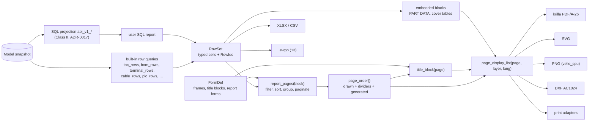

# Reports, forms and page output: report blocks, rows, forms and pagination

A chapter of [Reports, forms and page output](09-reports-forms-output.md), whose table says where each section lives.

---

## 1. Scope and context

### 1.1 What this document decides

- **Reports** are typed row queries (built-in) or SQL over the read-only projection (user reports). Both produce
  one `RowSet` that every consumer reads: report pages, embedded tables, XLSX, CSV and the production package
  (ADR-0018).
- **Report blocks are model data; report pages are derived.** No report page is stored, no "update reports" step
  exists, and TOC, Prev/Next, the PDF outline and `/PageLabels` always include generated pages (FR-REP-001).
- **Forms** (`FormDef`) are declarative nm geometry with typed placeholders. A title block is a table of cells, each a
  text and the value it shows; a value the program does not know is a field of the project's own, one value for the
  project or one per page (§2.10), never text typed into one title block (FR-REP-035). A person changes a frame and
  its title block on a page that prints them (§3.9).
- **One display-list IR** (`ew-dl`) feeds screen, PDF, SVG, DXF, PNG and print, so all outputs agree (FR-OUT-018).
- **Determinism.** The same model, settings, EW version and derivation profile give byte-identical PDF, SVG, XLSX
  and CSV on every platform (FR-OUT-019, NFR-REL-07).

**Out of scope here, with owners:** row *content* of PLC, bus and fluid reports ([10](10-plc-and-bus.md),
[11](11-fluid-power.md)); layout legends and model views ([12](12-panel-layout.md)); wire-list variants, labels,
machine profiles and `.ewpp` ([13](13-manufacturing-outputs.md)); QET title-block and `graphics_table` import
([14](14-interop.md)); check-report content, revision comparison and the release gate
([15](15-checks-revisions-collaboration.md)); shell and dialogs ([16](16-ux-ui.md)); CLI catalogue and `api_v1`
view schemas ([17](17-extensibility.md)). Frame *grid semantics* (cell lookup, xref anchors) are in
[06](06-schematic-editor.md) §2.4 and §5.1; this document owns frame and title-block *forms* and how a person changes
them (§3.9).

**Not done here:** PDF optional-content layers (FR-OUT-023); DWG page export (FR-OUT-016); 3D PDF (FR-OUT-024); HPGL;
stored report pages (ADR-0018); a user-writable SQL path (ADR-0017).

### 1.2 Pipeline



### 1.3 Crates

| Crate | Role here |
|---|---|
| `ew-derive` | `page_order`, `toc_rows`, `title_block`, `device_part_lines`, `bom_rows`, `terminal_rows`, `cable_rows`, `plc_rows`, `potential_partition` |
| `ew-text` | fonts and the memoised `shaped_text` query (parley 0.12.0, fontique 0.12.0, harfrust 0.14.0, skrifa 0.48.0), below `ew-reports` and `ew-scene`, so pagination and paper measure text with one stack |
| `ew-reports` | `RowSet`, report-kind registry, filters, sorting, grouping, pagination into `GeneratedPage`s, user SQL reports through the sandboxed query API of `ew-sqlview` (it never links rusqlite, [04](04-architecture.md) §3.2 rule 2), XLSX (rust_xlsxwriter 0.100.0) and CSV (csv 1.4.0) writers |
| `ew-scene` | forms engine: frame, title-block, cover and report-form layout; text through `ew-text`; `page_display_list` |
| `ew-dl` (permissive) | IR items including `LinkSource`, `LinkTarget`, `EntityRef` |
| `ew-export` | PDF (krilla 0.8.2, krilla-svg 0.8.1), SVG writer, DXF (dxf 0.6.2), PNG through `ew-render-cpu` (vello_cpu 0.3.0) |
| `ew-print` | OS print adapters with per-OS features (§4.5); depends on `ew-export` and `ew-render-cpu` |
| `ew-sqlview` | projection and sandbox for user reports (rusqlite 0.40.2) |
| `ew-library` | form catalogues; projects embed `FormDef` copies under `lib/forms/` |
| `ew-viewmodel` | Edit frame, the tool that changes a frame and its title block on the page (§3.9); Title block fields… |
| `ew-ui` | report-block panel, export and print dialogs; the page in Edit frame |

---

## 2. Concepts and data

### 2.1 Authored versus derived

| Kind | Records | Persisted in |
|---|---|---|
| Authored (A) | page-oriented `ReportBlock` | `report-blocks.jsonl` ([05](05-project-format-and-persistence.md) §2.2) |
| Authored (A) | embedded `ReportBlock` (anchored by `embedded.page`), `Page.form` override, `Page.title`, `Page.description_override`, `Page.user_props` (the page's values of the fields of its own, §2.10) | the page file `pages/<uuid>.jsonl` |
| Authored (A) | `Section.divider`, text styles, export schemes (project level), `Project.user_prop_defs` and `Project.user_props` (the fields of the project's own and their project values, §2.10) | `structure.jsonl`, `project.jsonl` |
| Library copy (L) | `FormDef` (frame, title block, cover, report, divider, label); a starter form a person changed is the project's own copy (§3.9) | `lib/forms/<copy_id>.json` |
| Project SQL | user report queries | `reports/<uuid>.sql` (untrusted until the project is trusted, NFR-SEC-05) |
| Derived (D) | `RowSet`, `GeneratedPage`, page order, Prev/Next, TOC, title-block values, display lists, PDF and table files | never stored; frozen copies only in the as-built archive (FR-REV-011) |

### 2.2 `ReportBlock`

The [domain model](03-domain-model.md) §6 record: its members, each with what it holds, are the struct `ReportBlock`
of `crates/ew-schema/src/page.rs`, and its stored form is the generated schema
(`schemas/0.1/report_block.schema.json`). Its generated pages are `v5(id, page_index)` (ADR-0004); an SQL source
names its query file `reports/<uuid>.sql`; an embedded block is a page-embedded table (§3.4); the printed columns,
the caption, the legend and the added rows are §3.8's, and the layout page is the panel layout page a legend list
follows (below, §3.2). The block's `params` and `filter` are specified; not built: they are appended later and kept
in `extra` until then.

The cover block is the report kind `profile_tables` (`ew-reports`), drawn by the
`embedded` module of `ew-scene` into the tables layer; its layout (proportions in 560ths of the block width, 24 rows) is
hard-coded in `ew-scene` and provisional until it moves into the form's regions.

The report kind `enclosure_legend` is
registered in `ew-reports` (`kinds/enclosure_legend.rs`) with its rows from `layout_legend(surface)`, plain functions
in `ew-derive` (`layout/legend.rs`), not memo families: the enclosure, the plate (falling back to the enclosure's plate
copy), one row per carrier (rails, then ducts, then carrier kinds the build does not know, each top to bottom then left
to right by its first point; the DT cell empty; the length in metres as the quantity, "Missing" without one), then
the placements by DT in natural order; positions 1 … n, derived; a row that is not a carrier has quantity 1. The
block takes its surface from the page it is embedded on, or, as a list of its own, from the layout page it
names, so a block on a page without a surface view lists no rows; a block that names no page (the kind's whole-project
rows, `ew export report --kind enclosure_legend`) lists every plate a layout page shows, in page order, each after a
heading row that names its first layout page ("Layout 902"). In the BOM, a layout object's line (the enclosure, the plate, the carrier
part lines) prints the panel pages that view its surface in its Folios cell only.

Embedded blocks of every kind are drawn.
A kind says what its embedded block prints through `ReportKindDef::embedded_layout` (`EmbeddedLayout`: the printed
columns with relative weights, the box title, whether each flow column has a header row, the number of flow columns);
the default prints every column at weight 1 under a header row, no title, one flow column. The layout is presentation
only: the rows, the CSV and every other export keep all the kind's columns, and a block's own non-empty `title`
replaces the kind's. `part_data` prints "PART DATA" with no header, the label and the part number at weights 3 : 10;
its source devices are the root ancestors of the devices drawn on the embedded page **and** the enclosure device of
the surface the page's surface view shows; carrier lines (`LineSource::Carrier`) are left out, since the legend on
the same page lists every carrier. `enclosure_legend` prints "LEGEND" in two flow columns, each with a header row:
position, DT, quantity (with its unit unless it counts pieces, "0.47 m") and part number at weights 10 : 22 : 16 : 35; the manufacturer, the
description and the unit stay in the rows and the CSV. An embedded block has no first folio, so `ew export report
--block` names it by its ID; the default block of a kind-specific export is never an embedded one. A block with its own printed
columns (`ReportBlock.columns`, the legend Add legend makes) prints as a lookup table: one flow column, columns sized
to their texts and its box ending under its last row ([12](12-panel-layout.md) §5.4). **Where it has no room, a
legend wraps; it does not ask for a wider box**: its identifiers (position, tag, quantity, part number)
print whole, shrunk to the 1.8 mm cap height where they must be, and its description gives way first, wrapping at its
words onto further lines while the block has the height for every row so grown, else cut in its row; only a block
narrower than its identifiers at that size cuts one. The rule and its order are 12 §5.4's. A legend without its own
columns prints the kind's four columns in two flow columns, until a person chooses its columns (§3.8, "In the window").

**A legend as a list of its own** ([12](12-panel-layout.md) §5.4). `ReportBlock.layout_page` (an optional page
ID, additive) names the panel layout page a page block of kind `enclosure_legend` lists: its rows are those of the
surface that page's view shows. The legend belongs to that plate (doc 12 §5.4): it follows the first layout
page in page order that shows it (the named page where that shows no plate): its pages follow that page in folio and
section (§3.2), its title's `{layout}` prints that page's folio, and its generated pages print the structure that page
shows (`page_display_structure`: its tags and title block as the layout's). It is a link that
cascades: deleting the layout page deletes the block. `report_block.create {layout_page}` writes the layout page's
folio number as `first_folio` and its section as `section`, so the block keeps EW-INV-014; this build reads neither for
such a block, and the folio checks of `page.create` and `report_block.create` leave it out (its pages move to a free
folio instead). **What an older build shows:** a page block of kind `enclosure_legend` whose rows it takes from an
embedded page only, so no rows and, by `empty`'s default, no pages: the legend page is not there, nothing else
changes, and the build keeps `layout_page` as an unknown member and writes it back. A legend list's rows link both
ways ([12](12-panel-layout.md) §5.4): the tag of a device's row to its footprint on the layout (`LinkTarget::Placement`),
and the row is where Follow reference from the device lands.

**Encodings and deferred members**:
- `source` is `{"kind": "<report kind>"}` with the snake_case names of §2.4, or
  `{"sql_query": {"api": "v1", "file": "<uuid>"}}`.
- `params` (report-kind parameters) and `filter` (§3.3: a typed predicate or a pure rhai expression) are not typed.
  They will be appended as top-level members of the block, not inside `source`, so adding them is additive; a file
  that carries them keeps them in `extra`. Typed filters (`Eq`, `Ne`, `Within`, `Present`, `Absent`) exist but none is
  persisted, and `parts_summary` reads `extra.params.mode`.
- **Block titles are templates**. `title` may name `{n}`, `{count}` and `{group}` (§4.1) and `{strip}` and `{device}`, which `ew-reports` resolves at derivation, before pagination: `{device}` is the short tag of the first device of the block's manual selection, `{strip}` that of the first selected device that has a strip aspect, so renumbering a strip renames its folios and its TOC rows. A placeholder with no such device stays as written, and no title is exempt by its text prefix. `{n}` is the 1-based page number within the block, `{count}` the block's page count; for example "Terminal Diagram {strip}" and "PLC Overview {device} {n}".
- **Group header and footer rows** are not a `GroupSpec` member: only a kind that makes them has them (the titles and
  captions of the profile tables), and a form's data area (§2.5), which a form of an earlier build may hold, is
  ignored, so `GroupSpec` is `{key, break}`.
- **`first_folio`** is required for a page-oriented block (a structural invariant) and ignored when `embedded` is
  set: an embedded block has no folio.
- **`EmbedSpec`** is `{page, rect}`. It has no overflow member: an embedded block overflows by its cells' `Overflow`
  policy and the rule of §3.4.

A cover's colour and size tables are one embedded `profile_tables` block whose form gives each group, colours,
control sizes and mains sizes, its own region. Section dividers are not blocks; they are generated from
`Section.divider` (FR-PAG-009). The cover is a drawn `TitlePage` page whose frame is a `Cover` form, not a block.

**Block sets.** The company basic project carries the standard set of page blocks (EPLAN's report templates); the
company-standard wizard copies it into new projects (FR-PRJ-010). Because pages are derived, there is no
"update reports" step: editing a block's filter, sort or form re-paginates on the next read.

**Creating a block with its form.** `report_block.create` ([17](17-extensibility.md)
§2.1) takes `form_copies: [libdoc]`: the library documents of the block's form and of the title block that form
names. A project holds a form as an embedded copy ([05](05-project-format-and-persistence.md) §13.2), and a form copy
without its title block breaks EW-INV-001, so the two travel together. They are checked by the rules of
`library.embed` (one shared check) and embedded in the same transaction through transaction lookups only, so the
derivation is never read during the command (kept); a held copy of the same version (the same `sha256`) is
reused, a copy of another version is refused with "update from library" (FR-PRT-014). One undo step removes the block
and the copies it embedded; a reused held copy stays. A form of the project's own (its library ID the project's: a
frame or title block made outside the program) is embedded as any other form, by `library.embed` and here;
a block's form is set afterwards with `fields.set` path `form` (its Form row in Properties) to a form the
project holds. Editing a form in the window is not built. **The wizard's standard layout** (16 §9.2 step 9) is written
through this command: the contents page on folio 2, the parts list on 901, **one** terminal-diagram block at 903
(over every strip; its pages continue as 903.1, 903.2), the cable overview at 906, the wire list at 907, the PLC
overview at 908, the potential overview at 909, the device-tag overview at 910 and the revision overview at 911; a basic project has no strip, so one terminal-diagram
block covers all. A block title that names a strip or a device (`{strip}`,
`{device}` above) would stay as written without a selection, so the wizard's titles count pages with `{n}` instead
("Terminal Diagram {n}", "Partlist {n}"). Not built: `report_block.delete` and `report_block.set`, and an editable
block list in the wizard; a block is created once and not changed or removed through a command.

### 2.3 `RowSet`: one row source for every consumer

A report's rows are a `RowSet`: the structs `RowSet`, `Row`, `RowId` and the enums `RowKind`, `RowKey` and `Cell` of
`crates/ew-reports/src/rowset.rs`, each member with what it holds. The rows are in their final order after filter,
sort and grouping; a range cell is a tag list compressed at render time (§3.6).

- **Typed cells, late formatting.** A cell holds a value, not a string. The display language, number format, tag
  display form and date format are applied by the consumer. XLSX therefore gets numbers as numbers ("0.75") while
  the PDF prints "0,75 mm²" in an nl-NL export (FR-I18N-009).
- **`RowId` is stable** (FR-REP-048). It is derived from the row's source entity IDs: a device ID
  for a device-list row, `(strip, terminal, level)` for a terminal row, the target-side connection ID for a wire row
  ([domain model](03-domain-model.md) §9.2), `(part, mode)` for a BOM row. It keys back-links (FR-REP-042), the
  hidden `id` column of the Excel round trip (FR-EXP-004), and revision deltas (FR-REV-015). Tags are never row keys.
- **Links.** `LinkRef` names the destination of a cell: the main representation of a device, a CP anchor, a page.
  The PDF turns them into link annotations; the canvas turns them into jumps.
- **`RowId` and its text form**. A `RowId` is an ordered list of
  `RowKey { Entity(uuid) | Index(u32) | Name(text) }`; its total order is the last tie-break of every sort. Its text
  form, which is also the hidden `id` column of the XLSX round trip (FR-EXP-004), joins typed, escaped components
  with "/": `e:<uuid>`, `i:<n>` and `n:<name>` with "%", "/" and ":" percent-escaped in the name, so it parses back
  without ambiguity. A `parts_list` row is keyed (device, part copy, variant, ordinal among equal parts)
  (FR-REP-048).
- **Cells and sets**. `Cell::Folio` holds a `PageRef` (drawn page, divider or
  generated page), so TOC rows can point at dividers and generated pages; `Cell::Number` (an integer such as a BOM
  position) and `Cell::Folios` (several pages in page order) exist; `Cell::Address` holds text. `Row.sources` lists the entities a row covers (manual exclusion, back-links)
  and `RowSet.groups` the group ranges. `as_of` is `None` for Class I sources, which are always current (a revision
  inside a memoised value would defeat early cut-off), and `Some(rev)` for a Class II source such as the SQL
  projection. A `RowSet` also carries its status, `Derived` or `NotDerived(reason)` (§3.2).

### 2.4 Built-in report kinds

Each kind is a registered Rust row query with a column schema and default form. Row content for domain reports is
owned by the listed document; this document owns forms, pagination and output for all of them.

The built kinds are the files of `ew-reports`' `src/kinds/` (one per kind or family, registered in
`kinds::builtin`); the [crate map](../map/crates.md) lists them with their heads, which name each kind's rows and
requirement. The cover is no kind: it is the `Cover` form of the drawn `TitlePage` page (FR-REP-038). Specified and not
built:

| Kind | Report | Row source (ARCH §6.4) | Group | Rel. | Requirement |
|---|---|---|---|---|---|
| `terminal_lineup` | Terminal line-up with accessories | strips, accessories | strip | 1.0 | FR-REP-011 |
| `terminal_connection` | Terminal connection diagram (graphical) | `terminal_rows` | strip | 1.x | FR-REP-043 |
| `device_connection` | Device connection diagram | `function_cps`, connections | device | 1.0 | FR-REP-015 |
| `plug_diagram` | Plug diagram and overview | plugs | plug | 1.0 | FR-REP-024 |
| `mounting_list` | Mounting list (EPLAN `.f32`) | placements ([12](12-panel-layout.md)) | surface | 1.0 | FR-REP-023 |
| `load_summary` | Load per potential and protective device | part currents, potentials | potential | 1.0 | FR-REP-026 |
| `order_list`, `manufacturer_list` | Purchasing views | `bom_rows` | supplier | 1.0 | FR-REP-025 |
| `check_report` | Findings, waivers, packs, disclaimer | `checks` ([15](15-checks-revisions-collaboration.md)) | severity | MVP | FR-CHK-014, NFR-COMP-04 |
| `thermal_report`, `checklist_*`, `hole_table` | Domain reports | [12](12-panel-layout.md), [13](13-manufacturing-outputs.md) | — | 1.0 | FR-THM-009, FR-MFG-029, FR-MFG-036 … FR-MFG-038 |
| `assembly_list`, `cut_list`, `consumables` | The workshop lists | [13](13-workshop-lists.md) | strip, group | 1.0 | FR-MFG-016, FR-MFG-030, FR-MFG-049 |
| `untranslated` | Untranslated texts per language | `MlText` fallbacks | language | 1.0 | FR-I18N-005 |

The domain kinds of 02b are registered through one row (FR-REP-045); a labour-estimate report is FR-REP-044 (1.x,
Could).

**BOM row order.** Component mode sorts device rows by the page order of the row's first main representation, then
its position on that page (column, then row, the numbering order), then the part
number. Rows without a schematic representation (enclosure, plate, carriers, accessories) follow in the layout-legend
order of [12](12-panel-layout.md) §5.4: enclosure, plate, carriers, then accessories. A row whose part is a layout-only
accessory (kind end bracket or accessory) is always in that second group, whatever the placement of the strip it sits
on; its folio column still lists the folios of its devices. Until layout placements exist, that column prints the folios of the
devices' representations instead of the layout page.

**Bond numbers in the potential overview.** The bond rows follow the potentials and are numbered B1, B2 …:
first the declared bonds (bond records, doc 03 §9.6), in the order they were made (their IDs, which grow with time),
then the drawn ones (a wire from a 0 V point to earth, 08 §3.7), in the order their wires were drawn. A bond drawn on a
page never moves a declared bond's number, and a new bond of either kind takes the next number of its group; a new
declared bond moves the drawn ones by one.

EPLAN report types without a kind of their own: the cable connection diagram (`.f07`) and the cable assignment
diagram (`.f08`) are alternative forms of `cable_overview_diagrams` over the same `cable_rows`, shipped at 1.0
(no extra row source, FR-REP-012); the PLC diagram per card is `plc_overview` filtered to one module; the symbol
overview and the forms and plot-frame documentation are 1.x candidates (Could), rendered from the library catalogue
rather than the model.

*Kind contract*. A kind's row query reads through `Q::try_get` wherever a read may close
a query cycle, so no model content makes it panic; a schema kind that no engine registers yet is a placeholder.
The placeholder page and a box whose rows do not derive print the reason in words in the project's language ("Not
derived: this build does not make this list", "Niet afgeleid: de lijst hangt af van haar eigen pagina's"), never a
family or kind name; the log and the command line keep the name.

### 2.5 `FormDef`

A form is the library item kind `form`: the struct `FormDef` of `crates/ew-schema/src/library.rs` with its frame grid,
cells (`FormCell`, with its `Overflow` policy), data area (`DataArea`, one `RowTemplate` per row kind in
`RowTemplates`) and page-to-sheet transform (`SheetTransform`), each member with what it holds; its stored form is the
generated schema (`schemas/0.1/form.schema.json`). What the code does not say: the page-to-sheet transform is for
QET-compatible frames only (FR-PAG-029), and absent means scale 1; the graphics are rules, boxes, drop shadows
(REF-105) and pictures (FR-SYM-025); the data area is a report form's only; the continuation is EPLAN's "next form"
(FR-REP-032); the `meta` holds the key, the licence (CC-BY-SA-4.0 with the exception), sources and status
([03](03-domain-model.md) §7); no overflow policy clips silently (FR-REP-039).

**The frame grid** (`FrameGrid`) is the frame's columns and rows, which its rulers print (FR-PAG-014; what they mean
is [06](06-schematic-editor.md) §2.4 and §5.1). Per axis it holds the count, the step (a rational step in nm), how the
axis is counted (`counting`: `numbers` or `letters`; the columns' default `numbers`, the rows' `letters`), the index of
its first label (`start_index`, default 0: the number 0, or the letter A) and whether letters skip I and O
(`skip_io`), and, for a frame brought in with labels of its own, explicit `labels`; for both axes the header bands'
thickness and whether the rulers are drawn (the member `ew.frame.show_grid`, default drawn). `counting` on both axes,
`start_index` on the rows and `skip_io` on the columns are additive members: an older build prints a frame that sets
them with numbered columns from their start and lettered rows from A. The grid also fixes the frame's size: the
drawing area is the header band plus the columns' and rows' steps, and the title block stands below it, as wide as
the frame (`ew_scene::forms::FrameGeometry`).

**A title block is a table.** Its cells tile its rectangle, and its lines are the cells' edges where two cells meet,
each drawn once as a line of its `graphics`; its outline is the frame's. The starter title blocks and the ones the
QElectroTech import makes are such tables. Its other graphics (a picture of its own) stand apart from its cells. A
cell's value is a placeholder (§2.6), a picture's place is a cell's rectangle, and a cell's text is its label.

The transform is stored as an integer scale in parts per 10⁹ plus an nm offset (the QET frame: 986 282 578 ppb,
offset (9.79, 9.79) mm), so every writer applies it with the integer arithmetic of §4.3 rule 4 instead of a float
`Affine`.

**Cell text**. A labelled cell prints its label, one space and the value;
v0 has no tab stops. `ShrinkToFit` reduces the style size down to `min_cap_height`, measured as printed through the
page-to-sheet transform (§2.8); text that still does not fit is drawn at that size and overflows the cell, and the
form finding `Overflow` reports it, because clipping is forbidden. `Ellipsis` cuts the text, appends "…" and reports
it; `Error` draws the text unshrunk and reports it. `FitWidth` (`"fit_width"`) is QElectroTech's `hadjust`, which a
QElectroTech title block's cells take ([14](14-interop.md) §4.10): its lines are never wrapped, and a text wider
than the cell is scaled down whole (its size and, with a pixel, its pixel) until its widest
line fits, without a floor, and placed in the cell's height scaled by the same share about its middle. Its height
counts only where the face's own line pitch, and not the text, makes the block taller than the cell: for a block of
more than one line and no more lines than the cell's `ew.cell.max_lines` whose box (the first line's ascent to the
last line's descent) crosses the cell's top or bottom, the lines close up first, the size unchanged, until the box
lies inside, never to less than 1 em apart; a block that still does not fit 1 em apart is scaled down whole, size and
pitch together. Either way it is placed in the whole cell. A text of more lines than that is drawn at its size and
not reported, as QElectroTech draws it. An older build keeps the value as unknown and draws the text as `Error`
does. Cell text is inset 2 QET px (0.529 mm) from the left and right
edges, or by the cell's own `ew.cell.inset` extra member in nm (0 to 10 mm; a QElectroTech title block's cells
have 0, [14](14-interop.md) §4.10), and middle alignment centres the cap height. A cell's `ew.cell.pixel` extra member
(nm, 1 nm to 10 mm; another value is none) lays its text out as a screen of that pixel does: every glyph's advance,
its kerning included, is rounded to a whole number of pixels (halves up) and each line is as long as their sum; a
QElectroTech title block's cells have one QET px, as QElectroTech prints them. Every output draws the glyphs where
the display list puts them, so nothing else changes; an older build ignores the member. A cell with no room at all (inset width ≤ 0, or shrinking that
reaches size 0) draws nothing and reports the finding of its own policy (`ShrinkLimit`, `Truncated` or `Error`); v0
has no separate finding kind for it. An asset cell draws the image of its `AssetRef`, fitted by the
recorded intrinsic size, or filling the inset area when the size is unknown ([05](05-project-format-and-persistence.md)
§13.3); a logo cell too small for its insets draws no image and reports an `Error` finding that carries the
placeholder text.

**`form_type`** (the placeholder set a form accepts, FR-REP-034) is not typed; placeholder validity is checked against `kind`
and, for a report form, the report kind of the block that uses it; a file that carries `form_type` keeps it in
`extra`.

**The house report form**, the starter A4 list layout: table x 16.31–277.27 mm, header and data rows 6.52 mm, header
fill #C0C0C0, grid 0.183 mm, text style `text.normal` 8.88 pt, **23 data rows per page**. The TOC form's columns are
Folio number 16.31–79.73, Title 79.73–214.90, Location (+) 214.90–277.27.

Shipped forms are CC-BY-SA-4.0 with the design exception (ADR-0024). Form copies embedded in projects, and every
PDF or table produced with them, are not subject to EW's copyleft (NFR-LIC-09).

### 2.6 Placeholders

A placeholder is `{scope.path | filter …}`. Unknown paths are a form load error; paths invalid for the form type
are rejected (FR-REP-034).

**Unresolved placeholders render empty**. At lowering, a placeholder that yields no value
renders as empty text, and the form finding `Binding` names the cell and the placeholder. This covers a valid path
without a value (`{revision.current.checker.name}` while no checker is set) and anything that escaped
the load check: an unknown scope or path, a computed `{= …}` cell before the formula engine exists, or a malformed
template. The raw `{…}` text is never printed; a form that wants a visible fallback writes `| default("—")`, which
counts as a value. An unsupported filter passes the value through unfiltered and is reported. `{{` and `}}` print
literal braces. The rule covers every unresolvable placeholder (unbound, unresolved, unknown scope, computed) and a malformed template draws nothing; the raw placeholder text is never drawn.

| Scope | Examples | Valid in |
|---|---|---|
| `project` | `{project.description}`, `{project.reference}`, `{project.drawing_id}`, `{project.object}`, `{project.document_title}` (the cover subtitle, "Sample conveyor" on the sample), `{project.created \| date}`, `{project.edited \| date}`, `{project.supply \| supply}`, `{project.control_voltage}`, `{project.consumption}`; `{project.logo}`, the logo asset reference of the basic project's company data, which a cell draws as the image and prints no text for, and `{project.notice}`, the notice text of the same company data ([07](07-symbols-parts-macros.md) §2.8) | all |
| `party.<role>` | `{party.customer.name}`, `{party.end_user.address.city}` (personal data, §7 pitfall 14) | all |
| `revision` | `{revision.current.label}`, `{revision.current.state}`, `{revision.current.author.name}`, `{revision.current.checker.name}`, `{revision.current.date \| date}` (the current revision: below the table; while it names no author, `{revision.current.author.name}` prints the project's designer, the party of the role author) | frame, title block, cover |
| `page` | `{page.folio}`, `{page.prev}`, `{page.next}`, `{page.title}` ("Supply 400 V AC" on the sample's 101), `{page.description}` (override or project description, §2.7), `{page.function}` (`=P01`), `{page.location}` (`+CAB`), `{page.scale}` ("1:5" on the sample's 902, FR-PAG-023), `{page.document_kind}` (`&EFS`, FR-PAG-028), `{page.last_changed_in}` ([15](15-checks-revisions-collaboration.md) §5.6) | frame, title block |
| `project.prop`, `page.prop` | `{project.prop.<key>}`, `{page.prop.<key>}`: a field of the project's own, its project value or the page's value (§2.10); a key the project does not define for that scope is unresolved | frame, title block, cover |
| `doc` | `{doc.page_index}`, `{doc.page_count}` (position in and length of `page_order`) | frame, title block |
| `block`, `group` | `{block.title}`, `{block.page_index}`, `{block.page_count}`, `{block.as_of}`, `{group.key}`, `{group.strip.tag}`, `{group.cable.part}` | report |
| `row` | `{row.<column key>}` | report data area |
| `profile` | colour rows (voltage, function, colour name, code), size rows | cover, embedded |
| `export` | `{export.date \| date}`, `{export.status_mark}`, `{ew.version}` (the root `ew` holds only `ew.version`) | all |

**Stored company and frame members.** No new record kind and no
schema change ([05](05-project-format-and-persistence.md) §10.3); the shapes are in [03](03-domain-model.md) §5.1.
`{project.notice}` reads `Project.extra["ew.company"].notice`, the provisional member that `project.company.set`
writes. The frame defaults are `settings.extra.frames` = `{default?, per_page_type: [{page_type, form}]}`, written by
`project.settings.set` (member `frames`) with the entries sorted by page type and `per_page_type` always present (`[]` when empty). The rule
for a page's frame is the one of §2.7: `Page.form`, else the entry of its page type, else `default`. A form or an entry
that names a copy the project does not hold falls through to the next rule, identically in the cell grid and in the page
output (`ew_derive::frame_form_of`). A page without its own form takes the frame defaults
in the page output (`PageFrameOf`), as in the cell grid.

**The logo.** `{project.logo}` reads the reference stored by
`project.company.set` ([17](17-extensibility.md) §2.1): `Project.extra["ew.company"].logo` is
`{sha256, format, size}` (the bare `"sha256:…"` form of an older file is read), and the bytes are an asset of the
project's asset store ([05](05-project-format-and-persistence.md) §13.3), at most 512 KiB (`MAX_LOGO_BYTES`). A title
block's logo cell takes the image by that reference, and the display list places it (so the wizard's preview shows the
logo on the sample's cover). SVG logos are drawn as vector paths by the CPU renderer, the PDF writer, the SVG writer and the viewer (the export job resolves them before any writer runs); PNG is drawn on the CPU path; the SVG writer embeds PNG and JPEG; JPEG on the CPU path and rasters in the PDF are not built; an SVG is
drawn only after `svg_hazard`'s checks ([threat model](../security/threat-model.md) TM-18), in usvg's drawn subset ([05](05-project-format-and-persistence.md)
§13.3). A raster logo (PNG, JPEG) prints rasterised, an SVG as vectors. An image that an export cannot draw (a missing
asset, or one the sniff refuses) is reported as `PageFinding::Image` in the export's findings, never dropped silently
.

**The current revision** is the project's open revision; without one, its newest released revision. Withdrawn
revisions and the `Withdrawn` records that point to them are ignored, and among several candidates of the same state
the newest date wins, a revision without a date counting as the newest.

Filters: `date` (project format, FR-PRJ-023), `supply` (structured supply → "1 x 230 VAC + N + PE, 50 Hz", D-18),
`qty(unit, decimals)`, `tag(full | displayed)`, `ml(lang)` or `ml(stacked: [nl-NL, en-GB], sep: " / ")`
(FR-I18N-004), `range` (§3.6), `upper`, `default("—")`. Computed cells use a pure rhai formula (`{= …}`) through
tracked reads only (FR-EXT-011).

### 2.7 Frames and title blocks

- **Frame forms** carry the columns and rows (§2.5; the starter A4 frame's 17 columns numbered from 0 and rows A–H,
  FR-PAG-015), variants with and without columns and rows that share one title block (FR-PAG-017), and the ISO 5457
  frames A4–A0 (FR-PAG-016). Assignment: project default, page-type default, page override (FR-PAG-018; the stored
  shape and the fall-through rule are in §2.6). Title, contents and divider pages and all generated pages use the
  frame without columns and rows. The starter frames for drawn pages, for the cover and for dividers, contents and
  lists name one title block, so a change of it shows on every page until a frame is given a block of its own (§3.9).
- **Title-block cells are bindings** (FR-REP-033, FR-REP-037). The starter title block, the QElectroTech-compatible
  one, binds: the large cell → `page.title` ("Supply 400 V AC" on the sample's 101); "Project:" →
  `project.reference`; "Description:" → `page.description`; "Drawing:" → `project.drawing_id`; "Revision:" →
  `revision.current.label`; the `=` and `+` cells → `page.function`, `page.location`; the party cell → one party role
  (below); "Object:" → `project.object`; "Checked:", "Author:" → revision checker and author; "Creation:", "Saved:" →
  `project.created`, `project.edited`; "Page:", "Prev:", "Next:" → page order; the logo and notice → `project.logo`
  and `project.notice`, the company data of the basic project (§2.6). Every labelled cell prints label, one space and
  value (§2.5). It has **no scale cell**: it is QElectroTech's default block. FR-REP-037's scale cell binds
  `page.scale` in a block that has one; a person gives a cell that value in its Shows (§3.9).
- **Project properties name their rows as these cells**: Project, Drawing, Object, Saved and Author (in
  Dutch Project, Tekening, Object, Opgeslagen, Getekend), and each row's explanation names the cell that prints it.
  `project.document_title` prints on the cover frame only, which its row says. The Checker row does not feed
  "Checked:": that cell is the sign-off and prints the checker who approves the current revision, empty until then.
- **`page.description`** resolves to `Page.description_override` if set, else `project.description` ("Conveyor drive
  with a pneumatic clamp" on the sample). An override raises the info finding EW-CORE-023 naming the page
  (FR-REP-036, D-06). `Page.title` is the per-page page description and TOC title (FR-PAG-010); it is not an override.
- **"Saved"** binds the model's edited date (day precision, merged by maximum; FR-PRJ-029), never a file time.
  Release exports take dates from the release context ([05](05-project-format-and-persistence.md) §14.1).
- **"Revision"** prints the latest revision record. While V1.1 is open, draft exports print "V1.1" and the status
  mark (FR-OUT-021); after release every page prints the released label (FR-REV-003).
- **Party cells bind roles** (FR-PRJ-003, D-30): the starter block's cell is "End user:" and binds the end-user
  role; a shop whose drawings name the customer there gives the cell the text "Customer:" and the value Customer ▸
  Name (§3.9).
- **A value the program does not know** (an order number, the customer's own sheet number) is a field of the
  project's own (§2.10): a cell shows it as it shows the program's values.
- **ISO 7200 coverage.** The starter block is QElectroTech's, not ISO 7200. The ISO 5457 frames (FR-PAG-016) carry an
  ISO 7200 title block whose mandatory fields bind as follows (FR-REP-050; field list per
  [standards](../research/standards.md) §12.2):

  | ISO 7200 field | Binding |
  |---|---|
  | Legal owner | party role panel builder / legal owner (FR-PRJ-003) |
  | Identification number | `project.drawing_id` |
  | Revision index | `revision.current.label` |
  | Date of issue | release context date, else `revision.current.date` |
  | Segment/sheet number, number of sheets | `page.folio`; `doc.page_count` |
  | Title, supplementary title | `page.description`; `page.title` |
  | Creator, approval person | revision author, revision checker |
  | Document type | `page.document_kind` (FR-PAG-028) |
  | Document status | `revision.current.state` plus the status mark (FR-OUT-021) |

### 2.8 Text styles and fonts

- Form cells reference **text styles held as model data** (FR-SYM-013). The built-in styles (`text.normal` 8.88 pt,
  `data.small` 6.66 pt, `pin` 5.92 pt, `xref.device` 5.18 pt …) are `crates/ew-text/src/style.rs`'s table.

- **Project text styles** ([ADR-0032](../adr/0032-per-project-text-styles.md)): the styles are project data in `ProjectSettings.text_styles`, overrides of the built-in table (`ew_schema::BUILTIN_TEXT_STYLES`, from which `ew_text::builtin()` is built). The effective table (the built-in rows with the overrides applied, then the keys only the project adds) is `ew-derive`'s memoised `text_styles` query; the scene, the forms, the report tables and the exports, EW-CORE-061 and EW-CORE-063 all read it, and only callers with no project use `ew_text::builtin()`. New projects write `cp.small` and `marker` at 7 px.
- **Fonts** are resolved from the project's font set: the bundled default family, optional osifont, and a bundled
  symbol fallback (§7, pitfall 8). Tahoma is never bundled or embedded (FR-IMP-020). Noto Sans is the
  default while ADR-0028 is Proposed; the forms and the expected PDFs and PNGs are built with it.
- **The symbol fallback** (ADR-0028 amendment 1): Noto Sans Math Regular 3.000 (OFL-1.1)
  draws the characters the style's face lacks, for Latin, Greek and Cyrillic text only; a text line drawn with two
  faces is a group of glyph runs, one per face (§4.3 rule 5). Export reports only the characters no bundled face
  drew (FR-OUT-027, EW-CORE-066).
- **The project's typeface** (§4.8): one font file of the user's, held in the project, prints every text of
  the Standard typeface. System fonts are not used (NFR-REL-11 requires a project to export without them).
- **Font versions are pinned** by the derivation profile (ADR-0028 recommendation 6): an EW release that updates a
  bundled font ships it as a new version, so line breaks and shrink-to-fit results of reopened projects do not
  shift.
- Styles bound to slot kinds make every tag print at one height (D-29). The minimum printed-height rule
  (FR-CHK-023, EW-CORE-061: printed cap height, minimum 1.2 mm) evaluates text at the sheet scale, including
  the page-to-sheet transform, and the print dialog repeats it for scale-to-fit jobs (D-31).

### 2.9 Export schemes

Export settings are a named settings scheme at company, user and project level (FR-PRJ-008, FR-OUT-010):

```toml
[scheme."customer delivery"]
scope = "project"                     # project | sections = [1, 2] | pages = "101-106" | selection
format = "pdf"
pdf.conformance = "A-2b"              # A-2b (default) | A-3b or A-4f (attachments only, FR-OUT-003, C-10) | none
pdf.tagged = false                    # PDF/UA-1 option (FR-OUT-012, 1.0)
pdf.outline = "sections"              # sections | sections+structure (FR-OUT-004)
pdf.links = "xrefs+reports"           # xrefs | xrefs+reports | none
pdf.partial_links = "plain"           # plain | companion (FR-OUT-020)
colour = "colour"                     # colour | monochrome (FR-OUT-011)
languages = ["en-GB"]                 # one PDF per entry (FR-I18N-005, 1.0)
omit_personal_data = false            # FR-OUT-025 (CLI --omit-personal-data), FR-PRJ-024; AML, .ewpp: FR-EXP-009
status_mark = "auto"                  # auto: "DRAFT <label>" on unreleased revisions (FR-OUT-021)
date = "model"                        # model | fixed "2025-04-14" | source-date-epoch (FR-OUT-026)
file_name = "{project.drawing_id}_{revision.current.label}_{lang}.pdf"
```

File-name templates are sanitised like archive labels ([05](05-project-format-and-persistence.md) §14.2) and may
not use personal-data fields when `omit_personal_data` is set.

---

## 3. Behaviour and rules

### 3.1 Page order with generated pages

`page_order()` (Memo, ARCH §6.4) merges three page sources and is the single source of Prev/Next, TOC rows, the
outline and `/PageLabels`.

```text
page_order(q):
  drawn    = q.pages()                                   # authored pages
  dividers = sections where divider → folio = range.start   # 100, 200, 900
  gen      = for each page block b except TOC blocks: report_pages(b)
  D        = len(drawn ∪ dividers ∪ gen)                 # does not depend on the TOC page count
  per      = TOC capacity: the rows of the TOC form's list area, else the profile's toc.rows_per_page (≥ 2)
  n_toc    = max(1, ceil(D / (per − 1)))                 # closed form: the TOC lists its own pages too
  merge(n) = sort(drawn ∪ dividers ∪ gen ∪ n TOC pages) by (section order, folio number, sub-page index,
                                                            origin: drawn < divider < generated, page id)
  order    = merge(n_toc)                                # one confirming round (ARCH §6.2)
  n'       = ceil(len(order) / per)
  if n' > n_toc:                                         # only if a TOC row is not one page
    emit EW-CORE-025 (TOC fixpoint not reached, warning); order = merge(n')   # never a missing page
  return order
```

- The sort key is numeric, never textual: 907 < 907.1 < 907.2 < 907.10 < 908 (FR-PAG-006, FR-NUM-018).
- **Example:** 34 pages do not depend on the TOC, so n = ⌈34 / 22⌉ = 2 TOC pages; the confirming round counts 36
  pages, ⌈36 / 23⌉ = 2, and stops. Prev/Next: folio 1 Prev empty, 911 Next empty (FR-PAG-013).
- **Closed form instead of iteration** (it replaces the earlier "initially 1, at most three rounds"). With a capacity below 2 rows the TOC could never list itself, so such a TOC form is an invalid layout
  (§3.2). When the confirming round still disagrees, the order is rebuilt with the larger count, so a page is never
  missing; a blank TOC row is acceptable (§7 pitfall 1).
- **The report engine is a provider**. `page_order` lives in `ew-derive`
  and calls `report_pages` through the `ReportPagesProvider`, which is engine-level configuration: one per
  `Session` (later one per memo store), never a per-`Q` untracked input; a `Q` without one is the test
  configuration. `ew-derive` never depends on `ew-reports`. Pagination runs inside `page_order`, so no query that
  feeds it reads `page_order`: row sources that order by page position read `drawn_page_order()` (drawn pages and
  dividers, the same relative order), and folio cells are printed from `page_order` when the page is drawn.
  EW-CORE-025 reads the page order's `settled` flag, surfaced as a finding.
- Pages without a section (1, 2, 3) precede section 1 (front matter).
- **Folio collisions** between a generated page and a drawn page, or two blocks, are the error EW-CORE-022
  (FR-REP-041, FR-CHK-038). The `origin` key places the generated page after the drawn page with the same folio, so
  output never loses a page and the order does not depend on random UUID bits.

### 3.2 Pagination

`report_pages(block)` (Memo + LRU) consumes the block's `RowSet` and the form geometry (FR-REP-002):

```text
report_pages(block):
  rows  = rowset(block)                       # filtered, sorted, grouped; tie-break by RowId
  form  = block.form; page = new(form); out = []
  for group in rows.groups():
    if group.break == NewPage and page.has_rows(): out.push(page); page = new(form.continuation)
    if group.break == NewFolio and out ∪ page non-empty: close folio; next folio = previous + 1
    place(group.header)                       # keep-with-next: header plus ≥ 1 data row on the same page
    for row in group.rows:
      h = one list-area row (6.52 mm)         # a profile table's group row none
      if page.used + h > form.list_area.rows:
        out.push(page); page = new(form.continuation)
      place(row)
    place(group.footer)                       # subtotals, e.g. Σ current per potential
  out.push(page)
  a run's last page under 3 data rows: the page before ends as many rows earlier (it keeps 3)
  apply block.empty when there are no data rows
  number pages: first_folio, then SubPage (first_folio.1, .2 …) or NextFolio
  title(page n) = block.title with {n}, {count}, {group}   # "Partlist 1", "Partlist 2" (FR-PAG-011)
```

- **Fixed-height rows are the default.** With the shipped form a page holds 23 rows, so pages = ⌈rows / 23⌉: the wire
  list's 50 rows (44 wires and the separate 6-row bridge block) give 907, 907.1, 907.2; the PLC overview's 56 rows
  give 908, 908.1, 908.2 (sub-page continuation, FR-PAG-030).
- **A list never ends on a page of one or two rows.** The last page of a run (the list's last page, or the
  last before a group that starts a page or a folio of its own) holds at least three data rows: where it would hold
  fewer, the page before it in the run ends that many data rows earlier, if it keeps three itself (a form of fewer rows
  is left as it is), so the rows move back; the page count stays ⌈rows / capacity⌉. Of 24 rows on the 23-row form, 21
  and 3. The page before has no room to take them: it closed because it was full, and the row kept free under a list's
  table (§3.8) is where the window marks that the list runs on, not a data row. `ew_reports::paginate::slice`
  (`LAST_PAGE_ROWS`).
- **A legend's pages follow its layout page** (0.3.5, §2.2's `layout_page`: the first layout page of its plate). The
  layout page is printed N (or N.j); the
  legend's pages are N.k, N.(k + 1) … in the layout page's section, k the least from 1 (from j + 1) at which no drawn
  page of that section holds one of them, so its run is never split by a drawn page: 902.1 and 902.2 after 902, and
  902.2 and 902.3 where a drawn page is 902.1. A drawn page made later at one of its folios is not refused; the legend
  moves on to the next free run. Another block's pages at the same folios collide as any two blocks' do (EW-CORE-022).
  A legend whose layout page is gone has no pages (the link cascades, so only a file edited by hand holds one).
- **Page counts.** `{block.page_count}` is filled after the block is paginated, since row heights do not depend on
  it. Only the TOC's row count depends on its own page count; that fixpoint is settled inside `page_order` (§3.1).
- Generated pages are `GeneratedPage { id: v5(block, index), block, folio, title, rows: Range, group, form }`. They
  are read-only on the canvas (FR-PAG-002).
- **Placeholders, layouts and form chains**. A
  report kind that is not derivable yet (its row query or its record shape does not exist, or the schema names a
  kind that no engine registers yet) paginates to one placeholder page whose note gives the reason, whatever its
  `empty` policy, so its folios and TOC entries stay in place; this generalises
  [ADR-0017](../adr/0017-read-only-sql-projection-api-v1.md) amendment 1. A form paginates by the rows of its list
  area (§3.8); a data area that a form of an earlier build holds is ignored, and a form copy that is missing or a
  list area of no row paginates with the house layout of 23 rows × 6.52 mm, which moves from `ew-reports` into the
  derivation profile. A `NewFolio` group break restarts the form chain at the block's form; `NewPage` continues it.
- **Group texts**. `{group}` and the group header texts print a device in its displayed tag
  form in the structure context of the generated page, falling back to the short tag; groups follow the sort
  direction of the group column, and a heading row bounds a group.

### 3.3 Filtering, sorting, grouping

- **Filters** are typed predicates over row columns or source entities (`location within +J-E-2416`,
  `state != Deactivated`, `has_part`) or a pure rhai expression. Manual include and exclude lists hold entity IDs and
  survive renumbering (FR-REP-027). The I/O list leaves out deactivated channels unless its block parameter
  `include_deactivated` is true, while the PLC overview lists every channel. Example: a BOM block filtered to `+J-E-2416` omits the `+FIELD` process valves.
- **Sorting** uses the specified natural order of `ew-mltext` (numeric runs by value; ADR-0005 amendment 3; ICU only for language-sensitive display sorting) in the project's *source* language, independent of OS locale
  and display language, so every language export sorts identically (FR-I18N-010, NFR-I18N-03). The reference BOM's
  ASCII order ("+" < "-" < digits) cannot occur.
- **Grouping** keys a page set per strip, cable, station, location or section (EPLAN's function-related reports).
  Group headers and footers are row kinds with their own templates; footers can carry sums of `Qty` columns.

### 3.4 Embedded report blocks

An embedded block (`embedded: {page, rect}`) renders its rows into a rectangle on an interactive page
through the form's data area (FR-REP-028, FR-REP-029). It does not join the page order.

| Block (example) | Page | Rows | Source |
|---|---|---|---|
| PART DATA | 201 | "Order Code 1:" 51E-F13GCQP-D+H2GG, "Order Code 2:" 32P-VGL-R-MAHAHAHAHAHAHUL3LAHU-28MS | `AssemblyConfig` of the valve terminal (D-36; split per order code is U-24) |
| PART DATA | 202 | the same two order codes (the reference repeats the box identically on 202) | same |
| PART DATA | 902 | "Cabinet: Schneider Electric NSYPLA1074G", "Backplate: Schneider Electric NSYPMM107" | `device_part_lines(-UC1)` |
| CABLE COLOUR DEFINITIONS, standard sizes | 1 | 2 header + 15 data rows (24 VDC Positive DBU … Analogue Earth GNYE); 0.75 / 1.5 mm² tables | colour and size profiles (D-08) |

- **Overflow** follows the cell policy: shrink to fit down to the minimum cap height, then ellipsis plus a warning
  finding with "n rows not shown". The rectangle never grows silently into the drawing.
- Embedded blocks render in their own display-list layer `tables` (ARCH §6.4, ADR-0015 amendment 2), so a wire
  edit does not rebuild them. A profile edit rebuilds `tables`, and `labels` only on pages
  whose wire markers print derived values.
- The reference sets each PART DATA entry as a label line ("Order Code 1:") above a centred value line; the
  `part_data` form reproduces this with a two-row template per entry.
- Changing the 24 V DC colour in the profile updates the folio 1 table, every derived wire colour and folio 907 in
  one commit (AC-12).

An embedded PART DATA block lists the root ancestors of the devices drawn
on its page: their configured lines become "Order Code n" rows, otherwise their own lines plus those of descendants
without a representation. The manufacturer text is the `LibRef`'s `extra.key` (a stopgap).

### 3.5 User SQL reports

User reports are an SQL file over the versioned `api_v1_*` views plus a form (FR-REP-031, ADR-0017; 1.0).

```sql
-- ew:report api = "v1"
-- ew:title  "24 V loads per potential"                        -- D-25 example (ARCH §11)
-- ew:column potential type = "ident"
-- ew:column load      type = "tag"
-- ew:column pin       type = "ident"
-- ew:column current   type = "qty" unit = "A"
-- ew:group  potential footer = "sum(current)"
SELECT w.potential_name AS potential, d.tag AS load, w.to_cp AS pin,
       json_extract(d.tech_data, '$.type') AS type,          -- technical data is JSON text; key illustrative
       c.i_load AS current                                   -- from 1.0 (ADR-0017 amendment 3)
FROM api_v1_wire AS w
JOIN api_v1_device AS d ON d.id = w.to_device_id
JOIN api_v1_cp AS c ON c.device_id = w.to_device_id AND c.cp = w.to_cp AND c.role = 'load'
WHERE w.potential_name LIKE '24VDC-%'
ORDER BY potential COLLATE ew_natural, load COLLATE ew_natural, pin COLLATE ew_natural;
```

- **Columns.** View and column names follow [17](17-extensibility.md) §6.1. `api_v1_cp.i_load` (decimal text,
  empty when the part declares no load current) and the derived CP roles `source`, `through`, `load` and `other`
  exist from 1.0, the release of user SQL reports (ADR-0017 amendment 3). Run as `ew sql` text before 1.0, the query
  has no current column and no footer sum and lists the 24 V loads only, as the D-25 example of
  [17](17-extensibility.md) does.
- **Typing.** `ew:column` annotations map result columns to cell types and placeholders `{row.<name>}`; unannotated
  columns are text. The projection delivers quantities as exact decimal text (`'0.75'`) and lengths as integer
  `_nm` (ADR-0017 column conventions), so a `qty` column parses into `Dec3` without float rounding and a footer
  `sum(current)` is exact. A query that does not prepare against the current projection fails the SQL compile test
  in CI (ARCH §13) and shows a finding in the project.
- **Sandbox.** Query-only connection, authorizer (no ATTACH, PRAGMA, DDL, DML or direct `t_*` reads; one statement
  per call), progress-handler deadline of 2 s per report, the report result cap of 100,000 rows and the
  `SQLITE_LIMIT_*` limits (all ADR-0017). A violation renders one error page and a finding.
- **Trust.** In an untrusted project the block renders one placeholder page "Report not run: project not trusted";
  `ew export pdf` creates no other output from it (NFR-SEC-05).
- **Freshness.** The projection is Class II. On screen, SQL report pages show "as of revision n" and are
  re-paginated when the projection catches up. **Every export builds the projection on its own fork**, so exported
  SQL pages are always fresh. In the session, `page_order` reads the last projection result per SQL block, a
  non-persisted, non-undoable query input stamped with its revision; before the first result exists the block counts
  as one placeholder page (ADR-0017 amendment 1).

### 3.6 Value rendering rules

| Value | Rendering | Example |
|---|---|---|
| `Tbd` | "TBD" (configurable), listed in open items, blocks release | "Node TBD" on folio 3 (D-15) |
| `Missing(Length)` | "length missing" | -3W1 in folio 906 (FR-REP-013, D-19) |
| `Stale(v, rev)` | value plus "≈" marker; allowed only in draft exports, refused in release exports (FR-EXP-001) | "≈ 810 mm" |
| `Qty` | icu number format of the output language, SI spacing | "0.75 mm²", nl-NL "0,75 mm²" (FR-I18N-009) |
| `Date` | project date format | "Creation: 03-03-2025"; ISO 8601 option (FR-PRJ-023) |
| `Tag` | full designation (`=P01+J-E-2416-102G1`) or displayed form, per column setting | frozen S51 (`sign: Hidden`) prints "S51" in displayed form and `=P01+J-E-2416-S51` in full form ([03](03-domain-model.md) §8) |
| `Range` | compressed tag list (below) | "-201U3-Q1 … -202U2-Q4" |

**Tag-range compression** (FR-REP-046):

```text
compress(tags, all_tags_of_class):        # class = same letter code and same assembly root or strip
  order = natural order of all_tags_of_class
  runs  = maximal runs of tags that are consecutive in `order` (no tag outside the row lies between)
  print runs of length ≥ 3 as "first … last", shorter runs as a comma list; strip the shared prefix of
  terminal runs ("-X1031:1 … 20")
```

Examples: 571334 → "-201U3-Q1 … -202U2-Q4" (all 28 valve children are consecutive); 533361 →
"-201U3 … -201U8, -202U2" (-201U9 and -202U1 interrupt the run); UK 5 N → "1X1:1, 1X1:2".

### 3.7 Freshness and release

- Built-in rows, pages, TOC and title blocks are Class I: always fresh (ADR-0003).
- Report layouts, built-in row definitions, title-block bindings and bundled font versions are part of the pinned
  derivation profile, so a project prints the same pages in later EW releases until its profile is upgraded by a
  previewed command (FR-PRJ-011, NFR-REL-09).
- The first shipped profile, `2027.1` (TOML data in `ew-derive`,
  [ADR-0003](../adr/0003-freshness-contract.md) amendment 2), carries the numbering scheme, the cross-reference
  format, the title-block binding set (the placeholder paths that `title_block(page)` resolves), the identifier-set
  key and the TOC layout (23 data rows per page, which drives the page-count fixpoint of `page_order`). Report layouts
  and font versions are not in the profile. `project.control_voltage` and `project.consumption`
  are in the binding set but stay unbound, and so render empty (§2.6): `Quantity` has no text formatter.
- Report outputs of a released revision are frozen into the as-built archive as `reports/<block id>.csv` plus the
  PDF ([05](05-project-format-and-persistence.md) §14.2, FR-REV-011). Re-rendering the archived project with its
  release context and derivation profile reproduces the page content (FR-REV-010).
- Release-mode exports refuse stale Class II inputs (lengths, SQL projection of another revision) and untrusted
  SQL blocks (FR-EXP-001).

### 3.8 Lists on the set's own frame

A delivered set has its terminal lists, cable lists, parts list and contents on the set's own frame and title block,
in its paper size, with the columns its maker chose under headings in the set's language, a caption, a legend line
and now and then a row the model does not hold. The lists print so:

**The frame of a list page.** A list page (a generated page of a page-oriented block) prints on its block's form
(`ReportBlock.form`: its Form row in Properties, `fields.set` path `form`, §2.2), on the set's paper: when the set's
frame (the frame defaults' `default`, §2.6, a form the project holds) has another sheet size than the block's form,
the page prints on the set's frame instead. So a set made A3 prints its lists on A3, the contents too, without a block
edited; a set that keeps no frame defaults prints its lists on their blocks' forms.
The rule is `ew_reports::layout::list_frame`; the pagination and the page output read it, so a list's pages and their
frame never disagree. The title block is the frame's.

**The frame a new list starts on.** Output ▸ Report block… gives a new list the set's own frame
(`Session::new_list_form`): the frame defaults' `default` when it names a form the project holds, else the frame most of
the drawn pages print on (a title page not counted; a tie goes to the frame that comes first in page order,
`ew_reports::layout::set_frame`). A project without drawn pages, or whose frame is a starter form, starts it on the
starter frame without the grid (embedded where the project lacks it), which the list then prints on the set's paper. So
a set brought in from QElectroTech, whose pages each name a frame of its own and which keeps no frame defaults, makes
its lists on its own frame and title block. The QElectroTech import does not write the frame defaults: it gives every
page the frame of its diagram, and the diagrams of one project may have different frames; the rule above finds the
set's frame from its pages, however the set was made.

**A list the set already has.** While a list of the kind chosen in Report block… already prints on pages of its own,
the form says so under its Report field ("This set already has Cable overview and diagrams on page 906. Create adds
another; …"), and after Create the toast names that page with Go to page beside Undo. Another list of a kind is allowed.
Output ▸ Parts list, the one list with a button of its own, opens the set's parts list and never makes one; its toast
says so ("Opened the set's parts list on page 901; it makes no second one. Report… on the Output tab adds another
list."). Where devices have no part, a second toast says how
many are left out of the list, with Select them (for Choose part…) and Type not known yet… (the same devices' part
dialog on its description field), which lists them by a description.

**The form's Report field.** Report block… offers the parts list first, as the Output tab leads with its Parts list,
and opens on it; the other kinds follow by their names. A kind may carry search words beside its name (`report-kind-<kind>-words`: "cable list" for Cable
overview and diagrams): the command search finds Report block… by them, and Report block… found by a list's name or
search words rather than its own opens its form on that list.

**The Form row.** A page's and a report block's Form row in Properties is a choice of the project's forms (every held
form but a title block and a label), by name: a starter form by its kind and its key in words ("Frame QET A4 landscape
nogrid"), a form of the project's own, which carries no name, by its kind, its paper and the pages that print on it
("Frame A4 landscape, on 101, 102, 103 …", "on no page"; two of one name are numbered). The kind and the words around the
paper are in the window's language ("Kader A4 liggend, op 101, 102"), in English on the command line; the key's words of
a starter form stay as the key has them. Typed, the row takes such a name or the form's ID and refuses anything else in
words, listing the forms. A block's Form row stands in the open; a page's waits under Advanced, as a page without a form
of its own takes the frame defaults, and such a page's row names the frame those defaults give it. The
project's Frames row names the defaults the same way, "Default: …; Table of contents: …", and so does the
Pages navigator's Frame column, for every page the frame it prints on.

**Frame of the lists.** The project's Properties have the row Frame of the lists in Main: the form every list (every
page-oriented block) prints on, by name, or each named where the lists differ. A form chosen there is set as the Form of
every list's block in one `fields.set` (one undo step), and a toast says so; the rule above still applies (a set of
another paper size prints its lists on the set's frame). A generated page's Form row is read-only, as every row of a
generated page is: an edit there is refused under the row with a button to Frame of the lists. So does every other row of a list page, each with
the way to where it is changed: the printed columns, the caption and the legend line List columns… on the Output tab,
the rows of one's own Rows of your own…, any other row Show report block (the list's block selected in Properties,
where its rows are edited). The frame defaults keep no entry for report pages
(EW-INV-012): a list's frame stays its block's Form. The generated table of contents is a list and follows Frame of the
lists; a section divider is no list and keeps the frame defaults' entry. The toast and the help of the project's Frames
row say so: that entry frames a contents page drawn by hand.

**Where the table stands.** In the frame's drawing area, printed (through the page-to-sheet transform): on a frame
with a grid inside its header bands and above its title block, on a form without one the sheet less 10 mm and its
title block. The table keeps the house table's distances to the starter A4 frame's drawing area (1.30 mm in on the
left, 3.91 mm on the right, its top at the area's top), so on that frame it is the house table of §2.5 to the
nanometre (x 16.31 to 277.27 mm, 23 rows) and every A4 list prints as it did. On a frame that draws its column and row
strips the table's top stands 1.30 mm below the column strip, as its left edge stands right of the row strip, never on
the strip's line. Rows are 6.52 mm: an optional caption
row, the header, the data rows, an optional legend row and one row kept free under them (where the window marks a list
that runs on); a page holds as many data rows as fit, at least one (36 on the starter A3 frame). One exact rule
(`FormDef::list_area` in `ew-schema`) gives the pagination its rows and the drawing its places, so a page never holds
a row it cannot draw; a TOC counts its pages with it too (the profile's 23 rows only when its form is missing). A data
area that a form of an earlier build holds is ignored (§3.2).

**The columns.** `ReportBlock.columns` (so far an embedded block's printed columns) is a list of `{key, weight,
heading?}`; on a page block too it gives the printed columns in its order, `weight` the column's share of the
table's width (widths in millimetres serve as shares) and `heading` (a multi-language text, optional, an additive
member) the printed heading in place of the kind's. A key the kind does not have prints nothing (the window offers
the kind's columns only). Empty: the columns the kind prints by default (`ReportKindDef::printed`), with their
weights; a kind that declares none prints every column, and the wire list prints the fitter's (13 §3.1). The chosen
columns are the print's: the CSV and XLSX keep every column of the kind.

**The caption and the legend.** `ReportBlock.caption` and `ReportBlock.legend` (multi-language texts, additive
members): the caption prints in a row of its own above the header, in the style `box.title`, the legend in the row
under the last row of the page, in the table's style; both on every page of the list, left aligned, shrunk, cut and
reported as a cell is. Each takes one row from the page.

**Rows the model does not hold.** `ReportBlock.added_rows` (additive): a list of `{cells: {<column key>: <text>}}`. A
list is made anew from the model and its block on every read, and the rows are the block's, so nothing the model
does removes or changes them: they join the kind's rows before the block's sorting and grouping (§3.3), a text in a
column of identifiers or addresses as such and a whole number in a column of numbers as that number, so a sort
places them among the model's rows; without sort keys they follow them. They print, paginate and export (CSV, XLSX) as
any row, link nowhere, and their row ID is their place in the list (`n:added/i:<k>`). A table of contents takes none
(it lists the pages).

**The language.** A Dutch project printed English headings because a column's heading was one English text and the
page printed neutral text, as did the title block. Every kind's column has its heading as a text by key of the list
texts (`ColumnDef::new` with `text!("column-…")`; `ew-reports/texts/<language>/lists.ftl`, in every language the
program ships), the starter title blocks have Dutch labels, and a page prints in the
project's language (`languages.source`; `nl` and `nl-NL` alike, `ew_derive::text_in`): the headings, the caption, the
legend, the rows' texts, the terminal states, the title block's labels and multi-language values, and quantities with
the language's decimal sign unless the project sets its own separator. A project without a language prints English
as before. The CSV and XLSX headers stay English.

**The program's own words.** Every word the program writes into a cell itself is a text by key of the list texts, as
the headings are, rendered in every language they ship where the cell is made (`ew_reports::words::in_languages`); a
word `ew_reports::render` adds when it prints is rendered there in the output language (`ew_reports::words::text`: the
tag, else its primary language, else en-GB, `ew_l10n::render::language_for`): a channel's state and kind, a
potential's type and class, a bond, "(cable)", a structure's and a device's kind, a revision's state, a bridge's kind
and its heading, where a wire's colour and size come from and how it is joined, "from part", a termination's on and
off, an IO-Link port's mode, a numbering's kind and status, "Order Code n", an open item's category, message (as `ew
check --lang` words it) and severity, the piece's symbol, "yes" and "no", "TBD" and the missing values
(`ew_reports::render`). The boxes on a drawn page (the legend, PART DATA, the PLC overview box, the cover's tables)
print their titles, headers and cells in the project's language too. A value of the project's data (a tag, a part
number, a description, a colour code) prints as it is; notation (DI, PE, IO-Link, `IP`, `ext.`) is the same in both.
The CSV and XLSX cells stay English, as their headers.

**The title.** A list's title is the person's or the program's. One a person types is kept as typed (a neutral text,
printed in every language). The program's own is a multi-language text in every language it ships: Report block…
without a title writes the report's name ("Terminal diagram", "Klemmenschema"), the template wizard the standard
layout's titles ("Terminal Diagram {n}", "Klemmenschema {n}"); so the title block, the contents, the page tab and the
PDF outline print the program's title in the project's language. A title written before as one English text is a text
like a person's and stays English.

**The terminal diagram names the strip**: its first column, `strip`, prints each terminal's strip tag, so
two strips' terminals 1 read apart; a block of one strip may leave the column out.

**In the window.** On a page of a list, Output ▸ List columns… (the Output tab's Reports group) shows the caption, the
legend and a row per column of the kind (its heading in the window's language): a tick to print it, a heading of its
own, its width and its order; Apply writes them in one undo step (`fields.set_many`). **A legend takes the same
choice**: with a legend selected on its panel page, List columns… (also in the legend's context menu) shows
its table without the caption and the legend line, which a legend does not print; a legend without columns of its own shows the four it prints (position, DT, quantity, part number) ticked and the description among the
others, and keeps printing them in two flow columns until Apply writes a choice, which makes it a lookup table (§2.2).
Output ▸ Rows of your own…
shows the printed columns and the list's own rows with three empty rows to fill; a row left empty is left out.
Properties of a block shows its caption, legend, printed columns, each printed column and its rows by the report's
column headings in the window's language, never a column's key. **By a command:** `fields.set` on the block, paths
`columns`, `caption`, `legend` and `added_rows`.

**A3 and the print.** The starter forms hold an A3 landscape frame with the grid and its title block, in the A4 ones'
manner: QElectroTech's 60 px columns and 80 px rows, 25 by 12, printed at the A4 frame's scale and offset, so a text
prints as high on A3 as on A4; the title block is the A4 one 127 mm wider, its title, project and description cells
taking the width. A new project and a template hold them; the template wizard's Frame offers "A3 landscape, with
grid", which puts the drawn pages, the contents and the dividers on it (the cover stays the A4 cover). `ew print
--fit` (and the print dialog's Scale to fit) scales each page to the whole paper up as well as down, so an A4 set
prints on A3 at 141 %; a page scaled either way carries the stamp "scaled n %".

**What it does not do.** Edit a report form's table in the window: a list's columns, caption and legend are List
columns…, its frame and title block Edit frame's (§3.9). Placeholders in the caption or the legend.
Rows of a height of the maker's, wrapping cells, a column's alignment. Check a row of the block's own against the
model, or link it anywhere. Print one list in several languages (one PDF per language is FR-I18N-005's). An A3 cover, an A3
frame without the grid, frames A2 to A0.
