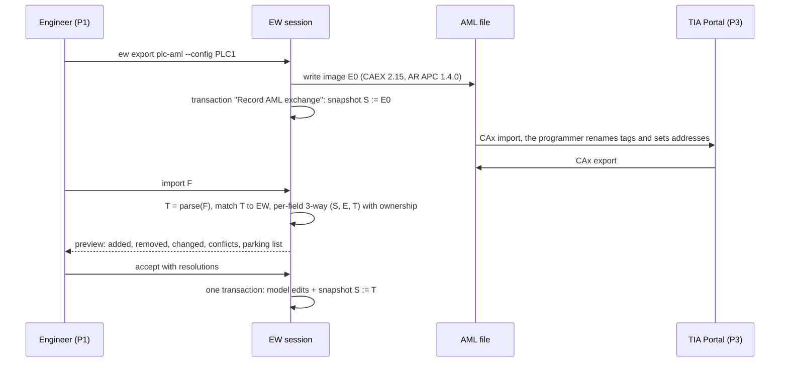

# PLC, I/O and fieldbus: exchange, outputs and the command line

A chapter of [PLC, I/O and fieldbus](10-plc-and-bus.md), whose table says where each section lives.

---

## 4. Exchange with PLC software and spreadsheets

### 4.1 Formats

| Format | Direction | Version | Release | Requirements | Implementation |
|---|---|---|---|---|---|
| AutomationML AR APC | export, import | CAEX 2.15 write; CAEX 2.15 and 3.0 read; AR APC 1.4.0 | 1.0 Must | FR-PLC-029, -031, -032, -033 | `ew-caex` (permissive) + `ew-plc` |
| AR APC 1.2.0 | export | for older TIA versions and EPLAN | 1.0 Should | FR-PLC-030 | same writer, version table |
| TIA "PLC Tags" XLSX | export, import | 10 fixed columns | 1.0 Must | FR-PLC-036 | dedicated exporter and importer in `ew-plc` (rust_xlsxwriter, calamine), not a machine profile (§4.5) |
| PLCopen XML GVL | export | TC6 v2.01 | 1.0 Must | FR-PLC-037 | quick-xml; `plcopen` crate in tests only (C-9) |
| Generic I/O list | export, import | CSV dialects, XLSX | MVP Should | FR-PLC-038, FR-EXP-002 … -004 | `ew-reports` row source |
| Instrument / I/O list | import | CSV, XLSX | 1.0 Should | FR-PLC-050 | `ew-plc` |
| TIA Selection Tool AML | import | AR APC 1.4.0 (TST 2025) | 1.x Should | FR-PLC-034 | `ew-caex` |
| Rockwell L5X, Beckhoff TE1120 | export | L5X fragment; TE1120 XML/AML | 1.x Could | FR-PLC-039 | `l5x` crate in tests only |
| TIA Openness bridge | outside the Rust core | C#, Windows only | Later Could | FR-PLC-040 | separate tool; the core has no .NET dependency |

Every exporter implements the permissive `Exporter` contract over an `ExportView` of a snapshot fork, never blocks
editing and records the revision it reflects (FR-EXP-001). Release-mode exports refuse a stale Class II input.

AML export and import, the AR APC 1.2.0 variant, the TIA tag table, the PLCopen list and the
instrument list are in these crates: `ew-caex` (permissive) holds the image, the AML writer and the AML reader
over quick-xml; `ew-plc` the projection of the image, the matching and merge, the tag table's rows, the PLCopen
writer and the instrument list. No XLSX or PLCopen crate is taken: the tag workbook is written by the workbook
writer of `ew-reports` (`plain_xlsx`, a sheet with fixed columns) and read by the workbook reader of the parts
import, both at the host (`ew-api`); `rust_xlsxwriter`, `calamine` and the `plcopen` test crate are not
dependencies. The `Exporter` contract of [14](14-interop.md) §2.2 is not built; an export runs on the session's
snapshot through `Session::plc_export`. The confirmation of FR-PLC-053, the preview of `plc.set_module_part`
(§3.3), lists the surplus channels with their bindings and symbols; their exchange records are not listed and go
with the next exchange's snapshot.

### 4.2 Exchange image and identity

Parsers and writers work on a **neutral `ExchangeImage`** in the permissive crate `ew-caex`, so third parties can
reuse them without GPL code (ARCH §3):

```rust
pub struct ExchangeImage { pub project: XProject, pub stations: Vec<XStation>, pub tags: Vec<XTag>,
                           pub links: Vec<(XRef, XRef)>, pub networks: Vec<XNetwork> }
pub struct XItem { pub key: XKey, pub position: u32, pub type_name: String, pub order_number: Option<String>,
                   pub firmware: Option<String>, pub built_in: bool, pub addresses: Vec<XAddr>, // {start, bits, io}
                   pub channels: Vec<XChannel>, pub children: Vec<XItem>, pub iec: Option<IecTags> }
pub struct XKey { pub foreign_id: Option<String>, pub ew_id: Option<Uuid> }
```

- **Export** projects the model into an image (`exchange_image(cfg)`) and writes it. Imports parse a file into an
  image, and `ew-plc` (GPL) matches and merges it against the model.
- **EW identity travels with the file** (FR-PLC-056). CAEX `ID`s are the EW UUIDs of station and module
  devices and the v5 channel IDs; tag IDs are `v5(channel, "tag")`. The XLSX and CSV formats carry the channel ID in
  a hidden column. `ProductDesignation IEC` carries the derived tag, `LocationIdentifier IEC` the location. The
  verified samples show these two attributes in TIA Selection Tool exports (PBF §3.1, finding 6); whether TIA Portal
  keeps them, and EW's GUIDs, on a CAx re-export is unverified (§8, item 6) and part of SC-8.
- **The last exchange snapshot** is the merge base. It is stored as canonical JSONL in
  `exchange/<config-project-uuid>.jsonl`: one record per exchanged station, module, channel and tag, holding the
  exchanged field values and the foreign-ID map (kinds `exchange_record` and `foreign_id`, ranks 70 and 71 of
  [05](05-project-format-and-persistence.md) §2.2; included in the as-built archive). A separate file keeps it out
  of `project.jsonl` merges, travels through git, and lets a colleague merge a TIA re-export.

The image is `ExchangeImage {project, stations, tags, networks}` with serde and a JSON Schema,
since it is the parameter of `plc.apply_exchange`. Every object carries one `id`, the ID the file gives it: an export
writes the project's IDs there, an import keeps what the PLC software wrote, and the matching decides whether that is
one of the project's IDs or a foreign one (no `XKey` with two members). A tag names its channel by that ID (`channel`)
instead of a link list; a station holds its bus interfaces (`XInterface` with a `XNode` and `XPort`s) and the image
the subnets (`XNetwork`). `exchange_image(q, cfg, stations?)` is a function of `ew-plc` over a `Q`, not a memoised
query. The snapshot is typed: `exchange_record {config_project, object, target, fields}` holds the exchanged values
of one station, module, channel, tag or bus node (`object`) by field name, `target` being the record the object is (a
device, a channel, the port's function); `foreign_id {config_project, object, target, foreign}` holds the ID the file
gave an object when it is not the project's. Both have computed IDs (`v5(config_project, …)`), so recording the same
exchange twice writes the same records. A row of an instrument list is an `exchange_record` of object `instrument`
(§4.7). The link to the configuration project is load-tolerant and cascades; `target` is history, not a link: a record
whose object is gone snapshots nothing. The XLSX carries the channel ID in a hidden eleventh column.

### 4.3 AML AR APC export

| EW | CAEX element (role or interface class) | Attributes |
|---|---|---|
| Configuration project | `InternalElement` (`AutomationProject`) | Name = `PLC1` |
| Station | `InternalElement` (`Device`) | TypeIdentifier (`System:Device.<family>` or `OrderNumber:<MLFB>` in the TIA sample; `OrderNumber:195740` for -201U1, unverified for GSD devices), `ProductDesignation IEC`, `LocationIdentifier IEC` |
| Rack, module, submodule | `InternalElement` (`DeviceItem`) | PositionNumber, TypeName, TypeIdentifier `OrderNumber:533361`, FirmwareVersion, BuiltIn, `Address` list {StartAddress, Length in bits, IoType}, IEC tags |
| Channel | `ExternalInterface` (`…InterfaceClassLib/Channel`) | Type Digital/Analog, IoType, Number, Length |
| Symbol | `ExternalInterface` (`…/Tag`) in a `TagTable` element (under the CPU `DeviceItem` in TIA; without a CPU under the `AutomationProject` element) | DataType, IoType, LogicalAddress "0.1" (no area letter; the area follows from IoType), Comment with `aml-lang` per `MlText` language |
| Channel ↔ symbol | `InternalLink` | RefPartnerSideA `<module ID>:Channel_DO_1`, RefPartnerSideB `<tag table ID>:TA05_V_15` |
| Bus interface, port, node | `CommunicationInterface`, `CommunicationPort` (Label), `Node`/`NodeEthernet` | NetworkAddress, SubnetMask, IpProtocolSelection; PROFIBUS address names to be fixed from a real DP export |

The valve terminal -201U1 with the symbol template `{target.process_tag}`, shortened (role and attribute declarations
omitted). The element nesting follows the TIA V21 sample (PBF §3.1); the tag table without a CPU sits under the
`AutomationProject` element. Both are verified in the exchange test (SC-8):

```xml
<CAEXFile FileName="PLC1.aml" SchemaVersion="2.15">
  <AdditionalInformation AutomationMLVersion="2.0"/>
  <AdditionalInformation><Document DocumentIdentifier="AR APC" Version="1.4.0"/></AdditionalInformation>
  <InstanceHierarchy Name="PLC1">
    <InternalElement ID="…cfg uuid…" Name="PLC1">                          <!-- AutomationProject -->
      <InternalElement ID="…-201U1 uuid…" Name="-201U1">                   <!-- Device -->
        <Attribute Name="TypeIdentifier"><Value>OrderNumber:195740</Value></Attribute>
        <Attribute Name="ProductDesignation IEC"><Value>-201U1</Value></Attribute>
        <Attribute Name="LocationIdentifier IEC"><Value>+J-E-2416</Value></Attribute>
        <InternalElement ID="…-201U3 uuid…" Name="-201U3">                 <!-- DeviceItem, PositionNumber 1 -->
          <Attribute Name="TypeIdentifier"><Value>OrderNumber:533361</Value></Attribute>
          <Attribute Name="Address"><Attribute Name="1">
            <Attribute Name="StartAddress"><Value>0</Value></Attribute>
            <Attribute Name="Length"><Value>8</Value></Attribute>
            <Attribute Name="IoType"><Value>Output</Value></Attribute></Attribute></Attribute>
          <ExternalInterface ID="…ch1 v5…" Name="Channel_DO_1"
              RefBaseClassPath="AutomationProjectConfigurationInterfaceClassLib/Channel"/> <!-- Number 1, Length 1 -->
        </InternalElement>
        <!-- -201U4 … -202U2: StartAddress 1 … 6 -->
      </InternalElement>
      <InternalElement ID="…tag table…" Name="EW_IO">                       <!-- TagTable -->
        <ExternalInterface ID="…tag v5…" Name="TA05_V_15"
            RefBaseClassPath="AutomationProjectConfigurationInterfaceClassLib/Tag"/> <!-- Bool, Output, 0.1 -->
      </InternalElement>
      <InternalLink Name="Link To Tag_1" RefPartnerSideA="…-201U3 uuid…:Channel_DO_1"
                    RefPartnerSideB="…tag table…:TA05_V_15"/>
    </InternalElement>
  </InstanceHierarchy>
</CAEXFile>
```

The full export holds 7 module `DeviceItem`s with 8-bit output ranges, 56 channel interfaces and 8 tags with 8
`InternalLink`s (FR-PLC-029, AC-30). The absolute starts are relative to the node (Q0 … Q6, ▲U-22). TIA applies the
ranges on CAx import. Writer-header dates come from the export's document date (default: the revision date, or
`SOURCE_DATE_EPOCH` in CI; FR-EXP-006), never from the clock (NFR-REL-07). Element and attribute order is fixed
(station order, slot, channel number), so the bytes are stable (FR-EXP-006). The personal-data option (FR-EXP-009)
leaves no person fields in the file.

The writer follows the table and the example: the configuration project's `InternalElement`,
below it one per station (role `Device`) with its modules (`DeviceItem`, flat: a rack is not written as an item, a
module's `PositionNumber` is its slot), the tag table (`TagTable`, under the project element) and
the subnets, then the `InternalLink`s. Roles are `SupportedRoleClass` paths, attributes carry `AttributeDataType`,
children come in the order of the CAEX 2.15 content model (attributes, interfaces, elements, the role, links), and the
class libraries are referenced by path. A station's `TypeIdentifier` is `OrderNumber:` and the order number (else the
part number) of its first part with a station PLC section; a module's order number is its part's, else its
`type_ident`'s. A tag is written for every channel with a determined symbol and an address; its comment is the
channel's, else the function text. Bus: one `CommunicationInterface` per interface name of the station's bus ports,
with a `Node` (`Type` `Profibus` or `Ethernet`, `NetworkAddress`, `SubnetMask`, `RouterAddress`, `PnDeviceName`) for
the port with an address and one `CommunicationPort` (`Label`) per labelled port; a logical net is a `Subnet`, linked
to its nodes through `LogicalEndPoint` interfaces. The node's attribute names, the `LogicalEndPoint` interface class
and `PnDeviceName` are **unverified** against a TIA export, as is the tag table's place; EtherCAT
and IO-Link ports are not written. The 1.2.0 variant (FR-PLC-030) is the same writer with a version table that so far
differs in the declared version only: which attributes an older importer refuses is part of the exchange test (SC-8).
The writer header's date is the document date (`SOURCE_DATE_EPOCH`, else the model's edited date). The file holds no
person field with or without `--omit-personal-data`, which `ew` accepts for the PLC exports (FR-EXP-009). An export is
refused while EW-PLC-005 has a finding (FR-PLC-047). **Validation:** the published CAEX 2.15 schema file is not in the
repository, because its licence for redistribution is not established; a test of `ew-caex` checks
the written file against the schema's content model written from the standard (child order, required attributes,
unique IDs, links that name interfaces), and AC-30's test reads an export back.

### 4.4 AML import and the three-way merge



**A6. Matching** (FR-PLC-032), first hit wins:
1. persisted foreign ID or EW UUID;
2. `ProductDesignation IEC` = derived full tag;
3. (station, rack, slot, subslot, channel number);
4. order number + position.

Ambiguous or unmatched foreign objects go to the **parking list**. They are never placed on pages and never created
silently. Each has a "create unplaced" action (TIA's ParkingLot equivalent). The comparison scope is the set of
stations present in the file. A station missing from the file is untouched unless the user ticks "file is complete".

**Per-field resolution** (FR-PLC-033):

| Ours E vs base S | Theirs T vs base S | Owner Ecad | Owner Plc | Owner Shared |
|---|---|---|---|---|
| unchanged | changed | listed as "rejected PLC change", can be accepted | apply T | apply T |
| changed | unchanged | keep E (exported next time) | keep E, flagged "export pending" | keep E |
| changed | changed, T ≠ E | conflict, default keep E | conflict, default take T | conflict, default keep E |
| either | E = T | no change | no change | no change |

- **Imported module starts become `Manual(…)`;** the snapshot records them as PLC-supplied, which is what the
  "address owned by PLC1" message cites. Channel addresses stay `Auto`, so they still follow the part map and
  EW-PLC-012 still applies.
- The preview groups changes per channel and shows the affected folios. The commit is **one undoable transaction**
  that includes the new snapshot, so undo restores both.
- Re-importing an unchanged export gives an empty diff (FR-PLC-032).

**Drift (EW-PLC-016).** The online rule compares `hash(exchange_image(cfg))` with the snapshot's hash and reports
"changed since the AML exchange of <date>". The second clause of FR-PLC-035 (the foreign file is newer) needs file
access, which queries never have, so FR-PLC-035 evaluates it in the exchange dialog and by `ew plc status <file>`
only.

`ew_plc::merge` on the session's snapshot is the preview, and `plc.apply_exchange` runs the same
merge on its base, so what was previewed is applied; a stale preview is refused by the engine as for every Bulk
command. **Matching** runs kind by kind (stations, modules, channels, nodes, tags), each below its matched parent, and
in passes over every object of the kind, so a weaker key never takes an object that a stronger key gives to an object
later in the file: first the ID (the project's, or a `foreign_id`) of every object, then a station's or module's IEC
designation, a channel's number and direction, a node's interface label, then a module's slot with its order number.
A station or module whose designation names no free object of the project is parked, never paired by its slot or type;
a station without an ID or a designation is parked too, as an image gives a station no position (A6's rule 4 needs
one). A tag follows its channel's link, else its ID, name, then address. A step that finds several objects parks the
foreign object as ambiguous. A module that only holds other modules (a rack) is passed over, and what is below a parked
station or module is not listed on its own. **Fields.** The merge
compares the fields of §4.2's records. Only fields of an owned group are written: a tag's name, data type and comment
(`Channel.symbol`, `data_type`, `comment`, per language), a module's start (a `manual` start), a station's firmware and
a node's address (the PROFIBUS station address; the PROFINET name, IP address, mask and gateway). Every other field
(structure, designations, order numbers, a tag's address, which follows its channel) is the schematic's: a difference
is listed as a rejected PLC change and cannot be accepted. **States** in a preview: `apply`, `rejected`, `kept`,
`pending` (changed in the project only although the PLC owns it: export pending) and `conflict`; a resolution (`ours`,
`theirs`) is keyed by `<object>/<record>/<field>`. `ew-plc` names each object kind, field and state by the key of
its words (`object_key`, `FIELD_KEYS`, `State::key`): the window and Apply's notices render the key in the
window's language ("applied" for `apply`), and the command line prints an object's and a field's words in English;
`ew import plc-aml` and `plc-xlsx` begin each change's line with the state's name above (`State::word`), as their
`--json` gives it. Without a snapshot of the object (a first import of a project that
never exported, an object added since) every difference of an owned field is a conflict with the owner's default. A
value the file leaves out or empty is no deletion: it never clears the project's value by default, but is listed as
`rejected` (or as a `conflict`) whose default is ours, and only the choice `theirs` clears it. A comment with languages
and one without never replace each other: where the file's comment is of the other form than the project's, the change
is a `conflict` that keeps the project's comment and cannot be taken. **Removed.** An object the last exchange held and
the file no longer has is listed and never deleted or cleared. **Parking.** "Create unplaced"
(`create` under the object's file ID) creates a parked station with its modules, or a parked module below its matched
station, as devices without functions: the tag frozen to the IEC designation (else the name), a rack slot at the
position, the starts as `manual` starts, the order number in `type_ident`; no part is assigned, so no channels exist
until one is. A parked channel, tag or node cannot be created. **Snapshot.** An exchange re-bases only what its format
carries: an AML file every field of every object, a tag table the tags' names, data types, addresses and the comment
in its language, every other value of a record staying. After the apply the snapshot holds so the file's values for
every matched object, with the foreign IDs; the stamp's direction is `import`. An export records itself the same way
(`plc.record_exchange`): an AML export replaces the records of what it exported, a tag table updates the tags' carried
fields, and a PLCopen list, which never comes back, is not recorded at all. The foreign ID of an object the file no
longer has, or the project no longer has, goes with its record. **Drift.** `ew plc
status [<file>]` prints the stamp, the differing objects with their fields, and whether the file's SHA-256 is the
stamp's; it does not read the file's content (`ew import plc-aml <file>` previews it). The affected folios are not
part of the preview.

### 4.5 TIA "PLC Tags" XLSX

Sheet "PLC Tags", columns exactly: Name, Path, Data Type, Logical Address, Comment, Hmi Visible, Hmi Accessible,
Hmi Writeable, Typeobject ID, Version ID (FR-PLC-036). The workbook is written and read by a dedicated exporter and
importer in `ew-plc`, not by a machine or label profile of [13](13-manufacturing-outputs.md) §5.4 and §7, because
its round trip needs code. One row per channel with a determined symbol:

| Name | Path | Data Type | Logical Address | Comment | Hmi Visible | Hmi Accessible | Hmi Writeable | Typeobject ID | Version ID |
|---|---|---|---|---|---|---|---|---|---|
| TA05_V_15 | EW_IO | Bool | %Q0.1 | TA05-V-15 (-201U3-Q1) | True | True | True | | |

- The path is `SymbolPolicy.tag_table`. HMI flags are a configuration-project setting; their TIA defaults are
  unverified.
- The comment uses the export language chosen in the dialog. Other `MlText` languages are untouched on re-import.
@@@ END

- **Import** matches by Name, then by Logical Address, and previews like §4.4 with the same snapshot. Tags without a
  channel are listed, never created.
- Because the workbook carries absolute addresses, the export warns while the module-start field group is still
  owned by `Ecad` and the starts are `Auto`: "addresses not confirmed by the PLC configuration" (§8, item 1).

The rows are made and read in `ew-plc` (`tia`); the workbook is written and read at the host.
Addresses are always the exchange form of the built-in TIA profile (`%Q0.1`), whatever profile the project draws
with. The three HMI flags are written `True`; there is no setting for them. The path is `SymbolPolicy.tag_table`,
else `EW_IO`. The hidden column `EW ID` after the ten columns carries the channel's ID; the import matches by it,
then by name, then by address, compares names, data types and the comment in the chosen language (a comment without
a language is the text in every language; a column without a language is no value for a comment with languages, nor
a column in a language one for a comment without: such a difference is a conflict that keeps the project's comment),
and previews and applies through the same merge and snapshot as AML. A German TIA Portal's addresses (`%A0.1`,
`%E0.1`, `%PEW2`) are read as the international ones. A row without a channel is parked and cannot be created. The
warning "addresses not confirmed by the PLC configuration" is given while no applied import has started the protection
(`ownership.imported`), which a tag table's import alone does not.

### 4.6 PLCopen XML for CODESYS

One GVL `IO_ElektraWatt` per configuration project, with one variable per used channel with a symbol
(FR-PLC-037):

```xml
<globalVars name="IO_ElektraWatt">
  <variable name="TA05_V_15" address="%QX0.1">
    <type><BOOL/></type>
    <documentation><xhtml xmlns="http://www.w3.org/1999/xhtml">TA05-V-15 · -201U3-Q1:14</xhtml></documentation>
  </variable>
</globalVars>
```

- Addresses always use the IEC rendering, whatever the project profile.
- `fileHeader/@creationDateTime` takes the export document date (NFR-REL-07).
- The placement under `instances/configurations/configuration/resource/globalVars` follows the CODESYS-written
  sample of PBF §3.3, and the `address="%IX0.1"` form the OpenPLC sample of PBF §2.5. Whether CODESYS 3.5 imports a
  GVL without its `addData` device block is part of the exchange test (SC-8).
- The file declares the namespace `http://www.plcopen.org/xml/tc6_0201`.
- CI parses the output with the `plcopen` crate as a test-only dependency.

The writer is `ew_plc::plcopen`: the file header, an empty `types` block and the list under
`instances/configurations/configuration/resource/globalVars`; a data type the standard does not name is a `derived`
type; the documentation is the function text and the signal pin. The `plcopen` crate is not taken as a test
dependency (a low-adoption crate, never a runtime dependency): the test reads the written XML for its namespace, its variables
and their addresses. Whether CODESYS imports the list is SC-8's. The export is not recorded as an exchange: the list
never comes back, so it is no base of a merge (§4.4).

### 4.7 Generic I/O list (CSV and XLSX)

The I/O-list row source (§5) exports with the FR-PLC-023 columns, one row per channel, through the
[09](09-reports-forms-output.md) §4.6 machinery: CSV dialects `excel-nl`, `excel-en`, `rfc4180` (FR-EXP-003) and
XLSX with a hidden `id` column and the hidden `_ew` and `_ew_base` sheets (FR-EXP-004,
[14](14-interop.md) §8.1).

- **Keys.** The row ID is the channel ID. Re-import matches by ID, then by (station, slot, channel number)
  (FR-PLC-038).
- **Three-way in XLSX.** The hidden `_ew_base` sheet holds the exported cell values of the editable columns:
  symbol, comment, signal range and state. Re-import then compares file, base and current model per cell. It
  reports EW edits made since the export without any project-side storage, as FR-EXP-004 asks. CSV has no hidden
  sheet, so a CSV re-import is a two-way diff with a warning.
- **Editable columns** are the manual fields only. Edits to derived columns (address, function text, target) are
  reported as "derived value, not applied" with the reason ("edit the start of -201U3" or "edit the process tag of
  -203Q1").
- **Excel safety.** Tags such as "-201U3" are string cells in XLSX. The CSV presets apply the formula guard of
  NFR-SEC-17 ([09](09-reports-forms-output.md) §4.6).

Editing three comments in Dutch Excel (`excel-nl`) and re-importing changes exactly three fields in one transaction,
which is FR-PLC-038's criterion.

**Instrument-list import** (1.0, FR-PLC-050). Rows hold tag, description, signal type, range, field location and
preferred station. They create placeholder field devices (state "supplied by others") with the process tag and
pre-assign spare channels of the matching kind in station order; a tag without a spare channel is an EW-PRC-002 open
item. Generating whole
schematics from such a list is IDEA-025 in [07](07-symbols-parts-macros.md) and [17](17-extensibility.md).

`ew import instrument-list <file>` reads a CSV or the first sheet of a workbook with the
columns `tag` and `signal type` (DI, DO, AI, AO) and, when present, `description`, `range`, `field location` and
`preferred station` (found by header, without regard to case), and `plc.apply_instrument_list` (Bulk) applies the
rows: a placeholder device per tag (a device that carries the process tag is reused) with the description as its
function text, and the first spare channel of the row's kind, of the preferred station first, then in station, slot
and channel order. The channel is reserved (`state: reserved`) and, where they are empty, takes the tag as its symbol
(cleaned under the strict policy), the description as its comment and the range. The row is kept as an
`exchange_record` of object `instrument` with its channel, which EW-PRC-002 reads; applying the list again keeps
every row's device and channel. Decisions: the placeholder has no functions and the device state stays `used` (the
format has no "supplied by others" state; the placeholder is known by its record); its letter is `B` for an input and
`Q` for an output; the field location is kept in the record and not assigned to the structure.

### 4.8 Later formats

- **L5X** (1.x): a module tree with CatalogNumber, ParentModule, ParentModPortId, ports with slot and IP, and
  `<Tag TagType="Alias" AliasFor="Local:3:O.Data.1">` per symbol. The form per module family is unverified.
- **TwinCAT TE1120** (1.x): terminal order, product codes, and channel ↔ variable links. No absolute addresses.
- **TIA Selection Tool** (1.x): creates stations and modules with the `-UF01` / `-K01` IEC tags it carries and adds
  accessory lines (front connectors, memory cards) to the BOM.
- **TIA Openness** stays out of the core (ARCH §16).

### 4.9 Device-description import

1. **Add the file.** The user adds a GSD, GSDML or IODD file to a company or user catalogue (`ew-library`). EW records
   hash, origin and licence note and keeps the file in the catalogue directory, never in a project.
2. **Parse.** The parser produces a device type in the permissive `ew-devdesc` crate (ARCH §3). Parsers are
   streaming, reject DTDs and external entities, and enforce the limits of NFR-SEC-02. Each has a cargo-fuzz target
   (NFR-SEC-03).
3. **Link.** The user links order numbers to device-type entries: one part ↔ one DAP or module ident. The part
   supplies what the DD lacks (§2.8).
4. **Build.** The rack/slot editor (1.0, FR-PLC-028) places modules into slots, validated against `FixedInSlots`,
   `AllowedInSlots`, `Max_Module` and the maximum I/O lengths (EW-PLC-011). N1 then expands channels.

A CPX-FB13 GSD gives the -201U1 node its supported rates for EW-BUS-005. The ABB FENA GSDML V2.31 sample yields
physical slots 0..2, fixed slot 0, port submodule 32769 and the F_Dest_Add range 1..65534 (FR-PLC-026). The Balluff
IODD creates pins L+, Other, L−, C/Q with core colours BN, WH, BU, BK on the connecting M12 cable (FR-BUS-013).

### 4.10 Determinism, privacy and security of exchange

- **Determinism.** The same model and options give byte-identical AML, XLSX, PLCopen and CSV files on every platform
  and thread count (FR-EXP-006, NFR-REL-07). Order is fixed, IDs are v5, dates come from the export's document date
  (revision date or `SOURCE_DATE_EPOCH`), and XLSX workbook properties are set explicitly.
- **Privacy.** Exports hold no person fields when `--omit-personal-data` is set (AML: FR-EXP-009; XLSX and CSV
  report tables: FR-OUT-025; NFR-PRIV-06).
- **Hostile input.** AML, PLCopen, GSD, GSDML, IODD, ESI, EDS and CSV/XLSX parsers enforce the NFR-SEC-02 limits.
  Imported identifiers are NFC-normalised and confusable-checked (ARCH §4.5). An import never executes content and
  changes the model only through the previewed command.

The AML reader refuses a DOCTYPE and bounds the input size, the element depth, the nodes, the
attributes per element and per document, an attribute value and a text by the `Limits` of [14](14-interop.md) §2.1; a
tag workbook and an instrument list are read by the table readers under the table limits; every read of foreign
bytes runs inside `catch_unwind`. The cargo-fuzz workspace is cut until 1.0, so the AML reader, the tag workbook and
the instrument list have deterministic damage tests in its place (every truncation and a spread of byte damage of a
real file is read or refused, never a panic). Imported identifiers are refused when they are no identifier text; a
confusable check is not built. NFR-PERF-22 is **not measured**.

---

## 5. Outputs: report row sources

Row content is defined here. Forms, pagination and the shared PDF/XLSX/CSV source are in
[09](09-reports-forms-output.md) §3. Rows sort by configuration project, station order, slot and channel number,
with natural sort for tags.

| Block kind | Rows | Columns | Release |
|---|---|---|---|
| `plc_overview` (FR-PLC-022, FR-REP-019) | one per channel of a station or module, all states | module DT, part, address, channel number, designation, kind, symbol, function text (else the tracked process tag, §3.4), process tag, target DT, state, link to the main representation | MVP |
| `io_list` (FR-PLC-023) | one per channel; default filter `state != Deactivated` | configuration project, CPU, station and bus address, rack.slot.subslot, module DT and part, channel number, designation, kind, address, symbol, data type, comment, function text (else the tracked process tag, §3.4), process tag, target DT and pin, target page and cell, passed terminals, signal range, F-address, state | MVP (target columns from 1.0) |
| `plc_card_list` (FR-REP-045) | one per module | station, slot path, module DT, part, type ident, start and length per direction, used / spare / reserved / deactivated counts | 1.0 |
| `network_address_list` (FR-BUS-008) | one per port with an address | logical net, station DT, device type, address or name, IP, mask, master flag, rate, configuration project, `Tbd` flag | 1.0 |
| `bus_overview` (FR-REP-020, FR-BUS-007) | per logical net, then per segment member | position, station DT, port, address, connector DT, termination, cable DT, cable length, external flag | 1.0 |
| `bus_cable_list` (FR-BUS-008) | one per bus cable | cable DT, bus system, part, length (source), from, to, segment | 1.0 |
| `iolink_port_list` (FR-BUS-014) | one per used master port | master DT, port, mode, class, device DT, vendor and device ID, IODD hash, process data in/out bits, cable | 1.0 |
| `safety_io_list` (FR-PLC-041) | one per safety channel | F-destination and F-source address, module DT, channel pair, sensor or actuator DT, requirement field, test-pulse source | 1.0 |

The open-items list (FR-REP-021) receives every `Tbd` start, channel and bus address, every unassigned
instrument-list tag and every used channel without a main representation. The SQL projection exposes
`api_v1_plc_channel` at 1.0 (FR-EXT-007) with the `io_list` columns plus IDs. The D-25 user SQL report "24 V loads
per protective channel" (ARCH §11, ADR-0017) reads `api_v1_cp` and `api_v1_potential`; from 1.0 it sums the load
currents `api_v1_cp.i_load` per channel, which EW-PLC-014 compares with the channel rating (ADR-0017 amendment 3).

@@@ END


The 1.0 kinds: `plc_card_list` (start as the profile's byte address, `QB0`, and
lengths in bytes; the type ident column is the module part's number), `network_address_list` (an external master
first, then every port with an address), `bus_overview` (per
logical net, then per segment member in A5's walk order; it is the generated bus topology overview of §3.6 and
FR-BUS-007, a report block, not a drawn page), `bus_cable_list`, `iolink_port_list` (one row per port with a connected
device; the IODD hash is 1.x) and `safety_io_list`. `io_list` prints the derived data type and the traced target pin;
the passed terminals, the signal range and the F-address are not columns, since its 20 columns fill the house
table's width (a 21st column overflows it at the 1.8 mm floor). The SQL view `api_v1_plc_channel` (doc 17 §6.1) has
the `io_list` columns plus `id, station_id, module_id, target_id, address_source` and the signal range, and, last so
that the earlier columns keep their places, the CPU, the station's bus address, the passed terminals (a JSON array of
their tags) and the F-address (the module's F-destination). `network_address_list` lists a port
with an address that names no logical net after the nets, with an empty net (FR-BUS-008). A cable length prints in
metres to the millimetre without trailing zeros (`12.5 m`).

`plc_overview` is a report kind in `ew-reports` over `plc_rows(station)`. Folio 908 prints the column set of the table above (module, part, address, channel number, designation, kind, symbol, function text, process tag, target, state and the page cell). Every row whose channel is bound to a coil links with `LinkTarget::Cp` to the coil position, the "link to the main representation" of the table. The station address is not a column. The station list is the block's manual selection of stations, else every station in natural tag order.

---

## 7. CLI and automation

- **Export.** `ew export plc-aml --config PLC1 [--apc 1.4.0|1.2.0]`, `ew export plc-xlsx` and `ew export plcopen`
  at 1.0 (FR-EXT-003). `ew export report --block 908 --format xlsx` and the `io_list` block at MVP (FR-EXT-027,
  [09](09-reports-forms-output.md) §4.6).
- **Import.** `ew import plc-aml <file> --preview --json` prints the diff of §4.4 and applies it only with
  `--accept <choices.json>` (the per-conflict choices of the preview; 1.0). `ew import io-list <file>` applies a
  generic I/O-list round trip (MVP Should, FR-PLC-038). `ew plc status <file>` reports drift (1.0). The subcommand
  names are fixed in [17](17-extensibility.md) §3.3.
- **Queries and SQL.** `ew query channel_addresses -201U3 --explain`;
  `ew sql "select address, symbol, state from api_v1_plc_channel"` (1.0).
- **Gates.** `ew check --scheme pre-delivery` runs the PLC and bus rules of the pre-delivery scheme.
- **MCP (off by default).** `ew mcp` reads the same queries (read tools from MVP, Could). From 1.0 an agent's
  re-addressing proposal is a `preview_command(plc.readdress, …)`, committed only through `commit_preview` after
  ask-first approval (ADR-0020, ARCH §10.5).
- **Scripts.** rhai can call `plc.readdress` and read `plc_rows`, never write addresses as text.

`ew export plc-aml [<project>] --out <file> [--config <name>] [--apc 1.4.0|1.2.0] [--station
<tag>]…`, `ew export plc-xlsx` (alias `plc-tags`) and `ew export plcopen`, each with `--lang` where it has a comment:
the file is written whole or not at all, the exchange is recorded with `plc.record_exchange` and the project saved.
`ew import plc-aml <file> [<project>]` and `ew import plc-xlsx` (alias `plc-tags`) print the preview (`--json` as
JSON; `--preview` is the default) and write nothing without `--accept <choices.json>`, a JSON object from a change's
key or a parked object's ID to `ours`, `theirs` or `create` (`{}` takes every default); `--complete` compares every
station. `ew import instrument-list <file> [--apply]`. `ew plc status [<file>] [--project <dir>]`. The imports and the
status print typed `--json` results (`ew.import-plc-aml-result/1`, `ew.import-plc-xlsx-result/1`,
`ew.plc-status-result/1`); the exports and the instrument list print text only. The API is
`Session::plc_export`, `plc_import`, `plc_status` and `instrument_list`.

