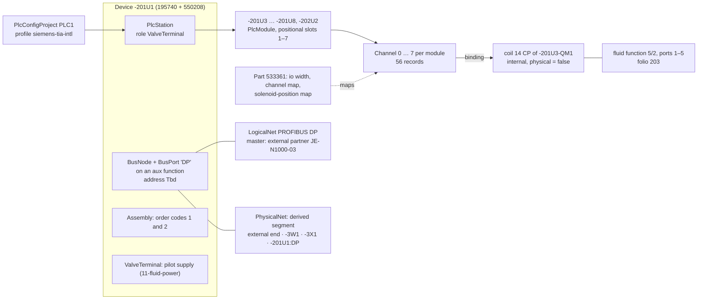
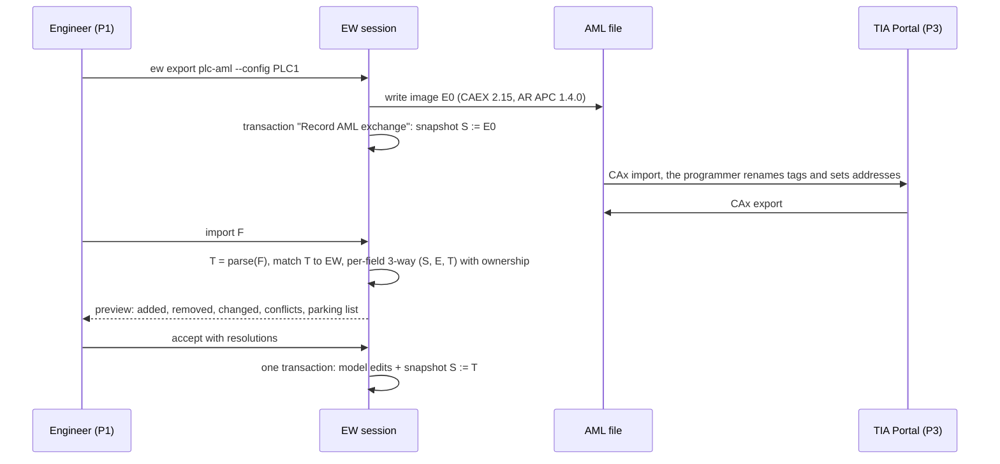

# PLC, I/O and fieldbus

**Status:** Draft v0.1 · **Date:** 2026-10-17 · **Part of:** ElektraWatt design document set

**Purpose.** This document specifies how ElektraWatt (EW) models PLC configuration projects, stations, modules,
channels and fieldbus networks. It defines how EW derives addresses, symbols, function texts and targets instead of
storing them as text, how it exchanges I/O data with TIA Portal, CODESYS and spreadsheets, and which rules check the
result. It elaborates the PLC, BUS and PLC-exchange EXP rows of [02b](02b-requirements-extended.md) on top of the
[domain model](03-domain-model.md) §13–§14 and the accepted [architecture](04-architecture.md) (ADR-0001, ADR-0003,
ADR-0006). The running example and acceptance case is the reference project's Festo valve terminal -201U1 on
folios 3, 106 and 201–206.

**Contents**
1. [Scope and boundaries](#1-scope-and-boundaries)
2. [Concepts and data](#2-concepts-and-data)
3. [Behaviour and rules](#3-behaviour-and-rules)
4. [Exchange with PLC software and spreadsheets](#4-exchange-with-plc-software-and-spreadsheets)
5. [Outputs: report row sources](#5-outputs-report-row-sources)
6. [UI and UX touchpoints](#6-ui-and-ux-touchpoints)
7. [CLI and automation](#7-cli-and-automation)
8. [Edge cases and pitfalls](#8-edge-cases-and-pitfalls)
9. [The reference project](#9-the-reference-project)
10. [Scope by release](#10-scope-by-release)
11. [Dependencies](#11-dependencies)
12. [Requirements covered](#requirements-covered), [Open questions](#open-questions)

---

## 1. Scope and boundaries

| Topic | Owner |
|---|---|
| PLC and bus records, derived PLC queries, address profiles, part PLC and bus sections, symbols, target tracking, EW-PLC/EW-SAF/EW-PRC/EW-BUS/EW-IOL rule content, PLC exchange formats, device descriptions | this document |
| Valve fluid function, ports 1–5, tubes, media, EW-FL rules, `valve_terminal_config` report | [11-fluid-power](11-fluid-power.md) |
| Assembly overview generation (201/202), child tags -201U3-QM1, DeviceLink | [03](03-domain-model.md) §7, [06](06-schematic-editor.md), [07](07-symbols-parts-macros.md) |
| Bus line connections, cable -3W1 as a cable, card supply potentials | [08-connections-terminals-cables](08-connections-terminals-cables.md) |
| Forms, pagination, XLSX/CSV mechanics, the `_ew` round-trip sheet | [09-reports-forms-output](09-reports-forms-output.md) |
| Generic import/export contracts, QET `plc_*` element info, EDZ PLC data | [14-interop](14-interop.md) |
| Rule engine, modes, waivers, release gate | [15-checks-revisions-collaboration](15-checks-revisions-collaboration.md) |
| PLC hardware in the cabinet, EtherCAT rail order | [12-panel-layout](12-panel-layout.md) |
| PLC workspace layout, persona P3, journey J4 | [16-ux-ui](16-ux-ui.md), [vision](00-vision-and-scope.md) §5–§6 |

Conventions: Golden A, B and C are the variants of [20-golden-project](20-golden-project.md); U-nn (unknowns),
EF-nn (expected findings), AC-nn (acceptance criteria) and MF-nn (migration findings) are its IDs. ▲ marks a value
that is unknown in the reference set and used as a test input. "(unverified)" marks a vendor fact from the
[PLC research](../research/plc-bus-fluid.md) that must be checked before it becomes a default (NFR-COMP-05).
Questions for the pilot user are cited by their PQ IDs in [01-brainstorm](01-brainstorm.md) §7. Abbreviations
follow [02a](02a-requirements-core.md) §1.2: PBF = [PLC research](../research/plc-bus-fluid.md), ARCH =
[architecture](04-architecture.md), C-n = [gaps and corrections](../research/gaps-and-corrections.md), SC-n =
success criteria of the [vision](00-vision-and-scope.md) §3.2. "EPLAN nnnnn" is an EPLAN property number (PBF §2.1).

---

## 2. Concepts and data

### 2.1 Overview



The **channel is the hub** (PBF §2.4). Its binding joins the electrical or internal model, its address the PLC
process image, its symbol the PLC software, its target the field function and, through a `DeviceLink`, the process
tag. Nothing a channel displays is stored as text anywhere else (ARCH §1.2, principle 1). Every record below is an
`ew-schema` record. The fields marked *proposed* refine [03](03-domain-model.md) §13–§14 and are listed in the Open
questions (3, 4, 6, 15 and 22) for the schema-steward rule (ARCH §7.6).

### 2.2 Configuration project

One `PlcConfigProject` exists per target PLC-software project: EPLAN's configuration project, a TIA project or a
CODESYS application. It lives in `project.jsonl` ([05](05-project-format-and-persistence.md) §2.2, rank 11) and scopes
address and symbol uniqueness (FR-PLC-002). A new project contains one default, `PLC1`, with the profile "Siemens TIA
(international)".

```rust
pub struct PlcConfigProject {
    pub name: Ident,                     // "PLC1"
    pub profile: AddressProfileRef,      // "siemens-tia-intl@2027.1" (§2.5)
    pub cpu: Option<Id<Device>>,         // None in Golden A: the DP master sits in +J-E-206
    pub allocation: Allocation,          // proposed: Packed (default) | SlotBased (1.x)
    pub ownership: Ownership,            // proposed: an Owner per field group, see the table below (FR-PLC-033)
    pub symbols: SymbolPolicy,           // proposed: { template: Option<String>, strict_iec: bool, tag_table: Ident }
    pub exchange: Option<ExchangeStamp>, // proposed: { format, version, file_sha256, direction, rev, date };
                                         //   replaces 03's foreign_ids + last_exchange; body in exchange/ (§4.2)
}
pub enum Owner { Ecad, Plc, Shared }     // proposed (03 has EcadOwns | PlcOwns); Shared: a one-sided change
                                         //   applies, a two-sided change is a conflict
```

| Field group | Default owner | After the first PLC import | Configurable |
|---|---|---|---|
| Structure: stations, modules, slots, order numbers | Ecad | Ecad | yes |
| DTs, pins, wiring, function texts, parts, process tags | Ecad | Ecad | no |
| Module start addresses | Ecad | **Plc** (protected until unlocked) | yes |
| Symbols, comments | Shared | Shared | yes |
| Firmware, IP addresses, PROFINET names, DP station addresses | Plc | Plc | no |

The defaults follow [02b](02b-requirements-extended.md) Open question 11 and IDEA-067. `Shared` is the refinement
that makes FR-PLC-033's acceptance work: a symbol renamed in TIA and a function text changed in EW merge without a
conflict, while the same symbol renamed on both sides gives one conflict row. Ownership drives the merge table of
§4.4 from the first exchange on. **Protection** (§3.9) starts with the first applied PLC import and covers every
field group whose owner is then `Plc`: before that import, EW edits of the DP station address (Golden A-R sets 3)
are ordinary edits, flagged "export pending".

### 2.3 Stations and modules

```rust
pub struct PlcStation {                  // device aspect (ARCH §4.3)
    pub config_project: Id<PlcConfigProject>,
    pub role: StationRole,               // Cpu | HeadStation | IoDevice | ValveTerminal | IoLinkMaster | Drive | ExternalPartner
    pub firmware: Option<Ident>,
    pub dd: Option<DeviceDescRef>,       // §2.8
    pub order: Option<u32>,              // proposed: address-allocation order; never derived from tags
}
pub struct PlcModule {                   // device aspect on the station device or on a child device
    pub slot: SlotPath,                  // Rack{rack, slot, subslot} | Positional
    pub type_ident: TypeIdent,           // { order_number: "533361", dd_module: Option<Ident> }
    pub start: IoStarts,                 // proposed refinement of ARCH's single `start`: { input: AddrSpec, output: AddrSpec }
    pub part_use: Option<u8>,            // proposed, replaces 03's `address_map` ref: which PartUse supplies the
                                         //   PLC section (maps included) if the device has several parts
    pub integrated: bool,                // created with the station; not deletable alone (FR-PLC-003)
    pub safety: Option<SafetyModule>,    // proposed: §2.9
}
```

**Where the aspects go.** The `PlcStation` aspect sits on the device that owns the bus port and the address window.
The `Assembly` aspect sits on the device that carries the configurator order codes. On -201U1 both coincide with
`BusNode` and with the `ValveTerminal` aspect that [11](11-fluid-power.md) owns (ARCH §4.3). A valve terminal
whose bus interface is a separate module (an SI unit, a CPX-AP interface) carries `Assembly` on the head device and
`PlcStation` plus `BusNode` on that module. A multi-pin valve terminal
without a bus node has no station at all: its coils are wired through a multi-pin cable to physical channels of
another module. This answers [03](03-domain-model.md) Open question 6.

**Slots.** `SlotPath::Rack` holds rack, slot and subslot for racks and remote I/O, authored or imported from TIA.
`SlotPath::Positional` derives the slot as the 1-based rank of the module among the station's I/O-module descendants,
ordered by `Device.position` (manifold order). Golden A uses `Positional`: -201U3 … -201U8 are slots 1–6 and -202U2
is slot 7. -201U2, -201U9, -202U1 and -202U3 carry no `PlcModule` and do not count. The slot therefore never depends
on a tag or on the page a child is drawn on (D-41).

**A module's I/O widths come from part data** (§2.6). A module may have an input and an output range at once, so
`start` holds one `AddrSpec` per direction. AR APC carries the same list of `{StartAddress, Length, IoType}`.

### 2.4 Channels

```rust
pub struct Channel {                     // shard of its module device; id = v5(module_id, "channel", number)
    pub module: Id<Device>,
    pub number: u16,                     // 0-based, = AML Channel/Number
    pub designation: Option<Ident>,      // manual; automatic from the part pattern ("{n}", "DO {n}", "X2:{n+1}")
    pub kind: ChannelKind,               // Di | Do | Ai | Ao | Counter | MultiFunction{mode} | IoLinkPort | PowerSupply
    pub data_type: PlcDataType,          // profile vocabulary + canonical bit width ("Bool" = 1)
    pub address: AddrSpec,               // Auto | Manual(PlcAddress) | Excluded | Tbd
    pub state: Option<ChannelState>,     // proposed Option (03: ChannelState); explicit Spare | Reserved |
                                         //   Deactivated; None = derived (§3.2)
    pub symbol: Option<Ident>,           // manual; automatic from the template (§3.4)
    pub comment: MlText,                 // PLC comment; exported as AML/TIA comment
    pub binding: Option<Endpoint>,       // signal CP: a module pin, or the served coil's internal CP
    pub aux_pins: SmallVec<ChannelPin>,  // { role: Supply | M | Shield, cp }
    pub target: Option<Id<Function>>,    // proposed: manual target override (§3.5)
    pub signal_range: Option<Ident>,     // proposed: "4..20 mA"
    pub safety: Option<SafetyChannel>,   // proposed: §2.9
}
```

- **Identity.** Channels are created by a normaliser from the module's part data when the `PlcModule` aspect is
  added (§3.3). They are stored, because they carry authored data, but their IDs are
  `v5(module_id, "channel", number)`, following ADR-0004's "instantiated → v5" rule. Two branches that add the
  same channel produce the same record, and an AML export can use the ID directly (§4.2).
- **Invariants.** S: a channel belongs to exactly one module (ARCH §4.6). P: a CP is in at most one channel
  (FR-PLC-005). P: addresses do not overlap within configuration project and area (EW-PLC-01). P: symbols are unique
  per configuration project (EW-PLC-07). Strict mode rejects; lenient mode (imports) reports (ADR-0009).
- **Determined values.** EPLAN's manual / automatic / determined triple (PBF §2.1, lesson 2) applies to every text a
  channel shows. The determined value is printed and exported; the property grid shows its provenance.

| Field | Manual | Automatic | Release of automatic |
|---|---|---|---|
| Designation | `Channel.designation` | part pattern over `number` | MVP |
| Symbol | `Channel.symbol` | template over the target (§3.4) | 1.0 (FR-PLC-017) |
| Function text | none: it is edited at the target device | the target device's determined function text | MVP for direct targets; 1.0 for traced targets |
| Comment | `Channel.comment` | `{function_text}` at export, if empty | 1.0 |
| Target | `Channel.target` (proposed) | target tracking (§3.5) | MVP direct; 1.0 traced (FR-PLC-018) |

### 2.5 Addresses and address profiles

Addresses are stored canonically as `PlcAddress { area: I | Q | M | PI | PQ, size: Bit | Byte | Word | DWord |
LWord, byte: u32, bit: Option<u8> }` and rendered by the configuration project's profile on demand (FR-PLC-007).
Switching a project from Siemens to IEC notation changes one setting, not 56 records.

| `AddrSpec` | Meaning | Prints | Class ([03](03-domain-model.md) §1.1) |
|---|---|---|---|
| `Auto` | module start + address-map offset (§3.1) | "Q0.1" | D |
| `Manual(a)` | deliberate value; every deviation from the derived value is reported (EW-PLC-12) | "Q0.1" | F |
| `Excluded` | "do not include in addressing" (EPLAN 20380): no address, skipped by allocation | "" | A |
| `Tbd` | typed open item; listed in open items and blocks release (EW-PLC-15, D-15) | "TBD" | A |

**Address profiles are versioned data** (FR-PLC-008). Built-in profiles ship with EW and are never removed, like
derivation profiles (NFR-REL-09). A project pins `id@version`. A user profile file is embedded in the project, so the
project renders identically without the installation that created it (NFR-REL-11, Open question 13).

```toml
# built-in profile "siemens-tia-intl", version 2027.1
[profile]
id         = "siemens-tia-intl"
version    = "2027.1"
label      = "Siemens TIA (international)"
absolute   = true             # false for tag-based platforms (Rockwell, TwinCAT)
base       = 10
unit_bits  = 8
word_align = 2                # bytes; convention (unverified), reported as a warning only

[profile.mnemonics]
area = { I = "I", Q = "Q", M = "M", PI = "PI", PQ = "PQ" }
size = { bit = "", byte = "B", word = "W", dword = "D", lword = "L" }

[profile.render]
bit      = "{area}{byte}.{bit}"   # Q0.1
unit     = "{area}{size}{byte}"   # IW64
drawing  = ""                     # prefix on pages and reports: "Q0.1", as the reference set prints it
exchange = "%"                    # prefix in the TIA XLSX and Openness XML: "%Q0.1"

[profile.parse]
prefixes          = ["", "%"]
peripheral_suffix = ":P"          # accepted on import and reported; EW stores hardware addresses only

[profile.allocation]
scheme   = "packed"
start    = { digital = 0, analog = 0 }   # (unverified) TIA defaults; verified = false
verified = false
```

The IEC profile differs only in data: `bit = "%{area}X{byte}.{bit}"`, `size.bit = "X"`, `drawing = "%"`. The
grammar engine (render templates plus a tokenising parser driven by the mnemonic tables) is the same for every
absolute profile. Tag-based profiles render from the station and slot model instead.

| Profile | Release | Bit output | Word / analog | Addressing | Notes |
|---|---|---|---|---|---|
| `siemens-tia-intl` | MVP | Q0.1 (pages), %Q0.1 (exchange) | IW64 | absolute | Golden A profile |
| `iec-61131-3` | MVP | %QX0.1 | %IW64 | absolute | `%Q0.1` (size omitted) parses as a bit; renders with X |
| `rockwell-logix` | 1.0 | Local:3:O.Data.1 | Local:1:I.Ch0Data | tag-based | `<adapter>:<slot>:…` for remote I/O; member paths from part data (FR-PLC-009) |
| `beckhoff-twincat` | 1.x | `AT %Q*` | `AT %I*` | link-based | No absolute address; the I/O list shows terminal and channel |
| `siemens-de`, `step7-classic` | 1.x | A0.1 / Q4.0 | EW64 / PIW256 | absolute | Mnemonics; slot-based allocation (FR-PLC-010) |
| `mitsubishi`, `omron`, `schneider` | 1.x | Y1 / CIO 100.00 / %Q0.2.1 | D0 / D0 (data registers) / %IW0.3.0 | absolute or topological | Octal or hexadecimal base; word.bit; rack.slot.channel; all (unverified) |

### 2.6 PLC and bus part data

The PLC and bus sections of a part are level L2 data in [07](07-symbols-parts-macros.md) §2.5, owned by this
document (FR-PRT-010). They carry a confidence (`ItemMeta.confidence`: verified, unverified, test) and a source.
Findings computed from a non-verified section carry the "based on non-verified part data" marker.

```toml
# part 533361 VMPA1-FB-EMG-8: electronic sub-base with 4 valve positions
[plc]
role     = "module"
io       = [{ dir = "out", bits = 8, class = "digital" }]
channels = { count = 8, kind = "do", data_type = "Bool", designation = "{n}" }
bit_of   = "n"                      # channel map: channel n -> bit offset n (linear)
unbound  = "deactivated"            # state of channels neither bound nor claimed (§3.2)

[plc.positions]                     # solenoid-position map; position index p = 0..3
count = 4
map   = [{ solenoid = "14", channel = "2p" }, { solenoid = "12", channel = "2p+1" }]   # hypothesis H1

[plc.meta]
confidence = "test"                 # ▲U-23 until the vendor manual or the pilot's PLC program confirms it (PQ-15)
```

```toml
# part 550208 CPX-M-GE-EV-S-7/8-5POL: interlinking block with 7/8" supply (folio 106)
[[plc.supply]]
group = "El"                        # electronics and sensor supply
pins  = { l_plus = "4", m = "2" }
[[plc.supply]]
group = "Val"                       # load supply of the solenoid outputs
pins  = { l_plus = "5", m = "1" }
feeds = "outputs"
[plc.earth]
pin  = "3"
role = "FE"                         # ▲U-18; D-16

# part 195740 CPX-FB13: PROFIBUS DP bus node
[[bus.port]]
interface = "DP"
bus       = "profibus-dp"
role      = "slave"
connector = "sub-d-9"
signals   = { B = "3", A = "8", DGND = "5", VP = "6", SHIELD = "housing" }   # (unverified)
```

The valve part 571334 declares `solenoids = ["14"]` in its fluid section ([11](11-fluid-power.md)).

- **Map language.** `bit_of` and `channel` accept `"<k>n[+<c>]"` (`"n"`, `"16n"`), `"<k>p[+<c>]"` (`"2p"`,
  `"2p+1"`) or an explicit list (`[1, 3, 5, 7]`). Analog channels use `"16n"` with `size = word`. The part
  linter rejects anything else. There is no scripting: maps are data, deterministic and safe to merge.
- **Supply groups** type the card-supply CPs (FR-PLC-024) and say which channels they feed. EW-PLC-13 and EW-PLC-14
  read them (§3.10).
- **The bus-port signal map** resolves per-core pins where a multi-line representation of the port exists. It
  answers [08](08-connections-terminals-cables.md) Open question 5 (proposed FR-BUS row (h)).

### 2.7 Bus model

```rust
pub struct BusPort {                     // aspect on a Function (03 §14)
    pub interface: Ident,                // "DP", "X1"
    pub port_label: Option<Ident>,       // "P1R"
    pub bus: BusSystem,                  // ProfibusDp | Profinet | EtherCat | EthernetIp | IoLink | Asi | CanOpen | ModbusTcp
    pub role: PortRole,                  // Master | Slave | Controller | Device | Passive
    pub address: AddrValue<NetAddress>,  // Value | Tbd | NotApplicable
    pub termination: Option<OnOff>,      // connectors and devices with a termination switch (FR-BUS-004)
    pub logical_net: Option<Id<LogicalNet>>,
    pub physical_net: Option<Id<PhysicalNet>>,
}
pub enum NetAddress {
    Profibus(u8), Profinet { name: Ident, ip: Option<Ipv4Addr>, mask: Option<Ipv4Addr>, gateway: Option<Ipv4Addr> },
    EtherCat { position: Option<u16>, alias: Option<u16> }, EthernetIp { ip: Ipv4Addr, mask: Ipv4Addr },
    Asi { addr: u8, ab: Option<AsiAb> }, IoLinkPort(u8), CanOpen(u8), ModbusTcp { ip: Ipv4Addr, unit: u8 },
}
pub struct LogicalNet  { pub bus: BusSystem, pub name: Ident, pub master: Option<Endpoint>, pub rate: Option<BusRate>,
                         pub space: AddressSpace }                      // address space as in 03 §14
pub struct PhysicalNet { pub name: Ident, pub medium: Medium,           // proposed: medium (copper, fibre, …)
                         pub order_hint: Vec<Id<Function>> }            // proposed; replaces 03's stored segments (§3.8)
```

- **Logical networks** carry addressing, rate and master (FR-BUS-002). Ports read the rate; they never copy it.
- **Physical networks** are named records. Their **segments are derived** from `Bus` connections, connector
  through-links and plug-on links (`bus_segments`, §3.8). `order_hint` orders members that are not drawn on any
  topology page. This refines [03](03-domain-model.md) §14, where segments are authored (Open question 6): a stored
  member order would be a second copy of what the topology page already states.
- **Bus connectors** are devices of kind `BusConnector` with a port function (role Passive). That function has an
  In entry (A1, B1), an Out entry (A2, B2, optional CPs), a device side and `termination`. -3X1 mates with -201U1's
  DP socket through a `Bus` connection without a cable.
- **Bus cables** are ordinary cables ([08](08-connections-terminals-cables.md) §7.5) drawn single-line as one
  `Connection{kind: Bus(BusLine{cable})}` (FR-CBL-008).
- **External partners** are placeholder devices with `PlcStation{role: ExternalPartner}`, `BusNode`, a `BusPort`
  and an `ExternalRef` (project, location, device), but no parts. They are excluded from the BOM (FR-BUS-005). On
  folio 3, the external interruption point "DP" inside the External Connection box is the physical segment end, and
  its `ExternalRef` names JE-N1000-03 in +J-E-206.

### 2.8 Device types from device descriptions

A device description (DD) is parsed into a **device type** that enriches a part's PLC and bus sections. The DD file
itself is never embedded in a project or shipped with EW (NFR-LIC-06). Only the extracted facts are stored, with a
`DeviceDescRef { kind, file_name, sha256, entry, licence_note }`. The `entry` is the DAP ID, module ident, product
code with revision, or IODD device ID.

| Format | Bus | EW extracts | Release | Requirement | Parser |
|---|---|---|---|---|---|
| GSD | PROFIBUS DP | ident number, supported rates (`*_supp`), `Modular_Station`, `Max_Module`, maximum I/O lengths, module catalogue with config bytes | 1.0 | FR-PLC-025 | `gsd-parser` 0.6.0 vendored with a named owner, or own parser (C-9) |
| GSDML | PROFINET | DAPs, physical, fixed and allowed slots, modules and submodules with I/O data types, interface and port subslots (0x8000, 0x8001 …), order numbers, `DNS_CompatibleName`, PROFIsafe F-parameters | 1.0 | FR-PLC-026 | own, on quick-xml (no crate exists) |
| IODD 1.1 | IO-Link | identity, process data in/out as a struct type, bitrate, SIO support, connector type, wire functions and colours | 1.0 | FR-BUS-013 | own subset parser (`ioddengine` in tests only, C-9) |
| ESI | EtherCAT | product code, revision, PDO entries as channels, `EBusCurrent` | 1.x | FR-PLC-027 | `taktora-ethercat-esi` vendored, or own |
| EDS (CIP) | EtherNet/IP | identity, assemblies, connections, RPI ranges | 1.x | FR-PLC-027 | own INI parser |

**What DDs lack and part data adds:** pin designations, the channel → pin map, the address map, electrical data
and the macro. The rack/slot editor (§6) combines both.

### 2.9 Safety data

```rust
pub struct SafetyModule  { pub f_dest: Option<u16>, pub f_source: Option<u16>, pub f_wd_ms: Option<u16>,
                           pub range: Option<RangeU16> }        // range from GSDML, e.g. 1..=65534
pub struct SafetyChannel { pub evaluation: Evaluation,          // OneOoOne | OneOoTwo
                           pub pair: Option<Id<Channel>>,
                           pub requirement: Option<Ident>,      // "SIL 2", "PL d": a field, never calculated
                           pub test_pulse: Option<Endpoint> }   // the module's sensor-supply pin
```

Safety channels render in a distinct style (hatched channel field plus an "F" marker, never colour alone,
FR-UI-025) in overviews and lists. EW-SAF-01 … EW-SAF-03 check them (§3.10). SIL/PL calculation and F-program
generation are out of scope (FR-PLC-041; [vision](00-vision-and-scope.md) §4: no PLC programming).

### 2.10 Derived queries

All queries live in `ew-derive` and follow the granularity rule: the finest memo key is a module, station,
configuration project or network (ARCH §6.3).

| Query (key) | Returns | Depends on | Initial policy |
|---|---|---|---|
| `module_order(cfg)` | modules in allocation order | stations (`order`, ID), slot paths, `Device.position` | Memo |
| `module_starts(cfg)` | start per module and direction | `module_order`, part I/O widths, `IoStarts`, profile | Memo; early cut-off per module |
| `channel_addresses(module)` (ARCH §6.4) | rendered and canonical address per channel | its `module_starts` entry, part maps, `Channel.address` | Memo |
| `channel_states(module)` | effective state per channel | bindings, position map, valve children, device states | Memo |
| `channel_targets(module)` | target function, passed terminals, ambiguity | signal partition, bindings, `Channel.target`, `DeviceLink` | Memo (traced from 1.0) |
| `channel_texts(module)` | determined designation, symbol, function text, comment | targets, templates, device texts | Memo |
| `address_index(cfg)` | sorted bit intervals per area | `channel_addresses` of every module | Memo |
| `plc_rows(station)` (ARCH §6.4) | report rows | all of the above | Memo |
| `bus_segments(pnet)` | ordered member chains with ends | `Bus` connections, connector links, `order_hint` | Memo |
| `net_members(lnet)` | ports, stations, master | `BusPort.logical_net` | Memo |
| `exchange_image(cfg)` | neutral exchange structure (§4.2) and its hash | all of the above | Memo, because the online rule EW-PLC-16 reads the hash; exporters read it on their fork |

`ew query channel_addresses -201U3 --explain` prints the dependency trail and provenance of each address
(ARCH §6.8).

---

## 3. Behaviour and rules

### 3.1 Address derivation

**A1. Module starts (positional packed allocation).**

```rust
fn module_starts(q: &Q, cfg: Id<PlcConfigProject>) -> Arc<StartMap> {
    let prof = q.profile(cfg);
    let order = q.get::<ModuleOrder>(cfg);                // stations by (order, id); modules by slot path
    // Pass 1: every Manual range is occupied before any Auto range is placed.
    let mut used = AreaIntervals::from_manual(&order, |m, r| m.start.manual(r.dir).map(|a| prof.range(a, r)));
    let mut cursor = prof.default_starts();               // per (direction, class): digital, analog
    let mut out = StartMap::default();
    for m in order.iter() {
        for r in q.part_io(m) {                           // { dir, bits, class } from the module's part
            let at = prof.align(cursor[r.key()], r.bits);
            let units = r.bits.div_ceil(prof.unit_bits);
            let (start, next) = match m.start.get(r.dir) {
                AddrSpec::Manual(a) => (Start::At(a), at + units), // kept; reserved in pass 1
                AddrSpec::Excluded  => (Start::None,  at + units),
                AddrSpec::Tbd       => (Start::Tbd,   at + units),
                AddrSpec::Auto      => {                  // first free range at or after the cursor, per area
                    let s = used.first_free(r.area(), at, units, &prof);
                    used.insert(r.area(), s, units);
                    (Start::At(prof.byte_address(r.dir, s)), s + units)
                }
            };
            out.insert(m.id, r.dir, start);
            cursor[r.key()] = next;                       // advances for every module, whatever its mode
        }
    }
    Arc::new(out)
}
```

- **Stable cursor.** The cursor advances by each module's own width, whatever its start mode, so a Manual start
  outside the Auto path never moves another module. This makes FR-PLC-012's acceptance hold: changing the start of
  -201U5 to Manual Q10 re-addresses only its 8 channels, and the engine statistics show one `channel_addresses`
  re-execution, while the other six are backdated (ARCH §6.2).
- **Auto never overlaps.** Auto ranges skip occupied ranges of the same area: Manual ranges (pass 1) and ranges
  already placed for another class. The digital and analog cursors of a profile whose default starts coincide
  (`start = { digital = 0, analog = 0 }`, unverified TIA defaults) therefore cannot collide, and an inserted module
  after a PLC import does not land on a PLC-owned start (§3.9). A Manual start set *inside* the Auto path (for
  example -201U5 = Q4) makes the following Auto modules skip it (-201U7 → Q5, -201U8 → Q6, -202U2 → Q7); the
  re-address preview lists every such move. EW-PLC-01 therefore fires only where a Manual value is involved: two
  overlapping Manual starts, or a Manual channel address inside another channel's range.
- **Inserting or widening** a module shifts the following Auto modules, which the preview also lists (§3.9).

**A2. Channel addresses.** `Auto` gives `start(module, dir) + bit_of(number)`, converted into byte and bit by the
profile's `unit_bits`. `Manual(a)` gives `a`. `Excluded` gives nothing, and `Tbd` prints "TBD". For a tag-based
profile, `channel_addresses` yields `ModuleMember { module, member }`, rendered as `Local:3:O.Data.1` from the
station, slot and the part's member pattern.

| Golden A module | Slot | Output start | Channels | Change "-201U5 output start = Manual Q10" |
|---|---|---|---|---|
| -201U3, -201U4 | 1, 2 | Q0, Q1 | Q0.0 … Q1.7 | unchanged |
| -201U5 | 3 | Q2 | Q2.0 … Q2.7 | Q10.0 … Q10.7 (8 changes; the 4 bound coils on folio 204 reprint) |
| -201U6 … -201U8, -202U2 | 4–7 | Q3 … Q6 | Q3.0 … Q6.7 | unchanged |

**Renumbering never re-addresses.** Tags, folios and page order are not inputs of A1 or A2. Golden B1 and B2 leave
every channel address unchanged (proposed row (f)).

### 3.2 Channel states (A3)

The effective state comes from `channel_states(module)`:

1. An explicit `Channel.state` (Spare, Reserved, Deactivated) wins.
2. `address = Tbd` gives `Tbd`.
3. A bound channel takes the state of its target device (FR-DEV-026): used → `Used`, spare → `Spare`, reserved →
   `Reserved`, not fitted → `Deactivated`.
4. An unbound channel that the position map *claims* gives `Reserved`, and EW-FL-02 reports the unbound solenoid.
   The map claims channel c if it assigns c to solenoid s of position p, a valve child at p declares s, and s is
   unbound or bound to c.
5. Any other unbound channel gives the part's `unbound` state: `Deactivated` for valve-terminal modules, `Spare` by
   default.

On Golden A, every coil is bound "as drawn" to channel 2p + 1. Under H1, channel 2p is assigned to coil 14, but
that coil is bound elsewhere, so the channel is not claimed. Under H2, channel 2p is assigned to coil 12, which no
monostable 571334 declares. **Both hypotheses therefore give 8 used, 20 spare and 28 deactivated channels**
([20](20-golden-project.md) §11.2). The PLC overview lists all 56. New I/O-list blocks default to
`state != Deactivated` and list 28 rows ([09](09-reports-forms-output.md) Open question 9; proposed row (a)).

### 3.3 Binding and normalisers

| Normaliser (ARCH §5.2) | Trigger | Effect |
|---|---|---|
| N1 channel instantiation | `PlcModule` added, or the module's part changed | Creates channels 0 … n−1 with v5 IDs from the part's `channels`. Surplus channels are removed only after a confirmation that lists their bindings, symbols and exchange records (proposed row (d)) |
| N2 solenoid binding | a valve child added to, or moved within, a module that has a position map | Binds each declared solenoid's coil CP to the channel the map assigns, if that channel is unbound; otherwise the coil stays unbound and EW-FL-02 reports it. An explicit binding in the command wins: QET import "as drawn" (A7), a macro value set of type `ChannelBinding` ([07](07-symbols-parts-macros.md) §2.7) (proposed row (b)). This is the normaliser that [11](11-fluid-power.md) lists as N-FL-3; it is implemented once, in `ew-commands` |
| N3 module pin binding | a channel created on a module with physical pins | `binding` = the module CP given by the part's channel → pin map |
| N4 logical-net inheritance | a `Bus` connection joins a port without a logical net to one that has one | Assigns that net; conflicting nets are left as they are and reported (proposed EW-BUS-10) |

**Bindings point at CPs, never at copies.** For a physical channel, `binding` is the module pin. For an internal
channel (valve-terminal solenoid outputs, IO-Link process data), `binding` is the served coil's internal CP
(`CpDef.physical = false`) directly. No connection record exists, so wire lists, terminal diagrams and wire-length
calculation contain nothing to exclude, while the PLC overview, the I/O list and target tracking read the binding
(FR-PLC-006). [08](08-connections-terminals-cables.md) §2.3 names "channel pin to a non-physical coil CP" as an
example of an `Internal` connection; Open question 5 proposes dropping that example.

**Drag-bind** (FR-PLC-020). Dropping channel 1 of -201U3 from the PLC navigator onto the coil of -201U3-QM1 on folio
203 runs `plc.bind_channel{channel, endpoint}`. It clears a previous binding of the same CP in the same transaction
(FR-PLC-005) and is one undo step.

**A7. Imported address texts** (QET pass P7 of [14](14-interop.md) §3.2; FR-IMP-017; MF-19). The QET importer
recognises "Q0.1" next to a coil as a *pending binding* `{cp, address}`; it never writes an address. Once the
module exists (Golden C fix-script step 6), `ApplyImport` resolves each pending binding, parsed with the
configuration project's profile (prefixes "" and "%"):
1. **Derived match.** The coil's module (the valve's parent `PlcModule`) has exactly one unbound channel whose
   derived `Auto` address equals the text: bind the coil to it and keep `Auto`. This is the "as drawn" binding;
   on Golden C all 28 texts resolve this way to channels 2p + 1, and EW-PLC-12 then reports EF-02 under H1.
2. **No derived match.** Bind the coil to the channel the position map assigns, set that channel's address to
   `Manual(text)` so the print is preserved, and let EW-PLC-12 (discriminator `manual`) report the deviation.
3. **Ambiguous or no module.** The text goes to the import review list (FR-IMP-017 uncertain matches); nothing is
   bound.

### 3.4 Symbols, designations and function texts

**Templates** (1.0, FR-PLC-017) are strings over these tokens: `{target.process_tag}`, `{target.dt}` (the derived
tag without the product sign and suppressed identifiers), `{target.function_text}`, `{pin}`, `{module.dt}`,
`{channel.number}` and `{address}`. `a|b` falls back to `b` when `a` is empty. The result passes through
`ident()`, which in strict IEC mode (FR-PLC-047):
- replaces characters outside `[A-Za-z0-9_]` with `_`;
- collapses runs of underscores;
- strips leading and trailing underscores;
- prefixes `_` when the result starts with a digit. IEC 61131-3 allows a leading underscore followed by a digit
  (verify against Ed. 4; Open question 10).

| Template | Target | Result |
|---|---|---|
| `{target.process_tag\|target.dt}` | -201U3-QM1, which drives -203Q1 (TA05-V-15) | `TA05_V_15` |
| same | spare valve -201U5-QM1 (no process tag) | `_201U5_QM1`, unless the template is `{target.process_tag}` alone, which gives no symbol (Golden A at 1.0) |
| `{target.dt}_{pin}` | -201U3-QM1:14 | `_201U3_QM1_14`; after renumbering -201U3 to -201U4, `_201U4_QM1_14` |

A manual symbol always wins and never follows renumbering. Uniqueness (EW-PLC-07) is tested on the determined,
cleaned symbol, so "TA05-V-15" and "TA05_V_15" on two channels collide. Function texts are never typed at the
channel. Editing the valve's function text on folio 203 changes folio 908, the I/O list and the AML comment in the
same commit (FR-PLC-022).

### 3.5 Target tracking (A4)

```rust
fn channel_targets(q: &Q, module: Id<Device>) -> Arc<TargetMap> {
    let mut out = TargetMap::default();
    for ch in q.channels_of(module) {
        if let Some(f) = ch.target { out.emit(ch, f, Source::Manual, []); continue; }
        let Some(cp) = ch.binding else { out.none(ch); continue; };
        let f = q.cp_function(cp);
        if f.device != Some(module) { out.emit(ch, f.id, Source::Direct, []); continue; } // coil of -201U3-QM1
        let sig = q.signal_of(cp);                 // nets joined by wires, cores, IP pairs, terminal levels, plug pins
        let cands = sig.cps().filter(|c| is_field_function(q, c) && !is_plc_cp(q, c) && !same_device(q, c, module));
        let Some(best) = cands.min_by_key(|c| (category_rank(q, c), page_order(q, c), cell(q, c), c.id)) // deterministic
            else { out.none(ch); continue; };
        out.emit(ch, best.function, Source::Traced, sig.path(cp, best).terminals());     // "-X1031:5"
    }
    Arc::new(out)
}
```

- **Within the signal only.** Tracking follows the signal level of [03](03-domain-model.md) §9.3: wires, cores,
  interruption-point pairs, terminal levels and plug pins. It never crosses bridges, which join potentials, so a DI
  never "finds" every load on a common 24 V rail. FR-PLC-018's text says "through … bridges"; Open question 19
  proposes amending it.
- **Field functions** are sensors, actuators, coils, lamps, contacts and valve solenoids. Terminals, plugs, cables
  and PLC CPs are passed through, never chosen.
- **Ambiguity** (several candidates) picks deterministically by category rank (coil and actuator before contact),
  then page order, cell and ID. The row is flagged "ambiguous" in the I/O list and in the "why this value?" view
  (FR-UI-011). A manual `target` resolves it.
- **Process tags** follow one `DeviceLink{Drives}` hop: the valve -201U3-QM1 drives the field device -203Q1
  (+FIELD, ▲U-07), so `target.process_tag` of channel 1 is TA05-V-15 (FR-DEV-012, FR-DEV-028).
- **Address at terminals** (FR-PLC-018 option, EPLAN 20854/20855): with the option set, the text slot `PlcAddress`
  of a terminal on a traced path shows the channel address.

At MVP only `Direct` and `Manual` targets exist. This covers every channel of the golden project, because all of
them are internal valve-coil channels.

### 3.6 Representations

| Representation | Page type ([06](06-schematic-editor.md) §2.2) | Shows | Joins nets | Cross-reference |
|---|---|---|---|---|
| Module box with channel pins | MultiLine | pin designation and the address, symbol and function-text slots per channel | yes | main representation of each channel |
| Coil on a fluid valve | Fluid (203–206) | address and function text slots of the valve | no wire (internal CP) | target of the PLC-overview xref |
| PLC overview box (proposed row (c)) | Overview | every channel of a module or station: number, address, symbol, function text, state | no (`Overview` connections) | per channel to its main representation (EPLAN 20301) |
| Station bus port | BusTopology (3) | DT, order code 1, part type, "Node {address}" | bus nets | aux → main "(201-E1)" |
| Card power connector | MultiLine (106) | pins 1–5 and FE | yes | aux → main "(201-E1)" |
| Assembly front view | AssemblyOverview (201–202) | modules and valves in manifold order | no | "∞ 203-B4" (FR-XRF-016) |
| PLC overview report | Report (908) | 56 rows, a link per row | — | link annotation to the coil's anchor |

- **One main representation per channel:** the representation that draws the binding CP. A valve representation
  draws two functions of one device, the 5/2 fluid function and the coil-14 function, so the coil's main
  representation is the valve symbol on 203.
- **The `PlcAddress` text slot** ([07](07-symbols-parts-macros.md) §2.3) resolves:
  - on a bound CP's function, to that channel's address;
  - on a fluid function whose device has bound coils, to the coil addresses in solenoid order 14, 12 ("Q0.0 /
    Q0.1" on a bistable valve, as in [11](11-fluid-power.md) §3.1);
  - on a module pin, to its channel's address.
- **Placing a channel symbol binds it**; it never copies properties (PBF §2.7, rule 2). Every representation
  renders the same determined values.

### 3.7 Valve terminals

The valve terminal is **one device tree in three disciplines** (ARCH §4.3, REF-098):

| Device | Parts | Aspects and functions | Drawn on |
|---|---|---|---|
| -201U1 | 195740 + 550208 | `PlcStation` (role ValveTerminal), `BusNode`, `Assembly` (order codes 1 and 2), `ValveTerminal` (pilot supply, [11](11-fluid-power.md)); main function = assembly view; aux functions = DP bus port, card power connector | 201 (main), 3, 106 |
| -201U2, -201U9 | 552286, 533354 | children, no I/O | 201 |
| -201U3 … -201U8, -202U2 | 533361 | children with `PlcModule` (positional slots 1–7), 8 channels each | 201, 202 (overview), 203–206 (aux label "(201-E4)") |
| -202U1, -202U3 | 550208, 533354 | children, no I/O; -202U1 carries the second power connector | 202, 106 |
| -201U3-QM1 … -202U2-QM4 | 571334 | 28 valve children: fluid function (ports 1–5) + coil-14 function with internal CP | 203–206 |

- **Spare positions** are real valves in state spare (U-36) whose coils are bound. Their channels are spare. A
  blanked position (no valve) gives deactivated channels.
- **Other vendors** use the same model: SMC EX600 SI units, Festo CPX-AP and VTUX, Bürkert AirLINE, Emerson AES. Only
  their part data differs (PBF §8.2). EW ships the Festo CPX/MPA part data of the golden project as test data.
- **Order codes** (51E-F13GCQP-D+H2GG, 32P-VGL-R-MAHAHAHA…-28MS) are stored verbatim on the assembly. Children are
  built by hand or in the rack/slot editor at 1.0. Configurator decoders that expand an order code into children are
  1.x plugins (IDEA-026). Slot-occupancy validation (EW-FL-03, D-40) is in [11](11-fluid-power.md).

### 3.8 Bus topology, addresses and termination

**A5. Segment derivation.**
1. Build a graph whose nodes are bus-discipline CPs: port functions and connector In, Out and device-side entries.
2. Its edges are `Bus` connections (with or without a cable), each connector's internal through-link and plug-on
   links.
3. Each connected component within one `PhysicalNet` is a segment. For line buses (PROFIBUS, RS-485) the component
   must be a path. A branch is reported by EW-BUS-06 as a stub.
4. Ends are degree-1 nodes. An external interruption point counts as an end.
5. Member order walks from the master end: the end whose port is the logical net's master, or the external end
   whose `ExternalRef` names the master; failing that, from the end with the smallest (`order_hint` position, ID).

**Termination (EW-BUS-04).** At each end, the termination state of the nearest terminating element (connector port
or device port with a switch) must be On, and every other terminating element on the segment must be Off. An
external end whose state is unknown gives one info (FR-BUS-016). On Golden A the segment is external end
(JE-N1000-03, master) · -3W1 · -3X1 (On) · -201U1:DP, the order of FR-BUS-003 and [03](03-domain-model.md) §14. It
gives no error and one info (EF-16). Setting -3X1 Off gives an error, and its rendered
text changes from "Switch to "ON"" to "Switch to "OFF"" because the text is a property arrangement over
`termination` (FR-BUS-004).

**Addresses.**
- `AddrValue::Tbd` renders "TBD", appears in the open-items list and blocks release (EW-BUS-01, FR-CHK-034).
- `NotApplicable` is for ports without addresses (IO-Link device side).
- Ranges, segment lengths and PROFINET name rules are data with a `verified` flag. Unverified constants report at
  most a warning (proposed FR-CHK-046 of [15](15-checks-revisions-collaboration.md) §3.2; NFR-COMP-05).

| Bus | Release | Address data | Main checks |
|---|---|---|---|
| PROFIBUS DP | MVP (model, address, termination); 1.0 (rates from GSD) | station address 0–125 (unverified), rate from the logical net (9.6 kbit/s … 12 Mbit/s) | EW-BUS-01, -02, -04, -05, -06 |
| PROFINET IO | 1.0 | device name, IPv4, mask, gateway, P1/P2 neighbours, MRP role | EW-BUS-01, -03, -07 |
| IO-Link | 1.0 | port number; mode IO-Link / DI / DQ / deactivated; class A or B | EW-IOL-01, -02 |
| EtherCAT | 1.0 structure; 1.x E-bus budget | position after the coupler, alias; rail order from layout at 1.0 ([12](12-panel-layout.md)) | EW-BUS-08 (1.x) |
| EtherNet/IP, AS-Interface | 1.x | IP, mask, RPI, DLR; 1–31, 1A–31B | EW-BUS-01, -02 |
| CANopen, Modbus | Later | node ID 1–127; IP + unit ID | EW-BUS-01 |

**IO-Link ports (1.0, FR-BUS-012).** A master port is a channel of kind `MultiFunction{mode}` with modes IO-Link,
DI, DQ and deactivated. The master's part declares the port window (fixed bytes per port, or a configurable maximum
such as 32 bytes ▲). In IO-Link mode the connected device's IODD supplies the process-data lengths and a struct
data type: the Balluff sample's 88 input bits give an 11-byte input window and a struct-typed symbol. The module's
I/O width is the sum of its port windows in their current modes, so a mode change re-runs A1 for the following
Auto modules (§8, item 10). EW-IOL-02 compares the IODD lengths with the window.

### 3.9 Commands, freezing and ownership

| Command | Effect | Cost | Release |
|---|---|---|---|
| `plc.set_start{modules, dir, spec}` | sets Auto, Manual, Excluded or Tbd starts | Interactive | MVP |
| `plc.readdress{scope}` | recomputes starts for a selection or a configuration project; previews old → new address, folios and symbol changes; one transaction (FR-PLC-014) | Bulk (preview) | MVP Should |
| `plc.convert_manual_to_auto{scope}` | drops manual values that equal the derived value; lists the others | Bulk | MVP Should |
| `plc.freeze{cfg}` | sets every derived channel address to `Manual(current)` (FR-PLC-015) | Bulk | 1.0 |
| `plc.unlock{scope, group}` | lifts PLC ownership protection for a field group | Interactive | 1.0 |
| `plc.bind_channel{channel, endpoint}` | binds or rebinds (§3.3) | Interactive | MVP |
| `plc.set_profile{cfg, profile}` | changes rendering only; the files differ in one setting (FR-PLC-007) | Interactive | MVP |
| `plc.apply_exchange{cfg, image, resolutions}` | applies an AML or XLSX import with its snapshot (§4.4) | Bulk (preview) | 1.0 |
| `plc.apply_io_list{rows, resolutions}` | applies a CSV/XLSX I/O-list import (§4.7) | Bulk (preview) | MVP Should |

**Re-address preview.** With Auto starts, inserting a module between -201U4 and -201U5 previews 40 address changes
(5 modules × 8 channels), 20 of them on bound coils on folios 204–206. Undo restores everything in one step.

**Protection.** After the first applied PLC import, the field groups owned by `Plc` (§2.2) are protected: module
starts, firmware, IP addresses, PROFINET names and DP station addresses. An edit of a protected field is rejected in
strict mode with the message "address owned by PLC1 (TIA import of <date>)" and an "Unlock" quick fix. In lenient
mode it is reported. Inserting the same module after an import moves nothing: the five later starts are
`Manual` (PLC-owned), so A1 gives the new module the first free byte, Q7, and the preview lists only its 8 channels.

### 3.10 Check rules

The EW-PLC pack ships at MVP with the rules marked MVP and is complete at 1.0 (FR-CHK-005). Rules are registered
Rust functions unless noted. Scopes are `checks(scope)` keys (ARCH §12). EW-PLC-01, -05, -07, -15 and -16 use the
configuration-project scope `cfg`, which [15](15-checks-revisions-collaboration.md) §2.3 lists at this document's
request. Pack membership and the MVP subset match [15](15-checks-revisions-collaboration.md) §4.1 and §4.5.

| Rule | Checks | Scope | Modes | Severity | Release | Requirement | Golden A |
|---|---|---|---|---|---|---|---|
| EW-PLC-01 | Duplicate address as bit-range overlap in configuration project and area (IW0 vs I1.3); word alignment warning | cfg | online, prevent (strict) | error | MVP | FR-PLC-044 | 0 |
| EW-PLC-02 | Address outside the module's I/O range | module | online | error | MVP | FR-PLC-044 | 0 |
| EW-PLC-03 | Bit index outside the profile's unit width | module | online | error | MVP | FR-PLC-044 | 0 |
| EW-PLC-04 | Channel kind ≠ connected function (DO to a proximity sensor) | module | offline | warning | 1.0 | FR-PLC-046 | 0 |
| EW-PLC-05 | Symbol not a valid identifier for the target profile | cfg | export, release | error | 1.0 | FR-PLC-047 | 0 |
| EW-PLC-06 | *Retired.* Spare channels are listed by reports and counts (FR-PLC-019), not as findings | — | — | — | — | — | — |
| EW-PLC-07 | Duplicate determined symbol in a configuration project | cfg | online, prevent | error | MVP | FR-PLC-016 | 0 |
| EW-PLC-08 | Used channel without address | module | online (warning), export (error) | warning | MVP | FR-PLC-044 | 0 |
| EW-PLC-09 | Channel with address or symbol but no connection, not spare | module | online | warning | 1.0 | FR-PLC-046 | 0 |
| EW-PLC-10 | Data-type width ≠ channel width (Bool on a 16-bit AI) | module | online | error | 1.0 | FR-PLC-046 | 0 |
| EW-PLC-11 | Module in a disallowed slot; `Max_Module`; maximum I/O length | station | prevent, online | error | 1.0 | FR-PLC-028 | 0 |
| EW-PLC-12 | Binding or address ≠ part map (discriminators `binding` and `manual`); supersedes EW-NUM-002 (FR-CHK-037) for addresses | module | online | error | MVP | FR-PLC-045 | **28 under H1, 0 under H2 (EF-02)** |
| EW-PLC-13 | Card supply group unconnected or fed from a wrong potential type (FE on PE); supersedes EW-POT-003 (FR-CHK-030) for PLC supply CPs | station | online | warning | 1.0 | FR-PLC-048 | 2 (EF-22) |
| EW-PLC-14 | Summed output load (coil power from part data) > channel, group, module or feeding-channel rating | station | offline | warning | 1.0 | FR-PLC-048 | 0; evaluation lists MICO Out1 (EF-24, D-25) |
| EW-PLC-15 | `Tbd` module start or channel address | cfg | online (info), release (error) | error at release | MVP | FR-PLC-013 | 0 (the `Tbd` bus address is EW-BUS-01) |
| EW-PLC-16 | Exchange drift: the configuration project changed since the last exchange (§4.4) | cfg | online | info | 1.0 | FR-PLC-035 | 0 |
| EW-SAF-01 | F-destination address missing, duplicate in a logical net or in the project, or outside the DD range | project | online | error | 1.0 | FR-PLC-042 | — |
| EW-SAF-02 | 1oo2 pair incomplete or wired to different devices | module | offline | error | 1.0 | FR-PLC-043 | — |
| EW-SAF-03 | F-DI sensor not supplied from the module's test-pulse pin | module | offline | warning | 1.0 | FR-PLC-043 | — |
| EW-PRC-01 | Process tag does not match the scheme; duplicate on different devices | project | online | warning | 1.0 | FR-PLC-049 | 0 |
| EW-PRC-02 | Instrument-list tag without device or channel (open item) | project | online | info | 1.0 | FR-PLC-050 | — |
| EW-BUS-01 | Bus address missing (open item) or duplicate in a logical net | lnet | online, release | error | MVP | FR-BUS-015 | 1 (EF-03) |
| EW-BUS-02 | Address outside the bus range | lnet | online | warning until verified | 1.0 | FR-BUS-018 | 0 |
| EW-BUS-03 | PROFINET name invalid or duplicate; IP duplicate or outside the subnet | lnet | online | error | 1.0 | FR-BUS-017 | — |
| EW-BUS-04 | Termination not On at exactly both segment ends | pnet | online | error; info for unknown external ends | MVP | FR-BUS-016 | 1 info (EF-16) |
| EW-BUS-05 | Rate not supported by a slave (GSD) | lnet | online | error | 1.0 | FR-BUS-009, -018 | 0 (rate unset ▲U-22) |
| EW-BUS-06 | Segment length, station count or stubs over the limit for the rate | pnet | offline | warning | 1.0 | FR-BUS-018 | 0 |
| EW-BUS-07 | Logical net without master (an external partner counts) | lnet | online | warning | 1.0 | FR-BUS-018 | 0 |
| EW-BUS-08 | EtherCAT E-bus current budget | station | online | error | 1.x | FR-BUS-020 | — |
| EW-BUS-09 | Bus port on a non-bus cable or the wrong connector type | pnet | online | warning | 1.0 | FR-BUS-018 | 0 |
| EW-BUS-10 | Ports joined by `Bus` connections but in different logical nets (proposed row (i)) | pnet | online | warning | 1.0 | proposed | 0 |
| EW-IOL-01 | Port class mismatch; IODD device on a port not in IO-Link mode | module | online | error | 1.0 | FR-BUS-019 | — |
| EW-IOL-02 | Process data > port window; cable longer than the maximum | module | online | warning | 1.0 | FR-BUS-019 | — |

**EW-PLC-12 and the odd-bit question (D-26).** Folios 203–206 bind coil 14 of position p to channel 2p + 1. If the
VMPA1-FB-EMG-8 assigns the lower bit to solenoid 14 (H1, suspected but unverified), the printed Q0.1 … Q6.7
address unused coil-12 outputs: a functional bug, not a style choice. EW does not decide this in code. The
solenoid-position map of part 533361 is data with confidence `test`:
- **H1** gives 28 findings, one per binding;
- **H2** ("coil 14 on 2p + 1") gives none;
- switching between them is a part-data edit (AC-29).

Each finding names the bound channel, the channel the map expects, both addresses and the unverified-data marker.
It offers two quick fixes: "rebind to the map's channel" (a previewed command; folios 203–206 then print Q0.0,
Q0.2 …) and "open the part's PLC section". Setting the map's confidence to `verified` needs a source (vendor manual
reference or the pilot's PLC program, PQ-15).

**One defect, one finding.** Following the supersession table of [15](15-checks-revisions-collaboration.md) §3.6
(proposed FR-CHK-045): EW-PLC-12 supersedes EW-NUM-002 (FR-CHK-037) for addresses, EW-PLC-13 supersedes EW-POT-003
(FR-CHK-030) at 1.0 (EF-10 → EF-22), and EW-BUS-01 supersedes EW-CORE-044 (FR-CHK-034) for bus addresses.
EW-PLC-15 covers only module starts and channel addresses, so it never reports the bus `Tbd`. Every rule ID has its
documentation page (NFR-DOC-02).

---

## 4. Exchange with PLC software and spreadsheets

### 4.1 Formats

| Format | Direction | Version | Release | Requirements | Implementation |
|---|---|---|---|---|---|
| AutomationML AR APC | export, import | CAEX 2.15 write; CAEX 2.15 and 3.0 read; AR APC 1.4.0 | 1.0 Must | FR-PLC-029, -031, -032, -033 | `ew-caex` (proposed permissive) + `ew-plc` |
| AR APC 1.2.0 | export | for older TIA versions and EPLAN | 1.0 Should | FR-PLC-030 | same writer, version table |
| TIA "PLC Tags" XLSX | export, import | 10 fixed columns | 1.0 Must | FR-PLC-036 | rust_xlsxwriter, calamine |
| PLCopen XML GVL | export | TC6 v2.01 | 1.0 Must | FR-PLC-037 | quick-xml; `plcopen` crate in tests only (C-9) |
| Generic I/O list | export, import | CSV dialects, XLSX | MVP Should | FR-PLC-038, FR-EXP-002 … -004 | `ew-reports` row source |
| Instrument / I/O list | import | CSV, XLSX | 1.0 Should | FR-PLC-050 | `ew-plc` |
| TIA Selection Tool AML | import | AR APC 1.4.0 (TST 2025) | 1.x Should | FR-PLC-034 | `ew-caex` |
| Rockwell L5X, Beckhoff TE1120 | export | L5X fragment; TE1120 XML/AML | 1.x Could | FR-PLC-039 | `l5x` crate in tests only |
| TIA Openness bridge | outside the Rust core | C#, Windows only | Later Could | FR-PLC-040 | separate tool; the core has no .NET dependency |

Every exporter implements the permissive `Exporter` contract over an `ExportView` of a snapshot fork, never blocks
editing and records the revision it reflects (FR-EXP-001). Release-mode exports refuse a stale Class II input.

### 4.2 Exchange image and identity

Parsers and writers work on a **neutral `ExchangeImage`** in a permissive crate, so third parties can reuse them
without GPL code (ARCH §3; [02b](02b-requirements-extended.md) Open question 13):

```rust
pub struct ExchangeImage { pub project: XProject, pub stations: Vec<XStation>, pub tags: Vec<XTag>,
                           pub links: Vec<(XRef, XRef)>, pub networks: Vec<XNetwork> }
pub struct XItem { pub key: XKey, pub position: u32, pub type_name: String, pub order_number: Option<String>,
                   pub firmware: Option<String>, pub built_in: bool, pub addresses: Vec<XAddr>, // {start, bits, io}
                   pub channels: Vec<XChannel>, pub children: Vec<XItem>, pub iec: Option<IecTags> }
pub struct XKey { pub foreign_id: Option<String>, pub ew_id: Option<Uuid> }
```

- **Export** projects the model into an image (`exchange_image(cfg)`) and writes it. Imports parse a file into an
  image, and `ew-plc` (GPL) matches and merges it against the model.
- **EW identity travels with the file** (proposed row (g)). CAEX `ID`s are the EW UUIDs of station and module
  devices and the v5 channel IDs; tag IDs are `v5(channel, "tag")`. The XLSX and CSV formats carry the channel ID in
  a hidden column. `ProductDesignation IEC` carries the derived tag, `LocationIdentifier IEC` the location. The
  verified samples show these two attributes in TIA Selection Tool exports (PBF §3.1, finding 6); whether TIA Portal
  keeps them, and EW's GUIDs, on a CAx re-export is unverified (§8, item 6) and part of SC-8.
- **The last exchange snapshot** is the merge base. It is stored as canonical JSONL in
  `exchange/<config-project-uuid>.jsonl`: one record per exchanged station, module, channel and tag, holding the
  exchanged field values and the foreign-ID map. A separate file keeps it out of `project.jsonl` merges, travels
  through git, and lets a colleague merge a TIA re-export (Open question 2).

### 4.3 AML AR APC export

| EW | CAEX element (role or interface class) | Attributes |
|---|---|---|
| Configuration project | `InternalElement` (`AutomationProject`) | Name = `PLC1` |
| Station | `InternalElement` (`Device`) | TypeIdentifier (`System:Device.<family>` or `OrderNumber:<MLFB>` in the TIA sample; `OrderNumber:195740` for -201U1, unverified for GSD devices, Open question 9), `ProductDesignation IEC`, `LocationIdentifier IEC` |
| Rack, module, submodule | `InternalElement` (`DeviceItem`) | PositionNumber, TypeName, TypeIdentifier `OrderNumber:533361`, FirmwareVersion, BuiltIn, `Address` list {StartAddress, Length in bits, IoType}, IEC tags |
| Channel | `ExternalInterface` (`…InterfaceClassLib/Channel`) | Type Digital/Analog, IoType, Number, Length |
| Symbol | `ExternalInterface` (`…/Tag`) in a `TagTable` element (under the CPU `DeviceItem` in TIA; without a CPU see Open question 18) | DataType, IoType, LogicalAddress "0.1" (no area letter; the area follows from IoType), Comment with `aml-lang` per `MlText` language |
| Channel ↔ symbol | `InternalLink` | RefPartnerSideA `<module ID>:Channel_DO_1`, RefPartnerSideB `<tag table ID>:TA05_V_15` |
| Bus interface, port, node | `CommunicationInterface`, `CommunicationPort` (Label), `Node`/`NodeEthernet` | NetworkAddress, SubnetMask, IpProtocolSelection; PROFIBUS address names to be fixed from a real DP export (Open question 9) |

Golden A at 1.0, with the symbol template `{target.process_tag}`, shortened (role and attribute declarations
omitted). The element nesting follows the TIA V21 sample (PBF §3.1); the tag-table placement without a CPU is
Open question 18. Both are verified in the exchange test (SC-8):

```xml
<CAEXFile FileName="PLC1.aml" SchemaVersion="2.15">
  <AdditionalInformation AutomationMLVersion="2.0"/>
  <AdditionalInformation><Document DocumentIdentifier="AR APC" Version="1.4.0"/></AdditionalInformation>
  <InstanceHierarchy Name="PLC1">
    <InternalElement ID="…cfg uuid…" Name="PLC1">                          <!-- AutomationProject -->
      <InternalElement ID="…-201U1 uuid…" Name="-201U1">                   <!-- Device -->
        <Attribute Name="TypeIdentifier"><Value>OrderNumber:195740</Value></Attribute>
        <Attribute Name="ProductDesignation IEC"><Value>-201U1</Value></Attribute>
        <Attribute Name="LocationIdentifier IEC"><Value>+J-E-2416</Value></Attribute>
        <InternalElement ID="…-201U3 uuid…" Name="-201U3">                 <!-- DeviceItem, PositionNumber 1 -->
          <Attribute Name="TypeIdentifier"><Value>OrderNumber:533361</Value></Attribute>
          <Attribute Name="Address"><Attribute Name="1">
            <Attribute Name="StartAddress"><Value>0</Value></Attribute>
            <Attribute Name="Length"><Value>8</Value></Attribute>
            <Attribute Name="IoType"><Value>Output</Value></Attribute></Attribute></Attribute>
          <ExternalInterface ID="…ch1 v5…" Name="Channel_DO_1"
              RefBaseClassPath="AutomationProjectConfigurationInterfaceClassLib/Channel"/> <!-- Number 1, Length 1 -->
        </InternalElement>
        <!-- -201U4 … -202U2: StartAddress 1 … 6 -->
      </InternalElement>
      <InternalElement ID="…tag table…" Name="EW_IO">                       <!-- TagTable -->
        <ExternalInterface ID="…tag v5…" Name="TA05_V_15"
            RefBaseClassPath="AutomationProjectConfigurationInterfaceClassLib/Tag"/> <!-- Bool, Output, 0.1 -->
      </InternalElement>
      <InternalLink Name="Link To Tag_1" RefPartnerSideA="…-201U3 uuid…:Channel_DO_1"
                    RefPartnerSideB="…tag table…:TA05_V_15"/>
    </InternalElement>
  </InstanceHierarchy>
</CAEXFile>
```

The full export holds 7 module `DeviceItem`s with 8-bit output ranges, 56 channel interfaces and 8 tags with 8
`InternalLink`s (FR-PLC-029, AC-30). The absolute starts are relative to the node (Q0 … Q6, ▲U-22). TIA applies the
ranges on CAx import. Writer-header dates come from the export's document date (default: the revision date, or
`SOURCE_DATE_EPOCH` in CI; FR-EXP-006), never from the clock (NFR-REL-07). Element and attribute order is fixed
(station order, slot, channel number), so the bytes are stable (FR-EXP-006). The personal-data option (FR-EXP-009)
leaves no person fields in the file.

### 4.4 AML import and the three-way merge



**A6. Matching** (FR-PLC-032), first hit wins:
1. persisted foreign ID or EW UUID;
2. `ProductDesignation IEC` = derived full tag;
3. (station, rack, slot, subslot, channel number);
4. order number + position.

Ambiguous or unmatched foreign objects go to the **parking list**. They are never placed on pages and never created
silently. Each has a "create unplaced" action (TIA's ParkingLot equivalent). The comparison scope is the set of
stations present in the file. A station missing from the file is untouched unless the user ticks "file is complete".

**Per-field resolution** (FR-PLC-033):

| Ours E vs base S | Theirs T vs base S | Owner Ecad | Owner Plc | Owner Shared |
|---|---|---|---|---|
| unchanged | changed | listed as "rejected PLC change", can be accepted | apply T | apply T |
| changed | unchanged | keep E (exported next time) | keep E, flagged "export pending" | keep E |
| changed | changed, T ≠ E | conflict, default keep E | conflict, default take T | conflict, default keep E |
| either | E = T | no change | no change | no change |

- **Imported module starts become `Manual(…)`;** the snapshot records them as PLC-supplied, which is what the
  "address owned by PLC1" message cites. Channel addresses stay `Auto`, so they still follow the part map and
  EW-PLC-12 still applies.
- The preview groups changes per channel and shows the affected folios. The commit is **one undoable transaction**
  that includes the new snapshot, so undo restores both.
- Re-importing an unchanged export gives an empty diff (FR-PLC-032).

**Drift (EW-PLC-16).** The online rule compares `hash(exchange_image(cfg))` with the snapshot's hash and reports
"changed since the AML exchange of <date>". The second clause of FR-PLC-035 (the foreign file is newer) needs file
access, which queries never have. It is evaluated in the exchange dialog and by `ew plc status <file>` (Open
question 12).

### 4.5 TIA "PLC Tags" XLSX

Sheet "PLC Tags", columns exactly: Name, Path, Data Type, Logical Address, Comment, Hmi Visible, Hmi Accessible,
Hmi Writeable, Typeobject ID, Version ID (FR-PLC-036). One row per channel with a determined symbol:

| Name | Path | Data Type | Logical Address | Comment | Hmi Visible | Hmi Accessible | Hmi Writeable | Typeobject ID | Version ID |
|---|---|---|---|---|---|---|---|---|---|
| TA05_V_15 | EW_IO | Bool | %Q0.1 | TA05-V-15 (-201U3-QM1) | True | True | True | | |

- The path is `SymbolPolicy.tag_table`. HMI flags are a configuration-project setting; their TIA defaults are
  unverified.
- The comment uses the export language chosen in the dialog. Other `MlText` languages are untouched on re-import.
- Golden A at 1.0 exports 8 rows.
- **Import** matches by Name, then by Logical Address, and previews like §4.4 with the same snapshot. Tags without a
  channel are listed, never created.
- Because the workbook carries absolute addresses, the export warns while the module-start field group is still
  owned by `Ecad` and the starts are `Auto`: "addresses not confirmed by the PLC configuration" (§8, item 1).

### 4.6 PLCopen XML for CODESYS

One GVL `IO_ElektraWatt` per configuration project, with one variable per used channel with a symbol
(FR-PLC-037):

```xml
<globalVars name="IO_ElektraWatt">
  <variable name="TA05_V_15" address="%QX0.1">
    <type><BOOL/></type>
    <documentation><xhtml xmlns="http://www.w3.org/1999/xhtml">TA05-V-15 · -201U3-QM1:14</xhtml></documentation>
  </variable>
</globalVars>
```

- Addresses always use the IEC rendering, whatever the project profile.
- `fileHeader/@creationDateTime` takes the export document date (NFR-REL-07).
- The placement under `instances/configurations/configuration/resource/globalVars` follows the CODESYS-written
  sample of PBF §3.3, and the `address="%IX0.1"` form the OpenPLC sample of PBF §2.5. Whether CODESYS 3.5 imports a
  GVL without its `addData` device block is part of the exchange test (SC-8).
- The file declares the namespace `http://www.plcopen.org/xml/tc6_0201`.
- CI parses the output with the `plcopen` crate as a test-only dependency.

### 4.7 Generic I/O list (CSV and XLSX)

The I/O-list row source (§5) exports with the FR-PLC-023 columns, one row per channel, through the
[09](09-reports-forms-output.md) §4.6 machinery: CSV dialects `excel-nl`, `excel-en`, `rfc4180` (FR-EXP-003) and
XLSX with a hidden `id` column and the `_ew` sheet (FR-EXP-004).

- **Keys.** The row ID is the channel ID. Re-import matches by ID, then by (station, slot, channel number)
  (FR-PLC-038).
- **Three-way in XLSX.** This document proposes that the `_ew` sheet also store the exported cell values of the
  editable columns: symbol, comment, signal range and state. Re-import then compares file, base and current model
  per cell. It reports EW edits made since the export without any project-side storage, as FR-EXP-004 asks. CSV has
  no hidden sheet, so a CSV re-import is a two-way diff with a warning.
- **Editable columns** are the manual fields only. Edits to derived columns (address, function text, target) are
  reported as "derived value, not applied" with the reason ("edit the start of -201U3" or "edit the valve's function
  text").
- **Excel safety.** Tags such as "-201U3" are string cells in XLSX. The CSV presets apply the guard of
  [09](09-reports-forms-output.md) Open question 8.

Golden A: the default block exports 28 rows (§3.2). Editing three comments in Dutch Excel (`excel-nl`) and
re-importing changes exactly three fields in one transaction. FR-PLC-038's criterion edits three *function texts*
instead, which this design reports as derived; Open question 20 resolves the difference.

**Instrument-list import** (1.0, FR-PLC-050). Rows hold tag, description, signal type, range, field location and
preferred station. They create placeholder field devices (state "supplied by others") with the process tag and
pre-assign spare channels of the matching kind in station order. A 10-row list with 8 DO tags against the golden
station assigns 8 spare channels of -201U5 and -201U6 and lists 2 tags as EW-PRC-02 open items. Generating whole
schematics from such a list is IDEA-025 in [07](07-symbols-parts-macros.md) and [17](17-extensibility.md).

### 4.8 Later formats

- **L5X** (1.x): a module tree with CatalogNumber, ParentModule, ParentModPortId, ports with slot and IP, and
  `<Tag TagType="Alias" AliasFor="Local:3:O.Data.1">` per symbol. The form per module family is unverified.
- **TwinCAT TE1120** (1.x): terminal order, product codes, and channel ↔ variable links. No absolute addresses.
- **TIA Selection Tool** (1.x): creates stations and modules with the `-UF01` / `-K01` IEC tags it carries and adds
  accessory lines (front connectors, memory cards) to the BOM.
- **TIA Openness** stays out of the core (ARCH §16).

### 4.9 Device-description import

1. **Add the file.** The user adds a GSD, GSDML or IODD file to a company or user catalogue (`ew-library`). EW records
   hash, origin and licence note and keeps the file in the catalogue directory, never in a project.
2. **Parse.** The parser produces a device type in the permissive `ew-devdesc` crate (proposed). Parsers are
   streaming, reject DTDs and external entities, and enforce the limits of NFR-SEC-02. Each has a cargo-fuzz target
   (NFR-SEC-03).
3. **Link.** The user links order numbers to device-type entries: one part ↔ one DAP or module ident. The part
   supplies what the DD lacks (§2.8).
4. **Build.** The rack/slot editor (1.0, FR-PLC-028) places modules into slots, validated against `FixedInSlots`,
   `AllowedInSlots`, `Max_Module` and the maximum I/O lengths (EW-PLC-11). N1 then expands channels.

A CPX-FB13 GSD gives the golden node its supported rates for EW-BUS-05. The ABB FENA GSDML V2.31 sample yields
physical slots 0..2, fixed slot 0, port submodule 32769 and the F_Dest_Add range 1..65534 (FR-PLC-026). The Balluff
IODD creates pins L+, Other, L−, C/Q with core colours BN, WH, BU, BK on the connecting M12 cable (FR-BUS-013).

### 4.10 Determinism, privacy and security of exchange

- **Determinism.** The same model and options give byte-identical AML, XLSX, PLCopen and CSV files on every platform
  and thread count (FR-EXP-006, NFR-REL-07). Order is fixed, IDs are v5, dates come from the export's document date
  (revision date or `SOURCE_DATE_EPOCH`), and XLSX workbook properties are set explicitly.
- **Privacy.** Exports hold no person fields when the personal-data option is set (FR-EXP-009, NFR-PRIV-06).
- **Hostile input.** AML, PLCopen, GSD, GSDML, IODD, ESI, EDS and CSV/XLSX parsers enforce the NFR-SEC-02 limits.
  Imported identifiers are NFC-normalised and confusable-checked (ARCH §4.5). An import never executes content and
  changes the model only through the previewed command.

---

## 5. Outputs: report row sources

Row content is defined here. Forms, pagination and the shared PDF/XLSX/CSV source are in
[09](09-reports-forms-output.md) §3. Rows sort by configuration project, station order, slot and channel number,
with natural sort for tags.

| Block kind | Rows | Columns | Release |
|---|---|---|---|
| `plc_overview` (FR-PLC-022, FR-REP-019) | one per channel of a station or module, all states | module DT, part, address, channel number, designation, kind, symbol, function text, target DT, state, link to the main representation | MVP |
| `io_list` (FR-PLC-023) | one per channel; default filter `state != Deactivated` | configuration project, CPU, station and bus address, rack.slot.subslot, module DT and part, channel number, designation, kind, address, symbol, data type, comment, function text, process tag, target DT and pin, target page and cell, passed terminals, signal range, F-address, state | MVP (target columns from 1.0) |
| `plc_card_list` ([09](09-reports-forms-output.md) P09-1) | one per module | station, slot path, module DT, part, type ident, start and length per direction, used / spare / reserved / deactivated counts | 1.0 |
| `network_address_list` (FR-BUS-008) | one per port with an address | logical net, station DT, device type, address or name, IP, mask, master flag, rate, configuration project, `Tbd` flag | 1.0 |
| `bus_overview` (FR-REP-020, FR-BUS-007) | per logical net, then per segment member | position, station DT, port, address, connector DT, termination, cable DT, cable length, external flag | 1.0 |
| `bus_cable_list` (FR-BUS-008) | one per bus cable | cable DT, bus system, part, length (source), from, to, segment | 1.0 |
| `iolink_port_list` (FR-BUS-014) | one per used master port | master DT, port, mode, class, device DT, vendor and device ID, IODD hash, process data in/out bits, cable | 1.0 |
| `safety_io_list` (FR-PLC-041) | one per safety channel | F-destination and F-source address, module DT, channel pair, sensor or actuator DT, requirement field, test-pulse source | 1.0 |

The open-items list (FR-REP-021) receives every `Tbd` start, channel and bus address, every unassigned
instrument-list tag and every used channel without a main representation. The SQL projection exposes
`api_v1_plc_channel` at 1.0 (FR-EXT-007) with the `io_list` columns plus IDs. The user SQL report "24 V loads per
MICO channel" (ARCH §11) joins it with potentials.

Golden A, folio 908: 56 rows on 908, 908.1 and 908.2 (23 rows per page). Station address "TBD"; addresses Q0.0 …
Q6.7; valve DTs; function texts TA05-V-15 … or "Spare"; states 8 used, 20 spare, 28 deactivated; one link per bound
row to the valve on 203–206 (AC-29). The network address list has two rows: JE-N1000-03 (master, external) and
-201U1 (slave, `Tbd` flagged).

---

## 6. UI and UX touchpoints

| Surface | Behaviour | Release | Requirements |
|---|---|---|---|
| PLC navigator, tree | configuration project → station (role icon) → rack → module (slot) → channel; bus ports under the station; badges for unplaced, `Tbd` and finding count; drag a channel onto a pin or coil to bind | MVP | FR-PLC-020, FR-UI-007 |
| PLC grid (table mode) | the columns of FR-PLC-021; filters unassigned, duplicate, spare, unplaced, safety, per bus, per configuration project, `Tbd`; fill-down, pattern fill (`TA05_V_{n:02}`), Excel paste, each edit one command | MVP Should | FR-PLC-021, FR-UI-008 |
| Property grid | address with provenance: *"Q0.1 · derived: -201U3 output start Q0 (auto, packed, slot 1) + 533361 channel map n → bit 1"*; function text *"TA05-V-15 · from -201U3-QM1"*; override marker and "reset to derived" | MVP | FR-UI-010 |
| Re-address preview | old → new address per channel, affected folios, symbol changes, rendered candidate pages; accept or cancel | MVP Should | FR-PLC-014, FR-UI-022 |
| Message panel | EW-PLC-12 jumps to the coil on 203; quick fixes "rebind to map channel", "set -3X1 termination On", "clean symbol", "re-address module"; waivers need a reason | MVP | FR-UI-021 |
| PLC workspace | PLC navigator, grid, bus navigator, exchange dialog and the fluid pages side by side | 1.0 | FR-UI-003, FR-UI-006 |
| Rack/slot editor | drag modules from the device type into allowed slots; valve-terminal slot list next to the stored order code; live EW-PLC-11 | 1.0 | FR-PLC-028 |
| Bus navigator | logical nets → ports; physical nets → derived segments with ends; termination toggles; rate at the net | 1.0 | FR-UI-006 |
| Exchange dialog | format and version (CAEX 2.15 or 3.0 read; AR APC 1.4.0 or 1.2.0), station scope, document date, personal-data option; import preview tabs: added, removed, changed, conflicts, parking | 1.0 | FR-PLC-029 … -036, FR-EXP-009 |

- **Persona and journey.** The PLC grid is the main surface of persona P3 and of journey J4
  ([vision](00-vision-and-scope.md) §5, §6).
- **Accessibility.** The PLC grid and navigator are also the accessible representation of folios 203–206
  (FR-UI-026). Safety and state styles combine an icon or pattern with colour (FR-UI-025).
- **Keyboard and vocabulary.** Every action is in the command palette, and EPLAN terms work as aliases
  ("configuration project", "PLC box", "readdress"; NFR-UX-03).
- **Testing.** The usability-test protocol of [16](16-ux-ui.md) includes the J4 tasks at 1.0.

---

## 7. CLI and automation

- **Export.** `ew export plc-aml --config PLC1 [--apc 1.4.0|1.2.0]`, `ew export plc-xlsx` and `ew export plcopen`
  at 1.0 (FR-EXT-003). `ew export report --block 908 --format xlsx` and the `io_list` block at MVP
  ([09](09-reports-forms-output.md) P09-10).
- **Import.** `ew import plc-aml <file> --preview --json` prints the diff of §4.4 and applies it only with
  `--accept <resolutions.json>` (1.0). `ew import io-list <file>` applies a generic I/O-list round trip (MVP
  Should, FR-PLC-038). `ew plc status <file>` reports drift (1.0). The subcommand names are fixed in
  [17](17-extensibility.md) §3.3.
- **Queries and SQL.** `ew query channel_addresses -201U3 --explain`;
  `ew sql "select address, symbol, state from api_v1_plc_channel"` (1.0).
- **Gates.** `ew check --scheme pre-delivery` reports EF-02 and EF-03 on Golden A and exits 1.
- **MCP (off by default).** `ew mcp` reads the same queries (read tools from MVP, Could). From 1.0 an agent's
  re-addressing proposal is a `preview_command(plc.readdress, …)`, committed only through `commit_preview` after
  ask-first approval (ADR-0020, ARCH §10.5).
- **Scripts.** rhai can call `plc.readdress` and read `plc_rows`, never write addresses as text.

---

## 8. Edge cases and pitfalls

1. **Unconfirmed absolute addresses.** Golden starts are relative to the node (▲U-22). Until the PLC side owns the
   starts, exported tag addresses carry a warning, and the I/O list shows a "relative" marker per station.
2. **Word and bit overlap.** `IW0` overlaps `I1.3`. EW-PLC-01 compares bit intervals, never strings, and word
   alignment is a warning only.
3. **Module part changes and station deletion** shift later Auto ranges; both are previewed (§3.3, §3.9), and
   PLC-owned starts never move.
4. **Git merges.** Two branches adding modules to one station cannot create overlapping Auto ranges: Auto starts
   are derived after the merge and skip occupied ranges (§3.1). Overlapping Manual values set on both branches
   surface in the post-merge integrity check (INT-13 in [05](05-project-format-and-persistence.md) §6.3) and in
   EW-PLC-01. v5 channel IDs prevent duplicate channel records.
5. **Symbols.** Cleaning can make two symbols equal ("TA05-V-15" and "TA05_V_15"); EW-PLC-07 tests the cleaned
   value. Leading digits get "_" (Open question 10). TIA quoting rules are opt-in.
6. **Foreign GUIDs.** TIA may replace EW's IDs on re-export (unverified). Matching then falls back to IEC tags, and
   ambiguous cases go to the parking list instead of being guessed.
7. **Partial exports.** A file holding one station never deletes the others (§4.4 scope rule).
8. **Multilingual comments.** AML carries every language. The TIA XLSX carries one, and its re-import touches only
   that language.
9. **Bistable valves and blanking plates.** Both solenoids are claimed and bound by N2. Empty positions give
   deactivated channels. EW-FL-02 compares solenoids with bound channels.
10. **IO-Link mode changes** alter channel kind and data width, and thereby the module's I/O width and the starts
    of later modules. The change is previewed.
11. **External partners.** Their address and termination are often unknown. EW-BUS-04 reports an info, and
    EW-BUS-07 accepts an external master. Plant-wide F-address uniqueness can only be checked within the project
    and against values entered on external partners.
12. **`Tbd` vs `NotApplicable` vs empty.** Only `Tbd` is an open item. An empty value on a used channel is
    EW-PLC-08.
13. **Spreadsheet edits of derived columns** are reported, never applied (§4.7).
14. **Scale.** At XL (10,000 channels) `address_index(cfg)` sorts once per commit that touches addresses; AML is
    written streaming. Performance targets are proposed in row (j).
15. **Unverified constants.** Bus ranges, segment lengths, IO-Link limits, PROFINET name rules and the analog
    default starts ship with `verified = false` and report at most warnings (NFR-COMP-05).

---

## 9. The reference project

### 9.1 Folio by folio

| Folio | EW model | Derived and printed | Requirement |
|---|---|---|---|
| 3 | -201U1's bus-port function (aux) on a BusTopology page; -3X1 bus connector with `termination = On`; `Bus` line with cable -3W1; external point "DP" with `ExternalRef` JE-N1000-03 in +J-E-206 | "-201U1 (201-E1)"; "Festo / 51E-F13GCQP-D+H2GG / CPX FB13 / Node TBD" from manufacturer, order code 1, part type and `address = Tbd`; "Switch to "ON"" from `termination`; "To J-E-206 / JE-N1000-03" from the ExternalRef | FR-BUS-001 … -006 |
| 106 | the card power connector functions of -201U1 and -202U1 (aux) with typed pins 1–5 and FE; cables -106W1, -106W2 | potentials per pin; FE on PE reported (EF-10 at MVP, EF-22 at 1.0) | FR-PLC-024, FR-PLC-048 |
| 201–202 | assembly overview generated from the children in manifold order | "∞ 203-B4" … "∞ 206-B4"; 4 valves on -202U2 | FR-DEV-023, FR-XRF-016 |
| 203–206 | 28 valve representations, each drawing fluid function + coil function; 28 bindings | Q0.1 … Q6.7 from `channel_addresses`; TA05-V-xx or "Spare" from the valve's function text | FR-PLC-011, FR-FLU-005 |
| 908 (new) | `plc_overview` report block | 56 rows on 908–908.2 | FR-PLC-022 |

### 9.2 Module -201U3 under H1 and H2

| Ch | Bound to | Address | State | Function text | Symbol (1.0) | EW-PLC-12 H1 / H2 |
|---|---|---|---|---|---|---|
| 0 | — | Q0.0 | deactivated | — | — | — / — |
| 1 | -201U3-QM1 coil 14 | Q0.1 | used | TA05-V-15 | TA05_V_15 | error (expects ch 0, Q0.0) / — |
| 2 | — | Q0.2 | deactivated | — | — | — / — |
| 3 | -201U3-QM2 coil 14 | Q0.3 | used | TA05-V-33 | TA05_V_33 | error / — |
| 4 | — | Q0.4 | deactivated | — | — | — / — |
| 5 | -201U3-QM3 coil 14 | Q0.5 | used | TA05-V-18 | TA05_V_18 | error / — |
| 6 | — | Q0.6 | deactivated | — | — | — / — |
| 7 | -201U3-QM4 coil 14 | Q0.7 | used | TA05-V-17 | TA05_V_17 | error / — |

-201U4 repeats the pattern on Q1 with TA05-V-36, -38, -16 and -37. -201U5 … -202U2 have spare valves on Q2 … Q6.
Totals: 8 used, 20 spare, 28 deactivated; EW-PLC-12 gives 28 or 0 findings (AC-29, EF-02). At 1.0 the exports hold
7 modules, 8 tags and 8 links (AC-30), and the bus checks give AC-31.

### 9.3 Defects prevented

| Defect | How this design prevents or reports it |
|---|---|
| D-01 -4W1 / -4X1 in the BOM | -3W1 and -3X1 are real devices; their tags are derived, and the topology page holds no free text |
| D-09 no PLC overview or I/O list | `plc_overview` (908) and `io_list` blocks at MVP; bus reports at 1.0 |
| D-10 overview 5 vs 4 valves | overview generated from the assembly's children; channels and positions come from the same children |
| D-15 "Node TBD"; termination as text | typed `Tbd` (EW-BUS-01 blocks release, EF-03); termination is a property checked by EW-BUS-04 |
| D-16 FE on PE at -201U1:3 | pin role FE in part data; EW-POT-003 (FR-CHK-030, EF-10) at MVP, superseded by EW-PLC-13 (EF-22) at 1.0 |
| D-25 crossed supply pairs, one 6 A channel | supply groups El/Val; EW-PLC-14 load evaluation; load summary (FR-REP-026) |
| D-26 odd-bit addresses | addresses derived from part maps; EW-PLC-12 under H1; the decision is part data with confidence |
| D-27 untagged valves | child devices with derived tags; process tags on field devices; automatic symbols from them |
| D-36 order code vs components | order codes on the `Assembly` aspect; channels from component parts |
| D-40 CPX block inside the MPA section | -202U1 carries no `PlcModule`, so addressing is unaffected; slot validation EW-FL-03 (1.x) |
| D-41 assembly tagged from two pages | positional slots from `Device.position`, never from tags or pages |

---

## 10. Scope by release

| Capability | MVP | 1.0 | 1.x | Later |
|---|---|---|---|---|
| Model | configuration project, station, module, channel; internal channels; card supply typing; bus ports, connectors, external partners | device types from GSD/GSDML/IODD; rack/slot editor; safety data; PROFINET, IO-Link, EtherCAT structure | ESI, EDS; EtherNet/IP, AS-i | CANopen, Modbus |
| Addressing | profiles TIA intl and IEC; Auto, Manual, Excluded, Tbd; part maps; re-address preview (Should) | freeze; Rockwell rendering; ownership protection | further vendor profiles; slot-based allocation | — |
| Texts | manual symbol and comment; function text from direct targets | automatic symbols; target tracking; process-tag scheme | structured (UDT) symbols; tags from PLC data (FR-NUM-027) | — |
| Representations | channel pins, coil binding on fluid pages, assembly overview, PLC overview box (Should) | generated bus topology overview | — | — |
| UI | PLC navigator, grid (Should), drag-bind | PLC workspace, bus navigator, exchange dialog, rack/slot editor | process-tag navigator | — |
| Exchange | generic I/O list CSV/XLSX round trip (Should) | AML AR APC 1.4.0 (+1.2.0) export and import with 3-way merge; TIA tag XLSX; PLCopen GVL; instrument-list import | TST import; L5X; TwinCAT | TIA Openness bridge |
| Checks | EW-PLC-01, -02, -03, -07, -08, -12, -15; EW-BUS-01, -04 | all other EW-PLC, EW-SAF, EW-PRC, EW-BUS, EW-IOL rules | EW-BUS-08 | — |
| Reports | `plc_overview`, `io_list`, open items | `plc_card_list`, bus reports, IO-Link and safety lists | — | — |

The MVP column is what the golden acceptance criteria need: AC-31 at milestone M2 and AC-29 at the MVP release.
AC-30 and the EW-PLC and EW-BUS part of AC-22 close at M3; SC-8 (the exchange test with real TIA and CODESYS
installations) closes by 1.0 ([20](20-golden-project.md) §22; [vision](00-vision-and-scope.md) §3.2).

---

## 11. Dependencies

| Crate | Role here |
|---|---|
| `ew-schema` | `PlcConfigProject`, aspects, `Channel`, bus records, exchange snapshot records |
| `ew-plcaddr` (proposed, permissive) | `PlcAddress`, profile data model, grammar engine, bit-interval arithmetic; used by `ew-derive` and the QET importer (Open question 1) |
| `ew-caex`, `ew-devdesc` (proposed, permissive) | CAEX 2.15/3.0 read and write, `ExchangeImage`; GSD, GSDML, IODD (ESI, EDS at 1.x) |
| `ew-derive` | the queries of §2.10 |
| `ew-commands` | normalisers N1–N4; `plc.*` commands |
| `ew-checks` | EW-PLC, EW-SAF, EW-PRC, EW-BUS and EW-IOL rules |
| `ew-plc` | exchange orchestration, matching and merge, writers for TIA XLSX, PLCopen and L5X, rack/slot logic |
| `ew-reports`, `ew-scene` | row sources of §5; text slots and property arrangements |
| `ew-viewmodel`, `ew-ui` | navigator, grid, dialogs |
| `ew-import-qet` | emits `plc_*` element info and recognised "Q0.1" texts as pending channel bindings (FR-IMP-011, FR-IMP-017); it never sees `ew-model` (ARCH §3, rule 4). `ApplyImport` in `ew-commands` resolves them by A7 (§3.3) |

| Document | Relation |
|---|---|
| [03](03-domain-model.md) | records refined here (Open questions 2–6, 15, 22) |
| [05](05-project-format-and-persistence.md) | kind ranks; proposed `exchange/` directory and `plc_profile` library kind (Open questions 2, 13) |
| [06](06-schematic-editor.md) | page types, text slots, xref formats |
| [07](07-symbols-parts-macros.md) | part sections L2, confidence, valve typical with `ChannelBinding` value sets |
| [08](08-connections-terminals-cables.md) | `Bus` lines, cables, supply potentials, `Internal` connections |
| [09](09-reports-forms-output.md) | blocks 908 and `io_list`, `_ew` sheet, CSV guard |
| [11](11-fluid-power.md) | valve model, `ValveTerminal` aspect, N-FL-3 (= N2), EW-FL-02/03, valve-terminal configuration report |
| [12](12-panel-layout.md) | EtherCAT rail order, placement of PLC hardware |
| [14](14-interop.md) | generic import and export, QET and EDZ PLC mapping |
| [15](15-checks-revisions-collaboration.md) | rule engine, configuration-project scope, release gate |
| [16](16-ux-ui.md), [17](17-extensibility.md), [18](18-quality-security-release.md), [20](20-golden-project.md) | UI, CLI names, fuzzing and determinism jobs, AC-29 … AC-31 |

---

## Requirements covered

- **PLC:** FR-PLC-001 … FR-PLC-050.
- **BUS:** FR-BUS-001 … FR-BUS-022.
- **EXP (PLC exchange):** FR-EXP-001, FR-EXP-002, FR-EXP-003, FR-EXP-004, FR-EXP-006, FR-EXP-009.
- **Core rows with a PLC or bus part (02a):** FR-DEV-012, FR-DEV-023, FR-DEV-024, FR-DEV-026, FR-DEV-028,
  FR-DEV-034, FR-PRT-010, FR-REP-019, FR-REP-020, FR-REP-021, FR-REP-026, FR-CHK-005, FR-CHK-030, FR-CHK-034,
  FR-CHK-037, FR-CHK-042, FR-XRF-016, FR-CBL-008, FR-MAC-004, FR-NUM-027.
- **Other 02b rows touched:** FR-FLU-005, FR-IMP-011, FR-IMP-017, FR-UI-003, FR-UI-006, FR-UI-007, FR-UI-008,
  FR-UI-010, FR-UI-011, FR-UI-021, FR-UI-022, FR-UI-025, FR-UI-026, FR-EXT-003, FR-EXT-007.
- **Non-functional:** NFR-REL-07, NFR-REL-09, NFR-REL-11, NFR-SEC-02, NFR-SEC-03, NFR-LIC-06, NFR-PRIV-06,
  NFR-COMP-05, NFR-PERF-08, NFR-PERF-09, NFR-DOC-02, NFR-UX-03.

### Proposed new requirements

| ID | Requirement | Prio | Release | Source | Acceptance criterion | Target |
|---|---|---|---|---|---|---|
| FR-PLC-nnn (a) | The effective channel state shall be derived: explicit state, else `Tbd`, else the bound target device's state (used, spare, reserved; not fitted → deactivated), else reserved when claimed by the position map, else the part's unbound state; I/O-list blocks shall default to `state != Deactivated`. | Must | MVP | [03](03-domain-model.md) OQ 9; [09](09-reports-forms-output.md) OQ 9 | Golden A gives 8 used, 20 spare and 28 deactivated under H1 and under H2; folio 908 lists 56 rows and the default I/O list 28. | 02b PLC |
| FR-PLC-nnn (b) | When a valve child is added to or moved within a module with a solenoid-position map, a normaliser shall bind each declared solenoid to the channel the map assigns, if that channel is unbound, in the same transaction, unless the command supplies an explicit binding. | Must | MVP | [03](03-domain-model.md) §13 | Adding a 571334 child at position index 2 of a new 533361 module binds coil 14 to channel 4 under H1 and to channel 5 under H2. | 02b PLC |
| FR-PLC-nnn (c) | The system shall place a module's or station's PLC overview box showing every channel with number, address, symbol, function text and state and a cross-reference to each channel's main representation; connections drawn on it join no nets. | Should | MVP | PBF §2.7; EPLAN 20301 | The overview of -201U3 shows Q0.0 … Q0.7; the four bound rows print the cells of their valves on 203; drawing on it changes no potential. | 02b PLC |
| FR-PLC-nnn (d) | Channel IDs shall be `v5(module_id, "channel", number)`; changing a module's part shall add missing channels and remove surplus channels only after a confirmation listing their bindings, symbols and exchange records. | Must | MVP | ADR-0004; PBF §11 (invariant 6) | Replacing 533361 by a 16-output part adds channels 8–15 and changes nothing else; replacing it by a 4-output part lists 4 channels and asks. | 02b PLC |
| FR-PLC-nnn (e) | A channel shall accept a manual target function that overrides target tracking. | Should | 1.0 | EPLAN 20449; PBF §2.8 | Assigning -203Q1 as target of an unwired DI shows -203Q1 and TA05-V-15 in the I/O list; removing it restores the traced target. | 02b PLC |
| FR-PLC-nnn (f) | Renumbering devices or pages shall never change a derived PLC address. | Must | MVP | ARCH §1.2; D-01 | `channel_addresses` of the 7 golden modules are identical before and after Golden B1 and B2. | 02b PLC |
| FR-PLC-nnn (g) | PLC exports shall carry EW identity: CAEX IDs equal to EW UUIDs (v5 for channels and tags), hidden ID columns in XLSX and CSV, and `ProductDesignation IEC` and `LocationIdentifier IEC` attributes. | Must | 1.0 | PBF §3.1, §3.7; ADR-0004 | Re-importing a golden AML whose IDs were replaced still matches all 7 modules by `ProductDesignation IEC`; an unchanged re-import gives an empty diff. | 02b PLC |
| FR-BUS-nnn (h) | Bus-port part data shall define a signal map from bus signals (A, B, DGND, VP, shield; TD±, RD±) to connector pins, so that a multi-line port representation resolves per-core connections and core colours of the bus cable. | Should | 1.0 | [08](08-connections-terminals-cables.md) OQ 5; PBF §5.3 | With a multi-line representation of -3X1, -3W1's cores A and B land on pins 8 and 3 ▲ and take their colours from the cable part. | 02b BUS |
| FR-BUS-nnn (i) | EW-BUS-10 shall report ports joined by bus connections that belong to different logical networks. | Should | 1.0 | PBF §5.2 | Moving -201U1:DP to a second logical net while -3W1 joins it to the master yields EW-BUS-10. | 02b BUS |
| NFR-PERF-nn (j) | AML export and import preview of 10,000 channels shall each finish in ≤ 10 s on BM, on a fork, while editing continues. | Should | 1.0 | G6; ADR-0022 | Timed on the XL fixture in the nightly gate. | 02c PERF |

---

## Open questions

1. **Crate placement of the address grammar.** ARCH §3 puts address grammars in `ew-plc`, which depends on
   `ew-commands`. `ew-derive` (rendering, `channel_addresses`) and the QET importer (parsing "Q0.1") cannot depend
   on it. *Recommendation:* move `PlcAddress`, profiles and the grammar engine into a permissive `ew-plcaddr` crate
   in the closed lower layer. Split `ew-caex` and `ew-devdesc` likewise (02b Open question 13), and amend ARCH §3.
2. **Exchange snapshot storage.** No file in [05](05-project-format-and-persistence.md) holds the merge base.
   *Recommendation:* `exchange/<config-project-uuid>.jsonl` with kinds `exchange_record` and `foreign_id`, new ranks
   in the kind registry, included in the as-built archive; `PlcConfigProject.exchange` keeps only the stamp.
3. **`PlcModule.start` per direction.** ARCH §4.2 has one `start`, but mixed modules need an input and an output
   start, as AR APC's `Address` list shows. *Recommendation:* adopt `IoStarts { input, output }`.
4. **Station allocation order.** Auto allocation needs an order that does not depend on tags. *Recommendation:* add
   `PlcStation.order: Option<u32>`, falling back to the UUIDv7 creation order. Never order by tag, page or bus
   address.
5. **Channel binding vs `Internal` connection.** [03](03-domain-model.md) and [20](20-golden-project.md) bind the
   coil CP directly, while [08](08-connections-terminals-cables.md) §2.3 cites the channel-to-coil link as an
   example of `Internal`. *Recommendation:* direct binding, as here. Keep `Internal` for other device-internal links
   and change 08's example.
6. **Authored vs derived bus segments.** [03](03-domain-model.md) §14 stores `PhysicalNet.segments`, which
   duplicates the topology drawing. *Recommendation:* derive segments (`bus_segments`) and keep only `order_hint`
   for undrawn members; amend 03.
7. **The odd-bit question (D-26).** Whether VMPA1-FB-EMG-8 puts coil 14 on the even bit decides 28 findings or none
   (PQ-15, U-23). *Recommendation:* keep H1 as the golden test input with confidence `test`; confirm from the
   vendor manual or the pilot's PLC program before 1.0, then set `verified` with the source.
8. **Ownership defaults.** *Recommendation:* the table of §2.2, including `Shared` for symbols and comments; confirm
   with the pilot user's PLC programmers (PQ-19) and show the setting in the PLC navigator.
9. **AR APC PROFIBUS attributes, CPX slot numbering and GSD type identifiers.** The verified TIA sample is PROFINET
   only. How TIA numbers the CPX-FB13's GSD modules is unknown, and so is the `TypeIdentifier` TIA expects for a
   non-Siemens GSD device (the sample shows only `System:Device.…` and `OrderNumber:…`; a GSD-based form is
   plausible but unverified). *Recommendation:* make a TIA V21 export of a DP master system with a CPX-FB13 slave a
   precondition for accepting FR-PLC-031's DP part and AC-30 (02b Open question 12), and take the station and module
   `TypeIdentifier` forms from it.
10. **Leading-digit symbols.** FR-PLC-017's example `201U3_QM1_14` breaks FR-PLC-047's strict IEC rule (no leading
    digit). *Recommendation:* `ident()` prefixes `_` (`_201U3_QM1_14`), after verifying that IEC 61131-3 Ed. 4 still
    allows a leading underscore before a digit; amend FR-PLC-017's criterion.
11. **I/O-list rows in FR-PLC-023.** Its criterion expects 56 golden rows; the default filter here gives 28.
    *Recommendation:* amend the criterion to name the filter ("56 rows with the filter off, 28 by default"), as
    [09](09-reports-forms-output.md) Open question 9 proposes.
12. **"Foreign file newer" in EW-PLC-16.** Queries cannot read files. *Recommendation:* evaluate that clause in the
    exchange dialog and in `ew plc status <file>` only; amend FR-PLC-035's wording.
13. **Storage of address profiles.** [05](05-project-format-and-persistence.md) §2.2 lists the library kinds part,
    symbol, fndef, form and macro, but no address profile. *Recommendation:* built-in profiles are versioned and
    never removed (like derivation profiles); a user profile is embedded as a new library kind `plc_profile` in
    `lib/plc-profiles/<id>.json` with `{library_id, item_id, version, sha256}`; amend 05.
14. **Low-adoption crates (C-9).** gsd-parser, plcopen, l5x, taktora-ethercat-esi and ioddengine are below the
    adoption threshold. *Recommendation:* use plcopen and l5x in tests only; vendor gsd-parser and
    taktora-ethercat-esi under a named owner, or write own parsers; never take them as unreviewed runtime
    dependencies.
15. **Manual target field.** `Channel.target` is not in [03](03-domain-model.md) §13. *Recommendation:* adopt it
    through the schema-steward rule with proposed row (e).
16. **Exchange test installations.** SC-8 needs TIA Portal V21, an older TIA (V17) for AR APC 1.2.0, and CODESYS
    3.5. The CAEX 2.15 XSD licence for CI validation is unverified. *Recommendation:* ask the pilot user for access
    or sample exports (PQ-19); vendor the XSD only if its licence permits, else validate structurally in CI and with
    the AutomationML editor in the exchange test.
17. **Rule constants.** Bus ranges, segment lengths, IO-Link limits, PROFINET name rules and TIA's default analog
    starts are unverified. *Recommendation:* ship them with `verified = false` (warnings only) and budget a
    verification pass against PI, IO-Link Community and vendor manuals before 1.0.
18. **Tag tables without a CPU.** In the TIA sample, `TagTable` elements sit under the CPU `DeviceItem`. Golden A has
    `cpu: None` (the DP master is the external partner JE-N1000-03), so the AML has no CPU to hang the 8 tags on.
    *Recommendation:* write the tag table under the `AutomationProject` element (as in §4.3) and test in SC-8 whether
    TIA accepts it; if not, export the tags only through the TIA "PLC Tags" XLSX (§4.5) whenever `cpu` is `None`, and
    say so in the export dialog.
19. **Target tracking and bridges.** FR-PLC-018 says tracking follows "connections, terminals and bridges", while
    §3.5 (and [03](03-domain-model.md) §9.3) stops at bridges, because a bridge joins potentials and would make a DI
    "find" every load on a 24 V rail. *Recommendation:* keep the signal-level rule and amend FR-PLC-018 to "through
    connections, terminals, terminal levels and plug pins"; validate with the EPLAN users of 03 Open question 2.
20. **Function texts in spreadsheet round trips.** FR-PLC-038's criterion edits 3 function texts in Excel, but a
    channel's function text is derived from its target (§2.4, §4.7). *Recommendation:* amend the criterion to edit 3
    comments; as a 1.0 Could, offer "apply to target" for a function-text cell whose channel has exactly one `Direct`
    or `Manual` target, written to the target device's function text in the same previewed transaction.
21. **Wording of FR-PLC-045 and FR-PLC-015.** FR-PLC-045's criterion speaks of "imported manual addresses Q0.1 …",
    but A7 (§3.3) imports them as bindings with `Auto` addresses; FR-PLC-015's criterion changes "the address map of
    571334", but the maps live on the module part 533361 (571334 declares only its solenoids). *Recommendation:*
    amend both criteria ("imported bindings", "the solenoid-position map of 533361"); the finding counts stay 28 / 0.
22. **Schema deltas against [03](03-domain-model.md) §13–§14.** Besides Open questions 3, 4, 6 and 15, this document
    changes `PlcConfigProject.ownership` from `EcadOwns | PlcOwns` to an `Owner` per field group (adding `Shared`),
    replaces `foreign_ids` and `last_exchange` by `exchange: ExchangeStamp` plus the `exchange/` file, adds
    `allocation` and `symbols`, replaces `PlcModule.address_map` by `part_use`, makes `Channel.state` optional
    (derived when absent) and adds `PlcModule.safety`, `Channel.signal_range`, `Channel.safety` and
    `PhysicalNet.medium`. *Recommendation:* accept them in one schema-steward PR before `ew-schema` v0 freezes, and
    update 03 §13–§14 in the same change.
23. **Direction of the golden bus segment.** FR-BUS-003 and [03](03-domain-model.md) §14 list the segment master
    first (JE-N1000-03 → -3W1 → -3X1 → -201U1 DP); [20](20-golden-project.md) §11.1 lists it from -201U1.
    *Recommendation:* A5 orders master-first (§3.8); amend 20 §11.1 so that the `bus_overview` expectation has one
    order.
24. **Auto allocation around Manual ranges.** A1 places Auto ranges at the first free range at or after the cursor,
    which matches TIA's "next free address" behaviour as far as known (unverified). *Recommendation:* keep first-fit
    with the stable cursor; confirm with the pilot user's PLC programmers (PQ-19) that inserted modules should take
    the next free byte (Q7 in §3.9) rather than force a re-address of PLC-owned starts.
