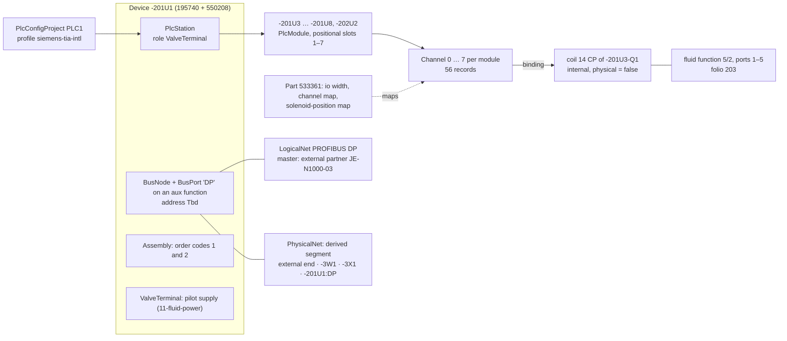

# PLC, I/O and fieldbus: the PLC data

A chapter of [PLC, I/O and fieldbus](10-plc-and-bus.md), whose table says where each section lives.

---

## 1. Scope and boundaries

| Topic | Owner |
|---|---|
| PLC and bus records, derived PLC queries, address profiles, part PLC and bus sections, symbols, target tracking, EW-PLC/EW-SAF/EW-PRC/EW-BUS/EW-IOL rule content, PLC exchange formats, device descriptions | this document |
| Valve fluid function, ports 1–5, tubes, media, EW-FL rules, `valve_terminal_config` report | [11-fluid-power](11-fluid-power.md) |
| Assembly overview generation (201/202), child tags -201U3-Q1, DeviceLink | [03](03-domain-model.md) §7, [06](06-schematic-editor.md), [07](07-symbols-parts-macros.md) |
| Bus line connections, cable -3W1 as a cable, card supply potentials | [08-connections-terminals-cables](08-connections-terminals-cables.md) |
| Forms, pagination, XLSX/CSV mechanics, the `_ew` round-trip sheet | [09-reports-forms-output](09-reports-forms-output.md) |
| Generic import/export contracts, QET `plc_*` element info, EDZ PLC data | [14-interop](14-interop.md) |
| Rule engine, modes, waivers, release gate | [15-checks-revisions-collaboration](15-checks-revisions-collaboration.md) |
| PLC hardware in the cabinet, EtherCAT rail order | [12-panel-layout](12-panel-layout.md) |
| PLC workspace layout, persona P3, journey J4 | [16-ux-ui](16-ux-ui.md), [vision](00-vision-and-scope.md) §5–§6 |

Conventions: Golden A, B and C are the variants of the golden project (retired at 0.3.5; see the [glossary](glossary.md)); U-nn (unknowns),
EF-nn (expected findings), AC-nn (acceptance criteria) and MF-nn (migration findings) are its IDs. ▲ marks a value
that is unknown in the reference set and used as a test input. "(unverified)" marks a vendor fact from the
[PLC research](../research/plc-bus-fluid.md) that must be checked before it becomes a default (NFR-COMP-05).
Questions for the pilot user are cited by their PQ IDs in [01-brainstorm](01-brainstorm.md) §7. Abbreviations
follow [02a](02a-requirements-core.md) §1.2: PBF = [PLC research](../research/plc-bus-fluid.md), ARCH =
[architecture](04-architecture.md), C-n = [gaps and corrections](../research/gaps-and-corrections.md), SC-n =
success criteria of the [vision](00-vision-and-scope.md) §3.2. "EPLAN nnnnn" is an EPLAN property number (PBF §2.1).

---

## 2. Concepts and data

---

### 2.1 Overview



The **channel is the hub** (PBF §2.4). Its binding joins the electrical or internal model, its address the PLC
process image, its symbol the PLC software, its target the field function and, through a `DeviceLink`, the process
tag. Nothing a channel displays is stored as text anywhere else (ARCH §1.2, principle 1). Every record below is an
`ew-schema` record. The fields marked *added* refine the first draft of [03](03-domain-model.md) §13–§14; the
schema-steward batch (ARCH §7.6) adopted them, and 03 §13–§14 lists them.

---

### 2.2 Configuration project

One `PlcConfigProject` exists per target PLC-software project: EPLAN's configuration project, a TIA project or a
CODESYS application. It lives in `project.jsonl` ([05](05-project-format-and-persistence.md) §2.2, rank 11) and scopes
address and symbol uniqueness (FR-PLC-002). A new project contains one default, `PLC1`, with the profile "Siemens TIA
(international)".

Its members, each with what it holds, are the struct `PlcConfigProject` of `crates/ew-schema/src/plc.rs`, and its
stored form is the generated schema (`schemas/0.1/plc_config_project.schema.json`). Its `cpu` is absent when the DP master sits outside the
project; its `ownership` gives an `Owner` (`Ecad`, `Plc` or `Shared`) per field group (FR-PLC-033), where under
`Shared` a one-sided change applies and a two-sided change is a conflict; the exchange's body is in `exchange/`
(§4.2). The allocation (packed, or slot-based in 1.x) is not typed and is kept in `extra`.

| Field group | Default owner | After the first PLC import | Configurable |
|---|---|---|---|
| Structure: stations, modules, slots, order numbers | Ecad | Ecad | yes |
| DTs, pins, wiring, function texts, parts, process tags | Ecad | Ecad | no |
| Module start addresses | Ecad | **Plc** (protected until unlocked) | yes |
| Symbols, comments | Shared | Shared | yes |
| Firmware, IP addresses, PROFINET names, DP station addresses | Plc | Plc | no |

The defaults follow IDEA-067. `Shared` is the refinement
that makes FR-PLC-033's acceptance work: a symbol renamed in TIA and a function text changed in EW merge without a
conflict, while the same symbol renamed on both sides gives one conflict row. Ownership drives the merge table of
§4.4 from the first exchange on. **Protection** (§3.9) starts with the first applied PLC import and covers every
field group whose owner is then `Plc`: before that import, EW edits of the DP station address
are ordinary edits, flagged "export pending".

`plc_config_project` (rank 11, `project.jsonl`) is typed in `ew-schema` with `name`, `profile` (the pinned reference `id@version`, here `siemens-tia-intl@2027.1`) and `cpu`, plus the import-provenance member `source_ref`. The address grammar lives in the permissive crate `ew-plcaddr` (addresses, the built-in TIA address profile, unit intervals and the part map language of §2.6). `symbols` is `SymbolPolicy {template, strict_iec (default true, omitted when true), tag_table}`, set with `fields.set`, which refuses a template that does not expand. Deleting the CPU device unlinks `cpu`; a configuration project cannot be deleted while a `plc_station` aspect still names it.

`PlcConfigProject.ownership` is `Ownership {module_starts, symbols, imported, unlocked}`: the
owner (`ecad`, `plc`, `shared`) of the two configurable groups that an import writes, the date of the first applied
PLC import that gave a value of a PLC-owned group, and the groups `plc.unlock` unlocked. Absent members are the
defaults: the module starts are the PLC's in a merge and symbols and comments are shared; the PLC's own data (firmware,
IP addresses, PROFINET names, DP station addresses) is always the PLC's. Nothing is protected before such an import
(`imported` absent), which is what the table's default `Ecad` for the starts says: until then a start is an ordinary
edit. A tag table carries only symbols and comments, so with the default owners its import protects nothing. The owners are set with
`fields.set` (`ownership.module_starts`, `ownership.symbols`). The structure group and the designations stay the
schematic's and have no member: an import lists a structural difference and never writes it (§4.4). The member is
**additive** (ADR-0011 amendment 6): an older 0.1 build keeps it verbatim and does not enforce the protection, and a
PLC-owned field that such a build edits is an ordinary difference in the next import's three-way merge (changed in
the project only: kept and flagged export pending; changed on both sides: a conflict), so the file stays consistent
without a new format version. `PlcConfigProject.exchange` is `ExchangeStamp {format (aml, tia_xlsx,
plcopen), version, file_sha256, direction (export, import), date}`. It has no `rev`: a session's revision counter
means nothing in another session, and the date is the exchange's document date.

---

### 2.3 Stations and modules

`PlcStation` and `PlcModule` are aspects of a device (ARCH §4.3); their members, each with what it holds, are the
structs of `crates/ew-schema/src/plc.rs`, and their stored form is the generated schema
(`schemas/0.1/device.schema.json`). What the code does not say is below.

**Where the aspects go.** The `PlcStation` aspect sits on the device that owns the bus port and the address window.
The `Assembly` aspect sits on the device that carries the configurator order codes. On -201U1 both coincide with
`BusNode` and with the `ValveTerminal` aspect that [11](11-fluid-power.md) owns (ARCH §4.3). A valve terminal
whose bus interface is a separate module (an SI unit, a CPX-AP interface) carries `Assembly` on the head device and
`PlcStation` plus `BusNode` on that module. A multi-pin valve terminal
without a bus node has no station at all: its coils are wired through a multi-pin cable to physical channels of
another module. [03](03-domain-model.md) §13 states the same rule.

**Slots.** `SlotPath::Rack` holds rack, slot and subslot for racks and remote I/O, authored or imported from TIA.
`SlotPath::Positional` derives the slot as the 1-based rank of the module among the station's I/O-module descendants,
ordered by `Device.position` (manifold order). The valve terminal -201U1 uses `Positional`: -201U3 … -201U8 are slots 1–6 and -202U2
is slot 7. -201U2, -201U9, -202U1 and -202U3 carry no `PlcModule` and do not count. The slot therefore never depends
on a tag or on the page a child is drawn on (D-41).

A slot prints in two forms. The lists and the SQL views print `<rack>.<slot>` (`0.3`, `ew_derive::slot_text`); the
PLC grid prints a slot of rack 0 as the slot alone (`3`, `ew_derive::slot_short`), and its typed Slot cell reads that
back as rack 0, because the grid shows the rack in its own column beside it. Both forms name the same slot.

**A module's I/O widths come from part data** (§2.6). A module may have an input and an output range at once, so
`start` holds one `AddrSpec` per direction. AR APC carries the same list of `{StartAddress, Length, IoType}`.

`plc_station` carries `config_project`, `role` (`StationRole`, all seven variants) and `order`. N0 gives
a new station the role `head_station` when its parts declare bus ports and none of them leads a bus (no `master` or
`controller` port: a remote I/O head such as EW-GEN-RIO-1), else `cpu`. `plc_module` carries `slot` (`SlotPath`: `positional`, the default, or `rack` with rack, slot and subslot), `start` (`IoStarts`; `auto` for both directions by default), `part_use` and `integrated`. `PlcModule.safety` (§2.9), `PlcStation.firmware` and `PlcModule.type_ident` (`{order_number}`, the order number of a module without part data, as an import creates one; a module with a part is identified by its part) are typed, each settable with `fields.set`. Not typed, and kept in `extra`: `PlcStation.dd` (§2.8) and `type_ident.dd_module`, the device descriptions'. The aspects are written in the member order of [05](05-project-format-and-persistence.md) §3.1: `assembly` (held verbatim) before `plc_station` before `plc_module`. The module order of `module_order` is: stations by (`order`, ID); within a station, rack slots first by (rack, slot, subslot), then positional modules in manifold order, whose slot is their 1-based rank.

**The rack comes first.**
A station is made as in TIA Portal: **New station…** opens the station's view (§6) in
a new-station state that asks what the station is (a PLC with its CPU, a remote I/O station, a valve terminal with a
bus node, a compact device with channels of its own; the choice narrows the head parts offered, the role stays what N0
gives the part's section), its head part and its configuration project (an existing one or a new `PLC<n>`), then fills
its rack slot by slot from the module parts that may sit in each slot. **Create** is one `plc.add_station {part,
config_project?, modules, copies}`: the station device (drawn on no page), its `plc_station` and, when its section
declares I/O, its own module, and each module as `plc.add_module` makes it (positional, in rack order), one undo
step. The same command with `device` makes an existing bus device a station (F19): a part with a station section takes
N0's role, a part without PLC data the role `io_device` with an open rack whose modules are added by hand. A station
part placed directly opens its station's view at once; a module placed directly joins as D4 says and its toast names the
slot, or a chooser asks which station takes it when several could and none is drawn beside it. The rack's order is the
slot: moving a module up or down swaps two modules' positions (`assembly.attach`) or slots (`fields.set_many`), and the
view says when addresses moved. Only a module part goes into a rack: the window refuses any other device in words,
`plc.remove_from_rack` takes a device out again (and, for a device that nothing describes as a module, its aspect and
its channels), and EW-PLC-017 reports a device in that state with that command as its fix. A copy of a station drops the
station's own module with `plc_station`, so N0 makes the paste a station again. **Draw on a page puts each card on a
page of its own** (Draw each card on a page of its own, `plc.rack_next {step: draw}`): a page that holds a CPU, its
cards, their terminals and the field devices is more than a sheet reads. Each module the electrical pages do not draw
gets a new page, in slot order, the station's head on the first; the pages are made in the station's section, after
the schematic page its head stands on, else after the schematic page the view was opened from, else where New page
puts a wiring page, each after the one before, titled from its card (`PLC 8 DI`: what it gives the PLC, else its part
number). All of it is one undo step; a refusal takes back what was made. All on one page… lists the schematic pages and
New page…, the one chosen taking the head and every card. Each page, or the one page, is one
`plc.draw_station {station, page, symbol, boxes}`: the window lays the station's box and its modules' out in slot order
(a module with channel pins as one row of pins along one edge, its inputs at the foot of the page and its outputs at
its head, [06a](06a-drafting.md) §7.5; any other device by the black box tool's pin layout over its part's pattern,
under what the page draws, or where that would pass the drawing area's foot in the first clear place inside it from
its head, as a module of outputs, and off the page's wires), and
the command gives a device made without functions its part's template functions before it draws the black-box entry;
a device drawn already is left alone, except a further box of a module drawn in parts. A
module row's Draw… draws that module on the page chosen, as all on one page lays it out. N3 binds the channels of a module that gains its main function in
the transaction, so a module drawn from the rack is bound to its pins as one drawn by hand; EW-PLC-018 reports a drawn
module with every channel unbound (an earlier build's drawing), its fix `plc.bind_pins`.

---

### 2.4 Channels

A channel is a record in the shard of its module device. Its members, each with what it holds, are the struct
`Channel` of `crates/ew-schema/src/plc.rs`, and its stored form is the generated schema
(`schemas/0.1/channel.schema.json`). Its `number` is AML's `Channel/Number`, its `comment` is exported as the AML and
TIA comment, and its automatic designation comes from the part's pattern (`"{n}"`, `"DO {n}"`, `"X2:{n+1}"`).

- **Identity.** Channels are created by a normaliser from the module's part data when the `PlcModule` aspect is
  added (§3.3). They are stored, because they carry authored data, but their IDs are
  `v5(module_id, "channel", number)`, following ADR-0004's "instantiated → v5" rule. Two branches that add the
  same channel produce the same record, and an AML export can use the ID directly (§4.2).
- **Invariants.** S: a channel belongs to exactly one module (ARCH §4.6). P: a CP is in at most one channel
  (FR-PLC-005). P: addresses do not overlap within configuration project and area (EW-PLC-001). P: symbols are unique
  per configuration project (EW-PLC-007). Strict mode rejects; lenient mode (imports) reports (ADR-0009).
- **Determined values.** EPLAN's manual / automatic / determined triple (PBF §2.1, lesson 2) applies to every text a
  channel shows. The determined value is printed and exported; the property grid shows its provenance.

| Field | Manual | Automatic | Release of automatic |
|---|---|---|---|
| Designation | `Channel.designation` | part pattern over `number` | MVP |
| Symbol | `Channel.symbol` | template over the target (§3.4) | 1.0 (FR-PLC-017) |
| Function text | none: it is edited at the target device | the target device's determined function text, else the tracked process tag of the device it drives (§3.4) | MVP for direct targets; 1.0 for traced targets |
| Comment | `Channel.comment` | `{function_text}` at export, if empty | 1.0 |
| Target | `Channel.target` (FR-PLC-054) | target tracking (§3.5) | MVP direct; 1.0 traced (FR-PLC-018) |

`channel` (rank 37, in the shard of its module device) is typed with `module`, `number`, `designation`, `kind`, `address` (`AddrSpec`: `auto`, the default, `manual`, `excluded`, `tbd`), `state`, `symbol`, `comment`, `binding`, `target` and the import-provenance member `source_ref`. `ChannelKind` has `di`, `do`, `ai`, `ao`, `counter`, `io_link_port`, `power_supply` and `multi_function` (§3.8): a unit value whose mode is the channel member `mode` (`io_link`, the default, `di`, `dq`, `deactivated`), not a `MultiFunction{mode}` payload, because N1 restores the part's kind on a part change and the mode is authored. `data_type` (absent: the part's `ChannelSpec.data_type`, else an IO-Link device's struct type, §3.8), `signal_range`, `mode` and `safety` (§2.9) are typed, each settable with `fields.set`; `aux_pins` stays in `extra`. **Channel IDs** are `v5(module, "channel", number)` (ADR-0004 amendment 2; `ew_ids::v5::plc_channel_id`); the CSV importer maps each `channels.csv` row to that ID, not to the `v5(ns, "channels|key")` of its other tables, so two branches that add the same module mint the same channel IDs. `source_ref.key` reads `channels|<label>`. Channels come from import or from normaliser N1 of §3.3, which creates them from a module's part data with the same IDs, and a channel exists when one with the same module and number exists. Link policy: a channel is deleted with its module; deleting the bound function or the target function unlinks the member. An older 0.1 build keeps channel records verbatim but does not enforce these links.

A channel's `kind` is instantiated part data: N1 restores the
part's channel kind when the module's part changes. Its `binding` is set by N2 (a valve coil, by the
position map), N3 (a module pin, by `pin_of`) or `plc.bind_channel` (§3.3). The automatic designation and `pin_of`
expand the part's pattern with one shared function, `ew_derive::expand_pattern`: every
`{<expression in n>}` of §2.6 is expanded (`"X2:{n+1}"` prints `X2:1` for channel 0), and a pattern that does not
expand (an unclosed `{`, a stray `}`, an expression that does not parse, one in `p`, an overflow) gives no
designation, as it gives no pin and a notice in N3. The map language has no
subtraction, so `{n-1}` does not parse. The derivation finds a module's channels as N1 keys them, by (module, number) and not by their v5
IDs: the channels-by-module index (below). Of two channels with one number the lower ID is the channel.

---

### 2.5 Addresses and address profiles

Addresses are stored canonically as `PlcAddress { area: I | Q | M | PI | PQ, size: Bit | Byte | Word | DWord |
LWord, byte: u32, bit: Option<u8> }` and rendered by the configuration project's profile on demand (FR-PLC-007).
Switching a project from Siemens to IEC notation changes one setting, not 56 records.

| `AddrSpec` | Meaning | Prints | Class ([03](03-domain-model.md) §1.1) |
|---|---|---|---|
| `Auto` | module start + address-map offset (§3.1) | "Q0.1" | D |
| `Manual(a)` | deliberate value; every deviation from the derived value is reported (EW-PLC-012) | "Q0.1" | F |
| `Excluded` | "do not include in addressing" (EPLAN 20380): no address, skipped by allocation | "" | A |
| `Tbd` | typed open item; listed in open items and blocks release (EW-PLC-015, D-15) | "TBD" | A |

**Address profiles are versioned data** (FR-PLC-008). Built-in profiles ship with EW and are never removed, like
derivation profiles (NFR-REL-09). A project pins `id@version`. A user profile file is embedded in the project as a
library copy of kind `plc_profile` in `lib/plc-profiles/` ([05](05-project-format-and-persistence.md) §2.2), so the
project renders identically without the installation that created it (NFR-REL-11).

```toml
# built-in profile "siemens-tia-intl", version 2027.1
[profile]
id         = "siemens-tia-intl"
version    = "2027.1"
label      = "Siemens TIA (international)"
absolute   = true             # false for tag-based platforms (Rockwell, TwinCAT)
base       = 10
unit_bits  = 8
word_align = 2                # bytes; convention (unverified), reported as a warning only

[profile.mnemonics]
area = { I = "I", Q = "Q", M = "M", PI = "PI", PQ = "PQ" }
size = { bit = "", byte = "B", word = "W", dword = "D", lword = "L" }

[profile.render]
bit      = "{area}{byte}.{bit}"   # Q0.1
unit     = "{area}{size}{byte}"   # IW64
drawing  = ""                     # prefix on pages and reports: "Q0.1", as the reference set prints it
exchange = "%"                    # prefix in the TIA XLSX and Openness XML: "%Q0.1"

[profile.parse]
prefixes          = ["", "%"]
peripheral_suffix = ":P"          # accepted on import and reported; EW stores hardware addresses only

[profile.allocation]
scheme   = "packed"
start    = { digital = 0, analog = 0 }   # (unverified) TIA defaults; verified = false
verified = false
```

The IEC profile differs only in data: `bit = "%{area}X{byte}.{bit}"`, `size.bit = "X"`, `drawing = "%"`. The
grammar engine (render templates plus a tokenising parser driven by the mnemonic tables) is the same for every
absolute profile. Tag-based profiles render from the station and slot model instead.

| Profile | Release | Bit output | Word / analog | Addressing | Notes |
|---|---|---|---|---|---|
| `siemens-tia-intl` | MVP | Q0.1 (pages), %Q0.1 (exchange) | IW64 | absolute | The default profile |
| `iec-61131-3` | MVP | %QX0.1 | %IW64 | absolute | `%Q0.1` (size omitted) parses as a bit; renders with X |
| `rockwell-logix` | 1.0 | Local:3:O.Data.1 | Local:1:I.Ch0Data | tag-based | `<adapter>:<slot>:…` for remote I/O; member paths from part data (FR-PLC-009) |
| `beckhoff-twincat` | 1.x | `AT %Q*` | `AT %I*` | link-based | No absolute address; the I/O list shows terminal and channel |
| `siemens-de`, `step7-classic` | 1.x | A0.1 / Q4.0 | EW64 / PIW256 | absolute | Mnemonics; slot-based allocation (FR-PLC-010) |
| `mitsubishi`, `omron`, `schneider` | 1.x | Y1 / CIO 100.00 / %Q0.2.1 | D0 / D0 (data registers) / %IW0.3.0 | absolute or topological | Octal or hexadecimal base; word.bit; rack.slot.channel; all (unverified) |

The `iec-61131-3` profile reads a bit address without
its size as X: `%Q0.1` parses as `%QX0.1`, and because the prefix is optional `Q0.1` parses as the same bit. A unit
address must name its size (`%Q10` is no address), because the row above covers only the bit case.

A profile is a JSON library document of
kind `plc_profile` (the example above shows its members in TOML form): `PlcProfileDef` with the members `profile` (`{id, version}`, the pin),
`label`, `absolute`, `base`, `unit_bits`, `word_align`, `mnemonics`, `render`, `parse` and `allocation`, and the item
meta. Its item version is the library's semver; its `profile.version` is the pin, and a change in what it renders is a
new `profile.version`. The built-ins `siemens-tia-intl@2027.1`, `iec-61131-3` and `rockwell-logix@2027.1` are `content/plc-profiles/*.json`
(CC-BY-SA-4.0), compiled into `ew-derive` and parsed once through `AddressProfile::new`, the one validating
constructor of `ew-plcaddr`; a user's file reaches a project through `library.embed`, which refuses one that does not
validate with "the address profile <key> cannot be read: <reason>". One lookup order holds everywhere: the project's
own copy of a pin first, then the built-in, so a project prints and parses in one notation.
`plc.set_profile` refuses a pin that is neither, naming the profiles at hand.

`rockwell-logix@2027.1` is tag-based (`absolute: false`): its bit template
`{station}:{slot}:{area}.Data.{bit}` and unit template `{station}:{slot}:{area}.Ch{channel}Data` name the slot instead
of a byte, the area mnemonics are `I` and `O`, and `AddressProfile::render_tag` fills them. The station is `Local`
when it is the configuration project's CPU, else its tag as an IEC identifier (`_201U1`); the slot is the rack slot,
else the positional rank; `{bit}` is the bit's offset in the module's range of its direction. A1 still packs the
modules, so the canonical addresses stay unique; only the text changes, and a slot move re-renders the module
(FR-PLC-009). A tag-based profile reads no address or start text: `fields.set` and `plc.set_start` refuse one in words,
and `plc.freeze` is refused in words too (nothing it prints moves). A manual channel address such a profile inherits
(a profile change, an import) is read as `auto` by A2: the channel prints its own place (its slot and its bit offset
from the part's map), so the text neither moves nor vanishes when an earlier module's start moves; the stored value
stays and counts again under an absolute profile. An IO-Link master's port prints the same way: a DI or DQ port by the
bit offset of its byte in the module's range, a port with a window by its channel (`.Ch<n>Data`).

---

### 2.6 PLC and bus part data

The PLC and bus sections of a part are level L2 data in [07](07-symbols-parts-macros.md) §2.5, owned by this
document (FR-PRT-010). They carry a confidence (`ItemMeta.confidence`: verified, unverified, test) and a source.
Findings computed from a non-verified section carry the "based on non-verified part data" marker.

```toml
# part 533361 VMPA1-FB-EMG-8: electronic sub-base with 4 valve positions
[plc]
role     = "module"
io       = [{ dir = "out", bits = 8, class = "digital" }]
channels = { count = 8, kind = "do", data_type = "Bool", designation = "{n}" }
bit_of   = "n"                      # channel map: channel n -> bit offset n (linear)
unbound  = "deactivated"            # state of channels neither bound nor claimed (§3.2)

[plc.positions]                     # solenoid-position map; position index p = 0..3
count = 4
map   = [{ solenoid = "14", channel = "2p" }, { solenoid = "12", channel = "2p+1" }]   # hypothesis H1

[plc.meta]
confidence = "test"                 # ▲U-23 until the vendor manual or the pilot's PLC program confirms it (PQ-15)
```

```toml
# part 550208 CPX-M-GE-EV-S-7/8-5POL: interlinking block with 7/8" supply (folio 106)
[[plc.supply]]
group = "El"                        # electronics and sensor supply
pins  = { l_plus = "4", m = "2" }
[[plc.supply]]
group = "Val"                       # load supply of the solenoid outputs
pins  = { l_plus = "5", m = "1" }
feeds = "outputs"
[plc.earth]
pin  = "3"
role = "FE"                         # ▲U-18; D-16

# part 195740 CPX-FB13: PROFIBUS DP bus node
[[bus.ports]]                       # `ports`, a list
interface = "DP"
bus       = "profibus_dp"               # `BusSystem` (D11, D15)
role      = "slave"
connector = "sub-d-9"
signals   = { B = "3", A = "8", DGND = "5", VP = "6", SHIELD = "housing" }   # (unverified)
```

The valve part 571334 declares `solenoids = ["14"]` in its fluid section ([11](11-fluid-power.md)).

- **Map language.** `bit_of` and `channel` accept `"<k>n[+<c>]"` (`"n"`, `"16n"`), `"<k>p[+<c>]"` (`"2p"`,
  `"2p+1"`) or an explicit list (`[1, 3, 5, 7]`). Analog channels use `"16n"` with `size = word`. The part
  linter rejects anything else. There is no scripting: maps are data, deterministic and safe to merge.
  **Grammar** (normative). An expression is

  ```text
  expr   = [factor] var ["+" const]
  var    = "n" | "p"
  factor = decimal            ; at least 1
  const  = decimal
  decimal = "0" | nonzero-digit *digit      ; no sign, no leading zero, no space
  ```

  and its value is `factor × var + const` in unsigned 32-bit arithmetic, `factor` defaulting to 1 and `const` to 0;
  an overflow is an error, never a wrap. There is **no subtraction** and no other operator: `"n-1"`, `"-n"`, `"n*2"`,
  `"2 n"` and `"02n"` are invalid, so a part whose pins or bits count from below its channel numbers states them as an
  explicit list. The same expressions appear inside braces in a designation pattern (`ChannelSpec.designation`,
  `pin_of`, §2.4), where only `n` is allowed: `"X2:{n+1}"` is valid and `"X2:{n-1}"` is not. Every reader parses an
  expression with `ew_plcaddr::MapExpr`, and a designation pattern with the one expander built on it,
  `ew_derive::expand_pattern`; what a reader does with an invalid one is its rule
  (no address, no designation, no pin with N3's notice).
- **Supply groups** type the card-supply CPs (FR-PLC-024) and say which channels they feed. EW-PLC-013 and EW-PLC-014
  read them (§3.10).
- **The bus-port signal map** resolves per-core pins where a multi-line representation of the port exists. It
  is FR-BUS-023.

The part section is `sections.plc` (`PlcSection`): `role` (`station` or `module`), `io` (a list of `IoRange{dir, bits, class}`), `channels` (`ChannelSpec{count, kind, data_type, designation}`), `bit_of` and `unbound` (the state of channels neither bound nor claimed; absent: spare). `bit_of` is a `MapSpec`: `MapSpec::Expr` holds the expression text of the map language (`"n"`, `"16n"`, `"2p+1"`) and `MapSpec::List` an explicit list. The schema stores the text; `ew-plcaddr` (`MapExpr`) parses it and the derivation gives an unresolved address for a map it cannot parse. The supply groups are `supply_groups`, the bus
ports the bus section (below) and the `meta` confidence `ItemMeta.confidence`; the earth pin is not modelled and is
kept in `extra`.

Two optional members follow in `PlcSection` (ADR-0011 amendments 1 and 4); an older build keeps them in `extra`.

- **`positions`** (`PositionMap{count, map: [SolenoidChannel{solenoid, channel}]}`) is `[plc.positions]` above. The
  position index p is 0-based: the valve child at `Device.position` q sits at p = q − 1 ([11](11-fluid-power.md)
  §3.2), and p runs over 0 … `count` − 1. `channel` is a map-language expression in `p` (`"2p"`, `"2p+1"`) or a list
  indexed by p; an entry that does not resolve at p, or gives a number not below the channel count, assigns no
  channel.
- **`pin_of`** (`PinMap`) is the channel → pin map that §2.8 names as part data a device description lacks. It maps
  a channel number to a pin **designation**, never to a CP index, because a designation survives a reordering of the
  FnDef's CPs. Its persisted forms are a format contract for every reader:
  - a **string** is a *pattern*: each `{<expression>}` is a map-language expression in `n` (`{n}`, `{n+1}`,
    `{2n+1}`), every other character is literal; `"X2:{n+1}"` gives `X2:1` for channel 0. There is no escape for a
    literal brace;
  - an **array** is a list of designations, the entry at index n being the pin of channel n;
  - a **one-member object** is a form of a newer format, kept verbatim and expanded by no reader of this format.

  A pattern with an unclosed `{` or a stray `}`, an expression in `p` or one that does not parse, an overflow, a list
  index out of range or an empty result gives **no pin**: N3 then leaves the channel unbound with a notice (§3.3).
  The CSV importer reads the column `pin_of` of `part_plc.csv` as a pattern and accepts a file without it; part
  533361 has no `pin_of`, because its channels are internal (the solenoid outputs).

The memoised query `solenoid_positions(module)` applies the module part's position map to its valve children: one
slot per position and map entry, with the channel, the valve (the lowest ID when two children hold the position) and
the valve's coil CP. Until N-FL-1, a valve declares solenoid s when one of its functions has a non-physical CP named s
([11](11-fluid-power.md) §3.1). The part-data confidence of `[plc.meta]` is `ItemMeta.confidence` (`part_confidence(copy, "plc")`); the PLC rules that
read a part's PLC section mark their findings "based on non-verified part data" when it is not `verified`.

Four optional members follow `supply_groups` in `PlcSection`: `allowed_slots` (the slots a
module of the part may occupy, empty: any), `limits` (`StationLimits {max_modules, max_input_bytes,
max_output_bytes}` of a station part), `iolink` (`IoLinkWindow {input_bytes, output_bytes, class, max_cable_m}`, the
port window of an IO-Link master, §3.8) and `ratings` (`OutputRatings {channel_ma, group_ma, module_ma}`, EW-PLC-014).
`PartBusPort` types `connector`, `rates` (supported rates in bit/s, FR-BUS-009), `address_range` (`RangeU16 {min,
max}`) and `iolink` (`IoLinkDevice {class, input_bits, output_bits, vendor_id, device_id, data_type}`, the facts an
IODD gives); `BusSection` types `cable_for`, the bus systems a cable part is made for (EW-BUS-009). `PartBusPort` also
types `signals` (FR-BUS-023): the pin designation of each bus signal, as in the example above. A core of a
bus line's cable resolves by its name, the signal (`SHIELD` for a shield core, compared without regard to case), to
the pin the signal map gives at each end's port, found as a CP of that designation on a function of the port's device
that a multi-line page draws (`ew_derive::bus_core_pins`); the cable diagram (`cable_overview_diagrams`) prints those
pins as the core's ends, and the core's colour is its conductor's, which the cable part's cores give. An end without a
port, a map entry or such a pin prints none (the `housing` of a shield is no CP).

**The bus section** (D15 to D17). A part's bus interfaces are `sections.bus`, typed within format 0.1
(ADR-0011 amendment 4), appended to `PartSections` after `mounting_plate`:

Its members, each with what it holds, are the structs `BusSection` and `PartBusPort` of
`crates/ew-schema/src/bus.rs`; the stored form is the generated schema of a part (`schemas/0.1/part.schema.json`). A port's `interface` (`"DP"`, `"X1"`),
`bus` and `role` are required; a `termination` that is present says the port has a termination switch, in that
state.

- **What the part holds and what it does not.** The part states which interfaces exist, their bus, role and
  termination switch, and the connector type, the signal map (FR-BUS-023), the address range and the supported rates
  (FR-BUS-009, the GSD facts of §2.8). The station address and the nets belong to the drawn port (§2.7), never to the
  part. Readers take the first port of an (`interface`, `port_label`) pair.
- **Part to function (N5, "bus ports from the part").** A part names no function or CP. A port is carried by a function
  of the device whose FnDef has contact kind `bus_port` (the DP port and the DP plug), and that function's CPs are the
  port's connection points. The normaliser N5 runs after N3 and before N4: when a device is new or its bus part (the
  first part use with a port) changes, or a bus-port function is added to or moved onto such a device, the part's ports
  that no function of the device carries (by `interface` and `port_label`) go, in list order, to its port-less bus-port
  functions in ID order, as `BusPort {interface, port_label, bus, role, termination}` with address `not_applicable` for
  a passive port and `tbd` otherwise and no nets. N5 never rewrites or removes a port: a carried port that differs in
  bus or role keeps its value with a notice ("-A1:DP keeps its bus port; part … declares profinet controller"), and a
  removed part leaves its ports. Its writes are in the command's preview and undo step. No EW-BUS rule reads the part
  port before 1.0.
- **Data.** The generic CPU EW-GEN-CPU-1 carries one port, `DP`, `profibus_dp`, `master`;
  placing the DP port symbol on the CPU types its port. The CPU EW-GEN-CPU-2 carries
  `DP` (`profibus_dp`, `master`) and `X1` (`profinet`, `controller`), the remote I/O head EW-GEN-RIO-1 `DP` (`slave`)
  and `X1` (`device`), and the cables EW-GEN-CBL-2 (PROFIBUS: cores A, B and the shield; `cable_for` PROFIBUS DP) and
  EW-GEN-CBL-3 (Industrial Ethernet: TD+, TD−, RD+, RD− in two pairs and the shield; `cable_for` PROFINET,
  EtherNet/IP and Modbus TCP). The starter has a PROFINET port symbol `ew.bus.pn-port` (FnDef `ew.fn.pn-port`, CPs P1
  and the optional P2) beside the DP port's, and a station row offers each uncarried port with its bus's symbol. N5
  gives a port-less bus-port function the first port of the bus its FnDef is filed under (a category word that
  begins the bus's stored name: `Profibus`, `Profinet`), else the first port, so the PROFINET symbol on EW-GEN-CPU-2
  takes `X1` although the part lists `DP` first.
- **Made in the window.** Edit ▸ New part… (and New part… in the part dialog and the device browser) makes
  a part with its bus interfaces (a row each) and its PLC section as forms: the role, one channel spec (kind, count,
  data type, name pattern), the pin pattern (`pin_of`, previewed as "channel 0 → pin 1 … channel 7 → pin 8"), the
  electronics supply groups, the allowed slots and a station's `max_modules`. *Supply pins as lists.* The L+
  and the M field each take a list of pins, by commas or spaces ("1L+, 2L+"): a group is made of the two lists' pins by
  their places, or of the one pin of a list with each pin of the other (two L+ pins over one M); lists that do not pair
  so are refused at the M field in words, and the form previews the supply pins that come. Edit part… lists every
  group's pins back so (one pin alone where every group has it), and a group of the same pins keeps what it supplies
  and the channels it feeds. The I/O range follows from the channels
  (a digital channel one bit, an analogue one a word, `bit_of` `n` or `16n`); the pins become the CP pattern with a
  black-box main function over them, as the starter cards carry, so N1 and N3 give the channels and bind them to the
  pins. *A card of two kinds.* The form has a second channel kind and its count, which go the other way
  from the first (outputs beside inputs, or inputs beside outputs, each of DI, DO, AI, AO or counter;
  also the same way, below; the same kind twice is refused at the field in words): the section gets the additive member `more_channels` (a list of
  `ChannelSpec` after `channels`, appended last in `PlcSection`, omitted when empty, ADR-0011 decision 6's additive
  rule), whose channels are numbered on after the first spec's (`PlcSection::channel_specs`, `spec_of`); each kind
  lies from bit 0 of its own direction's range (`io` one range per direction, `bit_of` the list of the offsets, a
  digital channel a bit, an analogue one a word); the one pin pattern runs over every channel (a card of four inputs
  and four outputs with `{n+1}` has the pins 1 to 8), the one name pattern over each kind's own channels from 0, and
  the data type is the second kind's where it is of the first's class. N1 makes every spec's channels of its kind;
  the derivation, N3, the station view and the PLC lists read the channel count and each channel's spec through those
  two accessors. An older build keeps the member in `extra` and makes the first spec's channels alone. *A card of two
  kinds of one direction* (inputs with analogue inputs, outputs with analogue outputs, a counter beside
  digital inputs) is one part too: the second kind may go either way, only not be the first kind again. A module has
  one start per direction, so its direction's one range holds both kinds: the first kind's from bit 0, the second
  kind's after the first's bits from the next word (bit 16k, so an analogue word is aligned whatever the first kind
  is); the range is that many bits, rounded up to a word, and of the first kind's class, so the profile's cursor of
  that class places it (pass 2 of A1, §3.1: one cursor per direction and class, a range of a word or more aligned to
  the profile's word). DI 8 with AI 2 is one input range of 48 bits: I0.0 … I0.7, then IW2 and IW4. The part is saved into the person's own library (My parts) and embedded,
  or kept project-local.
  Edit part… on a part of his own opens the same forms with the saved values: a copy of My parts is saved as the
  item's next patch version there and the project's copy follows by `library.update` (previewed, listing the devices);
  a project-local copy changes in place by `part.edit_copy`, which takes its `sections`, `cp_pattern` and
  `function_template`. Members the forms do not show are kept; the pins and the template are made again only when
  the channels, the pin pattern or the supply pins changed. A device already drawn
  follows the correction by either route, as its CPs are derived (`function_cps`, `port_cps`), and its drawn boxes
  follow in the same step (`follow_part_boxes` of `part.edit_copy` and `library.update`): both commands pair
  the old and the new pattern by designation (`pin_moves`), so a pin the correction numbers again (a card given more
  channels: its L+ was the fifth pin and is the seventh) keeps its wires, bindings and box CP under its new index, and
  a correction that takes away a pin something is connected to is refused in words; a box keeps the
  CPs the part still has where they stand; a box CP whose CP the part no longer has leaves the box, so no mark of it stays, unless a bus line ends
  there, which keeps its end and which the card names before Apply (`lost_sockets`, "A bus line ends at a socket the
  part no longer has"); a CP the part adds stands after the last CP of the edge of the highest-numbered one, one pitch
  on, the box growing past its far end where it needs to (a turned box, or one that is no rectangle, takes it when it
  is redrawn); the ports its functions carry keep their values (N5 never rewrites one). The card lists the changes in words: each interface that changes ("Interface X1:
  8 ports → 6 ports"), each PLC field the forms show, the pins made again as their designations, and a parts-list
  row that changes as its columns that differ. A starter part or another
  library's part stays read-only and is copied as a new part of his own. The box of a device with ports prints the
  interface's address in its caption (the black-box frame's `bus_address` slot), "Node TBD" while it is open.
  *Removing a part.* The part editor of a part of My parts has **Remove from my parts library…** apart from Save
  (`part.remove_own {part?, confirm?}`). Undo does not bring the part back, so it asks first (doc 16a §6.12):
  "Remove SW-6 from your parts library?", the next projects no longer offer it and a project that uses it keeps its
  copy; Cancel is the Primary and returns to the part editor, Remove the danger button. A script gives `confirm`, as
  the journal's discard does, and is refused in words without it. Confirmed, the item is taken out of My parts as a
  library write is made, all or nothing
  (`ew_library::Registry::remove`), and the next projects no longer offer it. A project that holds a copy of it keeps
  the copy and its devices their part, because every project embeds the parts it uses; the toast names the devices of
  the open project that keep it, and the copy's state in the Libraries navigator reads that no library holds it.
  Decided against refusing the removal while devices use the part: no project loses anything by it, and the person
  need not delete devices first. A part that is not in My parts is refused in words.

---

### 2.8 Device types from device descriptions

A device description (DD) is parsed into a **device type** that enriches a part's PLC and bus sections. The DD file
itself is never embedded in a project or shipped with EW (NFR-LIC-06). Only the extracted facts are stored, with a
`DeviceDescRef { kind, file_name, sha256, entry, licence_note }`. The `entry` is the DAP ID, module ident, product
code with revision, or IODD device ID.

| Format | Bus | EW extracts | Release | Requirement | Parser |
|---|---|---|---|---|---|
| GSD | PROFIBUS DP | ident number, supported rates (`*_supp`), `Modular_Station`, `Max_Module`, maximum I/O lengths, module catalogue with config bytes | 1.0 | FR-PLC-025 | `gsd-parser` 0.6.0 vendored with a named owner, or own parser (C-9) |
| GSDML | PROFINET | DAPs, physical, fixed and allowed slots, modules and submodules with I/O data types, interface and port subslots (0x8000, 0x8001 …), order numbers, `DNS_CompatibleName`, PROFIsafe F-parameters | 1.0 | FR-PLC-026 | own, on quick-xml (no crate exists) |
| IODD 1.1 | IO-Link | identity, process data in/out as a struct type, bitrate, SIO support, connector type, wire functions and colours | 1.0 | FR-BUS-013 | own subset parser (`ioddengine` in tests only, C-9) |
| ESI | EtherCAT | product code, revision, PDO entries as channels, `EBusCurrent` | 1.x | FR-PLC-027 | `taktora-ethercat-esi` vendored, or own |
| EDS (CIP) | EtherNet/IP | identity, assemblies, connections, RPI ranges | 1.x | FR-PLC-027 | own INI parser |

**What DDs lack and part data adds:** pin designations, the channel → pin map, the address map, electrical data
and the macro. The rack/slot editor (§6) combines both.

---

### 2.9 Safety data

`SafetyModule` and `SafetyChannel` (`crates/ew-schema/src/plc.rs`) are typed on `PlcModule.safety` and
`Channel.safety`: a module's F-destination, F-source and watchdog with the address range the GSDML gives (`1..=65534`
for one), and a channel's evaluation (`1oo1` or `1oo2`), its pair, its requirement (`"SIL 2"`, `"PL d"`: a field,
never calculated) and its test pulse (the module's sensor-supply pin); the `safety_io_list` of §5 lists them. The distinct
style below is the window's.

Safety channels render in a distinct style (hatched channel field plus an "F" marker, never colour alone,
FR-UI-025) in overviews and lists. EW-SAF-001 … EW-SAF-003 check them (§3.10). SIL/PL calculation and F-program
generation are out of scope (FR-PLC-041; [vision](00-vision-and-scope.md) §4: no PLC programming).

---

### 2.10 Derived queries

All queries live in `ew-derive` and follow the granularity rule: the finest memo key is a module, station,
configuration project or network (ARCH §6.3).

| Query (key) | Returns | Depends on | Initial policy |
|---|---|---|---|
| `module_order(cfg)` | modules in allocation order | stations (`order`, ID), slot paths, `Device.position` | Memo |
| `module_starts(cfg)` | start per module and direction | `module_order`, part I/O widths, `IoStarts`, profile | Memo; early cut-off per module |
| `channel_addresses(module)` (ARCH §6.4) | rendered and canonical address per channel | its `module_starts` entry, part maps, `Channel.address` | Memo |
| `channel_states(module)` | effective state per channel | bindings, position map, valve children, device states | Memo |
| `channel_targets(module)` | target function, passed terminals, ambiguity | signal partition, bindings, `Channel.target`, `DeviceLink` | Memo (traced from 1.0) |
| `channel_texts(module)` | determined designation, symbol, function text, comment | targets, templates, device texts | Memo |
| `address_index(cfg)` | sorted bit intervals per area | `channel_addresses` of every module | Memo |
| `plc_rows(station)` (ARCH §6.4) | report rows | all of the above | Memo |
| `bus_segments(pnet)` | ordered member chains with ends | `Bus` connections, connector links, `order_hint` | Memo |
| `net_members(lnet)` | ports, stations, master | `BusPort.logical_net` | Memo |
| `exchange_image(cfg)` | neutral exchange structure (§4.2) and its hash | all of the above | Memo, because the online rule EW-PLC-016 reads the hash; exporters read it on their fork |

`ew query channel_addresses -201U3 --explain` prints the dependency trail and provenance of each address
(ARCH §6.8).

`ew-derive` holds the queries of the table (`ModuleOrder`, `ModuleStarts`, `ChannelAddresses`, `ChannelStates`, `ChannelTargets`, `ChannelTexts`, `AddressIndex`, `PlcRows`, `BusSegments`, `NetMembersOf`), with algorithms A1 and A2 of §3.1, A3 of §3.2 and the direct targets of §3.5; `exchange_image(cfg)` is `ew-plc`'s (§4.2). A module reads its own channels by ID, but the per-module early cut-off of `module_starts` is not built: an edit re-runs `channel_addresses` for every module of the configuration project (FR-PLC-012, AC-29). `plc_rows` feeds the `plc_overview` report kind (§5).

`solenoid_positions(module)` (`SolenoidPositions`,
Memo) is the module part's position map applied to its valve children (§2.6), which `channel_states` reads for step 4
(§3.2) and EW-PLC-012 is to read; `ew verify-derived` and AC-16 sweep it.

`channels_by_target()` (`ChannelsByTarget`, Memo) holds the channels whose
target is manual or traced, by target function, which `plc_address_text` reads. The IO-Link port windows
(`port_windows(module)`), a module's allocated ranges (`module_io(module)`) and a channel's data type
(`channel_data_type`) are functions over the queries, not families.

Three families index the channels, and `ew verify-derived` and AC-16 sweep them:
`channels_by_module()` (`ChannelsByModule`, Memo, incremental over the channel table: every channel by (module, number,
ID)), `module_channel_ids(module)` (`ModuleChannelIds`, Memo: one module's slice of it, the channels by number with the
lowest ID where two share a number, read as a cut-off point) and `channels_by_cp()` (`ChannelsByCp`, Memo, incremental:
every channel bound to a CP, by (function, CP index, ID)). A module reads its channels through its slice and then each
row by ID, so an edit of one channel re-runs the readers of its own module only. A designation or symbol edit changes
no entry of either index and cuts off; a **binding** edit changes an entry of `channels_by_cp` (not of
`channels_by_module`). Step 4 asks the CP → channel index whether a coil is bound and reads its whole value, so a binding
edit of any channel re-runs `channel_states` of every module whose position map claims a channel, and of no other module
(a module whose map claims nothing does not read the index); the counts are pinned by a test. A slice per CP would cut that
fan-out and is not built. In a transaction, N1, N2, N3, `plc.bind_channel` and `plc.set_module_part` read
the model's base indexes with read-your-writes (`TxBuilder::channels_of_module`, `channels_at_cp`: the generic
referrer index of the links `Channel.module` and `Channel.binding`), because a transaction has no memoising `Q` over
its pending state; no whole-table read of the channel table is left on a binding edit. The designation pattern has one
expander (§2.4).

