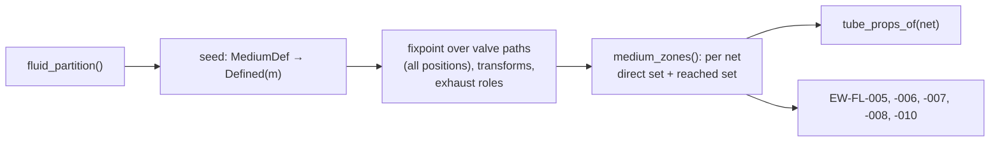

# Fluid power: algorithms, checks, the window, outputs and import

A chapter of [Fluid power](11-fluid-power.md), whose table says where each section lives.

---

## 5. Algorithms

### 5.1 Fluid partition and physical tubes

`fluid_partition()` is the fluid counterpart of `stitch_graph()`. It is a union-find over:
- fluid CPs;
- `Fluid` connections;
- fluid interruption-point pairs (1.0, FR-FLU-030);
- derived gallery edges (§5.2);
- `Short` internal links of fittings, tees, distribution blocks and bulkheads.

A `FluidNetId` is the `MediumDef` CP of the net if there is exactly one, else the minimum member CP ID. It is
therefore stable under unrelated edits (as FR-CON-013 is for potentials).

**Physical tubes** (FR-FLU-031). A shop cuts tubes between ports and fittings:
- one `Fluid` connection is one tube;
- a tube continued through a fluid interruption-point pair is one tube with the target-side connection's ID;
- a drawn fluid junction is a tee (`Junction.fitting`), so each branch is its own tube.

@@@ END


`fluid_nets()` joins the gallery edges of every valve terminal, the pairs of fluid
interruption points (an interruption point whose CP is a fluid port) that a line reaches, and the `short` internal
links of the FnDefs of the functions a line reaches. A net's ID stays its minimum member CP ID (not its definition
point's): stable under unrelated edits, and one rule with the electrical nets. `fluid_tubes()` gives one tube per
fluid line, merged across a pair whose two points have exactly one line each; the tube ID is the line at a
target-side point, else the lowest. The tube list orders tubes naturally by tag, then by their from end. The fluid
interruption point is the definition `ew.fn.ip-fluid` (one pneumatic CP) with the forms `ew.iso.ip` (outgoing, the
line at the tail) and `ew.iso.ip-target` (incoming, the line at the tip), each with its `@qet10` twin, placed with
`ip.place` and continued with `ip.continue`, which gives the partner the other form.

### 5.2 Manifold galleries

```text
galleries(vt):                                  # vt = device with ValveTerminal aspect; memo per vt
  slots = children(vt) in position order, each module followed by its valve children in position order
  for g in [Supply1, Exhaust3, Exhaust5, PilotExhaust] + ([Pilot] if vt.pilot_supply == External else []):
    segment = new
    for s in slots:
      if s.part.fluid.galleries[g].separates: close segment; segment = new
      if s is a valve: segment.join(s.valve_fn.cp(role g))         # port 1, 3, 5, 82/84
      elif s.part.fluid.galleries[g].tap: segment.join(s.cp(tap))  # supply-plate ports 1, 3, 5
      # modules without fluid data are transparent
  return gallery edges, one star per segment rooted at its first member
```

Gallery edges join the partition like rail bonds join PE (FR-FLU-009, FR-FLU-026). The property grid of a valve
port says "port 1 · via gallery 1 of -201U1". Modules without fluid data are transparent, so the misplaced CPX block
-202U1 does not cut the manifold (D-40 stays an assisted check, EW-FL-003). The pneumatic interface -201U2 (552286)
is also shipped without fluid data, hence transparent, until its supply and exhaust ports are verified (PBF §8.1
marks them unverified).

`galleries(vt)` takes as valve terminals the devices whose `plc_station.role` is
`valve_terminal`; the slots are its children in position order, each followed by its own children; per gallery
(supply 1, exhausts 3 and 5, pilot exhausts 82 and 84), a slot with a valve function joins its ports of that role, a
slot whose part taps the gallery joins its port of the tap's designation, a separator closes the segment, and
everything else is transparent. A segment of one member is kept, so a terminal of one valve still has its gallery-1
segment.

### 5.3 Media propagation



```text
media = {}                                        # FluidNetId -> BTreeSet<(MediumKey, Direct|Reached)>
for d in medium_defs sorted by id: media[net(d.at)] += (Defined(d.medium), Direct)
queue = nets with media, ascending id
while n = queue.pop_front():
  for (f, p) in ports(n) sorted:                  # every function with a CP in n
    for edge (p -> q) of f:                       # Flow p->q and Open in ANY position of any section of
                                                  #   f.valve_model, Short links, transform inlet->outlet
      for (k, _) in media[n]:
        (k', origin) = map(k, edge, role(q))      #   Exhaust3/5/82/84 -> Exhaust(k); regulator -> Regulated(root, p_set);
                                                  #   ejector vacuum port -> Vacuum(root); transform outlets are Direct,
                                                  #   every other edge gives Reached
        if media[net(q)] gains (k', origin): queue.push_back(net(q))
```

**Properties of the fixpoint:**
- **Monotone and finite.** `map` is idempotent on `Exhaust` and re-roots `Regulated` keys, so the key set is
  bounded.
- **Deterministic.** Ordered sets, and a queue in ID order (NFR-REL-07).
- **Conservative on purpose.** The union over all switching positions describes what a port *can* carry. This is
  what tube sizing and pressure-rating checks need, and it never depends on a simulated state.

**Effective medium of a net:**
1. the single non-exhaust key;
2. else, with no non-exhaust key, `Exhaust(k)`;
3. else several reached keys, which is allowed and shown as "mixed" (for example behind a shuttle valve).

Two different **direct** keys in one net is EW-FL-005.

`medium_zones()` works on nets, a CP that no line or gallery reaches being a net of its own,
and records for each net the node through which a key first reached it (`ew query medium_zones` prints it). A
definition whose port or medium is gone seeds nothing. Transforms come from the part of the function's device
(§2.6). Not measured: the cost estimate above.

**Cost.** The XL class has at most 10,000 PLC channels ([02c](02c-nonfunctional-requirements.md) §2.1). Assuming every
channel drives a valve coil gives an upper bound of 10,000 valves and about 60k fluid CPs, roughly a tenth of XL's
625k CPs. The partition is linear in CPs and edges; the fixpoint is linear in nets times distinct keys per net
(typically one or two). The estimate is under 2 ms per committed fluid edit, inside NFR-PERF-05's XL budget of
20 ms. Editing a `Medium`, which re-derives the tube properties of every net in its zones, stays inside
NFR-PERF-07's XL budget of 100 ms. The whole computation is Class I.

### 5.4 Effective tube properties

Each field resolves separately, from the highest level that sets it, with provenance (FR-FLU-010). This mirrors the
wire chain of [03](03-domain-model.md) §9.5:

| Level | Source | Example (test values ▲) |
|---|---|---|
| 1 | `ProjectSettings.fluid.default_tube` | none |
| 2 | Medium of the line's net: `line_kind_tubes[kind]`, else `default_tube`; colour from `Medium.colour` | "PU 6×4 BU · from medium 'compressed air 6 bar'" |
| 3 | Data of the effective tube part (the override's part, else the level-2 default's part) | PU tube part ▲: od, id, material, colour, p_rating |
| 4 | `TubeOverrides` field on the line | "8×6 · override" with the reset-to-derived action |

`tube_props_of(net)` is memoised per fluid net (granularity rule, ARCH §6.3). The per-line accessor is a cold
lookup into that map. A line with no effective od/id/material after level 4 is EW-FL-007.

`tube_props_of(line)` is memoised per line, not per net (a net's lines differ by line kind,
`line_kind_tubes`). Level 2 is the medium of the effective key (an exhaust key takes its root medium); a mixed net
gives no level 2. Level 1 to 4 each replace the values they set; the part of level 3 is the line's override part,
else the part the lower levels name. `ew query tube_props id:<line>` prints each value with its source.

### 5.5 Assembly overview generation

The overview on 201/202 is made of the overview representations of the assembly device and its children ([03](03-domain-model.md) §6, FR-DEV-023). The fluid
content is derived as follows:
1. **Order.** Walk the segment's children in position order. Each module glyph is the part's `overview.symbol`.
   Its width is `overview.width`, and modules accumulate left to right on the page grid.
2. **Texts.** Each module glyph gets the manufacturer short name, the part number and the type designation from the
   part copy. A two-part head (-201U1) prints both parts, 195740 CPX-FB13 at the top and 550208 CPX-M-GE-EV-S-7/8-5POL
   at the bottom.
3. **Valve glyphs.** Per position: `ew.ovw.valve-top` with the valve part number for `Valve`, a blank glyph for
   `Blank`, an outline for `Empty`. A sub-base therefore never shows more glyphs than `positions`, so D-10 cannot be
   drawn.
4. **Tags and references.** Above each module: its tag and the "∞" list of its auxiliary representations
   ("∞ 203-B4"; FR-XRF-015). Each child slot has a v5 ID `(rep, child)` that serves as anchor, PDF destination and
   main representation (so -201U3 is page-based on 201).
5. **Breaks.** Break marks at each segment's open end (right on 201, left on 202), derived from the members' pages, never stored.
6. **PART DATA.** The box is an embedded report block over `Assembly.configs` ("Order Code 1: 51E-F13GCQP-D+H2GG",
   "Order Code 2: 32P-VGL-R-MAHAHAHAHAHAHUL3LAHU-28MS") on 201 and 202 (D-36).

**MVP and 1.0.** At MVP the content of each segment is generated (FR-DEV-023): the user places the overview
representations of the members on their pages, and the
break marks follow from the pages. At 1.0 `valve_terminal.generate_overview` builds the pages as well. It splits the children
into segments by the frame's usable width, never inside a module, and previews the tag changes a new break would
cause, because modules are page-based ([06](06-schematic-editor.md) §8).

Step 3 is built: the scene derives one glyph
per position of a module from `valve_slots`, a valve as a rectangle with a circle and its part's number, a blank with
both diagonals, an empty position dashed, in a band above the module glyph; the glyphs are derived items, never
records (AC-32's MVP part).

`valve_terminal.generate_overview {station, left, right, y, symbol?, copies?, title?}` is built, a
`Bulk` command (previewed, one undo step); the window's entry is Generate overview… on a valve terminal's row of the
fluid, PLC or device navigator, which sends the drawing area of the frame on the page the overview starts from (the
first page of a member's overview, else the terminal's first fluid page, else the station's page;
`ew_derive::overview_start_page`, `Session::overview_params`) and, for members not drawn
yet, the starter `ew.ovw.module-wide` of the page grid's family (the drawing area is
the frame's, in page coordinates; `ew.ovw.module` is 24 mm wide and its QET edition 15.875 mm, too narrow for the starter parts' numbers and their valve
glyphs, so the starter overview takes the wide module, 64 mm and 42.3 mm, whose four valve glyphs hold a part number
of twelve characters; a new overview page is titled by the window with the terminal, "Valve terminal -201A1",
`title`). The members (`assembly_members`) stand left to right, each
the width of its symbol's graphics, snapped to the page grid; one that would pass the band's right edge starts the next
page (the members' overview pages in member order, then new assembly-overview pages after the last, with its frame,
grid and structure; with none, the first new page follows the terminal's first fluid page in its section, so that the
overview stands with its fluid diagram, not in the wiring section, doc 10 §6; a new page after an overview sub-page
is its sibling, `104.1`, `104.2`, `104.3`, not `104.1.1`). A member already drawn in member order inside the band (on a later page than the member before,
or right of it on the same page) stays where it stands: a refresh of an overview drawn in order changes nothing. A member without an overview representation gets one of its main
function; a module added without functions gets the symbol's FnDef as its main function. The preview's changes name
each page's members, the new pages and a page left without members; the derived changes show the tags that move with a page. A member takes
part in the overview with its **overview representation** (`overview_rep`: its main representation when that is an
overview one, else the smallest-ID overview representation of its main function), so a module drawn on a multi-line
page first is a member of the generated overview too; its main representation, and so its page-based tag, stay with
the smallest-ID representation (doc 03 §5.1). The positions in the overview are each member's symbol width apart,
so a refresh of an overview drawn by hand with gaps closes the gaps. The part data's `overview.symbol` and
`overview.width` (step 1) are not read: the symbol is the member's own or the starter one, the width its graphics'.

A valve or a blanking plate is never a member: it is a glyph of its module's position
(step 3), also when the module is the terminal itself (the starter terminal, §2.6). So a terminal with valve positions
of its own is an overview without other members; the command refuses only a station with neither members nor valve
positions.

### 5.6 Query catalogue

| Query (key) | Depends on | Policy | Class |
|---|---|---|---|
| `galleries(vt)` | children, positions, part fluid data | Memo | I |
| `fluid_partition()` | fluid connections, galleries, fluid IP pairs, `Short` links | Memo | I |
| `medium_zones()` | partition, medium defs, valve models, transforms | Memo | I |
| `tube_props_of(net)` | zones, media, tube parts, overrides | Memo | I |
| `valve_slots(module)` | children, bindings, `channel_addresses(module)` | Memo | I |
| `tracked_target(valve)` | device links, partition | Cold | I |
| `tube_rows()`, `tube_cut_rows()`, `tube_label_rows()`, `valve_terminal_rows(vt)`, `medium_rows()` | above | Memo | I |
| `checks(scope)`, scopes `device` (the valve-terminal device), `fluid_net`, `page` ([15](15-checks-revisions-collaboration.md) §2.3) | above | Memo | I |
| Routed tube lengths (1.x) | layout, routes | Committed (`RouteTubes`, EW-LAY-011 when stale) | II |

Every memoised query is covered by the oracle that compares it with a cold recomputation (NFR-REL-08, ARCH §6.8).

---

## 6. Check rules: the EW-FL pack

These are the contents of pack EW-FL (FR-CHK-005). [15](15-checks-revisions-collaboration.md) §2.2 and §4.5.3 register
the pack in class 120 with codes `1200nn` (EW-FL-001 → `120001`) and adopt EW-FL-011 … 014 as numbered here; the
`pre-delivery` scheme keeps EW-FL-008 and EW-FL-014 off. Modes: o online, f offline, p prevent, r release. Online rules
stay within the 5 ms per-commit budget and the full check run within NFR-PERF-09. The check panel and release
reports state that checks do not replace engineering verification (NFR-COMP-04).

| Rule | Checks | Req. | Modes | Severity | Release |
|---|---|---|---|---|---|
| EW-FL-001 | Working port 2 or 4 unconnected and not closed (plug, silencer, blanked). One finding per valve function, listing the ports | FR-FLU-018 | o r | warning | MVP |
| EW-FL-002 | Channels bound to a valve's coils ≠ its solenoids. Excess → error; used valve with an unbound coil → warning; spare unbound → none. In strict mode the second binding is already refused by FR-PLC-005, so excess arises only on import (FR-FLU-017's criterion) | FR-FLU-017 | o r | error / warning | MVP |
| EW-FL-003 | Slot occupancy contradicts the configurator order code (decoder plugin) | FR-FLU-022 | f r | warning | 1.x |
| EW-FL-004 | Spare and blank positions, listed | FR-FLU-017 | o | info | MVP |
| EW-FL-005 | Two different direct media in one fluid net | FR-FLU-019 | o r | error | 1.0 |
| EW-FL-006 | Tube `p_rating` below the highest `p_nom` in its net; tube od ≠ port `push_in_od` at either end | FR-FLU-020 | o r | warning | 1.0 |
| EW-FL-007 | Line without effective tube specification (§5.4) | FR-FLU-020 | o r | warning | 1.0 |
| EW-FL-008 | Fluid net whose ports all have exhaust roles (3, 5, 82, 84), or that carries an `Exhaust` key, with no silencer, collector line or closure; off by default | FR-FLU-021 | o | info | 1.0 |
| EW-FL-009 | Coil `voltage` ≠ voltage of the potential feeding the coil or its module's valve-supply pin | FR-FLU-019 | o r | error | 1.0 |
| EW-FL-010 | Valve, or manifold gallery-1 segment, whose port-1 net has no medium definition and no member outside the terminal | FR-FLU-020 | o r | warning | 1.0 |
| EW-FL-011 | `Drives` target ≠ the device reached through the working-port tubes | FR-FLU-029 | o | warning | MVP |
| EW-FL-012 | Port-role conflict: a valve's working port joined to an exhaust port of another valve without a valve between them; two ports of one valve function joined, unless all are exhausts | FR-FLU-032 | o r | warning | 1.0 |
| EW-FL-013 | Occupancy: duplicate or out-of-range position, `Empty` position (lenient report of FI-02, FI-07) | FR-FLU-027 | p o | error (empty: warning) | MVP |
| EW-FL-014 | Tube crossing a location boundary without a transition device (bulkhead); off by default | FR-FLU-032 | o | info | 1.0 |

The core rule FR-CHK-022 ([02a](02a-requirements-core.md)) covers hand-drawn or imported overviews that disagree
with the children (MF-14). Generated overviews cannot disagree. EW-PLC-012, the address-map rule, is in
[10](10-plc-and-bus.md).

EW-FL-001, -002, -004, -011 and -013 are
in pack EW-FL, on in every shipped scheme, with their catalogue rows, rule pages and messages in both languages.
**EW-FL-004 runs in `o r`**, not `o` alone, so that the pre-delivery release run counts it; EW-FL-013's prevent half refuses a strict transaction for FI-02 and FI-07.

EW-FL-005 … -010, -012 and -014 are in the pack's **1.0 content** and run in the
shipped schemes (doc 15 §4.1). Scopes: EW-FL-009 and -010 per device, the others per project (no `fluid_net` scope kind). EW-FL-008 counts a line
(a collector), a closure and a port of another role as treatment; a silencer device is a line's end. EW-FL-009 reads
the feed at a physical coil's pins, and at an internal coil the load supply pin (`L+` of a `load` supply group) of
the bound channel's module or of the first device above it with one. EW-FL-010 counts a junction
as a member outside the terminal. EW-FL-012 skips a net without a line (a gallery alone); a working port into an
inlet (port 1 of another valve or of a manifold, a quick-exhaust or shuttle valve's inlet) is a circuit, not a
conflict, the ports of a component that is no valve never conflict but a supply plate's taps, which are on the
sides of the gallery they tap (a working port joined to a plate's exhaust tap conflicts), and two exhausts of one valve may share a silencer. EW-FL-009 also compares AC and DC where the coil and the potential both name one. Each has its rule page.

EW-FL-007 keeps §5.4's test (outer and inner diameter and material), and its message
says what is missing: a tube whose size is known reads "tube … is 6×4 mm but has no material; give the default tube of
its medium or of the project a material, or set it on the tube", so that it agrees with the tube table, which showed
the size. Its title is "Tube without specification". Fluid settings… says in a toast what the default tube is now, that
the tubes drawn already take it, and that it lacks a material when it does.

---

## 7. UI and UX touchpoints

| Where | Behaviour | Req. |
|---|---|---|
| Fluid page (MVP) | The palette offers fluid symbols only (FR-SYM-006). The line tool draws `Fluid` lines of a line kind its HUD changes; autoconnect works on fluid ports only ([06](06-schematic-editor.md) §2.2). Working and pilot lines differ by dash pattern, never by colour alone (NFR-A11Y-03); drain shares the pilot pattern and is named in the hover text and property grid | FR-FLU-002 |
| Placing a valve part | Placing 571334 on a module position creates the valve child, its functions and the binding per map. The ghost shows the child tag, the address and the position | FR-FLU-004 |
| Assembly overview page | Read-only content. Dragging a valve onto folio 202 is refused with "edit -202U2's children in the device navigator" ([06](06-schematic-editor.md) §8) | FR-DEV-023 |
| Device navigator (MVP); slot table (MVP Should; rack/slot editor 1.0, FR-PLC-028) | -201U1 → modules in position order → valves. Context actions: add valve, set spare or blank, close ports, generate overview. The slot table shows the FR-FLU-015 columns next to the order codes | FR-FLU-004, FR-FLU-015 |
| PLC navigator | Dragging channel 1 of -201U3 onto -201U3-Q1 on folio 203 binds coil 14 | FR-PLC-020 |
| Property grid | For a tube: effective spec with provenance and an override marker. For a valve: part, position, state, coils with channels and addresses, tracked target, process tag. For a port: role, medium, gallery | FR-FLU-010 |
| Highlight (1.0 Could) | Highlights a medium zone with pattern plus colour. Toggles a valve's position to show its flow paths as a view aid only | FR-FLU-034 |
| Fluid navigator and Fluid workspace (1.0) | Fluid devices, lines with tube specs and lengths, media. The workspace docks the fluid navigator, the tube table and the medium table | FR-UI-003, FR-UI-006 |
| Tables | The tube table supports fill-down of specs and lengths and Excel round trip, each edit one command (FR-EXP-004) | FR-FLU-011 |

**The Fluid workspace** is the built-in workspace Fluid (View ▸ Workspaces ▸ Fluid power): the
fluid navigator (rail entry Fluid) in the left column, the tube table and the medium table as tabs of the bottom dock.
The fluid navigator lists Valve terminals → each terminal → its modules → their valves, then Fluid devices (every other
device at a line's end), each device with its lines (`→ <the other end's port>`, from `tube_rows`), then Media, each
with the line count of its zones. The tube table is the `tube_list` rows; its Tube part and Length cells are the new
`fields.set` paths `tube_part` and `tube_length` of a fluid line (refused on another connection; the length typed in
millimetres), which Properties shows on fluid lines too. The medium table is the `medium_overview` rows. **Media are
set** by Project ▸ New medium… (a form of name, pressure and letter: one `fluid.medium.edit`) and by a fluid line's
context menu, Medium: `<name>` (one `fluid.medium.define` at the line's end, which replaces the net's definition
wherever it is; the entry of the medium the line's net carries is checked), which also offers the line kinds (Line:
Working … Flexible: the line-kind picker, after drawing). **Zones are shown** by a medium's row with
Highlight (`Ctrl+Shift+H`, the window highlight of doc 16 §7.3 in a slot's colour and hatch, never colour alone): the
lines of the nets whose medium is that medium. This is the highlight half of FR-FLU-034 (Could), built because the
zones were otherwise invisible; the per-position flow preview stays Later. **The device rows' fluid actions**
are on a device's row of the fluid, PLC and device navigators (`Session::fluid_menu`): a valve terminal's Generate
overview… (§5.5); a valve module's Add valve at position *n* for each blank or empty position (a `valve.set_occupancy`
with the part of the module's first valve, else of another module's; disabled with its reason without one) and Blank
position *n* for each empty one; a valve's
Set spare or Set used and Blank position *n*, a blanking plate's Add valve; Plug port *p* for each open working port
(EW-FL-001's, `ew_derive::open_working_ports`; `fluid.port.close` with a plug). Each is one undo step. **The line
tool**: Fluid ▸ Tube on a fluid page starts the Wire tool at once, drawing lines of the kind used last
(Working at first; `connection.draw` with `{"fluid": {"line_kind"}}`); the HUD says the kind and the project's default
tube ("Working line · tube 6/4 mm") and its Line kind button (`fluid.tube_kind`) steps through Working, Pilot,
Exhaust, Drain and Flexible, remembered; a project without a default tube is told once that Fluid settings… sets it.
Draw ▸ Wire draws working lines. Fluid pages autoconnect: a placed symbol's fluid port facing a free fluid port proposes the
join, and the committed hint is a working fluid line (`device.place`'s hint takes the fluid kind when both ends are
fluid ports); a fluid port never proposes an electrical CP, nor an electrical CP a fluid port, on any page, and a
valve's working port never proposes another valve's exhaust port or a supply plate's exhaust tap, nor the other way
round (EW-FL-012's conflict, `ew_derive::ValvePort`), and an in-line fitting's port (a FnDef with two generic fluid ports: a flow control, a check valve, a
throttle, a coupling, a bulkhead; `ew_derive::is_fitting`) never proposes another fitting's: two set side by side are
a row of branches, not one line; a fitting facing a
valve's or a cylinder's port still is. The placement's toast counts the tubes it draws ("connected 1 tube"). A flexible
line is drawn as an arc between its ends: a quadratic curve whose control point stands a quarter of the chord to the
left of it, the route's corners not drawn. Project ▸ Fluid settings… is a form of the member `fluid` of `project.settings.set`: the default tube's outer and inner diameter in mm and its material, and whether fluid lines are tagged by page and counter; the member's other values are kept, a diameter that is no length is refused in words.

The device's fluid actions stand on its symbol's menu as on
its rows, so a valve terminal's box offers Add valve and Generate overview…. **Add valve at position n** is the window
action `fluid.valve_add {module, position}`: one `valve.set_occupancy` with the part of the terminal's other valves,
else the system libraries' valve for its positions (the first by part number of the parts that name solenoids the
module's map names, with no PLC section and no CP pattern, embedded in the same step; `Session::fluid_menu`), then the
new valve's symbol on the pointer (`place.pick` of its main function) when the page shown takes it, and a toast that
names it. **Generate overview…** without a row acts on the selected valve terminal; while none is selected it is greyed
with "Select a valve terminal first: on its page or in the Fluid panel", and on a device that is no terminal with
"The selection is no valve terminal: a valve terminal is placed from a part with valve positions".

**A tube's Properties** show, beside Line kind, Tube part and Tube length, two derived
rows: **Medium**, the medium its net carries, its chip saying where it is defined ("medium defined at -201X1:1", else
"carried through the valves"), chosen among the project's media (one `fluid.medium.define` at the tube's end through
`Session::layout_edit`, which replaces the net's definition); and **Tube**, its effective specification ("6×4 mm PU"),
its chip naming the sources of its size and material (the project's default tube, a medium's, a tube part's, its own
override; §5.4), read-only. **The Fluid panel's tool line** offers Fluid settings… and New medium…, the Project tab's
actions.

The Medium row's list ends in **New medium…**; the medium its form makes is set
on the row's tubes. While the project has no medium, the list (and the tube's and the source's menus) offers New
medium…'s usual media first ("Compressed air, 6 bar"): one is made and set on the row's ports in one undo step
(`fluid.medium.edit {set, at}`). A row whose only action is Edit opens its editor from its "…" at once. **A source's Properties** (a device with a function on
a FnDef of category `Source`, the air-supply point) show the same Medium row in Main: the medium its port's net carries
and where it is defined, set at its port.

**One word.** The window calls a drawn fluid line a **tube** (Dutch *slang*): Draw ▸
Connect ▸ Tube, a tube's Properties headed "Tube (Working)", the refusals, the medium's count ("3 tubes"), the layout
findings; "line kind" stays the attribute (Working, Pilot, Exhaust, Drain, Flexible), "fluid line" stays this document's
and the format's term. **The Fluid panel's table** lists the tubes drawn: `NavKind::Fluid`'s columns are the tube
table's (`NavKind::source`), and each tube's first row in the tree carries the tube list's cells.

---

## 8. Outputs

### 8.1 Pages

- **Fluid pages** (203–206) render from `page_display_list` like every page. They show the derived texts of §3.1,
  the port designations and the line styles of §2.4. Tube colour is printed as a code text only when the arrangement
  asks for it. The house PDF stays monochrome.
- **Assembly-overview pages** (201, 202) follow §5.5.
- **Generated report pages** are added for the fluid row sources below, as report blocks
  ([09](09-reports-forms-output.md) §2.4: `tube_list`, `valve_terminal_config`, `medium_overview`); the tubes to cut
  are the Tubes group of the cut list ([13](13-workshop-lists.md) §9.3).

### 8.2 Row sources

All row sources are deterministic, sorted naturally by tag, with ties broken by ID. Each one feeds PDF, XLSX and CSV
alike (ADR-0018, FR-EXP-002).

| Row source | Columns |
|---|---|
| Tube list (FR-FLU-012, 1.0) | tag, from DT:port (role), to DT:port (role), medium, line kind, od×id, material, colour, tube part, length + source, fittings A/B, location change, page/cell |
| Tube cut list (FR-FLU-013, 1.0) | the Tubes group of the cut list ([13](13-workshop-lists.md) §9.3): per tube part, else material, od×id and colour, and piece length: pieces, piece length rounded up to the cut increment, total |
| Tube labels (FR-FLU-013, 1.0) | per tube end: text by marking scheme (tag, or destination "-203Q1:A" / "-201U3-Q1:2"), marker part |
| Valve-terminal configuration (FR-FLU-015, 1.0) | position, module DT, module part, valve DT, valve part, solenoids, channel and address, function text / process tag, occupancy and state |
| Medium overview (FR-FLU-016, 1.0) | medium, sources (DT:port), p_nom, quality, consumers (devices whose port 1 lies in the zone, and the actuators it reaches), default tube |
| Fluid BOM lines (FR-FLU-014, 1.0) | Tubes as consumables in m per tube part; fittings per end; plugs and silencers from closures and devices; blanking plates; configured assemblies in assembly mode (FR-REP-005); field devices supplied by others excluded |

The row sources are `tube_rows()`, `valve_terminal_rows()` and `medium_rows()` of
`ew-derive`, shared by the report kinds and the SQL views. A terminal that is its own valve module (EW-GEN-VTM-1:
positions of its own, no child with positions) has a row per position after its own row, and its valves no module
rows (the sample's -201K1 lists positions 1 to 4 with -201K1-Q1 … -Q4, solenoid 14, Q0.0 … Q0.6). The tube
list prints lengths in metres. The cut list's Tubes group counts the pieces of each tube part and length; it has no
per-end cut allowance and no order length, since no part data names an order increment. The tube labels give one row per tube
end with the line tag, else the far end; no marker part. The medium overview counts as consumers the **valves** whose
port 1 lies in a net carrying the medium (not the supply plates that feed it) and the **actuators** whose consumer port
(a cylinder's A or B) does, so a medium set on a working line counts the cylinder it feeds. The fluid BOM
lines are part lines of a device: a closure's part on the device of the closed port, a tube's part on the device of
its from end in metres, else of its to end (a tube from a tee), a fitting on the device of its end, and a tee on the
owner of the lowest tube at it that has one; a tube between two tees has no owner.

### 8.3 Exports, CLI and SQL

- **CLI.** `ew export tubes` (1.0, listed in [17](17-extensibility.md) §3.3) exports the tube list. The cut list, the
  valve-terminal configuration and the medium overview export through `ew export report --block <name>
  --format pdf|xlsx|csv` over the same row sources.
- **Queries.** `ew query medium_zones --json` and `ew query tube_props F1 --explain` (the per-line accessor of
  `tube_props_of`), which prints the provenance of each field.
- **Production package.** The package carries the tube pieces in the cut list's Tubes group, its Excel file
  ([13](13-manufacturing-outputs.md) §8.2); no reader asks for the tubes as data of their own.
- **SQL projection.** [17](17-extensibility.md) §6.1 lists three fluid views at 1.0 and leaves their columns to this
  document (FR-EXT-032, ADR-0017 amendment 2; `api_v1` is Preview until the 1.0 freeze). Column names follow the
  `api_v1_wire` conventions (`*_nm` lengths, `prov_*` provenance):

  | View | Row | Columns |
  |---|---|---|
  | `api_v1_fluid_line` | one physical tube (§5.1) | `id, tag, line_kind, from_device_id, from_tag, from_port, from_role, to_device_id, to_tag, to_port, to_role, fluid_net_id, medium, od_nm, id_nm, material, colour, tube_part, p_rating, length_nm, length_source, fitting_a, fitting_b, from_location, to_location, page_id, cell, prov_tube` |
  | `api_v1_valve_position` | one position of a valve module | `module_id, module_tag, position, occupancy, valve_id, valve_tag, valve_part, solenoids, channel_ids, addresses, function_text, process_tag, target_id, target_tag, state` |
  | `api_v1_medium` | one project medium | `id, name, code, discipline, p_nom, quality, source_cps, consumer_count, default_tube` |

The three views have the columns above (`cell` is NULL: a tube has no frame cell; `prov_tube` is a JSON object of the sources). The report kinds export with `ew export report --kind tube_list`
(and the others' names); `ew export tubes` is not built, it would repeat that command. `ew query medium_zones` and
`ew query tube_props` are built.

---

## 9. QET pneumatic import

### 9.1 Mapping table

QET pneumatic elements have unnamed generic terminals. The 5/2 valve definition
`502010601000_5_2_way.elmt` has six terminals with `type="Generic"` and `name=""`
([plc-bus-fluid](../research/plc-bus-fluid.md) §9.2). Port semantics therefore come from a user-extendable table
(FR-IMP-018). The table is the fluid part of `symbol-map.csv` ([07](07-symbols-parts-macros.md) §3.6).

| Column | Content |
|---|---|
| `match` | QET element UUID or collection path glob |
| `ew_symbol`, `fndef` | e.g. `ew.iso.valve-5-2-sol-spring` |
| `cp_map` | QET terminal key (terminal UUID if present, else the definition-order index) → EW designation and role |
| `coils` | Solenoid designations to create: `14` |
| `line_kind_from_style` | Dashed conductor → Pilot, otherwise Working |
| `confidence` | `verified` (checked against the corpus) or `draft` |

| `match` (examples) | EW symbol | `cp_map` | Coils | Confidence |
|---|---|---|---|---|
| `50_pneumatic/5020_velves/502010_control/50201060_5_2_way/**` | `ew.iso.valve-5-2-sol-spring` or `-pilot-spring` by element variant | 6 terminals → 3, 1, 5, 2, 4, — (index order ▲, read from the element file) | 14 for the solenoid variant | draft |
| `50_pneumatic/5030_actuators/**` double-acting ▲ | `ew.iso.cylinder-double-acting` | 2 terminals → A, B (`Consumer`) | — | draft |
| Process 2-way valve element of the pilot's library ▲ | `ew.iso.process-valve-2way` | process ports, not fluid | — | draft |
| Any other `50_pneumatic/**` | Kept in the project's "QET import" library, `rep_type = Fluid`, CPs `Generic` (FR-SYM-018) | — | — | review item |

The shipped rows are generated in CI from the QET element corpus (24 example projects plus the elements
repository). A QET conductor with both ends on mapped fluid CPs becomes a
`Fluid` connection. A conductor with mixed ends goes to the review list. Page type `Fluid` is inferred when the
mapped representations on a folio are mostly fluid, and is confirmed in the review.

### 9.2 Text recognition and valve-terminal reconstruction

Free texts near mapped fluid symbols become data (FR-IMP-017). The recognisers, their default patterns and their
confidence levels are those of [14](14-interop.md) §4.12; this table states only what they mean for fluid symbols.
Uncertain matches go to the review list:

| Recogniser ([14](14-interop.md) §4.12 default) | Becomes on a fluid symbol |
|---|---|
| PLC address `^%?(I\|Q\|E\|A)(\d+)\.([0-7])$` | Pending channel binding `{coil CP, address}`, resolved by `ApplyImport` once the module exists ([10](10-plc-and-bus.md) §3.3 A7; MF-19) |
| Process tag, project regex (default `^[A-Z]{2}\d{2}-[A-Z]-\d{2}$`, PQ-18) | `process_tag` on the valve until a field device exists (§3.3) |
| Keyword "Spare" (configurable list) | Manual function text "Spare" kept; state Spare proposed in the review list |
| Port number `^(1\|2\|3\|4\|5\|12\|14\|82\|84)$` and the grouped "3 1 5" | Consumed. A mismatch with `cp_map` is a review item |

QET has no device or assembly concept for a manifold (MF-20). The importer reports the untagged valve elements
(EW-IMP-112) and the drawn overview count against the detail pages (EW-IMP-110: 5 drawn on -202U2 against 4,
[14](14-interop.md) §4.13). The **valve-terminal reconstruction assistant** (FR-IMP-039, MVP Should) then builds the
assembly. It is a previewed command in `ew-commands` that runs on the model after `ApplyImport`, because importers
never see the model (ADR-0021, ARCH §3 rule 4):
1. **Children.** It reads the overview folios (201, 202) and proposes the head and its children from the tag texts
   in left-to-right order: -201U2 … -201U9, -202U1 … -202U3.
2. **Valves.** It groups the valve symbols on the detail folios by the module tag text above them (-201U3 at
   203-B4, -201U4 at 203-B12), in left-to-right order, as positions 1 … n.
3. **Bindings.** It resolves the pending bindings from the recognised addresses ([10](10-plc-and-bus.md) §3.3 A7).
4. **Preview.** It shows the hand-drawn overview's count against the proposed children (MF-14, FR-CHK-022) and
   regenerates the overview on accept.

@@@ END

---

## 10. Edge cases and pitfalls

1. **A fifth valve on a 4-position sub-base** (D-10). Strict mode refuses it (FI-02). An import creates children
   only through the assistant, which proposes four positions and reports the fifth drawn glyph (FR-CHK-022).
2. **Changing 571334 to a double-solenoid part.** N-FL-1 adds coil 12; N2 (N-FL-3) finds channel 2p + 1 already
   bound to coil 14 (as drawn). EW-FL-002 and EW-PLC-012 report it; nothing is rebound silently.
3. **Moving a module across the overview break.** Its page-based tag changes (-201U9 → -202U4). The preview lists
   it; freezing the tag keeps shop labels valid.
4. **Spare valve vs blanking plate** (▲U-36). The BOM count of 571334 changes (28 vs 8). The occupancy toggle is one
   previewed command, and EW-FL-001 does not fire for `Blank`.
5. **Supply plates and D-40.** -201U9 sits mid-manifold (▲U-24). Without separator data it taps the same gallery
   zone as -202U3, and galleries pass through the CPX block -202U1. Only the configurator plugin (EW-FL-003, 1.x) can
   call that topology impossible.
6. **External pilot supply.** With `pilot_supply = External`, a terminal without a line to its X port raises
   EW-FL-010 for the pilot gallery as well.
7. **Tubes leaving the cabinet.** F1 is one tube from -201U3-Q1:2 to -203Q1:A unless a bulkhead device splits it
   (EW-FL-014, optional). Lengths across locations stay `Manual`; 1.x routing covers the cabinet side only.
8. **Vacuum and bistable valves.** An ejector's vacuum port carries `Vacuum(root)` and a direct air–vacuum join is
   EW-FL-005. A bistable valve (`rest = None`) propagates over the union of its positions like any other.
9. **Deleting or copying.** `Device.parent` defaults to *forbid* ([03](03-domain-model.md) §4.2), so deleting a
   sub-base asks first. On explicit cascade it deletes its valves and channels and the tubes ending at their ports,
   and drops their `Drives` links, listing bindings, tubes and links in the preview (FR-DEV-030). A pasted valve
   takes the next free position; a full module refuses the paste.
10. **Determinism.** Gallery order, propagation order, tube counters and cut-list grouping break ties by position,
    then by ID, never by hash order or wall clock (NFR-REL-07).
11. **Hydraulics** (1.x, FR-FLU-025). The same records with `discipline = Hydraulic`, letter roles P, T, A, B, X,
    Y, L, and hose data (identification, manufacturing date, pipe class). A hydraulic CP never joins a pneumatic net
    (FI-01). The other media EPLAN Fluid covers (lubrication, cooling, cooling lubricant, gas;
    [eplan-features](../research/eplan-features.md) §17) are further `discipline` values, also Later.

---

## 11. The valve terminal as data

The tests open the sample project (`fixtures/sample/`), whose page 201 draws a
valve terminal with two used and two spare valves.

### 11.1 Folios 201–206 as data

**One value, one place.** A used valve carries no function text: the process tag is stored once, on the field
device, and prints on the valve through the `FunctionText` slot's `ProcessTag` fallback, as in the module typical of
[07](07-symbols-parts-macros.md) §9.3. A spare valve keeps the manual function text "Spare". Reports keep function
text and process tag as separate columns ([10](10-plc-and-bus.md) §3.4). Changing a module's start re-renders its
valves' address texts in the same commit (FR-FLU-005); renumbering leaves process tags untouched (FR-DEV-012).

### 11.2 Expected results

The fluid rules are tested on small models built in code: `crates/ew-checks/tests/it/fluid.rs` (EW-FL-001, -002,
-004, -011, -013) and `fluid_media.rs` (EW-FL-005, -006, -007, -009, -010, -012). EW-FL-004 counts in the release
run (`o r`, §6).

### 11.3 Defects prevented

| Defect | Class | Mechanism in this area |
|---|---|---|
| D-04 BOM without valves and quantities | S | Parts on the 28 valve devices aggregate to 571334 × 28; tubes and fittings at 1.0 |
| D-09 no fluid reports | S | Tube list, cut list, labels, valve-terminal table and medium overview as report blocks |
| D-10 5 vs 4 valves | S + I + C | Generated overview (§5.5); FI-02; FR-CHK-022 for imports |
| D-26 odd-bit addresses | S + C | Printed addresses come from bindings; the map normaliser binds by part data; EW-PLC-012 reports deviations ([10](10-plc-and-bus.md)) |
| D-27 untagged valves and process valves | S | Child tags; field devices with process tags and location; `Drives` links |
| D-28 fluid model incomplete | C | Media, galleries, tube specs; EW-FL-001 (MVP), EW-FL-007, EW-FL-008, EW-FL-010 (1.0) |
| D-36 order code vs components | S | `Assembly.configs`; PART DATA as an embedded block; BOM modes |
| D-40 CPX block inside the MPA section | A | EW-FL-003 decoder plugin (1.x) |
| D-41 assembly tagged from two pages | S | One assembly identity spanning both segments and all fluid rows |

---

## 12. Scope by release

The milestones are in the [roadmap](../../ROADMAP.md); what is built is stated in §2 to §8. The shipped ISO 1219
pneumatic library covers the families of PBF §9.2 and is checked by the library's fluid symbol lint (`ew-library`,
test `fluid_symbols`).

