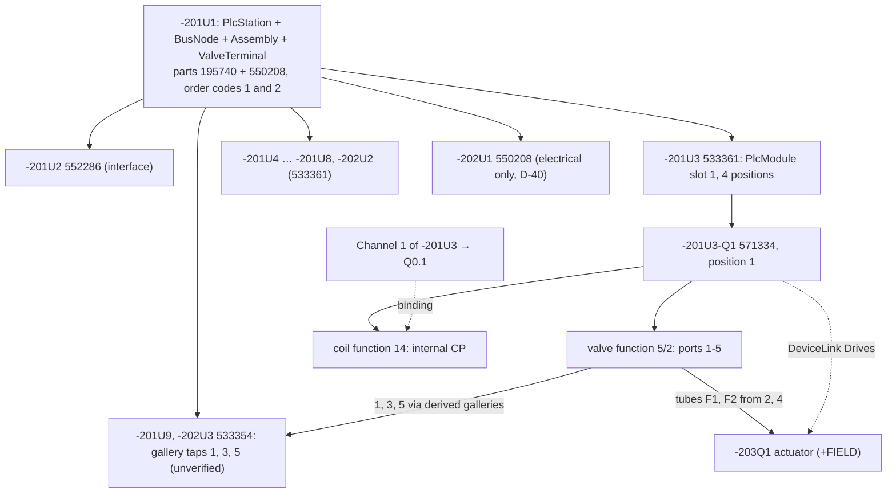

# Fluid power: concepts, fluid and electrical devices, rules

A chapter of [Fluid power](11-fluid-power.md), whose table says where each section lives.

---

## 1. Scope and position

**In scope:** fluid ports, lines and tubes; valve models; media and their propagation; manifold galleries; the fluid
side of solenoid valves and valve terminals; field actuators and process tags; the fluid row sources; the EW-FL rules;
the fluid part of the QET importer.

**Out of scope here, with owners:**

| Topic | Owner |
|---|---|
| Channel model, address maps, the solenoid-position map semantics, EW-PLC-012 (D-26), AML export of the valve terminal | [10-plc-and-bus](10-plc-and-bus.md) |
| Symbol, FnDef and part record formats, the starter library, the valve-module and valve-manifold macros | [07-symbols-parts-macros](07-symbols-parts-macros.md) §2, §9 |
| Connection invariants CI-01 … CI-07, physical-wire rules, colour codes | [08-connections-terminals-cables](08-connections-terminals-cables.md) |
| Forms, pagination, the shared row source for PDF/XLSX/CSV | [09-reports-forms-output](09-reports-forms-output.md) |
| 3D tube routing (1.x), carriers | [12-panel-layout](12-panel-layout.md) |
| Label engine, production package | [13-manufacturing-outputs](13-manufacturing-outputs.md) |
| QET parser and the general symbol map | [14-interop](14-interop.md) |
| Final rule IDs and severities | [15-checks-revisions-collaboration](15-checks-revisions-collaboration.md) |

**Design rules.**
1. **One graph engine.** A fluid port is a connection point (CP) with a fluid discipline. A tube is a `Connection`
   of kind `Fluid` (ARCH §4.2). Fluid nets are computed with the same union-find machinery as electrical nets, but in a
   separate partition. A fluid line never joins an electrical net (FR-FLU-002).
2. **Media behave like potentials.** A `MediumDef` names the medium at a source CP, as a `PotentialDef` does. The
   medium propagates along tubes, galleries and valve flow paths. Tube defaults are resolved from the medium with
   provenance, the fluid analogue of D-08 (FR-FLU-009, FR-FLU-010).
3. **The valve terminal is one device tree.** -201U1 carries `PlcStation`, `BusNode`, `Assembly` and
   `ValveTerminal` (FR-DEV-024). Its sub-bases are `PlcModule` children, and each valve is a child of its sub-base
   with one fluid function and one coil function per solenoid (ARCH §4.3, ADR-0006, FR-FLU-004). One device thus owns
   electrical, bus and fluid CPs (FR-DEV-025).
4. **Everything printed is derived.** Port designations, PLC addresses at valves, process tags, overview pages,
   tube specifications and every fluid report are query results (ADR-0001). The only free texts are those the user
   types on purpose.
5. **Manifold internals are derived, not drawn.** The supply, exhaust and pilot galleries of a valve terminal follow
   from manifold order and part data, in the same way rail bonding follows from carriers ([03](03-domain-model.md) §9.3,
   §16).
6. **Symbols are own drawings.** Every shipped ISO 1219-1 symbol is drawn by the project, carries an SPDX licence
   (CC-BY-SA-4.0 with the design exception) and a source field, and cites the standard only through
   `SymbolDef.iso1219_ref` metadata ([07](07-symbols-parts-macros.md) §2.3; NFR-LIC-06, NFR-LIC-07, NFR-COMP-05).
   QET pneumatic elements are never bundled; imported ones stay in the project's "QET import" library.

   The shipped set is drawn on one module, so that a fluid page and an electrical page read as one
   drawing set: a valve position is a square of 12 mm, its ports on the 4 mm grid 4 mm apart with 2 mm leads (the
   square's edge 2 mm off the grid), the paths drawn from the definition's switching model (a flow arrow, a closed
   port's T), the actuators 6 mm (solenoid, spring, pilot), the manual override 3 mm. Every other component is a body
   of 12 mm or less centred between its ports, which stand 8 mm from its centre with 2 mm leads; a port's designation
   stands beside its tube just beyond the port. Line widths and text sizes are the electrical symbols'. The script
   `tools/iso1219/symbols.py` draws them (then `cargo xtask symbols-qet10` seals them). A library update that draws a CP elsewhere takes the routes at it along
   (the end segments stretch, a hand-drawn route keeps its other bends).

---

## 2. Concepts and data

### 2.1 Records used

These records come from [03](03-domain-model.md) §7 and §15. Storage follows
[05](05-project-format-and-persistence.md) §2. Derived concepts (fluid net, medium zone, gallery, physical tube) are
defined in §5.

| Record or field | Kind | Stored in | Notes |
|---|---|---|---|
| `CpDef{discipline, port_role, designation, physical}` | L | `lib/fndefs/` | The port role is data (§2.2). A VMPA coil CP has `physical = false` |
| `FnDef.valve_model` | L | `lib/fndefs/` | §2.3. It ships with the starter FnDefs from MVP and is first used for propagation at 1.0 |
| `Connection{kind: Fluid(FluidLine{line_kind, tube, length}), number}` | A | page file | §2.4. The line tag is the common `Connection.number: NumberSpec` |
| `Medium` | A | `project.jsonl` | §2.5 |
| `MediumDef{at: Endpoint, medium}` | A | device shard of the owner of `at` | Delete policy *unlink*: when the CP disappears the definition is dropped and listed in the preview ([03](03-domain-model.md) §4.2) |
| `Device{parent, position, state, process_tag}` | A | device shard | Valve children and field devices. `state`: used, spare, reserved, not fitted (FR-DEV-026) |
| `DeviceAspects.valve_terminal: ValveTerminal{pilot_supply}` | A | device shard | Sits on -201U1 next to `Assembly`, `PlcStation` and `BusNode` |
| `Assembly{configs: [AssemblyConfig{label, order_code, part?, covers}], bom_basis}` | A | device shard | The order codes printed in the PART DATA boxes (D-36; FR-DEV-020, FR-PRT-006) |
| `DeviceLink{from, to, kind: Drives \| Linkage}` | A | device shard of `from` | Valve → field device |
| `Channel.binding: Endpoint` | A | module device shard | The channel–coil link. There is no `Connection` row and it never appears in a wire list (FR-PLC-006) |
| `Representation{rep_type: Fluid \| Overview}` | A | page file | Fluid symbols on 203–206 and the generated overview on 201/202 |
| `PartCopy.sections.fluid` | L | `lib/parts/` | §2.6 |

The fluid MVP uses these records with the members of §2.7; the closure's part is optional (a plug's part enters the BOM at 1.0).

### 2.2 Fluid ports

The port designation is a string and the role is an enum, which checks and propagation read (FR-FLU-001). Physical
port data (thread, push-in size, nominal flow) come from the part (§2.6).

| Designation | `FluidPortRole` | Meaning (ISO 5599-3 numbering, withdrawn; successor ISO 11727, edition unverified) | Read by |
|---|---|---|---|
| 1 | `Supply1` | Supply (pressure inlet) | EW-FL-010; gallery 1; consumer count |
| 2, 4 | `Working2`, `Working4` | Working (outlet) ports | EW-FL-001; tube list "from"; target tracking |
| 3, 5 | `Exhaust3`, `Exhaust5` | Exhausts | Exhaust pseudo-medium; galleries 3 and 5; EW-FL-008 |
| 12, 14 | `Pilot12`, `Pilot14` | Pilot or control. A "14" signal connects 1→4, a "12" signal connects 1→2 | Valve model actuation. These are real CPs only on pneumatically piloted valves. On a solenoid valve, 12 and 14 name the solenoids (coil functions, §3.1) |
| 10 | `Pilot10` (added, §2.7) | Pilot signal that blocks the supply (3/2 normally open) | Valve model actuation |
| 82, 84 | `PilotExhaust82`, `PilotExhaust84` | Pilot exhausts | Gallery 82/84 |
| X | `ExternalPilot` | External pilot supply | `ValveTerminal.pilot_supply = External` |
| A, B, vendor names | `Consumer` (added, §2.7) | Actuator and cylinder ports | Tube list "to"; target tracking |
| 1 in, 2 out, 3 exhaust on air preparation | `Supply1`, `Working2`, `Exhaust3` | Filter, regulator, lubricator (FRL), relieving regulators and on/off valves follow the same numbering (PBF §9.2) | Propagation, transforms (§5.3) |

The order in which designations are printed ("3 1 5" above the valve, 2 and 4 below; reference correction C3) is
symbol graphics. Only the designation and role are data.

### 2.3 Valve model

A valve FnDef carries a switching model (FR-FLU-007). Media propagation (§5.3) and the valve rules read it. A valve
body with independently switched halves (2×3/2) is **one** valve function with two sections, so FR-FLU-004's "one
fluid function per valve device" and FI-03 hold for every valve type.

The model is the struct `ValveModel` of `crates/ew-schema/src/library.rs` with its sections (`ValveSection`),
positions (`SwitchPos`), paths (`ValvePath`, between CP indexes of the FnDef) and actuations (`Actuation`,
`Actuator`), each member with what it holds: one section, or two for a 2×3/2 body; the positions in drawn order with
the ISO 1219 labels a, b and 0 for a centre position; the rest position held without a signal, absent for a bistable
valve (the last command holds); a solenoid matched to the part's solenoids and the coil function by its designation
("14", "12").

| Valve (example part) | Positions and paths | Rest | Actuation |
|---|---|---|---|
| 5/2 monostable, solenoid/spring (571334) | a: 1→4, 2→3, 5 closed. b: 1→2, 4→5, 3 closed | b | Solenoid 14 → a; manual override (detent type ▲) → a; spring → b |
| 5/2 bistable | as above | none | Solenoid 14 → a; solenoid 12 → b |
| 5/3 closed centre, spring-centred | a: 1→4, 2→3. 0: 1, 2, 3, 4, 5 closed. b: 1→2, 4→5 | 0 | 14 → a; 12 → b; springs → 0 |
| 3/2 normally closed, solenoid/spring | a: 1→2, 3 closed. b: 2→3, 1 closed | b | Solenoid 12 → a; spring → b |
| 2×3/2 normally closed (one body, two solenoids) | Section 14: a: 1→4, 5 closed; b: 4→5, 1 closed. Section 12: a: 1→2, 3 closed; b: 2→3, 1 closed | b per section | Solenoid 14 → section 14 a; solenoid 12 → section 12 a; springs → b |

A `Flow` path is directional: propagation follows it from `from` to `to` only. An `Open` path conducts both ways.
The FR-FLU-007 acceptance is the first row: 1→2 and 4→5 at rest, 1→4 and 2→3 with coil 14 energised. Which side
of the symbol carries the solenoid is graphics only: the reference draws the spring on the left and the solenoid
with manual override on the right.

`FnDef.valve_model` holds the model, written `{"sections": [{"positions": [{"label",
"paths": [{"flow": {"from", "to"}} | {"open": {"a", "b"}} | {"closed": idx}]}], "rest", "actuation": [{"actuator",
"selects"}]}]}`; `ValvePath` and `Actuator` keep a value of a newer format as `Unknown`. Every shipped valve FnDef
carries its model, and a passive component with flow paths (a
filter, a check valve, a throttle, the ejector: 1→2, 1→3 and 2→3) carries a one-position model, which is how
propagation crosses it. The library's fluid symbol lint asks a model of every definition that needs one: a valve, or
a component with an inlet (port 1 or a generic port) and another port the medium leaves by that no `short` link
joins. The process
valve of a field device (`ew.fn.process-valve-2way`) has none: its ports are process ports.

### 2.4 Fluid lines and tube specification

`FluidLine{line_kind, tube: TubeOverrides?, length: LengthSource}`. The line kind sets the ISO 1219-1 line style
(FR-FLU-002). The dash patterns are form data with `verified = false` until checked against a licensed copy of
ISO 1219-1:2012 + Amd 1:2016 (NFR-COMP-05; [standards](../research/standards.md) §5 flags the line-type assignments
as unverified):

| `line_kind` | Default style (unverified) | Typical use |
|---|---|---|
| Working | solid | Supply and working lines; tubes F1–F16 of the reference project |
| Pilot | dashed | Pilot and control lines to ports 12/14 |
| Exhaust | solid (a working line); the exhaust port symbol or silencer is a separate symbol at the end | Collected exhaust lines |
| Drain | dashed, same pattern as Pilot | Leakage and drain (mainly hydraulics) |
| Flexible | solid arc | Hoses between moving parts |

A tube specification holds `od` and `id` (`Nm`), `material` (PU, PA, PE, PTFE, PVC, Cu, steel), `colour:
ColourSpec` (an IEC 60757 code or a profile company code such as NT for natural), `part: PartRef?`, `p_rating`
(`Dec3`, bar), `t_range` (°C) and `fittings: [PartRef?; 2]`. The line stores only overrides; the effective
specification is resolved per field (§5.4). Lengths reuse `LengthSource` of [08](08-connections-terminals-cables.md)
§7.6; `Routed` is 1.x (FR-FLU-024), a committed `RouteTubes` computation (ADR-0003).

`FluidLine {line_kind, tube: TubeSpec, length: LengthSource, fitting_a, fitting_b}`. The
fittings sit on the line, one per end, not in the tube specification: a medium's or the project's default names no
fittings. `TubeSpec {od, id, material, colour, part, p_rating, t_range}`, every value optional, is the one shape of
a line's overrides, a medium's defaults and `ProjectSettings.fluid.default_tube`; a tube part's data is the part's
`fluid.tube` (§2.6). `fluid.tube.set` and `fluid.length.set` write them (§4.3). The line-tag scheme is
`ProjectSettings.fluid.line_tags`: absent (no tags) or `page_counter`, printed `{page}.{counter}` (N-FL-5, §4.2); a
frozen number prints as written; the ISO 1219-2 line number (FR-FLU-023) is Later. A tube with a
tag prints it beside the line on its page, as a wire prints its number (`ew_derive::connection_number`), and in the
tube list; its size, its tube part and a length from the drawing are not printed or derived at the tube (a length is
typed in the tube table; routed lengths are 1.x).

The line tag is `Connection.number: NumberSpec = Unassigned | Assigned{counter} | Frozen(Ident)`, the field every
connection already has ([03](03-domain-model.md) §8.7, [08](08-connections-terminals-cables.md) §5.1). The numbering
engine runs a separate scheme for `Fluid` connections (FR-FLU-011): none (default for imported projects),
`{page}.{counter}` ("203.1" … "203.16"), or an ISO 1219-2 line number (FR-FLU-023). `NumberSpec::Frozen` freezes tags at release.

### 2.5 Media

`Medium { name: MlText, code: Ident?, discipline, p_nom: Dec3 (bar, gauge), quality: Ident? ("[1:4:1]" per
ISO 8573-1), t_range, colour: ColourSpec, default_tube: TubeSpec?, line_kind_tubes: [(LineKind, TubeSpec)] }`
(FR-FLU-008). `code` is the ISO 1219-2 medium letter, needed only when a project uses several media.
`line_kind_tubes` gives pilot lines their own default, for example 4×2.7 mm.

Media that propagation derives without a record:

| `MediumKey` | Arises at | Displayed as |
|---|---|---|
| `Defined(MediumId)` | a `MediumDef` | the medium name: "compressed air 6 bar" |
| `Regulated(root, p_set)` | the outlet of a regulator FnDef (§5.3) | "compressed air 6 bar → 4 bar"; a defined medium at the outlet replaces it |
| `Vacuum(root)` | the vacuum port of an ejector | "vacuum (from compressed air 6 bar)" |
| `Exhaust(key)` | an exhaust-role port reached through a valve path | "exhaust"; tube default from the root medium |

`medium` (rank 14, `project.jsonl`) is `{id, name, code?, discipline (pneumatic by default,
vacuum or hydraulic), p_nom, quality?, t_range?, colour?, default_tube, line_kind_tubes: [{line_kind, tube}]}`;
`medium_def` (rank 40) is `{id, at, medium}` in the file of the owner of `at`. `fluid.medium.edit` makes, changes and
deletes a medium (a deletion takes its definitions with it); `fluid.medium.define` sets or removes the definition of
a fluid port (FI-04: one per port; a new one replaces the definition of the port's whole net, so that a net is never
defined twice). The derived keys carry their root medium only:
`Regulated(root, p_set)`, `Vacuum(root)`, `Exhaust(root)`; their texts are "… → 4 bar", "vacuum (from …)" and
"exhaust" in en-GB and nl-NL. A medium defined in a regulator's outlet net replaces the regulated key there.
New medium… (F26, F27) starts from a usual medium (compressed air 6 bar, vacuum -0.9 bar, hydraulic
oil 160 bar, cooling water 4 bar, lubricant 5 bar, inert gas 10 bar; `fluid.medium_new {preset}`), which fills the name
and the pressure, both editable. Nothing reads `code` (the ISO 1219-2 line number, FR-FLU-023, is Later and the
letters are unverified), so the form has no Letter field; the action still takes `code`. Every field
of New medium… and Fluid settings… (and of the symbol policy, the process-tag scheme, module safety and channel mode
forms) says under it what it changes, with an example: the text `form-hint-<action>-<field>` of a form's field. The
vacuum port is the one the ejector's part names (`transform`, §2.6); the shipped ejector `ew.fn.ejector` has ports 1
(supply), 2 (vacuum) and 3 (exhaust).

### 2.6 Part data section `fluid`

This is the fluid entry of `PartCopy.sections` (FR-PRT-010). It is owned by this area and versioned with the
[07](07-symbols-parts-macros.md) part format.

| Field | Example | Used by |
|---|---|---|
| `ports[]{designation, position?, thread?, push_in_od?, qn?}` | 533361: ports 2 and 4 per position 1–4, push-in OD ▲ | EW-FL-006; fitting proposals. On a manifold the working ports sit physically on the sub-base: an entry with `position = p` on the module part supplies the physical data of port 2 or 4 of the valve at position p and wins over the valve part's own entry |
| `solenoids[]` | 571334: `[14]` (FR-PLC-011) | Coil functions (§3.1), EW-FL-002 |
| `coil{voltage, env, power_w}` | 24 V DC ▲, power ▲ | EW-FL-009; load sum EW-PLC-014 ([10](10-plc-and-bus.md)) |
| `positions` | 533361: 4 | Occupancy invariant FI-02, overview glyph count |
| `galleries[]{gallery, tap: CpIdx?, separates: bool}` | 533354: taps 1, 3, 5 (▲U-24). 533361: transparent. Separator seal parts: `separates = true` for gallery 1 | §5.2 |
| `overview{symbol, width}` | 533361: `ew.ovw.module`, four valve pitches | §5.5 |
| `tube{od, id, material, colour, p_rating, t_range, min_bend_radius}` | tube parts | §5.4, EW-FL-006 |
| `fitting{port_thread, tube_od}` | push-in fittings | EW-FL-006, BOM |
| `transform` | regulator, ejector, silencer | §5.3 |

The section is typed whole but `overview` (the overview generator's): `ports
[{designation, position?, thread?, push_in_od?, qn?}]`, `positions`, `coil {voltage, env, power_w}`, `galleries
[{gallery, tap?, separates}]`, `tube` (`TubeData`: the tube values and `min_bend_radius`), `fitting {port_thread,
tube_od}` and `transform` (`{"regulator": {outlet, p_set}}` or `{"ejector": {vacuum}}`, the outlet and vacuum ports
by designation; the path itself is the FnDef's valve model). A gallery is named by the role of the valve ports it
joins (`supply1`, `exhaust3`, `exhaust5`, `pilot_exhaust82`, `pilot_exhaust84`), and `tap` is the **designation** of
the part's port, not a CP index, so a part tapping a gallery does not depend on its FnDef's CP order. A module's
position count is `fluid.positions`, else `plc.positions.count`. The starter parts hold a generic valve
terminal: EW-GEN-VTM-1 (four positions, eight internal outputs, solenoid 14 on channel 2p), valve
EW-GEN-VLV-3 (5/2 with an internal coil, 24 V DC) and supply plate EW-GEN-VTS-1 (taps 1, 3 and 5). EW-GEN-VTM-1 is a station part with its outputs integrated (`plc.role` `station`, the positions map),
so that a device placed from it is a valve terminal and its own valve module: normaliser N0 gives a station whose
part maps solenoids to valve positions the role `valve_terminal` ([10](10-plc-and-bus.md) §3.3), and its valves are
its children. The part's category is ValveTerminalNode, not its overview FnDef's
Assembly: the device browser files it under "Valve terminals", beside "Valve terminal plates", and a device placed from
it takes that category's letter (K under EN 81346-2:2009, U allowed). Under a filter the browser lists first the parts
whose description starts with it, so "valve terminal" finds the terminal first. EW-GEN-VTS-1's one template entry is the supply plate's function, so
placed from Device it draws ew.iso.valve-supply-plate with its ports 1, 3 and 5 and, placed in a valve terminal's box, joins the terminal (§4.3); the starter parts EW-GEN-CYL-1
(double-acting cylinder) and EW-GEN-AIR-1 (an air supply: a service unit, on the air-supply point's FnDef) answer the
"no part" findings of a pneumatics job's own devices. The starter tubes EW-GEN-TUB-6, -8 and -10 (polyurethane 6×4, 8×6 and 10×8 mm, blue, 10 bar; part kind
`tube`, sold by the metre) and the push-in fittings EW-GEN-FIT-6 and -8 (G1/8 for 6 mm, G1/4 for 8 mm; kind
`accessory`) carry `fluid.tube` and `fluid.fitting` and no template. A fluid line's Tube part offers the parts of kind
`tube`, the project's and the system libraries' (a library part is embedded with the edit).

The starter parts (F10) hold the basic pneumatic parts, generic, each on its symbol's FnDef, so that
the device browser files it by the FnDef's category: air preparation (filter, with manual and with automatic drain,
regulator, with gauge, lubricator, service unit simplified and detailed, the 3/2 shut-off valve, soft-start valve,
gauge, condensate drain, air reservoir), the pressure switch EW-GEN-PSW-1 with its changeover contact as its second
function, directional valves (solenoid 2/2 NC, 3/2 NO, 5/2 double, 5/3 closed and exhausted centre, each with a
physical coil A1, A2 or B1, B2 per declared solenoid; push button, lever and roller 3/2 and 5/2; the piloted 5/2),
flow and logic valves (non-return, one-way flow control, throttle, quick exhaust, shuttle, dual-pressure), cylinders
(single-acting, double-acting with magnetic piston, cushioned, rodless; rotary actuator, gripper), vacuum (ejector,
suction cup), fittings (silencer, open exhaust, plug, a distributor block with four outlets). The new symbols are drawn
on the module of §1 rule 6. Left out: a pilot-operated variant of every valve (the piloted 5/2 only), a 3/2 lever
valve with detent beside the shut-off valve, a cushioning adjustment, a hydraulic set.

The k-th `function_template` entry of the part on a FnDef of contact kind `coil` is solenoid k.

### 2.7 Schema additions

This document added the following to the first draft of [03](03-domain-model.md) §15; the schema-steward batch
(ARCH §7.6) adopted them before `ew-schema` v0 freezes, and 03 §1.2 and §15 list them:

| Addition | Reason |
|---|---|
| `CpDef.port_role`: `Pilot10`, `Consumer`, `Sensing`, `Generic` (hydraulic P, T, A, B, X, Y, L later) | 3/2 NO pilots, actuator ports A/B (FR-FLU-006), pressure switches, unmapped imports |
| `ValveModel{sections: [ValveSection{positions, rest, actuation}]}` (§2.3) instead of [03](03-domain-model.md) §15's `positions: Vec<FlowMatrix>` plus `actuators_left/right` | The actuator → position mapping is explicit (bistable, 5/3, 2×3/2); the drawn side of an actuator is symbol graphics |
| `FluidLine.tag?` of [03](03-domain-model.md) §15 dropped; the tag is `Connection.number` (§2.4) | One numbering mechanism for wires and tubes, frozen the same way |
| `FluidLine.tube: TubeOverrides` (partial) instead of a full `TubeSpec` | Per-field provenance (FR-FLU-010) |
| `Medium.code`, `Medium.line_kind_tubes`; `ProjectSettings.fluid.default_tube` | ISO 1219-2 codes; pilot-line defaults; inheritance level 1 |
| `PartCopy.sections.fluid` (§2.6) | Galleries (§5.2), transforms (§5.3) |
| `CpOverride.closure: Plug(PartRef) \| Silencer(PartRef) \| Blanked` | Closed ports without a drawn device (EW-FL-001, EW-FL-008); BOM accessory line |
| `Junction.fitting: PartRef?` on fluid pages | A drawn fluid T is a physical tee (§5.1) |
| `DeviceKind::BlankingPlate` with a CP-less FnDef | A blank position is a BOM item with one main function (FR-DEV-004) |

Format 0.1 holds, each optional with an `Unknown` arm and
`schemas/0.1` re-blessed with additions only (ADR-0011 amendment 4): `CpDef.port_role` (`FluidPortRole`: `supply1`,
`working2`, `working4`, `exhaust3`, `exhaust5`, the pilot and pilot-exhaust roles, `external_pilot`, `consumer`,
`sensing`, `generic`); `ConnectionKind::Fluid(FluidLine)` with `line_kind` (`working`, the default, omitted;
`pilot`, `exhaust`, `drain`, `flexible`), written `{"fluid": {}}`; `CpOverride.closure` (`plug`, `silencer`,
`blanked`, with an optional `part`, a new link to a part copy); `PartSections.fluid` with `solenoids`; and
`TextSlot.fallback` (`process_tag`).

Additive within the locked format 0.1 (ADR-0011 amendment 6): `FnDef.valve_model`, the 1.0 members of `PartSections.fluid` (§2.6), `FluidLine.tube`, `.length`,
`.fitting_a` and `.fitting_b`, `Junction.fitting`, `ProjectSettings.fluid`, the reserved kinds `medium` and
`medium_def`, and the report kinds `tube_list`, `tube_cut_list`, `tube_labels`, `valve_terminal_config` and
`medium_overview`. Every new link (the tube, fitting and tee parts, a definition's point and medium, a medium's
tube parts) is **load-tolerant**: an older 0.1 build keeps the members in `extra` and the kinds verbatim and
does not apply them, so a stale target is no refusal on open, and a definition whose port or medium is gone seeds
nothing. The `valve_terminal` aspect (`pilot_supply`) is not typed: no
pilot gallery is derived, and EW-FL-010 does not check an X port.

---

## 3. Devices that are fluid and electrical

### 3.1 Solenoid valves

A solenoid valve is one device with a **valve function** (main; fluid CPs) and one **coil function** (auxiliary)
per declared solenoid (FR-FLU-003). Assigning the part creates both through the part-template normaliser (N-FL-1,
§4.2):

| Valve kind | Coil CPs | Binding | Cross-references |
|---|---|---|---|
| On a valve terminal (571334 on 533361) | One internal CP per solenoid, named "14" (and "12"), `physical = false`: never drawn, never wired | `Channel.binding` → coil CP, set by the map normaliser or by dragging a channel onto the valve (FR-PLC-020) | None for the coil. The module's representations carry the main/aux texts "(201-E4)" and "∞ 203-B4" |
| Stand-alone (own connector) | Physical pins A1/A2 or connector pins 1/2/PE from the part pattern | A DO channel wired to the coil through terminals | E.g. coil on an electrical page "(203-B2)" ↔ valve "∞ 105-C4" (FR-XRF-015). At 1.0, target tracking finds the channel through the wiring (FR-PLC-018) |

**Derived valve texts** (FR-FLU-005), all text slots of the fluid symbol ([07](07-symbols-parts-macros.md) §2.3):
- **`PlcAddress`** prints the rendered address of every channel bound to a coil function of the representation's
  device, in solenoid order 14, 12 ("Q0.0 / Q0.1" for a bistable valve); wired coils are found by target tracking. A slot that names a `solenoid` (`14`, `12`)
  prints that solenoid's address alone; the shipped valves with two solenoids (5/2 bistable, the three 5/3 valves) have
  one such slot above each solenoid, clear of the valve's squares, and a valve with one solenoid keeps its one slot.
  In a valve terminal's cell, where a valve stands with its insertion point on the cell's top line, an address slot
  higher than one grid step under that point is drawn one step under it (the two-solenoid valves' row), so the
  address stands inside the cell; the symbol and the record keep their place, and a valve drawn elsewhere prints in its own slot.
- **`FunctionText` with fallback to `ProcessTag`.** The slot prints the automatic function text (FR-DEV-011). If that
  is empty, it prints the tracked process tag (§3.3). Both are slot kinds of [07](07-symbols-parts-macros.md) §2.3; the
  fallback is a slot option `fallback: ProcessTag`, so reports keep the two values in separate columns (Open
  question 5). Used valves carry no function text of their own; "Spare" stays a manual function text.
- **`CpDesignation(idx)`** prints the port designations.

A valve declares solenoid s
exactly when s is in `fluid.solenoids` of its valve part, and its coil CP is the first non-physical CP with the
effective designation s among the device's functions on a FnDef of contact kind `coil` (`ew_derive::solenoid_coil`,
read by the solenoid positions, N2 and the PLC address slot); a physical coil gives no coil CP. The solenoid is not on the
valve body: `ew.fn.valve-5-2-sol-spring` carries ports 1 to 5 with their roles and no CP "14", and the coil is
`ew.fn.valve-solenoid` (contact kind `coil`). The valve 571334 declares `["14"]` with the template
`[the 5/2 valve, ew.fn.valve-solenoid]`, so each valve has a coil function with the binding on its CP.

A stand-alone valve's solenoids are drawn and joined in the window. The valve's menu (on its
symbol and its row) offers **Draw solenoid 14 on an electrical page…** for each coil function not drawn
(`fluid.draw_solenoid`: the nearest multi-line page, looking back first, with the coil's symbol on the pointer) and
**Go to solenoid 14 at 101-B4** for one that is; the valve's Properties list each solenoid as a row (where it is drawn,
a link that goes there or draws it, and the PLC output that drives it, `PlcAddressText`); the coil's menu and
Properties say **Solenoid 14 of -201Q1**, a link to the valve. Going either way (`nav.show`) shows the other symbol in
the middle of its page, selected so that its whole outline is marked, with "-201Q1, solenoid 14" beside it until the
pointer moves. The k-th coil function in template order is solenoid k
(§2.6). Typing another device's tag into a placed symbol's Tag is the Join of `rep.join_device`: it asks once in words
("-201Q1 has an undrawn …: make this symbol that?"), or says what the device has free and what the symbol is; the
symbol's device may carry a part whose other functions are neither drawn nor wired, and goes with them. Every coil
FnDef has a symbol: `ew.fn.valve-solenoid` is drawn by `ew.iec.valve-solenoid` (the coil box, no connection point:
the coil is bound to a PLC output, not wired). The starter valves EW-GEN-VLV-1 and -2 have the valve as their main
function (letter Q) and the coil as the second.

### 3.2 Valve terminals

- **Order.** Modules are children of the assembly device, ordered by `Device.position` (manifold order). Valves are
  children of their sub-base. Position p runs from 1 to the part's `positions` value. The address map's index is
  p − 1.
- **Occupancy** is derived per position:
  - `Valve(state)`: a valve child with state used, spare or reserved ("valve fitted, unused" when spare), or not
    fitted (planned position, no valve supplied: no BOM line, no EW-FL-001, its coils' channels deactivated);
  - `Blank`: a `BlankingPlate` child;
  - `Empty`: no child, reported by EW-FL-013.

  The BOM and the slot table distinguish all of them (FR-FLU-004). Channel states follow the bound coil's device
  state ([10](10-plc-and-bus.md) §3.2, FR-PLC-019).
- **Child tags.** The child rule gives `{parent}-{letter}{position}`, the letter being the valve's `TagSpec.letter`
  from the project's identifier set: Q for directional valves in the shipped EN 81346-2:2009 set, which accepts QM
  as an alternative ([03](03-domain-model.md) §8.5, ADR-0026). Normaliser N-FL-2 keeps the counter equal to the
  position, so -201U3-Q1 … -202U2-Q4 need no input (FR-DEV-021, FR-NUM-013, D-27).
- **`ValveTerminal{pilot_supply: Internal | External}`.** With `Internal`, the pilot air comes from gallery 1. With
  `External`, the supply plate's X port feeds the pilot gallery, and EW-FL-010 also checks that port.
- **Galleries** are derived from position order and the `galleries` part data (§5.2). Drawn lines inside the
  manifold are neither needed nor allowed. Folios 201 and 202 are `AssemblyOverview` pages (FR-PAG-001,
  [06](06-schematic-editor.md) §2.2): a line drawn on them is an `Overview` connection and joins no net (FR-PAG-002,
  FR-CON-002).

On a fluid page (F15) a valve terminal is drawn **as its positions**: a black box whose
`BoxSpec.slots {pitch}` (an optional member, additive in format 0.1) marks it, laid out by `ew_derive::SlotFrame` on the
page grid: a supply end of six grid steps, then one cell of `pitch` (eleven grid steps, a 5/2 valve of the 12 mm module
with a step to spare) per position in a row, eight steps high, the sub-base the bottom four with each cell's number in
it. A row reads best with upright valves whose working ports 2 and 4 leave the box upwards while ports 1, 3 and 5 end
on the sub-base (the galleries join them, §5.2; the terminal itself is the first gallery slot, so a terminal part that
taps a gallery feeds it). The cells are the terminal's positions, then its modules' (`terminal_cells`); their content is
derived, never stored: a valve's own symbol stands in its cell (its tag and the output that drives it, `PlcAddress`),
a valve drawn on another page is named by its tag, a blanking plate is drawn as one, an empty position dashed. The
Place tool places such a box with one click (`box.black` with `slots`), then gives way to Select; the toast names the
terminal and its positions ("Placed -201K1 at 201-B2: 4 positions, all empty."), and a click whose box would overlap
another box is refused in words. A terminal made first as a PLC station (the New
station view, its valves in its rack) is drawn on a fluid page by `fluid.draw_terminal` (its view's Draw on a
fluid page… in To do, its row in the PLC panel, and Fluid ▸ Valve terminal…, which on a fluid page offers each terminal drawn on
no fluid page first, "Draw -104A1 here", then "A new terminal…"): its box of positions on the pointer, joined to the
terminal as its main function (`join_device`), or another drawing of its main function where it has one; a new terminal
placed while another is undrawn says so in its placement toast. A valve placed or moved into a cell takes that
position (`seat_on_terminal`: a valve of the terminal swaps with the cell's holder through `assembly.attach {swap}`;
`device.place {replace}` replaces it); every command that changes a position (`assembly.attach`,
`valve.set_occupancy`, `box.black`, `device.place`) moves the valve's symbols on the box's page into their cells and
the supply plate into the supply end, their tubes following (`seat_reps`). Only a valve for a terminal is seated
(`fits_terminal`: a valve function and no coil FnDef with a physical CP); anything else dropped in the box stays its
own. The browser an empty cell opens lists the valves made for a terminal alone (a part that names solenoids and fits),
the first chosen. The box's menu lists, on a cell, that position, and on its body every position, each under a heading
("Position 2: empty") with Fill…, Replace…, Empty and Blanking plate; the terminal's kind is a heading too. A page drawn
before stays as it is: `valve_terminal.draw_slots {rep}` (Draw as slots, previewed) redraws a free
box as its positions. A box drawn as its positions is not reshaped (`box.reshape` refuses it).

A filled position shows its valve however it was filled. A valve stands in its cell with its
working ports 2 and 4 on the cell's top edge, where a tube leaves upwards; the sub-base is four grid steps high and
draws the galleries 1, 3 and 5 as lines through every position (`ew_derive::GALLERY_PORTS`), each valve port that ends
on it joined to its own gallery with a dot, the cell numbers under them. `seat_reps` makes the valves' functions first
(as N-FL-1 makes them), then draws, on the terminal's first box drawn as its positions, every valve drawn on no page in
its cell and the terminal's supply in the supply end: a terminal without a supply plate gets a supply function of its
own (an auxiliary function on the supply FnDef, `ew_derive::is_supply_def`, drawn with the symbol's `ports`
arrangement, so the tag is printed once), whose ports 1, 3 and 5 feed the galleries (`galleries`, `terminal_supply`)
and take a tube; EW-FL-010 then points at a port that exists. `valve.add` seats as the other position commands do;
emptying a position deletes the valve with its symbols. A symbol is drawn only when the project embeds one for the
page's grid (`cell_symbol`): the window sends the starter symbols with every command that fills a position or draws the
box (`Session::cell_copies`). A valve drawn on another page stays there; its cell prints its tag and the place of its
symbol (`(202-B3)`), a jump to it. A project made before: `valve_terminal.draw_valves {terminal, copies?}` (Draw its
valves in the terminal: the terminal's menu, its station view's To do, and the quick fix of EW-CORE-047 for a valve of
a terminal drawn as its positions) draws what is missing and moves valves an earlier build seated lower;
`valve_terminal.draw_slots` takes `copies` too. A position is as wide as its valve needs: a cell is the pitch wide, and
a valve whose symbol on the box's page is wider (a 5/3 valve, fifteen steps) takes its width and a step to spare
(`SlotFrame::with_cells`, `ew_derive::box_frame`); `seat_reps` gives the box the outline of those cells, its corner kept,
so it grows to the right, and the valves of the cells to its right move with their tubes; the sub-base and the cell
numbers follow. A terminal drawn before keeps its place. The starter parts hold a 5/3 valve for a terminal,
EW-GEN-VLV-53 (closed centre, solenoids 14 and 12). Only a valve for a terminal whose valve FnDef has no fluid symbol
(`CataloguePart::cell_symbol`) is listed by the station view and the cell's browser with the reason, and not put on a
position. Not built: a terminal
part with several sizes whose count is asked when it is made (it needs a device-level position count that the channel
instantiation honours, which an older build would not: not additive).

**Two kinds (F15).** A valve terminal **with a bus node** is a PLC station of role `valve_terminal`
(EW-GEN-VTM-1, "Valve terminal with bus node, 4 valve positions, 8 outputs"): its outputs drive the solenoids, nothing is
wired per solenoid. A **multipin** valve terminal has no station ([10](10-plc-and-bus.md) §2.3): its part's
`fluid.pins [{solenoid, pin}]` (an optional member, additive) names the plug pin of each solenoid as an expression in
the position index p, the pins being the part's CP pattern on its overview box (EW-GEN-VTP-1: eight positions, solenoid 14
on pin 2p+1, 12 on 2p+2, the common on 25); placed on an electrical page it is that plug, wired by a cable to an output
card. `is_fluid_terminal` takes both: galleries, cells, seating and the fluid navigator treat them alike;
`Session::terminal_kind` gives the kind, which the terminal's menu says ("Valve terminal · PLC station with bus node",
"Valve terminal · multipin, wired"). A terminal valve's solenoid is never drawn: its Properties row says "driven by
output Q0.0 of -201K1 (inside the terminal: nothing to wire)" or "pin 3 of the plug of -201K1" with a link to the plug
(or Draw the plug while it is drawn on no electrical page), and its menu offers Go to output (the channel in the PLC list)
instead of Draw solenoid. The plug is drawn from any page as a valve's solenoid is (`fluid.draw_plug`: the terminal's
menu, its Properties row Plug, the Fluid tab's Draw plug for the selected terminal): the electrical page shown, else the
nearest one, shows with the plug's box on the pointer; once drawn, the menu and the row go to it. On an electrical page
the plug (the terminal's box with a connection point per pin, placed with one click and sized by its pins: half down
its left side, the rest down its right, so that each pin's designation and text read horizontally) prints beside each pin what it carries (`plug_pins`): the valve's tag and the
solenoid where a valve holds the position ("-201K2-Q1 14"), else the position and the solenoid ("2 · 14"), and `COM` for
the common; the texts are derived, so filling, emptying or swapping a position changes them. A wire from a PLC output
to a pin makes that output the solenoid's (`wired_solenoid_channel`: the channel whose traced target is the plug pin):
the valve's `PlcAddress` slot prints it and EW-FL-002 counts the solenoid as driven; no binding is stored. Not built:
the fields of a valve terminal's kind, positions and pin map on its sheet in Parts (backlog).

### 3.3 Field devices, linkages, process tags and target tracking

The process valves TA05-V-15, -33, -18, -17, -36, -38, -16 and -37 are **field devices** (FR-DEV-027): -203Q1 …
-203Q8 in `+FIELD` (both ▲U-07), marked "supplied by others" (FR-DEV-037:
excluded from the BOM and the part and layout checks, kept in fluid lines and target tracking). Each has:
- a 2-way process-valve function and a double-acting actuator function (ports A, B ▲);
- a derived dashed linkage between the two functions (FR-SYM-014);
- the process tag on the device (FR-DEV-012), never renumbered and never translated.

Tubes F1–F16 cross from `+J-E-2416` to `+FIELD` (FR-FLU-006). The tube list shows the location change.

**Driven-device link.** The valve's `DeviceLink{Drives}` to the field device is authored. Normaliser N-FL-4 creates
it in the same transaction when the first tube joins a valve working port to a `Consumer` port of another device.
The ghost shows it before commit.

**Tracked target of a valve:**
1. the target of its `Drives` link, if one exists;
2. else the single device other than the valve terminal that its working-port nets reach; a passive in-line
   component (a throttle, a check valve, a quick-exhaust valve: no valve, but a switching model) does not end the
   path, which goes on along its model's paths to a port that is no exhaust;
3. else none.

**Tracked process tag:** the tracked target's `process_tag`, else the valve's own (the import case, §9.2). A valve
and its target carrying the same tag raises EW-PRC-001 ([10](10-plc-and-bus.md)), with the quick fix "move process
tag to the driven device".

**Channel targets.** The channel's target chain is channel → coil (`binding`) → valve device → tracked target. This
chain feeds:
- the I/O list target columns (FR-PLC-023);
- the automatic symbol template `{target.process_tag}` → `TA05_V_15` (FR-PLC-017, 1.0);
- the process-tag scheme parse `{area TA05, kind V, number 15}` (FR-PLC-049, 1.0).

---

## 4. Behaviour and rules

### 4.1 Invariants

All invariants are evaluated at transaction end (ADR-0009). S means structural: always on, and a violation rejects
the transaction. P means a prevent rule: strict mode rejects, lenient mode (import) reports.

| ID | Invariant | Class | Behaviour |
|---|---|---|---|
| FI-01 | A `Fluid` connection joins two fluid CPs of compatible disciplines: Pneumatic and Vacuum with each other, Hydraulic only with Hydraulic. An electrical CP is never a fluid endpoint (CI-02) | S | Reject |
| FI-02 | Valve and blanking-plate children of a module have unique positions within 1 … `positions` of the module part | P | Strict rejects (no fifth valve on -202U2, D-10). Lenient reports EW-FL-013 |
| FI-03 | A valve device has exactly one valve function (one `ValveSection` per independently switched half, §2.3) and one coil function per solenoid of its part | P | N-FL-1 maintains it. Lenient import reports EW-FL-002 |
| FI-04 | `MediumDef.at` is a fluid CP; at most one definition per CP | S | Reject |
| FI-05 | Tube values: `od > id > 0`, `p_rating ≥ 0`, colour is a valid `ColourSpec` | S | Reject |
| FI-06 | A `Drives` link from a valve targets neither the valve nor an assembly ancestor | S | Reject |
| FI-07 | Module children of a `ValveTerminal` assembly have unique positions | P | Strict rejects; lenient reports EW-FL-013 |

FI-01 is the structural invariant **EW-INV-024** (ADR-0009
amendment 9): a `fluid` connection ends at fluid CPs of one medium family, or at junctions whose every connection is
`fluid`, and no other connection but `overview` ends at a fluid CP; `connection.draw` and the Wire tool refuse first
in words at connection-point ends (elsewhere the invariant's ID shows, the media are read one junction deep). FI-06 is `device.link`'s refusal of a second `drives` link, not an invariant. FI-02 and FI-07 are
EW-FL-013's prevent half.

FI-04 and FI-05 are the refusals of the commands that write the values (`fluid.medium.define`;
`fluid.tube.set`, `fluid.medium.edit` and the `fluid` settings refuse, in words, a diameter of zero or less, an
outer diameter not larger than the inner one, a negative rating). FI-06 is the structural invariant **EW-INV-025**
(ADR-0009 amendment 10): a `drives` link targets neither its device nor an ancestor of it, judged on the edit path
only, because a 0.1 build did not enforce it; `device.link` refuses it first in words. A port whose FnDef copy is
missing (dropped as damaged at an open) is exempt from EW-INV-024.

### 4.2 Normalisers

They run in the commit pipeline (ARCH §5.2; registry and order in [06](06-schematic-editor.md) §3.2) and are
deterministic, with ties broken by ID.

| ID | Trigger | Effect |
|---|---|---|
| N-FL-1 | Part assigned or changed on a valve device | Creates or removes the valve function and the coil functions per `solenoids`. A removed coil unbinds its channel, and the preview lists it |
| N-FL-2 | Valve added to a module, or moved between positions | Lowest free position, or the requested one. Keeps the child counter equal to the position. With "push" insert, later siblings shift; the preview lists every changed child tag and every binding that no longer matches the position map (EW-PLC-012). Frozen child tags do not move |
| N-FL-3 | New valve child under a `PlcModule`, a valve moved within it, or a coil function added by N-FL-1 after a part change | A reference to normaliser N2 of [10](10-plc-and-bus.md) §3.3, the single implementation (in `ew-commands`), whose trigger includes these cases: it binds each coil to the channel the part's solenoid-position map assigns, if that channel is unbound (FR-PLC-051). Map semantics belong to [10](10-plc-and-bus.md). An explicit binding in the command (QET import "as drawn", macro value set) wins |
| N-FL-4 | First tube from a valve working port to a `Consumer` port of another device | Adds `DeviceLink{Drives}` unless one exists |
| N-FL-5 | Tube connection created | Assigns the tube counter when a line-tag scheme is active |

N-FL-3 is N2 of [10](10-plc-and-bus.md) §3.3, registry row 13
in `ew-commands`: it binds a coil only when the channel the map assigns is unbound and no channel binds the coil. A
moved valve keeps the binding of its coil (with a notice), pairs the transaction did not touch are never re-examined,
and a rebinding is `plc.bind_channel` (FR-PLC-051 as reworded). A valve moved out of its module keeps its coil bound
to a channel of the old module, outside that module's subtree; the move is to unbind it. N-FL-2 is not a normaliser
(§4.3).

**N-FL-1** is `valve_functions`, first in `ORDER`: for a
new device or one whose parts changed, with a valve part, it adds the valve function from the part's template when
missing and each template coil function (ID `v5(device, template_index)`), removes a coil function that the current
part's template lacks and unbinds its channel (notice T20), and never replaces or removes the valve function (notice
T21); a new coil whose ID the old part's valve function holds is not built. **N-FL-4** is `drives_link`,
after `bus_ports`: a new `fluid` line whose net joins a valve's working port to the `consumer` port of exactly one
other device outside the valve's parent chain adds `DeviceLink {kind: drives}` unless the valve has one (T22); two or
more such devices give T23 and no link.

N-FL-1 (d): a new valve part whose valve entry names another FnDef **replaces the valve
function's definition in place**: the function keeps its ID, representations and role; its CPs follow by
designation, and the connections, closures and medium definitions at a port follow to the new index, those at a port
the new valve lacks are deleted, each listed in a notice; of two old ports with one designation, which become one
new port, the first keeps its override and its medium definition and the other's go, with a notice; a symbol CP that
draws a port at another index gets a pin map entry. N-FL-1 runs when a device is new or its valve part (the first
part use with solenoids) changed: an accessory part added or a quantity changed leaves the functions alone. The part change's preview (`Engine::preview`) shows the notices; the drawn symbol keeps its graphics and a
notice says to exchange it. **N-FL-5** is `tube_tags`, after `wire_numbering`: under the scheme `page_counter` a fluid
line of the transaction without a counter, or with one another fluid line of its page holds, gets the lowest free
counter of its page; without a scheme a new line has none (`wire_numbering` leaves fluid lines to it).

### 4.3 Commands

| Command | Purpose | Undo |
|---|---|---|
| `fluid.line.draw{a, b, line_kind, route}` | Draws a fluid line (the wire tool on Fluid pages; autoconnect on fluid ports, ADR-0007) | 1 step |
| `fluid.tube.set{lines, overrides}` | Sets tube overrides on a multi-selection | 1 step |
| `fluid.medium.define{at, medium}` / `fluid.medium.edit` | Places a medium definition point / edits project media | 1 step |
| `valve.add{module, position?, part}`, `valve.set_occupancy{module, position, Valve \| Blank \| Empty}` | Builds valve positions; sets spare and blank | 1 step |
| `valve_terminal.generate_overview{station, pages?}` (1.0, FR-FLU-033) | Creates or refreshes the assembly-overview pages, segments and PART DATA blocks | 1 step, previewed |
| `fluid.port.close{cp, closure}` | Plug, silencer or blanked | 1 step |
| `device.link{from, to, Drives}` | Manual driven-device link | 1 step |
| `fluid.length.set{lines, length: Nm}`; `RouteTubes` (1.x) | Manual length; committed routing | 1 step |

`valve.add` and `device.link` are registered commands
([06](06-schematic-editor.md) §3.1). `valve.add{module, position?, part, letter?, fndef?, structure?}` creates the
valve child with the child tag scheme and its counter equal to its position (the lowest free position by default; a
held one is refused, no push insert); `fndef` names the FnDef copy of the valve's main function for a part without a
valve entry, and `letter` its letter code (default Q). N-FL-2 is not a normaliser: its counter rule is applied inside
`valve.add` and `assembly.attach` (a child tag of the child scheme, not frozen, whose counter equalled its old
position follows the new one), and its push insert, with `assembly.detach`, is not built. `device.link{from, to,
kind}` refuses a self-link and a duplicate of the same kind. The coil-to-channel binding is N2's ([10](10-plc-and-bus.md)
§3.3) or an explicit `plc.bind_channel`.

`fluid.medium.edit {medium?, set?}`, `fluid.medium.define {function, idx, medium?}`,
`fluid.tube.set {lines, set, fitting_a?, fitting_b?, reset: [field]}` and `fluid.length.set {lines, length?}` are
built, each one undo step (`fluid.medium.define` takes `also`, further ports defined alike in the same step: a tube's
Medium in Properties set on several tubes at once defines it at each tube's end); the project's default tube and line-tag scheme are the `fluid` member of
`project.settings.set`. `valve.add` refuses a part with a PLC section (a station or module part, which N0 would attach
to a station). `fluid.line.draw` is `connection.draw` with kind `fluid`; `valve_terminal.generate_overview`
is built (§5.5); `RouteTubes` is 1.x.

`valve.set_occupancy {module, position, occupancy, copies?}`
(`{"valve": {state, part?}}`, `{"blank": {part?}}` or `"empty"`, one undo step; a blank removes the valve with its
delete plan and makes a `blanking_plate` child with the position's tag; a new valve of a part with a PLC section is
refused as `valve.add` refuses it) and `fluid.port.close {function, idx,
closure?}` (refused on a port that is no fluid port or has a fluid line) are built; `valve.add` with a part whose
template has a valve entry ignores `fndef` and lets N-FL-1 make the functions; `fields.set` sets a fluid line's
`line_kind`.

A valve placed or moved into a valve terminal's box is that terminal's valve:
`device.place` and `rep.move` take `into` (the terminal whose box the window saw the insertion point in), and the new
or moved device joins it as `assembly.attach` makes it, in the same undo step: a valve at the first free position, a
supply plate (a part whose fluid section taps a gallery) without a position; a device already on it, any other device,
and a valve when no position is free, stay as they are. A valve symbol inside a valve terminal's box is a new device,
never an auxiliary function of the terminal ([06](06-schematic-editor.md) §2.7). The toast names the position. A
valve's **Valve position** is a Main row of Properties, typed into to move it to a free position (`assembly.attach`).

