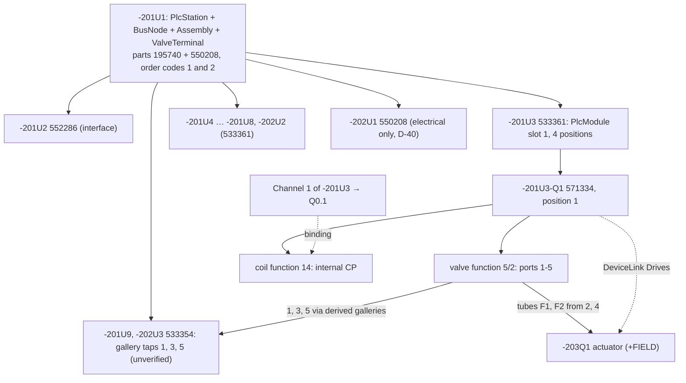
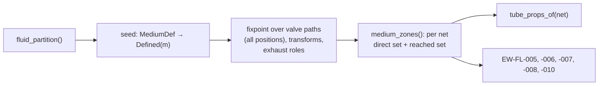

# Fluid power

**Status:** Draft v0.1 · **Date:** 2026-10-18 · **Part of:** ElektraWatt design document set

**Purpose.** This document specifies how ElektraWatt (EW) represents and checks fluid power: pneumatics in v1 and
hydraulics later. Fluid power runs on the same connection graph as the electrical schematic. It uses typed ports, valve
switching models and media that propagate the way potentials do. The document covers devices that are fluid and
electrical at once: solenoid valves, and valve terminals that are also PLC stations. It also covers the generated
valve-terminal overview pages, process tags and target tracking, tubes and their reports, the QET pneumatic import
mapping, and the EW-FL rule pack. It elaborates the FLU area of [02b](02b-requirements-extended.md). It builds on
[domain model](03-domain-model.md) §7 and §15, and follows the accepted [architecture](04-architecture.md)
(ADR-0001, ADR-0006, ADR-0007).

**Contents**
1. [Scope and position](#1-scope-and-position)
2. [Concepts and data](#2-concepts-and-data)
3. [Devices that are fluid and electrical](#3-devices-that-are-fluid-and-electrical)
4. [Behaviour and rules](#4-behaviour-and-rules)
5. [Algorithms](#5-algorithms)
6. [Check rules: the EW-FL pack](#6-check-rules-the-ew-fl-pack)
7. [UI and UX touchpoints](#7-ui-and-ux-touchpoints)
8. [Outputs](#8-outputs)
9. [QET pneumatic import](#9-qet-pneumatic-import)
10. [Edge cases and pitfalls](#10-edge-cases-and-pitfalls)
11. [The reference project](#11-the-reference-project)
12. [Scope by release](#12-scope-by-release)
13. [Dependencies](#13-dependencies)
14. [Requirements covered](#requirements-covered)
15. [Open questions](#open-questions)

---

## 1. Scope and position

**In scope:** fluid ports, lines and tubes; valve models; media and their propagation; manifold galleries; the fluid
side of solenoid valves and valve terminals; field actuators and process tags; the fluid row sources; the EW-FL rules;
the fluid part of the QET importer.

**Out of scope here, with owners:**

| Topic | Owner |
|---|---|
| Channel model, address maps, the solenoid-position map semantics, EW-PLC-012 (D-26), AML export of the valve terminal | [10-plc-and-bus](10-plc-and-bus.md) |
| Symbol, FnDef and part record formats, the starter library, the valve-module and valve-manifold macros | [07-symbols-parts-macros](07-symbols-parts-macros.md) §2, §9 |
| Connection invariants CI-01 … CI-07, physical-wire rules, colour codes | [08-connections-terminals-cables](08-connections-terminals-cables.md) |
| Forms, pagination, the shared row source for PDF/XLSX/CSV | [09-reports-forms-output](09-reports-forms-output.md) |
| 3D tube routing (1.x), carriers | [12-panel-layout](12-panel-layout.md) |
| Label engine, `.ewpp` | [13-manufacturing-outputs](13-manufacturing-outputs.md) |
| QET parser and the general symbol map | [14-interop](14-interop.md) |
| Final rule IDs and severities | [15-checks-revisions-collaboration](15-checks-revisions-collaboration.md) |

**Design rules.**
1. **One graph engine.** A fluid port is a connection point (CP) with a fluid discipline. A tube is a `Connection`
   of kind `Fluid` (ARCH §4.2). Fluid nets are computed with the same union-find machinery as electrical nets, but in a
   separate partition. A fluid line never joins an electrical net (FR-FLU-002).
2. **Media behave like potentials.** A `MediumDef` names the medium at a source CP, as a `PotentialDef` does. The
   medium propagates along tubes, galleries and valve flow paths. Tube defaults are resolved from the medium with
   provenance, the fluid analogue of D-08 (FR-FLU-009, FR-FLU-010).
3. **The valve terminal is one device tree.** -201U1 carries `PlcStation`, `BusNode`, `Assembly` and
   `ValveTerminal` (FR-DEV-024). Its sub-bases are `PlcModule` children, and each valve is a child of its sub-base
   with one fluid function and one coil function per solenoid (ARCH §4.3, ADR-0006, FR-FLU-004). One device thus owns
   electrical, bus and fluid CPs (FR-DEV-025).
4. **Everything printed is derived.** Port designations, PLC addresses at valves, process tags, overview pages,
   tube specifications and every fluid report are query results (ADR-0001). The only free texts are those the user
   types on purpose.
5. **Manifold internals are derived, not drawn.** The supply, exhaust and pilot galleries of a valve terminal follow
   from manifold order and part data, in the same way rail bonding follows from carriers ([03](03-domain-model.md) §9.3,
   §16).
6. **Symbols are own drawings.** Every shipped ISO 1219-1 symbol is drawn by the project, carries an SPDX licence
   (CC-BY-SA-4.0 with the design exception) and a source field, and cites the standard only through
   `SymbolDef.iso1219_ref` metadata ([07](07-symbols-parts-macros.md) §2.3; NFR-LIC-06, NFR-LIC-07, NFR-COMP-05).
   QET pneumatic elements are never bundled; imported ones stay in the project's "QET import" library.

---

## 2. Concepts and data

### 2.1 Records used

These records come from [03](03-domain-model.md) §7 and §15. Storage follows
[05](05-project-format-and-persistence.md) §2. Derived concepts (fluid net, medium zone, gallery, physical tube) are
defined in §5.

| Record or field | Kind | Stored in | Notes |
|---|---|---|---|
| `CpDef{discipline, port_role, designation, physical}` | L | `lib/fndefs/` | The port role is data (§2.2). A VMPA coil CP has `physical = false` |
| `FnDef.valve_model` | L | `lib/fndefs/` | §2.3. It ships with the starter FnDefs from MVP and is first used for propagation at 1.0 |
| `Connection{kind: Fluid(FluidLine{line_kind, tube, length}), number}` | A | page file | §2.4. The line tag is the common `Connection.number: NumberSpec` |
| `Medium` | A | `project.jsonl` | §2.5 |
| `MediumDef{at: Endpoint, medium}` | A | device shard of the owner of `at` | Delete policy *unlink*: when the CP disappears the definition is dropped and listed in the preview ([03](03-domain-model.md) §4.2) |
| `Device{parent, position, state, process_tag}` | A | device shard | Valve children and field devices. `state`: used, spare, reserved, not fitted (FR-DEV-026) |
| `DeviceAspects.valve_terminal: ValveTerminal{pilot_supply}` | A | device shard | Sits on -201U1 next to `Assembly`, `PlcStation` and `BusNode` |
| `Assembly{configs: [AssemblyConfig{label, order_code, part?, covers}], bom_basis}` | A | device shard | The order codes printed in the PART DATA boxes (D-36; FR-DEV-020, FR-PRT-006) |
| `DeviceLink{from, to, kind: Drives \| Linkage}` | A | device shard of `from` | Valve → field device |
| `Channel.binding: Endpoint` | A | module device shard | The channel–coil link. There is no `Connection` row and it never appears in a wire list (FR-PLC-006) |
| `Representation{rep_type: Fluid \| Overview}` | A | page file | Fluid symbols on 203–206 and the generated overview on 201/202 |
| `PartCopy.sections.fluid` | L | `lib/parts/` | §2.6 |

### 2.2 Fluid ports

The port designation is a string and the role is an enum, which checks and propagation read (FR-FLU-001). Physical
port data (thread, push-in size, nominal flow) come from the part (§2.6).

| Designation | `FluidPortRole` | Meaning (ISO 5599-3 numbering, withdrawn; successor ISO 11727, edition unverified) | Read by |
|---|---|---|---|
| 1 | `Supply1` | Supply (pressure inlet) | EW-FL-010; gallery 1; consumer count |
| 2, 4 | `Working2`, `Working4` | Working (outlet) ports | EW-FL-001; tube list "from"; target tracking |
| 3, 5 | `Exhaust3`, `Exhaust5` | Exhausts | Exhaust pseudo-medium; galleries 3 and 5; EW-FL-008 |
| 12, 14 | `Pilot12`, `Pilot14` | Pilot or control. A "14" signal connects 1→4, a "12" signal connects 1→2 | Valve model actuation. These are real CPs only on pneumatically piloted valves. On a solenoid valve, 12 and 14 name the solenoids (coil functions, §3.1) |
| 10 | `Pilot10` (added, §2.7) | Pilot signal that blocks the supply (3/2 normally open) | Valve model actuation |
| 82, 84 | `PilotExhaust82`, `PilotExhaust84` | Pilot exhausts | Gallery 82/84 |
| X | `ExternalPilot` | External pilot supply | `ValveTerminal.pilot_supply = External` |
| A, B, vendor names | `Consumer` (added, §2.7) | Actuator and cylinder ports | Tube list "to"; target tracking |
| 1 in, 2 out, 3 exhaust on air preparation | `Supply1`, `Working2`, `Exhaust3` | Filter, regulator, lubricator (FRL), relieving regulators and on/off valves follow the same numbering (PBF §9.2) | Propagation, transforms (§5.3) |

The order in which designations are printed ("3 1 5" above the valve, 2 and 4 below; reference correction C3) is
symbol graphics. Only the designation and role are data.

### 2.3 Valve model

A valve FnDef carries a switching model (FR-FLU-007). Media propagation (§5.3) and the valve rules read it. A valve
body with independently switched halves (2×3/2) is **one** valve function with two sections, so FR-FLU-004's "one
fluid function per valve device" and FI-03 hold for every valve type.

```rust
pub struct ValveModel { pub sections: SmallVec<[ValveSection; 1]> }  // one section; two for 2×3/2 bodies
pub struct ValveSection {
    pub positions: SmallVec<[SwitchPos; 3]>,  // drawn order; ISO 1219 labels a, b, and 0 for a centre position
    pub rest: Option<u8>,                     // position held without a signal; None = bistable (last command)
    pub actuation: SmallVec<[Actuation; 4]>,  // which actuator drives which position
}
pub struct SwitchPos { pub label: Ident, pub paths: SmallVec<[ValvePath; 4]> }
pub enum ValvePath { Flow { from: u16, to: u16 }, Open { a: u16, b: u16 }, Closed(u16) }  // CP idx of the FnDef
pub struct Actuation { pub actuator: Actuator, pub selects: u8 }
pub enum Actuator {
    Solenoid { solenoid: Ident },             // "14" or "12": matched to the part's `solenoids` and the coil function
    Pilot { port: u16 }, Spring, AirSpring, ManualOverride { detent: bool },
    Detent, Pushbutton, Lever, Roller, Pedal,
}
```

| Valve (example part) | Positions and paths | Rest | Actuation |
|---|---|---|---|
| 5/2 monostable, solenoid/spring (571334) | a: 1→4, 2→3, 5 closed. b: 1→2, 4→5, 3 closed | b | Solenoid 14 → a; manual override (detent type ▲) → a; spring → b |
| 5/2 bistable | as above | none | Solenoid 14 → a; solenoid 12 → b |
| 5/3 closed centre, spring-centred | a: 1→4, 2→3. 0: 1, 2, 3, 4, 5 closed. b: 1→2, 4→5 | 0 | 14 → a; 12 → b; springs → 0 |
| 3/2 normally closed, solenoid/spring | a: 1→2, 3 closed. b: 2→3, 1 closed | b | Solenoid 12 → a; spring → b |
| 2×3/2 normally closed (one body, two solenoids) | Section 14: a: 1→4, 5 closed; b: 4→5, 1 closed. Section 12: a: 1→2, 3 closed; b: 2→3, 1 closed | b per section | Solenoid 14 → section 14 a; solenoid 12 → section 12 a; springs → b |

A `Flow` path is directional: propagation follows it from `from` to `to` only. An `Open` path conducts both ways.
The FR-FLU-007 acceptance is the first row: 1→2 and 4→5 at rest, 1→4 and 2→3 with coil 14 energised. Which side
of the symbol carries the solenoid is graphics only: the reference draws the spring on the left and the solenoid
with manual override on the right.

### 2.4 Fluid lines and tube specification

`FluidLine{line_kind, tube: TubeOverrides?, length: LengthSource}`. The line kind sets the ISO 1219-1 line style
(FR-FLU-002). The dash patterns are form data with `verified = false` until checked against a licensed copy of
ISO 1219-1:2012 + Amd 1:2016 (NFR-COMP-05; [standards](../research/standards.md) §5 flags the line-type assignments
as unverified):

| `line_kind` | Default style (unverified) | Typical use |
|---|---|---|
| Working | solid | Supply and working lines; tubes F1–F16 of the reference project |
| Pilot | dashed | Pilot and control lines to ports 12/14 |
| Exhaust | solid (a working line); the exhaust port symbol or silencer is a separate symbol at the end | Collected exhaust lines |
| Drain | dashed, same pattern as Pilot | Leakage and drain (mainly hydraulics) |
| Flexible | solid arc | Hoses between moving parts |

A tube specification holds `od` and `id` (`Nm`), `material` (PU, PA, PE, PTFE, PVC, Cu, steel), `colour:
ColourSpec` (an IEC 60757 code or a profile company code such as NT for natural), `part: PartRef?`, `p_rating`
(`Dec3`, bar), `t_range` (°C) and `fittings: [PartRef?; 2]`. The line stores only overrides; the effective
specification is resolved per field (§5.4). Lengths reuse `LengthSource` of [08](08-connections-terminals-cables.md)
§7.6; `Routed` is 1.x (FR-FLU-024), a committed `RouteTubes` computation (ADR-0003).

The line tag is `Connection.number: NumberSpec = Unassigned | Assigned{counter} | Frozen(Ident)`, the field every
connection already has ([03](03-domain-model.md) §8.7, [08](08-connections-terminals-cables.md) §5.1). The numbering
engine runs a separate scheme for `Fluid` connections (FR-FLU-011): none (default for imported projects),
`{page}.{counter}` ("203.1" … "203.16" for F1–F16), or an ISO 1219-2 line number (FR-FLU-023). The golden labels
F1–F16 are test identifiers, not printed tags. `NumberSpec::Frozen` freezes tags at release.

### 2.5 Media

`Medium { name: MlText, code: Ident?, discipline, p_nom: Dec3 (bar, gauge), quality: Ident? ("[1:4:1]" per
ISO 8573-1), t_range, colour: ColourSpec, default_tube: TubeSpec?, line_kind_tubes: [(LineKind, TubeSpec)] }`
(FR-FLU-008). `code` is the ISO 1219-2 medium letter, needed only when a project uses several media.
`line_kind_tubes` gives pilot lines their own default, for example 4×2.7 mm.

Media that propagation derives without a record:

| `MediumKey` | Arises at | Displayed as |
|---|---|---|
| `Defined(MediumId)` | a `MediumDef` | the medium name: "compressed air 6 bar" |
| `Regulated(root, p_set)` | the outlet of a regulator FnDef (§5.3) | "compressed air 6 bar → 4 bar"; a defined medium at the outlet replaces it |
| `Vacuum(root)` | the vacuum port of an ejector | "vacuum (from compressed air 6 bar)" |
| `Exhaust(key)` | an exhaust-role port reached through a valve path | "exhaust"; tube default from the root medium |

### 2.6 Part data section `fluid`

This is the fluid entry of `PartCopy.sections` (FR-PRT-010). It is owned by this area and versioned with the
[07](07-symbols-parts-macros.md) part format.

| Field | Example | Used by |
|---|---|---|
| `ports[]{designation, position?, thread?, push_in_od?, qn?}` | 533361: ports 2 and 4 per position 1–4, push-in OD ▲ | EW-FL-006; fitting proposals. On a manifold the working ports sit physically on the sub-base: an entry with `position = p` on the module part supplies the physical data of port 2 or 4 of the valve at position p and wins over the valve part's own entry |
| `solenoids[]` | 571334: `[14]` (FR-PLC-011) | Coil functions (§3.1), EW-FL-002 |
| `coil{voltage, env, power_w}` | 24 V DC ▲, power ▲ | EW-FL-009; load sum EW-PLC-014 ([10](10-plc-and-bus.md)) |
| `positions` | 533361: 4 | Occupancy invariant FI-02, overview glyph count |
| `galleries[]{gallery, tap: CpIdx?, separates: bool}` | 533354: taps 1, 3, 5 (▲U-24). 533361: transparent. Separator seal parts: `separates = true` for gallery 1 | §5.2 |
| `overview{symbol, width}` | 533361: `ew.ovw.module`, four valve pitches | §5.5 |
| `tube{od, id, material, colour, p_rating, t_range, min_bend_radius}` | tube parts | §5.4, EW-FL-006 |
| `fitting{port_thread, tube_od}` | push-in fittings | EW-FL-006, BOM |
| `transform` | regulator, ejector, silencer | §5.3 |

### 2.7 Schema additions

This document added the following to the first draft of [03](03-domain-model.md) §15; the schema-steward batch
(ARCH §7.6) adopted them before `ew-schema` v0 freezes, and 03 §1.2 and §15 list them (Open questions 1–3):

| Addition | Reason |
|---|---|
| `CpDef.port_role`: `Pilot10`, `Consumer`, `Sensing`, `Generic` (hydraulic P, T, A, B, X, Y, L later) | 3/2 NO pilots, actuator ports A/B (FR-FLU-006), pressure switches, unmapped imports |
| `ValveModel{sections: [ValveSection{positions, rest, actuation}]}` (§2.3) instead of [03](03-domain-model.md) §15's `positions: Vec<FlowMatrix>` plus `actuators_left/right` | The actuator → position mapping is explicit (bistable, 5/3, 2×3/2); the drawn side of an actuator is symbol graphics |
| `FluidLine.tag?` of [03](03-domain-model.md) §15 dropped; the tag is `Connection.number` (§2.4) | One numbering mechanism for wires and tubes, frozen the same way |
| `FluidLine.tube: TubeOverrides` (partial) instead of a full `TubeSpec` | Per-field provenance (FR-FLU-010) |
| `Medium.code`, `Medium.line_kind_tubes`; `ProjectSettings.fluid.default_tube` | ISO 1219-2 codes; pilot-line defaults; inheritance level 1 |
| `PartCopy.sections.fluid` (§2.6) | Galleries (§5.2), transforms (§5.3) |
| `CpOverride.closure: Plug(PartRef) \| Silencer(PartRef) \| Blanked` | Closed ports without a drawn device (EW-FL-001, EW-FL-008); BOM accessory line |
| `Junction.fitting: PartRef?` on fluid pages | A drawn fluid T is a physical tee (§5.1) |
| `DeviceKind::BlankingPlate` with a CP-less FnDef | A blank position is a BOM item with one main function (FR-DEV-004) |

---

## 3. Devices that are fluid and electrical

### 3.1 Solenoid valves

A solenoid valve is one device with a **valve function** (main; fluid CPs) and one **coil function** (auxiliary)
per declared solenoid (FR-FLU-003). Assigning the part creates both through the part-template normaliser (N-FL-1,
§4.2):

| Valve kind | Coil CPs | Binding | Cross-references |
|---|---|---|---|
| On a valve terminal (571334 on 533361) | One internal CP per solenoid, named "14" (and "12"), `physical = false`: never drawn, never wired | `Channel.binding` → coil CP, set by the map normaliser or by dragging a channel onto the valve (FR-PLC-020) | None for the coil. The module's representations carry the main/aux texts "(201-E4)" and "∞ 203-B4" |
| Stand-alone (own connector) | Physical pins A1/A2 or connector pins 1/2/PE from the part pattern | A DO channel wired to the coil through terminals | E.g. coil on an electrical page "(203-B2)" ↔ valve "∞ 105-C4" (FR-XRF-015). At 1.0, target tracking finds the channel through the wiring (FR-PLC-018) |

**Derived valve texts** (FR-FLU-005), all text slots of the fluid symbol ([07](07-symbols-parts-macros.md) §2.3):
- **`PlcAddress`** prints the rendered address of every channel bound to a coil function of the representation's
  device, in solenoid order 14, 12 ("Q0.0 / Q0.1" for a bistable valve). At MVP only direct bindings count. At 1.0
  wired coils are found by target tracking.
- **`FunctionText` with fallback to `ProcessTag`.** The slot prints the automatic function text (FR-DEV-011). If that
  is empty, it prints the tracked process tag (§3.3). Both are slot kinds of [07](07-symbols-parts-macros.md) §2.3; the
  fallback is a slot option `fallback: ProcessTag`, so reports keep the two values in separate columns (Open
  question 5). Used valves carry no function text of their own; "Spare" stays a manual function text.
- **`CpDesignation(idx)`** prints the port designations.

### 3.2 Valve terminals



- **Order.** Modules are children of the assembly device, ordered by `Device.position` (manifold order). Valves are
  children of their sub-base. Position p runs from 1 to the part's `positions` value. The address map's index is
  p − 1 ([20](20-golden-project.md) §11.2).
- **Occupancy** is derived per position:
  - `Valve(state)`: a valve child with state used, spare or reserved ("valve fitted, unused" when spare), or not
    fitted (planned position, no valve supplied: no BOM line, no EW-FL-001, its coils' channels deactivated);
  - `Blank`: a `BlankingPlate` child;
  - `Empty`: no child, reported by EW-FL-013.

  The BOM and the slot table distinguish all of them (FR-FLU-004). Channel states follow the bound coil's device
  state ([10](10-plc-and-bus.md) §3.2, FR-PLC-019): Golden A gives 8 used, 20 spare and 28 deactivated channels.
- **Child tags.** The child rule gives `{parent}-{letter}{position}`, the letter being the valve's `TagSpec.letter`
  from the project's identifier set: Q for directional valves in the shipped EN 81346-2:2009 set, which accepts QM
  as an alternative ([03](03-domain-model.md) §8.5, ADR-0026). Normaliser N-FL-2 keeps the counter equal to the
  position, so -201U3-Q1 … -202U2-Q4 need no input (FR-DEV-021, FR-NUM-013, D-27).
- **`ValveTerminal{pilot_supply: Internal | External}`.** With `Internal`, the pilot air comes from gallery 1. With
  `External`, the supply plate's X port feeds the pilot gallery, and EW-FL-010 also checks that port.
- **Galleries** are derived from position order and the `galleries` part data (§5.2). Drawn lines inside the
  manifold are neither needed nor allowed. Folios 201 and 202 are `AssemblyOverview` pages (FR-PAG-001,
  [06](06-schematic-editor.md) §2.2): a line drawn on them is an `Overview` connection and joins no net (FR-PAG-002,
  FR-CON-002).

### 3.3 Field devices, linkages, process tags and target tracking

The process valves TA05-V-15, -33, -18, -17, -36, -38, -16 and -37 are **field devices** (FR-DEV-027): -203Q1 …
-203Q8 in `+FIELD` (both ▲U-07), marked "supplied by others" (FR-DEV-037, [20](20-golden-project.md) §6.2:
excluded from the BOM and the part and layout checks, kept in fluid lines and target tracking). Each has:
- a 2-way process-valve function and a double-acting actuator function (ports A, B ▲);
- a derived dashed linkage between the two functions (FR-SYM-014);
- the process tag on the device (FR-DEV-012), never renumbered and never translated.

Tubes F1–F16 cross from `+J-E-2416` to `+FIELD` (FR-FLU-006). The tube list shows the location change.

**Driven-device link.** The valve's `DeviceLink{Drives}` to the field device is authored. Normaliser N-FL-4 creates
it in the same transaction when the first tube joins a valve working port to a `Consumer` port of another device.
The ghost shows it before commit.

**Tracked target of a valve:**
1. the target of its `Drives` link, if one exists;
2. else the single device other than the valve terminal that its working-port nets reach;
3. else none.

**Tracked process tag:** the tracked target's `process_tag`, else the valve's own (the import case, §9.2). A valve
and its target carrying the same tag raises EW-PRC-001 ([10](10-plc-and-bus.md)), with the quick fix "move process
tag to the driven device".

**Channel targets.** The channel's target chain is channel → coil (`binding`) → valve device → tracked target. This
chain feeds:
- the I/O list target columns (FR-PLC-023);
- the automatic symbol template `{target.process_tag}` → `TA05_V_15` (FR-PLC-017, 1.0);
- the process-tag scheme parse `{area TA05, kind V, number 15}` (FR-PLC-049, 1.0).

---

## 4. Behaviour and rules

### 4.1 Invariants

All invariants are evaluated at transaction end (ADR-0009). S means structural: always on, and a violation rejects
the transaction. P means a prevent rule: strict mode rejects, lenient mode (import) reports.

| ID | Invariant | Class | Behaviour |
|---|---|---|---|
| FI-01 | A `Fluid` connection joins two fluid CPs of compatible disciplines: Pneumatic and Vacuum with each other, Hydraulic only with Hydraulic. An electrical CP is never a fluid endpoint (CI-02) | S | Reject |
| FI-02 | Valve and blanking-plate children of a module have unique positions within 1 … `positions` of the module part | P | Strict rejects (no fifth valve on -202U2, D-10). Lenient reports EW-FL-013 |
| FI-03 | A valve device has exactly one valve function (one `ValveSection` per independently switched half, §2.3) and one coil function per solenoid of its part | P | N-FL-1 maintains it. Lenient import reports EW-FL-002 |
| FI-04 | `MediumDef.at` is a fluid CP; at most one definition per CP | S | Reject |
| FI-05 | Tube values: `od > id > 0`, `p_rating ≥ 0`, colour is a valid `ColourSpec` | S | Reject |
| FI-06 | A `Drives` link from a valve targets neither the valve nor an assembly ancestor | S | Reject |
| FI-07 | Module children of a `ValveTerminal` assembly have unique positions | P | Strict rejects; lenient reports EW-FL-013 |

### 4.2 Normalisers

They run in the commit pipeline (ARCH §5.2; registry and order in [06](06-schematic-editor.md) §3.2) and are
deterministic, with ties broken by ID.

| ID | Trigger | Effect |
|---|---|---|
| N-FL-1 | Part assigned or changed on a valve device | Creates or removes the valve function and the coil functions per `solenoids`. A removed coil unbinds its channel, and the preview lists it |
| N-FL-2 | Valve added to a module, or moved between positions | Lowest free position, or the requested one. Keeps the child counter equal to the position. With "push" insert, later siblings shift; the preview lists every changed child tag and every binding that no longer matches the position map (EW-PLC-012). Frozen child tags do not move |
| N-FL-3 | New valve child under a `PlcModule`, a valve moved within it, or a coil function added by N-FL-1 after a part change | A reference to normaliser N2 of [10](10-plc-and-bus.md) §3.3, the single implementation (in `ew-commands`), whose trigger includes these cases: it binds each coil to the channel the part's solenoid-position map assigns, if that channel is unbound (FR-PLC-051). Map semantics belong to [10](10-plc-and-bus.md). An explicit binding in the command (QET import "as drawn", macro value set) wins |
| N-FL-4 | First tube from a valve working port to a `Consumer` port of another device | Adds `DeviceLink{Drives}` unless one exists |
| N-FL-5 | Tube connection created | Assigns the tube counter when a line-tag scheme is active |

### 4.3 Commands

| Command | Purpose | Undo |
|---|---|---|
| `fluid.line.draw{a, b, line_kind, route}` | Draws a fluid line (the wire tool on Fluid pages; autoconnect on fluid ports, ADR-0007) | 1 step |
| `fluid.tube.set{lines, overrides}` | Sets tube overrides on a multi-selection | 1 step |
| `fluid.medium.define{at, medium}` / `fluid.medium.edit` | Places a medium definition point / edits project media | 1 step |
| `valve.add{module, position?, part}`, `valve.set_occupancy{module, position, Valve \| Blank \| Empty}` | Builds valve positions; sets spare and blank | 1 step |
| `valve_terminal.generate_overview{station, pages?}` (1.0, FR-FLU-033) | Creates or refreshes the assembly-overview pages, segments and PART DATA blocks | 1 step, previewed |
| `fluid.port.close{cp, closure}` | Plug, silencer or blanked | 1 step |
| `device.link{from, to, Drives}` | Manual driven-device link | 1 step |
| `fluid.length.set{lines, length: Nm}`; `RouteTubes` (1.x) | Manual length; committed routing | 1 step |

**As built (cycle 16; decision log ID-392 to ID-395).** `valve.add` and `device.link` are registered commands
([06](06-schematic-editor.md) §3.1). `valve.add{module, position?, part, letter?, fndef?, structure?}` creates the
valve child with the child tag scheme and its counter equal to its position (the lowest free position by default; a
held one is refused, no push insert). Because N-FL-1 is not built, the interim parameter `fndef` names the FnDef copy
of the valve's main function and `letter` its letter code (default Q); the coil functions are not created, and when
N-FL-1 lands `fndef` is ignored for a part that declares solenoids and removed at the command's next schema version
(ID-394). N-FL-2 is not a normaliser yet: its counter rule is applied inside `valve.add` and `assembly.attach` (a child
tag of the child scheme, not frozen, whose counter equalled its old position follows the new one), and its push
insert, with `assembly.detach`, is FT-273. `device.link{from, to, kind}` refuses a self-link and a duplicate of the same
kind; N-FL-4 is not built. `valve.set_occupancy` and the other commands of the table are not built; the coil-to-channel
binding is the explicit `plc.bind_channel` of [10](10-plc-and-bus.md) §3.9 until N2 (FT-275).

---

## 5. Algorithms

### 5.1 Fluid partition and physical tubes

`fluid_partition()` is the fluid counterpart of `stitch_graph()`. It is a union-find over:
- fluid CPs;
- `Fluid` connections;
- fluid interruption-point pairs (1.0, FR-FLU-030);
- derived gallery edges (§5.2);
- `Short` internal links of fittings, tees, distribution blocks and bulkheads.

A `FluidNetId` is the `MediumDef` CP of the net if there is exactly one, else the minimum member CP ID. It is
therefore stable under unrelated edits (as FR-CON-013 is for potentials).

**Physical tubes** (FR-FLU-031). A shop cuts tubes between ports and fittings:
- one `Fluid` connection is one tube;
- a tube continued through a fluid interruption-point pair is one tube with the target-side connection's ID;
- a drawn fluid junction is a tee (`Junction.fitting`), so each branch is its own tube.

The 16 golden lines F1–F16 are 16 tubes.

### 5.2 Manifold galleries

```text
galleries(vt):                                  # vt = device with ValveTerminal aspect; memo per vt
  slots = children(vt) in position order, each module followed by its valve children in position order
  for g in [Supply1, Exhaust3, Exhaust5, PilotExhaust] + ([Pilot] if vt.pilot_supply == External else []):
    segment = new
    for s in slots:
      if s.part.fluid.galleries[g].separates: close segment; segment = new
      if s is a valve: segment.join(s.valve_fn.cp(role g))         # port 1, 3, 5, 82/84
      elif s.part.fluid.galleries[g].tap: segment.join(s.cp(tap))  # supply-plate ports 1, 3, 5
      # modules without fluid data are transparent
  return gallery edges, one star per segment rooted at its first member
```

Gallery edges join the partition like rail bonds join PE (FR-FLU-009, FR-FLU-026). The property grid of a valve
port says "port 1 · via gallery 1 of -201U1". Modules without fluid data are transparent, so the misplaced CPX block
-202U1 does not cut the manifold (D-40 stays an assisted check, EW-FL-003). The pneumatic interface -201U2 (552286)
is also shipped without fluid data, hence transparent, until its supply and exhaust ports are verified (PBF §8.1
marks them unverified).

### 5.3 Media propagation



```text
media = {}                                        # FluidNetId -> BTreeSet<(MediumKey, Direct|Reached)>
for d in medium_defs sorted by id: media[net(d.at)] += (Defined(d.medium), Direct)
queue = nets with media, ascending id
while n = queue.pop_front():
  for (f, p) in ports(n) sorted:                  # every function with a CP in n
    for edge (p -> q) of f:                       # Flow p->q and Open in ANY position of any section of
                                                  #   f.valve_model, Short links, transform inlet->outlet
      for (k, _) in media[n]:
        (k', origin) = map(k, edge, role(q))      #   Exhaust3/5/82/84 -> Exhaust(k); regulator -> Regulated(root, p_set);
                                                  #   ejector vacuum port -> Vacuum(root); transform outlets are Direct,
                                                  #   every other edge gives Reached
        if media[net(q)] gains (k', origin): queue.push_back(net(q))
```

**Properties of the fixpoint:**
- **Monotone and finite.** `map` is idempotent on `Exhaust` and re-roots `Regulated` keys, so the key set is
  bounded.
- **Deterministic.** Ordered sets, and a queue in ID order (NFR-REL-07).
- **Conservative on purpose.** The union over all switching positions describes what a port *can* carry. This is
  what tube sizing and pressure-rating checks need, and it never depends on a simulated state.

**Effective medium of a net:**
1. the single non-exhaust key;
2. else, with no non-exhaust key, `Exhaust(k)`;
3. else several reached keys, which is allowed and shown as "mixed" (for example behind a shuttle valve).

Two different **direct** keys in one net is EW-FL-005.

**Cost.** The XL class has at most 10,000 PLC channels ([02c](02c-nonfunctional-requirements.md) §2.1). Assuming every
channel drives a valve coil gives an upper bound of 10,000 valves and about 60k fluid CPs, roughly a tenth of XL's
625k CPs. The partition is linear in CPs and edges; the fixpoint is linear in nets times distinct keys per net
(typically one or two). The estimate is under 2 ms per committed fluid edit, inside NFR-PERF-05's XL budget of
20 ms. Editing a `Medium`, which re-derives the tube properties of every net in its zones, stays inside
NFR-PERF-07's XL budget of 100 ms. Both are measured on the XL fixture, whose replicated
Golden B pages include folios 203–206. The whole computation is Class I.

### 5.4 Effective tube properties

Each field resolves separately, from the highest level that sets it, with provenance (FR-FLU-010). This mirrors the
wire chain of [03](03-domain-model.md) §9.5:

| Level | Source | Example (golden test values ▲) |
|---|---|---|
| 1 | `ProjectSettings.fluid.default_tube` | none in Golden A |
| 2 | Medium of the line's net: `line_kind_tubes[kind]`, else `default_tube`; colour from `Medium.colour` | "PU 6×4 BU · from medium 'compressed air 6 bar'" |
| 3 | Data of the effective tube part (the override's part, else the level-2 default's part) | PU tube part ▲: od, id, material, colour, p_rating |
| 4 | `TubeOverrides` field on the line | "8×6 · override" with the reset-to-derived action |

`tube_props_of(net)` is memoised per fluid net (granularity rule, ARCH §6.3). The per-line accessor is a cold
lookup into that map. A line with no effective od/id/material after level 4 is EW-FL-007.

### 5.5 Assembly overview generation

The overview on 201/202 is made of the overview representations of the assembly device and its children ([03](03-domain-model.md) §6, FR-DEV-023). The fluid
content is derived as follows:
1. **Order.** Walk the segment's children in position order. Each module glyph is the part's `overview.symbol`.
   Its width is `overview.width`, and modules accumulate left to right on the page grid.
2. **Texts.** Each module glyph gets the manufacturer short name, the part number and the type designation from the
   part copy. A two-part head (-201U1) prints both parts, 195740 CPX-FB13 at the top and 550208 CPX-M-GE-EV-S-7/8-5POL
   at the bottom.
3. **Valve glyphs.** Per position: `ew.ovw.valve-top` with the valve part number for `Valve`, a blank glyph for
   `Blank`, an outline for `Empty`. A sub-base therefore never shows more glyphs than `positions`, so D-10 cannot be
   drawn.
4. **Tags and references.** Above each module: its tag and the "∞" list of its auxiliary representations
   ("∞ 203-B4"; FR-XRF-015). Each child slot has a v5 ID `(rep, child)` that serves as anchor, PDF destination and
   main representation (so -201U3 is page-based on 201).
5. **Breaks.** Break marks at each segment's open end (right on 201, left on 202), derived from the members' pages, never stored (decision log ID-373).
6. **PART DATA.** The box is an embedded report block over `Assembly.configs` ("Order Code 1: 51E-F13GCQP-D+H2GG",
   "Order Code 2: 32P-VGL-R-MAHAHAHAHAHAHUL3LAHU-28MS") on 201 and 202 (D-36).

**MVP and 1.0.** At MVP the content of each segment is generated (FR-DEV-023): the user places the overview
representations of the members on their pages (Golden A: -201U1 … -201U9 on 201, -202U1 … -202U3 on 202), and the
break marks follow from the pages. At 1.0 `valve_terminal.generate_overview` builds the pages as well. It splits the children
into segments by the frame's usable width, never inside a module, and previews the tag changes a new break would
cause, because modules are page-based ([06](06-schematic-editor.md) §8).

### 5.6 Query catalogue

| Query (key) | Depends on | Policy | Class |
|---|---|---|---|
| `galleries(vt)` | children, positions, part fluid data | Memo | I |
| `fluid_partition()` | fluid connections, galleries, fluid IP pairs, `Short` links | Memo | I |
| `medium_zones()` | partition, medium defs, valve models, transforms | Memo | I |
| `tube_props_of(net)` | zones, media, tube parts, overrides | Memo | I |
| `valve_slots(module)` | children, bindings, `channel_addresses(module)` | Memo | I |
| `tracked_target(valve)` | device links, partition | Cold | I |
| `tube_rows()`, `tube_cut_rows()`, `tube_label_rows()`, `valve_terminal_rows(vt)`, `medium_rows()` | above | Memo | I |
| `checks(scope)`, scopes `device` (the valve-terminal device), `fluid_net`, `page` ([15](15-checks-revisions-collaboration.md) §2.3) | above | Memo | I |
| Routed tube lengths (1.x) | layout, routes | Committed (`RouteTubes`, EW-LAY-011 when stale) | II |

Every memoised query is covered by the oracle that compares it with a cold recomputation (NFR-REL-08, ARCH §6.8).

---

## 6. Check rules: the EW-FL pack

These are the contents of pack EW-FL (FR-CHK-005). [15](15-checks-revisions-collaboration.md) §2.2 and §4.5.3 register
the pack in class 120 with codes `1200nn` (EW-FL-001 → `120001`) and adopt EW-FL-011 … 014 as numbered here; the
`pre-delivery` scheme keeps EW-FL-008 and EW-FL-014 off. Modes: o online, f offline, p prevent, r release. Online rules
stay within the 5 ms per-commit budget and the full check run within NFR-PERF-09. The check panel and release
reports state that checks do not replace engineering verification (NFR-COMP-04).

| Rule | Checks | Req. | Modes | Severity | Release | Golden A |
|---|---|---|---|---|---|---|
| EW-FL-001 | Working port 2 or 4 unconnected and not closed (plug, silencer, blanked). One finding per valve function, listing the ports | FR-FLU-018 | o r | warning | MVP | EF-13: 20 spare valves |
| EW-FL-002 | Channels bound to a valve's coils ≠ its solenoids. Excess → error; used valve with an unbound coil → warning; spare unbound → none. In strict mode the second binding is already refused by FR-PLC-005, so excess arises only on import (FR-FLU-017's criterion) | FR-FLU-017 | o r | error / warning | MVP | 0 (28 bindings, one per coil) |
| EW-FL-003 | Slot occupancy contradicts the configurator order code (decoder plugin) | FR-FLU-022 | f r | warning | 1.x | none before 1.x (D-40, ▲U-24) |
| EW-FL-004 | Spare and blank positions, listed | FR-FLU-017 | o | info | MVP | EF-14: 20 |
| EW-FL-005 | Two different direct media in one fluid net | FR-FLU-019 | o r | error | 1.0 | 0 |
| EW-FL-006 | Tube `p_rating` below the highest `p_nom` in its net; tube od ≠ port `push_in_od` at either end | FR-FLU-020 | o r | warning | 1.0 | 0 (no data) |
| EW-FL-007 | Line without effective tube specification (§5.4) | FR-FLU-020 | o r | warning | 1.0 | EF-21: F1 … F16 |
| EW-FL-008 | Fluid net whose ports all have exhaust roles (3, 5, 82, 84), or that carries an `Exhaust` key, with no silencer, collector line or closure; off by default | FR-FLU-021 | o | info | 1.0 | off. When enabled: 2 (galleries 3 and 5 of -201U1, listing the valves' ports 3 and 5) |
| EW-FL-009 | Coil `voltage` ≠ voltage of the potential feeding the coil or its module's valve-supply pin | FR-FLU-019 | o r | error | 1.0 | 0 (24 V DC ▲ on 24VDC-1 via -201U1:5) |
| EW-FL-010 | Valve, or manifold gallery-1 segment, whose port-1 net has no medium definition and no member outside the terminal | FR-FLU-020 | o r | warning | 1.0 | EF-20: 1 on -201U1 |
| EW-FL-011 | `Drives` target ≠ the device reached through the working-port tubes | FR-FLU-029 | o | warning | MVP | 0 |
| EW-FL-012 | Port-role conflict: a working port joined to an exhaust or supply port of another device without a valve; two ports of one valve function joined | FR-FLU-032 | o r | warning | 1.0 | 0 |
| EW-FL-013 | Occupancy: duplicate or out-of-range position, `Empty` position (lenient report of FI-02, FI-07) | FR-FLU-027 | p o | error (empty: warning) | MVP | 0 |
| EW-FL-014 | Tube crossing a location boundary without a transition device (bulkhead); off by default | FR-FLU-032 | o | info | 1.0 | off. When enabled: 16 |

The core rule FR-CHK-022 ([02a](02a-requirements-core.md)) covers hand-drawn or imported overviews that disagree
with the children (MF-14). Generated overviews cannot disagree. EW-PLC-012, the address-map rule, is in
[10](10-plc-and-bus.md).

---

## 7. UI and UX touchpoints

| Where | Behaviour | Req. |
|---|---|---|
| Fluid page (MVP) | The palette offers fluid symbols only (FR-SYM-006). The line tool draws `Fluid` lines with a line-kind picker; autoconnect works on fluid ports only ([06](06-schematic-editor.md) §2.2). Working and pilot lines differ by dash pattern, never by colour alone (NFR-A11Y-03); drain shares the pilot pattern and is named in the hover text and property grid | FR-FLU-002 |
| Placing a valve part | Placing 571334 on a module position creates the valve child, its functions and the binding per map. The ghost shows the child tag, the address and the position | FR-FLU-004 |
| Assembly overview page | Read-only content. Dragging a valve onto folio 202 is refused with "edit -202U2's children in the device navigator" ([06](06-schematic-editor.md) §8) | FR-DEV-023 |
| Device navigator (MVP); slot table (MVP Should; rack/slot editor 1.0, FR-PLC-028) | -201U1 → modules in position order → valves. Context actions: add valve, set spare or blank, close ports, generate overview. The slot table shows the FR-FLU-015 columns next to the order codes | FR-FLU-004, FR-FLU-015 |
| PLC navigator | Dragging channel 1 of -201U3 onto -201U3-Q1 on folio 203 binds coil 14 | FR-PLC-020 |
| Property grid | For a tube: effective spec with provenance and an override marker. For a valve: part, position, state, coils with channels and addresses, tracked target, process tag. For a port: role, medium, gallery | FR-FLU-010 |
| Highlight (1.0 Could) | Highlights a medium zone with pattern plus colour. Toggles a valve's position to show its flow paths as a view aid only | FR-FLU-034 |
| Fluid navigator and Fluid workspace (1.0) | Fluid devices, lines with tube specs and lengths, media. The workspace docks the fluid navigator, the tube table and the medium table | FR-UI-003, FR-UI-006 |
| Tables | The tube table supports fill-down of specs and lengths and Excel round trip, each edit one command (FR-EXP-004) | FR-FLU-011 |

---

## 8. Outputs

### 8.1 Pages

- **Fluid pages** (203–206) render from `page_display_list` like every page. They show the derived texts of §3.1,
  the port designations and the line styles of §2.4. Tube colour is printed as a code text only when the arrangement
  asks for it. The house PDF stays monochrome.
- **Assembly-overview pages** (201, 202) follow §5.5.
- **Generated report pages** are added for the fluid row sources below, as report blocks
  ([09](09-reports-forms-output.md) §2.4: `tube_list`, `tube_cut_list`, `valve_terminal_config`, `medium_overview`).

### 8.2 Row sources

All row sources are deterministic, sorted naturally by tag, with ties broken by ID. Each one feeds PDF, XLSX and CSV
alike (ADR-0018, FR-EXP-002).

| Row source | Columns | Golden A |
|---|---|---|
| Tube list (FR-FLU-012, 1.0) | tag, from DT:port (role), to DT:port (role), medium, line kind, od×id, material, colour, tube part, length + source, fittings A/B, location change, page/cell | 16 rows F1–F16, e.g. "— · -201U3-Q1:2 (working) · -203Q1:A ▲ · — · working · (no spec, EW-FL-007) · +J-E-2416 → +FIELD · 203" |
| Tube cut list (FR-FLU-013, 1.0) | material, od×id, colour, part, count, Σ length + per-end cut allowance (default 0), order length rounded to the part's order increment | Golden A-R (PU 6×4 BU at 1,200 mm on F1–F17 ▲, [20](20-golden-project.md) §12): 1 line, 17 pieces, 20.4 m |
| Tube labels (FR-FLU-013, 1.0) | per tube end: text by marking scheme (tag, or destination "-203Q1:A" / "-201U3-Q1:2"), marker part | Input to the label engine (FR-MFG-012, [13](13-manufacturing-outputs.md)) |
| Valve-terminal configuration (FR-FLU-015, 1.0) | position, module DT, module part, valve DT, valve part, solenoids, channel and address, function text / process tag, occupancy and state | 12 module rows -201U1 … -202U3, 28 valve rows (8 used, 20 spare) |
| Medium overview (FR-FLU-016, 1.0) | medium, sources (DT:port), p_nom, quality, consumers (devices whose port 1 lies in the zone), default tube | Golden A-R (medium at -201U9:1 through F17): one row, 28 consumers |
| Fluid BOM lines (FR-FLU-014, 1.0) | Tubes as consumables in m per tube part; fittings per end; plugs and silencers from closures and devices; blanking plates; configured assemblies in assembly mode (FR-REP-005); field devices supplied by others excluded | Component mode: 571334 × 28, 533361 × 7, 533354 × 2 (D-04); assembly mode: rows A1 (51E-F13GCQP-D+H2GG) and A2 (32P-VGL-R-…-28MS) ([20](20-golden-project.md) §14.2) |

### 8.3 Exports, CLI and SQL

- **CLI.** `ew export tubes` (1.0, listed in [17](17-extensibility.md) §3.3) exports the tube list. The cut list, the
  valve-terminal configuration and the medium overview export through `ew export report --block <name>
  --format pdf|xlsx|csv` over the same row sources.
- **Queries.** `ew query medium_zones --json` and `ew query tube_props F1 --explain` (the per-line accessor of
  `tube_props_of`), which prints the provenance of each field.
- **Production package.** The `.ewpp` carries the tube list and cut lengths at 1.0 as `tubes.json`, and tube rows in
  `cutlists.csv` ([13](13-manufacturing-outputs.md) §8.1).
- **SQL projection.** [17](17-extensibility.md) §6.1 lists three fluid views at 1.0 and leaves their columns to this
  document (FR-EXT-032, ADR-0017 amendment 2; `api_v1` is Preview until the 1.0 freeze). Column names follow the
  `api_v1_wire` conventions (`*_nm` lengths, `prov_*` provenance):

  | View | Row | Columns | Golden A rows |
  |---|---|---|---|
  | `api_v1_fluid_line` | one physical tube (§5.1) | `id, tag, line_kind, from_device_id, from_tag, from_port, from_role, to_device_id, to_tag, to_port, to_role, fluid_net_id, medium, od_nm, id_nm, material, colour, tube_part, p_rating, length_nm, length_source, fitting_a, fitting_b, from_location, to_location, page_id, cell, prov_tube` | 16 (17 on Golden A-R) |
  | `api_v1_valve_position` | one position of a valve module | `module_id, module_tag, position, occupancy, valve_id, valve_tag, valve_part, solenoids, channel_ids, addresses, function_text, process_tag, target_id, target_tag, state` | 28 |
  | `api_v1_medium` | one project medium | `id, name, code, discipline, p_nom, quality, source_cps, consumer_count, default_tube` | 0 (1 on Golden A-R) |

---

## 9. QET pneumatic import

### 9.1 Mapping table

QET pneumatic elements have unnamed generic terminals. The 5/2 valve definition
`502010601000_5_2_way.elmt` has six terminals with `type="Generic"` and `name=""`
([plc-bus-fluid](../research/plc-bus-fluid.md) §9.2). Port semantics therefore come from a user-extendable table
(FR-IMP-018). The table is the fluid part of `symbol-map.csv` ([07](07-symbols-parts-macros.md) §3.6).

| Column | Content |
|---|---|
| `match` | QET element UUID or collection path glob |
| `ew_symbol`, `fndef` | e.g. `ew.iso.valve-5-2-sol-spring` |
| `cp_map` | QET terminal key (terminal UUID if present, else the definition-order index) → EW designation and role |
| `coils` | Solenoid designations to create: `14` |
| `line_kind_from_style` | Dashed conductor → Pilot, otherwise Working |
| `confidence` | `verified` (checked against the corpus and the golden import) or `draft` |

| `match` (examples) | EW symbol | `cp_map` | Coils | Confidence |
|---|---|---|---|---|
| `50_pneumatic/5020_velves/502010_control/50201060_5_2_way/**` | `ew.iso.valve-5-2-sol-spring` or `-pilot-spring` by element variant | 6 terminals → 3, 1, 5, 2, 4, — (index order ▲, read from the element file) | 14 for the solenoid variant | draft |
| `50_pneumatic/5030_actuators/**` double-acting ▲ | `ew.iso.cylinder-double-acting` | 2 terminals → A, B (`Consumer`) | — | draft |
| Process 2-way valve element of the pilot's library ▲ | `ew.iso.process-valve-2way` | process ports, not fluid | — | draft |
| Any other `50_pneumatic/**` | Kept in the project's "QET import" library, `rep_type = Fluid`, CPs `Generic` (FR-SYM-018) | — | — | review item |

The shipped rows are generated in CI from the QET element corpus (24 example projects plus the elements
repository) and are checked against the golden import. A QET conductor with both ends on mapped fluid CPs becomes a
`Fluid` connection. A conductor with mixed ends goes to the review list. Page type `Fluid` is inferred when the
mapped representations on a folio are mostly fluid, and is confirmed in the review (Golden C: 203–206).

### 9.2 Text recognition and valve-terminal reconstruction

Free texts near mapped fluid symbols become data (FR-IMP-017). The recognisers, their default patterns and their
confidence levels are those of [14](14-interop.md) §4.12; this table states only what they mean for fluid symbols.
Uncertain matches go to the review list:

| Recogniser ([14](14-interop.md) §4.12 default) | Becomes on a fluid symbol |
|---|---|
| PLC address `^%?(I\|Q\|E\|A)(\d+)\.([0-7])$` | Pending channel binding `{coil CP, address}`, resolved by `ApplyImport` once the module exists ([10](10-plc-and-bus.md) §3.3 A7; MF-19: 28 addresses) |
| Process tag, project regex (default `^[A-Z]{2}\d{2}-[A-Z]-\d{2}$`, PQ-18) | `process_tag` on the valve until a field device exists (§3.3) |
| Keyword "Spare" (configurable list) | Manual function text "Spare" kept; state Spare proposed in the review list |
| Port number `^(1\|2\|3\|4\|5\|12\|14\|82\|84)$` and the grouped "3 1 5" | Consumed. A mismatch with `cp_map` is a review item |

QET has no device or assembly concept for a manifold (MF-20). The importer reports the untagged valve elements
(EW-IMP-112) and the drawn overview count against the detail pages (EW-IMP-110: 5 drawn on -202U2 against 4,
[14](14-interop.md) §4.13). The **valve-terminal reconstruction assistant** (FR-IMP-039, MVP Should) then builds the
assembly. It is a previewed command in `ew-commands` that runs on the model after `ApplyImport`, because importers
never see the model (ADR-0021, ARCH §3 rule 4):
1. **Children.** It reads the overview folios (201, 202) and proposes the head and its children from the tag texts
   in left-to-right order: -201U2 … -201U9, -202U1 … -202U3.
2. **Valves.** It groups the valve symbols on the detail folios by the module tag text above them (-201U3 at
   203-B4, -201U4 at 203-B12), in left-to-right order, as positions 1 … n.
3. **Bindings.** It resolves the pending bindings from the recognised addresses ([10](10-plc-and-bus.md) §3.3 A7).
4. **Preview.** It shows the hand-drawn overview's count against the proposed children (MF-14, FR-CHK-022) and
   regenerates the overview on accept.

The result equals step 6 of the Golden C fix script ([20](20-golden-project.md) §20.2).

---

## 10. Edge cases and pitfalls

1. **A fifth valve on a 4-position sub-base** (D-10). Strict mode refuses it (FI-02). An import creates children
   only through the assistant, which proposes four positions and reports the fifth drawn glyph (FR-CHK-022).
2. **Changing 571334 to a double-solenoid part.** N-FL-1 adds coil 12; N2 (N-FL-3) finds channel 2p + 1 already
   bound to coil 14 (as drawn in Golden A). EW-FL-002 and EW-PLC-012 report it; nothing is rebound silently.
3. **Moving a module across the overview break.** Its page-based tag changes (-201U9 → -202U4). The preview lists
   it; freezing the tag keeps shop labels valid.
4. **Spare valve vs blanking plate** (▲U-36). The BOM count of 571334 changes (28 vs 8). The occupancy toggle is one
   previewed command, and EW-FL-001 does not fire for `Blank`.
5. **Supply plates and D-40.** -201U9 sits mid-manifold (▲U-24). Without separator data it taps the same gallery
   zone as -202U3, and galleries pass through the CPX block -202U1. Only the configurator plugin (EW-FL-003, 1.x) can
   call that topology impossible.
6. **External pilot supply.** With `pilot_supply = External`, a terminal without a line to its X port raises
   EW-FL-010 for the pilot gallery as well.
7. **Tubes leaving the cabinet.** F1 is one tube from -201U3-Q1:2 to -203Q1:A unless a bulkhead device splits it
   (EW-FL-014, optional). Lengths across locations stay `Manual`; 1.x routing covers the cabinet side only.
8. **Vacuum and bistable valves.** An ejector's vacuum port carries `Vacuum(root)` and a direct air–vacuum join is
   EW-FL-005. A bistable valve (`rest = None`) propagates over the union of its positions like any other.
9. **Deleting or copying.** `Device.parent` defaults to *forbid* ([03](03-domain-model.md) §4.2), so deleting a
   sub-base asks first. On explicit cascade it deletes its valves and channels and the tubes ending at their ports,
   and drops their `Drives` links, listing bindings, tubes and links in the preview (FR-DEV-030). A pasted valve
   takes the next free position; a full module refuses the paste.
10. **Determinism.** Gallery order, propagation order, tube counters and cut-list grouping break ties by position,
    then by ID, never by hash order or wall clock (NFR-REL-07).
11. **Hydraulics** (Later, FR-FLU-025). The same records with `discipline = Hydraulic`, letter roles P, T, A, B, X,
    Y, L, and hose data (identification, manufacturing date, pipe class). A hydraulic CP never joins a pneumatic net
    (FI-01). The other media EPLAN Fluid covers (lubrication, cooling, cooling lubricant, gas;
    [eplan-features](../research/eplan-features.md) §17) are further `discipline` values, also Later.

---

## 11. The reference project

### 11.1 Folios 201–206 as data

| Fact | Model |
|---|---|
| One manifold drawn over 201 and 202 | -201U1 with 11 children in manifold order; two overview segments with derived break marks; one identity (FR-DEV-022, D-41) |
| 7 × VMPA1-FB-EMG-8 | -201U3 … -201U8, -202U2: `PlcModule` slots 1–7, 4 positions each, output bytes Q0 … Q6 |
| 28 × 571334 | -201U3-Q1 … -202U2-Q4: 5/2 monostable valve function plus coil 14 (internal CP). 8 used (-201U3, -201U4), 20 spare (state Spare, valve fitted, ▲U-36) |
| Order codes | `Assembly.configs`: 51E-F13GCQP-D+H2GG covers 195740 and 550208 of -201U1; 32P-VGL-R-MAHAHAHAHAHAHUL3LAHU-28MS covers the rest (▲U-24) |
| Process valves TA05-V-15, -33, -18, -17 (driven by -201U3-Q1 … Q4) and TA05-V-36, -38, -16, -37 (-201U4-Q1 … Q4) | -203Q1 … -203Q8 in +FIELD (▲U-07), supplied by others: process-valve and actuator functions, derived linkage, `Drives` from the valve |
| Tubes | F1–F16, working lines from ports 2 and 4 to actuator ports A, B. No spec, no length (▲U-25) |
| Supply, exhaust, medium | None as drawn (D-28) |

**Derived texts on folio 203 and 204.**

| Representation | Slot | Prints | Derivation |
|---|---|---|---|
| -201U3 (module aux rep, anchor 203-B4) | tag, xref | "-201U3", "(201-E4)" | Page-based tag from the 201 overview slot; main/aux reference (FR-XRF-016) |
| -201U3-Q1 | `PlcAddress` | "Q0.1" | Coil 14 ← channel 1 of -201U3 (as drawn, 2p + 1 with p = 0) → module start Q0 → profile "Siemens TIA (international)" |
| -201U3-Q1 | `FunctionText` with `ProcessTag` fallback | "TA05-V-15" | No manual text → `Drives` → -203Q1.process_tag |
| -201U3-Q1 | port designations | 3, 1, 5 / 2, 4 | FnDef CpDefs; the positions come from the symbol |
| -201U5-Q1 (204) | `PlcAddress`, `FunctionText` | "Q2.1", "Spare" | Binding; manual function text, state Spare |

Changing -201U3's module start re-renders "Q0.1" in the same commit (FR-FLU-005). Golden B renumbering leaves
"TA05-V-15" untouched (FR-DEV-012).

**One value, one place.** The used valves carry no function text: TA05-V-15 … are stored once, as the field
devices' process tags, and print on the valves through the `FunctionText` slot's `ProcessTag` fallback, as in
[20](20-golden-project.md) §6.2 and the valve typical of [07](07-symbols-parts-macros.md) §9.3. The spare valves
keep the manual function text "Spare". Reports keep function text and process tag as separate columns
([10](10-plc-and-bus.md) §3.4).

### 11.2 Expected results

- **MVP check run.**
  - EF-13: EW-FL-001, 20 warnings, one per spare valve, ports 2 and 4.
  - EF-14: EW-FL-004, 20 infos.
  - EW-FL-002, EW-FL-011 and EW-FL-013 report nothing ([20](20-golden-project.md) §18.1).
- **1.0 check run.**
  - EF-20: EW-FL-010, 1 warning on -201U1, because gallery 1 is fed by nothing.
  - EF-21: EW-FL-007, 16 warnings, F1–F16.
  - EW-FL-005, EW-FL-006, EW-FL-009 and EW-FL-012 report 0.
  - EW-FL-008 and EW-FL-014 are off.
- **AC-32.** 28 valve children, overviews 201/202 generated with 4 valves on -202U2, break marks and "∞" references,
  16 lines to 8 field devices, derived address texts. At 1.0 the tube list has 16 rows.
- **Propagation test** (FR-FLU-009, FR-FLU-026) on the Golden A-R fluid overlay ([20](20-golden-project.md) §2.4,
  §12; ▲U-25). The `MediumDef` "compressed air 6 bar [1:4:1]" at the air-supply point reaches -201U9:1 through the
  supply line F17 and port 1 of all 28 valves through gallery 1. It reaches ports 3 and 5 as `Exhaust`, and F1–F16
  as the medium. EF-20 clears. The default tube PU 6×4 BU clears EF-21, the plugs on the spare valves' ports 2 and 4
  clear EF-13, and the tube list has 17 rows F1–F17 at 1,200 mm (`expected/fluid.csv`).

### 11.3 Defects prevented

| Defect | Class | Mechanism in this area |
|---|---|---|
| D-04 BOM without valves and quantities | S | Parts on the 28 valve devices aggregate to 571334 × 28; tubes and fittings at 1.0 |
| D-09 no fluid reports | S | Tube list, cut list, labels, valve-terminal table and medium overview as report blocks |
| D-10 5 vs 4 valves | S + I + C | Generated overview (§5.5); FI-02; FR-CHK-022 for imports |
| D-26 odd-bit addresses | S + C | Printed addresses come from bindings; the map normaliser binds by part data; EW-PLC-012 reports deviations ([10](10-plc-and-bus.md)) |
| D-27 untagged valves and process valves | S | Child tags; field devices with process tags and location; `Drives` links |
| D-28 fluid model incomplete | C | Media, galleries, tube specs; EW-FL-001 (MVP), EW-FL-007, EW-FL-008, EW-FL-010 (1.0) |
| D-36 order code vs components | S | `Assembly.configs`; PART DATA as an embedded block; BOM modes |
| D-40 CPX block inside the MPA section | A | EW-FL-003 decoder plugin (1.x) |
| D-41 assembly tagged from two pages | S | One assembly identity spanning both segments and all fluid rows |

---

## 12. Scope by release

| Capability | MVP | 1.0 | 1.x | Later |
|---|---|---|---|---|
| Fluid CPs with roles 1–5, 12, 14, 82, 84, X; fluid lines with line kinds; Fluid page type; FI-01; fluid partition without galleries (for N-FL-4, tracked targets and EW-FL-011) | ● | | | |
| Starter ISO 1219 symbols of the golden project (FR-SYM-007), own drawings with SPDX licence (§1 rule 6), plus a pilot-essentials set as Should (Open question 7) | ● | | | |
| Solenoid valves with coil functions; internal coil CPs; channel binding; derived address and function texts | ● | | | |
| Valve terminals: children, positions, occupancy, child tags, generated overview content in user-placed segments, PART DATA, FI-02/07 | ● | | | |
| Field devices, `Drives` links, linkage, process tags on field devices (on valves only after import), N-FL-4 | ● | | | |
| EW-FL-001, -002, -004, -011, -013 | ● | | | |
| QET mapping table, text recognition, reconstruction assistant (Should, FR-IMP-039) | ● | | | |
| Valve models in use; galleries; media and propagation; tube inheritance with provenance | | ● | | |
| Tube list, cut list, labels, valve-terminal configuration, medium overview, fluid BOM lines | | ● | | |
| EW-FL-005 … -010, -012, -014; fluid IPs (FR-FLU-030); physical tubes with tee fittings (FR-FLU-031) | | ● | | |
| Full ISO 1219 pneumatic library (PBF §9.2 families), symbol lint | | ● | | |
| ISO 1219-2 identification as a second identifier set (FR-FLU-023, Could) | | ● | | |
| Fluid navigator and workspace; overview page generator; zone highlight (Could) | | ● | | |
| Tube routing and routed lengths (FR-FLU-024) | | | ● | |
| Configurator decoders and EW-FL-003 (FR-FLU-022) | | | ● | |
| Hydraulics (FR-FLU-025), P&ID process symbols | | | | ● |

---

## 13. Dependencies

| Depends on | For |
|---|---|
| [04-architecture](04-architecture.md) §3, §4.2–§4.6, §5.2, §6.3–§6.5, §10.2, §12; ADR-0001, ADR-0003, ADR-0005, ADR-0006, ADR-0007, ADR-0009, ADR-0017, ADR-0018, ADR-0019, ADR-0021, ADR-0024, ADR-0027 | Records, normalisers, granularity, freshness, invariants, rule engine, licences of the ISO 1219 drawings (own drawings, CC-BY-SA-4.0), QET grid |
| [03-domain-model](03-domain-model.md) §6, §7, §8.5, §13, §15 | overview representations, `FnDef`, `CpDef`, `DeviceLink`, child tags, channels, fluid records |
| [05-project-format-and-persistence](05-project-format-and-persistence.md) §2 | Storage of `medium_def`, page-less links |
| [06-schematic-editor](06-schematic-editor.md) §2.2, §8 | Fluid page tools; refusal on overview pages |
| [07-symbols-parts-macros](07-symbols-parts-macros.md) §2.3–§2.5, §3.6, §9 | Symbol and FnDef format, `symbol-map.csv`, starter symbols, valve-module typical, part sections |
| [08-connections-terminals-cables](08-connections-terminals-cables.md) §3, §7.6 | CI-02, union-find conventions, `LengthSource` |
| [10-plc-and-bus](10-plc-and-bus.md) | Address and solenoid maps, binding semantics, EW-PLC-012/-014, EW-PRC-001, target tracking |
| [09](09-reports-forms-output.md) §2.4, [12](12-panel-layout.md), [13](13-manufacturing-outputs.md) §5.3, §8.1, [14](14-interop.md) §4.12–§4.13, [15](15-checks-revisions-collaboration.md) §2.2–§2.3, §4.1, §4.5.3, [16](16-ux-ui.md), [17](17-extensibility.md) §3.3, §6.1, [20](20-golden-project.md) §6.2, §11, §12, §14, §18 | Report kinds, routing, labels and `.ewpp`, QET recognisers and assembly findings, rule IDs, codes and scopes, panels, CLI and SQL views, golden expectations |
| Crates ([04](04-architecture.md) §3) | `ew-schema` (fluid records, part section), `ew-model` (FI-01 … FI-07), `ew-derive` (§5.6 queries), `ew-commands` (N-FL-1 … 5, §4.3 commands, the reconstruction assistant), `ew-checks` (EW-FL), `ew-reports` (fluid row sources), `ew-scene` (fluid pages, overview segments, PART DATA blocks), `ew-library` (fluid part sections), `ew-sqlview` (fluid views), `ew-import-qet` (mapping table, text recognisers; no model access), `ew-viewmodel` and `ew-ui`; at 1.0 `ew-mfg` (tube labels, `tubes.json`); at 1.x `ew-panel` (`RouteTubes`) |

---

## Requirements covered

- **FLU:** FR-FLU-001 … FR-FLU-034.
- **02a, fluid part:**
  - FR-PAG-001, FR-PAG-002 (Fluid and AssemblyOverview page types);
  - FR-SYM-006, FR-SYM-007, FR-SYM-014, FR-SYM-018 (pneumatic elements in the "QET import" library);
  - FR-DEV-012, FR-DEV-020 … FR-DEV-028, FR-DEV-037 (supplied by others);
  - FR-NUM-013;
  - FR-CON-002;
  - FR-XRF-015, FR-XRF-016;
  - FR-PRT-006, FR-PRT-010;
  - FR-REP-005;
  - FR-MAC-004 (the valve value sets, with [07](07-symbols-parts-macros.md));
  - FR-CHK-005 (EW-FL pack content), FR-CHK-022.
- **02b, other areas:**
  - FR-PLC-006, FR-PLC-011, FR-PLC-017, FR-PLC-018, FR-PLC-019, FR-PLC-020, FR-PLC-023, FR-PLC-024, FR-PLC-049,
    FR-PLC-051 (their fluid side);
  - FR-IMP-017, FR-IMP-018, FR-IMP-039;
  - FR-EXT-032 (the fluid views);
  - FR-UI-003, FR-UI-006;
  - FR-MFG-012 (tube labels as input);
  - FR-EXP-002, FR-EXP-004.
- **Non-functional ([02c](02c-nonfunctional-requirements.md)):** NFR-PERF-05, NFR-PERF-07, NFR-PERF-09,
  NFR-REL-07, NFR-REL-08, NFR-A11Y-03, NFR-COMP-04, NFR-COMP-05, NFR-LIC-06, NFR-LIC-07.

### Proposed new requirements

The ten rows this document proposed, and its column definition of the fluid SQL views, are in the catalogues:
- derived manifold galleries → **FR-FLU-026** ([02b](02b-requirements-extended.md));
- prevent rule on valve and blanking-plate positions (EW-FL-013) → **FR-FLU-027** (02b);
- port closures by plug, silencer or "blanked" mark → **FR-FLU-028** (02b);
- `Drives` normaliser, process-tag fallback and EW-FL-011 → **FR-FLU-029** (02b);
- fluid interruption points → **FR-FLU-030** (02b);
- physical tubes across IP pairs and at tee fittings → **FR-FLU-031** (02b);
- EW-FL-012 and EW-FL-014 online → **FR-FLU-032** (02b);
- assembly-overview page generator → **FR-FLU-033** (02b);
- medium-zone highlight and flow-path preview → **FR-FLU-034** (02b);
- valve-terminal reconstruction assistant → **FR-IMP-039** (02b);
- the three fluid SQL views with the columns of §8.3 → covered by **FR-EXT-032** (02b, one row with the views of
  [17](17-extensibility.md) §6.1).

---

## Open questions

1. **Galleries are not in the domain model.** Neither ARCH §4.2 nor [03](03-domain-model.md) §15 named manifold
   internals, yet FR-FLU-009's acceptance needs them, and whether -201U9 and -202U3 feed one zone is unknown
   (▲U-24). **Resolved:** galleries are derived from position order and `PartCopy.sections.fluid` (§5.2, FR-FLU-026)
   and never stored as page-less fluid connections (03 §15); 533354 ships without a separator and is marked
   verified only after the order code is decoded (PQ-14).
2. **Schema additions of §2.7.** `FluidPortRole` covers only valve numbering, so the actuator ports A/B of
   FR-FLU-006 have no role, and 03's full `TubeSpec` on the line cannot express "override only the outer diameter"
   with provenance. 03's `ValveModel` (one flow matrix per position plus left/right actuator lists) cannot say which
   actuator selects which position, nor model a 2×3/2 body as one function, and 03's `FluidLine.tag?` duplicates
   `Connection.number`. **Resolved:** the schema-steward batch adopts the roles `Pilot10`, `Consumer`, `Sensing` and
   `Generic`, partial `TubeOverrides`, the sectioned `ValveModel` of §2.3, `Medium.code`, `line_kind_tubes` and the
   tag-as-`Connection.number` rule (03 §15, §2.7); hydraulic letters follow with FR-FLU-025.
3. **Blanking plates and closures.** **Resolved:** blanking plates are `BlankingPlate` child devices with a CP-less
   FnDef, and port plugs and silencers are `CpOverride.closure` (FR-FLU-028), aggregated as accessory BOM lines of
   their device (03 §15, §2.7); whether the pilot fits spare valves or blanks stays a pilot question (▲U-36, PQ-14).
4. **FR-DEV-017 acceptance.** It says assigning 533361 "creates its four valve-position functions", which conflicts
   with valves as child devices (FR-FLU-004). **Resolved:** FR-DEV-017's criterion reads "creates its PlcModule
   aspect with 8 channels and 4 empty valve positions (the valves stay child devices)".
5. **Function-text fallback and the golden data.** Printing the tracked process tag could be put into FR-DEV-011's
   automatic function text. [20](20-golden-project.md) §6.2 and [07](07-symbols-parts-macros.md) §9.3 instead store
   TA05-V-15 … as the used valves' manual function texts, duplicating the field devices' process tags, and
   [10](10-plc-and-bus.md) §3.4 read "the valve's function text" for the I/O list. **Resolved:** FR-DEV-011 is
   unchanged; used valves carry no function text, the `FunctionText` slot prints the automatic function text, else
   the tracked process tag of the driven device, "Spare" stays a manual function text, and reports keep both columns
   (§3.1, §11.1; 20 §6.2, 07 §9.3 and 10 §3.4 follow).
6. **Default line-tag scheme.** *Recommendation:* no tags for imported projects; `{page}.{counter}` in the pilot
   basic project only if the pilot labels tubes. Confirm with PQ-18.
7. **MVP symbol breadth.** The golden needs only the 5/2 valve, the actuator, the process valve and the linkage.
   *Recommendation:* add as MVP Should a pilot-essentials set (3/2 NC, 5/2 bistable, 5/3 closed centre,
   single-acting and double-acting cylinders, silencer, plug, FRL service unit, on/off valve, one-way flow control,
   pressure switch) and confirm it against the pilot's QET usage (PQ-18).
8. **Golden A-R has no fluid overlay.** [20](20-golden-project.md) §2.4 resolved no fluid unknowns, so EF-20 and EF-21
   could not clear and AC-32's tube list had no data. **Resolved:** 20 §2.4 and §12 add the U-25 test rows: medium
   "compressed air 6 bar [1:4:1]" ▲ fed to -201U9:1 through the supply line F17, default tube PU 6×4 BU, 1,200 mm
   manual lengths, silencers on the supply plates' ports 3/5 and plugs on the spare valves' ports 2/4 (§11.2).
9. **QET terminal order.** The `cp_map` of the 5/2 element is an index guess (▲). *Recommendation:* derive it from
   the element files of the corpus in CI, keep every shipped row `draft` until the Golden C import confirms it, and
   let unmatched terminals produce review items rather than guesses.
10. **Projection views.** ARCH §10.2's view list had no fluid views; [17](17-extensibility.md) §6.1 adds them at 1.0
    and points to this document for the columns. **Resolved:** FR-EXT-032 and ADR-0017 amendment 2 add
    `api_v1_fluid_line`, `api_v1_valve_position` and `api_v1_medium` with the columns of §8.3, ARCH §10.2 lists them,
    and `api_v1` is Preview until the 1.0 freeze.
11. **EW-FL-009 voltage source on valve terminals.** On a valve terminal the channel has no own supply pin.
    *Recommendation:* compare the coil voltage with the potential at the module group's valve-supply pin (24V Val,
    -201U1:5); [10](10-plc-and-bus.md) should define that pin as the channel group's supply (FR-PLC-024).
12. **ISO 1219-2 code format.** The separator format is unverified (NFR-COMP-05). *Recommendation:* keep
    FR-FLU-023 Could and ship it only after checking a licensed copy of ISO 1219-2:2012.
13. **FR-FLU-017 acceptance vs FR-PLC-005.** FR-FLU-017 expects "binding a second channel to a single-solenoid valve
    yields EW-FL-002", but FR-PLC-005 rejects a second binding of the same coil CP in strict mode and drag-bind clears
    the previous binding ([10](10-plc-and-bus.md) §3.3). An excess binding can therefore only arise in lenient
    (import) mode. **Resolved:** FR-FLU-017's criterion reads "importing a single-solenoid valve with two recognised
    addresses yields EW-FL-002 (error) in the migration report, and in strict mode the second binding replaces the
    first".
14. **Line styles.** Whether ISO 1219-1:2012 still distinguishes pilot and drain lines by dash length is unverified
    (§2.4). *Recommendation:* ship one dashed pattern for both with `verified = false`, and distinguish the kinds in
    the property grid and hover text; revisit after checking a licensed copy.
