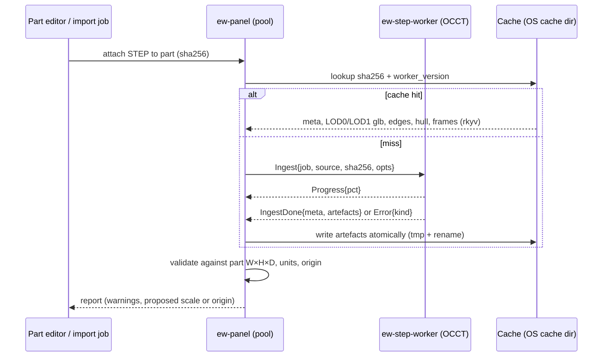

# Panel layout: 2D, 3D, routing, wire lengths and thermal: 3D, collision, routing, lengths, drilling and thermal

A chapter of [Panel layout: 2D, 3D, routing, wire lengths and thermal](12-panel-layout.md), whose table says where each section lives.

---

## 6. 3D scene, STEP pipeline and panel macros

### 6.1 Scene

`layout_scene(space)` derives one instance per visible solid: enclosure walls, doors, surfaces, carriers (parametric
prisms generated in `ew-panel`, never STEP), placements (mesh hash or box), keep-outs (hidden by default), routed
wires (polylines), unrouted wires as straight CP-to-CP lines (EPLAN's "connection diagram in 3D"; FR-LAY-064) and
the routing debug overlay. Instances carry the placement ID, the world pose (f32 relative to a
space-local origin to avoid precision loss) and a state (selected, colliding, stale). Repeated parts share one mesh
(the 20 PT 2.5-TWIN terminals of -X1031 are one mesh, 20 instances).

The **reconciler** (arch §8.5) keeps the GPU instance buffers and the parry3d BVH in step: it diffs successive
`Arc<Scene>` values by placement ID and applies insert, remove and refit. In debug builds it rebuilds from scratch
after each diff and compares (oracle), and the field-mask test guards new fields.

### 6.2 STEP import pipeline



- **Inputs** (FR-LAY-020): STEP AP214 and AP242 files, as vendors publish them (Phoenix Contact, Siemens, Schneider
  Electric, Festo, Rittal, Murrelektronik, Eaton); EPLAN `.e3d` data in EDZ packages is ignored in favour of STEP
  (FR-IMP-027).
- **Protocol** (`ew-step-proto`, length-prefixed postcard frames over stdio): `Hello{proto}`, `Ingest{job, source,
  sha256, opts{lin_defl, ang_defl, tri_budget, detect_features}}`, `Hlr{…}` (1.x), `ExportStep{…}` (FR-EXP-008),
  `Cancel{job}`, `Shutdown`. Replies `Progress`, `IngestDone`, `Error{Timeout | Parse | Memory | Crash}`.
- **Isolation** (NFR-REL-12): one or two pooled workers; per-job timeout (default 120 s), memory cap (job object on
  Windows, `RLIMIT_AS` on Unix; default 4 GiB), input size limit (default 200 MB), restart with back-off. A file hash
  that crashes the worker twice goes to a quarantine list and is not retried automatically. The IPC decoder has a
  fuzz target (NFR-SEC-03).
- **Build and licence.** The worker is the only binary that links OCCT and the only C++ in the build; it builds in
  its own CI job with cached OCCT artefacts (NFR-MAINT-09), sits on the `unsafe` allowlist (NFR-SEC-04) and ships
  as a replaceable binary with an LGPL source offer (NFR-LIC-08, C-6).
- **Outputs** (arch §8.6): assembly tree, LOD0 (display, capped at 200,000 triangles) and LOD1 (collision and far
  display, `tri_budget` default 20,000, meshopt 0.7.0), B-rep feature edges, bounding box, convex hulls (one, or a
  decomposition for L-shaped parts), detected rail-clip groove (a 35 mm groove on the back face), cylindrical holes
  and rectangular openings on the top and bottom faces.
- **Validation** (FR-LAY-021): the bounding box must match W×H×D within ±5 % in some axis permutation; a match at
  1/25.4 proposes scale 25.4 (inch file); the vendor transform is kept in `Model3dRef.vendor_transform` and the mesh
  is normalised to the EW part frame. Solids thinner than 0.3 mm (labels, markers) are tagged and excluded from
  collision.
- **Cache**: `<cache>/step/<sha256>/<worker_version>/` with `meta.json`, `lod0.glb`, `lod1.glb`, `edges.rkyv`,
  `hull.rkyv`, `frames.rkyv`. It is Class III: never model data, rebuildable, pruned by LRU. A cached reopen is a
  memory map plus rkyv validation (NFR-PERF-18: ≤ 1 s).
- **Licence** (FR-LAY-022, NFR-LIC-06): STEP files live in the user's model store, never in the project by default
  ([05](05-project-format-and-persistence.md) OQ8). A decimated LOD1 mesh is embedded as `assets/<sha256>.glb` only
  if the part's `embeddable` flag allows it. On a machine without the model the part renders as a box marked "model
  not available", with the re-download hint from `source_hint`.

### 6.3 Box fallback and the panel-macro editor

**Box macro** (FR-LAY-023). Without a STEP model, `placement_geometry` generates a box from W×H×D and spreads the
CPs over two faces in pin-list order: supply-side CPs on the top face, load-side CPs on the bottom face. The side is
chosen by a data table: odd/even terminal marking per IEC 60947-1 Annex L *(verify)* (1, 3, 5, 13 top; 2, 4, 6, 14
bottom), terminal side 1 top and side 2 bottom, PSU inputs L, N, PE on the bottom and outputs +, − on the top
*(heuristic, per part family)*, unknown on the bottom. The CP quality is `Generated`; every wire ending there carries `estimated_cp` in the wire list.

**Panel-macro editor** (FR-LAY-024, 1.0) edits the part copy's L3, L5 and L6 sections:

1. Load the LOD0 mesh or the box.
2. Origin and mounting: mount kind, rail offset; the detected groove is proposed and must be confirmed.
3. CP picking: click a face or a detected hole; the hit gives `pos`, the face normal or hole axis gives `dir`. The
   designation is drag-assigned from the part's function template, which lists each CP with level and clamp (for
   -102G1: L, N, PE, +#1, +#2, −#1, −#2). Clamp data fields follow.
4. Mapping table for spelling differences between macro and schematic (macro pins "Out 1" … "Out 4" against the
   schematic CPs "Out1" … "Out4" of -102F2, "24V" ↔ "+"), read by EW-LAY-005 (FR-LAY-027).
5. Drilling and cut-out sketch on a mounting face, keep-out boxes (prefilled from `clearance`), marker carriers.
6. Validation: EW-LAY-005 coverage, duplicate CPs, CP inside the solid (ray test), `dir` pointing out of the body.

Saving updates the project's part copy (undoable); "publish to library" writes the user or company library, which
is not undoable and asks for confirmation (arch §5.3). CP suggestions from detected holes are 1.x (FR-LAY-025).
EDZ connection-point and drilling patterns map into the same records when the user imports them (FR-IMP-027).

---

## 7. Collision and clearance

**Proxies per placement** (PM §6.4): L0 oriented box from W×H×D; L1 convex hull or hull compound from the worker;
L2 the LOD1 triangle mesh. Keep-outs are separate box proxies flagged soft. Carriers and enclosure walls are exact
parametric shapes.

**Pipeline** (parry3d 0.31.1; 0.31.0 is yanked):

1. Broad phase: one `Bvh` over L0 AABBs per layout space, refitted per changed leaf.
2. Allowed-contact filter: (placement, its carrier); (carrier, its surface); joined carriers (duct T-joints, rail on
   plate); neighbours on one rail with penetration ≤ 0.1 mm; members of one assembly; thin solids excluded.
3. Narrow phase: `intersection_test` on L1; L2 only where L1 intersects. Since 0.31 the result names the sub-shape,
   which the 3D view highlights (FR-LAY-028).
4. Clearance: `distance` between soft keep-outs and solids; EW-LAY-007 reports `required − actual` (FR-LAY-029).
5. Door closed (FR-LAY-030): door-surface placements posed at the closed door against plate placements and the
   enclosure interior; door cut-outs against the door's reinforcement keep-out.
6. Door swing (1.x, FR-LAY-031): sub-sweeps of at most 15° with `sweep_time_of_impact`, or 5° discrete steps as the
   fallback; EW-LAY-013 reports the first contact angle.

**Interaction.** While dragging, the dragged placement is tested against the BVH at L0 and L1 every frame and shown
as a red ghost on contact; full L2 results come at drag end (NFR-PERF-17). Findings are sorted by the pair of
placement IDs, so the message list is deterministic.

**MVP 2D overlap.** Before 3D exists, EW-LAY-006 tests footprint rectangles (plus clearance padding in rail direction)
per surface with an rstar index. The 1.0 implementation replaces it under the same rule ID.

---

## 8. Routing

### 8.1 Routing graph

`routing_graph(space)` is built on the routing fork (FR-LAY-042; PM §6.7). All node IDs are `v5(space, kind,
carrier, segment, index)`, so the graph is identical on every run.

| Element | Construction | Edge attributes |
|---|---|---|
| Duct centreline | per straight segment at mid-depth `z = plate + height/2`; nodes at every slot position | length; capacity = inner area × fill limit; class set; cost factor 1.0 |
| Slot nodes | both long sides, every `max(slot_pitch, 25 mm)` | slot → centreline edge of length width/2 |
| Joints | each T, corner and cross is expanded into one port node per incident segment; port-to-port edges carry the **bend penalty** (default 20 mm-equivalent ▲) for 90° turns, 0 for straight passes | — |
| CP stubs | per CP3D: escape 15 mm against `dir`, then an orthogonal plate-parallel run to the nearest slot node on a duct side facing the CP (top-face CPs prefer the duct above); line of sight checked by ray casts against the scene BVH, trying the next 8 slot nodes on failure | marked free-air; length; cost factor 1.0 within the stub |
| User paths | `RoutingPath` free-air segments (cost factor 1.5–3 ▲), hinge paths plate → door with loop allowance (default 300 mm), guides | class set |
| Cable entries | gland features of the gland surface (1.0) | entry nodes for cables leaving the space |
| Wiring holes | through-plate passages (1.x, FR-LAY-044) | front ↔ rear |

A blocked stub (no line of sight to any of 9 candidates) becomes a direct free-air edge with cost factor 3 and is
flagged; if even that intersects, the wire is EW-LAY-009. The reference set's graph has about 400 duct nodes and 150 stubs; a
2,000-wire cabinet stays under 10,000 nodes.

### 8.2 What is routed

| Object | Routed as | Notes |
|---|---|---|
| Physical wire (08 §3.8) | one route between its two CP3D stubs | Key = physical wire ID (the target-side connection UUID); through junctions and interruption-point pairs the decomposition of 08 applies, so W13 and W14 from F55:2 are two routes |
| Wire bridge (jumper wire) | a wire | — |
| Plug-in bridge | not routed | a bridge connection with its part (FR-TRM-007) |
| Multi-core cable inside the space (-106W1, -106W2) | one object with its outer diameter, from the centroid of end A's CPs to end B's connector CP; core breakouts added per core | length check EW-LAY-014 (FR-LAY-050) |
| Cable leaving the space (-3W1; the supply cable -101W1 of A-R, ▲U-20) | internal route to its cable entry; the external length is authored | FR-CBL-020 (§9) |
| Bus cable | as a cable with class `BUS` | -3W1 |
| Tube (1.x) | `RouteTubes` on the same graph with a fluid class mask ([11](11-fluid-power.md), FR-FLU-024) | — |

**Segregation** (FR-LAY-048). A wire's class is derived from its potential type, voltage and cable data
(`MAINS_AC` for L-1/N-1, `SELV_DC` for 24VDC-1, `BUS` for -3W1). A duct's `class_set` filters edges per wire; a
policy table states which classes may share a duct. EN 60204-1 permits mixing when insulated for the highest
voltage *(clause 13.1.3, unverified)*, so the default policy only separates `BUS` and `ANALOG_SHIELDED` from
`MAINS_AC`.

### 8.3 Path search

- **A\*** over the graph with **integer costs**: `cost(e) = length_nm(e) × factor_permille(e) / 1000 + bend +
  congestion`, all `u64`. The heuristic is the integer square root of the squared Euclidean distance in nm (squared
  in `u128`, since a 6 m bayed suite exceeds `u64`), which is admissible because every factor is ≥ 1.0 and bend and
  congestion terms are ≥ 0. The open set orders by `(f, h, node_id)`, and adjacency lists are sorted by node ID.
  Floats never decide a path, so results are identical across platforms, thread counts and record load order
  (NFR-REL-07).
- Because the `(f, h, node_id)` tie-break is part of the specification, EW keeps its own A\* (about 150 lines)
  rather than depending on the internal heap order of `pathfinding` 4.16.0's `astar`.
- **Alternatives** for one wire: Yen k-shortest paths (k = 3) on request in the wiring manager (FR-LAY-045), via
  `pathfinding::yen` over the same sorted successor lists *(determinism to verify in the shuffle-order test)*.

### 8.4 Negotiated congestion

After PathFinder (PM §6.7), deterministic:

```text
order = wires sorted by (csa × estimated_length desc, wire_id asc)
h[e] = 0
for iter in 1..=max_iter (policy 3..10, default 8):
    p_fac = p0 × 1.5^(iter-1)                         // fixed-point permille
    for w in order:
        if w is pinned: path[w] = override path; continue
        if iter > 1 and path[w] uses no overflowed edge: continue
        rip_up(w)
        cost_w(e) = base(e) × (1 + h[e]) × (1 + p_fac × over(e, w))
        //  over(e, w) = max(0, occ[e] + area(w) − cap[e]) / cap[e]
        path[w] = astar(stub_a(w), stub_b(w), cost_w, class_mask(w))   // None → EW-LAY-009
        add(w)
    overflow = Σ max(0, occ[e] − cap[e])
    if overflow == 0: break
    for e with occ[e] > cap[e]: h[e] += h_inc × (occ[e] − cap[e]) / cap[e]
    if overflow did not fall in 2 iterations: break
report EW-LAY-008 for every edge still over its error limit
```

Wire areas are integer µm² with π/4 ≈ 355/452. Wires are routed sequentially within an iteration, which keeps the
algorithm faithful to PathFinder; graph construction and stub ray casts run on rayon. If the M4 benchmark misses
NFR-PERF-16, the fallback routes each iteration in parallel against the occupancy at iteration start, followed by a
sequential repair pass. Both are thread-count independent.

### 8.5 `RouteWires`, committed routes and staleness

- `RouteWires{scope, options}` is `Cost::Bulk`: it builds the graph on a fork, routes, computes lengths and returns
  a preview (changed lengths, new findings, fill heat-map). Accept commits `committed_route` records (FR-LAY-046).
  Routing is never in the interactive path (arch §16).
- **Input hash per wire** = SHA-256 over the canonical encoding of: both end CP3D world positions and directions
  (pose chain, part geometry hash), the wire's routing properties (OD, class, csa), the geometry hashes of the
  carriers and routing paths on its committed path, its `RouteOverride`, and the routing and length policy. Other
  wires are excluded on purpose: moving -102F2 stales only the wires at -102F2 (EW-LAY-011), not the cabinet.
- **Fill is recomputed** online from the committed routes (`duct_fill`), so a re-route of one wire updates EW-LAY-008
  immediately.
- **Overrides** (FR-LAY-047): a pinned path is used verbatim; a broken pinned path (deleted duct) yields EW-LAY-009
  with reason "pinned path broken" and keeps the override for the user to repair.
- **Release** (FR-MFG-025): the pre-delivery scheme fails while any EW-LAY-011 or EW-LAY-009 finding is open.

### 8.6 Duct fill

`fill(e) = Σ_{w on e} (π/4)·OD_w² / A_inner(e)` per centreline edge (FR-LAY-049). OD comes from the wire part; a
default OD table *(unverified: H05V-K 0.75 ≈ 2.7 mm, H07V-K 1.5 ≈ 3.3 mm)* is flagged in every result. Inner area
comes from the duct part, else 0.85 × nominal. Example: a 40×60 duct without inner data has 2,040 mm²; 30 H05V-K
0.75 wires at the default 2.7 mm occupy 171.8 mm², a fill of 8.4 % with the "default OD" flag. Limits are shop
policy, defaulting to 60 % warning and 80 % error (PQ-22). The 3D view and the 2D page show the fill as a
heat-map with numeric labels and pattern classes (§12.4).

### 8.7 Bundles and wiring sequence

Derived by default by `bundle_sequence(space)` (FR-LAY-054; PM §6.9): group by (start strip or device) × (first
duct entry node); split above
the maximum bundle size; order bundles bottom to top; within a strip the lower level first; long before short in
the same duct; door wiring last. `bundle.seq` numbers are derived; `RouteOverride.bundle/seq` overrides survive
re-routing.

### 8.8 Wiring manager

A table per layout space (FR-LAY-055): wire number, ends (DT:CP level/clamp), route as duct names (D1 → D2 → D4),
length and source, bundle, maximum fill along the route, status (fresh, stale, unrouted, pinned). Selecting rows
and "re-route" runs `RouteWires{scope: Wires(ids)}`, a previewed transaction for those wires only.

---

## 9. Wire lengths

**Formula** (FR-LAY-051; PM §6.8):

`L_raw = stub_A + path + stub_B + Δz_A + Δz_B + a_A + a_B + reserve + Σ family offsets`
`L_cal = L_raw × calibration`, stored unrounded in the committed route; `L_out = ⌈L_cal / increment⌉ × increment`,
computed once, when the `WireRecord` is built ([13](13-manufacturing-outputs.md) §3.3, FR-MFG-051)

| Term | Source |
|---|---|
| `stub` | CP escape plus the plate-parallel run to the slot (§8.1) |
| `path` | graph edges along centrelines, including the slot entries, joints and user paths |
| `Δz` | height of the CP above the plate minus the duct mid-depth, per end; forgetting it gives systematically short wires (PM §11 pitfall 4) |
| `a` | per-end allowance: `strip_len + insertion_depth + bend allowance` (default 2 × OD, policy) |
| `reserve` | `MfgSettings.reserve` ([03](03-domain-model.md) §17): fixed (default 100 mm) or proportional, plus a door extra and the hinge loop allowance |
| family offset | per device family, from calibration (FR-LAY-052) |
| `increment` | `MfgSettings.length_increment`: one project increment (default 10 mm); machine profiles only declare their resolution and never re-round (FR-MFG-051) |

All terms are `Nm`; the calibration factor is a rational (`1030/1000`). Every length carries a `LengthBreakdown`
and a source, aligned with `LengthSource` of [08](08-connections-terminals-cables.md) §7.6: `Routed`, `Estimated`
(FR-LAY-053), `Manual` (`WireOverrides.length`, §2.2), `FromPart` (cores of pre-assembled cables such as -106W1)
or `Missing`.

**Worked example** (PM §6.8 inputs, illustrative geometry): W29, -102F2:Out1 → -X1031:1 clamp a, potential
24VDC-1.

| Term | Value |
|---|---|
| Stub A (escape 15 + run 30) | 45 mm |
| Δz A (CP 95 mm above plate − duct mid-depth 30) | 65 mm |
| Path (top duct 140 + left duct 260 + middle duct 90) | 490 mm |
| Stub B (15 + 25) | 40 mm |
| Δz B (60 − 30) | 30 mm |
| Allowances 2 × (10 strip + 2 insertion + 6 bend) | 36 mm |
| Reserve | 100 mm |
| **L_raw** | **806 mm** in the committed route → **810 mm** in the `WireRecord` at the 10 mm project increment |
| With calibration 1.03 | 830.18 mm → **840 mm** |

**Estimated lengths** (FR-LAY-053, HMW-13). Without CP3D data or with an incomplete duct network, each end is the
footprint centre of the placement projected to the nearest duct side of the 2D plate layout, with a default stub
(50 mm ▲) and default Δz (device depth / 2 − duct mid-depth); path search is the same A\* on the 2D duct graph.
Source `Estimated`, flagged in the wire list and blocking only machine profiles that demand routed lengths
(EW-MFG pre-flight, FR-MFG-024).

**Cable lengths** (FR-CBL-010). A shop-cut cable fully inside the space takes `Routed` from its committed route. A
pre-assembled cable keeps `FromPart` (-106W1, -106W2: 2 m ▲); its route only feeds EW-LAY-014. For a cable that leaves
the space, the routed internal part to the cable entry is added to the authored external length; the length source
shows both (FR-CBL-020).

---

## 10. Surface features, drilling and cut-outs

`surface_features(surface)` aggregates per surface side (FR-LAY-056; PM §6.11):

| Origin | Features |
|---|---|
| Placement | the part's `FeaturePattern` transformed to the surface (screw-mounted modules, door devices: Ø 22.3 mm for 22 mm operators *(unverified)*, rectangular cut-outs with corner radius for fans and HMIs) |
| Carrier fixing | rail and duct fixing holes or tapped holes at the policy pitch (default 300 mm ▲) along the path, with end margins |
| Enclosure | gland holes on gland surfaces (metric glands: M20 ≈ 20.5 mm *(unverified)*) |
| User | `SurfaceFeature` records |

Feature IDs are derived (`H1 … Hn` sorted by tool class, then v, then u). Two devices sharing one fixing produce one
merged hole (info); a web below the minimum, a hole closer to the edge than the minimum web, or a hole under another
device raises EW-LAY-012 (FR-LAY-057). Tap-drill cores M4 3.3, M5 4.2, M6 5.0 mm *(unverified)* are data.

**Outputs** (owned with [13](13-manufacturing-outputs.md)): DXF per surface (FR-MFG-028: CIRCLE for holes, closed
LWPOLYLINE for cut-outs, one layer per tool or feature class such as `DRILL_4.2`, `TAP_M5`, `CUT`, the outline on its
own layer, origin at the machine datum corner, `$INSUNITS = 4`, AC1015, an EPLAN 802–805 layer preset), the hole
table per surface (FR-MFG-029) and the cut list of rails, ducts and busbars (FR-MFG-030). All three read
`surface_features` and carrier paths, so the DXF, the drilling drawing and the hole table cannot disagree. NC
formats (Perforex, Steinhauer) and the RiPanel AML dialect stay Later (PARK-09).

---

## 11. Thermal calculation

Thermal sizing is a calculation, not a simulation (PM §1 point 7). It runs per layout space as a Class II job
`thermal(space)`; the result carries its revision and shows a stale badge after any relevant edit (FR-THM-008).
At 1.0 it covers one compartment; multi-compartment is 1.x (FR-THM-010), forced-ventilation curves Later
(FR-THM-011).

### 11.1 Inputs

`ThermalInputs` (FR-THM-005) per layout space, defaulted from the project: `t_u_max`, `t_u_min` (ambient),
`t_i_max`, `t_i_min` (internal target and minimum), `altitude`, enclosure material and `k_w` (W/(m²·K), from the
enclosure part), installation context (§3.1), simultaneity factor (RDF), the selected method and the coefficient
set reference. All temperatures and powers are `Dec3`.

### 11.2 Power loss Q_V

`Q_V = Σ_placed P_eff + P_conductors + P_busbars` (FR-THM-001, FR-THM-002). Each term lists its source (part data,
load model, simultaneity default, rated-value default).

| Loss model (part thermal section) | P_eff | Typical parts |
|---|---|---|
| `Quadratic{p_n, i_n}` (default, FR-THM-001) | `p_n × (I_b / i_n)²` | MCBs, switches, contactors, terminals |
| `Efficiency{eta}` (FR-THM-001) | `P_out × (1/η − 1)` with P_out from the load model of the output potential | PSUs (-102G1), drives |
| `Constant{p, duty}` | `p × duty` | electronics, lamps (E56 duty 0), fans |
| `PerChannel{p_on, on_fraction}` | `channels × p_on × on_fraction`, counting positions in state `used` | valve coils of -201U3 … -202U2 |
| `Heater` | excluded from Q_V; used for heating capacity | E55 |

`I_b` comes from the load model (`load_summary`, FR-REP-026) where available, else simultaneity × rated current,
else the rated current (conservative). Conductor losses use routed length × loss per metre from a user-supplied
IEC 61439-1 Annex H table (*verify table*); unrouted wires use estimated lengths and are flagged.

### 11.3 Effective cooling surface A_e

`A_e = Σ_faces A_0 × b(exposure)` (FR-THM-003), with exposure of each face taken from the scene: the back face is
covered by `wall_behind`, the top by `ceiling_above`, sides by bayed neighbours; the floor is not counted. The b
factors are data *(secondary sources: exposed top 1.4, covered top 0.7, exposed side 0.9, covered side 0.5;
verify)*. These factors reproduce the handbook's installation-type formulas, e.g. wall-mounted single:
`1.4·W·(H+D) + 1.8·D·H`. Example: 1.4 × 0.75 × 1.42 + 1.8 × 0.42 × 1.0 = **2.25 m²**.

### 11.4 Methods

| Method | Computation | Data | Report wording |
|---|---|---|---|
| IEC 61439-1 10.10.4.2 (single compartment, InA ≤ 630 A) | Q_V against the enclosure's dissipation capability at the allowed rise; conditions recorded: every device at I_b / I_n ≤ 0.8 (computed), losses evenly distributed and air circulation unimpeded (confirmed by the user) | Manufacturer dissipation data (enclosure part) | "Design verification by calculation, 10.10.4.2" |
| IEC TR 60890 (FR-THM-004; enclosures without forced ventilation) | `Δt_0.5 = d · k · Q_V^x`; `Δt_1.0 = c · Δt_0.5`; profile through both | Coefficient set `{k(A_e, vents), c(A_e, f, vents), x, d}` supplied by the user or vendor, never shipped; the figures split at A_e ≤ / > 1.25 m², x = 0.804 / 0.715 unventilated (STD §8.2), f = h^1.35 / A_b (height, base area) *(all unverified)* | "IEC TR 60890 method, coefficients user-supplied" |
| Surface balance (climate sizing) | `ΔT_mean = Q_V / (k_w · A_e)` | `k_w` of the enclosure material | "Mean temperature rise, enclosure surface method" |

The TR's enclosure constant k (from its figures) and the wall coefficient `k_w` are different quantities; EW keeps
them in different fields (FR-THM-004). EW ships only a **synthetic test set** for CI, labelled as not taken
from the TR (NFR-LIC-06).

### 11.5 Temperature at mounting height

Each placement gets `T_air(h) = t_u_max + Δt(h_rel)`, with `h_rel` = top edge of its bounding box over the internal
height (conservative; centre by policy). `Δt(h_rel)` is piecewise linear through (0.5, Δt_0.5) and (1.0, Δt_1.0);
below mid-height the coefficient set's profile shape applies, and without one EW holds Δt_0.5 constant and flags
"default profile shape". EW-THM-001 reports a device whose `t_amb_max` is below `T_air` (FR-THM-006).

### 11.6 Climate devices

| Device | Formula (FR-THM-007; STD §8.2) |
|---|---|
| Filter fan | `V = f · Q_V / (t_i_max − t_u_max)`, f = 3.1 / 3.2 / 3.3 / 3.4 / 3.5 m³·K/Wh for 0–100 / –250 / –500 / –750 / –1000 m |
| Cooling unit | `Q_E = Q_V − k_w · A_e · (t_i_max − t_u_max)` |
| Air/air heat exchanger | `q_W = Q_E / (t_i_max − t_u_max)` W/K |
| Heater | `Q_H = k_w · A_e · (t_i_min − t_u_min)` |

Proposals filter climate-device parts by capacity at the rating point, air flow, cut-out size and admissible
surface. `PlaceClimateDevice` creates the device, its placement (door, side or roof), its cut-out (derived from the
part pattern, §10) and its loss entry, and marks the thermal result stale.

### 11.7 Report

`thermal_report(space)` (FR-THM-009) lists per device P_n, I_b, model, P_eff and source; Q_V; enclosure data and
A_e with face exposures; Δt at 0.5 and 1.0 of the height; per-placement air temperature; the climate result and
proposal; the method, the coefficient set with its `verified` flag, every data source, and the NFR-COMP-04 statement
that the calculation does not replace verification by a competent person. It feeds the IEC 61439 design
verification record (FR-MFG-041).

### 11.8 Thermal findings

Severities as registered in [15](15-checks-revisions-collaboration.md) §4.6:

| Rule | Finding | Severity | Release |
|---|---|---|---|
| EW-THM-001 | Device ambient limit below predicted air temperature at its height (FR-THM-006) | error | 1.0 |
| EW-THM-002 | Required cooling or heating not covered by the placed climate devices (FR-THM-007, FR-THM-012) | error | 1.0 |
| EW-THM-003 | Placed device without loss data; result marked incomplete (FR-THM-012) | warning | 1.0 |
| EW-THM-004 | Unverified or test coefficients used in a release (FR-THM-012) | warning (release) | 1.0 |
| EW-THM-005 | Thermal result stale at release; supersedes EW-REL-002 for thermal results (FR-THM-012) | error (release) | 1.0 |
| EW-THM-006 | 10.10.4.2 conditions not met: a component above 80 % of its free-air rating, or InA above 630 A | warning | 1.0 |
| EW-THM-007 | Method not applicable: horizontal partitions treated as one compartment (FR-THM-010 is 1.x) | warning | 1.0 |

---

## 12. UI and UX touchpoints

Persona P1 (engineer) works through journey J3 ([00](00-vision-and-scope.md) §6); P2 (wireman) sees the results in
the wiring viewer ([13](13-manufacturing-outputs.md)). Shell, docking and keymaps are [16](16-ux-ui.md)'s.

### 12.1 2D layout editing (MVP)

| Tool | Behaviour |
|---|---|
| Place from list | drag a device from the unplaced list (FR-LAY-013) onto a rail or surface; ghost shows snap result, overlap and push effect; release commits |
| Move | drag with snapping; Shift suspends snapping; push and swap by modifier keys (EPLAN-like preset); arrow keys nudge by the snap step |
| Rotate, flip | R rotates 90° (surface items), X flips (rail items), the same keys as rotate and mirror on schematic pages ([06](06-schematic-editor.md)) |
| Draw rail, draw duct | two clicks or an orthogonal polyline; length and offsets editable in the property grid |
| Place strip, place assembly, auto-fill rail | §3.4, §3.3 |
| Lock | lock icon; locked items stop push |

The property grid of a placement shows device (link), realised part, carrier, s or (u, v) in mm, rotation, lock,
and derived rows with provenance: label, footprint, clearance, findings. Selection is synchronised with the device
navigator and with schematic pages ("show all representations", FR-UI-007).

A refused drop writes in the
status bar the words its ghost's chip showed: a rail device beside every rail ("-102F1 sits on rail 1 and mounts on a
TS 35×7.5 rail, so it moves along a rail only: drag it along rail 1 or onto another rail"; a device not placed yet: "F55
mounts on a TS 35×7.5 rail; drop it on a rail."), a rail of another profile ("F55 mounts on a TS 35×7.5 rail and does
not fit rail 4: drop it on a TS 35×7.5 rail."), else the command's own refusal ("No gap on rail 1 is wide enough for
F55 (300 mm)."). The plain "The drop is refused; nothing changed" is left for a drop with no words.

Auto-fill rail's dialog, with no device marked and none unplaced in the cabinet's space, says why:
every device of the location is placed already, or no device has the location yet and N mountable devices have none
(`ew_derive::layout::unlocated`: no location, mountable by steps 2 to 9 of §2.7, no placement). Its button "Give the N
devices without a location +CAB1 and place them" sets their `structure.location` in one `fields.set` (its own undo
step) and fills the rail.

### 12.2 3D canvas (1.0)

- **Camera:** orbit about the picked point, pan, zoom to cursor, standard views (front, top, side, iso),
  orthographic/perspective toggle, fit all and fit selection (FR-UI-029).
- **Picking:** CPU ray cast against the parry3d BVH (L1, then L2), deterministic and without GPU read-back; hover is
  throttled to one ray per frame. Picks resolve to placement, carrier, CP3D or feature.
- **Gizmo:** transform-gizmo-egui in `ew-ui`, constrained to the carrier's degrees of freedom through
  `ew-render3d`'s constraint API: a rail placement shows one axis
  and snaps exactly like the 2D tool (FR-UI-029 acceptance); surface items show two axes and a 90° rotation ring;
  door items a free ring.
- **Display:** enclosure transparency slider, door open/closed, layer filters (enclosure, carriers, devices, wires,
  keep-outs, routing graph), collision markers on the violating sub-shape, routed wires with the selected wire
  highlighted end to end, unrouted wires as straight lines (FR-LAY-064), duct fill heat-map.
- **Rendering:** forward pass with MSAA ×4, flat shading with a hemispheric light, B-rep feature edges as
  screen-space lines, weighted blended transparency for the enclosure shell, frustum culling and LOD by projected
  size (LOD1 below 40 px, box below 8 px).

### 12.3 Panels

Layout navigator (space → enclosure → surfaces → carriers → placements, FR-UI-006), unplaced-devices list, wiring
manager (§8.8), routing preview (diff of lengths and findings, accept/cancel, FR-UI-022), thermal panel (inputs,
results, per-device table, proposals, stale badge, FR-UI-024), panel-macro editor (§6.3). The Panel 3D workspace
groups them (FR-UI-003).

### 12.4 Accessibility and degraded hosts

- No meaning in colour alone (NFR-A11Y-03): collisions are red plus hatch plus icon; fill classes carry pattern and
  percentage text; stale lengths carry a badge and the text "re-route pending".
- Keyboard placement (NFR-A11Y-01): Tab cycles placements in `carrier_order`, arrows move by snap step, Enter opens
  the property grid. The live region announces "-102F1, MCB, rail R1 at 158 mm, no findings" (NFR-A11Y-02; with
  -102G1's clip point at s = 96 mm as in §2.3, clip points at the part centres, no lateral clearance, a 70 mm PSU
  and two 18 mm MCBs, all widths *(unverified)*).
- GPU-less hosts (NFR-PLAT-03): 3D runs on DX12 WARP or a software Vulkan adapter where one exists, with LOD1 or
  boxes only and frames rendered on demand; otherwise the 3D canvas is disabled with an explanation. The 2D panel
  pages stay fully available on the CPU renderer.

---

## 13. Performance budgets

Budgets hold on the baseline machine BM (4-core 2018+ x64, 8 GB RAM, integrated GPU with DX12/Vulkan,
1920×1080, local SSD) and are gated nightly (NFR-PERF-20, ADR-0022).

| Operation | Budget | Requirement | Design measure |
|---|---|---|---|
| Drag on a rail of 60 placements | frame ≤ 16 ms; snap ≤ 0.5 ms | NFR-PERF-04 | memoised `rail_occupancy`, binary search; no commit during drag |
| Commit a placement incl. online layout checks | p99 ≤ 5 ms at M | NFR-PERF-05, NFR-PERF-09 | checks keyed per surface and carrier; layer-scoped display lists |
| Folio 902 rebuild after a move | `placements` + `labels` layers only | NFR-PERF-04 | early cut-off keeps `frame`, `tables` GPU buffers |
| 3D view, 10,000 instanced placements | ≥ 30 fps | NFR-PERF-17 | instancing, culling, LOD by projected size |
| Drag feedback in 3D | inside the 16 ms frame | NFR-PERF-17 | BVH leaf refit; L0/L1 only |
| Full collision, 500 placements | ≤ 10 ms after drag end | NFR-PERF-17 | hull narrow phase, mesh only on hull hits, rayon over pairs |
| `RouteWires`, 2,000 wires | ≤ 5 s | NFR-PERF-16 | < 10k nodes, integer A\*, ≤ 10 iterations, rip-up only on overflow |
| Re-route one wire | ≤ 50 ms | NFR-PERF-16 | A\* against committed occupancy and history |
| STEP import 20 MB / cached reopen | ≤ 30 s / ≤ 1 s | NFR-PERF-18 | worker pool; rkyv memory-mapped cache |
| Thermal recalculation, 500 placements | ≤ 200 ms | NFR-PERF-23 | one pass over placements; coefficient lookups |
| Project open with layout | inside NFR-PERF-03 | NFR-PERF-03 | meshes load lazily on first 3D view; layout records are small |
| Memory | mesh cache LRU 512 MB ▲; GPU one mesh per unique part | NFR-PERF-13 | Class III cache outside the model |

---

## 14. Outputs

| Output | Source query | Release | Consumers |
|---|---|---|---|
| PanelLayout pages (folio 902), PDF/SVG/PNG | `page_display_list` with the panel layers (§5.2) | MVP | `ew export pdf`, print |
| Placement legend, PART DATA, mounting list | `layout_legend`, `device_part_lines` | MVP (embedded) / 1.0 (page reports, FR-REP-023) | pages, XLSX, CSV |
| BOM lines for enclosure, plate, rails, ducts, brackets | carriers, group accessories | MVP | `bom_rows` (FR-REP-007, D-04) |
| Model views | `layout_scene`, cached part projections | 1.0 | pages |
| Routes, lengths, bundles, route as duct names | committed routes, `wire_length` | 1.0 | WireRecord, machine profiles, `.ewpp` ([13](13-manufacturing-outputs.md)) |
| Surface DXF, hole tables, cut lists | `surface_features`, carriers | 1.0 | FR-MFG-028 … 030 |
| glTF (`.glb`, node names = placement UUIDs, DT and part in extras) and STL per layout space | `layout_scene`, written by `ew-panel` | 1.0 | FR-EXP-007, `.ewpp` layout member, wiring viewer |
| STEP AP242 assembly named by DTs | worker `ExportStep` | 1.0 (Could) | FR-EXP-008 |
| Thermal report | `thermal(space)` | 1.0 | FR-THM-009, design verification record |
| SQL view `api_v1_placement` | projection | 1.0 | user reports, MCP (FR-EXT-007) |

Every output is deterministic: no wall-clock times, members and rows in derived order (NFR-REL-07).

---

## 15. Edge cases and pitfalls

1. **Treating the layout as a drawing.** Users will "just draw a rectangle". Free graphics are allowed on layout
   pages but never count in the BOM or in EW-LAY-001 (FR-LAY-008).
2. **Vendor origins and units.** Normalise to the rail-clip origin, keep the vendor transform, validate against
   W×H×D, detect inch files (FR-LAY-021).
3. **Snap clips penetrate rails** in vendor models: exclude by the allowed-contact rule, not by tolerance.
4. **Strip growth.** A terminal added on folio 103 lengthens -X1031 silently in many tools; EW recomputes and
   reports overflow (EW-LAY-010).
5. **Two meanings of "carrier".** [08](08-connections-terminals-cables.md) §3.8 calls the connection that holds a
   physical wire's number its "carrier connection"; the layout `Carrier` is a rail or duct. Routes key on the
   physical wire ID, never on the layout carrier.
6. **TWIN clamps.** "-X1031:1+" alone does not say which clamp; wire ends name level and clamp, and CP3D has one
   entry per clamp (PM §4.4).
7. **Δz and default ODs** make lengths too short and fill too optimistic; both are explicit terms and flags.
8. **Non-determinism** changes machine files on every regeneration. Integer costs, sorted adjacency, UUID tie-breaks
   and a shuffle-order CI test prevent it.
9. **Overrides lost on regeneration.** Pins, bundles, manual lengths and locks are keyed by UUID and survive.
10. **Concurrent edits.** Two branches that both place on rail R1 merge cleanly record by record and overlap
    afterwards; the post-merge integrity check reports EW-LAY-006 (ADR-0012).
11. **Copy-paste between projects** remaps carrier IDs; a placement whose carrier did not come along is re-homed to
    the target surface and reported (EW-LAY-010).
12. **Thermal with missing data.** A device without loss data would make Q_V optimistic; EW reports EW-THM-003 and
    marks the result incomplete instead of assuming zero.
13. **Heaters and door lamps.** Thermostat-controlled heaters (E55, setpoint 15 °C on T55) are not losses in the
    summer case; door lamps (E56) have duty 0 by default.
14. **Scope creep into MCAD.** No free-form solid modelling: enclosure changes are surface features, not B-rep
    booleans (PM §11 pitfall 12).
15. **Huge STEP assemblies** (drives with 200k–2M triangles *(unverified)*): LOD1 budget and the worker's memory cap
    keep them bounded; the part shows as a box with a warning if decimation fails.

---

## 16. Defects prevented

The tests open the sample project (`fixtures/sample/`).

### 16.4 Defects prevented

| Defect | Class | Mechanism here |
|---|---|---|
| D-02 T51 vs T55; free rectangles | S | Placements reference devices; labels are `layout_label`; EW-LAY-002 |
| D-32 layout incomplete, not to scale | S + C | True-scale projection with the scale in the title block; EW-LAY-001 and the unplaced list |
| D-04 BOM without enclosure, plate, ducts, rails, brackets | S | Carriers and group accessories are BOM lines from the layout (FR-LAY-004, -005, -008) |
| D-01 stale tags after renumber | S | Labels and legend are derived; layout files untouched by renumbering |
| D-03 "+JE2416" vs "+J-E-2416" | S | One structure node; identifier suppression prints "-X1031" |
| D-21 PE continuity not drawn | C | MVP: rail-bonded terminals join the location PE node ([08](08-connections-terminals-cables.md) §3.7); 1.0: `pe_bond` on rails and plate, continuity through carriers (FR-CHK-029) |
| D-19 missing lengths | C | Routed, estimated or manual lengths with source; release gate on missing and stale lengths |
| D-29, D-31 shrunk label text | S + C | Paper-height label styles; rotate, leader or balloon, never shrink |
| D-05, D-06 title-block drift on 902 | S | Layout pages are ordinary pages with bound title blocks |
| D-10 overview vs layout order | S + C | Assembly members placed in `Device.position` order; EW-LAY-016 |

