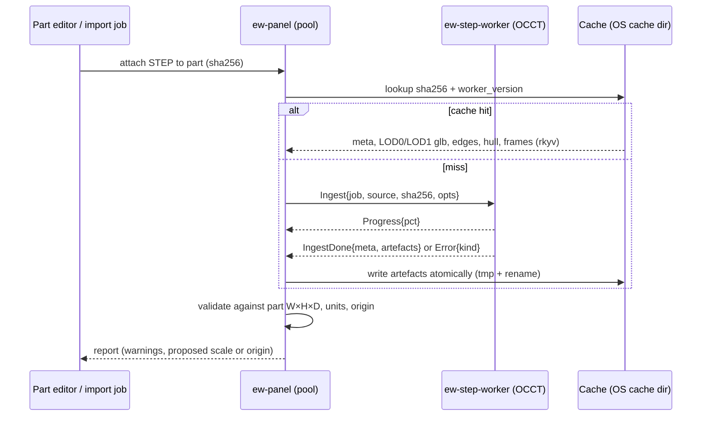

# Panel layout: 2D, 3D, routing, wire lengths and thermal: 3D, collision, routing, lengths, drilling and thermal

A chapter of [Panel layout: 2D, 3D, routing, wire lengths and thermal](12-panel-layout.md), whose table says where each section lives.

---

## 6. 3D scene, STEP pipeline and panel macros

### 6.1 Scene

`layout_scene(space)` derives one instance per visible solid: enclosure walls, doors, surfaces, carriers (parametric
prisms generated in `ew-panel`, never STEP), placements (mesh hash or box), keep-outs (hidden by default), routed
wires (polylines), unrouted wires as straight CP-to-CP lines (EPLAN's "connection diagram in 3D"; FR-LAY-064) and
the routing debug overlay. Instances carry the placement ID, the world pose (f32 relative to a
space-local origin to avoid precision loss) and a state (selected, colliding, stale). Repeated parts share one mesh
(the 20 PT 2.5-TWIN terminals of -X1031 are one mesh, 20 instances).

The **reconciler** (arch §8.5) keeps the GPU instance buffers and the parry3d BVH in step: it diffs successive
`Arc<Scene>` values by placement ID and applies insert, remove and refit. In debug builds it rebuilds from scratch
after each diff and compares (oracle), and the field-mask test guards new fields.

### 6.2 STEP import pipeline



- **Inputs** (FR-LAY-020): STEP AP214 and AP242 files, as vendors publish them (Phoenix Contact, Siemens, Schneider
  Electric, Festo, Rittal, Murrelektronik, Eaton); EPLAN `.e3d` data in EDZ packages is ignored in favour of STEP
  (FR-IMP-027).
- **Protocol** (`ew-step-proto`, length-prefixed postcard frames over stdio): `Hello{proto}`, `Ingest{job, source,
  sha256, opts{lin_defl, ang_defl, tri_budget, detect_features}}`, `Hlr{…}` (1.x), `ExportStep{…}` (FR-EXP-008),
  `Cancel{job}`, `Shutdown`. Replies `Progress`, `IngestDone`, `Error{Timeout | Parse | Memory | Crash}`.
- **Isolation** (NFR-REL-12): one or two pooled workers; per-job timeout (default 120 s), memory cap (job object on
  Windows, `RLIMIT_AS` on Unix; default 4 GiB), input size limit (default 200 MB), restart with back-off. A file hash
  that crashes the worker twice goes to a quarantine list and is not retried automatically. The IPC decoder has a
  fuzz target (NFR-SEC-03).
- **Build and licence.** The worker is the only binary that links OCCT and the only C++ in the build; it builds in
  its own CI job with cached OCCT artefacts (NFR-MAINT-09), sits on the `unsafe` allowlist (NFR-SEC-04) and ships
  as a replaceable binary with an LGPL source offer (NFR-LIC-08, C-6).
- **Outputs** (arch §8.6): assembly tree, LOD0 (display, capped at 200,000 triangles) and LOD1 (collision and far
  display, `tri_budget` default 20,000, meshopt 0.7.0), B-rep feature edges, bounding box, convex hulls (one, or a
  decomposition for L-shaped parts), detected rail-clip groove (a 35 mm groove on the back face), cylindrical holes
  and rectangular openings on the top and bottom faces.
- **Validation** (FR-LAY-021): the bounding box must match W×H×D within ±5 % in some axis permutation; a match at
  1/25.4 proposes scale 25.4 (inch file); the vendor transform is kept in `Model3dRef.vendor_transform` and the mesh
  is normalised to the EW part frame. Solids thinner than 0.3 mm (labels, markers) are tagged and excluded from
  collision.
- **Cache**: `<cache>/step/<sha256>/<worker_version>/` with `meta.json`, `lod0.glb`, `lod1.glb`, `edges.rkyv`,
  `hull.rkyv`, `frames.rkyv`. It is Class III: never model data, rebuildable, pruned by LRU. A cached reopen is a
  memory map plus rkyv validation (NFR-PERF-18: ≤ 1 s).
- **Licence** (FR-LAY-022, NFR-LIC-06): STEP files live in the user's model store, never in the project by default
  ([05](05-project-format-and-persistence.md) OQ8). A decimated LOD1 mesh is embedded as `assets/<sha256>.glb` only
  if the part's `embeddable` flag allows it. On a machine without the model the part renders as a box marked "model
  not available", with the re-download hint from `source_hint`.

### 6.3 Box fallback and the panel-macro editor

**Box macro** (FR-LAY-023). Without a STEP model, `placement_geometry` generates a box from W×H×D and spreads the
CPs over two faces in pin-list order: supply-side CPs on the top face, load-side CPs on the bottom face. The side is
chosen by a data table: odd/even terminal marking per IEC 60947-1 Annex L *(verify)* (1, 3, 5, 13 top; 2, 4, 6, 14
bottom), terminal side 1 top and side 2 bottom, PSU inputs L, N, PE on the bottom and outputs +, − on the top
*(heuristic, per part family)*, unknown on the bottom. The CP quality is `Generated`; every wire ending there carries `estimated_cp` in the wire list.

**Panel-macro editor** (FR-LAY-024, 1.0) edits the part copy's L3, L5 and L6 sections:

1. Load the LOD0 mesh or the box.
2. Origin and mounting: mount kind, rail offset; the detected groove is proposed and must be confirmed.
3. CP picking: click a face or a detected hole; the hit gives `pos`, the face normal or hole axis gives `dir`. The
   designation is drag-assigned from the part's function template, which lists each CP with level and clamp (for
   -102G1: L, N, PE, +#1, +#2, −#1, −#2). Clamp data fields follow.
4. Mapping table for spelling differences between macro and schematic (macro pins "Out 1" … "Out 4" against the
   schematic CPs "Out1" … "Out4" of -102F2, "24V" ↔ "+"), read by EW-LAY-005 (FR-LAY-027).
5. Drilling and cut-out sketch on a mounting face, keep-out boxes (prefilled from `clearance`), marker carriers.
6. Validation: EW-LAY-005 coverage, duplicate CPs, CP inside the solid (ray test), `dir` pointing out of the body.

Saving updates the project's part copy (undoable); "publish to library" writes the user or company library, which
is not undoable and asks for confirmation (arch §5.3). CP suggestions from detected holes are 1.x (FR-LAY-025).
EDZ connection-point and drilling patterns map into the same records when the user imports them (FR-IMP-027).

---

## 7. Collision and clearance

The cabinet is judged in 2D and by number: a footprint is a rectangle on its surface (§2.6), and how far a thing
stands out of its surface is a number. Collision of solids comes with the 3D view (§6).

| Rule | What it reports | Severity |
|---|---|---|
| EW-LAY-006, on a surface | two footprints that overlap, a footprint and a duct, a rail and a duct (§4) | error |
| EW-LAY-006, the closed door | a device or a duct of the plate that reaches the closed door, and a device of the plate and one of the door that meet when it is closed | error |
| EW-LAY-007 | a footprint or a duct inside the room a device's part asks to keep free | warning |

**The room a part keeps free.** A part's clearance (`mech.clearance`: top, bottom, left, right, front;
[07](07-symbols-parts-macros.md) §2.5) is what its maker asks to keep free around it, for heat, for an arc or for a
hand. Its zone on the surface is the footprint grown by the four sides, turned with the part. On a rail, placing and
moving keep the left and the right clear already (the snap pads them, §3.3); the zone judges the rest: what stands
above and below, and a device put closer by hand (Shift while dragging, a typed position) or by a later change of its
part. EW-LAY-007 reports each
footprint and each duct inside a zone once, naming the two, the side and the amount: "-101G1 keeps 25 mm free below
it (its part's clearance); duct 1 is 10 mm from it, 15 mm too close". The device's own rail and the end brackets of
strips are not judged, nor the zone of an unknown footprint.

**What a thing takes out of its surface.** A device on a rail takes the rail's height (from its profile: 7.5 mm for
TS 35 × 7.5, 15 mm for TS 35 × 15 and TS 32, 5.5 mm for TS 15; the last two unverified) plus its part's depth plus the
clearance its part keeps in front; a device on the plate itself its depth and its front clearance; a duct its height.
A device in the door takes what it reaches behind the door (`behind_door`, §2.6: its part's depth and its deepest
contact block).

**The closed door.** The room between the plate and the closed door is the enclosure part's usable depth
(`sections.enclosure.usable_depth`, §2.5). EW-LAY-006 reports, naming the things:

- a device or a duct of the plate that takes more than that room: "-101G1 reaches 117.5 mm from the plate; the closed
  door is 110 mm away";
- a device or a duct of the plate and a device of the door whose footprints overlap when the door is closed, seen from
  the front (`to_enclosure`, §2.8), and which together take more than the room: "-101G1 and -102S1 in the door meet
  when the door is closed: they take 117.5 and 100 mm of the 200 mm between the plate and the door".

A device without a depth is not judged, nor a cabinet whose enclosure part gives no usable depth; the device's
Properties say "Depth not known: the closed door is not checked for it". On the sample nothing reaches the door: the
deepest, -101G1, takes 117.5 of the 200 mm (110 mm on its 7.5 mm rail), and -102S1 in the door, in front of duct 1,
takes 45 mm beside the duct's 60.

---

## 8. Routing

A wire's **way** is where it runs in the cabinet: out of its pin, into a duct, along the ducts, out to its other pin.
Route finds each way on the 2D layout. The plate's ducts and footprints give the way in the plane, and two numbers
give the third dimension: how far a pin stands out of the plate, and the height at which wires lie in a duct. No 3D
connection point and no model is read.

### 8.1 The ways of a cabinet

**Where a pin is.** A pin stands on the top or the bottom edge of its device's footprint, in the part's frame (§2.1),
turned with the part:

- where the part says it: the pin's `face` in the part's pins (`CpData.face`: `top` or `bottom`;
  [07](07-symbols-parts-macros.md) §2.5);
- else where the drawing shows it: a pin a wire leaves upwards on the page that draws it (its symbol's or its device
  box's connection point as the page turns it; of a function drawn twice, the first page in page order) is on the top
  edge, any other on the bottom edge. A schematic draws a device's supply at the top, and that is where its maker puts
  it in most cases; where he does not (a power supply with its input below), the part says so once, for every device
  of it.

The pins of one edge share it evenly in the order of the part's pins (of the device's function CPs where it has no
part): the k-th of n stands at (k + ½)/n of the edge. A terminal's pins stand on its own width within its strip
(§3.4): side 1 and side 2 on the edges its drawing gives them, so a strip turned on its rail turns its sides with it.
A pin's **height** above the plate is the rail's height plus half its device's depth (the rail's alone where the
depth is not known).

**The ducts as a graph.** A duct's centreline (§2.4) is a chain of straight pieces. Two ducts are joined where their
outlines touch or overlap, at the point of the one's centreline nearest the other's, which makes a corner, a T or a
cross; the stretch from a duct's end to that point belongs to the joint. Wires lie in a duct at half its height.

**Into a duct.** From its pin a wire leaves straight out of its edge (up from the top edge, down from the bottom one)
to the first duct that line meets; or back across its own device's front to the first duct on the other side. A line
that meets another footprint first stops there: that way is not taken. The **stub** is the distance from the pin to
the duct's centreline; the **climb** the difference between the pin's height and the duct's half height.

**A direct way.** Between two pins of one device, or of two devices that stand side by side on one rail (no footprint
between them), a wire may run straight from pin to pin over the fronts: across plus along, plus the difference of the
two heights. Route takes it where it is shorter than the way through the ducts: the sample's jumper 101.14 from
-101G1:+#1 to -101G1:+#2, and 101.12 from -101F1:2 to -101G1:L, run so.

**To the door.** A wire to a device in a door (§2.8) runs through the ducts to the end or the corner of a duct from
which the rest is shortest; from there in free air to the plate's edge on the door's hinge side
(`MountingSurface.hinge`, §2.8), across the hinge in the door loop the shop leaves (`workshop.door_loop`, §9), along
the door from its hinge edge to the device (across plus up, the door's points and the plate's in one front view by
`to_enclosure`, §2.8), and up half what the device reaches behind the door (`behind_door`, §2.6) to its pin. A pin in a
door stands at its device's centre. Two devices in one door are joined directly on the door, device to device.

**A wire that leaves the cabinet.** A wire with an end outside the cabinet (an external point, or a device of another
location: a field wire, [13](13-manufacturing-outputs.md) §2.1) is made on site and gets no way. Inside the cabinet
the shop wires to a terminal's inner side, and what leaves from its field side is a cable's. A cable's core gets no
way: it is cut with its cable and has its cable's length, as today (its Length says `cable`,
[13](13-manufacturing-outputs.md) §3.3), also a core that ends on a terminal inside the cabinet after its cable came in
through its gland (§3.9).

### 8.2 What is routed

Every physical wire ([08](08-connections-terminals-cables.md) §3.8) that is no core and no bridge and whose two ends
are on devices of the cabinet's location (the location of the layout space) is the cabinet's. Its way is keyed by the
physical wire's ID, its carrier connection, never by a layout carrier (§15 item 5). Of the cabinet's wires, a wire
gets no way, and is told why in words with what to do:

| Why | The words |
|---|---|
| An end's device is not placed | "-102S1 is not placed: place it, then route again" |
| An end's pin meets no duct and the wire has no direct way | "-104A1-A1:M meets no duct: draw a duct above or below rail 2, or type the length" (the sample without duct 1) |
| An end is on another surface than the plate or a door, or the wire runs between two doors | "-109E1 is on a side wall: Route lays wires on the plate and into the doors; type the length" |

### 8.3 The search

A way is the shortest path through the graph of §8.1 from one pin's entries to the other's, the direct way and the
door's crossing included, by its length in integer nanometres. Every length is a sum of coordinate differences
(carriers are axis-parallel, turns are quarter turns), and ties go to the lower duct ID, then the lower position
along it, so the same cabinet gives the same ways on every machine and in every order of its records (NFR-REL-07).
The search is a plain shortest path over a graph of tens of nodes per duct; it shares nothing with the router of
schematic pages ([06a](06a-drafting.md)), whose lattice and prices are a page's.

### 8.4 One pass

The planned wires (§8.5) are laid one after another in the order of the wire list
([08](08-connections-terminals-cables.md) §5.2). Each takes the shortest way that **has room**: a way along which no
piece of duct goes over the project's fill limit (§8.6) with this wire in it, or the direct way where it is shorter.
Where no way has room, the wire takes the shortest way all the same, and its duct goes over its limit (EW-LAY-008,
§8.6). The ways not planned hold their room.

No second pass moves wires out of a full duct to make room for others. Route already avoids a full duct where a way
with room exists, and the sample needs none: the fullest piece of its one duct holds 18 wires, 8 % of its area. A
cabinet whose duct goes over its limit is told so, and gets a wider duct or a second one.

### 8.5 Route, the stored ways and when a way no longer holds

**Route** (`layout.route` on a panel page; the Draw tab's Connect group, as on a schematic page, [06a](06a-drafting.md)
§7.1) plans the cabinet of the layout space the page shows:

- with nothing selected, the cabinet's wires without a way and those whose way no longer holds (below);
- with a selection, the wires at the selected devices, through the selected ducts, or the selected wires (from the
  Connections table), whatever their state;
- with the preview's tick **Route every wire again**, every wire of the cabinet.

It always shows a preview first (ADR-0008's fork); the card and the canvas are §12.5. Apply stores the plan in one
`layout.route` command: one undo step. `ew route` on a panel page runs the same plan and stores it; `--dry-run` prints
it.

**What Route stores.** One `committed_route` record per wire with a way, in the layout file of its space (rank 56,
[05](05-project-format-and-persistence.md) §2), ID `v5(wire, "route")`, written only by `layout.route`:

| Member | What it holds |
|---|---|
| `space` | the layout space (delete policy cascade) |
| `wire` | the physical wire's ID, its carrier connection (delete policy cascade) |
| `ends` | per end, From first: the CP, the surface the pin was on, its place in that surface's frame and its height |
| `way` | the steps in order: `{"duct": {carrier, from, to}}`, a stretch of a duct between two positions along its path in nm; `{"door": surface}` where it crosses a door's hinge; empty for a direct way |
| `run` | the way's length in nm, as computed, before any reserve or loop is added or anything rounded |

The record of the sample's 101.8, from -101Q1:2 on its bottom edge down into duct 1, along it and back across
-103F1's front to its pin 1 (IDs shortened):

```json
{"$k":"committed_route","id":"…","space":"…","wire":"…","ends":[{"cp":["…",1],"surface":"…","at":[86700000,537500000],"h":42500000},{"cp":["…",0],"surface":"…","at":[359000000,622500000],"h":42500000}],"way":[{"duct":{"carrier":"…","from":61700000,"to":334000000}}],"run":577300000}
```

The way is stored so that a length does not change behind the person's back: the length is made from `run` (§9), and
what changes in the cabinet afterwards changes no length until he routes again. The rounded length, the reserve, the
loop and the fill are never stored.

**When a way no longer holds.** A way holds while what it was laid from is as it was: its ends are the pins as they
are now, and its run, measured again along its stored steps over the ducts as they are now, is the run it stored.
These are the inputs it read, kept as they were and compared as they are, in place of an input hash (ADR-0003,
amendment 4). It no longer holds (it is **stale**) when:

- an end's pin is not where it was: its device moved, turned, went to another surface or another rail, or took
  another part ("-X1031 moved");
- the wire now lands on another pin at an end ("its end moved from -102Q1:2 to -102Q1:4");
- an end's device is no longer placed;
- a duct on its way moved, changed its size or is gone ("duct 1 changed").

Nothing else stales a way: not another wire, not a new duct (Route again uses it), not a renumbering, not the wire's
size or colour (the fill follows them at once), and not the settings of §9 (the length follows them at once). A stale
way keeps its length: the lists print it with "≈" ([09](09-output.md) §12 item 12), and the Connections table's
Length from says "stale". EW-LAY-011 reports one finding per cause, a moved device or a changed duct, with its wires as
targets: "The ways of 5 wires at -X1031 no longer hold: it moved. Route gives them new ones." (warning; error in
release mode), with Route as its quick fix.

**A record whose wire is gone.** A junction edit can make another connection the carrier of a wire: the wire is then
a wire without a way, and its old record is not read. A record whose wire or space is gone (an older build keeps the
kind verbatim and does not delete it) is not read either; the next Route on its cabinet removes such records, whatever
else it does. A Route that lays nothing and only removes them is still a change: its card opens with the lead "Route:
cabinet +CAB. 3 ways of wires this cabinet no longer lays are removed. Nothing has changed yet.", Apply is its own undo
step and its toast says "Removed 3 ways of wires +CAB no longer lays."; `ew route --page` removes them, says so and
saves.

### 8.6 Duct fill

`duct_fill(duct)` gives, per piece of the duct between the points where ways enter or leave it, the area of the wires
whose stored way runs along it over the duct's inner area, and the duct's **fill**: that of its fullest piece.

- A wire's area is π/4 · OD². Its outer diameter comes from its wire part (`sections.wire.outer_diameter`,
  [07](07-symbols-parts-macros.md) §2.5), else from the table below by its cross-section, else the wire is not
  counted and the fill says so ("1 wire without a diameter not counted").
- The inner area is the duct part's inner width × inner height (`sections.duct`), else 0.85 × the nominal width ×
  height (PM §5.3, unverified).
- The **fill limit** is the shop's (`workshop.fill_limit`, §9): 60 % unless set.

| Cross-section (mm²) | 0.5 | 0.75 | 1 | 1.5 | 2.5 | 4 | 6 |
|---|---|---|---|---|---|---|---|
| Outer diameter (mm) | 2.5 | 2.7 | 2.9 | 3.3 | 3.9 | 4.6 | 5.3 |

The table is data of `ew-derive` with its source (PM §6.7: H05V-K to 1 mm², H07V-K above), unverified; a fill that
read it says "with default diameters (unverified)". A cable gets no way and is not counted.

A duct over its limit is EW-LAY-008 (warning): "Duct 1 (40×60) is 72 % full where it is fullest; the limit is 60 %:
widen it or add a duct". On the sample, 23 ways run in duct 1; its fullest piece holds 18 of them, 154.5 mm² of its
2,040 mm² (0.85 × 40 × 60): 8 %.

### 8.7 What Route does not do

Route offers no alternative way for a wire, and a way cannot be pinned by hand: where Route's way is not the fitter's,
a typed length wins (§9). It keeps no segregation classes (a duct for mains only), makes no bundles and no wiring
sequence, and lays no cable: a cable's length is typed or its part's ([08](08-connections-terminals-cables.md) §7.6).
It routes no wire through a wiring hole or along a path the person draws, and none to a side wall, the roof or the
floor.

### 8.8 No wiring manager

The table of a cabinet's wires is the Connections navigator in table mode ([13](13-manufacturing-outputs.md) §12):
its Length and Length from columns say every wire's length and whether it is routed, stale, typed, with its cable or
missing; a sort on Length from lists the stale ones; a selection there and Route on the panel page lay those wires
again. A wire's way is shown where it is (§12.5); a duct's wires are one click from the duct (§8.6, §12.5).

---

## 9. Wire lengths

**The length of a routed wire** is made from its stored way, in integer nanometres, and rounded once:

`L = ⌈(run + 2 · reserve + loop) / increment⌉ · increment`

| Term | What it is | From |
|---|---|---|
| `run` | the way's length: the two stubs and climbs, the stretches along the ducts, or the direct way; for a door way the free air to the plate's edge, along the door and up the door device | the stored way (§8.5) |
| `reserve` | what the fitter adds at each end: stripping, the bend into the clamp and a little to spare | `workshop.reserve`, 50 mm unless set (PM §6.8: a fixed reserve of 50 to 150 mm per wire; unverified) |
| `loop` | the loop across a door's hinge, for a door way only | `workshop.door_loop`, 300 mm unless set (PM §6.7; unverified) |
| `increment` | what a piece is cut to | `workshop.cut_increment`, 5 mm unless set ([07](07-symbols-parts-macros.md) §2.5) |

The rounding is `ew_units::arith`'s, upwards, in `wire_record_set()` ([13](13-manufacturing-outputs.md) §3.3);
nothing that reads the record rounds a wire's length again. A change of the reserve, the loop or the increment
changes every routed length at once: the shop changed its rule, and no way changed.

**Where a length comes from.** `WireLength` of `ew-derive` ([13](13-manufacturing-outputs.md) §2.4), first match
wins:

| Source | When | Length | Length from |
|---|---|---|---|
| `Typed(n)` | a constituent connection carries `WireOverrides.length` | n, as typed, never rounded | typed |
| `WithCable(cable)` | the wire is a core | `cable` | cable |
| `Routed{length, run}` | the wire has a stored way that holds | L | routed |
| `Stale{length, run, why}` | the wire has a stored way that no longer holds (§8.5) | ≈ L | stale |
| `Missing` | none of these | — | missing; `site` for a field wire, whose length the site gives |

A typed length wins and stays as typed. Route still lays a typed wire, so that its duct counts it, and its Properties
say both: "Typed by hand. Route gives it 180 mm: clear the length to take it." No length is estimated before Route:
a wire of the cabinet has a length when Route has laid it or when one is typed.

**What a person is told.** Properties of a wire explain its length as one text with its numbers: "Routed: 772.5 mm of way,
50 mm reserve at each end and a 300 mm door loop, rounded up to 1,175 mm"; "Stale: -X1031 moved. Route gives it a new
way"; "No way yet: Route on page 902 gives it one, or type its length here"; "No way: -102S1 is not placed".

**What reads the length.** The record is the one source (ADR-0018):

- the wire list ([13](13-manufacturing-outputs.md) §3.1): Length and Length from, a stale length with "≈";
- the cut list's wires and the consumables' metres ([the workshop lists](13-workshop-lists.md) §3.6, §9.3): the
  record's length as it is, a stale one with "≈", a sum that holds one with "≈", and a sum beside wires without a
  length says them ("≈ 0.45 and 6 wires without a length");
- the rework list ([13](13-manufacturing-outputs.md) §3.5): Check length where a length changed since the release;
- the check before an export for the workshop: the length and its source.

**EW-MFG-001.** In a project with a panel layout, Check project reports the cabinet's wires without a length, one
finding per cabinet with the wires as its targets: "12 wires of +CAB have no length: Route gives them one, or type it"
(info), with Route as its quick fix. Field wires and cores are not counted: the site and the cable give their lengths. A stale length is
EW-LAY-011's (§8.5), not EW-MFG-001's.

**Worked example** (the sample, its door devices in the door; `run` in mm):

| Wire | Way | Run | Length |
|---|---|---|---|
| 101.4, -X1011:PE (clamp a) to -101G1:PE | down 117.5 into duct 1, climb 2.5, along 156.1, back across -101G1's front 185, climb 32.5 | 493.6 | 595 (+ 2 × 50, rounded up) |
| 101.14, -101G1:+#1 to -101G1:+#2 | direct, along the bottom edge | 15.0 | 115 |
| 104.3, -104A1-A1:M to -104E1:X2 in the door | back across the module's front 220, climb 15, along duct 1 to its hinge end 112.5, free air 25, along the door 380 (300 from the hinge, 80 up), up the lamp 20 | 772.5 | 1,175 (+ 2 × 50 + 300 loop) |

---

## 10. Surface features, drilling and cut-outs

**What the panel builder gets.** Every hole and cut-out he must make in each surface of his cabinet (the plate, a
door, a wall, the top, the bottom), from what is placed on it and from what he added by hand, numbered in the order he
makes them; and from that one list the hole table, a template to print at full size and a DXF for a machine
([13](13-drilling.md) §9). Nothing of it is stored but the holes he added and the holes he moved or left
out.

### 10.1 The journey

1. **First job.** His schematic is done and the plate page 902 is laid out. Unplaced devices lists the pushbuttons and
   lamps with Mount "in a cut-out". He drags -102S1 onto the plate; the drop is refused: "-102S1 goes in a cut-out of
   a door or a wall: place it on the door's page", and the toast offers Open the door.
2. Open the door makes page 904 "Door", the door of -UC1 at 1:5 with "Door, seen from outside" under it, the hinge
   ticked on the left edge, the 30 mm edge margin dashed, the datum "0" at the bottom-left corner, and on the screen
   the plate's devices faint behind the door; and its legend page 904.1.
3. He drags the five buttons and lamps onto the door from Unplaced devices; each lines up with the others' centres;
   the 22 mm cut-out shows dashed under each front. He gives -101Q1 its door coupling handle (Properties ▸ Parts ▸
   Add part…) and drags the handle from Unplaced devices onto the door, in front of the faint switch behind it.
4. Check project says nothing: the starter parts carry their holes. Had his own lamp part none, EW-LAY-017: "The part
   MY-LAMP-1 of -102E1 goes in a cut-out but has no holes, so the door's hole table lacks it: give it its holes (Front view
   and holes)" with Edit part….
5. On the part's sheet in Parts, under **In the cabinet**, he sets Front Round and adds a hole: Kind Cut-out, Size 22 mm, X 15,
   Y 15. The preview draws the front and its cut-out.
6. On 902 he right-clicks near the plate's bottom-right corner: **Add hole here…** asks Kind Fixing, Size M6, For
   "Earth stud", with X and Y from the click; Add puts it there.
7. The HUD says "2 glands to place: Bottom". Bottom makes page 905 (the bottom seen from below, the door's edge at the
   top). Unplaced devices lists under Glands "-101W1 · gland M20" and "-103W1 · gland M25"; he selects both and drops
   them near the bottom's left: they stand in a row 35 mm apart, so their nuts clear each other
   ([12](12-placement-pages.md) §3.9). -103W1's Properties say "Gland: EW-GEN-GLD-M25, proposed: 12.5 mm, in its 9 …
   16 mm · Bottom of -UC1, H2". His shop measures this job from the top-left: Project properties ▸ Workshop ▸ Holes ▸
   Measured from: Top left, once for every surface (a surface's own Measured from, in its Properties, still wins).
8. Output ▸ Workshop ▸ **Hole tables** opens page 915: the plate's 10 holes, the door's 8 and the bottom's 2, each
   with its number, its X and Y from the corner the surface's heading names, what to make ("Ø 4.2, tap M5", "Ø 22.3",
   "Ø 25.5") and what it is for (a rail, a device, a cable).
9. Output ▸ Workshop ▸ **Drilling…** lists the plate, the door and the bottom with their hole counts and sheet counts;
   Export writes "+CAB Door template.pdf", "+CAB Door.dxf" and the others' files. He prints the door's template at 100 %,
   measures the 100 mm bar, tapes the five sheets at their crosses, lays the template into the door's top-left corner,
   centre-punches through the crosses and punches the 22 mm holes.
10. **The day after.** He moves -104E2 10 mm to the right: the hole table, the template and the DXF follow; the door
   record is unchanged and only the placement moved. A rail lengthened by 100 mm gets its fourth fixing hole. A new
   cable to a sensor in the field is one more gland to place; -103W1 given a thicker part keeps its M25 hole and
   EW-LAY-018 offers Take M32. **The tenth job:** his parts carry their holes and his basic project sets the workshop's
   Holes rows once; he lays out the door and the bottom and goes straight to step 8.

### 10.2 The sizes of the named holes

A part and a hole by hand name a hole by its kind ([12](12-placement-pages.md) §2.5); the size made is data of
`ew_derive::layout` (one table, with its source and whether it was checked against it):

| Hole | Made as | Source | Checked |
|---|---|---|---|
| Cut-out 16, 22, 30 mm | Ø 16.2, Ø 22.3, Ø 30.5 mm | the mounting holes of control-circuit devices, IEC 60947-5-1 | no |
| Gland M12, M16, M20, M25, M32, M40, M50, M63 | Ø 12.5, 16.5, 20.5, 25.5, 32.5, 40.5, 50.5, 63.5 mm: the gland's thread and 0.5 mm | the clearance hole of a metric cable gland (EN 62444; ISO 261 threads) | no |
| Fixing M3, M4, M5, M6, M8, tapped | Ø 2.5, 3.3, 4.2, 5.0, 6.8 mm and the tap | the tap drill of the coarse thread (ISO 261 pitch, DIN 336) | no |
| Fixing, through | Ø 3.4, 4.5, 5.5, 6.6, 9.0 mm | ISO 273, medium clearance | no |
| Fixing, self-tapping screw | Ø 2.7, 3.7, 4.6, 5.5, 7.4 mm | a thread-forming screw's pilot hole in sheet steel, about 0.9 × the thread | no |

Where a person meets a size from this table (the hole's Properties, the Drilling… dialog) it says "from the program's
table, not checked against its standard". A shop whose punch differs types a round hole of its own size. The cable
diameters a gland seals are not this table's: they are each gland part's data ([12](12-placement-pages.md) §2.5, §3.9).

### 10.3 What a fixing and a carrier become

- **A fixing hole** of a part on the mounting plate is made as the workshop's **Fixing holes** setting says (Project
  properties ▸ Workshop): Tapped (the default), Self-tapping screws, or Through, with a nut. In a door, a wall, the top
  or the bottom it is a through hole: the screw goes through the sheet.
- **A rail** is fixed on its axis and **a duct** on its centreline as the workshop's Rail fixing and Duct fixing say
  (a screw size, at most how far apart, how far from each end; absent: M5, 300 mm, 25 mm for a rail and M4, 300 mm,
  25 mm for a duct, the program's assumption, unchecked): along each straight piece of length `L`, one hole at the
  given distance `e` from each end and `n − 2` between them, evenly spaced, `n = ⌈(L − 2e) / p⌉ + 1`, each place
  rounded to the whole millimetre (half up). A piece shorter than `2e` gets one hole at its middle. The sample's
  470 mm rails and duct have three holes each, at 25, 235 and 445 mm from their start.

### 10.4 The features of a surface

`surface_features(surface)` (memo per surface) is every hole of the surface, each with its centre in the surface frame,
its `Hole`, how it is made, its owners and its number:

1. **From each placement on the surface**, its part's `mech.holes`, turned with the placement and moved to its pose.
   A strip, a part on `on_parent` and a part without holes give none.
2. **From each rail and duct on the surface**, its fixing holes (§10.3).
3. **Each `SurfaceFeature`** of the surface: a hole by hand, its `purpose` its owner; a cable's gland, its cable its
   owner and its stored hole its size ([12](12-placement-pages.md) §3.9).
4. **The choices** of a placement or a carrier apply: a hole moved by its `offset`, a hole left out (`omit`).
5. **Holes that meet merge:** two holes made the same way whose centres lie within 0.5 mm of each other are one hole
   with both owners (two parts sharing a fixing).
6. **The numbers are the drilling order:** by how the hole is made, the smallest drill first (a tapped hole by its tap
   drill), then the named cut-outs and the glands by size, then the rectangles by size; within one tool row by row
   from the bottom of the surface as its page shows it (a row: the holes whose centres lie at one height, to the whole
   millimetre), the first row left to right, the next right to left, and so on. H1 … Hn; ties by the owner's ID. The
   number follows the hole while the surface does not change, and is never stored.

A hole's owner is said in words: a device by its tag ("-102S1"), a rail or a duct by its label ("Rail 1"), a hole by
hand by its purpose ("Earth stud"), a gland by its cable ("-103W1"), else by its kind ("Gland M20").

### 10.5 What he is told

- **EW-LAY-012 Holes too close** (warning): two holes of a surface whose edges are closer than the workshop's **Web
  between holes** (absent: 5 mm, the program's assumption), or a hole closer to the sheet's edge than its edge margin
  and that web, or a hole off the sheet. It names both: "The cut-out of -104E2 is 3 mm from the cut-out of -104E1 on
  the door: keep at least 5 mm between holes (Project properties ▸ Workshop ▸ Web between holes)"; "The cut-out of
  -102E1 lies 12 mm from the door's top edge, inside its 30 mm margin".
- **EW-LAY-017 Holes not known** (warning), once per part with its devices: a part placed in a cut-out or screwed to a
  surface whose `mech.holes` is empty, or a device placed there without a part. "The part MY-LAMP-1 of -102E1 and
  -104E1 goes in a cut-out but has no holes, so the door's hole table and drawings lack them: give the part its holes
  in Parts (In the cabinet)", with Edit part…; "-102E1 has no part, so its cut-out is not known: choose
  its part", with Choose part…. A rail device needs no holes and is never reported.
- **EW-LAY-018 Cable gland** (warning; error at release for a gland not placed): [12](12-placement-pages.md) §3.9.
- **The depth behind the door** is the depth check's ([§7](#7-collision-and-clearance)): it reads `behind_door` and the
  enclosure's usable depth.

### 10.6 Where he sees and changes holes

- **On the page**, the features layer draws every hole ([12](12-placement-pages.md) §5.2); a click on a hole by hand
  selects it, a click on a derived one selects its owner, whose holes are drawn highlighted.
- **Properties of a placement or a carrier** has a section Holes: one row per hole of its pattern, its number, X and Y
  from the datum, how it is made, and Leave out. Typing X or Y moves the hole (`layout.hole_choice` with the offset);
  the row then says "moved" with Reset. A hole left out is drawn nowhere and listed nowhere.
- **Add hole here…** (the panel page's context menu; `layout.feature_add`): a form, "Add a hole to the door", with
  Kind (Hole, Fixing, Cut-out, Gland, Rectangle), Size (its choices for a named kind, a length for a hole, width ×
  height and a corner radius for a rectangle), X and Y from the datum (the click's point, on whole millimetres) and For.
  Add is one `layout.feature.add`. A hole by hand drags with Select (1 mm steps, 5 mm with the coarse grid, free with
  Shift; its outline follows the pointer, and the drop is one `layout.feature.edit` of its centre, the rules of a hole
  running as after typing X and Y), shows Kind, Size, X, Y and For in Properties, and Delete removes it.
- **Properties of a surface** (a click on its outline or its free area): Width, Height, Hinge, Edge margin, Measured
  from (Bottom left, Bottom right, Top left, Top right, or "The project's: Bottom left"; the project's is Project
  properties ▸ Workshop ▸ Holes ▸ Measured from), the count of its holes with Hole table, and its page.

**Left out**, each with its reason ([backlog-later](../plan/backlog-later.md)): the anti-rotation notch of a 22 mm
cut-out (no starter part needs one); slots, keyholes and free outlines as holes; a hole under another device as a
finding (a rail's fixing under its devices is the normal case, so the rule would mostly be noise); importing a maker's drilling pattern from his DXF; NC formats of punching
machines (no specification read).

---

## 11. Thermal calculation

Thermal sizing is a calculation, not a simulation (PM §1 point 7). It runs per layout space as a Class II job
`thermal(space)`; the result carries its revision and shows a stale badge after any relevant edit (FR-THM-008).
At 1.0 it covers one compartment; multi-compartment is 1.x (FR-THM-010), forced-ventilation curves Later
(FR-THM-011).

### 11.1 Inputs

`ThermalInputs` (FR-THM-005) per layout space, defaulted from the project: `t_u_max`, `t_u_min` (ambient),
`t_i_max`, `t_i_min` (internal target and minimum), `altitude`, enclosure material and `k_w` (W/(m²·K), from the
enclosure part), installation context (§3.1), simultaneity factor (RDF), the selected method and the coefficient
set reference. All temperatures and powers are `Dec3`.

### 11.2 Power loss Q_V

`Q_V = Σ_placed P_eff + P_conductors + P_busbars` (FR-THM-001, FR-THM-002). Each term lists its source (part data,
load model, simultaneity default, rated-value default).

| Loss model (part thermal section) | P_eff | Typical parts |
|---|---|---|
| `Quadratic{p_n, i_n}` (default, FR-THM-001) | `p_n × (I_b / i_n)²` | MCBs, switches, contactors, terminals |
| `Efficiency{eta}` (FR-THM-001) | `P_out × (1/η − 1)` with P_out from the load model of the output potential | PSUs (-102G1), drives |
| `Constant{p, duty}` | `p × duty` | electronics, lamps (E56 duty 0), fans |
| `PerChannel{p_on, on_fraction}` | `channels × p_on × on_fraction`, counting positions in state `used` | valve coils of -201U3 … -202U2 |
| `Heater` | excluded from Q_V; used for heating capacity | E55 |

`I_b` comes from the load model (`load_summary`, FR-REP-026) where available, else simultaneity × rated current,
else the rated current (conservative). Conductor losses use routed length × loss per metre from a user-supplied
IEC 61439-1 Annex H table (*verify table*); a wire without a routed or typed length (§9) adds no loss and is flagged.

### 11.3 Effective cooling surface A_e

`A_e = Σ_faces A_0 × b(exposure)` (FR-THM-003), with exposure of each face taken from the scene: the back face is
covered by `wall_behind`, the top by `ceiling_above`, sides by bayed neighbours; the floor is not counted. The b
factors are data *(secondary sources: exposed top 1.4, covered top 0.7, exposed side 0.9, covered side 0.5;
verify)*. These factors reproduce the handbook's installation-type formulas, e.g. wall-mounted single:
`1.4·W·(H+D) + 1.8·D·H`. Example: 1.4 × 0.75 × 1.42 + 1.8 × 0.42 × 1.0 = **2.25 m²**.

### 11.4 Methods

| Method | Computation | Data | Report wording |
|---|---|---|---|
| IEC 61439-1 10.10.4.2 (single compartment, InA ≤ 630 A) | Q_V against the enclosure's dissipation capability at the allowed rise; conditions recorded: every device at I_b / I_n ≤ 0.8 (computed), losses evenly distributed and air circulation unimpeded (confirmed by the user) | Manufacturer dissipation data (enclosure part) | "Design verification by calculation, 10.10.4.2" |
| IEC TR 60890 (FR-THM-004; enclosures without forced ventilation) | `Δt_0.5 = d · k · Q_V^x`; `Δt_1.0 = c · Δt_0.5`; profile through both | Coefficient set `{k(A_e, vents), c(A_e, f, vents), x, d}` supplied by the user or vendor, never shipped; the figures split at A_e ≤ / > 1.25 m², x = 0.804 / 0.715 unventilated (STD §8.2), f = h^1.35 / A_b (height, base area) *(all unverified)* | "IEC TR 60890 method, coefficients user-supplied" |
| Surface balance (climate sizing) | `ΔT_mean = Q_V / (k_w · A_e)` | `k_w` of the enclosure material | "Mean temperature rise, enclosure surface method" |

The TR's enclosure constant k (from its figures) and the wall coefficient `k_w` are different quantities; EW keeps
them in different fields (FR-THM-004). EW ships only a **synthetic test set** for CI, labelled as not taken
from the TR (NFR-LIC-06).

### 11.5 Temperature at mounting height

Each placement gets `T_air(h) = t_u_max + Δt(h_rel)`, with `h_rel` = top edge of its bounding box over the internal
height (conservative; centre by policy). `Δt(h_rel)` is piecewise linear through (0.5, Δt_0.5) and (1.0, Δt_1.0);
below mid-height the coefficient set's profile shape applies, and without one EW holds Δt_0.5 constant and flags
"default profile shape". EW-THM-001 reports a device whose `t_amb_max` is below `T_air` (FR-THM-006).

### 11.6 Climate devices

| Device | Formula (FR-THM-007; STD §8.2) |
|---|---|
| Filter fan | `V = f · Q_V / (t_i_max − t_u_max)`, f = 3.1 / 3.2 / 3.3 / 3.4 / 3.5 m³·K/Wh for 0–100 / –250 / –500 / –750 / –1000 m |
| Cooling unit | `Q_E = Q_V − k_w · A_e · (t_i_max − t_u_max)` |
| Air/air heat exchanger | `q_W = Q_E / (t_i_max − t_u_max)` W/K |
| Heater | `Q_H = k_w · A_e · (t_i_min − t_u_min)` |

Proposals filter climate-device parts by capacity at the rating point, air flow, cut-out size and admissible
surface. `PlaceClimateDevice` creates the device, its placement (door, side or roof), its cut-out (derived from the
part pattern, §10) and its loss entry, and marks the thermal result stale.

### 11.7 Report

`thermal_report(space)` (FR-THM-009) lists per device P_n, I_b, model, P_eff and source; Q_V; enclosure data and
A_e with face exposures; Δt at 0.5 and 1.0 of the height; per-placement air temperature; the climate result and
proposal; the method, the coefficient set with its `verified` flag, every data source, and the NFR-COMP-04 statement
that the calculation does not replace verification by a competent person. It feeds the IEC 61439 design
verification record (FR-MFG-041).

### 11.8 Thermal findings

Severities as registered in [15](15-checks-revisions-collaboration.md) §4.6:

| Rule | Finding | Severity | Release |
|---|---|---|---|
| EW-THM-001 | Device ambient limit below predicted air temperature at its height (FR-THM-006) | error | 1.0 |
| EW-THM-002 | Required cooling or heating not covered by the placed climate devices (FR-THM-007, FR-THM-012) | error | 1.0 |
| EW-THM-003 | Placed device without loss data; result marked incomplete (FR-THM-012) | warning | 1.0 |
| EW-THM-004 | Unverified or test coefficients used in a release (FR-THM-012) | warning (release) | 1.0 |
| EW-THM-005 | Thermal result stale at release; supersedes EW-REL-002 for thermal results (FR-THM-012) | error (release) | 1.0 |
| EW-THM-006 | 10.10.4.2 conditions not met: a component above 80 % of its free-air rating, or InA above 630 A | warning | 1.0 |
| EW-THM-007 | Method not applicable: horizontal partitions treated as one compartment (FR-THM-010 is 1.x) | warning | 1.0 |

---

## 12. UI and UX touchpoints

Persona P1 (engineer) works through journey J3 ([00](00-vision-and-scope.md) §6); P2 (wireman) sees the results in
the wiring viewer ([13](13-manufacturing-outputs.md)). Shell, docking and keymaps are [16](16-ux-ui.md)'s.

### 12.1 2D layout editing (MVP)

| Tool | Behaviour |
|---|---|
| Place from list | drag a device from the unplaced list (FR-LAY-013) onto a rail or surface; ghost shows snap result, overlap and push effect; release commits |
| Move | drag with snapping; Shift suspends snapping; push and swap by modifier keys (EPLAN-like preset); arrow keys nudge by the snap step |
| Rotate, flip | R rotates 90° (surface items), X flips (rail items), the same keys as rotate and mirror on schematic pages ([06](06-schematic-editor.md)) |
| Draw rail, draw duct | two clicks or an orthogonal polyline; length and offsets editable in the property grid |
| Place strip, place assembly, auto-fill rail | §3.4, §3.3 |
| Lock | lock icon; locked items stop push |

The property grid of a placement shows device (link), realised part, carrier, s or (u, v) in mm, rotation, lock,
and derived rows with provenance: label, footprint, clearance, findings. Selection is synchronised with the device
navigator and with schematic pages ("show all representations", FR-UI-007).

A refused drop writes in the
status bar the words its ghost's chip showed: a rail device beside every rail ("-102F1 sits on rail 1 and mounts on a
TS 35×7.5 rail, so it moves along a rail only: drag it along rail 1 or onto another rail"; a device not placed yet: "F55
mounts on a TS 35×7.5 rail; drop it on a rail."), a rail of another profile ("F55 mounts on a TS 35×7.5 rail and does
not fit rail 4: drop it on a TS 35×7.5 rail."), else the command's own refusal ("No gap on rail 1 is wide enough for
F55 (300 mm)."). The plain "The drop is refused; nothing changed" is left for a drop with no words.

Auto-fill rail's dialog, with no device marked and none unplaced in the cabinet's space, says why:
every device of the location is placed already, or no device has the location yet and N mountable devices have none
(`ew_derive::layout::unlocated`: no location, mountable by steps 2 to 9 of §2.7, no placement). Its button "Give the N
devices without a location +CAB1 and place them" sets their `structure.location` in one `fields.set` (its own undo
step) and fills the rail.

### 12.2 3D canvas (1.0)

- **Camera:** orbit about the picked point, pan, zoom to cursor, standard views (front, top, side, iso),
  orthographic/perspective toggle, fit all and fit selection (FR-UI-029).
- **Picking:** CPU ray cast against the parry3d BVH (L1, then L2), deterministic and without GPU read-back; hover is
  throttled to one ray per frame. Picks resolve to placement, carrier, CP3D or feature.
- **Gizmo:** transform-gizmo-egui in `ew-ui`, constrained to the carrier's degrees of freedom through
  `ew-render3d`'s constraint API: a rail placement shows one axis
  and snaps exactly like the 2D tool (FR-UI-029 acceptance); surface items show two axes and a 90° rotation ring;
  door items a free ring.
- **Display:** enclosure transparency slider, door open/closed, layer filters (enclosure, carriers, devices, wires,
  keep-outs, routing graph), collision markers on the violating sub-shape, routed wires with the selected wire
  highlighted end to end, unrouted wires as straight lines (FR-LAY-064), duct fill heat-map.
- **Rendering:** forward pass with MSAA ×4, flat shading with a hemispheric light, B-rep feature edges as
  screen-space lines, weighted blended transparency for the enclosure shell, frustum culling and LOD by projected
  size (LOD1 below 40 px, box below 8 px).

### 12.3 Panels

Layout navigator (space → enclosure → surfaces → carriers → placements, FR-UI-006), unplaced-devices list,
thermal panel (inputs, results, per-device table, proposals, stale badge, FR-UI-024), panel-macro editor (§6.3).
The Panel 3D workspace groups them (FR-UI-003). Route's preview is a card of the Preview tab and the cabinet's wires
are the Connections table (§8.8, §12.5): neither is a panel of its own.

### 12.4 Accessibility and degraded hosts

- No meaning in colour alone (NFR-A11Y-03): collisions are red plus hatch plus icon; a duct's fill is a number
  ("8 %"), and one over its limit carries the warning icon and the word "over"; a stale length prints "≈" and its
  Length from says "stale"; a stale way is drawn dashed.
- Keyboard placement (NFR-A11Y-01): Tab cycles placements in `carrier_order`, arrows move by snap step, Enter opens
  the property grid. The live region announces "-102F1, MCB, rail R1 at 158 mm, no findings" (NFR-A11Y-02; with
  -102G1's clip point at s = 96 mm as in §2.3, clip points at the part centres, no lateral clearance, a 70 mm PSU
  and two 18 mm MCBs, all widths *(unverified)*).
- GPU-less hosts (NFR-PLAT-03): 3D runs on DX12 WARP or a software Vulkan adapter where one exists, with LOD1 or
  boxes only and frames rendered on demand; otherwise the 3D canvas is disabled with an explanation. The 2D panel
  pages stay fully available on the CPU renderer.

### 12.5 Ways, lengths and fill in the window

The panel builder routes on the panel page, where he placed the devices and drew the ducts, and reads the lengths
where he reads every wire: the Connections table, a wire's Properties and the wire list. A way and a fill are screen
marks of the panel page ([16a](16a-design-language.md) §7): the page prints as it did, with no line of a way on it.

**The first time.** (1) Every device of the cabinet is placed; the HUD of the panel page names the next step, "Route
gives each wire its way through the ducts and its length", with Route. (2) Route (the Draw tab's Connect group; on a
schematic page the same button routes the drawing) shows the preview. The canvas shows the cabinet whole while the
card is open (and the page as it was when it closes): every planned way as a line from its pins into the ducts and
along them, in `canvas.ghost`, the ways in a duct side by side across its width; the wires to a door as one arrow
to the hinge side with their count; and on each duct a chip with its fill where it is fullest ("8 %"; over the limit
the chip takes the warning icon, "72 % · over 60 %"). A row of the card hovered or selected shows its way alone, in
the accent. In the Preview tab the card:

- the lead: "Route: cabinet +CAB. 41 wires get a way through the ducts; 3 are made on site. Nothing has changed
  yet.";
- **Ducts:** per duct its label, size and fill where fullest ("Duct 1 · 40×60 · 8 % of 2,040 mm²"), one over the
  limit first;
- **Lengths:** per wire its number, its ends and its length, a wire whose way changes as "475 → 445 mm";
- **Typed by hand:** the wires that keep their typed length, with what Route gives ("101.1 keeps 400 mm; Route gives
  180 mm");
- **Made on site** and **Without a way:** per wire the reason in the words of §8.2;
- the tick **Route every wire again**, with the count of the wires whose way still holds; ticked, the card plans again;
- Apply and Cancel.

(3) Apply stores every way in one undo step ("Route the cabinet +CAB"); the toast says "Routed 41 wires of +CAB." with
Undo. (4) In the Connections table (table mode) the Length column holds every length, in the secondary colour as a
derived value, and Length from says "routed". (5) A wire selected there or on a schematic page shows its way on the
panel page: a 2-px accent line from pin to pin, its pins as connection-point rings, and a chip with its number and
length ("104.3 · 1,175 mm"); a device selected on the panel page shows the ways of its wires. Properties of the wire
show Length with its source chip and the explanation of §9, and the row Way ("Duct 1, door", "direct") with Show on
902. A wire selected with its every stretch (its row of the Connections table) reads as that one wire throughout: the
header names its number and its ends, its section counts one ("Connection (1)") and its Wire number is the wire's, not
one per stretch.

**The tenth job.** His basic project carries his reserve, his fill limit and his door loop, and his company library
the edge of every pin his drawings do not show the way his parts are built. He places the devices, draws the ducts,
presses Route, applies and prints: the lengths come with the list.

**The day after.** He turns -X1031 so that its inner side faces the duct. The toast of the turn says "Turned -X1031.
The ways of 5 wires no longer hold." with Route; the HUD says it until he routes; the Connections table prints their
lengths "≈ 475" with Length from "stale"; Messages hold EW-LAY-011. Route then plans those five only, and the card
lists "103.5 · 475 → 445 mm". A duct he widened, moved or deleted says the same of its wires.

**A duct.** Selected, it shows its fill chip and its fullest piece hatched in `canvas.stale`'s pattern (§8.6). Its
Properties show Size, Inner area ("2,040 mm² · 0.85 × 40 × 60: the part gives no inner size"), Fill ("8 % where
fullest · the limit is 60 %", "with default diameters (unverified)" where it read the table) and Wires ("23 · Select
them", which selects them for the Connections table).

**The shop's numbers.** Project properties ▸ Workshop holds, beside Cut to: Reserve per end (50 mm), Duct fill limit
(60 %) and Door loop (300 mm), each with the source of its default in its explanation; each change is one
`project.settings.set` and one undo step, and changes the lengths and fills at once (§9).

**A part's pins.** The Connections table of a part's sheet in Parts has the column Wired at: top or bottom, or empty, where the drawing
decides and the cell shows the derived edge in the secondary colour ("top · drawing"). The Size section has the row
Clearance in front, the Wire section the row Outer diameter.

Route is one action, `layout.route`, whichever page it runs on: on a schematic, fluid or bus page it routes the drawing
([06a](06a-drafting.md) §7), on a panel page that shows a cabinet's plate it routes the cabinet, and elsewhere it is
greyed with its reason. One button and one word serve the one intent, to route the wires of the page in front of him;
two buttons named Route in one bar would ask which is which. It stands in Draw ▸ Connect, the HUD of the panel page,
the toast of a move, EW-LAY-011's quick fix and the menus of a duct, a placement and a wire; Show on the layout page
is the Way row's.

---

## 13. Performance budgets

Budgets hold on the baseline machine BM (4-core 2018+ x64, 8 GB RAM, integrated GPU with DX12/Vulkan,
1920×1080, local SSD) and are gated nightly (NFR-PERF-20, ADR-0022).

| Operation | Budget | Requirement | Design measure |
|---|---|---|---|
| Drag on a rail of 60 placements | frame ≤ 16 ms; snap ≤ 0.5 ms | NFR-PERF-04 | memoised `rail_occupancy`, binary search; no commit during drag |
| Commit a placement incl. online layout checks | p99 ≤ 5 ms at M | NFR-PERF-05, NFR-PERF-09 | checks keyed per surface and carrier; layer-scoped display lists |
| Folio 902 rebuild after a move | `placements` + `labels` layers only | NFR-PERF-04 | early cut-off keeps `frame`, `tables` GPU buffers |
| 3D view, 10,000 instanced placements | ≥ 30 fps | NFR-PERF-17 | instancing, culling, LOD by projected size |
| Drag feedback in 3D | inside the 16 ms frame | NFR-PERF-17 | BVH leaf refit; L0/L1 only |
| Full collision, 500 placements | ≤ 10 ms after drag end | NFR-PERF-17 | hull narrow phase, mesh only on hull hits, rayon over pairs |
| Route, 2,000 wires | ≤ 5 s (not measured) | NFR-PERF-16 | one pass; a shortest path per wire over the duct pieces of one cabinet, integer lengths |
| Route one wire again | ≤ 50 ms (not measured) | NFR-PERF-16 | the same search against the stored ways' room |
| STEP import 20 MB / cached reopen | ≤ 30 s / ≤ 1 s | NFR-PERF-18 | worker pool; rkyv memory-mapped cache |
| Thermal recalculation, 500 placements | ≤ 200 ms | NFR-PERF-23 | one pass over placements; coefficient lookups |
| Project open with layout | inside NFR-PERF-03 | NFR-PERF-03 | meshes load lazily on first 3D view; layout records are small |
| Memory | mesh cache LRU 512 MB ▲; GPU one mesh per unique part | NFR-PERF-13 | Class III cache outside the model |

---

## 14. Outputs

| Output | Source query | Release | Consumers |
|---|---|---|---|
| PanelLayout pages (folio 902), PDF/SVG/PNG | `page_display_list` with the panel layers (§5.2) | MVP | `ew export pdf`, print |
| Placement legend, PART DATA, mounting list | `layout_legend`, `device_part_lines` | MVP (embedded) / 1.0 (page reports, FR-REP-023) | pages, XLSX, CSV |
| BOM lines for enclosure, plate, rails, ducts, brackets | carriers, group accessories | MVP | `bom_rows` (FR-REP-007, D-04) |
| Model views | `layout_scene`, cached part projections | 1.0 | pages |
| Ways and lengths | `committed_route` records, `wire_record_set()` (§8.5, §9) | 1.0 | the wire list, the cut list, the consumables, the rework list, the production package ([13](13-manufacturing-outputs.md)) |
| Hole table, drilling template (PDF at full size), drilling DXF per surface | `surface_features` (§10.4) | 0.4.0 | [13](13-drilling.md) §9.1, §9.2; the cut list is [13](13-workshop-lists.md) §9.3 |
| glTF (`.glb`, node names = placement UUIDs, DT and part in extras) and STL per layout space | `layout_scene`, written by `ew-panel` | 1.0 | FR-EXP-007, wiring viewer |
| STEP AP242 assembly named by DTs | worker `ExportStep` | 1.0 (Could) | FR-EXP-008 |
| Thermal report | `thermal(space)` | 1.0 | FR-THM-009, design verification record |
| SQL view `api_v1_placement` | projection | 1.0 | user reports, MCP (FR-EXT-007) |

Every output is deterministic: no wall-clock times, members and rows in derived order (NFR-REL-07).

---

## 15. Edge cases and pitfalls

1. **Treating the layout as a drawing.** Users will "just draw a rectangle". Free graphics are allowed on layout
   pages but never count in the BOM or in EW-LAY-001 (FR-LAY-008).
2. **Vendor origins and units.** Normalise to the rail-clip origin, keep the vendor transform, validate against
   W×H×D, detect inch files (FR-LAY-021).
3. **Snap clips penetrate rails** in vendor models: exclude by the allowed-contact rule, not by tolerance.
4. **Strip growth.** A terminal added on folio 103 lengthens -X1031 silently in many tools; EW recomputes and
   reports overflow (EW-LAY-010).
5. **Two meanings of "carrier".** [08](08-connections-terminals-cables.md) §3.8 calls the connection that holds a
   physical wire's number its "carrier connection"; the layout `Carrier` is a rail or duct. Routes key on the
   physical wire ID, never on the layout carrier.
6. **Two clamps of one terminal.** A terminal's two sides are two pins on two edges of its width (§8.1), and a wire
   end names its clamp (`-X1011:L1` clamp a), so the way leaves from the side the wire lands on.
7. **The third dimension and default diameters.** A length without the climb from a pin to the duct is short, and a
   fill with diameters too small is optimistic: the climb is a term of every way (§8.1), and a fill that read the table
   of diameters says so (§8.6).
8. **Non-determinism** changes machine files on every regeneration. Integer lengths, the wire list's order and ties
   by duct ID and position prevent it (§8.3); a test lays the sample's wires from its records in another order and
   compares.
9. **Lengths that change behind his back.** A way is stored and its length made from it (§8.5); a move stales it and
   says so, and only Route lays it again. A typed length and a lock are keyed by UUID and survive every Route.
10. **Concurrent edits.** Two branches that both place on rail R1 merge cleanly record by record and overlap
    afterwards; the post-merge integrity check reports EW-LAY-006 (ADR-0012).
11. **Copy-paste between projects** remaps carrier IDs; a placement whose carrier did not come along is re-homed to
    the target surface and reported (EW-LAY-010).
12. **Thermal with missing data.** A device without loss data would make Q_V optimistic; EW reports EW-THM-003 and
    marks the result incomplete instead of assuming zero.
13. **Heaters and door lamps.** Thermostat-controlled heaters (E55, setpoint 15 °C on T55) are not losses in the
    summer case; door lamps (E56) have duty 0 by default.
14. **Scope creep into MCAD.** No free-form solid modelling: enclosure changes are surface features, not B-rep
    booleans (PM §11 pitfall 12).
15. **Huge STEP assemblies** (drives with 200k–2M triangles *(unverified)*): LOD1 budget and the worker's memory cap
    keep them bounded; the part shows as a box with a warning if decimation fails.

---

## 16. Defects prevented

The tests open the sample project (`fixtures/sample/`).

### 16.4 Defects prevented

| Defect | Class | Mechanism here |
|---|---|---|
| D-02 T51 vs T55; free rectangles | S | Placements reference devices; labels are `layout_label`; EW-LAY-002 |
| D-32 layout incomplete, not to scale | S + C | True-scale projection with the scale in the title block; EW-LAY-001 and the unplaced list |
| D-04 BOM without enclosure, plate, ducts, rails, brackets | S | Carriers and group accessories are BOM lines from the layout (FR-LAY-004, -005, -008) |
| D-01 stale tags after renumber | S | Labels and legend are derived; layout files untouched by renumbering |
| D-03 "+JE2416" vs "+J-E-2416" | S | One structure node; identifier suppression prints "-X1031" |
| D-21 PE continuity not drawn | C | MVP: rail-bonded terminals join the location PE node ([08](08-connections-terminals-cables.md) §3.7); 1.0: `pe_bond` on rails and plate, continuity through carriers (FR-CHK-029) |
| D-19 missing lengths | C | Routed or typed lengths with their source; EW-MFG-001 counts the cabinet's wires without one, EW-LAY-011 the stale ones |
| D-29, D-31 shrunk label text | S + C | Paper-height label styles; rotate, leader or balloon, never shrink |
| D-05, D-06 title-block drift on 902 | S | Layout pages are ordinary pages with bound title blocks |
| D-10 overview vs layout order | S + C | Assembly members placed in `Device.position` order; EW-LAY-016 |

