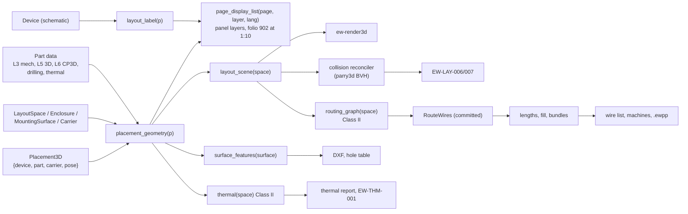
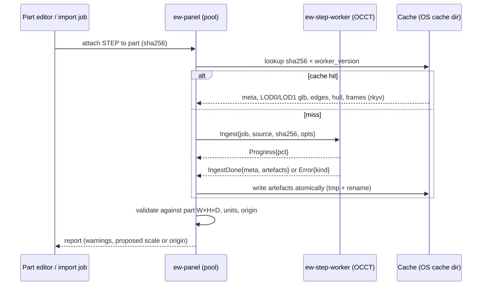

# Panel layout: 2D, 3D, routing, wire lengths and thermal

**Status:** Draft v0.1 · Amended 2026-10-31, cycle 40 (WP-S4.01 part 2, decision log ID-932): §2.6's MVP queries, §2.7's predicate and Open question 3 as built · Amended 2026-10-31, cycle 41 (WP-S4.01 parts 3 and 5, decision log ID-951 to ID-955, ID-977, ID-978, ID-996): §5.1 to §5.3 as built · **Date:** 2026-10-18 · **Part of:** ElektraWatt design document set

**Purpose.** This document designs the physical side of an ElektraWatt (EW) project: layout spaces, enclosures and
mounting surfaces modelled at 1:1 in nanometres, rails and ducts as parametric carriers, placements bound to
schematic devices, 2D panel pages such as folio 902 as projections, the 3D scene with STEP models from the
out-of-process OCCT worker, collision and clearance checks, wire routing with duct fill, automatic wire lengths,
machining features, and the IEC 61439-1 / IEC TR 60890 thermal calculation. It elaborates the LAY and THM rows of
[02b](02b-requirements-extended.md) §4–§5 on the accepted [architecture](04-architecture.md) (ADR-0001, ADR-0003,
ADR-0016) and the entities of [domain model](03-domain-model.md) §16, and it states what the MVP, 1.0 and 1.x
releases contain.

**Contents**
1. [Scope and position](#1-scope-and-position)
2. [Concepts and data](#2-concepts-and-data)
3. [Placement behaviour and rules](#3-placement-behaviour-and-rules)
4. [Layout checks (EW-LAYOUT)](#4-layout-checks-ew-layout)
5. [2D panel pages](#5-2d-panel-pages)
6. [3D scene, STEP pipeline and panel macros](#6-3d-scene-step-pipeline-and-panel-macros)
7. [Collision and clearance](#7-collision-and-clearance)
8. [Routing](#8-routing)
9. [Wire lengths](#9-wire-lengths)
10. [Surface features, drilling and cut-outs](#10-surface-features-drilling-and-cut-outs)
11. [Thermal calculation](#11-thermal-calculation)
12. [UI and UX touchpoints](#12-ui-and-ux-touchpoints)
13. [Performance budgets](#13-performance-budgets)
14. [Outputs](#14-outputs)
15. [Edge cases and pitfalls](#15-edge-cases-and-pitfalls)
16. [The reference project](#16-the-reference-project)
17. [Scope by release](#17-scope-by-release)
18. [Dependencies](#18-dependencies)
19. [Requirements covered](#requirements-covered)
20. [Open questions](#open-questions)

Conventions: "GP" is the golden project ([20](20-golden-project.md)); ▲ marks a test value for an unknown of the
reference (U-nn in 20 §23.1) or a shop-policy default still to be confirmed by the pilot (PQ-22, PQ-24); "DT" is a
device tag; "CP" a connection point. Values marked *(unverified)* come from the research notes and ship as data,
never as hard-coded constants (02b Open question 7). Source abbreviations: ARCH/arch =
[architecture](04-architecture.md); VIS = [vision](00-vision-and-scope.md); BS = [brainstorm](01-brainstorm.md);
PM = [panel-manufacturing](../research/panel-manufacturing.md); STD = [standards](../research/standards.md);
RD = [reference-drawing](../research/reference-drawing.md); EF = [eplan-features](../research/eplan-features.md);
PBF = [plc-bus-fluid](../research/plc-bus-fluid.md); C-nn and G-nn =
[gaps-and-corrections](../research/gaps-and-corrections.md).

---

## 1. Scope and position

### 1.1 What this document owns

| Topic | Here | Elsewhere |
|---|---|---|
| Layout records, frames, poses, carriers, placements | §2, §3 | Entity list: [03](03-domain-model.md) §16; file ownership: [05](05-project-format-and-persistence.md) §2 |
| Part data the layout reads (mechanical, 3D, CP3D, drilling, thermal) | which fields, units and semantics (§2.5) | Part record and data levels: [07](07-symbols-parts-macros.md) §2.5 |
| PanelLayout and ModelView pages | projection, labels, legend, dimensions (§5) | Page model and tools frame: [06](06-schematic-editor.md); forms and embedded blocks: [09](09-reports-forms-output.md) |
| Physical wires and their identity | consumed as routing units (§8.2) | Derivation: [08](08-connections-terminals-cables.md) §3.8 |
| Wire records, machine files, `.ewpp`, labels | length and route fields they read (§9) | [13](13-manufacturing-outputs.md) |
| Rule engine, modes, waivers | rule content of pack EW-LAYOUT and EW-THM (§4, §11.8) | [15](15-checks-revisions-collaboration.md), 02a CHK |
| Panel 3D workspace shell | canvas behaviour (§12) | [16](16-ux-ui.md) |
| QET folio 902 migration | binding rules (§16.3) | Importer: [14](14-interop.md) (FR-IMP-019) |

### 1.2 Crates

| Crate | Layout responsibility |
|---|---|
| `ew-panel` | Layout queries, snapping engine, placement commands, collision reconciler, routing graph, negotiated-congestion router, lengths, duct fill, bundles, surface features, thermal queries (VIS OQ6, 02b OQ6), the 2D projection of surfaces (the geometry layers of PanelLayout display lists, §5.2, arch §3), and the glTF (glb) and STL writer for `layout_scene` (§14); MVP 2D overlap index on rstar 0.13.0, already a workspace dependency of `ew-scene` |
| `ew-render3d` | wgpu 3D renderer: instancing, feature edges, transparency, CAD camera, CPU ray picking, and the toolkit-agnostic camera, pick and constraint API behind the gizmo |
| `ew-ui` | The 3D gizmo (transform-gizmo-egui 0.11.0) over that API, because only `ew-ui` may know egui (arch §3 Rule 3, ADR-0016 amendment 1) |
| `ew-step-proto` (permissive) | Worker IPC frames (postcard) and cache artefact formats (rkyv, glb) |
| `ew-step-worker` (bin) | OCCT via occt-sys 7.8.1 + opencascade 0.3.0 (LGPL-2.1, C-5): STEP read, tessellation, edges, hulls, frames, features; HLR in 1.x |
| `ew-scene`, `ew-dl` | Composition of PanelLayout and ModelView pages: frame and title block, embedded tables, label text shaping (`shaped_text`), and the IR emitted to the renderers (ADR-0015) |
| `ew-reports`, `ew-export`, `ew-mfg`, `ew-api` | Legend, hole table, cut list and thermal row sources; surface DXF; `.ewpp` content from `ew-mfg`, composed by `ew-api` with the `ew-panel` glb (arch §3) |
| `ew-checks` | Pack EW-LAYOUT (EW-LAY-0nn) and the EW-THM rules ([15](15-checks-revisions-collaboration.md) §4.5.4, §4.6) |

### 1.3 Design rules

1. **The placement is the single source of physical truth.** Every layout output (2D page, 3D view, routing,
   lengths, drilling, thermal input, BOM lines for layout parts) is derived from placements, carriers and part data.
   Nothing is drawn independently (PM §1 point 2).
2. **No tag text in layout records** (ADR-0001, D-02). Labels are the `layout_label` query.
3. **Model at 1:1 in nm, view at scale.** Paper size, text height and line weight are paper-space constants; the
   model never stores a paper coordinate (G4, ADR-0005).
4. **Semantics never come from vendor CAD.** Surfaces, frames, rail profiles and connection points come from part
   templates and panel macros. A STEP file only adds appearance and collision detail, so a bad file cannot break
   routing (PM §6.2).
5. **Expensive results are Class II, shop-floor results are committed** (ADR-0003). Routing, full 3D collision and
   thermal run on forks with a revision stamp; routes and lengths become `committed_route` records only through the
   explicit `RouteWires` command.
6. **Deterministic to the byte** (NFR-REL-07): integer geometry and costs, sorted iteration, UUID tie-breaks.
7. **No third-party engineering content shipped** (NFR-LIC-06): vendor STEP, DXF and TR 60890 figures are user data.



---

## 2. Concepts and data

### 2.1 Frames and units

| Frame | Origin and axes | Used by |
|---|---|---|
| Layout space (world) | Enclosure 1's outside bottom-left-rear corner; X right, Y up, Z towards the door (03 §16) | Routing graph, thermal heights, 3D scene |
| Enclosure | Same convention per enclosure; `Enclosure.pose` places it in the space (bayed suites, 1.x) | Surfaces |
| Mounting surface | `frame: Pose3`: u, v in the surface plane, w outward normal (towards the viewer of the 2D view); datum = bottom-left corner of the usable polygon's bounding box | 2D pages, carrier paths, drilling DXF datum |
| Carrier | Rail: start of the rail axis on the rail's front face (7.5 or 15 mm above the plate), u along the path, w out of the plate. Duct: start of the centreline at plate level. Surface: the surface frame | Placement poses |
| Part | Bounding-box min corner after normalisation: x along the rail (width W), y up the plate (height H), z out of the plate (depth D). `rail_offset` = vector from the part origin to the rail clip point | Footprint, meshes, CP3D, drilling |

- All linear values are `Nm(i64)`; poses are `Pose3 {t: [Nm; 3], q: [i64; 4] in 10⁻⁹}`, encoded as
  `{"t":[x,y,z],"q":[w,x,y,z]}` (05 §3). f64 mm (glam `DVec3`/`DAffine3`) is used only inside maths and f32 only in
  GPU buffers (G4, C-12). The 0.1 mm quantisation proposed in PM §4.1 is superseded.
- World transforms are composed in i128 nm for translations and rounded once per query result, so the same model
  yields the same world coordinates on every platform.

### 2.2 Records

The authored records are those of 03 §16 and arch §4.2. They all live in `layout/<space-uuid>.jsonl` (05 §2, kind
ranks 50–56, plus 57 `routing_path` and 58 `surface_feature`). Fields and kinds marked **(add)** are this document's
additions to the first draft of 03 §16; the schema-steward batch adopted them (Open question 2).

| Record | Authored fields | Notes |
|---|---|---|
| `LayoutSpace` | `location: StructureNodeId`, `name`, `install: InstallContext` **(add)** `{wall_behind, ceiling_above, neighbours: [Left/Right], floor}`, `thermal: ThermalInputs` (FR-THM-005), `policy: LayoutPolicyRef?` | One per cabinet or bayed suite (FR-LAY-001) |
| `Enclosure` | `space`, `device` (-UC1, carries the enclosure part), `pose`, `install_type` (derived default from `install`, overridable), `doors: Vec<DoorState>` (1.0) | The enclosure is a device, so its part reaches the BOM by the one path (ADR-0006) |
| `MountingSurface` | `enclosure`, `kind: Plate \| DoorInside \| DoorOutside \| Side \| Roof \| Floor \| Gland`, `device?` (plate NSYPMM107 as child of -UC1), `frame`, `usable: Vec<Pt2>`, `max_depth`, `pe_bond` | Created from the enclosure part's surface templates (FR-LAY-002/003) |
| `Carrier` | `surface`, `kind: Rail \| Duct \| Busbar \| Surface`, `part?`, `path: Vec<Pt2>` (surface frame), `params` (§2.4), `pe_bond` | Layout-only part, counted in the BOM (FR-LAY-008) |
| `Placement3D` | `device`, `function?`, `part: PartRef?` **(add)**, `segment: SeqRange?` **(add)**, `carrier: CarrierRef`, `pose`, `variant?`, `locked` | §2.3 |
| `RouteOverride` | `connection` (physical wire ID, 08 §3.8), `path: Vec<RouteNodeRef>`, `pinned`, `bundle: Ident?` **(add)**, `seq: u32?` **(add)** | Survives re-routing (FR-LAY-047, FR-LAY-054). A manual length is not stored here but in `WireOverrides.length` **(add)** of the wire's carrier connection ([03](03-domain-model.md) §9, [13](13-manufacturing-outputs.md) §3.3), so that it also exists without a layout space (Open question 16) |
| `committed_route` | `wire`, `path: Vec<RouteNodeRef>`, `len: LengthBreakdown` (ending in the unrounded calibrated length `L_cal`, §9), `input_hash` | `Committed<T>` without `rev` (05 §2); ID `v5(connection, "route")`; rounding happens once, when the `WireRecord` is built ([13](13-manufacturing-outputs.md) §3.3) |
| `RoutingPath` **(add)** | `space`, `kind: FreeAir \| Hinge{loop_allowance} \| WiringHole{feature} \| Guide`, `points: Vec<RouteAnchor>`, `class_set`, `cost_factor` | User routing paths (FR-LAY-043/044) |
| `SurfaceFeature` **(add)** | `surface`, `side: Front \| Back`, `feature: Hole \| Thread \| Cutout \| Slot \| Keyhole \| Custom`, `at`, params | User-authored machining features (FR-LAY-056); all others are derived |

`RouteNodeRef = Duct{carrier, seg, s} | Joint{carrier, vertex} | Path{routing_path, idx} | Stub{cp} | Entry{feature}`.
It names carrier positions, not graph node indices, so a committed route stays readable after the graph is rebuilt.
Authored layout records get UUIDv7 IDs; routing-graph nodes and `committed_route` records use UUIDv5 over their
inputs (ADR-0004).

### 2.3 Placement3D

```json
{"$k":"placement","id":"0193a2c4-9b10-7e21-8c44-1d2e3f405162","device":"0192f1c4-5a10-7c3e-8b21-6f0d9a4e2b10","carrier":{"carrier":"0193a2b0-41c2-7d0a-9f11-2a3b4c5d6e70"},"pose":{"t":[96000000,0,0],"q":[1000000000,0,0,0]}}
```

This is -102G1 on rail R1 at s = 96 mm. Fields not shown take their defaults: `part` = the primary mountable part
use, `locked = false`, no segment, no variant.

| Field | Meaning | Rule |
|---|---|---|
| `device` | The placed device | Structural: exists; delete policy `cascade` (03 §4.2) |
| `function?` | One function placed separately, e.g. the door handle function of a door-coupled switch | Must belong to `device` |
| `part?` **(add)** | Which `PartUse` of the device this placement realises; `None` = the primary mountable part (the first part use whose part has `mech.mount_kind`) | EW-LAY-003 if it names no part use of the device (FR-LAY-007, FR-LAY-059, PM §4.2 `part_ref`) |
| `segment?` **(add)** | Terminal range `{from_seq, to_seq}` when a strip is placed in pieces on several carriers (FR-LAY-063) | Ranges of one strip are disjoint and cover what is placed |
| `carrier` | `CarrierRef = Carrier(Id) \| Surface(Id) \| Placement(Id)`; `Placement` is piggy-back mounting (1.0 Could) | Delete policy `forbid`; §3.6 |
| `pose` | Relative to the carrier frame | Constrained per carrier kind (below) |
| `variant?` | Panel-macro variant (mounting orientation, e.g. a PSU mounted lying) | Must exist in the part |
| `locked` | Excluded from push, swap and auto-fill | — |

**Pose constraints per carrier kind** (validated in the command, reported by EW-LAY-010 after imports and merges):

| Carrier | Degrees of freedom | Stored pose |
|---|---|---|
| Rail | s along the axis; flip 180° about w | `t = (s, 0, 0)` = position of the part's rail clip point, `q ∈ {identity, 180° about w}` |
| Surface (plate, gland) | u, v; rotation k·90° about w | `t = (u, v, 0)` |
| Door inside / outside | u, v; any rotation about w | `t = (u, v, 0)` |
| Busbar system | s at multiples of the system pitch | `t = (k·pitch, 0, 0)` |

What is **never** stored: label text, footprint size, world position, the list of unplaced devices, outlines, holes,
fill, temperatures. Each is a query (§2.6).

### 2.4 Carrier parameters

| Kind | `params` | Derived | BOM |
|---|---|---|---|
| Rail | `profile: Ts35x7_5 \| Ts35x15 \| Ts32 \| Ts15`, `perforated`, start and end on the surface | axis, length, height above plate, fixing holes at the policy pitch | Part in metres or stock pieces; cut list (FR-MFG-030) |
| Duct | `width`, `height` (out of the plate), `inner_w?`, `inner_h?` (default from part, else 0.85 × nominal area), `slot_pitch`, `finger_w`, `cover`, orthogonal polyline `path`, joint style per vertex (`Butt \| Mitre`), `class_set` | label "W×H" (template, default `{width}×{height}`), centreline, slot nodes, segment lengths, fixings | Part in metres per segment; cut list |
| Busbar (1.0) | `phases: [L1, L2, L3, N?, PE?]`, `pitch` (60 mm system), `bar_section` (e.g. 12×5), phase ↔ potential links | adapter snap lattice, bar lengths | Bars and supports; cut list (FR-LAY-035) |
| Surface | — | the surface's own frame and usable polygon | — |

The label "40×60" of folio 902 is generated from `width = 40 mm`, `height = 60 mm` (▲, the reference's order is
ambiguous; PM §5.3). In Golden A all five ducts and the three rails carry the placeholder parts of BOM rows 24–25
(▲U-27), which FR-CHK-034 reports as open items (EF-17); the unlabelled lower duct D5 additionally has a test type
(▲U-26).

### 2.5 Part data the layout reads

Part data is defined in [07](07-symbols-parts-macros.md) §2.5 (`MechData`, `Model3dRef`, `Cp3d`, `FeaturePattern`,
`PartSections`; FR-PRT-010, FR-PRT-011). The layout uses these fields:

| Level ([07](07-symbols-parts-macros.md)) | Field | Unit | Consumer | Release |
|---|---|---|---|---|
| L3 | `width`, `height`, `depth` | nm | footprint, box macro, enclosure fit | MVP |
| L3 | `mount_kind: Ts35x7_5 \| Ts35x15 \| Ts32 \| Ts15 \| Screw \| BusbarAdapter \| DoorCutout \| OnParent \| None` | — | snapping, EW-LAY-010, mountable predicate | MVP |
| L3 | `rail_offset` | nm vector | rail pose → part origin | MVP |
| L3 | `clearance {top, bottom, left, right, front}` | nm | padding while snapping (MVP), keep-outs EW-LAY-007 (1.0) | MVP / 1.0 |
| L3 | `front_2d` (outline polylines in the part frame) | nm | 2D outline at scale | MVP |
| L3 | `mass` | g | door mass rule (FR-LAY-033) | 1.0 |
| L5 | `model3d {sha256, source_hint, embeddable, vendor_transform, units}` | — | STEP pipeline (§6.2) | 1.0 |
| L5 | `drilling: FeaturePattern`, `cutout`, `keep_outs`, `marker_carriers` | nm | features (§10), collision, labels | 1.0 |
| L5 | enclosure section: outer and wall dimensions, doors, surface templates, material, `k_w`, IP/IK, dissipation data | — | enclosure creation, thermal | MVP (dims, plate) / 1.0 |
| L5 | duct and rail sections: inner dimensions, slot pitch, finger width, profile, stock length | nm | routing, fill, cut list | MVP / 1.0 |
| L6 | `cp3d: Vec<Cp3d>` | — | routing, lengths, ferrules, wiring viewer | 1.0 |
| L2 | thermal section: loss model (§11.2), `t_amb_max`, derating, climate-device data | W, A, °C | thermal | 1.0 |
| L2 | wire section: `outer_diameter`, class, insulation | nm | fill, segregation | 1.0 |

**`Cp3d`, the critical record** (FR-LAY-026; PM §4.4). One entry per physical CP of the part's function template:

| Field | Type | Meaning |
|---|---|---|
| `designation` | Ident | Must equal the schematic CP designation, or map through the macro's mapping table (EW-LAY-005) |
| `cp_idx` | u16 | Index into the template FnDef, so duplicated designations ("+#1", "+#2" of -102G1) stay distinct |
| `level`, `clamp` | u8, `ClampKey` | Locus on multi-level and twin terminals (`ClampKey` in 08 §2.3, clamp rules in 08 §6.3): PT 2.5-TWIN has clamp a on side 1 and b, c on side 2 |
| `pos`, `dir` | nm vector, unit vector ×10⁹ | Entry point of the clamp opening; insertion direction into the clamp |
| `clamp_type` | `Screw \| Spring \| PushIn \| Idc \| RingStud(M) \| Plug` | Ferrule rules, torque list |
| `csa_solid`, `csa_fine`, `csa_ferrule` | `Dec3` ranges mm² | Ferrule selection, EW-MFG pre-flight |
| `max_conductors`, `twin_ferrule_ok` | u8, bool | EN 60204-1 13.1 check (EW-EN60204-008) |
| `strip_len`, `insertion_depth` | nm | End allowance in the length formula (§9) |
| `torque` | `Dec3` N·m | Checklists (FR-MFG-037) |
| `test_access` | bool | Continuity test points |
| `quality` | `Measured \| FromVendor \| Generated` | `Generated` sets `estimated_cp` on wires (FR-LAY-023) |

Optional accuracy fields for robot wiring stay out of v1 (PARK-07); the record is extensible through `extra`.

### 2.6 Derived queries

| Query (key) | Returns | Class, policy | Main inputs |
|---|---|---|---|
| `mountable(dev)` | `Mountable{primary_part} \| Exempt(reason)` | I, cold | device kind, parts, parent, aspects (§2.7) |
| `unplaced(space)` | sorted device list | I, memo | mountable, device locations, `placements_by_device` |
| `placement_geometry(p)` | footprint, OBB, CP3D in carrier and world frames, keep-outs, outline ref, quality | I, memo per placement | pose chain, part L3/L5/L6, variant |
| `layout_label(p)` | label lines, style key | I, memo | `device_tag(dev).displayed(page)`, page label mode (FR-LAY-009) |
| `rail_occupancy(carrier)` | sorted intervals `(s0, s1, placement, padding, locked)` incl. strips and group accessories | I, memo per carrier | placements on the carrier, geometry |
| `strip_layout(p)` | per terminal: s, width; end covers, brackets per group | I, memo | strip terminals by `seq`, part widths, accessories |
| `carrier_order(carrier)` | placements in physical order | I, cold | rail occupancy (consumed by [10](10-plc-and-bus.md) for EtherCAT and rack order) |
| `page_display_list(page, layer, lang)` of a PanelLayout page | 2D display list per panel layer (§5.2) | I, memo + LRU | geometry, labels, carriers, features, form |
| `layout_legend(surface)` | legend rows | I, memo | placements, carriers, parts (FR-LAY-012) |
| `surface_features(surface)` | merged feature list with origins | I, memo | part patterns, carrier fixings, enclosure, `SurfaceFeature` |
| `layout_scene(space)` | instances `{placement, mesh hash, world pose, state}` | I, memo (arch §6.4) | geometry, Class III mesh refs |
| `collisions(space)` | findings with sub-shape refs | II, job ≤ 10 ms | scene, cache meshes |
| `routing_graph(space)` | nodes, edges, capacities | II, built on the fork | carriers, scene, routing paths, policy |
| `route_status(wire)` | `Fresh \| Stale(fields) \| Unrouted` | I, cold | committed route, recomputed input hash |
| `duct_fill(space)` | fill per edge | I, memo | committed routes, wire ODs, duct areas |
| `bundle_sequence(space)` | bundle key and `seq` per wire, with overrides applied (§8.7) | I, memo | committed routes, strips, `RouteOverride.bundle/seq` (consumed by [13](13-manufacturing-outputs.md)) |
| `panel_front_reps(dev)` | derived "panel front" representations for navigation and "show all representations" (arch §6.4; Open question 1) | I, cold | placements of the device, layout pages |
| `wire_length(wire)` | `LengthBreakdown`, source | I (reads committed) | committed route, policy, overrides |
| `thermal(space)` | `ThermalResult` | II, job | placements, loss models, load model, enclosure, inputs, coefficient set |

*As built (cycle 40, WP-S4.01 part 2; decision log ID-932).* The MVP's queries are in `ew_derive::layout` (D2: no
`ew-panel` crate yet), and none is stored: a footprint, a label, the unplaced list and an occupancy are derived from
the placement records and the part data each time. Values are integer nanometres in the mounting surface's frame
(u right, v up), exact, since carriers are axis-parallel and turns are quarter turns. `mountable(dev)` (D8, cold; §2.7
as built); `unplaced(space)` (memo): the mountable devices of the space's location without a placement, in natural
order of their full tag, a device of another location never listed, `Session::unplaced` in the API (Golden A: F55,
E55, E56, S56, -201U9); `placement_geometry(p)` (memo): the footprint and outline in the surface frame and the unknown
flag only (no OBB, CP3D or keep-outs at the MVP): on a rail the clip point lies on the axis at u = `path[0].u` + s
(-102G1 on R1: (101, 675)–(171, 805) mm), an unknown part is the 20 × 20 mm square about the pose, a strip is its
terminals side by side, and a placement on a duct or a rail without a valid axis has none; `rail_occupancy(carrier)`
(memo): intervals `(s0, s1, placement, device, locked, unknown)` in s along the rail, sorted, a strip one interval,
overlaps kept for EW-LAY-006, no clearance padding and no group accessories yet (WP-S4.02); `layout_label(p, page, mode)`
(memo): the device's displayed tag on the page (abbreviated) or its full designation, so renumbering changes the label
and no layout record; a placement of one function prints its device's label without D10's ":" suffix (functions
carry no designation member in format 0.1); `carrier_geometry(carrier)` (cold): the axis check, length, rail axis and
outline, a rail's width from its profile. `strip_layout`, `carrier_order` and the rest of the table wait for their
packages. The four memo families are in `verify-derived`'s sweep.

### 2.7 The mountable predicate

EW-LAY-001 and the unplaced list need one exact definition of "a device that must appear in the layout of its
location":

| Case | Result | GP example |
|---|---|---|
| Device location ≠ any layout space location, or device marked *supplied by others* (FR-DEV-037) | not considered | field valves -203Q1 … -203Q8 (TA05-V-15 …) in +FIELD ▲U-07 (20 §6.2) |
| Part use with `mount_kind` ∉ {`None`, `OnParent`} | Mountable (primary part) | -102G1, -201U2, -201U9 |
| No part, device kind physical (switch, lamp, protective device, terminal strip …) | Mountable, footprint unknown | S56, E56 (no parts, EF-04) |
| `mount_kind = OnParent`, or a child of a placed strip or sub-base | Exempt: mounted with its parent | -X1031:1 … 20; valves -201U3-Q1 …; the DP plug -3X1 (Festo 532216) on -201U1 |
| Terminal of a strip | Exempt: placed through `strip_layout` | 1X1:PE |
| Cable, conductor, wire, interruption point, external device | Exempt | -106W1, -3W1 |
| Enclosure and surface devices | Exempt: they are the layout | -UC1, NSYPMM107 plate |
| Integral device (kind `PeStud`, no part, parent = a surface's device) | Exempt; its CPs take their 3D position from the parent part's CP3D (the plate's PE stud), so wires to it stay routable | -XPE (waiver W-1); W6 ends on the plate's PE stud |

*As built (cycle 40, WP-S4.01 D8; decision log ID-932).* `ew_derive::layout::Mountable`, first match wins: (1) a device
whose location has no layout space is not considered (*supplied by others* waits for its attribute, FT-209); (2) the
device of an enclosure or a surface is exempt; (3) a strip with terminals is mountable as one placement without a
part; (4) a terminal of a strip, a cable and a device without functions are exempt; (5) a part use whose part has a
mount kind other than `none` and `on_parent` is mountable, the first such use the primary part; (6) part uses that
are all `on_parent` or `none` are exempt; (7) part uses without a mount kind are mountable with an unknown footprint;
(8) a device without parts whose functions are all of the PE point's FnDef category is exempt as an integral PE point
(-XPE, by its FnDef category rather than a `PeStud` kind); (9) any other device without parts is mountable with an
unknown footprint. Assembly children are not exempt by being children: "with its parent" holds only through
`on_parent`.

---

## 3. Placement behaviour and rules

### 3.1 Enclosures and surfaces

- **Create from part data** (FR-LAY-002). `CreateEnclosure{part, space, pose}` creates the enclosure device (-UC1)
  with its part, and one `MountingSurface` per template in the enclosure part. At MVP the template set is
  box-shaped: plate, with door and gland templates read but used from 1.0 (FR-LAY-003). Dimensions are never typed on
  the page; changing the part re-derives the surfaces' usable polygons and reports placements that no longer fit
  (EW-LAY-010).
- **Families.** Schneider Thalassa PLA polyester wall enclosures (NSYPLA1074G with NSYPMM107, folio 902) have no
  system punching: rails and ducts are screwed to the plate, which creates fixing features (§10). Rittal AX compact
  enclosures behave the same way. Rittal VX25 frame enclosures add a punching lattice (25 mm pitch *(unverified)*)
  and a depth-adjustable plate (`plate_z`), which drives the door-closed check. Lattice snapping and bayed suites
  are 1.x (FR-LAY-037).
- **Installation context.** `LayoutSpace.install` records the wall behind, the ceiling and bayed neighbours. Thermal
  reads face exposure from it (§11.3), so "wall-mounted" is a fact of the scene, not a separate thermal input.
- **Selection assistant (1.x, FR-LAY-038)** is a catalogue filter, not an optimiser: Σ(footprint + clearance) +
  duct area + reserve ≤ usable plate area, max(device depth + rail height) + door-device depth ≤ usable depth, and a
  passing thermal result or a fitting climate device. With the golden device set and 25 % reserve it must list
  NSYPLA1074G.

### 3.2 Rails and ducts

- **Rails** are drawn by two points on a surface, snapped to the plate grid (1 mm fine, 5 mm coarse) and to duct
  edges. The profile comes from the rail part; the axis is a 1-D coordinate space `s ∈ [0, L]` (FR-LAY-004).
- **Ducts** are orthogonal polylines with explicit width and height (FR-LAY-005). A vertex is a corner or, where two
  ducts meet, a T or cross joint; joints connect routing segments (§8.1). Duct and rail lengths in the BOM and cut
  list come from the path, rounded up to the cutting increment of the shop policy.
- **Moving a carrier moves everything on it**, because placement poses are carrier-relative. A move that makes a
  rail overlap a duct is a collision finding, never an automatic correction.
- **Free length.** The property grid of a rail shows its free length `L − Σ occupied intervals` from
  `rail_occupancy`, the basis of reserve rules and of the selection assistant.

### 3.3 Placing and snapping

`PlaceDevice{device, part?, carrier, at, mode}` and `MovePlacement{placement, at, mode}` are interactive commands.
While the user drags, the tool computes the snap result each frame without committing (arch §9, tools return
`Transient`); release commits one transaction (ADR-0008), so one drag is one undo step.

**Rail snapping on a 1-D interval model** (FR-LAY-014; PM §5.4):

```text
snap_on_rail(rail, device, cursor, mode):
  s_cursor = project(cursor, rail.axis)                 // only rails within snap distance (default 15 px)
  require compatible(device.mount_kind, rail.profile)   // else refuse; EW-LAY-010
  w   = footprint.width + clearance.left + clearance.right
  occ = rail_occupancy(rail)                            // sorted (s0, s1, id, locked), padding included
  s   = snap(s_cursor, targets = occupant edges ∪ {0, L} ∪ plate grid ∪ column edges of the rail above)
  match mode:
    Free => nearest gap g in occ with |g| ≥ w, closest to s
    Push => insert at s; shift right neighbours by the overlap, cascading;
            fail if a locked placement or the rail end is reached ("would overflow by x mm")
    Swap => exchange intervals with the occupant under the cursor (same width class or push the rest)
  return pose t = (s_left + clearance.left + rail_offset.x, 0, 0)   // the part's clip point on the rail axis
         and the neighbour poses that changed
```

- Push and swap write the moved neighbours' poses in the **same** transaction, so undo restores the whole row.
- **Off-rail placement** on a surface snaps to the plate grid, to edges and centres of other footprints and to duct
  edges; rotation in 90° steps. Door items rotate freely (FR-LAY-032).
- **Mount-kind compatibility**: TS 35 devices fit TS 35×7.5 and TS 35×15; TS 32 devices only TS 32; screw-mounted
  devices go on surfaces; busbar adapters on busbar systems. The table is data in the layout policy.
- **Bulk placement** (FR-LAY-016). `AutoFillRail{rail, devices, order: Dt | SchematicPosition}` fills greedily from
  the left with clearance gaps and stops at the rail end, listing what did not fit. Schematic order is (page order,
  row, column) of each device's main representation.

### 3.4 Strips, assemblies and group accessories

- **Terminal strips are placed as a whole** (FR-LAY-015): one `Placement3D` of the strip device; `strip_layout`
  positions the terminals by `seq` with their part widths, adds end covers per strip end from the terminal part's
  accessories, and recomputes on every strip change. Adding a terminal in the schematic lengthens the placed strip in
  the next derivation; if the rail overflows, EW-LAY-010 reports it. A strip may be split across carriers with
  `segment` ranges, and it stays one BOM row (D-42).
- **Group accessories** (FR-LAY-060, MVP). A group is a maximal run of abutting strip placements on one rail.
  Wherever strips are placed, `rail_occupancy` derives one end bracket per strip boundary in the run plus one at each
  run end, so k abutting strips need k + 1 brackets. GP rail R2 holds 1X1, -X1031 and -X1032 abutting: **4**
  brackets, as on folio 902 and in BOM row 26 ([20](20-golden-project.md) §14.1). Strips that are not placed, and
  bridges, use authored part uses (bridge parts on their `BridgeSpec` connections). From 1.0 the part-data accessory
  lists (`AccessoryRef{per: Group}`, [07](07-symbols-parts-macros.md) §2.5; FR-PRT-005, FR-REP-051) declare the
  bracket part and must reproduce the same golden count.
- **Assemblies and PLC racks.** Children of one assembly (the valve terminal -201U1 … -202U3) or of one PLC station
  on one carrier are kept contiguous and in physical order (`Device.position`, module slot). `PlaceAssembly{device,
  carrier, at}` places all members abutting; inserting a missing member uses push mode. EW-LAY-016 (FR-LAY-061) reports
  gaps and order differences, so the layout cannot contradict the manifold order that also generates the overview
  on 201/202 (D-10). `carrier_order` gives [10](10-plc-and-bus.md) the EtherCAT and rack order (1.0).

### 3.5 Part changes and schematic changes

| Event | Effect | Never |
|---|---|---|
| Device part changes (wider MCB on -102F1) | `placement_geometry` re-derives the footprint at the same pose; an overlap with -102F2 is reported (EW-LAY-006, FR-LAY-007) | neighbours are moved |
| Device renumbered (T55 → T57) | the label changes in the same commit; no file under `layout/` changes (FR-LAY-006, D-01, D-02) | stored label text |
| Device deleted | placement cascades; the transaction lists it in the preview; routes of its wires become unrouted | orphan placement |
| Device location changes (+J-E-2416 → +J-E-206) | placement kept; EW-LAY-004 with quick fixes "remove placement" and "move to the layout space of +J-E-206" | silent move |
| Terminal added to a placed strip | strip length grows; EW-LAY-010 on overflow | rail auto-extension |
| Part use removed that a placement names | EW-LAY-003; quick fix "realise the primary part" | silent retarget |

### 3.6 Carrier deletion

`Placement3D.carrier` has delete policy `forbid`. `DeleteCarrier{carrier, then: RemovePlacements | RehomeToSurface}`
is the only way to delete an occupied carrier. `RehomeToSurface` converts each pose to the equivalent surface pose,
after which EW-LAY-010 reports the devices as "rail device not on a rail". Both variants are previewed.

### 3.7 Commands

| Command | Cost | Notes |
|---|---|---|
| `CreateLayoutSpace`, `CreateEnclosure`, `SetInstallContext`, `SetThermalInputs` | Interactive | — |
| `AddCarrier`, `EditCarrierPath`, `DeleteCarrier` | Interactive | Rails, ducts, busbars |
| `PlaceDevice`, `MovePlacement`, `RotatePlacement`, `FlipPlacement`, `LockPlacement`, `RemovePlacement` | Interactive | Modes Free/Push/Swap |
| `PlaceStrip`, `PlaceAssembly`, `AutoFillRail` | Interactive / Bulk above 200 placements | — |
| `AddRoutingPath`, `SetRouteOverride`, `PinRoute`, `SetBundle` | Interactive | Keyed by physical wire ID |
| `RouteWires{scope: Space \| Wires(ids), options}`, `ClearRoutes` | Bulk (preview job) | §8.5 |
| `AddSurfaceFeature`, `AddDimension` | Interactive | 1.0 |
| `PlaceClimateDevice{part, surface, at}` | Interactive | Creates the device with its functions unplaced (listed in the device navigator for dragging onto a schematic page, FR-UI-007), its placement, its cut-out and its loss entry, and marks the thermal result stale (FR-THM-008) |

---

## 4. Layout checks (EW-LAYOUT)

The rule IDs, final severities and numeric codes are registered in [15](15-checks-revisions-collaboration.md) §4.5.4
(family EW-LAY, class 130, e.g. EW-LAY-011 → `130011`); EW-LAY-012 … 016 and 020 … 026 are this document's
additions to the 02b set EW-LAY-001 … 011. Online rules are memoised
`checks(scope)` queries per surface or carrier (arch §12, ADR-0019); 3D collision and routing rules are Class II and
show their revision stamp.

| Rule | Finding | Severity | Mode | Release | Implementation | Quick fix |
|---|---|---|---|---|---|---|
| EW-LAY-001 | Mountable device without placement in the layout space of its location (§2.7; FR-LAY-017, FR-CHK-039) | warning; error at release | online, release | MVP | `unplaced(space)` | open unplaced list; place on active rail |
| EW-LAY-002 | Placement without device | structural (cascade) | prevent | MVP | invariant; on lenient import an unmatched QET rectangle becomes a layout graphic, never a placement | — |
| EW-LAY-003 | Placement's part use is not on the device (FR-LAY-059) | error | online | MVP | `Placement3D.part` ∉ `device.parts` | realise primary part |
| EW-LAY-004 | Device location ≠ layout space location | warning | online | MVP | structure query | remove / move placement |
| EW-LAY-005 | CP3D pattern does not cover the device's physical schematic CPs (after the macro mapping table) | error (blocks routing of affected wires) | online | 1.0 | designation multiset per function | open macro editor; add mapping entry |
| EW-LAY-006 | Overlap or collision: 2D footprints per surface (MVP); 3D solids, door closed (1.0) | error | online (2D); II (3D) | MVP / 1.0 | §7 | — |
| EW-LAY-007 | Clearance zone violated, with the amount | warning | II | 1.0 | `distance` on keep-outs | — |
| EW-LAY-008 | Duct edge over fill limit: warning limit, error limit (shop policy) | warning / error | online on committed routes | 1.0 | `duct_fill` | re-route; widen duct |
| EW-LAY-009 | Wire unroutable (no path, blocked stub, pinned path broken) | error | II | 1.0 | router report | add routing path |
| EW-LAY-010 | Carrier compatibility: mount kind ≠ carrier profile; pose off the carrier; outside the usable polygon or depth range; rail or strip overflow | error | online | MVP | pose and occupancy validation | move to compatible carrier |
| EW-LAY-011 | Committed route or length stale (input hash changed) | warning; error at release | online | 1.0 | `route_status` | re-route the listed wires |
| EW-LAY-012 | Machining feature conflict: web below minimum (feature–feature, feature–edge), hole under another device; duplicate holes merged (info) | warning | online | 1.0 | `surface_features` (FR-LAY-057) | — |
| EW-LAY-013 | Door-swing collision, with the angle | error | II | 1.x | sweep (FR-LAY-031) | — |
| EW-LAY-014 | Pre-assembled cable route longer than its length minus connector allowances | error | II | 1.0 | FR-LAY-050 | choose a longer cable part |
| EW-LAY-015 | Wire in a duct whose class set excludes its segregation class (manual or pinned paths) | warning / error by policy | online | 1.0 | FR-LAY-048 | re-route |
| EW-LAY-016 | Assembly or rack members not contiguous or not in physical order on their carrier (FR-LAY-061) | warning | online | MVP | `carrier_order` vs `Device.position` | reorder by position |
| EW-LAY-020 … 026 | Placement rules (FR-LAY-033/034): depth containment, thermal zoning, EMC segregation distance, operator height, door mass, cable-entry zone, handle-axis alignment | warning | online | 1.0 (Could) | rhai/Rust rules with constants as data, `verified` flag | — |

Rule constants (fill limits, clearances, heights, segregation distances) ship with a `verified` flag; an
unverified constant reports at most a warning (FR-CHK-046).

---

## 5. 2D panel pages

### 5.1 Page model

A `PanelLayout` page ([06](06-schematic-editor.md) §2.2) shows one mounting surface (FR-LAY-010). It carries:

- `Page.scale`: a ratio from the configured series (1:2, 1:5, 1:10, 1:20 *(unverified ISO 5455 list)*) or
  `NotToScale`; the title block binds it (FR-REP-033, REF-070);
- a `SurfaceView` page item **(add)** `{surface, side: Front | Back, datum_at: Pt2, clip: Rect?, label_mode:
  Abbreviated | Full, layers}`;
- embedded report blocks: PART DATA (bound to `device_part_lines(-UC1)`, [09](09-reports-forms-output.md) §3.4) and
  the placement legend (FR-LAY-012);
- at 1.0, dimension items **(add)** and further `ModelView` items with their own scale (FR-PAG-003, FR-LAY-039).

The page is an ordinary page of `page_order()`: its title block, Prev/Next and TOC entry are derived, so the layout
page cannot drift in revision or description (D-05, D-06), and GP folio 902 gets Next = 903 from the generated
report folios.

**Projection.** A model point (u, v) of the surface maps to paper by
`x = datum.x + u·num/den`, `y = datum.y − v·num/den` (paper y points down, 03 §3.1), computed in i128 nm with one
rounding to the nearest nm. At 1:10 the GP enclosure (W 750 × H 1000 mm ▲U-26) occupies 75 × 100 mm on the A4 sheet,
which leaves the grid columns right of the plate for the legend. Changing the scale changes no stored pose
(FR-LAY-002).

*As built (cycle 41, WP-S4.01 part 3; decision log ID-951, ID-952, ID-955, ID-977).* The page item `surface_view`
is typed with `surface`, `datum_at` and `label_mode`; `side`, `clip` and `layers` stay verbatim until typed
([03](03-domain-model.md) §6). `page.surface_view.set {page, surface, datum_at, label_mode?}` sets it on a
`panel_layout` page and is refused on another kind; a second set replaces the view in place; the view cascades with
its surface. **The stated scale holds on paper:** the frame maps the page to the sheet at `scale_ppb` (0.986282578 on
every frame of Golden A and the starters), so the projection divides by it too, `num/den = 10⁹ / (n · scale_ppb)`
(10⁹ without a map), i128, one rounding half away from zero; the datum stays in page coordinates. On 902 the
enclosure measures 75.0 × 100.0 mm printed (76.043 mm on the page for its 750 mm edge). A page without a scale draws
the surface at 1:1 on the page. The projection is built in `ew-scene`'s `panel` module from a view that `ew-api` fills
from the layout queries (arch §3, ID-957).

### 5.2 Layers of the display list

A PanelLayout page is drawn by the same `page_display_list(page, layer, lang)` query as every page (arch §6.4,
ADR-0015 amendment 2), with the panel-page layers surface, carriers, placements, features and dims plus the shared
frame, labels, tables and highlights ([09](09-reports-forms-output.md) §4.1). The layer rule holds: a placement
move rebuilds `placements` and `labels` only, never `frame` or `tables`.

| Layer | Content | Line and text style |
|---|---|---|
| `surface` | enclosure outline, plate outline, usable polygon (thin dashed) | ISO 128 visible / hidden |
| `carriers` | rails (outline + axis chain line), ducts (outline, optional slot ticks), busbars | duct fill hatch optional |
| `placements` | `front_2d` outline, else the footprint rectangle; from 1.0 silhouettes from 3D (FR-LAY-011, FR-LAY-039) | |
| `labels` | `layout_label` lines; balloons at 1.0 | slot kind `layout.label`, bound in the golden to the style `xref.device` (1.83 mm em, 20 §17.5); paper height constant |
| `features` | holes, cut-outs, centre marks (1.0) | |
| `dims` | associative dimensions (1.0) | ISO 129-1 style *(unverified edition)* |
| `tables` | PART DATA, legend | form |
| `frame` | frame and title block | form |
| `highlights` | selection, collision and fill highlights; screen only, never exported | — |

Every item carries an `EntityRef` (placement, carrier, feature), so hit-testing, selection sync and "show all
representations" work on folio 902 as on schematic pages (FR-UI-007).

*As built (cycle 41, WP-S4.01 part 3; decision log ID-951, ID-955, ID-978).* The `surface`, `carriers`, `placements`
and `labels` layers are drawn, each its own memo family (`page_display_list_surface`, `_carriers`, `_placements`,
`_labels`); `features` and `dims` stay empty until 1.0, and the embedded blocks of a panel page are drawn by WP-S4.01
part 4b. `surface`: the enclosure outline, the plate outline and the usable polygon thin dashed; `carriers`: per
carrier by ID its outline rectangles, a rail's axis as a chain line and a duct's "W×H" label in millimetres;
`placements`: per placement by ID its `front_2d` outline, else its footprint rectangle (an unknown footprint dashed).
Carrier outlines and duct labels carry the carrier's entity, footprints and labels the placement's; the surface
outlines and a rail's axis carry none, so a click on a footprint selects the placement. **Labels knock out the
carriers:** the carriers layer cuts the rails' and ducts' outlines and the rails' axes around every label's ink box as
placed (a cut, not a paper-coloured fill), so the carriers layer reads the labels' fit and **a placement move rebuilds
`placements`, `labels` and `carriers`**, never `frame` or `tables`.

### 5.3 Labels

- `layout_label(p)` = `device_tag(dev).displayed(page)`. With `label_mode = Abbreviated`, identifier suppression
  removes the aspects equal to the page's (+J-E-2416), so -X1031 prints as "-X1031" and the full DT
  `=P01+J-E-2416-X1031` appears in the legend (FR-LAY-009). Frozen tags print as frozen ("S51", "T55", sign hidden).
- A strip segment of one terminal (`segment` with `from_seq = to_seq`) or a placement of one function prints the
  full designation ("-X1031:1"). A terminal is a device (arch §4.2) but is placed only through its strip.
- **Fitting policy** (FR-LAY-062). The label keeps its style's paper height. The fit test compares the
  label's ink box from `shaped_text` plus 0.1 mm per side with the footprint's paper rectangle. If it does not fit,
  the label is rotated by 90°; if it still does not fit, it is placed outside with a leader; otherwise it becomes a
  balloon with the legend position. It is never shrunk: the reference's rotated labels at 1.88–3.40 pt (RD §1.12)
  are exactly what D-29 and D-31 forbid. Example: at 1:10 an 18 mm MCB *(unverified width)* is 1.8 mm wide on
  paper. "-101F1" in `xref.device` (1.83 mm em, ink height ≈ 1.31 mm with the default font's cap height of 0.714 em,
  length ≈ 5.8 mm) does not fit horizontally but fits rotated: 1.31 + 0.2 = 1.51 mm ≤ 1.8 mm.

*As built (cycle 41, WP-S4.01 part 3; decision log ID-953, ID-954, ID-978).* `layout.label` is a constant of
`ew-scene` bound to the `xref.device` style, not a slot kind of the symbol library. The ink box is estimated as the
shaped text's advance + 0.2 mm by the face's cap height + 0.2 mm, plus the descent only when the text has a descender
(a true ink-box query is FT-870), and compared with the footprint in page space; a label placed outside starts its
leader 1.5 mm off the footprint, above it, or below when above leaves the surface. Balloons are not built (1.0, FP-3).
A function's placement adds no ":" suffix, since functions carry no designation member (ID-932).

### 5.4 Legend and PART DATA

`layout_legend(surface)` rows: position, DT, manufacturer, part number, description, quantity or length. Order:
enclosure and plate first, carriers (rails, ducts, busbars) next, then placements by DT in natural order, then
layout-only accessories. Positions are derived and renumber when rows are added; balloons and the legend read the
same query, so they cannot disagree. Rows come from the same `RowSet` as XLSX and CSV (FR-REP-030). The embedded
PART DATA box of folio 902 is kept for fidelity with the reference and is bound to -UC1's part lines (REF-069).

### 5.5 Dimensions and views (1.0)

- **Associative dimensions** (FR-LAY-041) reference features: `RefPoint = CarrierAxis{carrier, end} |
  CarrierEdge{carrier, side} | FeatureCentre{feature} | PlacementEdge{placement, side} | SurfaceDatum`. The value is
  derived at render; a dimension whose reference disappeared renders "?" and raises an info finding. Presets:
  plate overview (ordinate from the datum), drilling drawing with hole table, door cut-out drawing.
- **Model views** (FR-LAY-039): orthographic front, top and side views, isometric and detail views on ordinary
  pages. 1.0 uses painter's order by z of placement boxes plus per-part projected feature edges (computed once per
  part and view direction in the worker and cached); exact OCCT hidden-line views follow in 1.x (FR-LAY-040). While
  a view regenerates, its frame shows "out of date" (Class II).

---

## 6. 3D scene, STEP pipeline and panel macros

### 6.1 Scene

`layout_scene(space)` derives one instance per visible solid: enclosure walls, doors, surfaces, carriers (parametric
prisms generated in `ew-panel`, never STEP), placements (mesh hash or box), keep-outs (hidden by default), routed
wires (polylines), unrouted wires as straight CP-to-CP lines (EPLAN's "connection diagram in 3D"; FR-LAY-064) and
the routing debug overlay. Instances carry the placement ID, the world pose (f32 relative to a
space-local origin to avoid precision loss) and a state (selected, colliding, stale). Repeated parts share one mesh
(the 20 PT 2.5-TWIN terminals of -X1031 are one mesh, 20 instances).

The **reconciler** (arch §8.5) keeps the GPU instance buffers and the parry3d BVH in step: it diffs successive
`Arc<Scene>` values by placement ID and applies insert, remove and refit. In debug builds it rebuilds from scratch
after each diff and compares (oracle), and the field-mask test guards new fields.

### 6.2 STEP import pipeline



- **Inputs** (FR-LAY-020): STEP AP214 and AP242 files, as vendors publish them (Phoenix Contact, Siemens, Schneider
  Electric, Festo, Rittal, Murrelektronik, Eaton); EPLAN `.e3d` data in EDZ packages is ignored in favour of STEP
  (FR-IMP-027).
- **Protocol** (`ew-step-proto`, length-prefixed postcard frames over stdio): `Hello{proto}`, `Ingest{job, source,
  sha256, opts{lin_defl, ang_defl, tri_budget, detect_features}}`, `Hlr{…}` (1.x), `ExportStep{…}` (FR-EXP-008),
  `Cancel{job}`, `Shutdown`. Replies `Progress`, `IngestDone`, `Error{Timeout | Parse | Memory | Crash}`.
- **Isolation** (NFR-REL-12): one or two pooled workers; per-job timeout (default 120 s), memory cap (job object on
  Windows, `RLIMIT_AS` on Unix; default 4 GiB), input size limit (default 200 MB), restart with back-off. A file hash
  that crashes the worker twice goes to a quarantine list and is not retried automatically. The IPC decoder has a
  fuzz target (NFR-SEC-03).
- **Build and licence.** The worker is the only binary that links OCCT and the only C++ in the build; it builds in
  its own CI job with cached OCCT artefacts (NFR-MAINT-09), sits on the `unsafe` allowlist (NFR-SEC-04) and ships
  as a replaceable binary with an LGPL source offer (NFR-LIC-08, C-6).
- **Outputs** (arch §8.6): assembly tree, LOD0 (display, capped at 200,000 triangles) and LOD1 (collision and far
  display, `tri_budget` default 20,000, meshopt 0.7.0), B-rep feature edges, bounding box, convex hulls (one, or a
  decomposition for L-shaped parts), detected rail-clip groove (a 35 mm groove on the back face), cylindrical holes
  and rectangular openings on the top and bottom faces.
- **Validation** (FR-LAY-021): the bounding box must match W×H×D within ±5 % in some axis permutation; a match at
  1/25.4 proposes scale 25.4 (inch file); the vendor transform is kept in `Model3dRef.vendor_transform` and the mesh
  is normalised to the EW part frame. Solids thinner than 0.3 mm (labels, markers) are tagged and excluded from
  collision.
- **Cache**: `<cache>/step/<sha256>/<worker_version>/` with `meta.json`, `lod0.glb`, `lod1.glb`, `edges.rkyv`,
  `hull.rkyv`, `frames.rkyv`. It is Class III: never model data, rebuildable, pruned by LRU. A cached reopen is a
  memory map plus rkyv validation (NFR-PERF-18: ≤ 1 s).
- **Licence** (FR-LAY-022, NFR-LIC-06): STEP files live in the user's model store, never in the project by default
  ([05](05-project-format-and-persistence.md) OQ8). A decimated LOD1 mesh is embedded as `assets/<sha256>.glb` only
  if the part's `embeddable` flag allows it. On a machine without the model the part renders as a box marked "model
  not available", with the re-download hint from `source_hint`.

### 6.3 Box fallback and the panel-macro editor

**Box macro** (FR-LAY-023). Without a STEP model, `placement_geometry` generates a box from W×H×D and spreads the
CPs over two faces in pin-list order: supply-side CPs on the top face, load-side CPs on the bottom face. The side is
chosen by a data table: odd/even terminal marking per IEC 60947-1 Annex L *(verify)* (1, 3, 5, 13 top; 2, 4, 6, 14
bottom), terminal side 1 top and side 2 bottom, PSU inputs L, N, PE on the bottom and outputs +, − on the top
*(heuristic, per part family)*, unknown on the bottom. The CP quality is `Generated`; every wire ending there carries `estimated_cp` in the wire list.

**Panel-macro editor** (FR-LAY-024, 1.0) edits the part copy's L3, L5 and L6 sections:

1. Load the LOD0 mesh or the box.
2. Origin and mounting: mount kind, rail offset; the detected groove is proposed and must be confirmed.
3. CP picking: click a face or a detected hole; the hit gives `pos`, the face normal or hole axis gives `dir`. The
   designation is drag-assigned from the part's function template, which lists each CP with level and clamp (for
   -102G1: L, N, PE, +#1, +#2, −#1, −#2). Clamp data fields follow.
4. Mapping table for spelling differences between macro and schematic (macro pins "Out 1" … "Out 4" against the
   schematic CPs "Out1" … "Out4" of -102F2, "24V" ↔ "+"), read by EW-LAY-005 (FR-LAY-027).
5. Drilling and cut-out sketch on a mounting face, keep-out boxes (prefilled from `clearance`), marker carriers.
6. Validation: EW-LAY-005 coverage, duplicate CPs, CP inside the solid (ray test), `dir` pointing out of the body.

Saving updates the project's part copy (undoable); "publish to library" writes the user or company library, which
is not undoable and asks for confirmation (arch §5.3). CP suggestions from detected holes are 1.x (FR-LAY-025).
EDZ connection-point and drilling patterns map into the same records when the user imports them (FR-IMP-027).

---

## 7. Collision and clearance

**Proxies per placement** (PM §6.4): L0 oriented box from W×H×D; L1 convex hull or hull compound from the worker;
L2 the LOD1 triangle mesh. Keep-outs are separate box proxies flagged soft. Carriers and enclosure walls are exact
parametric shapes.

**Pipeline** (parry3d 0.31.1; 0.31.0 is yanked):

1. Broad phase: one `Bvh` over L0 AABBs per layout space, refitted per changed leaf.
2. Allowed-contact filter: (placement, its carrier); (carrier, its surface); joined carriers (duct T-joints, rail on
   plate); neighbours on one rail with penetration ≤ 0.1 mm; members of one assembly; thin solids excluded.
3. Narrow phase: `intersection_test` on L1; L2 only where L1 intersects. Since 0.31 the result names the sub-shape,
   which the 3D view highlights (FR-LAY-028).
4. Clearance: `distance` between soft keep-outs and solids; EW-LAY-007 reports `required − actual` (FR-LAY-029).
5. Door closed (FR-LAY-030): door-surface placements posed at the closed door against plate placements and the
   enclosure interior; door cut-outs against the door's reinforcement keep-out.
6. Door swing (1.x, FR-LAY-031): sub-sweeps of at most 15° with `sweep_time_of_impact`, or 5° discrete steps as the
   fallback; EW-LAY-013 reports the first contact angle.

**Interaction.** While dragging, the dragged placement is tested against the BVH at L0 and L1 every frame and shown
as a red ghost on contact; full L2 results come at drag end (NFR-PERF-17). Findings are sorted by the pair of
placement IDs, so the message list is deterministic.

**MVP 2D overlap.** Before 3D exists, EW-LAY-006 tests footprint rectangles (plus clearance padding in rail direction)
per surface with an rstar index. The 1.0 implementation replaces it under the same rule ID.

---

## 8. Routing

### 8.1 Routing graph

`routing_graph(space)` is built on the routing fork (FR-LAY-042; PM §6.7). All node IDs are `v5(space, kind,
carrier, segment, index)`, so the graph is identical on every run.

| Element | Construction | Edge attributes |
|---|---|---|
| Duct centreline | per straight segment at mid-depth `z = plate + height/2`; nodes at every slot position | length; capacity = inner area × fill limit; class set; cost factor 1.0 |
| Slot nodes | both long sides, every `max(slot_pitch, 25 mm)` | slot → centreline edge of length width/2 |
| Joints | each T, corner and cross is expanded into one port node per incident segment; port-to-port edges carry the **bend penalty** (default 20 mm-equivalent ▲) for 90° turns, 0 for straight passes | — |
| CP stubs | per CP3D: escape 15 mm against `dir`, then an orthogonal plate-parallel run to the nearest slot node on a duct side facing the CP (top-face CPs prefer the duct above); line of sight checked by ray casts against the scene BVH, trying the next 8 slot nodes on failure | marked free-air; length; cost factor 1.0 within the stub |
| User paths | `RoutingPath` free-air segments (cost factor 1.5–3 ▲), hinge paths plate → door with loop allowance (default 300 mm), guides | class set |
| Cable entries | gland features of the gland surface (1.0) | entry nodes for cables leaving the space |
| Wiring holes | through-plate passages (1.x, FR-LAY-044) | front ↔ rear |

A blocked stub (no line of sight to any of 9 candidates) becomes a direct free-air edge with cost factor 3 and is
flagged; if even that intersects, the wire is EW-LAY-009. The golden graph has about 400 duct nodes and 150 stubs; a
2,000-wire cabinet stays under 10,000 nodes.

### 8.2 What is routed

| Object | Routed as | Notes |
|---|---|---|
| Physical wire (08 §3.8) | one route between its two CP3D stubs | Key = physical wire ID (the target-side connection UUID); through junctions and interruption-point pairs the decomposition of 08 applies, so W13 and W14 from F55:2 are two routes |
| Wire bridge (jumper wire) | a wire | — |
| Plug-in bridge | not routed | a bridge connection with its part (FR-TRM-007) |
| Multi-core cable inside the space (-106W1, -106W2) | one object with its outer diameter, from the centroid of end A's CPs to end B's connector CP; core breakouts added per core | length check EW-LAY-014 (FR-LAY-050) |
| Cable leaving the space (-3W1; the supply cable -101W1 of A-R, ▲U-20) | internal route to its cable entry; the external length is authored | FR-CBL-020 (§9) |
| Bus cable | as a cable with class `BUS` | -3W1 |
| Tube (1.x) | `RouteTubes` on the same graph with a fluid class mask ([11](11-fluid-power.md), FR-FLU-024) | — |

**Segregation** (FR-LAY-048). A wire's class is derived from its potential type, voltage and cable data
(`MAINS_AC` for L-1/N-1, `SELV_DC` for 24VDC-1, `BUS` for -3W1). A duct's `class_set` filters edges per wire; a
policy table states which classes may share a duct. EN 60204-1 permits mixing when insulated for the highest
voltage *(clause 13.1.3, unverified)*, so the default policy only separates `BUS` and `ANALOG_SHIELDED` from
`MAINS_AC`.

### 8.3 Path search

- **A\*** over the graph with **integer costs**: `cost(e) = length_nm(e) × factor_permille(e) / 1000 + bend +
  congestion`, all `u64`. The heuristic is the integer square root of the squared Euclidean distance in nm (squared
  in `u128`, since a 6 m bayed suite exceeds `u64`), which is admissible because every factor is ≥ 1.0 and bend and
  congestion terms are ≥ 0. The open set orders by `(f, h, node_id)`, and adjacency lists are sorted by node ID.
  Floats never decide a path, so results are identical across platforms, thread counts and record load order
  (NFR-REL-07).
- Because the `(f, h, node_id)` tie-break is part of the specification, EW keeps its own A\* (about 150 lines)
  rather than depending on the internal heap order of `pathfinding` 4.16.0's `astar`.
- **Alternatives** for one wire: Yen k-shortest paths (k = 3) on request in the wiring manager (FR-LAY-045), via
  `pathfinding::yen` over the same sorted successor lists *(determinism to verify in the shuffle-order test)*.

### 8.4 Negotiated congestion

After PathFinder (PM §6.7), deterministic:

```text
order = wires sorted by (csa × estimated_length desc, wire_id asc)
h[e] = 0
for iter in 1..=max_iter (policy 3..10, default 8):
    p_fac = p0 × 1.5^(iter-1)                         // fixed-point permille
    for w in order:
        if w is pinned: path[w] = override path; continue
        if iter > 1 and path[w] uses no overflowed edge: continue
        rip_up(w)
        cost_w(e) = base(e) × (1 + h[e]) × (1 + p_fac × over(e, w))
        //  over(e, w) = max(0, occ[e] + area(w) − cap[e]) / cap[e]
        path[w] = astar(stub_a(w), stub_b(w), cost_w, class_mask(w))   // None → EW-LAY-009
        add(w)
    overflow = Σ max(0, occ[e] − cap[e])
    if overflow == 0: break
    for e with occ[e] > cap[e]: h[e] += h_inc × (occ[e] − cap[e]) / cap[e]
    if overflow did not fall in 2 iterations: break
report EW-LAY-008 for every edge still over its error limit
```

Wire areas are integer µm² with π/4 ≈ 355/452. Wires are routed sequentially within an iteration, which keeps the
algorithm faithful to PathFinder; graph construction and stub ray casts run on rayon. If the M4 benchmark misses
NFR-PERF-16, the fallback routes each iteration in parallel against the occupancy at iteration start, followed by a
sequential repair pass (Open question 11). Both are thread-count independent.

### 8.5 `RouteWires`, committed routes and staleness

- `RouteWires{scope, options}` is `Cost::Bulk`: it builds the graph on a fork, routes, computes lengths and returns
  a preview (changed lengths, new findings, fill heat-map). Accept commits `committed_route` records (FR-LAY-046).
  Routing is never in the interactive path (arch §16).
- **Input hash per wire** = SHA-256 over the canonical encoding of: both end CP3D world positions and directions
  (pose chain, part geometry hash), the wire's routing properties (OD, class, csa), the geometry hashes of the
  carriers and routing paths on its committed path, its `RouteOverride`, and the routing and length policy. Other
  wires are excluded on purpose: moving -102F2 stales only the wires at -102F2 (EW-LAY-011), not the cabinet.
- **Fill is recomputed** online from the committed routes (`duct_fill`), so a re-route of one wire updates EW-LAY-008
  immediately.
- **Overrides** (FR-LAY-047): a pinned path is used verbatim; a broken pinned path (deleted duct) yields EW-LAY-009
  with reason "pinned path broken" and keeps the override for the user to repair.
- **Release** (FR-MFG-025): the pre-delivery scheme fails while any EW-LAY-011 or EW-LAY-009 finding is open.

### 8.6 Duct fill

`fill(e) = Σ_{w on e} (π/4)·OD_w² / A_inner(e)` per centreline edge (FR-LAY-049). OD comes from the wire part; a
default OD table *(unverified: H05V-K 0.75 ≈ 2.7 mm, H07V-K 1.5 ≈ 3.3 mm)* is flagged in every result. Inner area
comes from the duct part, else 0.85 × nominal. Example: a 40×60 duct without inner data has 2,040 mm²; 30 H05V-K
0.75 wires at the default 2.7 mm occupy 171.8 mm², a fill of 8.4 % with the "default OD" flag. Limits are shop
policy, defaulting to 60 % warning and 80 % error (02b OQ9, PQ-22). The 3D view and the 2D page show the fill as a
heat-map with numeric labels and pattern classes (§12.4).

### 8.7 Bundles and wiring sequence

Derived by default by `bundle_sequence(space)` (FR-LAY-054; PM §6.9): group by (start strip or device) × (first
duct entry node); split above
the maximum bundle size; order bundles bottom to top; within a strip the lower level first; long before short in
the same duct; door wiring last. `bundle.seq` numbers are derived; `RouteOverride.bundle/seq` overrides survive
re-routing.

### 8.8 Wiring manager

A table per layout space (FR-LAY-055): wire number, ends (DT:CP level/clamp), route as duct names (D1 → D2 → D4),
length and source, bundle, maximum fill along the route, status (fresh, stale, unrouted, pinned). Selecting rows
and "re-route" runs `RouteWires{scope: Wires(ids)}`, a previewed transaction for those wires only.

---

## 9. Wire lengths

**Formula** (FR-LAY-051; PM §6.8):

`L_raw = stub_A + path + stub_B + Δz_A + Δz_B + a_A + a_B + reserve + Σ family offsets`
`L_cal = L_raw × calibration`, stored unrounded in the committed route; `L_out = ⌈L_cal / increment⌉ × increment`,
computed once, when the `WireRecord` is built ([13](13-manufacturing-outputs.md) §3.3, FR-MFG-051)

| Term | Source |
|---|---|
| `stub` | CP escape plus the plate-parallel run to the slot (§8.1) |
| `path` | graph edges along centrelines, including the slot entries, joints and user paths |
| `Δz` | height of the CP above the plate minus the duct mid-depth, per end; forgetting it gives systematically short wires (PM §11 pitfall 4) |
| `a` | per-end allowance: `strip_len + insertion_depth + bend allowance` (default 2 × OD, policy) |
| `reserve` | `MfgSettings.reserve` ([03](03-domain-model.md) §17): fixed (default 100 mm) or proportional, plus a door extra and the hinge loop allowance |
| family offset | per device family, from calibration (FR-LAY-052) |
| `increment` | `MfgSettings.length_increment`: one project increment (default 10 mm); machine profiles only declare their resolution and never re-round (FR-MFG-051) |

All terms are `Nm`; the calibration factor is a rational (`1030/1000`). Every length carries a `LengthBreakdown`
and a source, aligned with `LengthSource` of [08](08-connections-terminals-cables.md) §7.6: `Routed`, `Estimated`
(FR-LAY-053), `Manual` (`WireOverrides.length`, §2.2), `FromPart` (cores of pre-assembled cables such as -106W1)
or `Missing`.

**Worked example** (PM §6.8 inputs, illustrative geometry): W29, -102F2:Out1 → -X1031:1 clamp a, potential
24VDC-1.

| Term | Value |
|---|---|
| Stub A (escape 15 + run 30) | 45 mm |
| Δz A (CP 95 mm above plate − duct mid-depth 30) | 65 mm |
| Path (top duct 140 + left duct 260 + middle duct 90) | 490 mm |
| Stub B (15 + 25) | 40 mm |
| Δz B (60 − 30) | 30 mm |
| Allowances 2 × (10 strip + 2 insertion + 6 bend) | 36 mm |
| Reserve | 100 mm |
| **L_raw** | **806 mm** in the committed route → **810 mm** in the `WireRecord` at the 10 mm project increment |
| With calibration 1.03 | 830.18 mm → **840 mm** |

**Estimated lengths** (FR-LAY-053, HMW-13). Without CP3D data or with an incomplete duct network, each end is the
footprint centre of the placement projected to the nearest duct side of the 2D plate layout, with a default stub
(50 mm ▲) and default Δz (device depth / 2 − duct mid-depth); path search is the same A\* on the 2D duct graph.
Source `Estimated`, flagged in the wire list and blocking only machine profiles that demand routed lengths
(EW-MFG pre-flight, FR-MFG-024).

**Cable lengths** (FR-CBL-010). A shop-cut cable fully inside the space takes `Routed` from its committed route. A
pre-assembled cable keeps `FromPart` (-106W1, -106W2: 2 m ▲); its route only feeds EW-LAY-014. For a cable that leaves
the space, the routed internal part to the cable entry is added to the authored external length; the length source
shows both (FR-CBL-020). On Golden A-R, -3W1's sum is the 10 m of U-21.

---

## 10. Surface features, drilling and cut-outs

`surface_features(surface)` aggregates per surface side (FR-LAY-056; PM §6.11):

| Origin | Features |
|---|---|
| Placement | the part's `FeaturePattern` transformed to the surface (screw-mounted modules, door devices: Ø 22.3 mm for 22 mm operators *(unverified)*, rectangular cut-outs with corner radius for fans and HMIs) |
| Carrier fixing | rail and duct fixing holes or tapped holes at the policy pitch (default 300 mm ▲) along the path, with end margins |
| Enclosure | gland holes on gland surfaces (metric glands: M20 ≈ 20.5 mm *(unverified)*) |
| User | `SurfaceFeature` records |

Feature IDs are derived (`H1 … Hn` sorted by tool class, then v, then u). Two devices sharing one fixing produce one
merged hole (info); a web below the minimum, a hole closer to the edge than the minimum web, or a hole under another
device raises EW-LAY-012 (FR-LAY-057). Tap-drill cores M4 3.3, M5 4.2, M6 5.0 mm *(unverified)* are data.

**Outputs** (owned with [13](13-manufacturing-outputs.md)): DXF per surface (FR-MFG-028: CIRCLE for holes, closed
LWPOLYLINE for cut-outs, one layer per tool or feature class such as `DRILL_4.2`, `TAP_M5`, `CUT`, the outline on its
own layer, origin at the machine datum corner, `$INSUNITS = 4`, AC1015, an EPLAN 802–805 layer preset), the hole
table per surface (FR-MFG-029) and the cut list of rails, ducts and busbars (FR-MFG-030). All three read
`surface_features` and carrier paths, so the DXF, the drilling drawing and the hole table cannot disagree. NC
formats (Perforex, Steinhauer) and the RiPanel AML dialect stay Later (PARK-09).

---

## 11. Thermal calculation

Thermal sizing is a calculation, not a simulation (PM §1 point 7). It runs per layout space as a Class II job
`thermal(space)`; the result carries its revision and shows a stale badge after any relevant edit (FR-THM-008).
At 1.0 it covers one compartment; multi-compartment is 1.x (FR-THM-010), forced-ventilation curves Later
(FR-THM-011).

### 11.1 Inputs

`ThermalInputs` (FR-THM-005) per layout space, defaulted from the project: `t_u_max`, `t_u_min` (ambient),
`t_i_max`, `t_i_min` (internal target and minimum), `altitude`, enclosure material and `k_w` (W/(m²·K), from the
enclosure part), installation context (§3.1), simultaneity factor (RDF), the selected method and the coefficient
set reference. All temperatures and powers are `Dec3`.

### 11.2 Power loss Q_V

`Q_V = Σ_placed P_eff + P_conductors + P_busbars` (FR-THM-001, FR-THM-002). Each term lists its source (part data,
load model, simultaneity default, rated-value default).

| Loss model (part thermal section) | P_eff | Typical parts |
|---|---|---|
| `Quadratic{p_n, i_n}` (default, FR-THM-001) | `p_n × (I_b / i_n)²` | MCBs, switches, contactors, terminals |
| `Efficiency{eta}` (FR-THM-001) | `P_out × (1/η − 1)` with P_out from the load model of the output potential | PSUs (-102G1), drives |
| `Constant{p, duty}` | `p × duty` | electronics, lamps (E56 duty 0), fans |
| `PerChannel{p_on, on_fraction}` | `channels × p_on × on_fraction`, counting positions in state `used` | valve coils of -201U3 … -202U2 |
| `Heater` | excluded from Q_V; used for heating capacity | E55 |

`I_b` comes from the load model (`load_summary`, FR-REP-026) where available, else simultaneity × rated current,
else the rated current (conservative). Conductor losses use routed length × loss per metre from a user-supplied
IEC 61439-1 Annex H table (*verify table*); unrouted wires use estimated lengths and are flagged.

### 11.3 Effective cooling surface A_e

`A_e = Σ_faces A_0 × b(exposure)` (FR-THM-003), with exposure of each face taken from the scene: the back face is
covered by `wall_behind`, the top by `ceiling_above`, sides by bayed neighbours; the floor is not counted. The b
factors are data *(secondary sources: exposed top 1.4, covered top 0.7, exposed side 0.9, covered side 0.5;
verify)*. These factors reproduce the handbook's installation-type formulas, e.g. wall-mounted single:
`1.4·W·(H+D) + 1.8·D·H`. GP: 1.4 × 0.75 × 1.42 + 1.8 × 0.42 × 1.0 = **2.25 m²**.

### 11.4 Methods

| Method | Computation | Data | Report wording |
|---|---|---|---|
| IEC 61439-1 10.10.4.2 (single compartment, InA ≤ 630 A) | Q_V against the enclosure's dissipation capability at the allowed rise; conditions recorded: every device at I_b / I_n ≤ 0.8 (computed), losses evenly distributed and air circulation unimpeded (confirmed by the user) | Manufacturer dissipation data (enclosure part) | "Design verification by calculation, 10.10.4.2" |
| IEC TR 60890 (FR-THM-004; enclosures without forced ventilation) | `Δt_0.5 = d · k · Q_V^x`; `Δt_1.0 = c · Δt_0.5`; profile through both | Coefficient set `{k(A_e, vents), c(A_e, f, vents), x, d}` supplied by the user or vendor, never shipped; the figures split at A_e ≤ / > 1.25 m², x = 0.804 / 0.715 unventilated (STD §8.2), f = h^1.35 / A_b (height, base area) *(all unverified)* | "IEC TR 60890 method, coefficients user-supplied" |
| Surface balance (climate sizing) | `ΔT_mean = Q_V / (k_w · A_e)` | `k_w` of the enclosure material | "Mean temperature rise, enclosure surface method" |

The TR's enclosure constant k (from its figures) and the wall coefficient `k_w` are different quantities; EW keeps
them in different fields (FR-THM-004). EW ships only a **synthetic test set** for CI, labelled as not taken
from the TR (NFR-LIC-06).

### 11.5 Temperature at mounting height

Each placement gets `T_air(h) = t_u_max + Δt(h_rel)`, with `h_rel` = top edge of its bounding box over the internal
height (conservative; centre by policy). `Δt(h_rel)` is piecewise linear through (0.5, Δt_0.5) and (1.0, Δt_1.0);
below mid-height the coefficient set's profile shape applies, and without one EW holds Δt_0.5 constant and flags
"default profile shape". EW-THM-001 reports a device whose `t_amb_max` is below `T_air` (FR-THM-006).

### 11.6 Climate devices

| Device | Formula (FR-THM-007; STD §8.2) |
|---|---|
| Filter fan | `V = f · Q_V / (t_i_max − t_u_max)`, f = 3.1 / 3.2 / 3.3 / 3.4 / 3.5 m³·K/Wh for 0–100 / –250 / –500 / –750 / –1000 m |
| Cooling unit | `Q_E = Q_V − k_w · A_e · (t_i_max − t_u_max)` |
| Air/air heat exchanger | `q_W = Q_E / (t_i_max − t_u_max)` W/K |
| Heater | `Q_H = k_w · A_e · (t_i_min − t_u_min)` |

Proposals filter climate-device parts by capacity at the rating point, air flow, cut-out size and admissible
surface. `PlaceClimateDevice` creates the device, its placement (door, side or roof), its cut-out (derived from the
part pattern, §10) and its loss entry, and marks the thermal result stale.

### 11.7 Report

`thermal_report(space)` (FR-THM-009) lists per device P_n, I_b, model, P_eff and source; Q_V; enclosure data and
A_e with face exposures; Δt at 0.5 and 1.0 of the height; per-placement air temperature; the climate result and
proposal; the method, the coefficient set with its `verified` flag, every data source, and the NFR-COMP-04 statement
that the calculation does not replace verification by a competent person. It feeds the IEC 61439 design
verification record (FR-MFG-041).

### 11.8 Thermal findings

Severities as registered in [15](15-checks-revisions-collaboration.md) §4.6:

| Rule | Finding | Severity | Release |
|---|---|---|---|
| EW-THM-001 | Device ambient limit below predicted air temperature at its height (FR-THM-006) | error | 1.0 |
| EW-THM-002 | Required cooling or heating not covered by the placed climate devices (FR-THM-007, FR-THM-012) | error | 1.0 |
| EW-THM-003 | Placed device without loss data; result marked incomplete (FR-THM-012) | warning | 1.0 |
| EW-THM-004 | Unverified or test coefficients used in a release (FR-THM-012) | warning (release) | 1.0 |
| EW-THM-005 | Thermal result stale at release; supersedes EW-REL-002 for thermal results (FR-THM-012) | error (release) | 1.0 |
| EW-THM-006 | 10.10.4.2 conditions not met: a component above 80 % of its free-air rating, or InA above 630 A | warning | 1.0 |
| EW-THM-007 | Method not applicable: horizontal partitions treated as one compartment (FR-THM-010 is 1.x) | warning | 1.0 |

---

## 12. UI and UX touchpoints

Persona P1 (engineer) works through journey J3 ([00](00-vision-and-scope.md) §6); P2 (wireman) sees the results in
the wiring viewer ([13](13-manufacturing-outputs.md)). Shell, docking and keymaps are [16](16-ux-ui.md)'s.

### 12.1 2D layout editing (MVP)

| Tool | Behaviour |
|---|---|
| Place from list | drag a device from the unplaced list (FR-LAY-013) onto a rail or surface; ghost shows snap result, overlap and push effect; release commits |
| Move | drag with snapping; Shift suspends snapping; push and swap by modifier keys (EPLAN-like preset); arrow keys nudge by the snap step |
| Rotate, flip | R rotates 90° (surface items), X flips (rail items), the same keys as rotate and mirror on schematic pages ([06](06-schematic-editor.md)) |
| Draw rail, draw duct | two clicks or an orthogonal polyline; length and offsets editable in the property grid |
| Place strip, place assembly, auto-fill rail | §3.4, §3.3 |
| Lock | lock icon; locked items stop push |

The property grid of a placement shows device (link), realised part, carrier, s or (u, v) in mm, rotation, lock,
and derived rows with provenance: label, footprint, clearance, findings. Selection is synchronised with the device
navigator and with schematic pages ("show all representations", FR-UI-007).

### 12.2 3D canvas (1.0)

- **Camera:** orbit about the picked point, pan, zoom to cursor, standard views (front, top, side, iso),
  orthographic/perspective toggle, fit all and fit selection (FR-UI-029).
- **Picking:** CPU ray cast against the parry3d BVH (L1, then L2), deterministic and without GPU read-back; hover is
  throttled to one ray per frame. Picks resolve to placement, carrier, CP3D or feature.
- **Gizmo:** transform-gizmo-egui in `ew-ui`, constrained to the carrier's degrees of freedom through
  `ew-render3d`'s constraint API: a rail placement shows one axis
  and snaps exactly like the 2D tool (FR-UI-029 acceptance); surface items show two axes and a 90° rotation ring;
  door items a free ring.
- **Display:** enclosure transparency slider, door open/closed, layer filters (enclosure, carriers, devices, wires,
  keep-outs, routing graph), collision markers on the violating sub-shape, routed wires with the selected wire
  highlighted end to end, unrouted wires as straight lines (Open question 17), duct fill heat-map.
- **Rendering:** forward pass with MSAA ×4, flat shading with a hemispheric light, B-rep feature edges as
  screen-space lines, weighted blended transparency for the enclosure shell, frustum culling and LOD by projected
  size (LOD1 below 40 px, box below 8 px).

### 12.3 Panels

Layout navigator (space → enclosure → surfaces → carriers → placements, FR-UI-006), unplaced-devices list, wiring
manager (§8.8), routing preview (diff of lengths and findings, accept/cancel, FR-UI-022), thermal panel (inputs,
results, per-device table, proposals, stale badge, FR-UI-024), panel-macro editor (§6.3). The Panel 3D workspace
groups them (FR-UI-003).

### 12.4 Accessibility and degraded hosts

- No meaning in colour alone (NFR-A11Y-03): collisions are red plus hatch plus icon; fill classes carry pattern and
  percentage text; stale lengths carry a badge and the text "re-route pending".
- Keyboard placement (NFR-A11Y-01): Tab cycles placements in `carrier_order`, arrows move by snap step, Enter opens
  the property grid. The live region announces "-102F1, MCB, rail R1 at 158 mm, no findings" (NFR-A11Y-02; with
  -102G1's clip point at s = 96 mm as in §2.3, clip points at the part centres, no lateral clearance, a 70 mm PSU
  and two 18 mm MCBs, all widths *(unverified)*).
- GPU-less hosts (NFR-PLAT-03): 3D runs on DX12 WARP or a software Vulkan adapter where one exists, with LOD1 or
  boxes only and frames rendered on demand; otherwise the 3D canvas is disabled with an explanation. The 2D panel
  pages stay fully available on the CPU renderer.

---

## 13. Performance budgets

Budgets hold on the baseline machine BM (4-core 2018+ x64, 8 GB RAM, integrated GPU with DX12/Vulkan,
1920×1080, local SSD) and are gated nightly (NFR-PERF-20, ADR-0022).

| Operation | Budget | Requirement | Design measure |
|---|---|---|---|
| Drag on a rail of 60 placements | frame ≤ 16 ms; snap ≤ 0.5 ms | NFR-PERF-04 | memoised `rail_occupancy`, binary search; no commit during drag |
| Commit a placement incl. online layout checks | p99 ≤ 5 ms at M | NFR-PERF-05, NFR-PERF-09 | checks keyed per surface and carrier; layer-scoped display lists |
| Folio 902 rebuild after a move | `placements` + `labels` layers only | NFR-PERF-04 | early cut-off keeps `frame`, `tables` GPU buffers |
| 3D view, 10,000 instanced placements | ≥ 30 fps | NFR-PERF-17 | instancing, culling, LOD by projected size |
| Drag feedback in 3D | inside the 16 ms frame | NFR-PERF-17 | BVH leaf refit; L0/L1 only |
| Full collision, 500 placements | ≤ 10 ms after drag end | NFR-PERF-17 | hull narrow phase, mesh only on hull hits, rayon over pairs |
| `RouteWires`, 2,000 wires | ≤ 5 s | NFR-PERF-16 | < 10k nodes, integer A\*, ≤ 10 iterations, rip-up only on overflow |
| Re-route one wire | ≤ 50 ms | NFR-PERF-16 | A\* against committed occupancy and history |
| STEP import 20 MB / cached reopen | ≤ 30 s / ≤ 1 s | NFR-PERF-18 | worker pool; rkyv memory-mapped cache |
| Thermal recalculation, 500 placements | ≤ 200 ms | NFR-PERF-23 | one pass over placements; coefficient lookups |
| Project open with layout | inside NFR-PERF-03 | NFR-PERF-03 | meshes load lazily on first 3D view; layout records are small |
| Memory | mesh cache LRU 512 MB ▲; GPU one mesh per unique part | NFR-PERF-13 | Class III cache outside the model |

---

## 14. Outputs

| Output | Source query | Release | Consumers |
|---|---|---|---|
| PanelLayout pages (folio 902), PDF/SVG/PNG | `page_display_list` with the panel layers (§5.2) | MVP | `ew export pdf`, print |
| Placement legend, PART DATA, mounting list | `layout_legend`, `device_part_lines` | MVP (embedded) / 1.0 (page reports, FR-REP-023) | pages, XLSX, CSV |
| BOM lines for enclosure, plate, rails, ducts, brackets | carriers, group accessories | MVP | `bom_rows` (FR-REP-007, D-04) |
| Model views | `layout_scene`, cached part projections | 1.0 | pages |
| Routes, lengths, bundles, route as duct names | committed routes, `wire_length` | 1.0 | WireRecord, machine profiles, `.ewpp` ([13](13-manufacturing-outputs.md)) |
| Surface DXF, hole tables, cut lists | `surface_features`, carriers | 1.0 | FR-MFG-028 … 030 |
| glTF (`.glb`, node names = placement UUIDs, DT and part in extras) and STL per layout space | `layout_scene`, written by `ew-panel` | 1.0 | FR-EXP-007, `.ewpp` layout member, wiring viewer |
| STEP AP242 assembly named by DTs | worker `ExportStep` | 1.0 (Could) | FR-EXP-008 |
| Thermal report | `thermal(space)` | 1.0 | FR-THM-009, design verification record |
| SQL view `api_v1_placement` | projection | 1.0 | user reports, MCP (FR-EXT-007) |

Every output is deterministic: no wall-clock times, members and rows in derived order (NFR-REL-07).

---

## 15. Edge cases and pitfalls

1. **Treating the layout as a drawing.** Users will "just draw a rectangle". Free graphics are allowed on layout
   pages but never count in the BOM or in EW-LAY-001 (FR-LAY-008).
2. **Vendor origins and units.** Normalise to the rail-clip origin, keep the vendor transform, validate against
   W×H×D, detect inch files (FR-LAY-021).
3. **Snap clips penetrate rails** in vendor models: exclude by the allowed-contact rule, not by tolerance.
4. **Strip growth.** A terminal added on folio 103 lengthens -X1031 silently in many tools; EW recomputes and
   reports overflow (EW-LAY-010).
5. **Two meanings of "carrier".** [08](08-connections-terminals-cables.md) §3.8 calls the connection that holds a
   physical wire's number its "carrier connection"; the layout `Carrier` is a rail or duct. Routes key on the
   physical wire ID, never on the layout carrier.
6. **TWIN clamps.** "-X1031:1+" alone does not say which clamp; wire ends name level and clamp, and CP3D has one
   entry per clamp (PM §4.4).
7. **Δz and default ODs** make lengths too short and fill too optimistic; both are explicit terms and flags.
8. **Non-determinism** changes machine files on every regeneration. Integer costs, sorted adjacency, UUID tie-breaks
   and a shuffle-order CI test prevent it.
9. **Overrides lost on regeneration.** Pins, bundles, manual lengths and locks are keyed by UUID and survive.
10. **Concurrent edits.** Two branches that both place on rail R1 merge cleanly record by record and overlap
    afterwards; the post-merge integrity check reports EW-LAY-006 (ADR-0012).
11. **Copy-paste between projects** remaps carrier IDs; a placement whose carrier did not come along is re-homed to
    the target surface and reported (EW-LAY-010).
12. **Thermal with missing data.** A device without loss data would make Q_V optimistic; EW reports EW-THM-003 and
    marks the result incomplete instead of assuming zero.
13. **Heaters and door lamps.** Thermostat-controlled heaters (E55, setpoint 15 °C on T55) are not losses in the
    summer case; door lamps (E56) have duty 0 by default.
14. **Scope creep into MCAD.** No free-form solid modelling: enclosure changes are surface features, not B-rep
    booleans (PM §11 pitfall 12).
15. **Huge STEP assemblies** (drives with 200k–2M triangles *(unverified)*): LOD1 budget and the worker's memory cap
    keep them bounded; the part shows as a box with a warning if decimation fails.

---

## 16. The reference project

### 16.1 Golden A (MVP, AC-33)

1. One layout space for +J-E-2416. `CreateEnclosure{NSYPLA1074G}` creates -UC1 (test dimensions H 1000 × W 750 ×
   D 420 mm ▲U-26) with the plate NSYPMM107 as child device, `pe_bond = true`.
2. Ducts D1 … D5 as on folio 902 (top, left, right, middle, lower), 40×60 (D5 type ▲U-26; placeholder parts →
   EF-17); rails R1 … R3, TS 35, `pe_bond = true`. Folio 902 draws no rails (RD §1.12;
   [gaps-and-corrections](../research/gaps-and-corrections.md) §3.1): R1 between D1 and D4, R2 between D4 and D5
   and R3 below D5 are test assumptions ▲ (20 §13).
3. Placements in carrier order (20 §13): R1 -102G1, -101F1, -102F1, -102F2, T55, S51; R2 1X1, -X1031, -X1032 with 4
   derived end brackets; R3 -201U1, -201U2, -201U3 … -201U8, -202U1, -202U2, -202U3 placed with `PlaceAssembly`
   (the valve terminal on its rail-mounting kit, a test part of ▲U-27; Open question 15).
4. Folio 902 is a PanelLayout page of the plate at 1:10 ▲, "Cabinet Layout · Scale 1:10" in the title block, the
   PART DATA block bound to -UC1, the legend right of the plate. Labels: "T55" (not "T51"), "S51", "1X1",
   "-X1031", "-X1032", "-201U3".
5. EW-LAY-001 lists exactly F55, E55, E56, S56 and -201U9 (EF-05); -XPE, -3X1, the 28 valves and the field valves in
   +FIELD are exempt (§2.7). No command can create a placement without a device (EW-LAY-002).
6. Renaming T55 → T57 changes folios 101, 901, 902 and 910 in one commit and no layout file (20 §19, D-02).

### 16.2 Golden A-R (1.0, AC-34, AC-36)

- F55 is placed after S51 on R1; -201U9 is inserted between -201U8 and -202U1 in push mode, shifting -202U1 …
  -202U3 by its width; E55 goes low on the plate; S56 and E56 go on the door frame (a Side surface near the door
  opening, Open question 8), reached by a free-air routing path along the side wall. EW-LAY-001 is then 0.
- 3D shows no EW-LAY-006 finding. `RouteWires` commits lengths for every internal wire (W4 … W34 with both ends in
  +J-E-2416; W1–W3 come from +J-E-206); -106W1 and -106W2 route as cables with their part length of 2 m (▲, "K-2"
  read as 2 m, *unverified*) checked by EW-LAY-014; folio 907 shows the wire lengths and folio 906 the cable lengths.
  Moving -102G1 marks exactly its wires stale (EW-LAY-011) until re-routed.
- PE continuity (EF-23): 1X1:PE and -X1032:1–5 are rail-bonded terminals on R2, rails R1–R3 and the plate declare
  `pe_bond`, and -XPE is the plate's PE stud, so the continuity rule finds no isolated PE CP without a drawn wire
  (FR-LAY-058, FR-CHK-029, D-21).
- Thermal with the test losses (PM §6.12): PSU 14.5 W (efficiency model, 8 A × 24 V, η 0.93), three MCBs 6 W, MICO
  3 W, 28 coils × 1 W × 0.5 = 14 W, wiring and terminals 5 W → **Q_V = 43 W**. A_e = 2.25 m² (wall-mounted);
  with `k_w` = 3.5 W/(m²·K) for polyester *(unverified)* the mean rise is **5.5 K**. With t_i_max 45 °C and t_u_max
  35 °C, Q_E = 43 − 3.5 × 2.25 × 10 = −35.8 W: no cooling needed. The heater requirement for +10 °C inside at
  −10 °C outside is 3.5 × 2.25 × 20 = **158 W**; EW-THM-002 reports E55 if its part's heating power is lower
  (U-14). With T55's actual setpoint of 15 °C as t_i_min the requirement would be 3.5 × 2.25 × 25 = 197 W; the
  golden keeps the +10 °C test value of FR-THM-007.
  With the synthetic TR set (x = 0.715, taken from STD §8.2; k = 0.374, c = 1.25, d = 1 invented to match the surface
  method) Δt_0.5 = 5.5 K and Δt_1.0 = 6.9 K, so -102G1 at h_rel 0.8 sees 35 + 5.5 + 0.6 × 1.4 = 41.3 °C.
- The coil term is PM §6.12's illustrative assumption (all 28 coils, 50 % on). The `PerChannel` model would count
  only the 8 used positions of -201U3 and -201U4 (4 W, Q_V ≈ 33 W); `tables/thermal.csv` of AC-36 therefore pins
  the test losses explicitly so that FR-THM-001's 43 W acceptance stays reproducible.

### 16.3 Golden C (QET import of folio 902)

The importer ([14](14-interop.md), FR-IMP-019) reads folio 902's rectangles and texts, infers a scale per object
class, and proposes bindings in a review queue: "-102G1" → -102G1 exactly, "X1031" → -X1031 by location
suppression, "T51" → T55 by fuzzy match within the "5x" group of folio 101 (R-902-5). Confirmed bindings become
placements on a plate surface in the drawn order and rows; part data then replaces the drawn sizes, and the
difference is listed. The "40x60" texts become duct carriers. Unmatched items stay layout-only graphics.

### 16.4 Defects prevented

| Defect | Class | Mechanism here |
|---|---|---|
| D-02 T51 vs T55; free rectangles | S | Placements reference devices; labels are `layout_label`; EW-LAY-002 |
| D-32 layout incomplete, not to scale | S + C | True-scale projection with the scale in the title block; EW-LAY-001 and the unplaced list |
| D-04 BOM without enclosure, plate, ducts, rails, brackets | S | Carriers and group accessories are BOM lines from the layout (FR-LAY-004, -005, -008) |
| D-01 stale tags after renumber | S | Labels and legend are derived; layout files untouched by renumbering |
| D-03 "+JE2416" vs "+J-E-2416" | S | One structure node; identifier suppression prints "-X1031" |
| D-21 PE continuity not drawn | C | MVP: rail-bonded terminals join the location PE node ([08](08-connections-terminals-cables.md) §3.7); 1.0: `pe_bond` on rails and plate, continuity through carriers (FR-CHK-029) |
| D-19 missing lengths | C | Routed, estimated or manual lengths with source; release gate on missing and stale lengths |
| D-29, D-31 shrunk label text | S + C | Paper-height label styles; rotate, leader or balloon, never shrink |
| D-05, D-06 title-block drift on 902 | S | Layout pages are ordinary pages with bound title blocks |
| D-10 overview vs layout order | S + C | Assembly members placed in `Device.position` order; EW-LAY-016 |

---

## 17. Scope by release

| Capability | MVP | 1.0 | 1.x | Later |
|---|---|---|---|---|
| Layout space, enclosure and plate from part data | box enclosure, plate surface | door in/out, gland, side, roof surfaces; enclosure templates | bayed suites, frame punching lattice | — |
| Rails, ducts | parametric, straight segments, BOM | busbar systems with straight bars | — | bent copper (FR-LAY-036) |
| Placements | device-bound, part-derived footprints, live labels, rail snapping (free/push/swap), strip and assembly placement, auto-fill, group brackets | piggy-back mounting, door items | enclosure selection assistant | — |
| 2D pages | folio 902 at scale, legend, PART DATA, label fitting | associative dimensions, hole-table drawings, model views (painter's) | OCCT HLR views | section views |
| Checks | EW-LAY-001 … 004, 006 (2D), 010, 016 | EW-LAY-005 … 009, 011, 012, 014, 015, 020 … 026; EW-THM-001 … 007 | EW-LAY-013 door swing | — |
| 3D | — | wgpu view, STEP worker, LODs, box macros, macro editor, CP3D, unrouted connection lines (FR-LAY-064) | CP suggestion from holes; saved views (FR-LAY-065); macros carrying placements (FR-LAY-066) | — |
| Collision | 2D footprint overlap | BVH + hull + mesh, clearance, door closed | door swing | — |
| Routing and lengths | — | graph, A\*, negotiated congestion, `RouteWires`, overrides, segregation, fill heat-map, cables as objects, lengths, calibration, estimates, bundles, wiring manager | wiring holes, tube routing, feedback calibration | robot-grade paths |
| Features and machining | — | features, EW-LAY-012, DXF, hole tables, cut lists | — | Perforex/Steinhauer NC, RiPanel AML |
| Thermal | — | single compartment, TR 60890 with user data, climate sizing, per-placement check, report | multi-compartment | forced-ventilation curves |
| Exchange | — | glTF and STL, STEP AP242 (Could) | — | 3D PDF (FR-OUT-024) |

The MVP slice is the thin S4 slice of BS OQ2 and VIS OQ1: 21 LAY rows (FR-LAY-001, -002, -004 … -018 and
-059 … -062). It must be staffed explicitly in the plan, because arch §15.2 starts stream S4 after the 2D editor MVP
for small teams.

---

## 18. Dependencies

| Depends on | For |
|---|---|
| [03](03-domain-model.md) §16, [05](05-project-format-and-persistence.md) §2 | Records, file ownership, committed-route storage, record kinds 50–56 plus additions |
| [07](07-symbols-parts-macros.md) §2.5 | `MechData`, `Model3dRef`, `Cp3d`, `FeaturePattern`, thermal and carrier sections, `AccessoryRef{per: Group}` |
| [08](08-connections-terminals-cables.md) §3.7–§3.8, §6.3, §7.6 | Physical wires, clamp loci, rail-foot bonding, `LengthSource` |
| [06](06-schematic-editor.md), [09](09-reports-forms-output.md) | PanelLayout page type, tools frame, embedded blocks, forms, legend row source |
| [10](10-plc-and-bus.md), [11](11-fluid-power.md) | consume `carrier_order`; `RouteTubes` on the routing graph (1.x) |
| [13](13-manufacturing-outputs.md) | consumes lengths, routes, bundles, features, glTF |
| [14](14-interop.md) | QET folio 902 binding, EDZ drilling and CP patterns |
| [15](15-checks-revisions-collaboration.md), [16](16-ux-ui.md), [18](18-quality-security-release.md), [20](20-golden-project.md) | rule registration; Panel 3D workspace; worker build, IPC fuzzing, determinism and 3D smoke jobs; golden expectations |
| Crates (versions as pinned in arch §3) | parry3d 0.31.1 (not the yanked 0.31.0), glam 0.34.1, pathfinding 4.16.0, petgraph 0.8.3, rstar 0.13.0, meshopt 0.7.0, gltf 1.4.1, wgpu 30.0.1, transform-gizmo-egui 0.11.0, occt-sys 7.8.1, opencascade 0.3.0, postcard 1.1.3, rkyv 0.8.18, dxf 0.6.2, rayon 1.12.0 (marked **(verify)** in arch §2) |

---

## Requirements covered

- **LAY (02b §4):** FR-LAY-001 … FR-LAY-066.
- **THM (02b §5):** FR-THM-001 … FR-THM-012.
- **Shared with other areas:** FR-PAG-003 (model-view page), FR-PRT-010, FR-PRT-011 (part sections and dimensions
  read by the layout), FR-PRT-005 (part-data accessories from 1.0), FR-REP-007, FR-REP-023, FR-REP-028 (layout
  objects in the BOM, legend, PART DATA on 902), FR-CBL-010, FR-CBL-020 (routed and routed-plus-external cable
  lengths), FR-DEV-037 (supplied by others), FR-TRM-016 (group accessories), FR-TRM-017 (rail bonding at 1.0),
  FR-CHK-005 (EW-LAYOUT pack content), FR-CHK-029 (PE through carriers), FR-CHK-039 (unplaced devices), FR-CHK-046
  (unverified constants), FR-IMP-019, FR-IMP-027 (layout migration, EDZ patterns), FR-EXP-007, FR-EXP-008
  (glTF/STL, STEP), FR-MFG-025 (release gate on stale routes), FR-MFG-028, FR-MFG-029, FR-MFG-030 (surface DXF,
  hole tables, cut lists, with 13), FR-MFG-051 (single rounding of lengths), FR-MFG-041 (thermal in the design
  verification record), FR-FLU-024 (tube routing hook), FR-UI-003, FR-UI-006, FR-UI-007, FR-UI-022, FR-UI-024,
  FR-UI-029 (Panel 3D workspace, layout navigator, "show all representations", routing preview, Class II staleness,
  3D canvas).
- **Non-functional (02c):** NFR-PERF-03, NFR-PERF-04, NFR-PERF-05, NFR-PERF-09, NFR-PERF-13, NFR-PERF-16,
  NFR-PERF-17, NFR-PERF-18, NFR-PERF-20, NFR-PERF-23, NFR-REL-07, NFR-REL-12, NFR-PLAT-03, NFR-SEC-03, NFR-SEC-04,
  NFR-LIC-06,
  NFR-LIC-08, NFR-MAINT-09, NFR-COMP-04, NFR-A11Y-01 … NFR-A11Y-03.

### Proposed new requirements

The ten rows this document proposed are in the catalogues, together with two 1.x rows that Open question 17 asked
for:
- placement names the part use it realises (EW-LAY-003) → **FR-LAY-059** ([02b](02b-requirements-extended.md));
- group accessories (end brackets) derived from rail occupancy → **FR-LAY-060** (02b, MVP);
- contiguous assemblies and PLC racks on their carrier (EW-LAY-016) → **FR-LAY-061** (02b);
- label fitting at paper height, never scaled → **FR-LAY-062** (02b);
- terminal strips placed in segments → **FR-LAY-063** (02b);
- unrouted wires as straight lines in 3D → **FR-LAY-064** (02b);
- saved 3D views → **FR-LAY-065** (02b, 1.x Could; from Open question 17);
- window macros that carry placements → **FR-LAY-066** (02b, 1.x Could; from Open question 17);
- routed-plus-external length of cables leaving the layout space → **FR-CBL-020** ([02a](02a-requirements-core.md));
- loss model per part → covered by the reworded existing **FR-THM-001** (02b);
- thermal check set EW-THM-002 … 005 → **FR-THM-012** (02b);
- thermal recalculation budget → **NFR-PERF-23** ([02c](02c-nonfunctional-requirements.md)).

---

## Open questions

1. **PanelFront representations.** Arch §4.2 listed "panel front" among `Representation` types and [06](06-schematic-editor.md)
   §2.2 offered "PanelFront projections" on PanelLayout pages. Storing a positioned representation on folio 902 next
   to a `Placement3D` would create two sources of truth for one physical position, the D-02 class again.
   **Resolved:** no PanelFront representation rows are stored; `panel_front_reps(dev)` derives them from placements
   for navigation and "show all representations" (arch §4.2, §6.4), a PanelLayout page hosts one `SurfaceView`, and
   symbols may still carry `rep_type` PanelFront for their 2D front graphics.
2. **Schema additions.** `Placement3D.part`, `Placement3D.segment`, `RouteOverride.bundle/seq`,
   `WireOverrides.length`, `LayoutSpace.install`, record kinds `routing_path` and `surface_feature`, and page items
   `SurfaceView`, `ModelView` and `Dimension` were not in arch §4.2, [03](03-domain-model.md) §16 or
   [05](05-project-format-and-persistence.md) §2. **Resolved:** the schema-steward batch adds them to 03 §16 (with
   `RouteNodeRef`, `LayoutSpace.thermal` and the carrier delete policy *forbid*), and 05 §2 adds the kinds
   `routing_path` and `surface_feature` (ranks 57, 58 in `layout/<space>.jsonl`), the page items as `page_item`
   variants and `assets/<sha256>.glb` for embeddable meshes (1.0).
3. **Golden plate and rail geometry.** U-26 fixes the enclosure test size and the scale but not the plate's usable
   area, the rail lengths or the gland plate. *Recommendation:* add test values to [20](20-golden-project.md) §13
   (for example a 650 × 900 mm usable plate and a bottom gland surface ▲) and confirm the real NSYPMM107 data with
   the pilot (PQ-24). **Resolved (cycle 40, WP-S4.01 D13; decision log ID-932):** [20](20-golden-project.md) §13's
   test geometry (▲U-50): the plate 650 × 900 mm, centred at plate frame (50, 50) mm in the 750 × 1000 × 420 mm
   enclosure, the eight carriers in plate millimetres (rails 1.71 m, ducts 3.17 m) and the twenty placements; no gland
   surface at the MVP; the real NSYPMM107 data stay a pilot question (PQ-24).
4. **End brackets: per strip or per group.** Golden BOM row 26 has 4 brackets for 3 abutting strips, while
   [07](07-symbols-parts-macros.md) OQ5 proposed authored part uses on strips at MVP, which would give 6 unless
   hand-adjusted; FR-TRM-016 (1.0) already expects 4. **Resolved:** end brackets are derived from the rail occupancy
   wherever strips are placed, from MVP (FR-LAY-060); unplaced strips and bridges use authored part uses, and the
   part-data accessory lists of FR-PRT-005 (1.0) must reproduce the same golden counts (§3.4).
5. **Two "k" values in FR-THM-004.** Its acceptance ("k = 3.5 W/(m²·K) … mean rise 5.5 K") is the surface-balance
   method with the wall coefficient, not the TR 60890 enclosure constant read from its figures. **Resolved:**
   FR-THM-004's first criterion uses the surface-balance method with k_w = 3.5 W/(m²·K) (5.5 K ± 0.1 K), its second
   the synthetic TR coefficient set of §16.2, and the data model keeps k and k_w apart (FR-THM-007 writes k_w).
6. **Loss law in FR-THM-001.** P_n·(I_b/I_n)² cannot produce the golden PSU loss of 14.5 W. **Resolved:** FR-THM-001
   computes P_eff by the part's loss model (Quadratic default, Efficiency, Constant, PerChannel, Heater), which
   absorbs the proposed loss-model row (§11.2).
7. **Cables leaving the layout space.** FR-CBL-010's acceptance expected a routed length for -3W1, which runs to
   +J-E-206. **Resolved:** FR-CBL-020 adds the routed-plus-external rule, and FR-CBL-010's criterion reads "-3W1 shows
   routed internal plus external length (Golden A-R: 10 m, U-21); moving -201U1 marks it stale" (§9).
8. **"Door frame" placements** for S56 and E56 in A-R. NSYPLA enclosures have no separate frame surface.
   *Recommendation:* model them on a Side surface strip near the door opening for A-R; add a `Frame` surface kind only
   with frame enclosures in 1.x; confirm the real positions with the pilot (PQ-24).
9. **3D on GPU-less Linux hosts.** WARP covers Windows; lavapipe or llvmpipe under wgpu is unverified (G6).
   *Recommendation:* add a lavapipe 3D smoke job at M4 ([18](18-quality-security-release.md)); keep the degraded mode
   of §12.4 and the 2D pages as the guaranteed path (NFR-PLAT-03).
10. **TR 60890 coefficient data.** The k and c curves are copyrighted figures (STD §8.2, PM OQ8). *Recommendation:*
    accept user- or vendor-supplied sets with a `verified` flag, ship only the synthetic CI set, and ask enclosure
    vendors for dissipation data per enclosure, which the 10.10.4.2 route needs anyway.
11. **Router parallelism.** Sequential PathFinder iterations are estimated to meet NFR-PERF-16 (≈ 0.2 s per
    iteration for 2,000 wires), but this is unmeasured. *Recommendation:* benchmark on the L fixture at M4 and switch
    to the iteration-parallel variant of §8.4 only if the budget is missed; both are deterministic.
12. **Shop policy defaults** (fill limits, reserve, loop allowance, bend allowance, increment, fixing pitch, bend
    penalty). *Recommendation:* 60 % / 80 % fill, 100 mm reserve, 300 mm hinge loop, 2 × OD bend allowance, 10 mm
    increment, 300 mm fixing pitch, configurable in the basic project; confirm with the pilot (PQ-22) and calibrate
    on the first built panel (B8 proof at M4).
13. **Rail-clip origin versus EPLAN and EDZ origins.** EDZ placement data uses EPLAN's macro origins *(unverified)*.
    *Recommendation:* map them in the EDZ importer ([14](14-interop.md)) to the EW part frame, keep the source
    transform, and validate with the first imported EDZ parts of the pilot's catalogue.
14. **Label position numbers.** Derived legend positions renumber when devices are added, which some shops dislike
    on revised drawings. *Recommendation:* keep them derived at MVP; offer frozen positions at release (like frozen
    wire numbers) if the pilot asks for it.
15. **How the valve terminal is mounted.** [20](20-golden-project.md) §13 puts -201U1 … -202U3 on rail R3, and
    EF-23 lets the CPX earth screws reach the plate through R1–R3, while FR-LAY-056's acceptance expects drilling
    patterns of "screw-mounted modules -201U1 … -202U3". CPX/VMPA terminals can be wall-mounted or rail-mounted
    with a mounting kit *(unverified)*. **Resolved:** the golden stays on R3 with a rail-mounting-kit test part
    (▲U-27), and FR-LAY-056's criterion reads "the golden plate's feature list contains the rail and duct fixing
    holes at the configured pitch and the pattern of one screw-mounted test part"; the real mounting is a pilot
    question (PQ-24).
16. **Where a manual wire length lives.** Neither [03](03-domain-model.md) nor 02b has a field for it; a field on
    `RouteOverride` would live in the layout file, while [13](13-manufacturing-outputs.md) §3.3 reads it from the
    carrier connection's overrides. **Resolved:** the schema-steward batch adds `WireOverrides.length: Option<Nm>` on
    the carrier connection, next to the per-end overrides `WireOverrides.ends`, both moved by the number-transfer
    normaliser ([03](03-domain-model.md) §9); `RouteOverride` keeps path, pin, bundle and sequence (§2.2).
17. **Pro Panel parity items without a requirement.** EPLAN offers connection diagrams in the 3D layout (unrouted
    connections as straight lines) and up to 10 saved 3D views (2026) (EF §15); macros that also carry
    mounting-layout placements are common EPLAN practice *(unverified here)*. 02a/02b have no row for them, and
    window macros (FR-MAC-001) carry no placements. **Resolved:** unrouted CP-to-CP lines are FR-LAY-064 (1.0,
    Should); saved 3D views (FR-LAY-065) and window macros carrying placements (FR-LAY-066) are 1.x Could rows; until
    then an inserted macro adds its devices to the unplaced list.
18. **"One function, e.g. a terminal".** FR-LAY-006 and [03](03-domain-model.md) §16 described a single-terminal
    placement as a function placement, but a terminal is a device (arch §4.2). **Resolved:** both read "one function
    (e.g. a door handle) or one strip segment (e.g. a single terminal)", matching §2.3 and §5.3.
