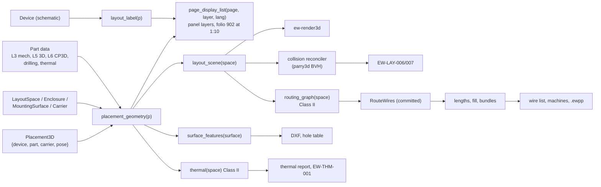

# Panel layout: 2D, 3D, routing, wire lengths and thermal: placement, layout checks and 2D panel pages

A chapter of [Panel layout: 2D, 3D, routing, wire lengths and thermal](12-panel-layout.md), whose table says where each section lives.

---

## 1. Scope and position

### 1.1 What this document owns

| Topic | Here | Elsewhere |
|---|---|---|
| Layout records, frames, poses, carriers, placements | §2, §3 | Entity list: [03](03-domain-model.md) §16; file ownership: [05](05-project-format-and-persistence.md) §2 |
| Part data the layout reads (mechanical, 3D, CP3D, drilling, thermal) | which fields, units and semantics (§2.5) | Part record and data levels: [07](07-symbols-parts-macros.md) §2.5 |
| PanelLayout and ModelView pages | projection, labels, legend, dimensions (§5) | Page model and tools frame: [06](06-schematic-editor.md); forms and embedded blocks: [09](09-reports-forms-output.md) |
| Physical wires and their identity | consumed as routing units (§8.2) | Derivation: [08](08-connections-terminals-cables.md) §3.8 |
| Wire records, machine files, `.ewpp`, labels | length and route fields they read (§9) | [13](13-manufacturing-outputs.md) |
| Rule engine, modes, waivers | rule content of pack EW-LAYOUT and EW-THM (§4, §11.8) | [15](15-checks-revisions-collaboration.md), 02a CHK |
| Panel 3D workspace shell | canvas behaviour (§12) | [16](16-ux-ui.md) |
| QET folio 902 migration | binding rules (§16.3) | Importer: [14](14-interop.md) (FR-IMP-019) |

### 1.2 Crates

| Crate | Layout responsibility |
|---|---|
| `ew-panel` | Layout queries, snapping engine, placement commands, collision reconciler, routing graph, negotiated-congestion router, lengths, duct fill, bundles, surface features, thermal queries, the 2D projection of surfaces (the geometry layers of PanelLayout display lists, §5.2, arch §3), and the glTF (glb) and STL writer for `layout_scene` (§14); MVP 2D overlap index on rstar 0.13.0, already a workspace dependency of `ew-scene` |
| `ew-render3d` | wgpu 3D renderer: instancing, feature edges, transparency, CAD camera, CPU ray picking, and the toolkit-agnostic camera, pick and constraint API behind the gizmo |
| `ew-ui` | The 3D gizmo (transform-gizmo-egui 0.11.0) over that API, because only `ew-ui` may know egui (arch §3 Rule 3, ADR-0016 amendment 1) |
| `ew-step-proto` (permissive) | Worker IPC frames (postcard) and cache artefact formats (rkyv, glb) |
| `ew-step-worker` (bin) | OCCT via occt-sys 7.8.1 + opencascade 0.3.0 (LGPL-2.1, C-5): STEP read, tessellation, edges, hulls, frames, features; HLR in 1.x |
| `ew-scene`, `ew-dl` | Composition of PanelLayout and ModelView pages: frame and title block, embedded tables, label text shaping (`shaped_text`), and the IR emitted to the renderers (ADR-0015) |
| `ew-reports`, `ew-export`, `ew-mfg`, `ew-api` | Legend, hole table, cut list and thermal row sources; surface DXF; `.ewpp` content from `ew-mfg`, composed by `ew-api` with the `ew-panel` glb (arch §3) |
| `ew-checks` | Pack EW-LAYOUT (EW-LAY-0nn) and the EW-THM rules ([15](15-checks-revisions-collaboration.md) §4.5.4, §4.6) |

### 1.3 Design rules

1. **The placement is the single source of physical truth.** Every layout output (2D page, 3D view, routing,
   lengths, drilling, thermal input, BOM lines for layout parts) is derived from placements, carriers and part data.
   Nothing is drawn independently (PM §1 point 2).
2. **No tag text in layout records** (ADR-0001, D-02). Labels are the `layout_label` query.
3. **Model at 1:1 in nm, view at scale.** Paper size, text height and line weight are paper-space constants; the
   model never stores a paper coordinate (G4, ADR-0005).
4. **Semantics never come from vendor CAD.** Surfaces, frames, rail profiles and connection points come from part
   templates and panel macros. A STEP file only adds appearance and collision detail, so a bad file cannot break
   routing (PM §6.2).
5. **Expensive results are Class II, shop-floor results are committed** (ADR-0003). Routing, full 3D collision and
   thermal run on forks with a revision stamp; routes and lengths become `committed_route` records only through the
   explicit `RouteWires` command.
6. **Deterministic to the byte** (NFR-REL-07): integer geometry and costs, sorted iteration, UUID tie-breaks.
7. **No third-party engineering content shipped** (NFR-LIC-06): vendor STEP, DXF and TR 60890 figures are user data.



---

## 2. Concepts and data

### 2.1 Frames and units

| Frame | Origin and axes | Used by |
|---|---|---|
| Layout space (world) | Enclosure 1's outside bottom-left-rear corner; X right, Y up, Z towards the door (03 §16) | Routing graph, thermal heights, 3D scene |
| Enclosure | Same convention per enclosure; `Enclosure.pose` places it in the space (bayed suites, 1.x) | Surfaces |
| Mounting surface | `frame: Pose3`: u, v in the surface plane, w outward normal (towards the viewer of the 2D view); datum = bottom-left corner of the usable polygon's bounding box | 2D pages, carrier paths, drilling DXF datum |
| Carrier | Rail: start of the rail axis on the rail's front face (7.5 or 15 mm above the plate), u along the path, w out of the plate. Duct: start of the centreline at plate level. Surface: the surface frame | Placement poses |
| Part | Bounding-box min corner after normalisation: x along the rail (width W), y up the plate (height H), z out of the plate (depth D). `rail_offset` = vector from the part origin to the rail clip point | Footprint, meshes, CP3D, drilling |

- All linear values are `Nm(i64)`; poses are `Pose3 {t: [Nm; 3], q: [i64; 4] in 10⁻⁹}`, encoded as
  `{"t":[x,y,z],"q":[w,x,y,z]}` (05 §3). f64 mm (glam `DVec3`/`DAffine3`) is used only inside maths and f32 only in
  GPU buffers (G4, C-12). The 0.1 mm quantisation proposed in PM §4.1 is superseded.
- World transforms are composed in i128 nm for translations and rounded once per query result, so the same model
  yields the same world coordinates on every platform.

### 2.2 Records

The authored records are those of 03 §16 and arch §4.2. They all live in `layout/<space-uuid>.jsonl` (05 §2, kind
ranks 50–56, plus 57 `routing_path` and 58 `surface_feature`). Fields and kinds marked **(add)** are this document's
additions to the first draft of 03 §16; the schema-steward batch adopted them.

| Record | Authored fields | Notes |
|---|---|---|
| `LayoutSpace` | `location: StructureNodeId`, `name`, `install: InstallContext` **(add)** `{wall_behind, ceiling_above, neighbours: [Left/Right], floor}`, `thermal: ThermalInputs` (FR-THM-005), `policy: LayoutPolicyRef?` | One per cabinet or bayed suite (FR-LAY-001) |
| `Enclosure` | `space`, `device` (-UC1, carries the enclosure part), `pose`, `install_type` (derived default from `install`, overridable), `doors: Vec<DoorState>` (1.0) | The enclosure is a device, so its part reaches the BOM by the one path (ADR-0006) |
| `MountingSurface` | `enclosure`, `kind: Plate \| DoorInside \| DoorOutside \| Side \| Roof \| Floor \| Gland`, `device?` (plate NSYPMM107 as child of -UC1), `frame`, `usable: Vec<Pt2>`, `max_depth`, `pe_bond` | Created from the enclosure part's surface templates (FR-LAY-002/003) |
| `Carrier` | `surface`, `kind: Rail \| Duct \| Busbar \| Surface`, `part?`, `path: Vec<Pt2>` (surface frame), `params` (§2.4), `pe_bond` | Layout-only part, counted in the BOM (FR-LAY-008) |
| `Placement3D` | `device`, `function?`, `part: PartRef?` **(add)**, `segment: SeqRange?` **(add)**, `carrier: CarrierRef`, `pose`, `variant?`, `locked` | §2.3 |
| `RouteOverride` | `connection` (physical wire ID, 08 §3.8), `path: Vec<RouteNodeRef>`, `pinned`, `bundle: Ident?` **(add)**, `seq: u32?` **(add)** | Survives re-routing (FR-LAY-047, FR-LAY-054). A manual length is not stored here but in `WireOverrides.length` **(add)** of the wire's carrier connection ([03](03-domain-model.md) §9, [13](13-manufacturing-outputs.md) §3.3), so that it also exists without a layout space |
| `committed_route` | `wire`, `path: Vec<RouteNodeRef>`, `len: LengthBreakdown` (ending in the unrounded calibrated length `L_cal`, §9), `input_hash` | `Committed<T>` without `rev` (05 §2); ID `v5(connection, "route")`; rounding happens once, when the `WireRecord` is built ([13](13-manufacturing-outputs.md) §3.3) |
| `RoutingPath` **(add)** | `space`, `kind: FreeAir \| Hinge{loop_allowance} \| WiringHole{feature} \| Guide`, `points: Vec<RouteAnchor>`, `class_set`, `cost_factor` | User routing paths (FR-LAY-043/044) |
| `SurfaceFeature` **(add)** | `surface`, `side: Front \| Back`, `feature: Hole \| Thread \| Cutout \| Slot \| Keyhole \| Custom`, `at`, params | User-authored machining features (FR-LAY-056); all others are derived |

`RouteNodeRef = Duct{carrier, seg, s} | Joint{carrier, vertex} | Path{routing_path, idx} | Stub{cp} | Entry{feature}`.
It names carrier positions, not graph node indices, so a committed route stays readable after the graph is rebuilt.
Authored layout records get UUIDv7 IDs; routing-graph nodes and `committed_route` records use UUIDv5 over their
inputs (ADR-0004).

### 2.3 Placement3D

```json
{"$k":"placement","id":"0193a2c4-9b10-7e21-8c44-1d2e3f405162","device":"0192f1c4-5a10-7c3e-8b21-6f0d9a4e2b10","carrier":{"carrier":"0193a2b0-41c2-7d0a-9f11-2a3b4c5d6e70"},"pose":{"t":[96000000,0,0],"q":[1000000000,0,0,0]}}
```

This is -102G1 on rail R1 at s = 96 mm. Fields not shown take their defaults: `part` = the primary mountable part
use, `locked = false`, no segment, no variant.

| Field | Meaning | Rule |
|---|---|---|
| `device` | The placed device | Structural: exists; delete policy `cascade` (03 §4.2) |
| `function?` | One function placed separately, e.g. the door handle function of a door-coupled switch | Must belong to `device` |
| `part?` **(add)** | Which `PartUse` of the device this placement realises; `None` = the primary mountable part (the first part use whose part has `mech.mount_kind`) | EW-LAY-003 if it names no part use of the device (FR-LAY-007, FR-LAY-059, PM §4.2 `part_ref`) |
| `segment?` **(add)** | Terminal range `{from_seq, to_seq}` when a strip is placed in pieces on several carriers (FR-LAY-063) | Ranges of one strip are disjoint and cover what is placed |
| `carrier` | `CarrierRef = Carrier(Id) \| Surface(Id) \| Placement(Id)`; `Placement` is piggy-back mounting (1.0 Could) | Delete policy `forbid`; §3.6 |
| `pose` | Relative to the carrier frame | Constrained per carrier kind (below) |
| `variant?` | Panel-macro variant (mounting orientation, e.g. a PSU mounted lying) | Must exist in the part |
| `locked` | Excluded from push, swap and auto-fill | — |

**Pose constraints per carrier kind** (validated in the command, reported by EW-LAY-010 after imports and merges):

| Carrier | Degrees of freedom | Stored pose |
|---|---|---|
| Rail | s along the axis; flip 180° about w | `t = (s, 0, 0)` = position of the part's rail clip point, `q ∈ {identity, 180° about w}` |
| Surface (plate, gland) | u, v; rotation k·90° about w | `t = (u, v, 0)` |
| Door inside / outside | u, v; any rotation about w | `t = (u, v, 0)` |
| Busbar system | s at multiples of the system pitch | `t = (k·pitch, 0, 0)` |

What is **never** stored: label text, footprint size, world position, the list of unplaced devices, outlines, holes,
fill, temperatures. Each is a query (§2.6).

### 2.4 Carrier parameters

| Kind | `params` | Derived | BOM |
|---|---|---|---|
| Rail | `profile: Ts35x7_5 \| Ts35x15 \| Ts32 \| Ts15`, `perforated`, start and end on the surface | axis, length, height above plate, fixing holes at the policy pitch | Part in metres or stock pieces; cut list (FR-MFG-030) |
| Duct | `width`, `height` (out of the plate), `inner_w?`, `inner_h?` (default from part, else 0.85 × nominal area), `slot_pitch`, `finger_w`, `cover`, orthogonal polyline `path`, joint style per vertex (`Butt \| Mitre`), `class_set` | label "W×H" (template, default `{width}×{height}`), centreline, slot nodes, segment lengths, fixings | Part in metres per segment; cut list |
| Busbar (1.0) | `phases: [L1, L2, L3, N?, PE?]`, `pitch` (60 mm system), `bar_section` (e.g. 12×5), phase ↔ potential links | adapter snap lattice, bar lengths | Bars and supports; cut list (FR-LAY-035) |
| Surface | — | the surface's own frame and usable polygon | — |

The label "40×60" of folio 902 is generated from `width = 40 mm`, `height = 60 mm` (▲, the reference's order is
ambiguous; PM §5.3). In the example all five ducts and the three rails carry placeholder parts (▲U-27), which
FR-CHK-034 reports as open items (EF-17); the unlabelled lower duct D5 additionally has a test type
(▲U-26).

### 2.5 Part data the layout reads

Part data is defined in [07](07-symbols-parts-macros.md) §2.5 (`MechData`, `Model3dRef`, `Cp3d`, `FeaturePattern`,
`PartSections`; FR-PRT-010, FR-PRT-011). The layout uses these fields:

| Level ([07](07-symbols-parts-macros.md)) | Field | Unit | Consumer | Release |
|---|---|---|---|---|
| L3 | `width`, `height`, `depth` | nm | footprint, box macro, enclosure fit | MVP |
| L3 | `mount_kind: Ts35x7_5 \| Ts35x15 \| Ts32 \| Ts15 \| Screw \| BusbarAdapter \| DoorCutout \| OnParent \| None` | — | snapping, EW-LAY-010, mountable predicate | MVP |
| L3 | `rail_offset` | nm vector | rail pose → part origin | MVP |
| L3 | `clearance {top, bottom, left, right, front}` | nm | padding while snapping (MVP), keep-outs EW-LAY-007 (1.0) | MVP / 1.0 |
| L3 | `front_2d` (outline polylines in the part frame) | nm | 2D outline at scale | MVP |
| L3 | `mass` | g | door mass rule (FR-LAY-033) | 1.0 |
| L5 | `model3d {sha256, source_hint, embeddable, vendor_transform, units}` | — | STEP pipeline (§6.2) | 1.0 |
| L5 | `drilling: FeaturePattern`, `cutout`, `keep_outs`, `marker_carriers` | nm | features (§10), collision, labels | 1.0 |
| L5 | enclosure section: outer and wall dimensions, doors, surface templates, material, `k_w`, IP/IK, dissipation data | — | enclosure creation, thermal | MVP (dims, plate) / 1.0 |
| L5 | duct and rail sections: inner dimensions, slot pitch, finger width, profile, stock length | nm | routing, fill, cut list | MVP / 1.0 |
| L6 | `cp3d: Vec<Cp3d>` | — | routing, lengths, ferrules, wiring viewer | 1.0 |
| L2 | thermal section: loss model (§11.2), `t_amb_max`, derating, climate-device data | W, A, °C | thermal | 1.0 |
| L2 | wire section: `outer_diameter`, class, insulation | nm | fill, segregation | 1.0 |

**`Cp3d`, the critical record** (FR-LAY-026; PM §4.4). One entry per physical CP of the part's function template:

| Field | Type | Meaning |
|---|---|---|
| `designation` | Ident | Must equal the schematic CP designation, or map through the macro's mapping table (EW-LAY-005) |
| `cp_idx` | u16 | Index into the template FnDef, so duplicated designations ("+#1", "+#2" of -102G1) stay distinct |
| `level`, `clamp` | u8, `ClampKey` | Locus on multi-level and twin terminals (`ClampKey` in 08 §2.3, clamp rules in 08 §6.3): PT 2.5-TWIN has clamp a on side 1 and b, c on side 2 |
| `pos`, `dir` | nm vector, unit vector ×10⁹ | Entry point of the clamp opening; insertion direction into the clamp |
| `clamp_type` | `Screw \| Spring \| PushIn \| Idc \| RingStud(M) \| Plug` | Ferrule rules, torque list |
| `csa_solid`, `csa_fine`, `csa_ferrule` | `Dec3` ranges mm² | Ferrule selection, EW-MFG pre-flight |
| `max_conductors`, `twin_ferrule_ok` | u8, bool | EN 60204-1 13.1 check (EW-EN60204-008) |
| `strip_len`, `insertion_depth` | nm | End allowance in the length formula (§9) |
| `torque` | `Dec3` N·m | Checklists (FR-MFG-037) |
| `test_access` | bool | Continuity test points |
| `quality` | `Measured \| FromVendor \| Generated` | `Generated` sets `estimated_cp` on wires (FR-LAY-023) |

Optional accuracy fields for robot wiring stay out of v1 (PARK-07); the record is extensible through `extra`.

### 2.6 Derived queries

| Query (key) | Returns | Class, policy | Main inputs |
|---|---|---|---|
| `mountable(dev)` | `Mountable{primary_part} \| Exempt(reason)` | I, cold | device kind, parts, parent, aspects (§2.7) |
| `unplaced(space)` | sorted device list | I, memo | mountable, device locations, `placements_by_device` |
| `placement_geometry(p)` | footprint, OBB, CP3D in carrier and world frames, keep-outs, outline ref, quality | I, memo per placement | pose chain, part L3/L5/L6, variant |
| `layout_label(p)` | label lines, style key | I, memo | `device_tag(dev).displayed(page)`, page label mode (FR-LAY-009) |
| `rail_occupancy(carrier)` | sorted intervals `(s0, s1, placement, padding, locked)` incl. strips and group accessories | I, memo per carrier | placements on the carrier, geometry |
| `strip_layout(p)` | per terminal: s, width; end covers, brackets per group | I, memo | strip terminals by `seq`, part widths, accessories |
| `carrier_order(carrier)` | placements in physical order | I, cold | rail occupancy (consumed by [10](10-plc-and-bus.md) for EtherCAT and rack order) |
| `page_display_list(page, layer, lang)` of a PanelLayout page | 2D display list per panel layer (§5.2) | I, memo + LRU | geometry, labels, carriers, features, form |
| `layout_legend(surface)` | legend rows | I, memo | placements, carriers, parts (FR-LAY-012) |
| `surface_features(surface)` | merged feature list with origins | I, memo | part patterns, carrier fixings, enclosure, `SurfaceFeature` |
| `layout_scene(space)` | instances `{placement, mesh hash, world pose, state}` | I, memo (arch §6.4) | geometry, Class III mesh refs |
| `collisions(space)` | findings with sub-shape refs | II, job ≤ 10 ms | scene, cache meshes |
| `routing_graph(space)` | nodes, edges, capacities | II, built on the fork | carriers, scene, routing paths, policy |
| `route_status(wire)` | `Fresh \| Stale(fields) \| Unrouted` | I, cold | committed route, recomputed input hash |
| `duct_fill(space)` | fill per edge | I, memo | committed routes, wire ODs, duct areas |
| `bundle_sequence(space)` | bundle key and `seq` per wire, with overrides applied (§8.7) | I, memo | committed routes, strips, `RouteOverride.bundle/seq` (consumed by [13](13-manufacturing-outputs.md)) |
| `panel_front_reps(dev)` | derived "panel front" representations for navigation and "show all representations" (arch §6.4; none is stored) | I, cold | placements of the device, layout pages |
| `wire_length(wire)` | `LengthBreakdown`, source | I (reads committed) | committed route, policy, overrides |
| `thermal(space)` | `ThermalResult` | II, job | placements, loss models, load model, enclosure, inputs, coefficient set |

The MVP's queries are in `ew_derive::layout` (D2: no
`ew-panel` crate yet), and none is stored: a footprint, a label, the unplaced list and an occupancy are derived from
the placement records and the part data each time. Values are integer nanometres in the mounting surface's frame
(u right, v up), exact, since carriers are axis-parallel and turns are quarter turns. `mountable(dev)` (D8, cold; §2.7);
`unplaced(space)` (memo): the mountable devices of the space's location without a placement, in natural
order of their full tag, a device of another location never listed, `Session::unplaced` in the API; `placement_geometry(p)` (memo): the footprint and outline in the surface frame and the unknown
flag only (no OBB, CP3D or keep-outs at the MVP): on a rail the clip point lies on the axis at u = `path[0].u` + s
(-102G1 on R1: (101, 675)–(171, 805) mm), an unknown part is the 20 × 20 mm square about the pose, a strip is its
terminals side by side, and a placement on a duct or a rail without a valid axis has none; `rail_occupancy(carrier)`
(memo): intervals `(s0, s1, placement, device, locked, unknown)` in s along the rail, sorted, a strip one interval,
overlaps kept for EW-LAY-006, no clearance padding and no group accessories; `layout_label(p, page, mode)`
(memo): the device's displayed tag on the page (abbreviated) or its full designation, so renumbering changes the label
and no layout record; a placement of one function prints its device's label without D10's ":" suffix (functions
carry no designation member in format 0.1); `carrier_geometry(carrier)` (cold): the axis check, length, rail axis and
outline, a rail's width from its profile. `strip_layout`, `carrier_order` and the rest of the table wait for their
packages. The four memo families are in `verify-derived`'s sweep.

### 2.7 The mountable predicate

EW-LAY-001 and the unplaced list need one exact definition of "a device that must appear in the layout of its
location":

| Case | Result | Example |
|---|---|---|
| Device location ≠ any layout space location, or device marked *supplied by others* (FR-DEV-037) | not considered | field valves -203Q1 … -203Q8 (TA05-V-15 …) in +FIELD ▲U-07 (20 §6.2) |
| Part use with `mount_kind` ∉ {`None`, `OnParent`} | Mountable (primary part) | -102G1, -201U2, -201U9 |
| No part, device kind physical (switch, lamp, protective device, terminal strip …) | Mountable, footprint unknown | S56, E56 (no parts, EF-04) |
| `mount_kind = OnParent`, or a child of a placed strip or sub-base | Exempt: mounted with its parent | -X1031:1 … 20; valves -201U3-Q1 …; the DP plug -3X1 (Festo 532216) on -201U1 |
| Terminal of a strip | Exempt: placed through `strip_layout` | 1X1:PE |
| Cable, conductor, wire, interruption point, external device | Exempt | -106W1, -3W1 |
| Enclosure and surface devices | Exempt: they are the layout | -UC1, NSYPMM107 plate |
| Integral device (kind `PeStud`, no part, parent = a surface's device) | Exempt; its CPs take their 3D position from the parent part's CP3D (the plate's PE stud), so wires to it stay routable | -XPE (waiver W-1); W6 ends on the plate's PE stud |

`ew_derive::layout::Mountable`, first match wins: (1) a device
whose location has no layout space is not considered (*supplied by others* waits for its attribute); (2) the
device of an enclosure or a surface is exempt; (3) a strip with terminals is mountable as one placement without a
part; (4) a terminal of a strip, a cable and a device without functions are exempt; (5) a part use whose part has a
mount kind other than `none` and `on_parent` is mountable, the first such use the primary part; (6) part uses that
are all `on_parent` or `none` are exempt; (7) part uses without a mount kind are mountable with an unknown footprint;
(8) a device without parts whose functions are all of the PE point's FnDef category is exempt as an integral PE point
(-XPE, by its FnDef category rather than a `PeStud` kind); (9) any other device without parts is mountable with an
unknown footprint. Assembly children are not exempt by being children: "with its parent" holds only through
`on_parent`.

---

## 3. Placement behaviour and rules

### 3.1 Enclosures and surfaces

- **Create from part data** (FR-LAY-002). `CreateEnclosure{part, space, pose}` creates the enclosure device (-UC1)
  with its part, and one `MountingSurface` per template in the enclosure part. At MVP the template set is
  box-shaped: plate, with door and gland templates read but used from 1.0 (FR-LAY-003). Dimensions are never typed on
  the page; changing the part re-derives the surfaces' usable polygons and reports placements that no longer fit
  (EW-LAY-010).
  The enclosure device and its plate take the **numbering scheme's tags, not frozen
  ones**: the enclosure letter `UC` with the lowest counter no `UC` tag holds, its tag printing no page since no page
  draws it (as a cable without a drawing, [03](03-domain-model.md) §8.2), so `-UC1`; the plate its child `U1`
  (`-UC1-U1`). A frozen tag is a person's or an import's fixed text, which EW-NUM-001 lists as deviating; one the
  program chose itself made the check report both right after Enclosure…. An older project keeps its frozen tags.
- **Families.** Schneider Thalassa PLA polyester wall enclosures (NSYPLA1074G with NSYPMM107, folio 902) have no
  system punching: rails and ducts are screwed to the plate, which creates fixing features (§10). Rittal AX compact
  enclosures behave the same way. Rittal VX25 frame enclosures add a punching lattice (25 mm pitch *(unverified)*)
  and a depth-adjustable plate (`plate_z`), which drives the door-closed check. Lattice snapping and bayed suites
  are 1.x (FR-LAY-037).
- **Installation context.** `LayoutSpace.install` records the wall behind, the ceiling and bayed neighbours. Thermal
  reads face exposure from it (§11.3), so "wall-mounted" is a fact of the scene, not a separate thermal input.
- **Selection assistant (1.x, FR-LAY-038)** is a catalogue filter, not an optimiser: Σ(footprint + clearance) +
  duct area + reserve ≤ usable plate area, max(device depth + rail height) + door-device depth ≤ usable depth, and a
  passing thermal result or a fitting climate device. With the reference set's devices and 25 % reserve it must list
  NSYPLA1074G.

### 3.2 Rails and ducts

- **Rails** are drawn by two points on a surface, snapped to the plate grid (1 mm fine, 5 mm coarse) and to duct
  edges. The profile comes from the rail part; the axis is a 1-D coordinate space `s ∈ [0, L]` (FR-LAY-004).
- **Ducts** are orthogonal polylines with explicit width and height (FR-LAY-005). A vertex is a corner or, where two
  ducts meet, a T or cross joint; joints connect routing segments (§8.1). Duct and rail lengths in the BOM and cut
  list come from the path, rounded up to the cutting increment of the shop policy.
- **Moving a carrier moves everything on it**, because placement poses are carrier-relative. A move that makes a
  rail overlap a duct is a collision finding, never an automatic correction.
- **Free length.** The property grid of a rail shows its free length `L − Σ occupied intervals` from
  `rail_occupancy`, the basis of reserve rules and of the selection assistant.

### 3.3 Placing and snapping

`PlaceDevice{device, part?, carrier, at, mode}` and `MovePlacement{placement, at, mode}` are interactive commands.
While the user drags, the tool computes the snap result each frame without committing (arch §9, tools return
`Transient`); release commits one transaction (ADR-0008), so one drag is one undo step.

**Rail snapping on a 1-D interval model** (FR-LAY-014; PM §5.4):

```text
snap_on_rail(rail, device, cursor, mode):
  s_cursor = project(cursor, rail.axis)                 // only rails within snap distance (default 15 px)
  require compatible(device.mount_kind, rail.profile)   // else refuse; EW-LAY-010
  w   = footprint.width + clearance.left + clearance.right
  occ = rail_occupancy(rail)                            // sorted (s0, s1, id, locked), padding included
  s   = snap(s_cursor, targets = occupant edges ∪ {0, L} ∪ plate grid ∪ column edges of the rail above)
  match mode:
    Free => nearest gap g in occ with |g| ≥ w, closest to s
    Push => insert at s; shift right neighbours by the overlap, cascading;
            fail if a locked placement or the rail end is reached ("would overflow by x mm")
    Swap => exchange intervals with the occupant under the cursor (same width class or push the rest)
  return pose t = (s_left + clearance.left + rail_offset.x, 0, 0)   // the part's clip point on the rail axis
         and the neighbour poses that changed
```

- Push and swap write the moved neighbours' poses in the **same** transaction, so undo restores the whole row.
- **Off-rail placement** on a surface snaps to the plate grid, to edges and centres of other footprints and to duct
  edges; rotation in 90° steps. Door items rotate freely (FR-LAY-032).
- **Mount-kind compatibility**: TS 35 devices fit TS 35×7.5 and TS 35×15; TS 32 devices only TS 32; screw-mounted
  devices go on surfaces; busbar adapters on busbar systems. The table is data in the layout policy.
- **Bulk placement** (FR-LAY-016). `AutoFillRail{rail, devices, order: Dt | SchematicPosition}` fills greedily from
  the left with clearance gaps and stops at the rail end, listing what did not fit. Schematic order is (page order,
  row, column) of each device's main representation.
  **The person chooses the devices.** Auto-fill rail… (`layout.auto_fill_rail`) offers
  the cabinet's unplaced devices, then the devices without a location, each a row with a tick; Fill places the ticked
  ones, and a ticked device without a location takes the cabinet's location in the same undo step (a refused fill
  takes it back). The devices marked in Unplaced devices start ticked; without marks the **first guess** reads only
  what the model already holds of a device, first match wins: (1) its primary part's mount kind: a rail profile is
  ticked, any other kind (screwed, in the door, on a busbar) is not; (2) it has the cabinet's location: ticked; (3) a
  function whose FnDef category is field equipment (`SensingPosition`, `SensingPressure`, `SensingTemperature`,
  `FluidSensor`, `CylinderFluid`, `MotorRotary`, `ValveTerminal`, `ValveTerminalNode`, `ValveTerminalModule`), or it
  stands behind terminals in the field (every wire from it ends at a terminal's field side, as Give location reads
  it): unticked; (4) otherwise ticked. No data is added to a device. A script names the devices (`devices`: IDs or
  tags of those offered; another is refused in words) or, leaving them out, takes the guess. The dialog's former
  button that gave every device without a location the cabinet's and placed them all, field devices too, is gone.

### 3.4 Strips, assemblies and group accessories

- **Terminal strips are placed as a whole** (FR-LAY-015): one `Placement3D` of the strip device; `strip_layout`
  positions the terminals by `seq` with their part widths, adds end covers per strip end from the terminal part's
  accessories, and recomputes on every strip change. Adding a terminal in the schematic lengthens the placed strip in
  the next derivation; if the rail overflows, EW-LAY-010 reports it. A strip may be split across carriers with
  `segment` ranges, and it stays one BOM row (D-42).
  A strip that grows by `terminal.insert` or by a new terminal
  placed in the schematic shifts the items after it on its rail by the overlap, cascading as push does (§3.3), in the
  same transaction: free space after the strip is used first, a locked item stops the cascade (EW-LAY-010 then reports
  the overlap), and past the rail end the positions are written and EW-LAY-010 reports `bracket_outside`. The command
  is never refused for the layout's sake. A strip whose footprint is unknown before or after (a terminal without a
  part, so every `terminal.add`) pushes nothing. A strip turned 180° grows left, so it pushes the items before it,
  leftwards, by the same cascade on the rail's coordinates mirrored: the gaps stay the real frame's, so between two
  strips the bracket of the strip on the left, as EW-LAY-010 judges it, a locked item stops the
  cascade, and past the rail's start the positions are written and EW-LAY-010 reports `bracket_outside`. The pushes of one command cascade from one another: each reads the positions and the strip
  widths the transaction holds.
- **Group accessories** (FR-LAY-060, MVP). A group is a maximal run of abutting strip placements on one rail.
  Wherever strips are placed, `rail_occupancy` derives one end bracket per strip boundary in the run plus one at each
  run end, so k abutting strips need k + 1 brackets. In the example rail R2 holds 1X1, -X1031 and -X1032 abutting: **4**
  brackets, as on folio 902 and in BOM row 26. Strips that are not placed, and
  bridges, use authored part uses (bridge parts on their `BridgeSpec` connections). From 1.0 the part-data accessory
  lists (`AccessoryRef{per: Group}`, [07](07-symbols-parts-macros.md) §2.5; FR-PRT-005, FR-REP-051) declare the
  bracket part and must reproduce the same count.
- **Assemblies and PLC racks.** Children of one assembly (the valve terminal -201U1 … -202U3) or of one PLC station
  on one carrier are kept contiguous and in physical order (`Device.position`, module slot). `PlaceAssembly{device,
  carrier, at}` places all members abutting; inserting a missing member uses push mode. EW-LAY-016 (FR-LAY-061) reports
  gaps and order differences, so the layout cannot contradict the manifold order that also generates the overview
  on 201/202 (D-10). `carrier_order` gives [10](10-plc-and-bus.md) the EtherCAT and rack order (1.0).

### 3.5 Part changes and schematic changes

| Event | Effect | Never |
|---|---|---|
| Device part changes (wider MCB on -102F1) | `placement_geometry` re-derives the footprint at the same pose; an overlap with -102F2 is reported (EW-LAY-006, FR-LAY-007) | neighbours are moved, except by a strip placed as a whole whose terminal the change widened: it pushes as a growing strip does (§3.4) |
| Device renumbered (T55 → T57) | the label changes in the same commit; no file under `layout/` changes (FR-LAY-006, D-01, D-02) | stored label text |
| Device deleted | placement cascades; the transaction lists it in the preview; routes of its wires become unrouted | orphan placement |
| Device location changes (+J-E-2416 → +J-E-206) | placement kept; EW-LAY-004 with quick fixes "remove placement" and "move to the layout space of +J-E-206" | silent move |
| Terminal added to a placed strip | strip length grows; EW-LAY-010 on overflow | rail auto-extension |
| Part use removed that a placement names | EW-LAY-003; quick fix "realise the primary part" | silent retarget |

"Terminal added to a placed strip" also moves the items after
the strip on its rail by the overlap, as §3.4's as-built note says; the strip's length still grows and EW-LAY-010 still
reports an overflow, and the rail is still never extended.

### 3.6 Carrier deletion

`Placement3D.carrier` has delete policy `forbid`. `DeleteCarrier{carrier, then: RemovePlacements | RehomeToSurface}`
is the only way to delete an occupied carrier. `RehomeToSurface` converts each pose to the equivalent surface pose,
after which EW-LAY-010 reports the devices as "rail device not on a rail". Both variants are previewed.

### 3.7 Commands

| Command | Cost | Notes |
|---|---|---|
| `CreateLayoutSpace`, `CreateEnclosure`, `SetInstallContext`, `SetThermalInputs` | Interactive | — |
| `AddCarrier`, `EditCarrierPath`, `DeleteCarrier` | Interactive | Rails, ducts, busbars |
| `PlaceDevice`, `MovePlacement`, `RotatePlacement`, `FlipPlacement`, `LockPlacement`, `RemovePlacement` | Interactive | Modes Free/Push/Swap |
| `PlaceStrip`, `PlaceAssembly`, `AutoFillRail` | Interactive / Bulk above 200 placements | — |
| `AddRoutingPath`, `SetRouteOverride`, `PinRoute`, `SetBundle` | Interactive | Keyed by physical wire ID |
| `RouteWires{scope: Space \| Wires(ids), options}`, `ClearRoutes` | Bulk (preview job) | §8.5 |
| `AddSurfaceFeature`, `AddDimension` | Interactive | 1.0 |
| `PlaceClimateDevice{part, surface, at}` | Interactive | Creates the device with its functions unplaced (listed in the device navigator for dragging onto a schematic page, FR-UI-007), its placement, its cut-out and its loss entry, and marks the thermal result stale (FR-THM-008) |

---

## 4. Layout checks (EW-LAYOUT)

The rule IDs, final severities and numeric codes are registered in [15](15-checks-revisions-collaboration.md) §4.5.4
(family EW-LAY, class 130, e.g. EW-LAY-011 → `130011`); EW-LAY-012 … 016 and 020 … 026 are this document's
additions to the 02b set EW-LAY-001 … 011. Online rules are memoised
`checks(scope)` queries per surface or carrier (arch §12, ADR-0019); 3D collision and routing rules are Class II and
show their revision stamp.

| Rule | Finding | Severity | Mode | Release | Implementation | Quick fix |
|---|---|---|---|---|---|---|
| EW-LAY-001 | Mountable device without placement in the layout space of its location (§2.7; FR-LAY-017, FR-CHK-039) | warning; error at release | online, release | MVP | `unplaced(space)` | open unplaced list; place on active rail |
| EW-LAY-002 | Placement without device | structural (cascade) | prevent | MVP | invariant; on lenient import an unmatched QET rectangle becomes a layout graphic, never a placement | — |
| EW-LAY-003 | Placement's part use is not on the device (FR-LAY-059) | error | online | MVP | `Placement3D.part` ∉ `device.parts` | realise primary part |
| EW-LAY-004 | Device location ≠ layout space location | warning | online | MVP | structure query | remove / move placement |
| EW-LAY-005 | CP3D pattern does not cover the device's physical schematic CPs (after the macro mapping table) | error (blocks routing of affected wires) | online | 1.0 | designation multiset per function | open macro editor; add mapping entry |
| EW-LAY-006 | Overlap or collision: 2D footprints per surface (MVP); 3D solids, door closed (1.0) | error | online (2D); II (3D) | MVP / 1.0 | §7 | — |
| EW-LAY-007 | Clearance zone violated, with the amount | warning | II | 1.0 | `distance` on keep-outs | — |
| EW-LAY-008 | Duct edge over fill limit: warning limit, error limit (shop policy) | warning / error | online on committed routes | 1.0 | `duct_fill` | re-route; widen duct |
| EW-LAY-009 | Wire unroutable (no path, blocked stub, pinned path broken) | error | II | 1.0 | router report | add routing path |
| EW-LAY-010 | Carrier compatibility: mount kind ≠ carrier profile; pose off the carrier; outside the usable polygon or depth range; rail or strip overflow | error | online | MVP | pose and occupancy validation | move to compatible carrier |
| EW-LAY-011 | Committed route or length stale (input hash changed) | warning; error at release | online | 1.0 | `route_status` | re-route the listed wires |
| EW-LAY-012 | Machining feature conflict: web below minimum (feature–feature, feature–edge), hole under another device; duplicate holes merged (info) | warning | online | 1.0 | `surface_features` (FR-LAY-057) | — |
| EW-LAY-013 | Door-swing collision, with the angle | error | II | 1.x | sweep (FR-LAY-031) | — |
| EW-LAY-014 | Pre-assembled cable route longer than its length minus connector allowances | error | II | 1.0 | FR-LAY-050 | choose a longer cable part |
| EW-LAY-015 | Wire in a duct whose class set excludes its segregation class (manual or pinned paths) | warning / error by policy | online | 1.0 | FR-LAY-048 | re-route |
| EW-LAY-016 | Assembly or rack members not contiguous or not in physical order on their carrier (FR-LAY-061) | warning | online | MVP | `carrier_order` vs `Device.position` | reorder by position |
| EW-LAY-020 … 026 | Placement rules (FR-LAY-033/034): depth containment, thermal zoning, EMC segregation distance, operator height, door mass, cable-entry zone, handle-axis alignment | warning | online | 1.0 (Could) | rhai/Rust rules with constants as data, `verified` flag | — |

Rule constants (fill limits, clearances, heights, segregation distances) ship with a `verified` flag; an
unverified constant reports at most a warning (FR-CHK-046).

---

## 5. 2D panel pages

### 5.1 Page model

A `PanelLayout` page ([06](06-schematic-editor.md) §2.2) shows one mounting surface (FR-LAY-010). It carries:

- `Page.scale`: a ratio from the configured series (1:1, 1:2, 1:5, 1:10, 1:20, 1:50, 1:100, after ISO 5455) or
  `NotToScale`; the title block binds it (FR-REP-033, REF-070); a page still not to
  scale takes, with its first surface view, the first ratio of the series at which the surface's usable outline fits
  the drawing area (a chosen scale kept), a page without a frame form reading the default frame grid's area;
- a `SurfaceView` page item **(add)** `{surface, side: Front | Back, datum_at: Pt2, clip: Rect?, label_mode:
  Abbreviated | Full, layers}`;
- embedded report blocks: PART DATA (bound to `device_part_lines(-UC1)`, [09](09-reports-forms-output.md) §3.4) and
  the placement legend (FR-LAY-012);
- at 1.0, dimension items **(add)** and further `ModelView` items with their own scale (FR-PAG-003, FR-LAY-039).

The page is an ordinary page of `page_order()`: its title block, Prev/Next and TOC entry are derived, so the layout
page cannot drift in revision or description (D-05, D-06), and folio 902 gets Next = 903 from the generated
report folios.

**Projection.** A model point (u, v) of the surface maps to paper by
`x = datum.x + u·num/den`, `y = datum.y − v·num/den` (paper y points down, 03 §3.1), computed in i128 nm with one
rounding to the nearest nm. At 1:10 the example's enclosure (W 750 × H 1000 mm ▲U-26) occupies 75 × 100 mm on the A4 sheet.
Changing the scale changes no stored pose (FR-LAY-002). **The plate takes the whole sheet**: a new view fits
its enclosure to the frame's whole drawing area at the first ratio of the series that holds it and centres it there;
nothing is kept free for a legend, which is a list page of its own (§5.4). **Fit the layout to the sheet**
(`layout.fit_sheet`, a panel page's context menu, Page ▸ Order and Enclosure's split on the Draw tab's layout
group beside Rail and Duct) does the same to the view a page has: one
`page.surface_view.set` with the fitting scale and the centred datum, its labels and label mode kept, so it changes the
datum and the scale and never a stored pose; on a page drawn so already it is refused in words ("The layout takes the
whole sheet already"), and so it is while a legend box still stands beside the layout, whose room the plate would take
("The legend stands beside the layout: choose Move the legend to its own page first, …", §5.4). A Scale typed in the
page's Properties at which the plate's usable outline runs over the drawing area says so in a toast whose action is
Fit the layout to the sheet ("At 1:2 the layout runs over the frame's drawing area. Fit the layout to the sheet draws
it at 1:5, centred."; `Session::layout_overruns`), and a ratio that is no scale (`1:4.5`, `2:9`) is refused in words
("`1:4.5` is not a scale; type 1:n …").

The page item `surface_view`
is typed with `surface`, `datum_at`, `label_mode` and `labels` (`tags`, the default; `item_numbers`; `both`: what each
placement is labelled with, §5.3; added in 0.3, an older build keeps it and draws tags); `side`, `clip` and `layers` stay verbatim until typed
([03](03-domain-model.md) §6). `page.surface_view.set {page, surface, datum_at, label_mode?, labels?}` sets it on a
`panel_layout` page and is refused on another kind (`labels` absent keeps the view's); a second set replaces the view in place; the view cascades with
its surface. **The stated scale holds on paper:** the frame maps the page to the sheet at `scale_ppb` (0.986282578 on
every QET-compatible frame and the starters), so the projection divides by it too, `num/den = 10⁹ / (n · scale_ppb)`
(10⁹ without a map), i128, one rounding half away from zero; the datum stays in page coordinates. On 902 the
enclosure measures 75.0 × 100.0 mm printed (76.043 mm on the page for its 750 mm edge). A page without a scale draws
the surface at 1:1 on the page. The projection is built in `ew-scene`'s `panel` module from a view that `ew-api` fills
from the layout queries (arch §3).

### 5.2 Layers of the display list

A PanelLayout page is drawn by the same `page_display_list(page, layer, lang)` query as every page (arch §6.4,
ADR-0015 amendment 2), with the panel-page layers surface, carriers, placements, features and dims plus the shared
frame, labels, tables and highlights ([09](09-reports-forms-output.md) §4.1). The layer rule holds: a placement
move rebuilds `placements` and `labels` only, never `frame` or `tables`.

| Layer | Content | Line and text style |
|---|---|---|
| `surface` | enclosure outline, plate outline, usable polygon (thin dashed) | ISO 128 visible / hidden |
| `carriers` | rails (outline + axis chain line), ducts (outline, optional slot ticks), busbars | duct fill hatch optional |
| `placements` | `front_2d` outline, else the footprint rectangle; from 1.0 silhouettes from 3D (FR-LAY-011, FR-LAY-039) | |
| `labels` | `layout_label` lines; balloons at 1.0 | slot kind `layout.label`, bound by default to the style `xref.device` (1.83 mm em); paper height constant |
| `features` | holes, cut-outs, centre marks (1.0) | |
| `dims` | associative dimensions (1.0) | ISO 129-1 style *(unverified edition)* |
| `tables` | PART DATA, legend | form |
| `frame` | frame and title block | form |
| `highlights` | selection, collision and fill highlights; screen only, never exported | — |

Every item carries an `EntityRef` (placement, carrier, feature), so hit-testing, selection sync and "show all
representations" work on folio 902 as on schematic pages (FR-UI-007).

The `surface`, `carriers`, `placements`
and `labels` layers are drawn, each its own memo family (`page_display_list_surface`, `_carriers`, `_placements`,
`_labels`); `features` and `dims` stay empty until 1.0, and the `tables` layer draws the embedded blocks of a panel page. `surface`: the enclosure outline, the plate outline and the usable polygon thin dashed; `carriers`: per
carrier by ID its outline rectangles, a rail's axis as a chain line and a duct's "W×H" label in millimetres;
`placements`: per placement by ID its `front_2d` outline, else its footprint rectangle (an unknown footprint dashed).
Carrier outlines and duct labels carry the carrier's entity, footprints and labels the placement's; the surface
outlines and a rail's axis carry none, so a click on a footprint selects the placement. **Labels knock out the
carriers:** the carriers layer cuts the rails' and ducts' outlines and the rails' axes around every label's ink box as
placed (a cut, not a paper-coloured fill), so the carriers layer reads the labels' fit and **a placement move rebuilds
`placements`, `labels` and `carriers`**, never `frame` or `tables`.

### 5.3 Labels

- `layout_label(p)` = `device_tag(dev).displayed(page)`. With `label_mode = Abbreviated`, identifier suppression
  removes the aspects equal to the page's (+J-E-2416), so -X1031 prints as "-X1031" and the full DT
  `=P01+J-E-2416-X1031` appears in the legend (FR-LAY-009). Frozen tags print as frozen ("S51", "T55", sign hidden).
- A strip segment of one terminal (`segment` with `from_seq = to_seq`) or a placement of one function prints the
  full designation ("-X1031:1"). A terminal is a device (arch §4.2) but is placed only through its strip.
- **Fitting policy** (FR-LAY-062). The label keeps its style's paper height. The fit test compares the
  label's ink box from `shaped_text` plus 0.1 mm per side with the footprint's paper rectangle. If it does not fit,
  the label is rotated by 90°; if it still does not fit, it is placed outside with a leader; otherwise it becomes a
  balloon with the legend position. It is never shrunk: the reference's rotated labels at 1.88–3.40 pt (RD §1.12)
  are exactly what D-29 and D-31 forbid. Example: at 1:10 an 18 mm MCB *(unverified width)* is 1.8 mm wide on
  paper. "-101F1" in `xref.device` (1.83 mm em, ink height ≈ 1.31 mm with the default font's cap height of 0.714 em,
  length ≈ 5.8 mm) does not fit horizontally but fits rotated: 1.31 + 0.2 = 1.51 mm ≤ 1.8 mm.

`layout.label` is a constant of
`ew-scene` bound to the `xref.device` style, not a slot kind of the symbol library. The ink box is estimated as the
shaped text's advance + 0.2 mm by the face's cap height + 0.2 mm, plus the descent only when the text has a descender
(a true ink-box query is not built), and compared with the footprint in page space; a label placed outside starts its
leader 1.5 mm off the footprint, above it, or below when above leaves the surface. Balloons are built in 0.3 (below).
A function's placement adds no ":" suffix, since functions carry no designation member.

At 1:10 the tags of one rail would run into each other, so:
- **What a label shows.** The view's `labels` chooses the tag, the item number or both. The **item number** is the
  placement's position in `layout_legend` (§5.4), read by the labels layer from the same query as the legend, so the
  two cannot disagree; it prints in a **balloon** (a circle in pen 0.18 around the number in the label style, 0.3 mm
  inside), centred in the footprint when it fits, else outside with its leader as a tag. With both, the balloon
  stands left of the tag in one label. The Properties row Labels sets it, and so does the page's menu (Labels: Tags,
  Item numbers, Both, the current one checked; `layout.labels {show}`); Add legend on a page that shows tags
  answers with a toast whose Show item numbers switches it.
- **Tags where they fit, balloons where they do not** (`labels: tags_or_numbers`, Labels:
  Tags or numbers). A device prints its tag inside its footprint where the tag fits whole at the label size, across
  or turned (the fit test above, never shrunk); where it does not (a terminal, a small part) it prints its item
  number in a balloon instead, centred in the footprint where the balloon fits, else outside with its leader. Every
  view the window makes (the page's Surface row on a page without a view, Enclosure…) takes this mode, whatever the
  scale; tags, item numbers and both stay as choices, and the legend lists every position whatever the mode. An older
  build reads the value as one of a newer format and draws tags. A view the window makes gets its legend page in the
  same gesture (§5.4).
- **Crowded labels move apart.** A label placed outside its footprint takes, left to right by footprint, the first
  place that overlaps no label placed before it (labels inside their footprints and moved labels stand first): its
  first side (above, or below when above leaves the surface), the other side, then one stack level (its height plus
  0.5 mm) further out on either side, up to four levels; a place other than the first must stay on the surface. The
  leader runs from the label to the footprint's edge. A row without collisions prints as before.
- **The short form.** A page without a location of its own suppresses the location of the layout space its view
  shows: on the cabinet's own layout "+CAB1-K1" prints "-K1". This is one rule for every page
  (`page_display_structure`, which the displayed tag, the layout labels, the legend's DT and the title block's
  `{page.location}` read): a page without a location of its own takes the cabinet its view shows, else the one location
  every device drawn on it has (a page whose devices have two locations, or none, takes none), so a schematic page of
  one cabinet prints "-102A1" and says "+CAB1" once in its title block. Devices still take their structure from the
  page's own slots only.
- **A label can be moved.** A drag of a label (or balloon) that stands off its footprint moves it alone; one inside
  its footprint moves alone once its placement is selected, else it goes with its device's drag. With one placement selected its label shows a dashed box with a
  handle, and the pointer over a label that drags alone is the grab hand
  (`layout.label_move {placement, at?}`); `Placement.label_at` (added in 0.3) stores the label's centre as an offset
  from the footprint's centre in the surface's frame, so it moves with the placement; a label off its footprint gets
  a leader to the footprint's nearest point. Reset label position in the placement's menu removes it (greyed with its
  reason while the label stands where the rules put it); Reset label positions in the page's menu removes every one of
  the page in one step (`layout.labels_reset {placements}`).

### 5.4 Legend and PART DATA

`layout_legend(surface)` rows: position, DT, manufacturer, part number, description, quantity or length. A
quantity that is not a count of pieces prints with its unit ("0.47 m" for a rail), since a legend,
in a box or as a page, is made without a Unit column; a count prints bare, and the CSV and XLSX write the number
beside the Unit column. Order:
enclosure and plate first, carriers (rails, ducts, busbars) next, then placements by DT in natural order, then
layout-only accessories. Positions are derived and renumber when rows are added; balloons and the legend read the
same query, so they cannot disagree. Rows come from the same `RowSet` as XLSX and CSV (FR-REP-030). The embedded
PART DATA box of folio 902 is kept for fidelity with the reference and is bound to -UC1's part lines (REF-069).

The legend is the embedded report block
`legend-902` of kind `enclosure_legend` on 902, rect 108.00–278.00 × 19.50–167.50 mm printed (doc 20 §17.3), drawn as
a boxed table titled "LEGEND" in two flow columns of a header and up to 20 rows of 6.52 mm each (40 rows); printed columns position, DT, quantity and part number at weights
10 : 22 : 16 : 35; the manufacturer, the description and the unit stay in the rows and the CSV, which `ew export
report --block <its ID> --format csv` writes ([09](09-reports-forms-output.md) §2.2). PART DATA on 902 lists -UC1's
part lines (NSYPLA1074G, NSYPMM107) and no carrier line: the source is the enclosure device of the surface the page's
surface view shows, and carrier lines are left out. A `layout.move` rebuilds no `tables` family of 902.

**Add legend** (the page's right-click menu, Page ▸ Order ▸ Add legend; Select at rest says so over
the free spot) puts an embedded `enclosure_legend` block on a panel page that shows a surface and holds none: in the largest
free part of the frame's drawing area right of, left of, below or above the layout (its enclosure's outline as
projected), 10 mm off the layout and 5 mm inside the area, when that part is at least 60 × 40 mm and the legend prints
every row and every text whole there; else it makes the legend page (below). Such a legend prints position, DT, quantity, part number and description through the block's own printed
columns (`ReportBlock.columns`: `{key, weight}` per column, absent means the kind's layout, which an older
build prints). A block with its own columns is a **lookup table**: one flow column across the block; each column as wide as its
widest text, the last taking the rest; the box ends under its last row, so the block's rectangle is the room it may
take. **Where the block is narrower, the legend keeps its identifiers whole and wraps its prose**: a
part number cut to "…" is worth nothing on paper, where no tooltip reads the rest, and a reader of a panel layout looks
an item up by its position, its tag and its part number; the description only says what the item is. A column of text
(the description) is prose, every other one (position, tag, quantity, part number, manufacturer) an identifier. In
this order, until the columns fit: every column shrinks its text to the 1.8 mm cap height, the prose first, then the
quantity and the part number, the tag and the position last; the prose narrows to its widest word, a description that
no longer fits wrapping at its words onto further lines at that size, its row growing by a line pitch for each further
line; the prose narrows further and is cut; last, an identifier is cut (a column cut to nothing prints nothing), which
only a box narrower than its identifiers at the smallest size meets. Where the wrapped rows need more height than the
block has, no description wraps and each is cut in its row instead: the box keeps every row before whole descriptions.
The legend does not ask for a wider box: the room beside a layout is the frame's, and a legend that waits for a person
prints cut texts until then. A legend a person adds draws no drop shadow and fills its header row a light grey
(`LOOKUP_HEADER_FILL`, 232 of 255), where the house box (PART DATA, a legend without its own columns) keeps the
reference's 2.61 mm shadow and its grey header. 100 mm wide, the starter's texts print whole; 60 mm wide, every
position, tag, quantity and part number stays whole. On
its page Select picks the legend by its box, a drag moves it and, with the legend selected, a drag of one of its corners
resizes it (`fields.set` of `embedded.rect`, on whole millimetres, at least 30 × 20 mm; a bottom corner sets where its
room ends); Delete removes it. A block without `columns` prints its four columns in two flow columns. The legend keeps
the order of `layout_legend`: the enclosure, the plate and the carriers stand together before the devices, since the
reference set's legend holds that order and they are items a shop orders and cuts.

**The legend is a list page of its own, right after its layout page** (FR-REP-023 brought forward). A
page block of kind `enclosure_legend` that names its layout page (`ReportBlock.layout_page`, [09](09-reports-forms-output.md)
§2.2) lists the surface that page's view shows, and is a list like any other: it runs on over as many pages as its rows
need, on the set's own frame (09 §3.8), with its own printed columns and caption (made with position, tag, quantity,
part number and description; the manufacturer and the unit are among the others List columns… offers), in the
project's language, in the contents and the PDF outline, and `ew export report --block <its ID>` (or its printed
folio, 902.1, or the layout page's number, 902, its `first_folio`) writes it as CSV or XLSX. Its pages follow the
layout page, 902.1, 902.2 … after 902 (09 §3.2 says where those are taken). Its Properties show the layout page it
follows (Layout page) and not its first folio and section, which it keeps for older builds and this build does not
read. Its title names its layout: "Legend of layout 902", "Legenda bij layout 902" (the title
`Legend of layout {layout}`, `{layout}` the layout page's folio, so a renumbered layout renames it); a legend page's
Properties show the title as the page prints it, and the title row's explanation names `{layout}`. `ew export
report --kind enclosure_legend` writes the legend of every plate a layout page shows, in page order, each after a
heading row "Layout 902" (09 §2.2), and a list block of the legend's kind that names no layout page (Output ▸ Reports ▸
Report block… makes one) lists the same on its pages. Deleting the layout page deletes its legend list.
- **Enclosure…** makes the legend page with the view: the plate drawn on the layout page and its legend page are one
  undo step (a location, a layout page and an enclosure the act makes stay steps of their own before it). A page's
  Surface row that gives a page its first view makes the legend page the same way.
- **Add legend** puts the legend on the layout page itself only where it prints every row and every text whole there
  (above); otherwise a toast says so in words ("The legend does not fit beside the layout whole, so it has a page of
  its own: 902.1") and Add legend makes the legend page. A layout with a legend, on the page or as a page, is offered
  no second one ("This layout has its legend on a page of its own"), and `report_block.create` refuses a second legend
  list of one plate in words: the two would print the same folios.
- **A legend belongs to the plate, not to the page.** Its rows are the plate's and its positions are
  the plate's balloons, the same on every layout page that shows it (a second page of one plate, a detail at another
  scale), so a second list would print the same rows twice. Of the layout pages that show the plate, the first in page
  order is the one the legend follows, whichever of them it was made from: its pages are that page's sub-pages, its
  title names that page, its rows link to that page's footprints, and a renumbering or a new page earlier in the order
  moves it with them. Every layout page of the plate links its labels to the one legend, and is offered no legend of
  its own ("This layout has its legend on a page of its own"; Add legend's toast names the legend's folio).
  `ReportBlock.layout_page` still names the page it was made from, which tells the plate.
- **An embedded legend made before keeps printing as it does.** **Move the legend to its own page** (the legend's
  context menu, Page ▸ Order; `report_block.legend_to_page`) removes the box and makes the legend page in one undo
  step: the rows are the same surface's, and the printed columns are the box's own, or the five above for a box
  without its own.
- **A layout made before keeps its datum and its scale as stored** (§5.1). To give such a page the whole sheet once
  its legend has gone, **Fit the layout to the sheet** (the page's context menu and Page ▸ Order; `layout.fit_sheet`) fits its view as a new view is fitted, in one undo step (§5.1).
- **From the drawing to the row and back** (the cross-references' links and their resolution, 09 §4.2). A row's tag
  on the legend page links to the device's footprint on the layout, which is that link's target (`ew:pl`), so a click
  on it goes there, in the window and in the exported PDF. Back, Follow reference (F) over a device or its tag or
  balloon on the layout, or with the device selected, goes to its row (the row is the target `ew:lr`). The labels
  themselves are no links: on an editable page a click on a link follows it, and a click on a label must select and
  drag its device. A layout without a legend page draws no target, so its drawing is unchanged.
- **What it does not do.** Keep the legend when the layout page it was made from is deleted while another page shows
  the plate (the record names that page, and its delete takes the legend with it); a legend page of a page of another
  kind; rows in any order but `layout_legend`'s (the positions are the
  balloons' numbers); wrapping a description on the list page (a list's cells do not wrap, 09 §3.8: the column takes
  the room the others leave, as every list's does).

### 5.5 Dimensions and views (1.0)

- **Associative dimensions** (FR-LAY-041) reference features: `RefPoint = CarrierAxis{carrier, end} |
  CarrierEdge{carrier, side} | FeatureCentre{feature} | PlacementEdge{placement, side} | SurfaceDatum`. The value is
  derived at render; a dimension whose reference disappeared renders "?" and raises an info finding. Presets:
  plate overview (ordinate from the datum), drilling drawing with hole table, door cut-out drawing.
- **Model views** (FR-LAY-039): orthographic front, top and side views, isometric and detail views on ordinary
  pages. 1.0 uses painter's order by z of placement boxes plus per-part projected feature edges (computed once per
  part and view direction in the worker and cached); exact OCCT hidden-line views follow in 1.x (FR-LAY-040). While
  a view regenerates, its frame shows "out of date" (Class II).

