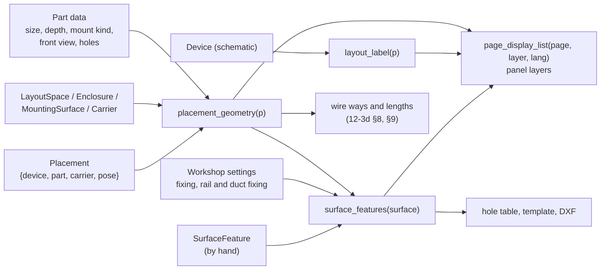

# Panel layout: 2D, 3D, routing, wire lengths and thermal: placement, layout checks and 2D panel pages

A chapter of [Panel layout: 2D, 3D, routing, wire lengths and thermal](12-panel-layout.md), whose table says where each section lives.

---

## 1. Scope and position

### 1.1 What this document owns

| Topic | Here | Elsewhere |
|---|---|---|
| Layout records: spaces, enclosures, the surfaces of a cabinet, carriers, placements, holes added by hand | §2, §3 | Entity list: [03](03-domain-model.md) §16; file ownership: [05](05-project-format-and-persistence.md) §2 |
| Part data the layout reads (size, depth, mount kind, clearance, front view, holes) | which members and what they mean (§2.5) | The part record: [07](07-symbols-parts-macros.md) §2.5 |
| Panel layout pages | projection, labels, legend (§5) | Page model: [06](06-schematic-editor.md); list pages: [09](09-reports-forms-output.md) |
| The holes and cut-outs of a surface | what is placed gives them ([12-3d](12-3d-routing-thermal.md) §10) | The hole table and the drawings for drilling: [13](13-drilling.md) §9 |
| Wire ways, lengths, duct fill, clearance and depth | the surfaces and depths they read (§2.8) | [12-3d](12-3d-routing-thermal.md) §7 to §9 |
| Rules of the pack EW-LAYOUT | rule content (§4) | Rule engine: [15](15-checks-revisions-collaboration.md) |

### 1.2 Homes

No crate is added for the layout ([04](04-architecture.md) §3.4):

| Crate | What it holds of the layout |
|---|---|
| `ew-schema` | the layout records (§2.2), a part's mechanical data and the `Hole` value (§2.5) |
| `ew-derive` (`layout`) | the queries (§2.6): geometry, fit, occupancy, labels, the legend, the features of a surface and their drilling order, the sizes of the named holes ([12-3d](12-3d-routing-thermal.md) §10); the word for a surface and a hole (`ew_derive::text`) |
| `ew-commands` | the `layout.*` commands (§3) |
| `ew-checks` | the pack EW-LAYOUT (§4) |
| `ew-scene` | the panel page drawn from its view (§5), a part's front view, the sheets of a drilling template |
| `ew-reports` | the legend and the hole table as lists |
| `ew-export` | the drilling DXF from the program's own writer and the template's PDF |
| `ew-api`, `ew-viewmodel`, `ew-ui` | the session's views of a page and a part, the shell's tools, dialogs and rows, the window |

### 1.3 Design rules

1. **The placement is the single source of physical truth.** Every layout output (a panel page, the wire ways, the
   lengths, the holes, the parts list's layout lines) is derived from placements, carriers and part data. Nothing is
   drawn independently.
2. **No tag text in layout records.** A label is the `layout_label` query.
3. **Model at 1:1 in nm, view at scale.** Paper size, text height and line weight are paper-space constants; the
   model never stores a paper coordinate.
4. **A part says what it is; the shop says how it is made.** A part's size, mount kind, front view and holes are
   part data; how a fixing hole is made (tapped, for a self-tapping screw, or through) and where a rail is fixed are
   the workshop's settings.
5. **Derived, never stored twice.** The features of a surface, its hole numbers and the drilling order are queries; a
   hole a person moved or left out is a choice stored on its owner, as an accessory's is.
6. **Deterministic to the byte:** integer geometry, sorted iteration, ID tie-breaks.
7. **No third-party engineering content shipped:** a maker's drawings and sizes are the user's data; the starter
   parts are generic.



---

## 2. Concepts and data

### 2.1 Frames and units

| Frame | Origin and axes | Used by |
|---|---|---|
| Enclosure | its outside bottom-left-rear corner; x right and y up as seen from the front, z towards the door | the surfaces' frames, the wire ways |
| Mounting surface | `frame: Pose3` in the enclosure: `u` right and `v` up as the surface is seen from the side it is worked from (§2.8), `w` towards that side | the page, carrier paths, poses, holes |
| Datum of a surface | the corner of its sheet it is measured from: the surface's own (`MountingSurface.datum`), else the project's (`WorkshopSettings.datum`), else the bottom-left one | the hole table, the drawings for drilling, the view's datum mark |
| Carrier | rail: the start of its axis, `s` along it; duct: the start of its centreline | placement poses |
| Part | the bottom-left corner of its front: `x` right and `y` up as the front is seen, `z` out of the front; a door device's depth runs behind the door. `rail_offset` is the rail clip point in this frame | footprint, front view, holes |

All lengths are `Nm(i64)`; a pose is `Pose3 {t: [Nm; 3], q: [i64; 4] in 10⁻⁹}`, encoded as `{"t":[x,y,z],"q":[w,x,y,z]}`
([05](05-project-format-and-persistence.md) §3). A placement turns by whole quarter turns about `w`, so every
coordinate of the layout is exact integer arithmetic.

### 2.2 Records

The records are those of [03](03-domain-model.md) §16, in `layout/<space-uuid>.jsonl`
([05](05-project-format-and-persistence.md) §2, kind ranks 50 to 58). Each struct of `crates/ew-schema/src/layout.rs`
says its members; what they mean:

| Record | Members | Notes |
|---|---|---|
| `LayoutSpace` | `location` (+CAB), `name?` | one per location's cabinet; `install`, `thermal`, `policy` are kept verbatim until thermal types them |
| `Enclosure` | `space`, `device` (-UC1, which carries the enclosure part), `pose` | the enclosure is a device, so its part reaches the parts list by the one path |
| `MountingSurface` | `enclosure`, `kind: plate \| door \| left \| right \| top \| bottom`, `device?` (a surface part of its own: the plate -UC1-U1), `frame`, `usable` (the sheet's outline in its frame), `edge_margin?` (the strip along a door's or a wall's edge where nothing is cut), `hinge?: left \| right` (a door), `datum?: bottom_left \| bottom_right \| top_left \| top_right` (absent: the project's, `WorkshopSettings.datum`, bottom left when that is absent too), `pe_bond` | one per face of the cabinet (§2.8); the plate is made with the enclosure, every other face the first time a page shows it (§3.1) |
| `Carrier` | `surface`, `kind: rail \| duct`, `part?`, `path` (surface frame), `params` (§2.4), `pe_bond`, `hole_choices` | a layout-only part, counted in the parts list by length; `hole_choices`: its fixing holes moved or left out ([12-3d](12-3d-routing-thermal.md) §10.4) |
| `Placement` | `device`, `function?`, `part?`, `carrier: carrier \| surface`, `pose`, `locked`, `label_at?`, `hole_choices` | §2.3 |
| `SurfaceFeature` | `surface`, `at` (its centre in the surface frame), `hole` (§2.5), `purpose?` (what it is for, in the person's words: "Earth stud"), `cable?` (the cable whose gland it holds, §3.9; delete policy unlink), `for_cable` (made for a cable: true stays when the cable is gone) | a hole a person added: by hand, or a cable's gland he placed; every other hole is derived ([12-3d](12-3d-routing-thermal.md) §10) |
| `RouteOverride` | none: rank 55 stays reserved | A way is not pinned by hand ([12-3d](12-3d-routing-thermal.md) §8.7). A length typed by hand is `WireOverrides.length` of the wire's carrier connection ([03](03-domain-model.md) §9, [13](13-manufacturing-outputs.md) §3.3), so that it also exists without a layout space |
| `committed_route` | `space`, `wire`, `ends`, `way`, `run` ([12-3d](12-3d-routing-thermal.md) §8.5) | Written only by Route; ID `v5(wire, "route")`; the length is made from `run` and rounded once, when the `WireRecord` is built ([12-3d](12-3d-routing-thermal.md) §9) |
| `RoutingPath` | none: rank 57 stays reserved | No path is drawn by the person ([12-3d](12-3d-routing-thermal.md) §8.7); a door's crossing is derived ([12-3d](12-3d-routing-thermal.md) §8.1) |

A stored way names positions along ducts, not nodes of a graph, so it stays readable after the graph is built again
([12-3d](12-3d-routing-thermal.md) §8.5). Authored layout records get UUIDv7 IDs; a `committed_route` record uses
UUIDv5 over its wire (ADR-0004).

A `HoleChoice` is `{index, offset?, omit}`: the hole of its owner's pattern at `index` (a part's `mech.holes` in its
order; a carrier's fixings counted from the start of its path) moved by `offset` (`u`, `v` in the surface frame) or
left out. A member a build does not know, a kind of a newer format and a carrier of another kind are kept verbatim as
read.

### 2.3 Placement

```json
{"$k":"placement","id":"019b76da-a97e-7000-8000-00000000017e","device":"019b76da-a82b-7000-8000-00000000002b","part":{"copy":"e427be05-825e-56c5-bfc0-ee9ce5d9122f"},"carrier":{"carrier":"019b76da-a96c-7000-8000-00000000016c"},"pose":{"t":[168200000,0,0],"q":[1000000000,0,0,0]}}
```

This is the sample's -101G1 on rail 1 at s = 168.2 mm. A device in the door sits on the door surface itself, its pose
the bottom-left corner of its front: -102S1 at (255, 465) mm is `"carrier":{"surface":"<the door>"}` with
`"t":[255000000,465000000,0]`.

| Member | Meaning | Rule |
|---|---|---|
| `device` | the placed device | cascade with the device |
| `function?` | one function placed on its own | must belong to `device` |
| `part?` | which part use of the device the placement realises; absent: the primary part (the first part use whose part has a mount kind). A device with a part in the door and a part on the plate has a placement for each: -101Q1's switch on rail 1 and its door coupling handle in the door | EW-LAY-003 if it names no part use of the device |
| `carrier` | a rail, or a surface itself (`{"surface": id}`): the plate, a door, a wall | delete policy forbid (§3.6) |
| `pose` | relative to the carrier | per carrier kind (below) |
| `locked` | left alone by push, swap and auto-fill | — |
| `label_at?` | where a person moved its label (§5.3) | — |
| `hole_choices` | the holes of its part moved or left out ([12-3d](12-3d-routing-thermal.md) §10.4), each naming the part's hole (`hole`: its centre in the part frame and its kind and size) | a choice stays on its hole when the part's holes are edited or its copy replaced; one whose hole the part no longer has applies to none, and EW-LAY-017 says so with Drop the choices that find no hole |

`segment` (a strip placed in pieces) and `variant` (a mounting variant) are kept verbatim; neither is built.

| Carrier | Degrees of freedom | Stored pose |
|---|---|---|
| Rail | `s` along the axis; a half turn about `w` | `t = (s, 0, 0)`, the part's clip point on the rail axis |
| Surface (plate, door, wall, top, bottom) | `u`, `v`; a turn of `k · 90°` about `w` | `t = (u, v, 0)`, the bottom-left corner of the part's front before the turn |

What is **never** stored: label text, a footprint, a world position, the unplaced list, outlines, holes, their
numbers. Each is a query (§2.6).

### 2.4 Carrier parameters

| Kind | `params` | Derived | Parts list |
|---|---|---|---|
| Rail | `profile: ts35x7_5 \| ts35x15 \| ts32 \| ts15` | axis, length, its fixing holes from the workshop's rail fixing ([12-3d](12-3d-routing-thermal.md) §10.3) | its part by length; cut list ([13](13-workshop-lists.md) §9.3) |
| Duct | `width`, `height` (out of the plate), `slot_pitch?`, `cover?` | the label "W×H", the centreline, segment lengths, its fixing holes from the workshop's duct fixing | its part by length per segment; cut list |

The sample's duct is 40 × 60 mm and prints "40×60". Busbar systems are not built.

### 2.5 Part data the layout reads

A part's members are the struct `Part` of `crates/ew-schema/src/library.rs` ([07](07-symbols-parts-macros.md)
§2.5). The layout reads `mech` and four sections:

| Member | What it is | Read by |
|---|---|---|
| `mech.width`, `mech.height` | the size of the part's front, as it is seen from the side it is worked from (on a rail: along the rail and up the plate) | the footprint |
| `mech.depth` | how far it stands out of its surface; for a part in a cut-out, how far it reaches behind the door or wall | the depth check ([12-3d](12-3d-routing-thermal.md) §7), the wire ways |
| `mech.mount_kind` | how it mounts (below) | where it fits, EW-LAY-010 |
| `mech.rail_offset` | the clip point in the part frame; absent: the front's centre | the pose on a rail |
| `mech.clearance` | the room kept free around it | the padding while placing, the clearance check |
| `mech.front_shape` | `rectangle` (absent) or `round`: the outline drawn when the part has no imported outline; `round` is a circle of diameter `width` and is allowed only where `width` = `height` | the panel page, the In the cabinet picture of Parts |
| `mech.front_2d` | an outline imported from a maker's DXF drawing, polylines in the part frame; when present it is drawn instead of the shape | the panel page |
| `mech.holes` | the drilling pattern: `PartHole {x, y, hole}` each, its centre in the part frame and its `Hole` | the features of a surface ([12-3d](12-3d-routing-thermal.md) §10) |
| `sections.enclosure` | outer `width`, `height`, `depth`, `wall`, the `plate` part, and: `doors` (each `{hinge: left \| right, width?}`, left to right; absent: one door over the whole front, hinged on the left), `edge_margin?` (of its doors and walls), `usable_depth?` (the clear depth between the plate and the closed door) | the surfaces (§2.8), the depth check |
| `sections.mounting_plate` | its `width`, `height`, `thickness` | the plate surface |
| `sections.cable.outer_diameter` | a cable part's outer diameter | the size of its gland (§3.9) |
| `sections.gland` | a gland part (`kind: gland`): `thread` (M12 … M63), `clamp_min`, `clamp_max` (the cable diameters it seals), `nut?` (the room its nut takes, across its corners) | the gland a cable gets, the pitch of a row of glands |
| `sections.rail`, `sections.duct` | a rail's profile and stock length; a duct's inner size and slot pitch | carriers, cut list, duct fill |

**A `Hole`** is one of:

| Kind | Stored | What it is |
|---|---|---|
| Round | `{"round": {"d": <nm>}}` | a plain hole of a diameter |
| Fixing | `{"fixing": "m5"}` (M3, M4, M5, M6, M8) | a hole for a screw that fixes the part: the shop's setting and the surface decide how it is made ([12-3d](12-3d-routing-thermal.md) §10.3) |
| Cut-out | `{"cutout": "d22"}` (16, 22, 30 mm) | the round cut-out of an operator of that class |
| Gland | `{"gland": "m20"}` (M12, M16, M20, M25, M32, M40, M50, M63) | the hole of a metric cable gland |
| Rectangle | `{"rect": {"w": <nm>, "h": <nm>, "r": <nm>?}}` | a rectangular cut-out, with a corner radius |

A named hole's size comes from the program's table ([12-3d](12-3d-routing-thermal.md) §10.2), so a part names "a
22 mm cut-out" and the hole table, the template and the DXF print the size the table gives. The text form of a hole
(`Ø 4.5`, `M5`, `22 mm`, `M20`, `92 × 92 R 2`) is parsed by `Hole`'s own parser in `ew-schema`, with its kind, for
the cells of the Holes table in Parts and the command line.

**Where a mount kind fits:**

| Mount kind | Fits | Words |
|---|---|---|
| `ts35x7_5`, `ts35x15`, `ts32`, `ts15` | a rail of a profile the table of §3.3 lets it, on any surface | "TS 35×7.5" … |
| `screw` | a surface itself: the plate, and the inside of a door or a wall | "screw-mounted" |
| `door_cutout` | a cut-out of a door, a wall, the top or the bottom; never the plate or a rail | "in a cut-out" |
| `on_parent` | not placed: it is mounted with its device's other part (a contact block behind its operator) | "mounted on its parent" |
| `none` | not placed | "not mounted" |
| `busbar_adapter` | a busbar system, which is not built: it fits nothing yet | "busbar adapter" |

The 3D model and the connection points in 3D of a part come with the 3D view and are not read by the 2D layout.

### 2.6 Derived queries

The queries are in `ew_derive::layout`; none is stored. Values are integer nanometres in the mounting surface's frame
(`u` right, `v` up), exact, since carriers are axis-parallel and turns are quarter turns. The queries of the wire ways
and lengths are [12-3d](12-3d-routing-thermal.md) §8 and §9's.

| Query | Returns | Policy |
|---|---|---|
| `mountable(dev)` | each part use to place and its primary part, or why the device is exempt (§2.7) | cold |
| `unplaced(space)` | each mountable part use of the space's location without a placement: `(device, part)`, in natural order of the device's full tag, then the part use's order; a device of another location is never listed | memo |
| `placement_geometry(p)` | the footprint and the outline in the surface frame, the turn, the part realised, whether the footprint is unknown | memo |
| `rail_occupancy(carrier)` | intervals `(s0, s1, placement, device, locked, unknown)` along a rail, sorted, a strip one interval, overlaps kept for EW-LAY-006 | memo |
| `strip_layout(strip)` | a strip's items in mounting order with their widths and places | memo |
| `layout_label((p, page, mode))` | the label text (§5.3) | memo |
| `carrier_geometry(carrier)` | the axis check, the length, a rail's axis and the outline | cold |
| `layout_legend(surface)` | the legend rows (§5.4) | memo |
| `surface_features(surface)` | every hole of the surface with its owners, numbered in drilling order ([12-3d](12-3d-routing-thermal.md) §10.4) | memo |
| `surfaces(enclosure)` | the enclosure's six faces (§2.8): for each its kind, the record if it has one, its size from the part, its page | cold |
| `behind_door(p)` | how far a placement in a door or a wall reaches behind it: its part's depth and the greatest depth of the device's `on_parent` parts | cold |
| `cable_glands(space)` | each cable with an end in the space's location and an end outside it: its gland part (its chosen one, else the proposal) or why it has none, and the `SurfaceFeature` that holds it, if placed (§3.9) | memo |
| `to_enclosure(surface, pt)` | a point of a surface in the enclosure's front view (`x`, `y`): a door's point lies in front of the plate's point of the same `x`, `y` | cold |

**The footprint.** On a rail the clip point lies on the axis at `s`; on a surface the pose is the front's bottom-left
corner before the turn. A part without `W` or `H`, or a device without a part, has the unknown 20 × 20 mm square about
the pose. A strip is its terminals and the accessories standing in it side by side (`strip_layout`): the terminals by
`seq` and, after each, the accessories its terminals' parts stand there (`part_accessories`); the accessories a
person added to the strip (`Strip.accessories`) stand after the terminal whose `seq` is the greatest not above their
`after_seq` (before the first terminal when none is) and count in the width as those the parts bring do. A placement
on a duct, or on a rail without a valid axis, has none. A placement of one function prints its device's label
without a ":" suffix. The memo families are in `verify-derived`'s sweep.

### 2.7 The mountable predicate

EW-LAY-001 and the unplaced list need one definition of "a device that must appear in the layout of its location".
`ew_derive::layout::Mountable`, first match wins:

1. A device whose location has no layout space is not considered (the field devices of +FLD: -103M1, -104B1).
2. The device of an enclosure or of a surface is exempt: they are the layout (-UC1, -UC1-U1).
3. A strip with terminals is mountable as one placement without a part (-X1011, -X1021, -X1031).
4. A terminal of a strip, a cable and a device without functions are exempt (-X1011:1, -101W1).
5. **The primary part is to be placed, and each further part use whose part goes in a cut-out**: the primary part is
   the first part use whose mount kind is other than `none` and `on_parent`; -101Q1 with its switch (TS 35) and its
   door coupling handle (in a cut-out) is listed twice until both are placed. A further part use on a rail or on
   screws is placed with its device, as projects made before hold it (an accessory listed as a part use of its own).
6. Part uses that are all `on_parent` or `none` are exempt (-201K1-Q1, mounted on its valve terminal).
7. Part uses without a mount kind are mountable with an unknown footprint.
8. A device without parts whose functions are all of the PE point's FnDef category is exempt as an integral PE
   point.
9. Any other device without parts is mountable with an unknown footprint.

Assembly children are not exempt by being children: "with its parent" holds only through `on_parent`.

### 2.8 The surfaces of a cabinet

A cabinet has six faces besides its plate, and each is a surface a device can sit on and a hole can be made in. Each
is drawn as a person sees it from the side it is worked from, standing in front of the closed cabinet:

| Surface | Kind | Sheet | Seen from | `u`, `v` in the enclosure | Words |
|---|---|---|---|---|---|
| Mounting plate | `plate` | the plate part's `width × height`, centred in the enclosure | the front, the door open | `x`, `y` | Mounting plate / Montageplaat |
| Door | `door` | the door's `width` × the enclosure's `height`; one door: the whole front | outside | `x` (from the door's left edge), `y` | Door / Deur; of two: Left door, Right door / Linkerdeur, Rechterdeur; of three or more: Door 1, Door 2 … from the left |
| Left side | `left` | `depth × height` | the left, the door on the right | `z`, `y` | Left side / Linkerzijwand |
| Right side | `right` | `depth × height` | the right, the door on the left | `depth − z`, `y` | Right side / Rechterzijwand |
| Top | `top` | `width × depth` | above, the door's edge at the bottom of the drawing | `x`, `depth − z` | Top / Bovenkant |
| Bottom | `bottom` | `width × depth` | below, the door's edge at the top of the drawing | `x`, `z` | Bottom / Onderkant |

- **A surface's size** is the enclosure part's when the surface is made (the door's width from `doors`, else the
  enclosure's), and it is the surface's own from then on: Properties shows Width and Height, which he may type. A face
  whose size the part does not give (an enclosure part without a depth) is offered with its size to type before it is
  made.
- **The edge margin** of a door or a wall is the enclosure part's `edge_margin` (absent: none, and only the web of
  [12-3d](12-3d-routing-thermal.md) §10.5 is kept to the edge). The usable area is the sheet less the margin; the
  plate has none. A device's footprint stays inside the usable area (EW-LAY-010).
- **A door's hinge** is the part's (`doors[i].hinge`): one door is hinged on the left unless the part says otherwise;
  of two, the left door on the left and the right door on the right. The page draws it (§5.2); the wire ways read it
  to cross to the door ([12-3d](12-3d-routing-thermal.md) §8).
- **The datum** differs from job to job, so it is a setting: the surface's Properties ▸ Measured from (Bottom left,
  Bottom right, Top left, Top right, or "The project's: Bottom left", which clears it), and for every surface of the
  project at once Project properties ▸ Workshop ▸ Measured from (bottom left when not set), so a shop that
  always measures from the top-left sets it once. The hole table's heading, the template's band and the DXF's origin
  and its `DATUM` layer say which corner it is ([13](13-drilling.md) §9); the page marks it with its "0" (§5.2).
- **Seen from outside, a door lies in front of the plate as drawn:** its `x`, `y` are the plate's, shifted by the
  plate's place in the enclosure, so nothing is mirrored. The door's page shows the plate's footprints behind it on
  the screen (§5.2), and `to_enclosure` gives the depth check and the wire ways the same mapping.

---

## 3. Placement behaviour and rules

### 3.1 Enclosures and surfaces

- **Created from part data.** Enclosure… (`layout.enclosure.create_from_part`) makes the enclosure device (-UC1) with
  its part and the plate surface from the enclosure part's `plate`: its frame centres the plate in the enclosure, its
  usable polygon is the plate rectangle. Sizes are never typed on the page.
- **Tags.** The enclosure device and its plate take the numbering scheme's tags, not frozen ones: the enclosure letter
  `UC` with the lowest counter no `UC` tag holds, its tag printing no page since no page draws it ([03](03-domain-model.md)
  §8.2), so `-UC1`; the plate its child `U1` (`-UC1-U1`). An older project keeps its frozen tags.
- **Every other surface is made the first time a page shows it.** The door, the sides, the top and the bottom are
  offered from the enclosure part (`surfaces(enclosure)`), and the act that opens a page of one (§3.8) makes its
  `MountingSurface` record from the part in the same undo step. A cabinet whose door holds nothing has no door
  record and no door page. **An existing project's enclosure reads as before:** its plate only; its door is offered
  from its part and made when he opens it. Nothing stored changes its meaning.
- **Two doors.** An enclosure part that lists two doors offers Left door and Right door, each a surface of its own
  with its own sheet, hinge, datum and page; a device sits in one of them.
- **Installation context** (`LayoutSpace.install`) and the thermal inputs are kept verbatim until thermal types them.

### 3.2 Rails and ducts

- **Rails** are drawn by two points on a surface, snapped to the plate grid (1 mm fine, 5 mm coarse) and to duct
  edges. The profile comes from the rail part; the axis is a 1-D coordinate `s ∈ [0, L]`.
- **Ducts** are orthogonal polylines with an explicit width and height. A vertex is a corner or, where two ducts
  meet, a T or a cross. Duct and rail lengths in the parts list and the cut list come from the path: the parts list
  prints it exact to the millimetre, the cut list rounds each piece up to the project's cut increment
  ([13](13-workshop-lists.md) §9.3).
- **A rail's and a duct's fixing holes** follow the workshop's rail and duct fixing, along the axis and the centreline
  ([12-3d](12-3d-routing-thermal.md) §10.3). Lengthening a carrier adds holes; a carrier edit that changes how many
  holes it has drops its hole choices, and its preview says so.
- **Moving a carrier moves everything on it**, because placement poses are carrier-relative. A move that makes a
  rail overlap a duct is a finding, never an automatic correction.
- **Free length.** The rail's Properties show its free length `L − Σ occupied intervals` from `rail_occupancy`.

### 3.3 Placing and snapping

`layout.place` and `layout.move` are interactive: while the user drags, the tool computes the snap result each frame
without committing; release commits one transaction, so one drag is one undo step.

**Rail snapping on a 1-D interval model:**

```text
snap_on_rail(rail, device, cursor, mode):
  s_cursor = project(cursor, rail.axis)                 // only rails within snap distance
  require compatible(device.mount_kind, rail.profile)   // else refuse; EW-LAY-010
  w   = footprint.width + clearance.left + clearance.right
  occ = rail_occupancy(rail)                            // sorted (s0, s1, id, locked), padding included
  s   = snap(s_cursor, targets = occupant edges ∪ {0, L} ∪ plate grid ∪ column edges of the rail above)
  match mode:
    Free => nearest gap g in occ with |g| ≥ w, closest to s
    Push => insert at s; shift right neighbours by the overlap, cascading;
            fail if a locked placement or the rail end is reached ("would overflow by x mm")
    Swap => exchange intervals with the occupant under the cursor (same width class or push the rest)
  return pose t = (s_left + clearance.left + rail_offset.x, 0, 0)   // the part's clip point on the rail axis
         and the neighbour poses that changed
```

- Push and swap write the moved neighbours' poses in the **same** transaction, so undo restores the whole row.
- **On a surface** a placement snaps to the plate grid, to the edges and centres of other footprints (so a row of
  pushbuttons lines up) and to duct edges; R turns it by a quarter turn, in a door as on the plate.
- **Mount-kind compatibility** is the table of §2.5 and, for rails, this one (data in `ew_derive::layout`): TS 35
  devices fit TS 35×7.5 and TS 35×15; TS 32 devices only TS 32; TS 15 only TS 15.
- **A refused drop says where the device goes.** A part in a cut-out dropped on the plate or a rail: "-102S1 goes in a
  cut-out of a door or a wall: place it on the door's page", with the toast's Open the door (`layout.surface_page`,
  §3.8). A rail device dropped on a door: "-101F1 mounts on a TS 35×7.5 rail: drop it on a rail".
- **Bulk placement.** Auto-fill rail… (`layout.auto_fill_rail`) offers the cabinet's unplaced devices, then the
  devices without a location, each a row with a tick; Fill places the ticked ones, and a ticked device without a
  location takes the cabinet's location in the same undo step (a refused fill takes it back). The devices marked in
  Unplaced devices start ticked; without marks the **first guess** reads only what the model already holds of a
  device, first match wins: (1) its primary part's mount kind: a rail profile is ticked, any other kind (screwed, in a
  cut-out, on a busbar) is not; (2) it has the cabinet's location: ticked; (3) a function whose FnDef category is field
  equipment (`SensingPosition`, `SensingPressure`, `SensingTemperature`, `FluidSensor`, `CylinderFluid`,
  `MotorRotary`, `ValveTerminal`, `ValveTerminalNode`, `ValveTerminalModule`), or it stands behind terminals in the
  field (every wire from it ends at a terminal's field side, as Give location reads it): unticked; (4) otherwise
  ticked. No data is added to a device. A script names the devices (`devices`: IDs or tags of those offered; another
  is refused in words) or, leaving them out, takes the guess. Schematic order is (page order, row, column) of each
  device's main representation.

### 3.4 Strips, assemblies and group accessories

- **Terminal strips are placed as a whole:** one placement of the strip device; `strip_layout` positions the
  terminals by `seq` with their part widths and the accessories that stand in the strip at their places (the end
  plates its terminals' parts name, after the last terminal that names each, and the strip's own,
  [07](07-symbols-parts-macros.md) §2.5), and recomputes on every strip change. Adding a terminal in the schematic
  lengthens the placed strip in the next derivation; if the rail overflows, EW-LAY-010 reports it.
  A strip that grows by `terminal.insert` or by a new terminal placed in the schematic shifts the items after it on
  its rail by the overlap, cascading as push does (§3.3), in the same transaction: free space after the strip is used
  first, a locked item stops the cascade (EW-LAY-010 then reports the overlap), and past the rail end the positions
  are written and EW-LAY-010 reports `bracket_outside`. The command is never refused for the layout's sake. A strip
  whose footprint is unknown before or after (a terminal without a part, so every `terminal.add`) pushes nothing. A
  strip turned 180° grows left, so it pushes the items before it, leftwards, by the same cascade on the rail's
  coordinates mirrored: the gaps stay the real frame's, so between two strips the bracket of the strip on the left,
  as EW-LAY-010 judges it, a locked item stops the cascade, and past the rail's start the positions are written and
  EW-LAY-010 reports `bracket_outside`. The pushes of one command cascade from one another: each reads the positions
  and the strip widths the transaction holds.
- **Group accessories.** A group is a maximal run of abutting strip placements on one rail. Its end brackets are one
  before the run and one after each strip, each attributed to the strip it follows (the first to the run's first
  strip), so k abutting strips need k + 1. A strip's end bracket is, first match wins: its own choice
  (`Device.accessory_choices`), an end bracket it holds as a part use (a project made before), the `rail_group`
  accessory of the first of its terminals whose part names one ([07](07-symbols-parts-macros.md) §2.5). An end plate
  and an end bracket a declaration names are the project's own copy of that item where the project has corrected it
  ([07](07-concepts.md) "Accessories"): the strip is as long and its brackets as wide as that copy, on every panel
  page that shows it. A strip without one has no brackets and declares no width to the rail. A strip on no rail is a run of its own and takes two,
  so the parts list and the assembly list count brackets before a layout is drawn. On the sample, -X1011, -X1021 and
  -X1031 stand on their rails between other devices: two brackets each, six in the parts list. Bridges are no
  accessory of a terminal: their parts are on their `BridgeSpec` connections ([08](08-connections-terminals-cables.md)
  §2.3).
- **Assemblies.** The children of one assembly (the valve terminal -201K1 with its valves -201K1-Q1 … Q4, mounted
  `on_parent`) or of one PLC station on one carrier (-104A1 with its cards -104A1-A1, -A2) are kept contiguous and in
  physical order (`Device.position`, module slot). `layout.place_assembly` places all members abutting; inserting a
  missing member uses push mode. EW-LAY-016 reports gaps and order differences, so the layout cannot contradict the
  station's order.

### 3.5 Part changes and schematic changes

| Event | Effect | Never |
|---|---|---|
| A device's part changes (a wider breaker on -102F1) | `placement_geometry` re-derives the footprint at the same pose; an overlap with its neighbour is reported (EW-LAY-006); the part's holes follow, and its hole choices drop | neighbours are moved, except by a strip placed as a whole whose terminal the change widened: it pushes as a growing strip does (§3.4) |
| A device is renumbered (-102S1 → -102S3) | the label changes in the same commit; no file under `layout/` changes | stored label text |
| A device is deleted | its placements cascade; the transaction lists them in the preview; its holes go with them | an orphan placement |
| A device's location changes (+CAB → +FLD) | the placement is kept; EW-LAY-004 with its quick fixes | a silent move |
| A terminal is added to a placed strip | the strip grows and the items after it move (§3.4); EW-LAY-010 on overflow | the rail is extended |
| A part use a placement names is removed | EW-LAY-003; quick fix "realise the primary part" | a silent retarget |
| A part use is added to a placed device (-101Q1's door coupling handle) | the device is listed in Unplaced devices with the new part until it is placed (§2.7) | an automatic placement |

### 3.6 Carrier deletion

`Placement.carrier` has delete policy `forbid`. `layout.carrier.delete {carrier, then: remove_placements |
rehome_to_surface}` is the only way to delete an occupied carrier. `rehome_to_surface` converts each pose to the
equivalent surface pose, after which EW-LAY-010 reports the devices as "rail device not on a rail". Both are previewed.
A carrier's fixing holes go with it.

### 3.7 Commands

The command reference lists every `layout.*` command with its parameters; what the surfaces and holes add:

- `layout.surface.add {enclosure, kind, door?, width?, height?}` makes one surface of an enclosure from its part
  (§2.8): its frame, sheet, hinge and edge margin. Refused in words: the plate (it is made with the enclosure), a face
  the enclosure has already ("-UC1 has its door already: page 904"), a door the part does not list, a face whose size
  the part does not give and the act does not type ("-UC1's part gives no depth: type the side's width").
- `layout.surface.edit {surface, pe_bond?, width?, height?, hinge?, datum?, edge_margin?}` changes a surface; a size
  that leaves a placement outside the usable area is done, and EW-LAY-010 reports it.
- `layout.feature.add {surface, at, hole, purpose?}`, `layout.feature.edit {feature, at?, hole?, purpose?}`: a hole by
  hand. A hole is refused in words when its text does not parse ("`M7` is no screw size: type M3, M4, M5, M6 or M8")
  or when it lies off the sheet. The general delete removes a feature.
- `layout.hole_choice {placement | carrier, index, offset?, omit?}` moves a derived hole or leaves it out; neither
  given puts it back. Refused: an index the owner has no hole at.
- `layout.place` and `layout.move` accept a surface of every kind, with the fit of §2.5.

### 3.8 A device in the door

**Opening a surface.** The Draw tab's Enclosure split (beside Mounting plate… and Fit the layout to the sheet) holds
**Surface…**, which asks "Which surface of -UC1?" in a table of the cabinet's surfaces, one chosen: Mounting plate, Door (or
Left door and Right door), Left side, Right side, Top, Bottom, each with its size and its page where it has one ("Door
· 600 × 800 mm · new page"; "Mounting plate · 520 × 720 mm · page 902"). Its Primary names the act: "Draw on a new
page" or "Go to page 902". A face whose size the part does not give shows Width and Height to type. The same act,
`layout.surface_page {surface}`, is the panel page's context menu's **Surfaces** submenu, the Open the door offer of a
refused drop (§3.3), and the HUD of a panel page while devices of its cabinet that go in a cut-out are unplaced ("5
devices go in a cut-out: Door"). It goes to the page that shows the surface; where none does, it makes, in one undo
step, the surface record if it has none, a panel layout page after the cabinet's plate page (the first free folio
after it, as New page proposes: 904 on the sample), its view fitted to the sheet (§5.1) and its legend page (§5.4).
The page's title is the surface's words ("Door"). Off a panel page, Surface… asks for the cabinet first, as
Enclosure… does.

**Placing.** He drags a device from Unplaced devices onto the door. The footprint is the part's front; the
features layer shows the cut-out under it (§5.2); the live chip says "-102S1, door at 270, 480 mm" (the centre,
from the datum). Snapping lines the front up with the others' centres and edges; R turns it by a quarter turn. A
placement on a surface shows in Properties its centre from the surface's datum (Centre X, Centre Y, which he may type),
its turn and its part; one in a cut-out adds its front, its cut-out with the hole's number and how far it reaches
behind the door, and a section Holes ([12-3d](12-3d-routing-thermal.md) §10.6).

**What fits where** is the mount kind (§2.5). A part in a cut-out goes in a door, a wall, the top or the bottom. A
screwed part goes on the plate or on the inside of a door or a wall; its front is drawn dashed on a door's page, which
shows the outside. A rail device goes on a rail of any surface.

**A device with a part in the door and a part on the plate** has a placement for each part use (§2.3): -101Q1's switch
on rail 1 and its door coupling handle in the door. Unplaced devices lists the device once per part to place
("-101Q1 · EW-GEN-HDL-1"). On the door's page the plate's footprints show behind the door on the screen, so the handle
is put in front of its switch. A contact block that is a part use of its own (`on_parent`) is not placed: it reaches
behind the door with its operator (`behind_door`).

**What is said on the page.** A device's tag labels it as on the plate (§5.3); the legend of the door lists the door's
devices with their parts (§5.4). The device's symbol on its schematic page is unchanged; the door is a place of the
layout only.

### 3.9 Cable glands

**Every cable that leaves the cabinet goes through a gland**, one in each cabinet it leaves (a cable between two
cabinets has two, and placing one says nothing of the other), and the gland is a part he orders and mounts, so it is a
part of the project: the parts list counts it on its cable's line and the legend of the surface it sits in lists it.
It is no accessory of the cable's part, since which gland a cable takes follows from the cable's diameter and the
shop's stock, not from the cable's maker; and it is no device of its own, since it has no tag, no function and no
schematic symbol.

- **Which cables.** A cable with an end in the cabinet's location and an end outside it (another location, or an
  external point) gets one gland in that cabinet; a cable between two cabinets one in each. On the sample -101W1 (the
  supply, from outside) and -103W1 (to the motor +FLD-103M1) get one; -105W1 runs from -104A1 to -201K1 inside +CAB and
  gets none. A field wire that is in no cable gets none.
- **Which gland** (`cable_glands`): the cable's own choice (`Device.gland`, set in its Properties), else the first gland
  part of the workshop stock ([07](07-symbols-parts-macros.md) §2.5) whose clamping range holds the cable part's outer
  diameter. The generic glands of the starter library (M16 … M40, their ranges unchecked) are the stock of a new
  project, so a shop with its own glands puts its maker's first; the clamping ranges are the gland parts' data and the
  hole of a thread is the table of [12-3d](12-3d-routing-thermal.md) §10.2, one home each. -101W1 (10.5 mm) takes
  EW-GEN-GLD-M20, -103W1 (12.5 mm) EW-GEN-GLD-M25. Without one the cable says why: "the part EW-GEN-CBL-17 gives no
  outer diameter" or "no gland of the stock seals 23 mm", each with what to do (Edit part…, Choose gland…).
- **The glands wait to be placed** as devices that go in a cut-out do: Unplaced devices lists them under Glands, each
  by its cable's tag with its gland part and "gland M25", and a panel page's HUD says "2 glands to place: Bottom" (on a side's, the top's or the bottom's own page its button is Place cable glands). He drags one, or
  several selected, onto the bottom (or the top or a side; a door and the plate refuse a gland in words: "A gland goes
  through a wall of the cabinet: place it on the bottom, the top or a side"). Several dropped together stand in a row
  from the drop to the right, in the list's order, each **at the pitch the program proposes so that the nuts clear each
  other**: half of each neighbour's nut and the workshop's web between holes (`nut` absent: 1.4 × the thread). A single
  gland snaps to the row of the glands placed already at that pitch. While the row is dragged over the page, the
  outline of each gland's nut, in that row, floats under the pointer, as a device dragged from Unplaced floats its
  footprint. One drop is one undo step (`layout.glands_place {surface, at, cables}`).
- **What a placed gland stores** is a `SurfaceFeature` with its `cable`, `for_cable` and its `hole`, the hole of its
  gland's thread when he placed it: a hole he has drilled is a fact, so it does not change behind him when the cable
  does (a value frozen on purpose, which the check holds against the derived one).
- **The day after.** A cable that comes to leave the cabinet is one more gland to place, and EW-LAY-018 says so. A
  cable whose gland changes (a thicker cable: M32 now) keeps its hole, and EW-LAY-018 says "The gland hole of -103W1 on
  the bottom is M25; its gland is now M32", with Take M32. A cable deleted, or no longer leaving the cabinet, leaves its
  hole without a cable, and EW-LAY-018 says "The gland hole H2 on the bottom serves no cable", with Remove the hole and
  Keep it as a hole (it becomes one by hand). Moving the cable's end does not move its gland.
- **A gland by hand** (Add hole here…, Kind Gland) stays possible: a spare entry, a breather. It has no cable and no
  part in the parts list.
- **Where he sees it.** The cable's Properties, under Part, have the row Gland: the gland part with its chip
  "proposed for 12.5 mm" (or none: chosen), typed over with another gland part of the project to choose it and emptied
  to take the proposal back; without one the chip says why ("no gland of the stock seals 23 mm"). The row Gland hole
  names its hole, "H2" with "on page 905", or is empty with "not placed" (EW-LAY-018's Place on the bottom and the
  bar's Place cable glands place it). A cable that does not leave the cabinet has neither row. On the page
  a placed gland is drawn as its hole with its cable's tag as its label; the hole table's For column names the cable.

---

## 4. Layout checks (EW-LAYOUT)

The rule IDs, final severities and numeric codes are registered in [15](15-checks-revisions-collaboration.md) §4.5.4
(family EW-LAY, class 130, e.g. EW-LAY-011 → `130011`); EW-LAY-012 … 017 and 020 … 026 are this document's
additions to the 02b set EW-LAY-001 … 011. Online rules are memoised
`checks(scope)` queries per surface or carrier (arch §12, ADR-0019); 3D collision and routing rules are Class II and
show their revision stamp.

| Rule | Finding | Severity | Mode | Release | Implementation | Quick fix |
|---|---|---|---|---|---|---|
| EW-LAY-001 | A part use to place (§2.7) without a placement in the layout space of its location (FR-LAY-017, FR-CHK-039); a device with two such part uses is reported for each one not placed | warning; error at release | online, release | MVP | `unplaced(space)` | open unplaced list; place on active rail |
| EW-LAY-002 | Placement without device | structural (cascade) | prevent | MVP | invariant; on lenient import an unmatched QET rectangle becomes a layout graphic, never a placement | — |
| EW-LAY-003 | Placement's part use is not on the device (FR-LAY-059) | error | online | MVP | `Placement.part` ∉ `device.parts` | realise primary part |
| EW-LAY-004 | Device location ≠ layout space location | warning | online | MVP | structure query | remove / move placement |
| EW-LAY-005 | CP3D pattern does not cover the device's physical schematic CPs (after the macro mapping table) | error (blocks routing of affected wires) | online | 1.0 | designation multiset per function | open macro editor; add mapping entry |
| EW-LAY-006 | Overlap or collision: 2D footprints per surface (MVP); the closed door, by number ([12-3d](12-3d-routing-thermal.md) §7, 1.0); solids with the 3D view | error | online, release | MVP / 1.0 | §7 | — |
| EW-LAY-007 | A footprint or a duct inside a device's clearance zone, with the side and the amount ([12-3d](12-3d-routing-thermal.md) §7) | warning | online, release | 1.0 | zones from `placement_geometry` and `mech.clearance` | — |
| EW-LAY-008 | A duct over the shop's fill limit where it is fullest ([12-3d](12-3d-routing-thermal.md) §8.6) | warning | online, release | 1.0 | `duct_fill` | — |
| EW-LAY-009 | Retired: a wire without a way is named by Route's preview and its Properties and counted by EW-MFG-001 ([12-3d](12-3d-routing-thermal.md) §8.2, §9) | — | — | — | — | — |
| EW-LAY-010 | Carrier compatibility: mount kind ≠ carrier profile; a part in a cut-out on the plate or a rail, a rail or screwed part in a cut-out; pose off the carrier; outside the usable area (a door's or a wall's less its edge margin); rail or strip overflow | error | online | MVP | pose and occupancy validation | move to compatible carrier |
| EW-LAY-011 | Ways that no longer hold, one finding per moved device or changed duct ([12-3d](12-3d-routing-thermal.md) §8.5) | warning; error at release | online, release | 1.0 | `route_status` | Route |
| EW-LAY-012 | Holes too close: two holes of a surface closer than the workshop's web between holes, or a hole closer to the edge than the edge margin and that web, or off the sheet ([12-3d](12-3d-routing-thermal.md) §10.5) | warning | online, release | — | `surface_features` | — |
| EW-LAY-013 | Door-swing collision, with the angle | error | II | 1.x | sweep (FR-LAY-031) | — |
| EW-LAY-014 | Pre-assembled cable route longer than its length minus connector allowances | error | II | 1.0 | FR-LAY-050 | choose a longer cable part |
| EW-LAY-015 | Wire in a duct whose class set excludes its segregation class (manual or pinned paths) | warning / error by policy | online | 1.0 | FR-LAY-048 | re-route |
| EW-LAY-016 | Assembly or rack members not contiguous or not in physical order on their carrier (FR-LAY-061) | warning | online | MVP | `carrier_order` vs `Device.position` | reorder by position |
| EW-LAY-017 | Holes not known: a part placed in a cut-out or screwed to a surface has no holes, or the device placed there has no part; one finding per part, naming its devices ([12-3d](12-3d-routing-thermal.md) §10.5) | warning | online, release | — | `surface_features` | Edit part… (Parts at the part's Holes); for a device without a part, Choose part… |
| EW-LAY-018 | Cable gland: a cable that leaves the cabinet has no gland placed (error at release); its gland is not known (no outer diameter, no stock gland seals it); a placed gland's hole differs from its gland's; a gland hole serves no cable (its cable gone, or no longer leaving the hole's cabinet); one finding per cable and cabinet | warning; error at release for one not placed | online, release | — | `cable_glands` | one per finding: Place on the bottom (not placed); Edit part… (no outer diameter); Choose gland… (none seals it: the cable's Gland row); Take M32 (differs); Remove the hole (serves no cable); Keep it as a hole is the selected gland hole's context menu entry (`layout.feature.edit {for_cable: false}`), as a valve's other offers are its own menu's |
| EW-LAY-021 … 026 | Placement rules (FR-LAY-033/034): thermal zoning, EMC segregation distance, operator height, door mass, cable-entry zone, handle-axis alignment; EW-LAY-020 (depth containment) is retired, the closed door being EW-LAY-006's ([12-3d](12-3d-routing-thermal.md) §7) | warning | online | 1.0 (Could) | rhai/Rust rules with constants as data, `verified` flag | — |

Rule constants (fill limits, clearances, heights, segregation distances) ship with a `verified` flag; an
unverified constant reports at most a warning (FR-CHK-046).

---

## 5. 2D panel pages

### 5.1 Page model

A `panel_layout` page ([06](06-schematic-editor.md) §2.2) shows **one surface** (FR-LAY-010): the plate on one page,
the door on another, each wall on its own. It carries:

- `Page.scale`: a ratio from the configured series (1:1, 1:2, 1:5, 1:10, 1:20, 1:50, 1:100) or `NotToScale`; the title
  block prints it; a page still not to scale takes, with its first surface view, the first ratio of the series at
  which the surface's outline fits the drawing area (a chosen scale kept), a page without a frame form reading the
  default frame grid's area;
- the page item `surface_view {surface, datum_at, label_mode?, labels?}` (`side`, `clip` and `layers` kept verbatim
  until typed, [03](03-domain-model.md) §6);
- embedded report blocks: the legend, where a person put it on the page (§5.4).

The page is an ordinary page of the page order: its title block, Prev and Next and its contents entry are derived.

**One page per surface.** A page is one surface at one scale with one datum, one legend and one drawing for the
workshop: the door's page is what the fitter takes to the door. The plate behind the door shows on the door's page on
the screen (§5.2).

**Projection.** A model point (u, v) of the surface maps to paper by
`x = datum.x + u·num/den`, `y = datum.y − v·num/den` (paper y points down), computed in i128 nm with one
rounding to the nearest nm. Changing the scale changes no stored pose. **The surface takes the whole sheet**: a new
view fits the outline it draws (the enclosure's for the plate, the sheet's for any other surface) to the frame's whole
drawing area at the first ratio of the series that holds it and centres it there; nothing is kept free for a legend,
which is a list page of its own (§5.4). **Fit the layout to the sheet** (`layout.fit_sheet`, a panel page's context
menu, Page ▸ Order and Enclosure's split on the Draw tab's layout group beside Rail and Duct) does the same to the
view a page has: one `page.surface_view.set` with the fitting scale and the centred datum, its labels and label mode
kept, so it changes the datum and the scale and never a stored pose; on a page drawn so already it is refused in words
("The layout takes the whole sheet already"), and so it is while a legend box still stands beside the layout, whose
room the plate would take ("The legend stands beside the layout: choose Move the legend to its own page first, …",
§5.4). A Scale typed in the page's Properties at which the outline runs over the drawing area says so in a toast whose
action is Fit the layout to the sheet ("At 1:2 the layout runs over the frame's drawing area. Fit the layout to the
sheet draws it at 1:5, centred."; `Session::layout_overruns`), and a ratio that is no scale (`1:4.5`, `2:9`) is refused
in words ("`1:4.5` is not a scale; type 1:n …").

`page.surface_view.set {page, surface, datum_at, label_mode?, labels?}` sets the view on a `panel_layout` page and is
refused on another kind (`labels` absent keeps the view's); a second set replaces the view in place; the view
cascades with its surface. The page's **Surface** row offers every surface of the project's enclosures in words
("-UC1 door", "-UC1 mounting plate"), and those not made yet with "(new)": choosing one makes it as §3.8 does. **The
stated scale holds on paper:** the frame maps the page to the sheet at `scale_ppb` (0.986282578 on every QET-compatible
frame and the starters), so the projection divides by it too, `num/den = 10⁹ / (n · scale_ppb)` (10⁹ without a map),
i128, one rounding half away from zero; the datum stays in page coordinates. On the sample's 902 the 600 × 800 mm
enclosure measures 120 × 160 mm printed at 1:5. A page without a scale draws the surface at 1:1 on the page. The
projection is built in `ew-scene`'s `panel` module from a view that `ew-api` fills from the layout queries.

### 5.2 Layers of the display list

A panel page is drawn by the same `page_display_list(page, layer, lang)` query as every page, with the panel layers
surface, carriers, placements, features and dims plus the shared frame, labels, tables and highlights
([09](09-reports-forms-output.md) §4.1). A placement move rebuilds `placements`, `labels`, `carriers` and `features`,
never `frame` or `tables`.

| Layer | Content |
|---|---|
| `surface` | the plate's page: the enclosure outline, the plate outline and the usable polygon thin dashed; any other surface's page: its sheet's outline and its edge margin thin dashed; a door's hinge as a row of short ticks outside its hinge edge with the word "Hinge"; the datum mark at the datum corner (two short arrows along the edges, "0"); and, on every page but the plate's (a plate is always seen from the front), under the drawing the caption, the surface seen from its side: "Door, seen from outside", "Bottom, seen from below; the door's edge at the top"; on the top's and the bottom's page "Door's edge" outside the edge that meets the door |
| `carriers` | per carrier by ID its outline rectangles, a rail's axis as a chain line and a duct's "W×H" label in millimetres |
| `placements` | per placement by ID its `front_2d` outline, else its front shape (a rectangle, or a circle for `round`), else its footprint rectangle (an unknown footprint dashed); a screwed part on a door's or a wall's page dashed, since it sits inside |
| `labels` | the labels (§5.3) |
| `features` | per hole of `surface_features`: a round hole as its circle at true size, a rectangle as its outline with its corner radius, each with a centre mark; thin solid where no footprint covers it, thin dashed under a footprint (a hidden line); a hole by hand carries its `SurfaceFeature`'s entity, a derived one its owner's; a cable's gland also draws the room of its nut thin dashed and its cable's tag under it |
| `dims` | empty: dimensions are not built (§5.5) |
| `tables` | an embedded legend |
| `frame` | frame and title block |
| `highlights` | selection, findings; screen only, never exported; on a door's page also the plate's rails, ducts and footprints behind the door in the tertiary text colour, so a handle is put in front of its switch |

**The plate's page** has no caption: a plate is always seen from the front, and the hole table's heading names the side
and the corner. It draws the zero corner and the holes as every surface's page does, and so does the plate's page of a
project made before 0.4.0: its rails' and ducts' fixing holes, its parts' holes and the "0" appear on it, and nothing on
it moves (owner, 2026-11-27).

Carrier outlines and duct labels carry the carrier's entity, footprints and labels the placement's; the surface
outlines and a rail's axis carry none, so a click on a footprint selects the placement. **Labels knock out the
carriers:** the carriers layer cuts the rails' and ducts' outlines and the rails' axes around every label's ink box as
placed (a cut, not a paper-coloured fill), so the carriers layer reads the labels' fit. The caption, the hinge word
and the datum's "0" are in the project's language at the label style's paper height.

### 5.3 Labels

- `layout_label(p)` is the device's displayed tag on the page. With `label_mode = abbreviated`, identifier
  suppression removes the aspects equal to the page's: on the sample's layout "+CAB-X1031" prints as "-X1031" and the
  full tag stands in the legend. Frozen tags print as frozen.
- A placement of one function prints its device's label without a ":" suffix. A terminal is placed only through its
  strip.
- **Fitting policy.** The label keeps its style's paper height. The fit test compares the label's ink box plus 0.1 mm
  per side with the footprint's paper rectangle. If it does not fit, the label is turned by 90°; if it still does not
  fit, it is placed outside with a leader; it is never shrunk. At 1:5 the sample's 18 mm breaker -102F1 is 3.6 mm wide
  on paper: its tag fits turned. On a door's or a wall's page every tag stands outside its front, above it first: across
  the front it would cross the centre mark of the cut-out.

`layout.label` is a constant of `ew-scene` bound to the `xref.device` style (1.83 mm em), not a slot kind of the symbol
library. The ink box is estimated as the shaped text's advance + 0.2 mm by the face's cap height + 0.2 mm, plus the
descent only when the text has a descender, and compared with the footprint in page space; a label placed outside
starts its leader 1.5 mm off the footprint, above it, or below when above leaves the surface.

At a small scale the tags of one rail would run into each other, so:
- **What a label shows.** The view's `labels` chooses the tag, the item number or both. The **item number** is the
  placement's position in `layout_legend` (§5.4), read by the labels layer from the same query as the legend, so the
  two cannot disagree; it prints in a **balloon** (a circle in pen 0.18 around the number in the label style, 0.3 mm
  inside), centred in the footprint when it fits, else outside with its leader as a tag. With both, the balloon
  stands left of the tag in one label. The Properties row Labels sets it, and so does the page's menu (Labels: Tags,
  Item numbers, Both, the current one checked; `layout.labels {show}`); Add legend on a page that shows tags
  answers with a toast whose Show item numbers switches it.
- **Tags where they fit, balloons where they do not** (`labels: tags_or_numbers`, Labels: Tags or numbers). A device
  prints its tag inside its footprint where the tag fits whole at the label size, across or turned (the fit test
  above, never shrunk); where it does not (a terminal, a small part) it prints its item number in a balloon instead,
  centred in the footprint where the balloon fits, else outside with its leader. Every view of a plate the window
  makes takes this mode, whatever the scale; a view of a door, a side, the top or the bottom takes Tags, since its
  devices stand apart and a tag beside its device reads better than a number to look up; tags, item numbers and both
  stay as choices, and the legend lists every position whatever the mode. An older build reads the value as one of a
  newer format and draws tags.
- **Crowded labels move apart.** A label placed outside its footprint takes, left to right by footprint, the first
  place that overlaps no label placed before it (labels inside their footprints and moved labels stand first): its
  first side (above, or below when above leaves the surface), the other side, then one stack level (its height plus
  0.5 mm) further out on either side, up to four levels; a place other than the first must stay on the surface. The
  leader runs from the label to the footprint's edge. A row without collisions prints as before.
- **The short form.** A page without a location of its own suppresses the location of the layout space its view
  shows: on the cabinet's own layout "+CAB-102Q1" prints "-102Q1". This is one rule for every page
  (`page_display_structure`, which the displayed tag, the layout labels, the legend's tag and the title block's
  `{page.location}` read): a page without a location of its own takes the cabinet its view shows, else the one location
  every device drawn on it has (a page whose devices have two locations, or none, takes none), so a schematic page of
  one cabinet prints "-102A1" and says "+CAB" once in its title block. Devices still take their structure from the
  page's own slots only.
- **A label can be moved.** A drag of a label (or balloon) that stands off its footprint moves it alone; one inside
  its footprint moves alone once its placement is selected, else it goes with its device's drag. With one placement
  selected its label shows a dashed box with a handle, and the pointer over a label that drags alone is the grab hand
  (`layout.label_move {placement, at?}`); `Placement.label_at` stores the label's centre as an offset from the
  footprint's centre in the surface's frame, so it moves with the placement; a label off its footprint gets a leader
  to the footprint's nearest point. Reset label position in the placement's menu removes it (greyed with its reason
  while the label stands where the rules put it); Reset label positions in the page's menu removes every one of the
  page in one step (`layout.labels_reset {placements}`).

### 5.4 Legend

`layout_legend(surface)` rows: position, tag, manufacturer, part number, description, quantity or length. A
quantity that is not a count of pieces prints with its unit ("0.47 m" for a rail), since a legend, in a box or as a
page, is made without a Unit column; a count prints bare, and the CSV and XLSX write the number beside the Unit
column. **Order:** on the plate's legend the enclosure and the plate first, the carriers (rails, ducts) next; on every
surface's legend then its placements by tag in natural order, each with the part it realises (so -101Q1's switch is a
row of the plate's legend and its handle a row of the door's), then the glands placed on it by their cables' tags,
then layout-only accessories. Positions are derived and
renumber when rows are added; balloons and the legend read the same query, so they cannot disagree. Rows come from the
same `RowSet` as XLSX and CSV.

**Add legend** (the page's right-click menu, Page ▸ Order ▸ Add legend; Select at rest says so over the free spot)
puts an embedded `enclosure_legend` block on a panel page that shows a surface and holds none: in the largest free
part of the frame's drawing area right of, left of, below or above the layout (its outline as projected), 10 mm off
the layout and 5 mm inside the area, when that part is at least 60 × 40 mm and the legend prints every row and every
text whole there; else it makes the legend page (below). Such a legend prints position, tag, quantity, part number and
description through the block's own printed columns (`ReportBlock.columns`: `{key, weight}` per column, absent means
the kind's layout, which an older build prints). A block with its own columns is a **lookup table**: one flow column
across the block; each column as wide as its widest text, the last taking the rest; the box ends under its last row,
so the block's rectangle is the room it may take. **Where the block is narrower, the legend keeps its identifiers
whole and wraps its prose**: a part number cut to "…" is worth nothing on paper, where no tooltip reads the rest, and a
reader of a panel layout looks an item up by its position, its tag and its part number; the description only says
what the item is. A column of text (the description) is prose, every other one (position, tag, quantity, part
number, manufacturer) an identifier. In this order, until the columns fit: every column shrinks its text to the 1.8 mm
cap height, the prose first, then the quantity and the part number, the tag and the position last; the prose narrows
to its widest word, a description that no longer fits wrapping at its words onto further lines at that size, its row
growing by a line pitch for each further line; the prose narrows further and is cut; last, an identifier is cut (a
column cut to nothing prints nothing), which only a box narrower than its identifiers at the smallest size meets.
Where the wrapped rows need more height than the block has, no description wraps and each is cut in its row instead:
the box keeps every row before whole descriptions. The legend does not ask for a wider box: the room beside a layout
is the frame's, and a legend that waits for a person prints cut texts until then. A legend a person adds draws no drop
shadow and fills its header row a light grey (`LOOKUP_HEADER_FILL`, 232 of 255); a block without its own columns
keeps its 2.61 mm shadow and its grey header and prints its four columns (position, tag, quantity and part number at
weights 10 : 22 : 16 : 35) in two flow columns. On its page Select picks the legend by its box, a drag moves it and,
with the legend selected, a drag of one of its corners resizes it (`fields.set` of `embedded.rect`, on whole
millimetres, at least 30 × 20 mm; a bottom corner sets where its room ends); Delete removes it. 100 mm wide, the
starter's texts print whole; 60 mm wide, every position, tag, quantity and part number stays whole.

**The legend is a list page of its own, right after its layout page.** A page block of kind `enclosure_legend` that
names its layout page (`ReportBlock.layout_page`, [09](09-reports-forms-output.md) §2.2) lists the surface that page's
view shows, and is a list like any other: it runs on over as many pages as its rows need, on the set's own frame (09
§3.8), with its own printed columns and caption (made with position, tag, quantity, part number and description; the
manufacturer and the unit are among the others List columns… offers), in the project's language, in the contents and
the PDF outline, and `ew export report --block <its ID>` (or its printed folio, 902.1, or the layout page's number,
902, its `first_folio`) writes it as CSV or XLSX. Its pages follow the layout page, 902.1, 902.2 … after 902 (09 §3.2
says where those are taken). Its Properties show the layout page it follows (Layout page) and not its first folio and
section, which it keeps for older builds and this build does not read. Its title names its layout: "Legend of layout
902", "Legenda bij layout 902" (the title `Legend of layout {layout}`, `{layout}` the layout page's folio, so a
renumbered layout renames it); a legend page's Properties show the title as the page prints it, and the title row's
explanation names `{layout}`. `ew export report --kind enclosure_legend` writes the legend of every surface a layout
page shows, in page order, each after a heading row "Layout 902" (09 §2.2), and a list block of the legend's kind that
names no layout page (Output ▸ Reports ▸ Report block… makes one) lists the same on its pages. Deleting the layout page
deletes its legend list.

- **A view the window makes gets its legend page in the same gesture:** Enclosure… for the plate, the page's Surface
  row, and the act that opens a surface's page (§3.8), each in one undo step with the page (a location, a layout page
  and an enclosure the act makes stay steps of their own before it). A surface with nothing placed prints its legend's
  header alone until something is.
- **Add legend** puts the legend on the layout page itself only where it prints every row and every text whole there
  (above); otherwise a toast says so in words ("The legend does not fit beside the layout whole, so it has a page of
  its own: 902.1") and Add legend makes the legend page. A layout with a legend, on the page or as a page, is offered
  no second one ("This layout has its legend on a page of its own"), and `report_block.create` refuses a second legend
  list of one surface in words: the two would print the same folios.
- **A legend belongs to its surface, not to the page.** Its rows are the surface's and its positions are the
  surface's balloons, the same on every layout page that shows it (a second page of one surface, a detail at another
  scale), so a second list would print the same rows twice. Of the layout pages that show the surface, the first in
  page order is the one the legend follows, whichever of them it was made from: its pages are that page's sub-pages,
  its title names that page, its rows link to that page's footprints, and a renumbering or a new page earlier in the
  order moves it with them. Every layout page of the surface links its labels to the one legend, and is offered no
  legend of its own ("This layout has its legend on a page of its own"; Add legend's toast names the legend's folio).
  `ReportBlock.layout_page` still names the page it was made from, which tells the surface.
- **An embedded legend made before keeps printing as it does.** **Move the legend to its own page** (the legend's
  context menu, Page ▸ Order; `report_block.legend_to_page`) removes the box and makes the legend page in one undo
  step: the rows are the same surface's, and the printed columns are the box's own, or the five above for a box
  without its own.
- **A layout made before keeps its datum and its scale as stored** (§5.1). To give such a page the whole sheet once
  its legend has gone, **Fit the layout to the sheet** fits its view as a new view is fitted, in one undo step (§5.1).
- **From the drawing to the row and back** (the cross-references' links and their resolution, 09 §4.2). A row's tag
  on the legend page links to the device's footprint on the layout, which is that link's target (`ew:pl`), so a click
  on it goes there, in the window and in the exported PDF. Back, Follow reference (F) over a device or its tag or
  balloon on the layout, or with the device selected, goes to its row (the row is the target `ew:lr`). The labels
  themselves are no links: on an editable page a click on a link follows it, and a click on a label must select and
  drag its device. A layout without a legend page draws no target, so its drawing is unchanged.
- **What it does not do.** Keep the legend when the layout page it was made from is deleted while another page shows
  the surface (the record names that page, and its delete takes the legend with it); a legend page of a page of
  another kind; rows in any order but `layout_legend`'s (the positions are the balloons' numbers); wrapping a
  description on the list page (a list's cells do not wrap, 09 §3.8: the column takes the room the others leave, as
  every list's does).

### 5.5 Dimensions and model views

Neither is built. Dimensions on a panel page and views of the cabinet from another side than a surface's come with the
3D view: a surface's page states its scale and its datum, and the hole table states every hole's place from that
datum ([13](13-drilling.md) §9.2), which is what the workshop measures from.
