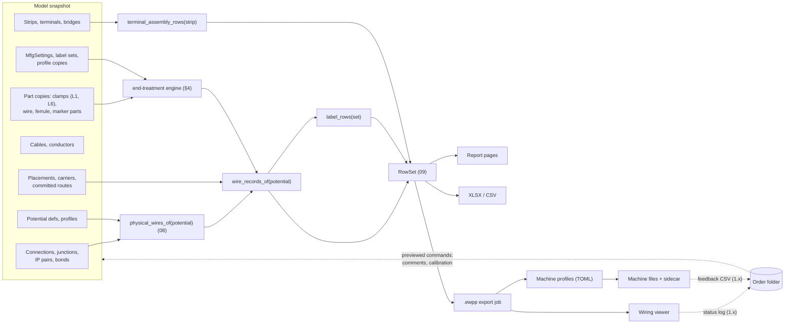

# Manufacturing outputs

**Status:** Draft v0.1 · **Date:** 2026-10-18 · **Part of:** ElektraWatt design document set

**Purpose.** This document designs everything ElektraWatt (EW) hands to the panel shop: the production wire record,
the ferrule and wire-end engine, wire and device marking, terminal-strip assembly lists, data-driven machine export
profiles, drilling and cut data, verification checklists, the open production package `.ewpp`, the read-only wiring
viewer and the as-built feedback loop. It elaborates the MFG rows of
[02b](02b-requirements-extended.md) §6 on top of the accepted [architecture](04-architecture.md) and the
[domain model](03-domain-model.md) §17. Its governing rule is ADR-0018: one row source feeds the printed list, the
spreadsheet, the package and the machine file, so they cannot disagree.

**Contents**
1. [Scope and position](#1-scope-and-position)
2. [Concepts and data](#2-concepts-and-data)
3. [The production wire record](#3-the-production-wire-record)
4. [Ferrule and wire-end engine](#4-ferrule-and-wire-end-engine)
5. [Wire marking and labels](#5-wire-marking-and-labels)
6. [Terminal-strip assembly lists](#6-terminal-strip-assembly-lists)
7. [Machine export profiles](#7-machine-export-profiles)
8. [The production package `.ewpp`](#8-the-production-package-ewpp)
9. [Drilling data, hole tables and cut lists](#9-drilling-data-hole-tables-and-cut-lists)
10. [Verification checklists and assembly documentation](#10-verification-checklists-and-assembly-documentation)
11. [Wiring viewer and the as-built feedback loop](#11-wiring-viewer-and-the-as-built-feedback-loop)
12. [UI and UX touchpoints](#12-ui-and-ux-touchpoints)
13. [Outputs](#13-outputs)
14. [Edge cases and pitfalls](#14-edge-cases-and-pitfalls)
15. [Defects prevented](#15-defects-prevented)

---

## 1. Scope and position

Manufacturing data is **derived, never authored twice**. A wire's ends come from the connection graph, its
cross-section and colour from the potential-based inheritance chain, its length from a committed route, its ferrule
from rules over part data, its marker text from the tag query. The only authored manufacturing facts are shop
policies (`MfgSettings`), label-set definitions, embedded machine profiles and per-end overrides (§2.3).

| Topic | Decided here | Decided elsewhere |
|---|---|---|
| Physical-wire identity, orientation (From/To), wire-end locus | Use only | [08](08-connections-terminals-cables.md) §3.8 |
| Effective csa, colour, wire part with provenance | Use only | [08](08-connections-terminals-cables.md) §4, [03](03-domain-model.md) §9.5 |
| Wire numbers, freezing at release | Use, duplicate pre-flight | [08](08-connections-terminals-cables.md) §5 |
| Routing, wire length formula, calibration, bundles and sequence | Consumption, provenance, staleness | [12](12-panel-layout.md) (FR-LAY-042 … 055) |
| Machining features per surface | DXF, hole table and cut-list output | [12](12-panel-layout.md) (FR-LAY-056, -057) |
| `RowSet`, report kinds, forms, pagination, PDF, XLSX/CSV dialects, dates | Manufacturing row sources | [09](09-reports-forms-output.md) §2.3, §2.4, §4.3, §4.6 |
| Clamp data, ferrule/wire/marker part kinds (L1, L6) | Which fields the engine reads | [07](07-symbols-parts-macros.md) §2.5 |
| PLC rows, tube rows | Checklist, label and cut-list input | [10](10-plc-and-bus.md) §5, [11](11-fluid-power.md) §8.2 |
| Deterministic ZIP rules, as-built archive | Package content and hashing | [05](05-project-format-and-persistence.md) §12, §14 |
| Rule engine, final rule IDs, waivers | Rule content EW-MFG-001 … 011 | [15](15-checks-revisions-collaboration.md) |
| Manufacturing workspace layout | Panels and commands it needs | [16](16-ux-ui.md) |



**Crates.** `ew-mfg` (GPL) holds the queries, the end-treatment engine, the label engine, the profile interpreter
and the package writer. It builds on `ew-reports` and `ew-panel` (committed routes, bundles and CP positions),
writes the package records through the permissive `ew-ewpp` crate (ARCH §3) and implements the `Exporter`
contract over an `ExportView` of a fork (FR-EXP-001). The queries of §2.5 are additions to the ARCH §6.4
catalogue. The `.ewpp` export job needs PDF, DXF and glTF rendering (`ew-scene`, `ew-export`, `ew-panel`), which
`ew-mfg` does not depend on; the job is therefore composed in `ew-api`, and `ew-mfg` receives the rendered members
as bytes. The permissive `ew-ewpp` crate holds the package record types, JSON Schemas, the reader, the writer and
the package diff; the GPL `ew-viewer` crate and the small `ew-wiring-viewer` binary serve the shop floor (ARCH §3).

---

## 2. Concepts and data

### 2.1 Vocabulary

| Term | Meaning |
|---|---|
| Wire | One physical conductor cut and made in the shop: a `PhysicalWire` of [08](08-connections-terminals-cables.md) §3.8 of kind Wire, or a bond wire. Its ID is the target-side carrier connection's UUID |
| Core | A cable conductor (`Connection{kind: Core}`); a wire record of kind `core` |
| Wire end | One termination of a wire: locus `dt:cp`, plus level and clamp on terminals (FR-MFG-002) |
| End treatment | Ferrule, twin ferrule, ring, fork or pin lug, bare, connector contact (pre-assembled), or `Undetermined` |
| Wire type key | The machine's identity of a wire stock: csa + colour (+ wire part), e.g. "0.75 DBU" |
| Bundle, sequence | Wires produced and delivered together, and the wiring order inside a bundle (FR-LAY-054) |
| Magazine | The wire types and ferrule reels loaded on a machine, declared in its profile |
| Machine profile | Versioned TOML data that maps wire records to one machine's import format (FR-MFG-018) |
| Label set | A definition of one marker kind: what text, which marker part, limits, optional code |
| Package | The `.ewpp` ZIP: the self-contained hand-off to the shop (FR-MFG-031) |
| Order | One assembly built from one package, with its serial number, status logs and feedback |

### 2.2 Inputs read through queries

| Input | Source | Fields used |
|---|---|---|
| Physical wires | `physical_wires_of(potential)` ([08](08-connections-terminals-cables.md) §3.8) | ID, ends, constituents, orientation, `core`, bond |
| Effective properties | `wire_props_of(potential)` | csa, colour, wire part, insulation, flags, provenance |
| Wire number | `Connection.number` of the carrier | printed number, frozen state |
| Clamp data | Part copy L1 (CP pattern) and L6 (3D CPs) ([07](07-symbols-parts-macros.md) §2.5) | clamp kind, csa ranges (solid, fine, with ferrule), max conductors, twin permission, ferrule sleeve range, strip length, insertion depth, torque, stud size |
| Wire part | Part section `wire` | IEC 60228 class, outer diameter, insulation type |
| Ferrule and lug parts | Part section `ferrule` (part kinds Ferrule, Accessory) | csa, twin, insulated, colour scheme and colour, sleeve and total length, collar diameter, crimp profile, packaging, stud size (lugs) |
| Marker parts | Part kind Marker | max characters per line, lines, printable code, carrier type |
| Lengths and routes | Committed `Route` per wire, `RouteOverride` ([03](03-domain-model.md) §16) | length, edges, input hash; estimated lengths (FR-LAY-053) |
| Bundles | `bundle_sequence(space)` ([12](12-panel-layout.md), FR-LAY-054) | bundle key, sequence, overrides |
| Positions | Placements, carriers, L6 CP positions | target position per end in the plate frame |
| Revision | `Revision`, `ReleaseRecord` | label, state, generation, release context date |

### 2.3 Authored manufacturing data

```rust
pub struct MfgSettings {                     // in ProjectSettings (project.jsonl); defaults from the basic project
    pub ferrule_colour_scheme: FerruleScheme,// Din46228_4 | French (FR-MFG-007); name as in 03 §17
    pub length_increment: Nm,                // project length increment, default 10 mm; rounding once (§3.3)
    pub reserve: ReservePolicy,              // as in 03 §17; both read by the length formula of 12 §9
    pub ferrule_policy: FerrulePolicy,       // insulated, spring-clamp rule, two_wire, default sleeve per csa
    pub treatment_rules: Vec<TreatmentRule>, // ordered data: (wire classes, clamp kind, csa range) → treatment (§4.2)
    pub standard_ferrules: Vec<PartRef>,     // the shop's standard set, ranked
    pub marking: MarkingScheme,              // WireNumber | Destination | SourceDestination | Potential (FR-MFG-010)
    pub label_sets: Vec<LabelSetDef>,        // §5.3
    pub machine_profiles: Vec<ProfileRef>,   // embedded profile copies in lib/profiles/ (05 §2.1)
    pub field_policy: FieldPolicy,           // field wires and external-end cores: list, label, exclude from machines
    pub package: PackagePolicy,              // members to include, docs languages, personal-data default
}
pub enum TwoWirePolicy { PreferTwin, SeparateWhereAllowed, TwinOnly }

// WireOverrides.ends of the carrier connection (03 §9; FR-MFG-042)
pub struct EndOverride {
    pub at: CpRef,                           // which physical end; keyed by CP, not by the carrier's endpoints
    pub treatment: Option<TreatmentKind>,
    pub part: Option<PartRef>,               // manual ferrule or lug
    pub strip_len: Option<Nm>,
    pub marker: Option<SmolStr>,             // explicit marker text
    pub no_marker: bool,
}
```

- **Defaults** (PQ-22): destination marking, DIN 46228-4 colours, insulated ferrules on
  fine-stranded wire, `TwoWirePolicy::PreferTwin`, fixed 100 mm reserve (the formula and its other terms belong to
  [12](12-panel-layout.md) §9).
- **End overrides** live on the wire's carrier connection, next to its `NumberSpec`. The number-transfer normaliser
  of [08](08-connections-terminals-cables.md) §5.1 moves them with the number when the carrier changes, so a manual
  lug survives a junction edit.
- **Nothing about production status is authored in the project.** Status, actual lengths and technician actions
  live in the order folder (§11.3). The project format stays free of timestamps (ARCH §7.3).

### 2.4 Derived records

```rust
pub struct WireRecord {                      // one per physical wire; grouped per potential (ARCH §6.3)
    pub id: WireId,                          // carrier connection UUID
    pub number: Option<Ident>,               // None for unnumbered cores
    pub kind: WireKind,                      // Wire | Core{cable, core} | Bond{bond}
    pub ends: [WireEnd; 2],                  // [From, To] by the 08 §3.8 orientation rule
    pub potential: PotentialId, pub potential_name: Ident, pub signal: SignalId,
    pub csa: Csa, pub colour: ColourSpec, pub wire_part: Option<PartRef>, pub wire_class: Option<u8>,
    pub props_source: Provenance,            // e.g. level 2, profile "DBU/WH 24 V"
    pub length: LengthInfo,                  // {mm, raw_mm, source, stale, rev, calibration}
    pub route: SmallVec<[CarrierName; 6]>,   // duct names in path order
    pub bundle: Option<BundleKey>, pub seq: Option<u32>,
    pub flags: WireFlags,                    // door, twisted, shielded, pre_assembled, estimated_cp, field, bond
    pub page_refs: SmallVec<[PageRef; 4]>,   // folio and cell of each end and of each IP passed
    pub wire_type_key: SmolStr,              // "0.75 DBU"
}
pub struct WireEnd {
    pub cp: CpRef, pub locus: Locus,         // {dt_full, dt_display, cp, level?, clamp?}
    pub treatment: EndTreatment,             // Ferrule{part} | TwinFerrule{part, partner} | RingLug{part, stud}
                                             //   | ForkLug{..} | PinLug{..} | Bare | Connector{part} | Undetermined{reason}
    pub sleeve_len: Option<Nm>, pub strip_len: Option<Nm>, pub crimp: Option<CrimpProfile>,
    pub marker: SmallVec<[SmolStr; 2]>,      // one entry per printed line
    pub target_pos: Option<[Nm; 3]>,         // plate frame; a position, not a Pose3 (as in 03 §17)
    pub torque: Option<Dec3>,                // N·m, from L6
    pub source: Provenance,                  // rule ID, magazine, standard set or override
}
```

`LabelRecord`, `TerminalAssemblyRow`, `MachineRow` and `ChecklistItem` follow in §5–§10. All are derived: none is
persisted except as frozen copies in the as-built archive (FR-REV-011).

### 2.5 Queries and freshness

| Query (key) | Depends on | Policy | Class |
|---|---|---|---|
| `wire_records_of(potential)` | `physical_wires_of`, `wire_props_of`, numbers, committed routes, bundles, clamp data, settings | Memo | I (reads committed lengths; staleness via input hash) |
| `clamp_occupancy(potential)` | physical wires, clamp data | Memo | I; shared with EW-POT-010 (§4.3) |
| `wire_record_set(scope)` | `wire_records_of` over the potentials of a location or layout space | Cold, sorted | I |
| `label_rows(label_set)` | wire records, terminals, devices, cables, tubes | Memo + LRU | I |
| `terminal_assembly_rows(strip)` | `terminal_rows(strip)`, accessories, bridges, parts | Memo | I |
| `checklist_rows(kind, scope)` | potentials, protective devices, PLC rows, change list | Memo | I |
| `consumables(scope)` | `wire_record_set`, `label_rows` | Cold | I |
| `machine_rows(profile)` | `wire_record_set`, profile | Cold, in the export job | II |
| `mfg_change_list(base, current)` | `diff_query` over wire records, terminals, devices | Cold, in a job | II |
| `.ewpp` export | all of the above on a fork | Job | II |

A committed route is model data, so reading its length is a Class I read; what can be stale is the route's input
hash (EW-LAY-011). A wire record therefore carries `length.stale = true` rather than silently passing on an old value
(ARCH §6.5). A wire edit on folio 102 re-executes only the wire records of the touched potential, about 1 ms at M
size (estimate), well inside the commit budget.

---

## 3. The production wire record

### 3.1 Field catalogue

The canonical JSON field names are those of `wires.json` (§8.3). Profiles address these names, never internal
structs. Example values are the golden wire W29 on Golden A-R with the PM §6.8 routing inputs.

| # | Field | Type | Derived from | W29 |
|---|---|---|---|---|
| 1 | `id`, `key` | UUID, string | carrier connection ([08](08-connections-terminals-cables.md) §3.8); `key` = short stable wire key (§11.2) | the folio-103 connection IP 24VDC-1 → -X1031:1/a; `W7K2M9QXA` (illustrative) |
| 2 | `number` | string? | `NumberSpec` of the carrier, printed by the scheme | `102.n` (counter in `expected/wires.csv`, ▲U-33) |
| 3 | `kind` | `wire`, `core`, `bond` | connection kind, `Bond.via` | `wire` |
| 4 | `bundle`, `seq` | string, int | `bundle_sequence(space)` | the -X1031 bundle ▲, by level |
| 5 | `from.dt`, `from.dt_full`, `from.cp`, `from.level`, `from.clamp` | strings | `device_tag`, CP designation, terminal CP | `-102F2`, `=P01+J-E-2416-102F2`, `Out1`, —, — |
| 6 | `to.*` | as above | as above | `-X1031`, `=P01+J-E-2416-X1031` ([03](03-domain-model.md) §8.4), `1`, `1`, `a` |
| 7 | `potential`, `signal` | names | `potential_partition`, signal name | `24VDC-1`, `24VDC-1` |
| 8 | `csa`, `csa_unit`, `colour`, `colour_name` | decimal string, code | `wire_props_of` | `0.75`, `mm2`, `DBU`, "dark blue" |
| 9 | `props_source` | string | provenance | `profile:DBU/WH 24 V` |
| 10 | `wire_part`, `wire_class` | part ref, int | profile wire part (FR-CON-033) | H05V-K 0.75 DBU ▲, 5 |
| 11 | `length_mm`, `length_raw`, `length_source`, `length_stale`, `length_rev` | int, decimal, enum, bool, int | committed route or estimate | `810`, `806.0`, `routed`, `false`, revision of the route |
| 12 | `from.treatment`, `from.part`, `from.sleeve_mm`, `from.strip_mm`, `from.crimp`, `from.twin_with` | §4 | end-treatment engine | ferrule, insulated 0.75 × 10 mm ▲, 10, trapezoidal ▲, — |
| 13 | `to.*` (same) | §4 | same | same |
| 14 | `from.marker`, `to.marker` | string lists | label engine (§5) | `["-X1031:1"]`, `["-102F2:Out1"]` |
| 15 | `route` | names | route edges → carrier names | `["D1","D2","D4"]` |
| 16 | `from.pos_mm`, `to.pos_mm` | 3 decimals | placement pose × L6 CP position | illustrative `["212.000","640.500","95.000"]` |
| 17 | `from.torque_nm`, `to.torque_nm` | decimal? | L6 | — (push-in) |
| 18 | `page_refs` | `folio-cell` list | `rep_anchor_cell` of the ends, IP cells | `102-H15`, `103-A1` (IP pair) plus both end cells |
| 19 | `flags` | set | door, twisted, shielded, pre_assembled, estimated_cp, field, bond | `[]` |
| 20 | `status` | enum | `open` at export; overlaid by the order's status log (§11.3) | `open` |

At MVP the wire list of folio 907 (FR-REP-014) already carries fields 1–3, 5–10 and 18, with lengths only as
`manual` or `missing` and a wire part only where one is set explicitly (the profile-derived wire part of FR-CON-033
is 1.0); it also prints the six bridges as bridge rows ([08](08-connections-terminals-cables.md) §6.5), which wire
records exclude. The 1.0 record adds bundles, routed and estimated lengths, routes, end treatments, markers,
positions, torque and flags. The printed list, the XLSX, the CSV and `wires.json` read the same `RowSet`
(FR-MFG-001 acceptance).

### 3.2 Inclusion and flags

| Physical wire | Wire record | Machine sets | Labels |
|---|---|---|---|
| Wire between two CPs of the layout space's location | `wire` | yes | yes |
| Bond wire (`Bond.via`, W27) | `bond`, potential printed "0V ⇄ PE" | yes | yes |
| Core of a pre-assembled cable (-106W1, -106W2: W35–W44) | `core`, `pre_assembled`; the connector end gets `Connector{part}` | no; manual list | cable markers; core markers by `core_id_mode` |
| Core of a shop-cut cable | `core` | cable machines only | cable and core markers |
| Wire or core with an end outside the location (W1–W3 from +J-E-206) | `field` | no | per `field_policy` (default: none) |
| Bridge, Internal, Bus, Fluid, Overview connection | none (FR-TRM-007) | — | bridges appear in the assembly list (§6) |

### 3.3 Lengths and their provenance

`length_source` is `routed` (committed `RouteWires` result), `estimated` (FR-LAY-053), `manual`
(`WireOverrides.length` on the carrier connection, [03](03-domain-model.md) §9, [12](12-panel-layout.md) §9), `from_part`
(pre-assembled cores) or `missing`; the values mirror `LengthSource` of [08](08-connections-terminals-cables.md) §7.6.
`length_raw` is the formula value before calibration and rounding (FR-LAY-051, -052). The property grid and
`ew query wire_record <id> --explain` show the chain: "810 mm · routed rev 412 · stubs 85 + path 490 + Δz 95 +
ends 36 + reserve 100 = 806 · ×1.00 · ↑10 mm".

**Rounding happens once**, in `wire_records_of`, to the project's length increment (`MfgSettings.length_increment`,
golden 10 mm); the committed `Route` keeps the unrounded calibrated length (FR-MFG-051). A machine profile's
`length_increment_mm` declares only the machine's resolution, and profiles never re-round: if the project
increment is a multiple of it (10 mm on a 1 mm machine), the machine file carries the wire-list value unchanged,
which is what keeps AC-35's "row-identical to folio 907" true. Otherwise EW-MFG-002 flags the row "length differs
from the wire list" and moves it to the manual list.

### 3.4 Wire-list variants (FR-MFG-003)

| Variant | Sort and group | Use |
|---|---|---|
| Manual wiring | bundle, seq; grouped by From device | the technician's list and the viewer queue |
| Machine set | wire type key (in magazine-slot order), then bundle, then seq | magazine machines; minimises changeovers |
| Per device | device, CP order of its FnDef | device connection diagram (FR-REP-015) |
| Change list | change kind, then device | rework (§3.5) |

### 3.5 Change list (FR-MFG-004)

`mfg_change_list(base, current)` keys wire records by `id` and classifies:

| Class | Condition |
|---|---|
| added / removed | ID only in current / only in base |
| re-landed | same ID, an end CP differs |
| changed | csa, colour, wire part, length (after rounding), treatment, ferrule part, marker text, bundle |
| route-only | route differs, length equal: reported as info, no rework |
| identity-changed | a removed and an added record with the same two end CPs and equal properties: shown as unchanged |

The base is an as-built archive (`diff_query`, ADR-0013, FR-REV-015) or a second `.ewpp`; a historic revision
without an archive (golden V1.0) cannot be a base. The package comparison needs only `wires.json`,
`terminals.json` and `devices.json`, so it runs in the permissive `ew-ewpp` reader (FR-MFG-046) and in the viewer.
Terminals and devices added or removed come from `terminals.json` and `devices.json`. The identity-changed rule
absorbs carrier switches after junction edits ([08](08-connections-terminals-cables.md) §5.1).

### 3.6 Consumables summary (FR-MFG-049)

`consumables(scope)` aggregates the wire records of a layout space for ordering and for loading machine
magazines: per wire type key the wire count and Σ `length_mm`; per ferrule or lug part the end count (a twin
ferrule counts once); per marker part the label count of each label set. It is a `RowSet` (report block, XLSX,
CSV, `consumables.csv` in the package), separate from the device-based BOM. Golden A gives 14 × 0.75, 25 × 1.5 and
8 × 2.5 mm² single ferrules, 4 twin ferrules 2 × 1.5 mm², one M6 and two M4 ring lugs (§15.2) and no wire metres,
because no wire is routed; Golden A-R adds the metres per type.

---

## 4. Ferrule and wire-end engine

### 4.1 Inputs per end

For each wire end the engine reads: the wire class and csa (wire part, or the cable part's core data for cores); the
clamp of the end CP (kind, accepted csa ranges, max conductors, twin permission, sleeve-length range, stud size);
the other wires on the same clamp (`clamp_occupancy`); the settings; the active machine profile's magazine when
the export targets a machine; and any `EndOverride`.

### 4.2 Treatment rules (data)

Shipped as the default `treatment_rules` (FR-MFG-005, FR-MFG-008), editable in the basic project. Per-terminal
acceptance is part data whose section confidence stays `unverified` for every vendor until checked
([07](07-symbols-parts-macros.md) §2.5); rules reading it report at most a warning (FR-CHK-046,
[15](15-checks-revisions-collaboration.md)). The table follows PM §7.3; the IDC row is EW's
assumption **(verify)**.

| Clamp kind | Class 1/2 (solid, stranded) | Class 5/6 (fine-stranded) |
|---|---|---|
| Screw (rising cage, screw clamp) | bare | ferrule |
| Push-in | bare | ferrule (policy may allow bare with pusher) |
| Spring (operated cage clamp) | bare | ferrule; `Optional` per policy |
| IDC | bare | not permitted → `Undetermined` (EW-MFG-008) |
| Ring stud Mx | ring lug Mx | ring lug Mx |
| Fork stud Mx | fork lug Mx | fork lug Mx |
| Pin-lug clamp (where the part requires it) | pin lug | pin lug |
| Connector pin (pre-assembled core) | `Connector{part}` from the cable part | same |

### 4.3 Two or more wires on one clamp

`clamp_occupancy(potential)` lists, per clamp, the wires landing on it. Pairing runs before part selection and is
shared with the electrical capacity rule EW-POT-010 (FR-CHK-021, [08](08-connections-terminals-cables.md) §8.1), so
both see the same conductor count:

```text
for each clamp k with wires W (n = |W| ≥ 2), wires sorted by (csa desc, wire id):
  pairs = []
  pairable(a, b) = a.csa == b.csa and 0.5 mm² ≤ csa ≤ 2.5 mm² (the twin-ferrule range, PM §7.3) and k.twin_ok
  PreferTwin, TwinOnly:  greedily pair pairable wires in sorted order
  SeparateWhereAllowed:  pair greedily only while n − |pairs| > k.max_conductors
  conductors = n − |pairs|
  if conductors > k.max_conductors:                       → EW-POT-010 error naming k (electrical capacity)
  elif policy.two_wire = TwinOnly and n − 2·|pairs| > 0:  → EW-MFG-007 error ("twin ferrule required")
  each pair → TwinFerrule{partner}; each unpaired wire → single treatment by §4.2
```

A twin ferrule counts as one conductor against `max_conductors`, which follows EN 60204-1 13.1.1 **(verify the
clause; [standards](../research/standards.md) M-08 cites 13.1)**: more than one conductor only where the terminal is
designed for it. This interprets FR-MFG-006: two wires on a clamp without twin permission are an error only if the
clamp accepts one conductor; on a two-conductor clamp they get two single ferrules.

### 4.4 Part selection

```text
select(end, treatment):
  if end has EndOverride.part: use it; validate (csa, scheme, sleeve range, stud) → EW-MFG-009 on mismatch
  cands = ferrule-kind parts in the project's embedded library and standard set with
          csa == wire.csa (twin: csa pair equal and part.twin), insulated == policy.insulated,
          colour scheme == settings.ferrule_colour_scheme (insulated parts only),
          sleeve_len ∈ clamp.sleeve_range        (unknown range: sleeve_len == policy.default_sleeve(csa), flag),
          collar_d ≤ clamp.max_collar_d          (if specified),
          lugs: stud == clamp.stud and csa ∈ part.csa_range
  rank by: in active magazine (machine export) > rank in standard_ferrules > |sleeve − preferred| > natural part
           number > part UUID
  none → Undetermined{NoPart} (EW-MFG-008); twin with no twin part → EW-MFG-007
  strip_len = sleeve_len + part.strip_offset (0 … 1 mm, part data, default 0)
  crimp = part.crimp_profile; torque = clamp.torque
```

Every input is ordered data and every tie is broken by a stable key, so selection is deterministic across platforms
and thread counts (NFR-REL-07). The chosen part, the rule and the ranking reason form the end's provenance
("Ferrule 0.75 × 10 mm, grey (DIN) · rule push-in × class 5 · magazine 'WT-36 shop'").

### 4.5 Colour schemes and units

- **Scheme as project property** (FR-MFG-007). Insulated ferrule parts carry `colour_scheme` and `colour`. Switching
  the scheme is a previewed settings command; the preview lists every end whose part changes. A manual ferrule of
  the other scheme stays and raises EW-MFG-009. The DIN 46228-4 and "French" tables of PM §7.3 ship as data flagged
  `verified = false`; the first use in a package raises EW-MFG-010 (info) until a reviewed change sets the flag.
- **mm² and AWG** (FR-MFG-009, 1.x). Selection keys are `Csa::Metric(Dec3)` or `Csa::Awg(i8)`; no conversion is
  applied for matching, only for display (FR-CON-032).

### 4.6 Rules of the EW-MFG pack

The pre-flight rules EW-MFG-001 … 006 are fixed by FR-MFG-024; EW-MFG-007 … 011 complete the pack, which ships with
the `manufacturing` scheme under FR-CHK-058. The final rows are those of the catalogue in
[15](15-checks-revisions-collaboration.md) §4.5.5. They run in the `manufacturing` check scheme (`extends =
"pre-delivery"` plus EW-MFG; [15](15-checks-revisions-collaboration.md) §4.9) and, as export pre-flight, in the
`export` mode of [15](15-checks-revisions-collaboration.md) §3.1. Rules 001 … 006 need the
export's profile; a scheme run without a profile evaluates EW-MFG-001 against "routed, manual or from part" and
skips 002, 003 and 006. EW-POT-015 supersedes EW-MFG-005 per target: duplicate wire numbers in the model are
reported online by EW-POT-015, and EW-MFG-005 fires only for duplicates that the export mapping creates
(`export_as`, company codes), which the model rule cannot see ([15](15-checks-revisions-collaboration.md) §3.6).
The IEC 61439 routine-verification checklist of §10.2 is the report block that EW-CORE-024 requires under the
`assembly-iec61439` scheme ([15](15-checks-revisions-collaboration.md) §4.9).

| Rule | Checks | Modes | Severity |
|---|---|---|---|
| EW-MFG-001 | Length routed, estimated and accepted by the profile, manual or from part; not missing, not stale. Field records (§3.2) are out of scope | export, release | error (excluded in working mode) |
| EW-MFG-002 | csa and wire type within the machine's limits and magazine; length re-rounded by the profile (§3.3) | export | warning → manual list |
| EW-MFG-003 | Ferrule in the machine's magazine; each end treatment in the profile's `end_treatments` (§7.1) | export | warning → manual list or finishing task |
| EW-MFG-004 | Marker text fits its marker part (characters per line, lines) and its encoding | online, export | warning |
| EW-MFG-005 | No duplicate wire number created by the export mapping (`export_as`, company codes); duplicates in the model are EW-POT-015, which supersedes it per target | export, release | error |
| EW-MFG-006 | Bundle within the bin size | export | warning (or split by profile option) |
| EW-MFG-007 | Twin ferrule required or chosen but no twin part of that csa pair exists | online, release | error |
| EW-MFG-008 | End treatment undetermined (no clamp data, no candidate part, IDC with class 5) | online, release | warning; error in release |
| EW-MFG-009 | Override inconsistent: other colour scheme, csa, sleeve outside range, wrong stud | online, release | error |
| EW-MFG-010 | Output based on unverified constants or part sections (one finding per package, listing the sources) | release | info |
| EW-MFG-011 | Feedback length deviates from the computed length beyond tolerance (1.x) | offline | info |

---

## 5. Wire marking and labels

### 5.1 Marking schemes (FR-MFG-010)

| Scheme | From end prints | To end prints | W29 |
|---|---|---|---|
| Wire number | number | number | `102.n` / `102.n` |
| Destination (default) | remote end | remote end | `-X1031:1` / `-102F2:Out1` |
| Source and destination | local / remote | local / remote | `-102F2:Out1 / -X1031:1` / reverse |
| Potential | potential name | potential name | `24VDC-1` / `24VDC-1` |

EN 60204-1 13.2.1 asks that every conductor be identifiable at each termination in line with the documentation;
the marker text is a query over the same tags and numbers the drawing prints, so it cannot drift.

### 5.2 Deterministic abbreviation (FR-MFG-011)

```text
marker_dt(end, ctx):                           ctx = the layout space (location +J-E-2416, function =P01)
  blocks = rds::parse(dt_full)                 // [=P01][+J-E-2416][-102F2] or [=P01][+J-E-2416][-X1031]
  drop the '=' block if it equals ctx.function
  drop the '+' block if it equals ctx.location // canonical node: "+JE2416" can never appear (D-03)
  text = product block + ":" + CP designation  // "#n" only where printed designations repeat (08 §3.8)
  append ".level" only for terminals with more than one level; clamp letters are never printed
  uniqueness: if two different full DTs abbreviate to the same text in one package, both keep the dropped block
  fit: wrap at separators (":", "-") into ≤ marker.lines; if still too long, EW-MFG-004 lists the full text
```

A wire leaving the location keeps its target's `+` block: a marker for a wire to +J-E-206 reads
`+J-E-206-…`. Strings are encoded per output; a character the encoding cannot carry (U+2212 minus in
`-102G1:−#1` for CP1252) goes through the profile's transliteration map or raises EW-MFG-004.

### 5.3 One label engine (FR-MFG-012)

```rust
pub struct LabelSetDef {
    pub kind: LabelKind,               // Wire | Terminal | Device | Cable | Strip | Bundle | Tube | Plate | Rating
    pub filter: Option<RhaiExpr>,      // pure, sandboxed (ARCH §10.3)
    pub lines: Vec<LineTemplate>,      // "{marker_dt}", "{number}", "{designation}", "{function_text}"
    pub marker_part: Option<PartRef>,  // the label stock; supplies limits
    pub code: CodeKind,                // None | Qr | DataMatrix (1.x, §11.2)
    pub per: LabelMultiplicity,        // per end, per terminal level, per cable end, per device
    pub sort: Vec<SortKey>,
}
pub struct LabelRecord { pub id: RowId, pub kind: LabelKind, pub target: EntityRef,
                         pub lines: SmallVec<[SmolStr; 3]>, pub marker_part: Option<PartRef>,
                         pub code: Option<SmolStr>, pub truncated: bool }
```

| Kind | Default text | Multiplicity |
|---|---|---|
| Wire marker | by marking scheme | two per wire |
| Terminal marker | unique designation; optional second line function text ("1" / "1+") | per terminal and level |
| Strip marker | strip tag (`-X1031`) | per strip, on its end bracket |
| Device marker | `marker_dt` of the device | per device with a marker carrier |
| Cable marker | cable tag, optional core count and type | both ends |
| Bundle label | bundle key, wire count, first and last wire; lookup code at 1.x (§11.2) | per bundle bag |
| Tube marker | tag or destination per [11](11-fluid-power.md) §8.2 (FR-FLU-013), e.g. "-203Q1:A" at the -201U3-Q1:2 end of F1 | per tube end |
| Door or front plate | function text (`MlText`, per display language) | per device on the door |
| Rating plate | §10.4 | per assembly |

Terminal markers print the **unique designation**, not only the function text. Golden -X1031 keeps
`label_mode = FunctionText` on the drawing so the pages look as before, but four physical markers reading "1+"
would recreate D-12 on the hardware.

### 5.4 Marking-software presets (FR-MFG-013)

Label exports use **label profiles** (`schema = "ew.label-profile/1"`), which share the TOML machinery of the machine
profiles of §7 (row source `label_rows`, column map, transforms, encoding): one row per label, one column per text
line, one column for the marker part (the label stock), plus a code column when set.

| Preset | Output | Status |
|---|---|---|
| Weidmüller M-Print PRO | CSV or XLSX in the import wizard layout | preview until validated with a partner |
| Phoenix Contact MARKING system | CSV or XLSX | preview |
| Brady Workstation | XLSX data import | preview (format unverified) |
| Murrplastik marking software | CSV or XLSX | preview (format unverified) |
| Generic | XLSX with every `LabelRecord` field | validated by the golden test |

Phoenix Contact clipx ENGINEER is a strip configurator, not a marking import; it is covered by §6.3 (1.x).

---

## 6. Terminal-strip assembly lists

### 6.1 Content (FR-MFG-016)

`terminal_assembly_rows(strip)` extends `terminal_rows(strip)` ([03](03-domain-model.md) §11) with mounting data:

| Column | Source |
|---|---|
| Position | `seq` in mounting order, accessories interleaved (`StripAccessory.after_seq`) |
| Item | terminal, end plate or cover, end bracket, partition plate, test plug, marker strip |
| Part, width | terminal or accessory part (L0, L3) |
| Designation, level | `Terminal.designation`, levels |
| Marker | the terminal marker text (§5.3) |
| Bridge | group, pole count, shaft, part (`BridgeSpec.group`, [08](08-connections-terminals-cables.md) §2.3) |
| State | used, spare, spare (fed) |
| Strip length | Σ widths of terminals and accessories in the strip |
| Rail | carrier (R2 for 1X1, -X1031 and -X1032), its cut length and free length (§6.2) |

Bridges are listed as bridges with their pole count and part, never as wires (FR-TRM-007). A spare terminal that
receives a feed on side 1 prints "spare (fed)", which is the state of -X1031:5, 7 and 9. A placeholder accessory or
bridge part ("TBD", Golden A's EF-17) prints as "TBD" and blocks release through FR-CHK-034. The terminal line-up
diagram (FR-REP-011, report kind `terminal_lineup` of [09](09-reports-forms-output.md) §2.4) is the graphical form of
the same rows.

### 6.2 Rail cut length

A rail is drawn by two points ([12](12-panel-layout.md) §3.2), so its cut length is `round_up(L, cut_increment)` of
the carrier path, never of what sits on it. The assembly list prints, per rail, that cut length next to the
occupied length (Σ strips, end brackets and other placements from `rail_occupancy`) and the free length `L − Σ
occupied`; an overfull rail is EW-LAY-010 ([12](12-panel-layout.md) §3.4), never an automatic extension. The value
feeds the cut list (§9.3).

### 6.3 Configurator export (FR-MFG-017, 1.x)

Strip export to Phoenix Contact clipx ENGINEER (AML or project XML) and to the Weidmüller configurator are
code-level exporters (formats unverified), shipped as built-in exporters or WASM plugins (FR-EXT-019). Re-import of
the configurator's accessory choices is Later.

---

## 7. Machine export profiles

### 7.1 Profile format (FR-MFG-018)

A profile is versioned TOML data. ADR-0018 fixes its shape `{row_source, filter, column map, transforms, limits,
encoding, header}`; FR-MFG-018 adds magazine contents, delimiter, line endings and the wire-type key format. The
example is illustrative: the Rittal WT template columns are **unverified** until a real template is obtained
(PQ-21).

```toml
schema      = "ew.machine-profile/1"
id          = "rittal-wt-csv"
version     = "0.9.0"                       # semver of the profile itself
status      = "preview"                     # preview | validated
kind        = "wires"                       # wires | terminals | cutlist | holes; labels use label profiles (§5.4)
record      = "ewpp.wire/1"                 # field paths are those of wires.json (§8.3)
row_source  = "builtin:wire_records"        # or "sql:<file>.sql" over api_v1_* (offline, trusted projects only)
filter      = "kind != 'core' && !flags.field && !flags.pre_assembled"
sort        = ["bundle", "seq"]

[limits]
csa_mm2             = { min = "0.5", max = "2.5" }
length_mm           = { min = 100, max = 6000 }   # ▲ unverified
length_increment_mm = 1                           # machine resolution; the record is already rounded (§3.3)
wire_types_max      = 36
bundle_max          = 40
accept_estimated    = false
end_treatments      = ["ferrule", "bare"]         # ▲ unverified; lugs and twin ferrules are not made here
unsupported_end     = "finish_manually"           # or "manual_list"

[magazine]
wires    = [{ part = "lib:wire/H05V-K-0.75-DBU", slot = 1 }, { part = "lib:wire/H05V-K-0.75-WH", slot = 2 }]
ferrules = [{ part = "lib:ferrule/0.75x10-ins", reel = 1 }]

[keys]
wire_type = "{csa} {colour}"                # EPLAN's Komax example style "2.5 blk" uses a colour map instead

[output]
format        = "csv"
encoding      = "cp1252"                    # utf-8 | utf-8-bom | cp1252
delimiter     = ";"
decimal       = ","
line_ending   = "crlf"
header        = true
quote         = "minimal"
formula_guard = false                       # machine software must receive values verbatim
file_name     = "{project}-{revision}-WT.csv"
transliterate = { "\u2212" = "-" }          # U+2212 minus is not in CP1252

[mapping]
columns = [
  { header = "Source",  value = "from.marker_dt" },
  { header = "Target",  value = "to.marker_dt" },
  { header = "Section", value = "csa" },
  { header = "Colour",  value = "colour",         transform = "map(colours)" },
  { header = "Length",  value = "length_mm" },  # already rounded once (§3.3); profiles never re-round
  { header = "Label",   value = "from.marker[0]" },
  { header = "WireId",  value = "key" },        # stable wire key (§11.2); cores have no number
]

[maps.colours]
DBU = "DBU"
WH  = "WH"
GNYE = "GNYE"
```

- **Transforms** are a closed set: `round_up(n)`, `round(n)`, `decimal(places)`, `map(table)`, `upper`,
  `lower`, `pad_left(n, c)`, `truncate(n)`, `format(pattern)`, `default(v)`, `concat(…)`. An `expr` column may hold
  a pure rhai expression (ARCH §10.3).
- **End capability.** A wire-by-wire machine cuts, strips, crimps and marks one wire at a time, so it cannot crimp a
  twin ferrule over two wires; whether a model crimps lugs is per machine **(verify)**. An end whose treatment is not
  in `end_treatments` either stays in the machine file with that end stripped only and becomes a finishing task in
  `manual.csv` (`finish_manually`), or moves the whole wire to the manual list (`manual_list`). EW-MFG-003 reports
  both (FR-MFG-050).
- **Trust.** A profile with `expr` columns or an `sql:` row source arriving inside a received project does not run
  until the project is trusted (NFR-SEC-05). Built-in profiles are trusted.
- **Licensing.** Shipped profiles are data files under MIT OR Apache-2.0 (ADR-0018 decision 8, ADR-0024); machine
  files made with them are outputs outside EW's copyleft (NFR-LIC-09).
- **Storage.** Shipped profiles are built in; company and user profiles live in the catalogue; a project embeds a
  copy of every profile it references (FR-MFG-047), as `lib/profiles/<copy_id>.toml` in its TOML source form
  ([05](05-project-format-and-persistence.md) §2.1), so the archive can reproduce its machine files (Open
  question 3).

### 7.2 Shipped profiles

| Profile (`id`) | Route | Key points | Release |
|---|---|---|---|
| Generic CSV/XLSX (FR-MFG-019; `generic-csv`, `generic-xlsx`) | file | every field of §3.1; `rfc4180` and `excel-*` dialects of [09](09-reports-forms-output.md) §4.6 | 1.0 Must, validated by the golden test |
| Komax via TopConvert CSV (FR-MFG-020; `komax-topconvert-csv`, as in [17](17-extensibility.md) §3.3) | CSV → TopConvert → WPCS | wire key csa + colour, font key for marking, end-processing keys per side | 1.0 Must, preview until partner validation |
| Rittal Wire Terminal WT 24/36, WT C (FR-MFG-021; `rittal-wt-csv`) | template CSV ("Wire Cockpit") | cut, strip, crimp ferrule, mark; 0.5–2.5 mm², 24 or 36 wire types; outside → manual list; lug and twin-ferrule ends → finishing tasks | 1.0 Must, preview |
| Weidmüller WPC (FR-MFG-022) | Excel template | fixed parameter order; WPC consistency check | 1.0 Should, preview |
| Schleuniger CAYMAN Excel (FR-MFG-023) | Excel | Schleuniger part numbers via a part-number map | 1.x |
| Native Komax WPCS, Perforex, Steinhauer, RiPanel AML (FR-MFG-027) | proprietary | only once vendors document them | Later (PARK-09) |

**Label profiles** (`schema = "ew.label-profile/1"`) for marking software and label printers share this TOML
machinery, the embedding as library copies and the trust rule; their presets are listed in §5.4. The TIA Portal
"PLC Tags" XLSX is not a profile: its round trip needs code, so it is a fixed-format exporter and importer in
`ew-plc` ([10](10-plc-and-bus.md) §4.5, FR-PLC-036).

### 7.3 Pre-flight and the split into machine and manual lists (FR-MFG-024)

The export job evaluates EW-MFG-001 … 06 per wire record of the export scope (the layout space). `manual.csv` lists
every in-scope record that is not in the machine file, each with its reason:
- filtered out by the profile (`field`, `pre-assembled core`);
- failed a warning-level rule (rule ID and text, e.g. "EW-MFG-002 csa 4 mm² outside 0.5–2.5 mm²");
- failed an error-level rule: excluded, and in release mode the export fails (FR-MFG-024: "no length");
- finishing tasks for ends the machine does not make (§7.1), listed under their wire.

The job writes:

```text
machine/rittal-wt-csv/J-E-2416-V2.0-WT.csv       the machine file
machine/rittal-wt-csv/manual.csv                 wires for manual processing, with the reason per row
machine/rittal-wt-csv/preflight.json             {profile, version, rows, machine, manual, excluded, findings[]}
```

Machine files are byte-deterministic: rows in the profile's sort with the wire ID as the final key, dates only from
the release context or an explicit export date ([09](09-reports-forms-output.md) §4.3).

### 7.4 Release mode and freshness (FR-MFG-025)

Release-mode exports run on a fork at a released revision (or inside `ReleaseRevision`). They refuse:
- a committed route or length whose input hash no longer matches (EW-LAY-011);
- stale Class II results (thermal, offline checks);
- unwaived errors of the `manufacturing` scheme.

The refusal names every wire (FR-MFG-025 acceptance). Working-mode exports write the files with `mode = "draft"`,
the status mark "DRAFT V3.0" on report pages while V3.0 is open (FR-OUT-021) and the findings in
`preflight.json`.

### 7.5 Feedback import (FR-MFG-026, 1.x)

`ew mfg feedback import <file> --profile rittal-wt-csv --order <dir>` parses a feedback CSV (Rittal WT feedback with
magazine and position; Komax through TopWin) under the parser limits of NFR-SEC-02 and matches rows on the wire
key column (`key`, mapped as "WireId" above) when the export carried it, else on wire number, else on (from, to,
csa). Matched rows append `cut` events
with the machine's timestamp and cut length to the order's status log (§11.3). Unmatched rows are reported. Nothing
is written to the project.

---

## 8. The production package `.ewpp`

### 8.1 Layout (FR-MFG-031)

```text
J-E-2416-V2.0.ewpp                ZIP per 05 §12: entries sorted, DOS time 1980-01-01 unless the 09 §4.3 date
                                  rule applies, mode 0644, UTF-8 flag
  mimetype                        "application/vnd.elektrawatt.production+zip": first entry, stored
  manifest.json                   format, generator, project id, revision, mode, export date, content hash, member hashes
  project.json                    project properties, parties (strippable), supply, structure nodes, MfgSettings used
  devices.json                    full and displayed DT, parts, location, placement pose, plate position, CPs with 3D positions
  parts.json                      the part copies used, reduced to L0, L1, L3 and L6 (no prices, no 3D files)
  wires.json  wires.csv           wire records (§3); CSV = the generic profile output
  cables.json                     cables, cores, pre-assembled flags, lengths and their sources
  terminals.json                  strips, terminals, levels, clamps, bridges, accessories, assembly rows
  tubes.json                      tube list and cut lengths (11 §8.2, §8.3)
  consumables.csv                 §3.6
  labels/<set>.csv                one file per label set
  layout/<space>.glb              glTF 2.0; node names = placement UUIDs; vendor meshes only where licensed (FR-LAY-022)
  surfaces/<surface>.dxf          drilling and cut-outs (§9); surfaces/<surface>-holes.csv
  cutlists.csv                    rails, ducts, busbars, tubes, shop-cut cables
  checklists.json                 §10 templates; results only in as-built packages
  docs/drawings.pdf               PDF/A-2b drawing set (plus drawings.<lang>.pdf per further display language);
                                  in release mode byte-identical to the archived PDF (05 §14.2)
  docs/<report>.pdf               manufacturing reports with revision and package ID in the footer
  docs/index.json                 folio → PDF page index, frame cell rectangles (viewer snippets)
  machine/<profile>/…             rendered machine files, manual list, preflight.json
  schemas/                        JSON Schema per member (NFR-REL-10)
  SHA256SUMS                      `sha256sum -c` format over all other entries
```

Compared with the 02b sketch this adds `mimetype`, `parts.json`, `tubes.json`, `consumables.csv`,
`docs/index.json`, `schemas/` and `SHA256SUMS`. `status/*.jsonl` appears only in as-built packages (§11.5, Open
question 4). Two exports of an unchanged project with the same options are byte-identical (FR-EXP-006,
NFR-REL-07).

### 8.2 Manifest and hashing (FR-MFG-032)

```json
{"format":"ewpp/1.0","min_reader":"1.0","generator":"ElektraWatt 1.0.0",
 "project":{"id":"0192e0f1-…","name":"J-E-2416"},
 "revision":{"label":"V2.0","state":"released","generation":214},
 "mode":"release","export_date":"2027-03-01","derivation_profile":"2027.1",
 "content_hash":"sha256:3f9a2c1d…","personal_data":"omitted",
 "data_members":["cables.json","consumables.csv","cutlists.csv","devices.json","layout/…","parts.json",
                 "project.json","schemas/…","surfaces/…","terminals.json","tubes.json","wires.csv","wires.json"],
 "members":{"wires.json":"sha256:…","labels/terminal.csv":"sha256:…","docs/wire-list.pdf":"sha256:…","…":"…"},
 "rule_packs":[{"id":"EW-MFG","version":"1.0.0"}],"preflight":{"errors":0,"warnings":2,"infos":1}}
```

The package must print its own ID on its report pages, labels and checklists, while the hash must cover the
package. EW resolves this in four steps:
1. **Data members** (the `data_members` list) are serialised canonically: schema field order; integers for
   whole-millimetre values (`length_mm`, `sleeve_mm`, `strip_mm`); decimal strings for csa, raw lengths, positions
   and torque; no binary floats. No data member contains the package ID, the export date or the export mode.
2. **Content hash** = SHA-256 over `path NUL sha256(member) LF` for the data members in byte-wise path order. Its
   first 8 hex digits, upper case, are the **package ID** ("V2.0 · pkg 3F9A2C1D").
3. **Stamped and rendered members** are written after step 2: report PDFs, `labels/*.csv` (package ID and code
   columns), `checklists.json` (its `package` field), `machine/*`, `docs/drawings.pdf` and `docs/index.json`. They
   are deterministic functions of the data members, the package ID, the generator version and the embedded
   profiles.
4. **Closure.** The manifest lists every member's SHA-256 and the generator; `SHA256SUMS` covers all other entries.
   The content hash identifies the package's data; the member hashes identify the exact bytes.

The drawing set is not re-stamped: in release mode `docs/drawings.pdf` is the archived PDF byte for byte, so the
shop and the archive hold the same document.

### 8.3 `wires.json` record

```json
{"id":"0192f3a0-…","key":"W7K2M9QXA","number":"102.n","kind":"wire","bundle":"B-X1031","seq":3,
 "from":{"dt":"-102F2","dt_full":"=P01+J-E-2416-102F2","cp":"Out1","level":null,"clamp":null,
         "marker_dt":"-102F2:Out1","treatment":"ferrule","part":"lib:ferrule/0.75x10-ins",
         "sleeve_mm":10,"strip_mm":10,"crimp":"trapezoidal","marker":["-X1031:1"],
         "pos_mm":["212.000","640.500","95.000"],"torque_nm":null,"page_ref":"102-…"},
 "to":{"dt":"-X1031","dt_full":"=P01+J-E-2416-X1031","cp":"1","level":1,"clamp":"a",
       "marker_dt":"-X1031:1","treatment":"ferrule","part":"lib:ferrule/0.75x10-ins",
       "sleeve_mm":10,"strip_mm":10,"crimp":"trapezoidal","marker":["-102F2:Out1"],
       "pos_mm":["…"],"torque_nm":null,"page_ref":"103-…"},
 "potential":"24VDC-1","signal":"24VDC-1","csa":"0.75","csa_unit":"mm2","colour":"DBU",
 "props_source":"profile:DBU/WH 24 V","wire_part":"lib:wire/H05V-K-0.75-DBU","wire_class":5,
 "length_mm":810,"length_raw":"806.0","length_source":"routed","length_stale":false,
 "route":["D1","D2","D4"],"page_refs":["102-H15","103-A1"],"flags":[],"status":"open"}
```

Bundle name, positions, part keys and crimp profile are illustrative; the values that are acceptance data are
named in §15.

### 8.4 Modes, personal data, licences

| Aspect | Rule |
|---|---|
| Release package | Written by `ReleaseRevision` (1.0) into the archive's `ewpp/` member ([05](05-project-format-and-persistence.md) §14.1 step 4, §14.2); `ew export ewpp --release` at that revision reproduces it byte for byte for hand-off; immutable |
| Working package | `ew export ewpp` at any revision; `mode = "draft"`; findings listed; not archived |
| Personal data | The export dialog and `--omit-personal-data` omit the person fields that `ew-schema` marks personal (engineer, checker, party contacts; NFR-PRIV-06, FR-EXP-009); the manifest records the choice |
| Vendor content | Meshes from vendor STEP only where the part's licence flag allows; boxes otherwise (FR-LAY-022, NFR-LIC-06) |
| Specification | The package format is documented CC-BY-4.0; schemas and the reader crate are MIT OR Apache-2.0 (FR-MFG-046) |
| Reading | Readers apply the `.ewz` limits of [05](05-project-format-and-persistence.md) §12 and NFR-SEC-02; packages carry no scripts, SQL or plugins |

---

## 9. Drilling data, hole tables and cut lists

### 9.1 DXF per surface (FR-MFG-028)

The machining features of a surface (FR-LAY-056, [12](12-panel-layout.md)) export as DXF AC1015 (AC1009 optional)
through dxf 0.6.2:

| Item | Encoding |
|---|---|
| Units and origin | `$INSUNITS = 4` (mm); origin at the machine datum corner of the surface side (configurable); back side mirrored |
| Holes | `CIRCLE` at true diameter on layer `DRILL_<d>` (e.g. `DRILL_4.2`) |
| Threads | `CIRCLE` at core diameter on `TAP_M<n>`; core diameters ship as unverified data |
| Cut-outs, slots, keyholes | closed `LWPOLYLINE` with bulges for corner radii on `CUT` |
| Outline | its own layer `OUTLINE` |
| Layer presets | "EW default" and "EPLAN 802–805" mapping; company presets as data |
| Determinism | entities sorted by (layer, x, y, feature ID); handles assigned in that order; coordinates from nm with 3 decimals |

Reading the file back with the `dxf` crate must yield the feature count of FR-LAY-056 (FR-MFG-028 acceptance).

### 9.2 Hole tables (FR-MFG-029)

`hole_table(surface)`: `{id, x, y, d or thread, tool, depth, side, origin}` with coordinates from the surface datum,
as a report block and as `surfaces/<surface>-holes.csv`. `origin` names the placement, carrier fixing or user
feature that produced the hole, so a merged duplicate hole lists both sources.

### 9.3 Cut lists (FR-MFG-030)

`cut_list(space)`: rails, ducts, busbars and tubes with length rounded up to the cutting increment, part, quantity
and fixing positions along the carrier. Duct covers follow their duct. Shop-cut cables add one row per cable with
part, length and its source (FR-CBL-009); pre-assembled cables (-106W1, -106W2) are listed as "from part", not cut.
The list is a `RowSet`, a report block and `cutlists.csv`. Golden A-R: rails R1–R3, ducts D1–D5 at their test
lengths (FR-MFG-030), -3W1 10 m (U-21), and with the test tube spec of [11](11-fluid-power.md) §8.2 one tube line
PU 6×4 BU, 16 pieces, 19.2 m.

---

## 10. Verification checklists and assembly documentation

### 10.1 EN 60204-1 clause 18 (FR-MFG-036)

Items cite clause numbers only, in EW's own wording; no standard text, table or figure is reproduced
(NFR-COMP-05). Test values are fields the technician fills in, never shipped constants. Clause numbers follow the
2016/2018 text and are **(verify)** against EN 60204-1:2018+A1:2025 ([standards](../research/standards.md) §7).

| Clause | Generated list | Source |
|---|---|---|
| 18.1 | Devices against BOM (DT, part number), labels present, documentation revision and package ID | `bom_rows`, label sets, revision |
| 18.2.2 | Every PE conductor and PE-bonded part, with the derived path from the main PE terminal and a result field (Ω) | PE potential, bonds, rail-bonded terminals, carriers and surfaces with `pe_bond` |
| 18.2.3 | Per protective device: type, rated current, characteristic, required maximum loop impedance (field) | devices with protective-device parts, tech data |
| 18.3, 18.4 | Devices to disconnect before insulation or voltage tests | part flag `insulation_test_disconnect` |
| 18.5 | Devices with stored energy | part flag `stored_energy` |
| 18.6 | Functional list: each used channel with address, target device, process tag, folio and expected effect; safety functions | `plc_rows`, channel bindings, `DeviceLink` |
| 18.7 | Retest scope: devices and circuits in the change list since the last delivery | `mfg_change_list` |

### 10.2 IEC 61439-1/-2 clause 11 (FR-MFG-037)

One checklist per assembly serial number. Sub-clause numbers follow the Ed. 2 material and are marked
**(verify)** for the current edition ([standards](../research/standards.md) §8.1).

| Sub-clause (verify) | Item | Generated content |
|---|---|---|
| 11.2 | Degree of protection | IP and IK from the enclosure part; door cut-outs with their device's rating |
| 11.3 | Clearances and creepage | devices and bars with declared minimums |
| 11.4 | Protective circuit | the 18.2.2 continuity list |
| 11.5 | Built-in components | placements against BOM and part installation notes |
| 11.6 | Internal connections | torque sample list per clamp kind (screw clamps with torque from L6; push-in clamps: pull test); point-to-point continuity list from the wire records |
| 11.7 | Terminals for external conductors | field-side terminals with their csa ranges |
| 11.8 | Mechanical operation | doors, locks, main-switch interlock items from the enclosure template and part flags |
| 11.9 | Dielectric properties | test value fields and the disconnect list |
| 11.10 | Wiring, operational performance, function | wiring completion (1.x viewer report), the 18.6 functional list |

### 10.3 Format, sign-off and disclaimer (FR-MFG-038)

```json
{"checklist":"en60204-1.cl18","ruleset":"EN60204-1:2018+A1:2025","revision":"V2.0","package":"3F9A2C1D",
 "assembly_serial":null,"method":"generated from the model; see section notes","disclaimer":"…",
 "sections":[{"clause":"18.2.2","items":[
   {"id":"5f1c…","target":{"dt":"-201U1","cp":"FE"},"path":["1X1:PE","rail R2","-X1032:3","W33"],
    "alias":"PE-1.3","expected":"continuity","unit":"ohm","result":null,"value":null}],
   "signoff":{"technician":null,"date":null,"instrument_serial":null}}]}
```

- Item IDs are UUIDv5 of (checklist kind, source entity IDs), so results re-attach to the same items in a later
  package.
- The PDF prints the same items through a checklist form ([09](09-reports-forms-output.md) §2.4, kind
  `checklist_*`).
- Every checklist states its method, its data sources and that it does not replace verification by a competent
  person (NFR-COMP-04).
- Filling them in the viewer is 1.x (§11.5).

### 10.4 As-built, marking and declarations (FR-MFG-039 … 041)

- **As-built package** (FR-MFG-039, 1.0 Should): `ew mfg asbuilt <order>` writes a package with the PDF/A set, BOM
  with quantities, wire list with actual lengths where feedback exists, terminal diagrams, layout views, the filled
  checklists, the status logs and the change list since the last delivery.
- **Assembly marking data** (FR-MFG-040): the IEC 61439-2 designation marking and EN 60204-1 16.4 nameplate items as a
  `Rating` label set and a report block from project properties: manufacturer `<panel builder>`, type, serial,
  supply, control voltage, rated current, standard reference, document number `<drawing id>`. The item list is
  **(verify)**.
- **Enclosure QR** (FR-MFG-015): the rating label may carry a configured payload (document ID or company URL). It
  is printed text; EW opens no connection.
- **Forms** (FR-MFG-041, Could): IEC 61439 design verification record (thermal method and result from FR-THM-009),
  EU declaration templates (2014/35/EU, 2014/30/EU, Regulation (EU) 2023/1230 where applicable, which applies from
  2027-01-20).

---

## 11. Wiring viewer and the as-built feedback loop

### 11.1 Read-only viewer (FR-MFG-033, 1.0 Should)

The viewer opens a `.ewpp` on a machine without EW projects or catalogues.

| Screen | Content |
|---|---|
| Queue | wires by bundle and sequence; filters: device, duct, strip, door, status (1.x), change since a base package |
| Wire | From and To with locus, csa and colour (code always beside the swatch, GNYE striped), treatment and ferrule colour by name, length and source, markers |
| 3D | both CPs highlighted, route highlighted in its ducts, camera auto-framed on the two ends (`layout/<space>.glb`, `pos_mm`) |
| Schematic | the region of the PDF/A page around each end's cell (±1 cell) and the IP cells, cropped with `docs/index.json`, rendered from the PDF itself |
| Strip | the terminal assembly list with the selected wire's terminal highlighted |

- **Fallback without GPU.** If no wgpu adapter is available (after DX12 WARP on Windows), the 3D view is replaced by
  the plate view rasterised on the CPU from the layout page (folio 902) of `docs/drawings.pdf`, with the end
  placements highlighted from `pos_mm`. This needs the same PDF rasteriser as the schematic snippets (Open
  question 12).
- **Integrity.** The viewer verifies `SHA256SUMS` and the content hash. A mismatch keeps the package open but shows
  a persistent banner "modified after export" naming the mismatched members, and the package ID is shown struck
  through.
- **Shop-floor ergonomics.** Large touch targets, a dark theme, keyboard-wedge scanner input into an always-focused
  search field (1.x codes), no network access (NFR-PRIV-01).

### 11.2 Lookup codes (FR-MFG-014, 1.x)

Payload: `EW1:<pkg>:<key>`.
- `pkg` is the 8-hex package ID (§8.2).
- `key` is `W` plus 8 Crockford base32 characters (40 bits) of the wire UUID's bytes 8–15 (the random or hash part,
  ARCH §7.3); `C`, `T` and `B` prefixes identify cables, terminals and bundles. If two wires of one package share a
  key, both keys are extended by characters until they differ. The viewer resolves a key by prefix match against
  the full wire UUIDs, so an older 8-character label still opens its wire and an ambiguous one lists both
  candidates. At 2,000 wires the chance of any collision is about 2 × 10⁻⁶.
- Example: `EW1:3F9A2C1D:W7K2M9QXA` (22 characters). Every character is in the QR alphanumeric set, and the payload
  fits a version 2 symbol at level M **(verify the capacity table)**. Data Matrix is offered for small wire markers.
- EW writes the payload as text into the label set's code column; the marking software renders the symbol. EW's own
  PDFs render no codes until an encoder crate is chosen.
- The code holds no URL by default; a per-company URL template is optional.
- A code from an older package still resolves, because the wire key is stable. The viewer then reports "label
  printed from package 1A2B3C4D (V2.0); this wire changed since". This is how the shop detects stale labels after a
  rework.

The wire key is used instead of the wire number because cores are unnumbered and numbers may change before they
are frozen.

### 11.3 Order folder and status log (FR-MFG-034, 1.x)

The package is immutable. Everything the shop records lives beside it:

```text
J-E-2416-SN0007/                 one order = one assembly serial number
  J-E-2416-V2.0.ewpp
  status/<device-id>.jsonl        append-only events, one file per viewer device
  photos/<sha256>.jpg             photos referenced by problem events
  feedback/<machine>-<n>.csv      raw machine feedback files, kept verbatim
  checklists/<kind>.json          filled checklists
```

```json
{"v":1,"pkg":"3F9A2C1D","wire":"0192f3a0-…","event":"problem","reason":"too_short","by":"T07",
 "device":"tab-02","at":"2027-03-04T09:12:44Z","seq":17,"photo":"sha256:…"}
```

- **Events:** `done`, `problem` (reason code, optional photo by hash), `skip`, `cut` (machine feedback with cut
  length), `tested`.
- **Merge:** union of all device files. A wire's status is its latest `done`, `problem` or `skip` event by (`at`,
  `device`, `seq`); `cut` and `tested` events are kept as history, and the completion report lists every `problem`
  event, including superseded ones. No CRDT and no server are needed; a shared folder suffices.
- **Personal data:** `by` is a pseudonymous technician code. The mapping to names stays in the shop and is never
  written into packages sent to customers.
- **Determinism:** status logs contain observed timestamps by nature. An as-built package is reproducible from
  (model, logs), not from the model alone.

### 11.4 Back into engineering

| Shop fact | Path into the project | Kind of change |
|---|---|---|
| Problem on a wire ("too short", "CP blocked") | `ew mfg import-status <order>` previews `Comment` entities anchored to the carrier connection | Undoable transaction, origin `mfg` |
| Measured trim or shortfall | suggestion of a calibration factor per device family (FR-LAY-052); EW-MFG-011 info | Only by an explicit settings command |
| Machine cut length | traceability only: it is what EW asked for, not what the wire needed | none |

The design model never changes behind the engineer's back: every effect is a previewed command.

### 11.5 As-built package

`ew mfg asbuilt <order>` folds the merged status log, the feedback files and the filled checklists into a new
package with `mode = "as-built"`, the serial number and a `status/` member. Its data hash differs from the hand-off
package; the manifest names the hand-off package ID it extends.

---

## 12. UI and UX touchpoints

Personas P2 (wireman) and P1 (engineer) of [vision](00-vision-and-scope.md), journey J3. Layout details belong to
[16](16-ux-ui.md) (workspace table, wizard step 10 for the `MfgSettings` defaults, usability task T11 "find W29 and
both of its ends in the production package").

| Touchpoint | Behaviour |
|---|---|
| Manufacturing workspace (FR-UI-003) | Left: label sets, machine profiles, orders. Centre: 3D or plate view. Bottom: wire table (shared with the wiring manager of FR-LAY-055) and pre-flight findings. Right: property grid |
| Wire table | Virtualised, columns of §3.1, filters "since V2.0", "manual list", "undetermined ends"; selection highlights both ends on canvas and in 3D |
| Property grid | Every manufacturing value with its provenance: length chain (§3.3), end treatment rule and ranking, marker abbreviation; override with marker and "reset to derived" |
| End override | Context action "Assign ferrule…" on a wire end: candidate list from §4.4 with the reason each is accepted or rejected; commit is one command |
| Label preview | Rendered markers at true size per marker part; truncated texts in a pattern plus colour (not colour alone, FR-UI-026) |
| Export dialog | Profile, mode (working or release), personal-data option, pre-flight summary (machine, manual, excluded) with the first rows; release mode greys out until the scheme is clean |
| Change list | "Wires changed since V2.0" as a filter and as a printable rework report |
| Stale state | Lengths show "810 mm · re-route pending" while EW-LAY-011 is open (FR-UI-024) |

**CLI** (FR-EXT-003): `ew export ewpp [--release] [--omit-personal-data]`, `ew export machine <profile>` with the
shipped profile ids `generic-csv`, `generic-xlsx`, `komax-topconvert-csv` and `rittal-wt-csv`,
`ew export labels <set>` (the set's label profile selects the preset, §5.4), `ew export drilling --surface <name>`,
`ew check --scheme manufacturing`, `ew diff <a.ewpp> <b.ewpp> --wires` (a package mode of the `ew diff` of
[17](17-extensibility.md) §3.3), `ew mfg asbuilt <order>` (1.0);
`ew mfg feedback import`, `ew mfg import-status` (1.x). Jobsets (FR-EXT-010) chain them: the golden release jobset
produces the PDF, BOM, wire list, terminal plans and the Komax CSV and stops at the first failing check.

---

## 13. Outputs

| Output | Format | Row source | Release | Requirement |
|---|---|---|---|---|
| Wire list (folio 907) | PDF, XLSX, CSV | `wire_list` ([09](09-reports-forms-output.md)) | MVP | FR-REP-014 |
| Production wire list and variants | PDF, XLSX, CSV, `wires.json` | `wire_record_set` | 1.0 | FR-MFG-001 … 003 |
| Change list | PDF, XLSX | `mfg_change_list` | 1.0 | FR-MFG-004 |
| Consumables summary | PDF, XLSX, CSV, `consumables.csv` | `consumables` | 1.0 | FR-MFG-049 |
| Label sets | CSV, XLSX per preset | `label_rows` | 1.0 | FR-MFG-012, -013 |
| Terminal assembly list | PDF, XLSX, `terminals.json` | `terminal_assembly_rows` | 1.0 | FR-MFG-016 |
| Machine files | CSV, XLSX per profile, manual list, `preflight.json` | `machine_rows` | 1.0 | FR-MFG-018 … 024 |
| Drilling DXF, hole tables, cut lists | DXF, CSV, PDF | features, `hole_table`, `cut_list` | 1.0 | FR-MFG-028 … 030 |
| Checklists | PDF, JSON | `checklist_rows` | 1.0 | FR-MFG-036 … 038 |
| Rating plate data | label set, report block | project properties | 1.0 | FR-MFG-015, -040 |
| `.ewpp` | ZIP | all of the above | 1.0 | FR-MFG-031, -032 |
| Viewer | binary | `.ewpp` | 1.0 | FR-MFG-033 |
| As-built package | ZIP | package + order folder | 1.0 | FR-MFG-039 |
| Status log, feedback import, codes | JSONL, CSV | order folder | 1.x | FR-MFG-014, -026, -034 |
| Configurator export | AML/XML | strips | 1.x | FR-MFG-017 |

---

## 14. Edge cases and pitfalls

| # | Case | Handling |
|---|---|---|
| 1 | A junction edit changes a wire's carrier connection, so its ID changes | Number and end overrides move with the number-transfer normaliser; the change list matches by end CPs (§3.5) |
| 2 | Four wires on "1+" of a TWIN strip (folio 103) | Locus `strip:terminal:level:clamp` is mandatory (FR-MFG-002); the clamp is picked once and never silently re-picked ([08](08-connections-terminals-cables.md) §6.3) |
| 3 | Bridges drawn like wires | Bridge connections never form wire records (FR-TRM-007); they appear in the assembly list |
| 4 | Mixed cross-sections on one clamp (-101F1:1: 2.5 + 1.5) | No twin ferrule; two singles if the clamp takes two conductors, else EW-POT-010 |
| 5 | Pre-assembled cables (-106W1) | Cores are `pre_assembled`: manual list only; connector end from the part; route length against part length (FR-LAY-050) |
| 6 | Field wires (W1–W3, incoming from +J-E-206) | Flag `field`; excluded from machine sets and default label sets; listed for site installation |
| 7 | Ferrule colours mixed (DIN grey vs French blue at 0.75 mm²) | Scheme is a project property; overrides of the other scheme raise EW-MFG-009 |
| 8 | Unverified constants (colour tables, clamp ranges, tap core diameters) | Tables shipped as data with `verified = false`, part sections with confidence `unverified` ([07](07-symbols-parts-macros.md) §2.5); EW-MFG-010 info; reports print "based on unverified data" |
| 9 | CP1252 cannot encode "−" (U+2212) or other identifiers | Per-profile transliteration; unmappable characters raise EW-MFG-004; identifiers are never silently altered elsewhere |
| 10 | Excel turns "-X1031:1" into a formula or "1-2" into a date | Machine CSVs are not meant for Excel; XLSX writes strings as string cells; the `excel-*` presets guard formulas ([09](09-reports-forms-output.md) §4.6) |
| 11 | Two devices abbreviate to the same marker text | Both keep the dropped block (§5.2); uniqueness is tested per package |
| 12 | Marker longer than the stock allows | Wrap at separators, then EW-MFG-004 with the full text; never silent truncation |
| 13 | Stale routes after a device move | Lengths flagged, release export refused (FR-MFG-025); working exports say "draft" |
| 14 | Rounding per segment, or per profile, accumulates error or splits the wire list from the machine file | Round once, after calibration, to the project increment; profiles only declare their resolution (§3.3) |
| 15 | Non-determinism (thread order, wall clock, ZIP times, float formatting) | Ordered maps, stable tie-breaks, decimal strings, dates from the release context, ZIP rules of 05 §12 (NFR-REL-07) |
| 16 | Vendor meshes in a package sent to a partner shop are redistribution | Only licence-flagged meshes; boxes otherwise (FR-LAY-022) |
| 17 | Personal data in packages leaving the company | `--omit-personal-data` option (FR-EXP-009); technician codes are pseudonyms |
| 18 | Package edited after export | Hash check in every reader; viewer banner |
| 19 | Labels printed from an older package after rework | Wire keys resolve across packages; the viewer reports the change (§11.2) |
| 20 | Unnumbered cores in machine files that need a wire ID | The "WireId" column carries the wire key (`key`, §11.2); numbers are never invented |
| 21 | Spare terminals that are fed (-X1031:5, 7, 9) | State "spare (fed)" in the assembly list |
| 22 | Door wiring | Hinge path and loop allowance from [12](12-panel-layout.md); flag `door`; sequenced last |
| 23 | Devices without parts (S56, E56) | No clamp data → `Undetermined` ends and EW-MFG-008; release error |
| 24 | Machine "actual length" is the cut length | Used for traceability only, never as calibration input (§11.4) |
| 25 | Twin-ferrule and lug ends on a wire-by-wire machine (-102F1:1, -XPE, the CPX FE screws) | The profile's `end_treatments`; the end becomes a finishing task in `manual.csv` (§7.1, §7.3) |
| 26 | A label or checklist printing the package ID would change the hash it prints | Stamped members are written after the content hash and excluded from it (§8.2) |

---

## 15. Defects prevented

The tests open the sample project (`fixtures/sample/`).

### 15.7 Defects prevented

| Defect | How the manufacturing outputs prevent it |
|---|---|
| D-02, D-32 | Target positions and viewer highlights come from placements bound to devices; an unplaced device has no position and blocks release |
| D-03 | Marker abbreviation from the canonical structure node; "+JE2416" cannot be printed |
| D-04, D-42 | Assembly lists and label counts come from one strip device with its parts and accessories |
| D-05 | Every output carries the managed revision and the package ID |
| D-08 | Every record holds effective csa and colour with provenance; no "standard size" rule reaches the shop as prose |
| D-09 | Wire list with numbers, terminal assembly lists, cable markers and machine files exist |
| D-11, D-12 | Terminal markers print unique designations; ends carry level and clamp; EW-POT-015 rejects duplicate wire numbers in the model and EW-MFG-005 those the export mapping creates |
| D-17 | Core colours are enum codes; markers and core lists print BN |
| D-19 | EW-MFG-001 and the release refusal stop wires and cables without length |
| D-21 | The 18.2.2 list traces PE through rails and plate |
| D-22 | The bond wire W27 is listed as a wire, while 0V and PE stay separate potentials |
