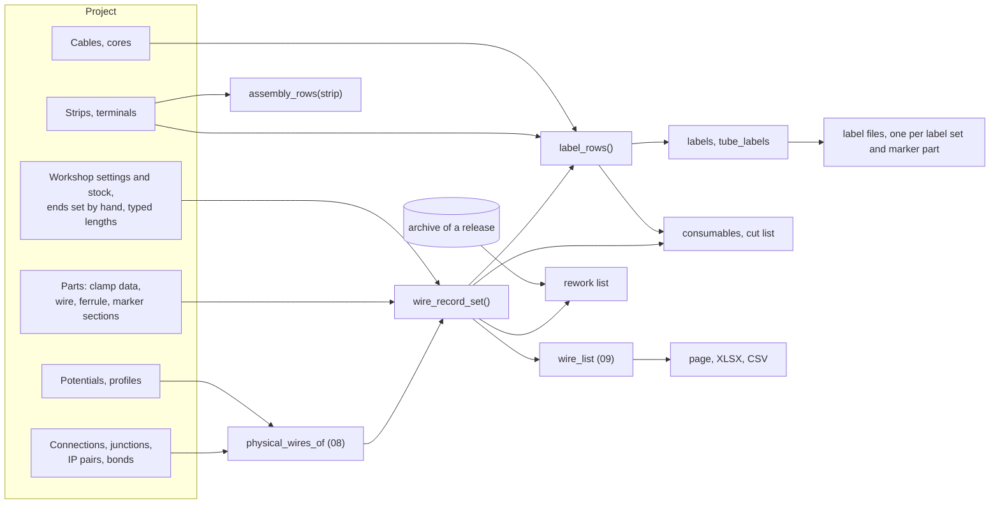

# Manufacturing outputs

**Status:** Draft v0.1 · **Date:** 2026-10-18 · **Part of:** ElektraWatt design document set

**Purpose.** This document designs everything ElektraWatt (EW) hands to the panel shop: the wire list as the fitter
works from it, the treatment of each wire end, markers and the label files, the rework list after a change,
terminal-strip assembly lists, the label file's export profile, drilling and cut
data, verification checklists, the production package, the read-only wiring viewer and the as-built feedback loop. It
elaborates the MFG rows of
[02b](02b-requirements-extended.md) §6 on top of the accepted [architecture](04-architecture.md) and the
[domain model](03-domain-model.md) §17. Its governing rule is ADR-0018: one row source feeds the printed list, the
spreadsheet, the package and the machine file, so they cannot disagree.

**Contents**
1. [Scope and position](#1-scope-and-position)
2. [Concepts and data](#2-concepts-and-data)
3. [The wire list](#3-the-wire-list)
4. [End treatments](#4-end-treatments)
5. [Markers and labels](13-markers-labels.md#5-markers-and-labels)
6. [Terminal-strip assembly lists](13-workshop-lists.md#6-terminal-strip-assembly-lists), with the
   consumables summary (§3.6) and the cut lists (§9.3) in [the workshop lists](13-workshop-lists.md)
7. [Export profiles](13-package.md#7-export-profiles)
8. [The production package](13-package.md#8-the-production-package)
9. [Drilling data, hole tables and cut lists](#9-drilling-data-hole-tables-and-cut-lists)
10. [Verification checklists and assembly documentation](#10-verification-checklists-and-assembly-documentation)
11. [Wiring viewer and the as-built feedback loop](#11-wiring-viewer-and-the-as-built-feedback-loop)
12. [UI and UX touchpoints](#12-ui-and-ux-touchpoints)
13. [Outputs](#13-outputs)
14. [Edge cases and pitfalls](#14-edge-cases-and-pitfalls)
15. [Defects prevented](#15-defects-prevented)

---

## 1. Scope and position

Manufacturing data is **derived, never authored twice**. A wire's ends come from the connection graph, its
cross-section and colour from the potential-based inheritance chain, its length from what a person typed or from the
layout, the treatment of each end from a rule table over the wire and its clamp, and the text of its markers from the
tags and numbers the drawing prints. A person authors only the shop's choices (`WorkshopSettings`, §2.3), an end set by
hand, a length typed by hand and the clamp data of a part.

| Topic | Decided here | Decided elsewhere |
|---|---|---|
| Physical-wire identity, orientation (From/To) | Use only | [08](08-connections-terminals-cables.md) §3.8 |
| Effective csa, colour, wire part with provenance | Use only | [08](08-connections-terminals-cables.md) §4, [03](03-domain-model.md) §9.5, [07](07-symbols-parts-macros.md) §2.5 |
| Wire numbers | Use only | [08](08-connections-terminals-cables.md) §5 |
| The wire annotation a page prints beside a wire | How it stands to a marker (§5.1) | [08](08-connections-terminals-cables.md) §4.5 |
| Routing, the length formula, the door, bundles | The length's place in the record (§3.3) | [12](12-panel-layout.md) §8, §9 |
| `RowSet`, report kinds, printed columns, pagination, PDF, XLSX and CSV | The wire list's columns, the label files | [09](09-reports-forms-output.md) §2.3, §2.4, §3.8, §4.6 |
| Clamp data; the wire, ferrule and marker sections; the workshop stock | Which members the derivation reads (§2.2) | [07](07-symbols-parts-macros.md) §2.5 |
| The assembly list, the cut list, the consumables summary | What they read of the wire records (§2.4) | [the workshop lists](13-workshop-lists.md) |
| Tube rows | The tube markers' text (§5.3) | [11](11-fluid-power.md) §8.2 |
| The as-built archive | What the rework list compares (§3.5) | [05](05-project-format-and-persistence.md) §14 |
| Rule engine, waivers | The rules of §4.6 | [15](15-checks-revisions-collaboration.md) |
| The window | The commands and dialogs of §12 | [16](16-ux-ui.md) |



**Homes** ([04](04-architecture.md) §3.4). No crate is added for the workshop:

- `ew-derive`: the query `wire_record_set()` (§2.4), a wire's length, the rule table of end treatments and the engine
  that applies it, the marker text and the rule that shortens it, the label engine `label_rows()` and the comparison of
  two states that gives the rework list. Each reads several records, and the checks read them too.
- `ew-reports`: the columns of `wire_list`, the list kinds `labels` and `tube_labels`, the rework rows and the label
  file writer.
- `ew-checks`: the rules of §4.6. `ew-commands`: nothing new; `fields.set` writes a typed length and an end set by hand,
  `project.settings.set` the members of `workshop`.
- `ew-api`: opening the archive a rework list compares with, writing the label files, the rows of Properties and the
  editable cells of the Connections table. `ew-viewmodel` and `ew-ui`: the commands and dialogs of §12.

The label file's export profile (§7) is a member of `WorkshopSettings`. The package (§8) is composed in `ew-api` from the files the
program's exports already write; the check before it is the release check of `ew-checks` (§8.6).

---

## 2. Concepts and data

### 2.1 Vocabulary

| Term | Meaning |
|---|---|
| Wire | One conductor the fitter cuts from a reel and lands at both ends: a physical wire of [08](08-connections-terminals-cables.md) §3.8 that is no cable core. A bond wire is a wire |
| Core | A conductor of a cable: cut with its cable; the fitter treats its ends, lands them and marks them where the shop does |
| Jumper | A wire whose two ends land on one device (-101G1:+#1 to -101G1:+#2) |
| Bridge | A plug-in, saddle, wire or inter-level bridge between terminals of a strip: mounted with the strip, never a wire |
| End | Where a wire lands: a pin of a device, a clamp of a terminal, or an external point outside the project |
| From end, To end | A wire's two ends in the orientation of [08](08-connections-terminals-cables.md) §3.8; every list, label and rework row reads a wire the same way round |
| Site end, field wire | An end that is external, or on a device of another location than the cabinet's (the location of a layout space), is made on site, not in the shop; a wire with a site end is a field wire |
| Clamp | The connection point of a part a conductor goes into; its kind and how many conductors it takes are part data |
| End treatment | What the fitter puts on an end: a ferrule, a twin ferrule, a ring lug, a connector's contact, or nothing (bare) |
| Marker | The printed sleeve or clip on a wire end that names the wire or its far end |
| Wire annotation | The text a schematic page prints beside a wire: its number, cross-section and colours ([08](08-connections-terminals-cables.md) §4.5). It is no marker (§5.1) |
| Label | Any printed mark of the workshop: a wire marker, a terminal or strip marker, a cable marker, a device label, a tube marker, a plate |
| Label set | The labels of one kind (wire markers, terminal markers, …), printed on the marker part of the stock that marks them; one label file per label set and marker part |
| Export profile | How a label file is written from the labels list's rows: its columns with their headings, its delimiter and Excel or CSV; project data (§7) |
| Package | One ZIP of the workshop's files for a job, with its contents and a manifest (§8) |
| Rework list | What the fitter changes in a built cabinet between a release and now (§3.5) |

### 2.2 What the derivation reads

| Input | Source | Read for |
|---|---|---|
| Physical wires, their ends and constituents | `physical_wires_of(potential)` ([08](08-connections-terminals-cables.md) §3.8) | rows, ends, jumpers, who shares a clamp |
| Cross-section, colour, wire part | `wire_props_of(potential)` ([08](08-connections-terminals-cables.md) §4); the wire part the chain names, else the stock's of the wire's size and colour (`wire_part_of`, [07](07-symbols-parts-macros.md) §2.5) | columns, the ferrule's size, the conductor class |
| Wire number | `wire_numbers()` ([08](08-connections-terminals-cables.md) §5.2) | the No. column, markers by number |
| Tags | the device tag, `level_short_tag`, `cp_label` ([08](08-connections-terminals-cables.md) §3.8) | ends, marker texts, labels |
| Clamp data | `CpData` of the part: `clamp_type`, `max_conductors`, `twin_ferrule`, `csa_min`, `csa_max` ([07](07-symbols-parts-macros.md) §2.5) | treatment, pairing, EW-POT-010 |
| Conductor class | `sections.wire.class` of the wire's part | treatment |
| Ferrules and lugs | the workshop stock's parts of section `ferrule`: `csa_min`, `csa_max`, `twin`, `insulated`, `sleeve`, `colour`, `stud` | the part of an end, its colour, the strip length |
| Markers | the workshop stock's parts of section `marker`: `marks`, `lines`, `chars` | a label's marker part, the shortening of §5.2 |
| Typed length | `WireOverrides.length` of the wire's connections, its own first (§2.3) | length |
| Cable | the core's conductor and its cable device | the No. and the length of a core |
| Placements | the layout's placements and layout spaces ([12](12-panel-layout.md)) | the order of device labels; a site end, a door end |
| Workshop settings | `ProjectSettings.workshop` (§2.3) | treatment, marking, rounding, label files |
| A release | its as-built archive ([05](05-project-format-and-persistence.md) §14), opened read-only | the rework list's base |

### 2.3 Authored data

The shop's choices are members of the one `WorkshopSettings` ([07](07-symbols-parts-macros.md) §2.5), beside its
stock and its cut increment. Every member is optional and additive; an older build keeps it in `extra` and writes it
back.

```rust
pub struct WorkshopSettings {                 // ProjectSettings.workshop; absent: every default below
    pub stock: Vec<PartRef>,                  // the wire, ferrule, marker and gland parts the shop keeps, in its order (07 §2.5)
    pub cut_increment: Option<Nm>,            // what a piece is rounded up to, 5 mm when absent (07 §2.5; here §3.3)
    pub marking: Marking,                     // destination (default) | wire_number | both_ends | potential
    pub mark_cores: bool,                     // default false: a core is known by its colour or number
    pub mark_jumpers: bool,                   // default false: a jumper on one device carries no marker
    pub ferrules: FerruleRule,                // not_into_spring_clamps (default) | every_fine_stranded_end
    pub two_wires: TwoWires,                  // twin_ferrule (default) | ferrule_each
    pub device_labels: DeviceLabels,          // on_device (default) | on_device_and_beside
    pub label_profile: Option<ExportProfile>, // the label file's; absent: the generic one (§5.4, §7)
    pub fixing: FixingRule,                   // a fixing hole in the plate: tapped (default) | self_tapping | through (12-3d §10.3)
    pub rail_fixing: Option<CarrierFixing>,   // absent: M5, at most 300 mm apart, 25 mm from each end
    pub duct_fixing: Option<CarrierFixing>,   // absent: M4, at most 300 mm apart, 25 mm from each end
    pub min_web: Option<Nm>,                  // the web kept between two holes; absent: 5 mm (12-3d §10.5)
    pub datum: Option<Corner>,                // the corner holes are measured from; absent: bottom left (12 §2.8)
    pub door_loop: Option<Nm>,                // the loop across a door's hinge; absent: 300 mm (12-3d §9)
    pub fill_limit: Option<u8>,               // a duct's fill limit in percent; absent: 60 (12-3d §8.6)
    pub reserve: Option<Nm>,                  // what the fitter adds at each end of a routed wire; absent: 50 mm (12-3d §9)
}
pub struct CarrierFixing { pub screw: Screw, pub pitch: Nm, pub from_end: Nm }   // Screw: m3 | m4 | m5 | m6 | m8
// ExportProfile, ProfileColumn and MachineTakes: §7.1
pub struct EndOverride {                      // WireOverrides.end_a and .end_b: the end of this connection
    pub treatment: Option<TreatmentKind>,     // ferrule | twin_ferrule | ring_lug | bare
    pub part: Option<PartRef>,                // a ferrule or ring lug part the project holds
    pub marker: Option<EndMarker>,            // {"text": "<marker>"} | "none"
}
```

- **An end set by hand belongs to one wire** and lives on a connection no other wire stands for (an edit writes the
  first; one stored on another is read and reset there): `end_a` holds the end reached through that endpoint `a`,
  `end_b` through `b`; two wires at one clamp are two ends. Reset clears it.
- **A typed length** is `WireOverrides.length` ([03](03-domain-model.md) §9), read as every override of a physical
  wire: the wire's own connections first, then the carrier ([08](08-connectivity-wires.md) §4.1). A cell of a
  wire's row in the Connections table (its length, colour or cross-section) sets the wire's first connection that no
  other wire stands for (`WireRecord::own`, the carrier where it is the wire's own); never a star's feed arm or a
  chain's arm another wire shares. A bridge row has no Length cell to type in.
- **A wire's own values follow the wire.** Its length, colour, size, flags, shown annotation, a member a newer format
  added and each end set by hand stand once, on its own connections, an end with the clamp it was set for. After every
  command that changes the wiring, one normaliser (`own_values`, [06](06-commands-connecting.md) §3.2) restores this
  from the states before and after, whatever the command was:
  - a wire with the same two clamps as before (matched by `wire_changes`, §3.5) has the same values;
  - a wire whose clamps changed has what divides of the wires it is made from (those that lost a clamp it ends at):
    its colour, size and the other members, each end set by hand from the wire that ended at its clamp, and no typed
    length, which nobody measured. A device placed on a wire cuts it into two such wires; a deleted arm or a junction
    turned from a star into a chain makes one. Where it is made from two wires (the feed arm's wire when a device cuts
    a star's feed arm, two wires joined into one), the values of the one whose ID it keeps come first, the others,
    in ID order, fill what that one leaves unset;
  - a new wire has what the command set on its own connections: a wire drawn onto a wire takes none of its values;
  - a value on a connection several wires share stays there only while every wire through it has it, else each wire
    keeps it on its own connection. A wire left without a connection of its own (the middle wire of a chain of three
    at one junction) keeps no value of its own; its row in the table is read-only.
- The layout's reserve ([12](12-panel-layout.md) §9) joins `WorkshopSettings` with the lengths the layout computes.
- **Nothing about production status is authored in the project.** Status, actual lengths and technician actions live
  in the order folder (§11.3); the project format stays free of timestamps (ARCH §7.3).

### 2.4 Derived records

```rust
pub struct WireRecord {               // wire_record_set(): every physical wire once, in the numbering order (08 §5.2)
    pub wire: PhysicalWire,           // oriented: ends[0] is the From end
    pub csa: Option<Prov<Csa>>,       // the effective cross-section, colour and wire part with their sources (08 §4);
    pub colour: Option<Prov<ColourSpec>>,   // the part is the chain's, else the stock's of this size and colour
    pub wire_part: Option<PartRef>,
    pub number: Option<String>,       // the printed number; None for a core and a wire drawn on no page
    pub length: WireLength,           // §3.3: value() and whether there is one
    pub flags: WireFlags,             // field: an end is a site end (§2.1)
    pub ends: [EndRecord; 2],         // From, To
}
pub enum WireLength {                 // 12-3d §9; nothing is estimated
    Typed(Nm), WithCable(Id<Device>),
    Routed { length: Nm, run: Nm, door: bool },                 // a stored way that holds
    Stale { length: Nm, run: Nm, door: bool, why: StaleWhy },   // a stored way that no longer holds (12-3d §8.5)
    Missing,
}
pub struct EndRecord {
    pub treatment: EndTreatment,      // Ferrule{csa} | TwinFerrule{csa, partner} | RingLug | Bare | Connector
                                      //   | External | Unknown{reason}
    pub part: Option<Id<Part>>,       // the ferrule's or ring lug's part (§4.4)
    pub site: bool,                   // made on site, not in the shop (§2.1)
    pub treated_by: TreatedBy,        // Rule{row, assumed: Assumption} | Hand | Outside (an external end)
    pub marker: MarkerText,           // Lines(1 to 3 lines) | NotMarked(why) (§5)
    pub marked_by: MarkedBy,          // Setting | Hand
    pub marker_fits: bool,            // false: the text does not fit the wire markers' part (§5.2, EW-MFG-004)
}
pub struct LabelRecord {              // label_rows(): every label in the order it is applied (§5.3)
    pub set: LabelSet,                // WireMarkers | TerminalMarkers | StripMarkers | CableMarkers | DeviceLabels
                                      //   | TubeMarkers | Plates
    pub target: LabelTarget,          // the wire end, terminal, strip, cable, device or tube end it labels
    pub lines: SmallVec<[String; 3]>,
    pub copies: u8,
    pub marker_part: Option<Id<Part>>,    // the stock's marker that marks its set (§5.3)
    pub fits: bool,                   // false: the text does not fit the marker part (§5.2)
}
```

The types are `ew-derive`'s; the cells and words that print them are `ew-reports`' and `ew_derive::text`'s. The
consumables summary and the cut list read `csa`, `colour`, `wire_part`, `length` and `flags.field` of a wire, the
`treatment` and `part` of each end the shop makes (a twin ferrule's part once for its two wires) and the `marker_part`
of each label ([the workshop lists](13-workshop-lists.md) §3.6, §9.3). A record is never stored; a release freezes the
lists it prints into its archive (FR-REV-011).

### 2.5 Queries and freshness

| Query | Reads | Policy | Class |
|---|---|---|---|
| `wire_record_set()` | `physical_wires_of`, `wire_props_of`, `wire_numbers`, tags, clamp data, the workshop stock, settings | Memo: one value for every reader of a state (the lists, and the checks per potential and per device, which computed it again each) | I |
| `label_rows()` | `wire_record_set()`, strips and terminals, cables, devices, placements, `tube_rows`, the stock's markers | cold | I |
| the rework list | two `wire_record_set()` and two `label_rows()`, one of them read from an archive | computed when asked, in a job | II (the archive is a file) |
| `assembly_rows(strip)`, `consumables`, `cut_list` | [the workshop lists](13-workshop-lists.md) | Memo, cold | I |
| `checklist_rows(kind, scope)` | potentials, protective devices, PLC rows, the rework list | Memo | I |
| the package (§8) | the files of the exports above, on the job's copy of the snapshot | job | II (the file is outside the project) |

A Class I list is always current; nothing is updated by hand. The rework list reads a file outside the project, so it
is made when a person asks for it and is never stored.

---

## 3. The wire list

### 3.1 One list, its rows and its columns

**The wire list is one list kind, `wire_list`, and it is the fitter's sheet.** There is no second production list: a
list that repeated the wire list's rows and columns would be a copy to keep in step. A project that wants the drawing
set's list and the fitter's list apart makes two blocks of the one kind and gives each its printed columns
(Output ▸ List columns…, [09](09-reports-forms-output.md) §3.8); their title and their columns are all that makes them
two things.

**Rows.** One row per physical wire, cores included, in the numbering order of [08](08-connections-terminals-cables.md)
§5.2, from `wire_record_set()`; then a heading "Bridges" and one row per bridge: its label (BR1), its first and last
terminal, and in the From end cell its kind and span ("plug-in bridge, terminals 1–4"). A bridge has no length,
treatment or marker: it is mounted with its strip ([the workshop lists](13-workshop-lists.md) §6).

**Columns.** The key is what an export profile and the round trip address.

| Key | Heading | The cell | Printed |
|---|---|---|---|
| `no` | No. | the wire number; a core, which has none, its cable and core (`-103W1 BN`) | yes |
| `from`, `to` | From, To | the end's device or terminal (§3.2) | yes |
| `from_cp`, `to_cp` | CP | the end's pin or clamp (§3.2) | yes |
| `potential` | Potential | the potential's name; a bond wire `0V ⇄ PE` | |
| `colour` | Colour | the effective colour code | yes |
| `cross_section` | mm² | the effective cross-section | yes |
| `source` | Source | where the cross-section and the colour come from ([08](08-connections-terminals-cables.md) §4) | |
| `via` | Via | how the wire is joined: its junction and wiring, a daisy chain, the interruption points passed | |
| `part` | Wire part | the wire part's number | |
| `pages` | Pages | the pages the wire is drawn on | yes |
| `length` | Length | the length in mm; `cable` for a core; `—` without one; a stale length after `≈` (§3.3) | yes |
| `length_source` | Length from | typed, cable, routed, stale or missing; site for a field wire without a length of a cabinet Route has laid | |
| `from_end`, `to_end` | From end, To end | the end's treatment (§4.4): `ferrule 1.5 BK`, `twin 2.5 BU · 102.8`, `ring lug M6`, `bare` | yes |
| `from_part`, `to_part` | From part, To part | the part number of the end's ferrule or ring lug | |
| `from_strip`, `to_strip` | From strip length, To strip length | the strip length in mm: the ferrule's sleeve | |
| `from_marker`, `to_marker` | From marker, To marker | the end's marker text (§5.2), its lines joined by ` / `; empty where the end carries none | yes |

A block without columns of its own prints the fitter's columns, those marked "printed", in this order: No., From, CP,
To, CP, Colour, mm², Length, From end, To end, From marker, To marker, Pages (`ReportKindDef::printed`,
[09](09-reports-forms-output.md) §3.8); Output ▸ List columns… ticks the
engineering columns (Potential, Source, Via, Wire part) and the ends' parts and strip lengths into a block's print. The CSV and the XLSX of the list hold every column in the order of the table. The Connections
navigator in table mode has every column; it opens with No., From, CP, To, CP, Colour, mm², Length, From end and To
end, the left column of the window widening to show them, and its column chooser adds the others. Length, From end, To end, From marker and
To marker are editable there (§12).

### 3.2 The end

- **A device end** is the device's tag and its pin, as the drawing names them: `-101Q1` and `1`. A pin the device has
  twice prints its number as the drawing's labels do: `+#1`, `+#2`.
- **A terminal end** is the terminal's tag, which holds the strip and the terminal (`-X1011:L1`; a level of a block with
  a number of its own prints that number, [08](08-connections-terminals-cables.md) §6.3), and its clamp: the clamp's
  letter where the part names clamps (`a`), else the CP's designation (`1`). The fitter reads strip, terminal, level
  and clamp from two cells.
- **An external end** prints `ext.` and the point's name (`ext. L1`), no pin: it is made outside the project.
- **The From end comes first**, by the orientation of [08](08-connections-terminals-cables.md) §3.8, on every list,
  label and rework row, so that a wire never reads reversed between two sheets.
- **A tag prints without the structure its two ends share.** Inside one location a wire reads `-104A1-A2` to
  `-104E1`; where its ends lie in two locations each end prints its own, `+FLD-104B1` and `+CAB-104A1-A2`, so the list
  says that the wire leaves the cabinet and where it goes. Such an end, outside the cabinet's location, is a site end
  (§2.1): the shop makes the other end, cuts the wire long enough and leaves this end for the site.
- **A door end** (a device placed in the door, [12](12-panel-layout.md)) prints `(door)` after its tag, so that the
  fitter takes the wire through the hinge loop.
- **A core** is a row of the wire list: the fitter treats, lands and (where the shop does) marks its ends. It is cut
  with its cable, which the cable list and the cut list carry; its Length cell says `cable`.

### 3.3 Lengths

| `WireLength` | When | Length | Length from |
|---|---|---|---|
| `Typed(n)` | a constituent connection carries `WireOverrides.length` | n, as typed | typed |
| `WithCable(cable)` | the wire is a core | `cable` | cable |
| `Routed{length, run}` | the wire has a stored way that holds | L | routed |
| `Stale{length, run, why}` | the wire has a stored way that no longer holds | `≈` L | stale |
| `Missing` | none of these | `—` | missing; site for a field wire |

The table is [12-3d](12-3d-routing-thermal.md) §9's, which makes L from the stored way's run, the reserve at each end and
a door way's loop; nothing is estimated. **Rounding happens once**: a length the program computes is rounded up to the project's cut increment
(`workshop.cut_increment`, 5 mm when absent) in `wire_record_set()`, and a typed length prints as it was typed. The
list, the labels, the cut list and the package read the record and never round a wire's length again.

A length is typed in the Length cell of the Connections table or in the wire's Length row (Properties), in mm or with
its unit ("2 m"); an empty value clears it. Properties says where a length comes from in words: "Typed by hand", "Cut
with its cable -103W1", "No length: type it here, or the fitter measures the wire" (a text by key with its arguments,
[04](04-architecture.md) §18). Where a length is asked for or can be computed, EW-MFG-001 (§4.6) says how many wires
have none; in a project without a panel layout the wire list prints — and no rule reports it.

### 3.4 Order and grouping

The list is in the numbering order. A block may group it by the device or strip of the From end (its `group` member,
[09](09-reports-forms-output.md) §3.3), with a heading per device, for a shop that wires device by device.

### 3.5 The rework list

**Between which states.** The project as it is now and a release: by default the last released revision, whose archive
the program finds where the project keeps its archives ([05](05-project-format-and-persistence.md) §14.2), or an
archive file the person chooses. The archive opens read-only; `wire_record_set()` and `label_rows()` run on both
states.

**Which wire is which.** A wire of now is the wire of the release with the same ID; a wire whose carrier changed (a
junction edit) is matched by its two end CPs, so it is not pulled and added again. The same matching gives the wire
numbers before and after a change that a preview lists ([16](16-ux-ui.md) §7.6): one function of `ew-derive`.

**What a row says.** One row per thing the fitter does, in the order he does it:

| Action | When | The Change cell |
|---|---|---|
| Remove device, Remove terminal, Remove cable | a device label, terminal marker or cable marker of the release is gone | — |
| Pull | a wire of the release is gone | — |
| Replace | a kept wire changed its cross-section, colour or wire part | `size 1.5 → 2.5 mm²` and every other change |
| Move end | an end of a kept wire lands on another CP | `end -104A1-A1:2 → -104A1-A1:4` and the markers that follow |
| Re-make end | an end's treatment or part changed | `at -104E1:X2: twin 0.75 · 104.7 → ferrule 0.75` |
| Check length | the length changed | `length 600 → 650 mm` |
| Re-mark | a marker's text changed | `marker at -101Q1:1: -X1011:L1 → -X1012:L1` |
| Re-label | a device, terminal, strip or cable label's text changed | the old and the new text |
| Mount device, Add terminal, Add cable | a device label, terminal marker or cable marker is new | — |
| Add | a wire is new | — |

A row with several changes takes the first action of the table that applies and lists every change. The columns are
Action, No., From, CP, To, CP, Colour, mm², Length, From end, To end, From marker, To marker and Change; a pulled wire
prints as the release had it, every other row as it is now.

**What it does not report**: a wire that only moved on a page or took another route, a new number while no marker
changes (with destination marking a renumber needs no work; a twin ferrule is compared by its partner wire, not by the
partner's number), a change of source that keeps the value (a size that
moves from the wire to the profile), a potential renamed while no marker names it. Tubes are the fluid lists'.

**Where it goes.** The Rework list… dialog shows the rows and exports them as XLSX and CSV through the list's writers;
Labels for these changes… writes the label files of the new and changed markers and labels only (§5.4). A rework list
is not a page of the drawing set: it compares with a file outside the project.

### 3.6 Consumables summary (FR-MFG-049)

In [the workshop lists](13-workshop-lists.md) §3.6.

---

## 4. End treatments

### 4.1 Inputs per end

For each end the engine reads: the wire's cross-section; its conductor class, `sections.wire.class` of the wire's part
(the part the chain names, else the workshop stock's wire part of its size and colour, [07](07-symbols-parts-macros.md)
§2.5), else fine-stranded (the assumption of §4.2); the clamp of the end's CP: its kind, how many conductors it takes,
whether it takes a twin ferrule and its cross-section range (`CpData`); the other wires that land on the same CP; the
workshop settings; and an end set by hand. An external end (`ext. L1`) is made outside the project: its treatment is
`External`, printed `—`. A site end (§3.2) gets its treatment like any other; the shop does not make it.

### 4.2 The rule table

The rows are data in `ew-derive`, each with its source; the first row that matches gives the treatment. The table is
**unverified** until a panel builder confirms it against his shop's practice: an end that a row decides says
"rule (unverified)" in Properties, and a rule that reads it reports at most a warning (FR-CHK-046).

| Row | Clamp | Conductor | Treatment | Source |
|---|---|---|---|---|
| 1 | plug (a connector's pin) | any | `connector`: the connector's own contact, which comes with the connector | the clamp is a contact, not a clamp |
| 2 | ring stud | any | `ring lug` | a stud takes a closed lug (DIN 46234 ring lugs, verify) |
| 3 | insulation displacement | fine-stranded | `Unknown`: the clamp does not take it (EW-MFG-008) | IDC clamps take solid and stranded conductors only |
| 4 | insulation displacement | solid, stranded | `bare` | |
| 5 | spring, push-in | fine-stranded, when the shop sets "not into spring or push-in clamps" | `bare` | the clamp holds fine strands itself (its maker's data) |
| 6 | screw, spring, push-in, or not known | fine-stranded (IEC 60228 class 5 or 6) | `ferrule` of its size, or a twin ferrule by §4.3 | DIN 46228 ferrules; EN 60204-1 13.1.1 (verify the clause): the strands held together |
| 7 | screw, spring, push-in, or not known | solid or stranded (class 1 or 2) | `bare` | a clamp takes them without a sleeve (IEC 60999-1, verify) |

**Assumptions, said where they are made.** A clamp whose part has no clamp data is taken as a screw or spring clamp; a
wire whose class nothing names is taken as fine-stranded, the common panel wire. An end decided under an assumption
says so in Properties ("rule: fine-stranded wire, clamp kind not known") and in its source; the printed list prints the
treatment only.

**What the shop sets** (`WorkshopSettings`, §2.3): `ferrules`, by default no ferrule into a spring or push-in clamp
(row 5: the end stays bare) and a ferrule on every other fine-stranded end, a screw clamp's (row 6), or else a
ferrule on every fine-stranded end; `two_wires` (§4.3: two wires of one size on one clamp, a screw clamp by default,
share a twin ferrule) and the order of its stock (§4.4). The default is the owner's shop rule (2026-11-26). Fork and pin lugs are not made by this design: no
part section describes them yet.

### 4.3 Two or more wires on one clamp

The wires whose ends land on one CP share its clamp. Pairing runs on the ends no person has set by hand, after the
table has given each its treatment:

```text
for each CP with wires W (|W| ≥ 2), sorted by cross-section (largest first), then number, then wire ID:
  pairable(a, b) = both ferrule ends, equal cross-section,
                   the clamp takes a twin ferrule (or its part does not say),
                   and the shop's two_wires is twin_ferrule
  pair greedily in that order; each pair → TwinFerrule{csa, partner}, every other end keeps its treatment
  conductors = |W| − pairs
  conductors > the clamp's maximum (where its part names one) → EW-POT-010, naming the clamp
```

A twin ferrule counts as one conductor, so EW-POT-010 and the treatment see the same count. Each wire of a pair prints
`twin 2.5 · 102.8`: the size and the partner's number (a core's cable and core), so the fitter cuts both wires before he
crimps them. Two wires of different sizes on one clamp get a ferrule each, as do two wires where the shop sets
`ferrule_each`; three wires of one size give one pair and one single ferrule.

### 4.4 The part of an end

A ferrule end takes the first ferrule of the workshop stock (`workshop.stock`, in its order;
[07](07-symbols-parts-macros.md) §2.5) whose section `ferrule` has no `stud`, holds the wire's size between `csa_min`
and `csa_max`, and is `twin` for a twin ferrule and not for a single one. A ring lug takes the first stock part of
section `ferrule` with a `stud` whose range holds the wire's size. Without such a part the end keeps its treatment and
has no part: the list prints the treatment, and the consumables summary counts it under its size as "no ferrule found"
([the workshop lists](13-workshop-lists.md) §3.6).

**What the end cell prints** is the treatment, its size, the part's collar colour where the part names one (a code of
IEC 60757) and, for a twin ferrule, the partner: `ferrule 1.5 BK`, `twin 2.5 BU · 102.8`, `ring lug M6`, `bare`,
`connector`, and `?` for an end the table cannot decide. The strip length is the part's `sleeve` (the From strip and To
strip columns, §3.1). A ferrule's colour is its part's: the program holds no colour table, and the shop's choice of DIN
or another colour scheme is the choice of its stock.

### 4.5 An end set by hand

In the Connections table's From end or To end cell, or in the wire's Properties (section From end or To end, rows From
end and From part, To end and To part), a person chooses ferrule, twin ferrule, ring lug or bare; an empty cell gives
the rule's own back; in the Part row, a ferrule or lug part the project holds. The choice is one `fields.set` of the
connection's `end_a` or `end_b` (§2.3) and one undo step. Properties set both ends of a wire from any of its
connections; a selection of several wires shows them read-only. The cell prints the treatment as the list does, and Properties shows the chip "set by hand" with
Reset, which clears it and gives the rule's treatment back; a rule's end says "rule (unverified)" and what it
assumed. An end set by hand takes no part in the pairing of §4.3; a
twin ferrule set by hand pairs with the other end on its clamp that is set or paired as twin.

### 4.6 The rules of the check

The rules that say before a print what the fitter would ask. They run online and in release mode ([15](15-checks-revisions-collaboration.md)
§3.1) and stand in Messages with the other findings; their words are their patterns in the rule texts.

| Rule | Says | Severity | Fix |
|---|---|---|---|
| EW-MFG-001 | How many of a cabinet's wires have no length, one finding per cabinet with the wires as its targets; raised by Check project where a panel layout gives lengths, never without a layout. A field wire and a core are not counted (the site and the cable give their lengths); a stale length is EW-LAY-011's | info, in the release check too: a wire without a length stops no release and no package, which name it (§8.6) | Route |
| EW-MFG-004 | "The marker of 104.4 at -104B1:13 does not fit its marker part: +CAB-104A1-A2:L+ needs 16 characters on a line of 12", per end | warning | — |
| EW-MFG-008 | "The end of 104.4 at -104B1:13 cannot be made: a fine-stranded wire into an insulation-displacement clamp", per end | warning | Set the end by hand |
| EW-MFG-009 | "The end of 101.7 at -101F1:3 set by hand does not fit: a ferrule for 1.5 mm² on a 2.5 mm² wire" (also: a twin ferrule with no second wire; a ferrule of another collar colour than the stock's ferrule of that size), per end | warning | Reset to the rule |
| EW-POT-010 | "-X1011:PE clamp a takes 1 conductor; 2 land on it", per clamp, only where the part names its capacity; "-X1011:PE clamp a takes 0.5–1.5 mm²; 101.4 of 2.5 mm² lands on it", per wire, only where the part names the range | error | — |

A wire part that does not match the wire is EW-MFG-022 ([07](07-symbols-parts-macros.md) §2.5). Before a package, the
release check judges the project with these rules and the others (§8.6).

---

## 5. Markers and labels

In [markers and labels](13-markers-labels.md) §5: marking (§5.1), the marker text and the rule that shortens it
(§5.2), the label engine (§5.3), label files and the export profile (§5.4).

---

## 6. Terminal-strip assembly lists

In [the workshop lists](13-workshop-lists.md) §6: the content (§6.1), the rail cut length (§6.2) and what the check
says (§6.3).

---

## 7. Export profiles

In [the label file's export profile and the package](13-package.md) §7: what a profile is (§7.1), the form of a file
(§7.2), where it is seen and changed (§7.3), and what is not built: presets and a wire file for a machine (§7.4).

---

## 8. The production package

In [the label file's export profile and the package](13-package.md) §8: what it is (§8.1), its members (§8.2), the manifest (§8.3),
draft and release (§8.4), where it is in the window (§8.5), the check before export (§8.6), without personal data
(§8.7), the same bytes (§8.8), homes and the licence (§8.9).

---

## 9. Drilling data, hole tables and cut lists

The hole table and the drawings for drilling (§9.1, §9.2) are in [holes and the drawings for drilling](13-drilling.md);
the cut lists (§9.3) in [the workshop lists](13-workshop-lists.md).

### 9.3 Cut lists (FR-MFG-030)

In [the workshop lists](13-workshop-lists.md) §9.3.

---

## 10. Verification checklists and assembly documentation

### 10.1 EN 60204-1 clause 18 (FR-MFG-036)

Items cite clause numbers only, in EW's own wording; no standard text, table or figure is reproduced
(NFR-COMP-05). Test values are fields the technician fills in, never shipped constants. Clause numbers follow the
2016/2018 text and are **(verify)** against EN 60204-1:2018+A1:2025 ([standards](../research/standards.md) §7).

| Clause | Generated list | Source |
|---|---|---|
| 18.1 | Devices against BOM (DT, part number), labels present, documentation revision | `bom_rows`, label sets, revision |
| 18.2.2 | Every PE conductor and PE-bonded part, with the derived path from the main PE terminal and a result field (Ω) | PE potential, bonds, rail-bonded terminals, carriers and surfaces with `pe_bond` |
| 18.2.3 | Per protective device: type, rated current, characteristic, required maximum loop impedance (field) | devices with protective-device parts, tech data |
| 18.3, 18.4 | Devices to disconnect before insulation or voltage tests | part flag `insulation_test_disconnect` |
| 18.5 | Devices with stored energy | part flag `stored_energy` |
| 18.6 | Functional list: each used channel with address, target device, process tag, folio and expected effect; safety functions | `plc_rows`, channel bindings, `DeviceLink` |
| 18.7 | Retest scope: devices and circuits in the change list since the last delivery | `mfg_change_list` |

### 10.2 IEC 61439-1/-2 clause 11 (FR-MFG-037)

One checklist per assembly serial number. Sub-clause numbers follow the Ed. 2 material and are marked
**(verify)** for the current edition ([standards](../research/standards.md) §8.1).

| Sub-clause (verify) | Item | Generated content |
|---|---|---|
| 11.2 | Degree of protection | IP and IK from the enclosure part; door cut-outs with their device's rating |
| 11.3 | Clearances and creepage | devices and bars with declared minimums |
| 11.4 | Protective circuit | the 18.2.2 continuity list |
| 11.5 | Built-in components | placements against BOM and part installation notes |
| 11.6 | Internal connections | torque sample list per clamp kind (screw clamps with torque from L6; push-in clamps: pull test); point-to-point continuity list from the wire records |
| 11.7 | Terminals for external conductors | field-side terminals with their csa ranges |
| 11.8 | Mechanical operation | doors, locks, main-switch interlock items from the enclosure template and part flags |
| 11.9 | Dielectric properties | test value fields and the disconnect list |
| 11.10 | Wiring, operational performance, function | wiring completion (1.x viewer report), the 18.6 functional list |

### 10.3 Format, sign-off and disclaimer (FR-MFG-038)

```json
{"checklist":"en60204-1.cl18","ruleset":"EN60204-1:2018+A1:2025","revision":"V2.0","package":"3F9A2C1D",
 "assembly_serial":null,"method":"generated from the model; see section notes","disclaimer":"…",
 "sections":[{"clause":"18.2.2","items":[
   {"id":"5f1c…","target":{"dt":"-201U1","cp":"FE"},"path":["1X1:PE","rail R2","-X1032:3","W33"],
    "alias":"PE-1.3","expected":"continuity","unit":"ohm","result":null,"value":null}],
   "signoff":{"technician":null,"date":null,"instrument_serial":null}}]}
```

- Item IDs are UUIDv5 of (checklist kind, source entity IDs), so results re-attach to the same items in a later
  package.
- The PDF prints the same items through a checklist form ([09](09-reports-forms-output.md) §2.4, kind
  `checklist_*`).
- Every checklist states its method, its data sources and that it does not replace verification by a competent
  person (NFR-COMP-04).
- Filling them in the viewer is 1.x (§11.5).

### 10.4 As-built, marking and declarations (FR-MFG-039 … 041)

- **As-built package** (FR-MFG-039, 1.0 Should): `ew mfg asbuilt <order>` writes a package with the PDF/A set, BOM
  with quantities, wire list with actual lengths where feedback exists, terminal diagrams, layout views, the filled
  checklists, the status logs and the change list since the last delivery.
- **Assembly marking data** (FR-MFG-040): the IEC 61439-2 designation marking and EN 60204-1 16.4 nameplate items as a
  `Rating` label set and a report block from project properties: manufacturer `<panel builder>`, type, serial,
  supply, control voltage, rated current, standard reference, document number `<drawing id>`. The item list is
  **(verify)**.
- **Enclosure QR** (FR-MFG-015): the rating label may carry a configured payload (document ID or company URL). It
  is printed text; EW opens no connection.
- **Forms** (FR-MFG-041, Could): IEC 61439 design verification record (thermal method and result from FR-THM-009),
  EU declaration templates (2014/35/EU, 2014/30/EU, Regulation (EU) 2023/1230 where applicable, which applies from
  2027-01-20).

---

## 11. Wiring viewer and the as-built feedback loop

The viewer, the lookup codes and the as-built loop are later work. They read the package of §8, which gains with them
the members they need and that no other reader has: the wire records as data, the position of each end, an index of
the drawings' pages and an identity of the package that a code can print. The names below are those members'.

### 11.1 Read-only viewer (FR-MFG-033, 1.0 Should)

The viewer opens a package (§8) on a machine without EW projects or catalogues.

| Screen | Content |
|---|---|
| Queue | wires by bundle and sequence; filters: device, duct, strip, door, status (1.x), change since a base package |
| Wire | From and To with locus, csa and colour (code always beside the swatch, GNYE striped), treatment and ferrule colour by name, length and source, markers |
| 3D | both CPs highlighted, route highlighted in its ducts, camera auto-framed on the two ends (`layout/<space>.glb`, `pos_mm`) |
| Schematic | the region of the PDF/A page around each end's cell (±1 cell) and the IP cells, cropped with `docs/index.json`, rendered from the PDF itself |
| Strip | the terminal assembly list with the selected wire's terminal highlighted |

- **Fallback without GPU.** If no wgpu adapter is available (after DX12 WARP on Windows), the 3D view is replaced by
  the plate view rasterised on the CPU from the layout page (folio 902) of `docs/drawings.pdf`, with the end
  placements highlighted from `pos_mm`. This needs the same PDF rasteriser as the schematic snippets.
- **Integrity.** The viewer verifies each member against the manifest's SHA-256 (§8.3). A mismatch keeps the package
  open but shows a persistent banner "modified after export" naming the mismatched members.
- **Shop-floor ergonomics.** Large touch targets, a dark theme, keyboard-wedge scanner input into an always-focused
  search field (1.x codes), no network access (NFR-PRIV-01).

### 11.2 Lookup codes (FR-MFG-014, 1.x)

Payload: `EW1:<pkg>:<key>`.
- `pkg` is the package's identity, which the package gains with the codes.
- `key` is `W` plus 8 Crockford base32 characters (40 bits) of the wire UUID's bytes 8–15 (the random or hash part,
  ARCH §7.3); `C`, `T` and `B` prefixes identify cables, terminals and bundles. If two wires of one package share a
  key, both keys are extended by characters until they differ. The viewer resolves a key by prefix match against
  the full wire UUIDs, so an older 8-character label still opens its wire and an ambiguous one lists both
  candidates. At 2,000 wires the chance of any collision is about 2 × 10⁻⁶.
- Example: `EW1:3F9A2C1D:W7K2M9QXA` (22 characters). Every character is in the QR alphanumeric set, and the payload
  fits a version 2 symbol at level M **(verify the capacity table)**. Data Matrix is offered for small wire markers.
- EW writes the payload as text into the label set's code column; the marking software renders the symbol. EW's own
  PDFs render no codes until an encoder crate is chosen.
- The code holds no URL by default; a per-company URL template is optional.
- A code from an older package still resolves, because the wire key is stable. The viewer then reports "label
  printed from package 1A2B3C4D (V2.0); this wire changed since". This is how the shop detects stale labels after a
  rework.

The wire key is used instead of the wire number because cores are unnumbered and numbers may change before they
are frozen.

### 11.3 Order folder and status log (FR-MFG-034, 1.x)

The package is immutable. Everything the shop records lives beside it:

```text
SAMPLE-E-SN0007/                 one order = one assembly serial number
  SAMPLE-E V1.0 2026-11-28 package.zip
  status/<device-id>.jsonl        append-only events, one file per viewer device
  photos/<sha256>.jpg             photos referenced by problem events
  feedback/<machine>-<n>.csv      raw machine feedback files, kept verbatim
  checklists/<kind>.json          filled checklists
```

```json
{"v":1,"pkg":"3F9A2C1D","wire":"0192f3a0-…","event":"problem","reason":"too_short","by":"T07",
 "device":"tab-02","at":"2027-03-04T09:12:44Z","seq":17,"photo":"sha256:…"}
```

- **Events:** `done`, `problem` (reason code, optional photo by hash), `skip`, `cut` (machine feedback with cut
  length), `tested`.
- **Merge:** union of all device files. A wire's status is its latest `done`, `problem` or `skip` event by (`at`,
  `device`, `seq`); `cut` and `tested` events are kept as history, and the completion report lists every `problem`
  event, including superseded ones. No CRDT and no server are needed; a shared folder suffices.
- **Personal data:** `by` is a pseudonymous technician code. The mapping to names stays in the shop and is never
  written into packages sent to customers.
- **Determinism:** status logs contain observed timestamps by nature. An as-built package is reproducible from
  (model, logs), not from the model alone.

### 11.4 Back into engineering

| Shop fact | Path into the project | Kind of change |
|---|---|---|
| Problem on a wire ("too short", "CP blocked") | `ew mfg import-status <order>` previews `Comment` entities anchored to the carrier connection | Undoable transaction, origin `mfg` |
| Measured trim or shortfall | suggestion of a calibration factor per device family (FR-LAY-052); EW-MFG-011 info | Only by an explicit settings command |
| Machine cut length | traceability only: it is what EW asked for, not what the wire needed | none |

The design model never changes behind the engineer's back: every effect is a previewed command.

### 11.5 As-built package

An as-built package is intended as the package of a release (§8) with what the shop recorded beside it: the merged
status log, the machine feedback files and the filled checklists of the order folder (§11.3), with the serial number
in its manifest and the hand-off package it extends named there. It comes with the viewer, whose status log it reads;
until then the order folder is the shop's own.

---

## 12. UI and UX touchpoints

The panel builder of [vision](00-vision-and-scope.md) who wires his cabinets himself or hands the lists to a fitter. The
workshop has **no workspace of its own**: what it needs is a list page, the Connections navigator in table mode,
Properties, two dialogs and Messages, each where the program already puts its kind of thing. Layout details belong to
[16](16-ux-ui.md) and [16a](16a-design-language.md).

**The first job.** (1) The schematic is checked; Output ▸ Workshop ▸ Wire list opens page 907: per wire its ends,
colour, size, length, each end's treatment (`ferrule 1.5 BK`, `twin 2.5 BU · 102.8`) and markers (`-101Q1:1`).
(2) A ferrule he did not expect: in the Connections table the cell is grey, and the wire's Properties say why ("rule:
fine-stranded wire, clamp kind not known"). (3) A PE wire takes a lug: the To end cell ▸ Ring lug; the cell turns to
the text colour and Properties show "set by hand" with Reset. (4) His shop marks with wire numbers: Output ▸ Workshop
▸ Workshop settings shows Project properties ▸ Workshop; Marker text ▸ Wire number at both ends, and the markers
follow. (5) Three long wires get a length in the Length cell of the Connections table; the others print — and the fitter
measures them. (6) He prints 907. (7) Output ▸ Workshop ▸ Labels… lists one file per label set and marker part with its
count; Export writes them ("Wrote 6 label files to Labels.", Open folder); his label program maps Text 1 once. (8)
Output ▸ Workshop ▸ Package… writes the drawings, these lists, the label files and the drawings for drilling as one
file for the shop, a draft while the revision is open (§8.5).

**The tenth job.** His basic project carries the stock, the workshop settings and his label file's profile: he writes
the package and hands it over.

**The day after.** Before delivery the list and the labels follow the change; he prints again. After a release,
Output ▸ Workshop ▸ Rework list… compares with it ("1 device to remove, 3 wires to pull, …"); Export… gives the fitter
the sheet, and Labels for these changes… only the new and changed labels.

| Touchpoint | Behaviour |
|---|---|
| Output ▸ Workshop ▸ Wire list | Opens the first page of the project's wire list; a project without one opens Report block… on that kind, as Assembly lists, Cut list and Consumables beside it do ([the workshop lists](13-workshop-lists.md)) |
| The wire list's pages | §3.1; Output ▸ List columns… chooses the printed columns of the list on show |
| Connections navigator, table mode | Every column of §3.1. Length takes a length (§3.3); From end and To end a treatment or the rule's (§4.5); From marker and To marker a text, "none" or the setting's (§5.1). A value set by hand prints in the text colour, a derived one in the secondary colour ([16a](16a-design-language.md) §6.21); each edit is one `fields.set` and one undo step |
| Properties of a wire | Length, with a chip that says where it comes from (§3.3); sections From end and To end, each named by its place ("From end · -X1011:L1 a"), with the rows End, Part and Marker; a derived value's chip says why ("rule: fine-stranded wire, clamp kind not known"), a value set by hand has the chip "set by hand" and Reset |
| Project properties ▸ Workshop | Beside Cut to and the stock ([07](07-symbols-parts-macros.md) §2.5), the rows Marker text, Mark cable cores, Mark jumpers, Ferrules, Two wires in one clamp, Device labels, Fixing holes (Tapped, Self-tapping screws, Through, with a nut), Rail fixing and Duct fixing (each a screw, at most how far apart and how far from each end), Web between holes, Measured from, Reserve per end, Duct fill limit and Door loop ([12-3d](12-3d-routing-thermal.md) §12.5), and Label file (the profile's summary; Change… opens the form of §7.3). Each change is one `project.settings.set` and one undo step; Output ▸ Workshop ▸ Workshop settings shows these rows |
| Output ▸ Workshop ▸ Labels… | A form dialog: which labels (all, or those changed since a release), one row per file with its label set, marker part and count, a tick each; the label file's profile on one line (its form and columns, "Excel · Text 1, Text 2, Text 3, Copies, For") with Change… (§7.3); the folder. A line under the files names the findings of the labels ("1 marker does not fit its marker part") with Show. Export writes the files as a job; its toast names the folder with Open folder |
| Output ▸ Workshop ▸ Rework list… | A dialog: Compare with (the released revisions whose archive is found, newest first; Archive file…), one line that counts the work ("1 device to remove, 3 wires to pull, …"), the rows of §3.5, Export… (XLSX or CSV) and Labels for these changes…. Without a release: "This project has no released revision yet: the rework list compares with a release. Release it on the Check tab, or choose an archive file" |
| Output ▸ Workshop ▸ Hole tables, Drilling… | The hole table page and the drawings for drilling (§9) |
| Output ▸ Workshop ▸ Package… | The dialog "Package for the workshop" in two panes: on the left the members, a tick each and what each holds; on the right, always in view, what the check before export found (each finding with Show and its fix, the wires without a length among them), the revision and whether the package is a draft, and Without personal data; below, the file; Write draft package or Write package runs a job (§8.5) |
| Messages | The rules of §4.6 with their fixes |
| Draw ▸ Annotation | The drawing's wire annotation tool (§5.1); its project setting reads Wire annotations |

**Command line.** `ew export wires` writes the wire list (every column); `ew export labels --dir <folder> [--format
csv|xlsx] [--since <revision> | --archive <file>]` the label files; `ew export rework [--since <revision> | --archive <file>] [--format
csv|xlsx] --out <file>` the rework list; `ew export report --kind labels` the labels list. `ew export package`
is §8.5's and the drilling export §9's.

---

## 13. Outputs

| Output | Format | Rows |
|---|---|---|
| Wire list (folio 907 of the standard layout) | PDF pages, XLSX, CSV | `wire_list` over `wire_record_set()` (§3) |
| Label files | Excel or CSV by the label file's profile, one per label set and marker part | `labels` over `label_rows()` (§5, §7) |
| Labels list, tube labels | PDF pages, XLSX, CSV | `labels`, `tube_labels` (§5.3) |
| Rework list | XLSX, CSV | two `wire_record_set()` and two `label_rows()` (§3.5) |
| Assembly list, cut list, consumables summary | PDF pages, XLSX, CSV | `assembly_list`, `cut_list`, `consumables` ([the workshop lists](13-workshop-lists.md)) |
| Hole table; drilling template and DXF per surface | PDF pages, XLSX, CSV; PDF at full size; DXF | `hole_table` over `surface_features`; the drawings from the same (§9) |
| Checklists | PDF, JSON | `checklist_rows` (§10) |
| Rating plate data | label, report block | project properties (§10.4) |
| Package | ZIP of the files above, `Contents.txt` and `manifest.json` | the drawings, the workshop lists, the label files, the drawings for drilling (§8) |
| Viewer | binary | the package (§11.1) |
| As-built package | ZIP | package and order folder (§11.5) |
| Status log, feedback import, codes | JSONL, CSV | order folder (§11) |

---

## 14. Edge cases and pitfalls

| # | Case | Handling |
|---|---|---|
| 1 | A junction edit changes which connection carries a wire | An end set by hand lives on a connection of the wire's own, by the endpoint that leads to it (§2.3); the rework list matches the wire by its two end CPs (§3.5) |
| 2 | Several wires on one clamp of a terminal | The end prints the terminal and its clamp (§3.2); pairing gives twin ferrules (§4.3); EW-POT-010 counts a twin as one conductor |
| 3 | Bridges drawn like wires | A bridge is never a wire row: the list prints it in its bridge block, the assembly list mounts it ([the workshop lists](13-workshop-lists.md) §6) |
| 4 | Two sizes on one clamp | No twin ferrule: a ferrule each, and EW-POT-010 where the clamp takes fewer conductors |
| 5 | A cable's cores | Rows of the wire list, cut with the cable (Length `cable`), markers only where the shop marks cores (§5.1) |
| 6 | A wire that leaves the cabinet | Each end prints its location (`+FLD-104B1`); the far end is a site end; the marker at the cabinet end names it with its location (§5.2) |
| 7 | Ferrule colours mixed (DIN grey and another scheme's blue at 0.75 mm²) | A ferrule's colour is its part's; an end takes the stock's first ferrule of its size; an end set by hand to another collar colour of that size is EW-MFG-009 (§4.4) |
| 8 | The rule table and part data not verified | The table says unverified (§4.2); an end decided under an assumption says which in Properties; a rule reading them reports at most a warning |
| 9 | A label program that reads only Windows-1252 | Not served: a label file's CSV is UTF-8 with a byte-order mark, its Excel file Unicode (§5.4); an encoding comes with a program that needs it |
| 10 | Excel turns "-X1031:1" into a formula or "1-2" into a date | XLSX writes text as text cells; the Excel CSV presets guard formulas; a label file never does, since a label program would print the guard (§5.4) |
| 11 | Two ends whose marker texts would read alike | Tags are unique in a project, and a text keeps the structure its two ends do not share (§5.2) |
| 12 | A marker longer than its marker part | The steps of §5.2, then EW-MFG-004 with the whole text; never a cut text |
| 13 | Stale lengths after a device move | A stale length prints after `≈` and EW-LAY-011 names its cause ([12-3d](12-3d-routing-thermal.md) §8.5); a release and its package are refused (EW-LAY-011 is an error in the release check, §8.6); a draft package carries the length with `≈`, names the stale wires in its contents, and says draft on every page (§8.4) |
| 14 | Rounding per segment, or per list, accumulates error or splits one list from another | Round once, where the record is made, to the cut increment; a typed length is not rounded; no list rounds a wire's length again (§3.3) |
| 15 | Non-determinism (thread order, wall clock, ZIP times, float formatting) | Ordered maps, stable tie-breaks, decimal strings, dates from the release or the model, the package's entries in byte order at a fixed date and level (§8.8, NFR-REL-07) |
| 16 | Personal data in packages leaving the company | Without personal data leaves out the names and addresses of the parties marked personal (§8.7); technician codes are pseudonyms |
| 17 | Package edited after export | The manifest's SHA-256 per member (§8.3); the viewer's banner (§11.1) |
| 18 | Labels printed for a release, then the cabinet is changed | The rework list's Labels for these changes… prints the new and changed labels only (§5.4) |
| 19 | A core has no wire number | Its No. cell prints its cable and core (`-103W1 BN`); a number is never invented |
| 20 | Spare terminals that are fed | State "spare (fed)" in the assembly list |
| 21 | Door wiring | The end prints `(door)` (§3.2); the door loop is the layout's (`workshop.door_loop`, [12-3d](12-3d-routing-thermal.md) §9) |
| 22 | Devices without parts | No clamp data: the clamp is taken as not known and the wire as fine-stranded, which the end says (§4.2); the device gets no device label |
| 23 | A jumper between two pins of one device | A wire row with its ends and treatments; no markers unless the shop marks jumpers (§5.1) |
| 24 | A renumber while ends are marked with the wire number | Every marker of a renumbered wire changes; the rework list lists each as Re-mark |

---

## 15. Defects prevented

The tests open the sample project (`fixtures/sample/`).

### 15.7 Defects prevented

| Defect | How the manufacturing outputs prevent it |
|---|---|
| D-02, D-32 | Target positions and viewer highlights come from placements bound to devices; an unplaced device has no position and blocks release |
| D-03 | Marker abbreviation from the canonical structure node; "+JE2416" cannot be printed |
| D-04, D-42 | Assembly lists and label counts come from one strip device with its parts and accessories |
| D-05 | Every page carries the managed revision; a package's manifest and contents name it, and a draft's pages say draft (§8.4) |
| D-08 | Every record holds effective csa and colour with provenance; no "standard size" rule reaches the shop as prose |
| D-09 | Wire list with numbers, terminal assembly lists, cable markers and machine files exist |
| D-11, D-12 | Terminal markers print unique designations; ends carry level and clamp; EW-POT-015 rejects duplicate wire numbers in the model |
| D-17 | Core colours are enum codes; markers and core lists print BN |
| D-19 | EW-MFG-001 names a cabinet's wires without a length, the package's check and contents say them, and EW-CORE-033 stops a release with a cable without one |
| D-21 | The 18.2.2 list traces PE through rails and plate |
| D-22 | The bond wire W27 is listed as a wire, while 0V and PE stay separate potentials |
