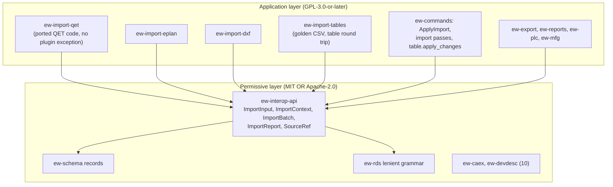
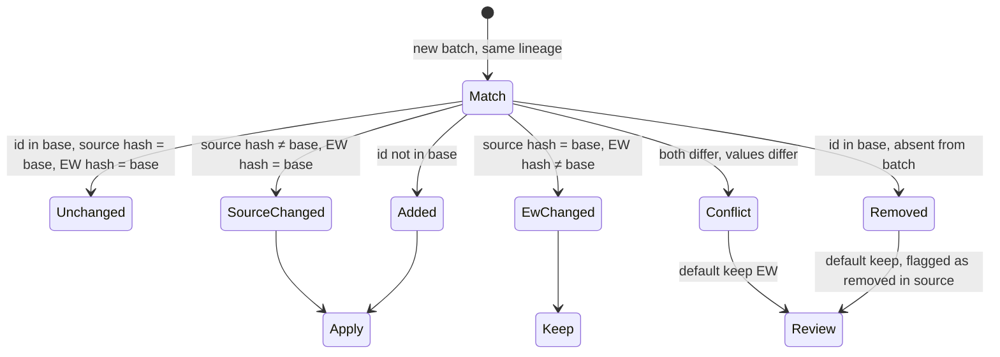

# Interoperability: import, export and migration: scope, contracts and the import pipeline

A chapter of [Interoperability: import, export and migration](14-interop.md), whose table says where each section lives.

---

## 1. Scope and context

### 1.1 What this document decides

| Decided here | Delegated |
|---|---|
| `ew-interop-api` types (`ImportInput`, `ImportContext`, `ImportBatch`, `ImportReport`, `SourceRef`; the `Importer` and `Exporter` traits are specified, not built) | Record kinds and invariants: [domain model](03-domain-model.md) |
| Import lineage, re-import without duplicates, the persisted import run | File layout and merge of the new record kinds: [05](05-project-format-and-persistence.md) |
| QET `.qet`/`.qetz` mapping, the migration report and its finding codes `EW-IMP-nnn` | Rule engine and live rule IDs (EW-TERM, EW-POT, EW-CORE): [08](08-connections-terminals-cables.md), [15](15-checks-revisions-collaboration.md) |
| EDZ, EPLAN parts XML, EPLAN report spreadsheets, underlays | Part, symbol and library content and library tiers: [07](07-symbols-parts-macros.md) |
| DXF and DWG reading; the DXF→symbol wizard | DXF page export details: [09](09-reports-forms-output.md) §4.4; drilling DXF: [12](12-panel-layout.md) §10, [13](13-manufacturing-outputs.md) |
| Spreadsheet round trip (FR-EXP-002 … FR-EXP-005), CSV dialect handling on import, translation files (XLIFF, CSV) | AML, TIA XLSX, PLCopen, I/O lists, GSD/GSDML/IODD: [10](10-plc-and-bus.md) §4 |
| Legal constraints, input limits, fuzz targets, corpora | STEP worker pipeline: [12](12-panel-layout.md) §6.2; machine formats: [13](13-manufacturing-outputs.md) |

### 1.2 Format catalogue

| Format | Direction | Crate (parser) | Release | Requirements |
|---|---|---|---|---|
| QET `.qet` 0.3–0.200, embedded `.elmt`, title blocks | read | `ew-import-qet` (roxmltree 0.21.1) | MVP | FR-IMP-006 … FR-IMP-021 |
| QET `.qetz` formats 2–4 | read | `ew-import-qet` (zip 9.0.4); `project.sqlite` read by the host through `ew-library` (§4.14) | 1.x | FR-IMP-024 |
| QET `.elmt` directory (the user's QET collection) | read | `ew-import-qet` (§4.3 mapper) into a user library | 1.0 ([07](07-symbols-parts-macros.md) §3.6) | FR-SYM-029 (07) |
| Golden tables (CSV) | read | `csv` importer (report format `golden-csv`) in `ew-import-tables` (ARCH §3), the CSV bootstrap of ARCH §13, exposed as `ew import csv` and reused by `ew-testkit` | MVP | FR-IMP-022 |
| Parts CSV/XLSX | read | `ew-import-catalog` column mapper into a user or company library ([07](07-symbols-parts-macros.md) §3.6) | MVP | FR-PRT-016 (07) |
| EDZ (7-Zip, ZIP) | read | `ew-import-eplan` (sevenz-rust2 0.24.2, its own bounded ZIP reader, quick-xml 0.41.0; §5.2) | 1.0 | FR-IMP-025 … FR-IMP-027 |
| EPLAN parts XML | read | `ew-import-eplan` | 1.0 | FR-IMP-028 |
| EPLAN report exports (XLSX/CSV) | read | `ew-import-eplan` for the mapping, the tables read by `ew-import-catalog`'s own bounded readers (not calamine) | 1.0 | FR-IMP-029 |
| PDF/DXF underlays | read | `ew-import-dxf`; PDF via hayro 0.8.0 in `ew-scene`, a runtime dependency (ARCH §3) | 1.0 | FR-IMP-030 |
| EPLAN `.epj` project XML | read | experimental, behind a flag | Later | FR-IMP-031 |
| DXF R12–2018 | read | `ew-import-dxf` (own reader, §6.1) | 1.0 | FR-IMP-032 … FR-IMP-035 |
| DXF AC1024 pages | write | `ew-export` (own writer, §6.4) | 1.0 | FR-OUT-015 (09) |
| DWG | read | ODA File Converter (user-installed); acadrust 0.6.4 behind a feature | 1.0 / 1.x | FR-IMP-036, FR-IMP-037 |
| XLSX/CSV tables | read/write | written by `ew-reports` (rust_xlsxwriter 0.100.0, csv 1.4.0); read by `ew-import-tables` (calamine 0.36.1, csv) | MVP | FR-EXP-002 … FR-EXP-005 |
| XLIFF 2.1, translation CSV | read/write | quick-xml, csv; the translation tables of `ew-import-tables`, next to the table round trip (ARCH §3) | 1.0 | FR-I18N-006, FR-I18N-007 |
| glTF 2.0, STL | write | the glTF (glb) and STL writer of `ew-panel` for `layout_scene` (gltf-json **(verify)**, ARCH §3; [12](12-panel-layout.md) §14) | 1.0 | FR-EXP-007 (12) |
| STEP AP214/AP242 | read / write | `ew-step-worker` (OCCT) | 1.0 | FR-LAY-021 (12), FR-EXP-008 |
| AML AR APC 1.4.0 and 1.2.0, TIA "PLC Tags" XLSX, PLCopen XML, generic and instrument I/O lists, GSD/GSDML/IODD (ESI, EDS at 1.x) | read/write | `ew-plc` with the permissive `ew-caex`, `ew-devdesc` and `ew-plcaddr` (ARCH §3) | MVP (generic I/O list, Should) / 1.0 / 1.x | FR-PLC-025 … FR-PLC-039, FR-PLC-050, FR-BUS-013 (10) |
| BMEcat 2005, ETIM xChange, ECLASS XML | read | `ew-import-eplan` sibling module `catalogue` | 1.x | FR-PRT-020 (07) |
| QET `.qet` 0.100 | write | `ew-export` | 1.x | FR-EXP-010 |
| EPLAN-importable XML | write | — | Later | FR-EXP-011 |

**The parts import** (row "Parts CSV/XLSX") is in
`ew-import-catalog` behind `ew-interop-api`, which re-exports `ew_schema` and `ew_ids` so the importer keeps its one
edge. It reads CSV (UTF-8 with or without a BOM, comma or semicolon from the header line, RFC 4180 quoting) and XLSX
with an **own bounded reader** on `miniz_oxide` and `quick-xml`, not calamine, whose zip would change the PDF bytes
through flate2's backend. A saved column map per source key turns rows into part copies with item IDs
`v5(lineage(catalog, library), parts|<maker key>|<pn_norm>)` ([07](07-symbols-parts-macros.md) §3.6).
`ew import parts --map` writes into a project, `ew lib import parts` (`--bump`, `--take-over`) into a user or company library; every row
is reported with its line.

### 1.3 Two kinds of import

EW has two import styles, and every format uses exactly one:

1. **Batch import** (QET, QETZ, EDZ, parts XML, DXF, EPLAN report spreadsheets, golden CSV). A pure importer turns
   bytes into an `ImportBatch` of `ew-schema` records. `ApplyImport` turns the batch into one previewed transaction
   in lenient mode (ADR-0021).
2. **Exchange import** (AML, TIA XLSX, I/O lists, the table round trip and translation files of §8). The file is parsed into a neutral
   image and **merged** against the current model and a stored base, with per-field ownership. The PLC variant is
   specified in [10](10-plc-and-bus.md) §4.2–§4.4. The table variant is in §8 of this document.

The distinction matters: a batch import creates or updates records it owns (keyed by lineage), while an exchange
import edits fields of records EW already owns.



---

## 2. Contracts and data

### 2.1 Importer contract

The contract of [architecture](04-architecture.md) §10.6 is kept; this section fixes its members. Everything here
lives in `ew-interop-api`, which depends directly only on `ew-schema` and `ew-ids` (and `sha2` for the input
digest); value types reach it through `ew-schema`'s records.

*State of the code:* the `Importer` trait, `Confidence`, `Source` and `TargetHints` below are specified for the plugin
API ([17](17-extensibility.md) §10); not built. The importers (`QetElementImporter`, `QetProjectImporter`,
`TablesImporter`) have an inherent `import` method, and the host calls them through `ew_api::import::front_door`.
What they share is in `ew-interop-api`: `ImportInput`, `ImportContext` (with `ImportMode` and `LineageInfo`), `Limits`,
`ImportBatch`, `ImportReport` with its entries, codes and `SourceInfo`, `ImportError`, `SourceRef`, `pn_norm`
and `check_archive_name`; the system library's ID and the starter keys an importer names are in `ew_schema::starter`.

The plugin contract as specified (not built):

```rust
pub trait Importer: Send + Sync {
    fn id(&self) -> &'static str;                         // "qet", "qetz", "edz", "eplan-parts-xml", "dxf", "csv"
    fn version(&self) -> &'static str;                    // recorded in the import run; bumps on mapping changes
    fn sniff(&self, head: &[u8], path: &Path) -> Confidence;               // content first, extension last
    fn import(&self, src: &mut dyn Source, cx: &ImportContext) -> Result<ImportBatch, ImportError>;
}
pub enum Confidence { No, Maybe(u8), Certain }
pub trait Source { fn name(&self) -> &str; fn len(&self) -> u64; fn sha256(&mut self) -> [u8; 32];
                   fn read(&mut self, limit: u64) -> Result<Bytes, LimitError>; }   // no path, no sibling access
// ImportContext gains, with the importers that need them:
//   hints: TargetHints                 plain data about the target, never the model
//   options: serde_json::Value         per-importer options, validated against its JSON Schema
//   cancel: &CancelToken, progress: &dyn Progress
pub struct TargetHints {               // copied from the target project or basic project by the host
    pub identifier_set: IdentifierSetKey, pub structure: Vec<(Aspect, Ident, Vec<Ident>)>, // code + aliases
    pub manufacturers: Vec<ManufacturerAlias>, pub colour_aliases: Vec<(String, ColourSpec)>,
    pub frames: Vec<FrameFingerprint>, pub symbol_map: Vec<SymbolMapRow>, pub font_map: Vec<FontMapRow>,
    pub text_patterns: TextPatterns,   // §4.12
}
```

What is built is in `crates/ew-interop-api/src/importer.rs`, each member with what it holds: `ImportContext` (the
target project, whose ID is the `library_id` of the "QET import" library, §4.3; the lineage, §2.3; the command's
`as_of` date, never the wall clock, 07 §3.6; the limits; the mode), `Limits` with its defaults (§11; a violation
refuses the file or skips the item, EW-IMP-001), and `ImportBatch`. `Limits::element_definition` tightens the
defaults for standalone element definitions (kilobytes and hundreds of primitives in practice), and the project
defaults stay for project files, whose importer reads them under its own budget. `Limits::stricter` is the
member-wise minimum, so a caller can only tighten, never loosen, the limits it is given; the element importer reads
with `ctx.limits.stricter(Limits::element_definition())`. The report entries of one element definition are capped
by a crate constant (`MAX_ENTRIES_PER_DEFINITION`), the rest summarised in one EW-IMP-001 entry.

The attribute work budget exists because `roxmltree` 0.21.1 checks the duplicate attributes of an element
quadratically, so a document can stay under both attribute counts and still be slow: the budget bounds the sum over
all elements of the squared attribute count. `max_xml_nodes` counts nodes (the document root, elements, texts, comments and processing instructions), not attributes; the pre-scan counts the root, elements and comments as a lower bound, and the parser's own limit also counts texts and processing instructions; a project
importer may raise it explicitly under its own budget.

**Importer IDs, input sets and bootstrap importers** ([ADR-0021](../adr/0021-importers-emit-format-level-records.md)
amendment 6). The importer ID is the `<importer>` of the lineage names of §2.3, so the
golden CSV bootstrap's ID is `csv` (`csv␟fixed␟golden`); `golden-csv` is only the name of its report format. An
importer may read a **set of inputs** instead of one `Source`: an `ImportInput` carries a file name (never a path),
the bytes and their SHA-256, and `TablesImporter::import(&[ImportInput], &ImportContext)` reads a directory of tables
as one batch. The rules below apply to the set as a whole: the file count, each file and the total are limited, a
repeated name is refused, and the order of the inputs does not change the batch. A **bootstrap importer** creates the
project record itself and derives its ID; `ImportContext.project` must be nil or equal to that ID, otherwise the
import is refused, and the batch is applied only into an empty project.

**Rules.**
- **Purity.** `import` reads only `src`. It never opens another file, follows an external reference or touches the
  network (NFR-SEC-18). It is deterministic: the same bytes, options, hints and `as_of` give a
  byte-identical batch.
- **No dangling references.** A batch must satisfy the structural invariants of ARCH §4.6 on its own plus the
  hinted target. An item whose reference cannot be resolved is dropped and reported (EW-IMP-003); it is never
  emitted. If `ApplyImport` still finds a structural violation, that is an importer bug: the import is refused
  with the report and the model stays unchanged (NFR-REL-12).
- **Prevent rules are not the importer's business.** Empty or duplicate terminal designations, duplicate tags and
  similar are emitted as found and reported later by the lenient validators (ADR-0009).
- **Proposals instead of guesses.** Where the mapping needs a human decision (a structure merge, a text-to-data
  match, a layout binding), the importer emits the conservative record and attaches a `Proposal` to a report
  entry (§2.4).

The batch holds no provenance list, since each record's own `source_ref` member is its provenance; its `assets` are
the bytes of the image files the records name by their SHA-256, each once, which the host stores as project assets.
The archive, input-set and table limits are `Limits` members too, which `stricter` covers; the importers read them
from the context, and the report and work caps are constants. **One front door,** `ew_api::import::front_door`: every
host call of an importer (the CLI's imports, the window's QET import and parts import, the fuzz targets) goes through
it; it refuses inputs over the size, total and file-count limits before the importer runs, runs the importer inside
`catch_unwind` (a panic becomes a refusal with the model untouched, NFR-REL-12) and checks the batch's contract
(`check_contract`: no repeated `(kind, id)`, no foreign lineage, every ID re-derived from its source key, records
sorted by rank and ID), never repairing a batch. The purity rule is a repository rule (`cargo xtask rules`) that refuses
`std::fs`, `std::net`, `std::process`, `std::env` and their kin in `ew-interop-api` and the `ew-import-*` crates, and
the XLSX walker refuses a DOCTYPE as `roxmltree` does.

### 2.2 Exporter contract

*State of the code:* the `Exporter` trait and its types (`ExportView`, `ExportContext`, `ExportReport`, `RowTable`) are
specified for the plugin API; not built, and nothing in `ew-interop-api` exports. The CSV and XLSX writers of
`ew-reports` (`table_csv`, `xlsx`) are called directly, and `ew-reports` does not depend on `ew-interop-api`.

```rust
pub trait Exporter: Send + Sync {
    fn id(&self) -> &'static str;
    fn export(&self, view: &ExportView, opts: &ExportOpts, sink: &mut dyn Sink) -> Result<ExportReport, ExportError>;
}
pub struct ExportView<'a> {            // built by the GPL host on a snapshot fork
    pub rev: Rev, pub records: &'a dyn RecordSource,      // ew-schema records of the snapshot
    pub rows: &'a dyn RowSource,       // materialised RowSets (09 §2.3) by key: "bom_component", "wires" …
    pub context: ExportContext,        // dates per 09 §4.3, language, personal-data policy, EW version
}
pub struct ExportReport { pub rev: Rev, pub outputs: Vec<OutputMeta{name, sha256, media_type}>, pub findings: Vec<ReportEntry> }
```

- An exporter sees records and row sets as plain data, so third-party exporters (WASM plugins at 1.x, FR-EXT-019)
  need no GPL code.
- Exports run on a fork and never block editing (FR-EXP-001). Every output records the revision it reflects; a
  release-mode export refuses stale Class II inputs (ADR-0003).
- **Determinism** (FR-EXP-006, NFR-REL-07): ordered maps only; dates from the export context (release context,
  scheme date, `SOURCE_DATE_EPOCH`, model edited date, in that order, [09](09-reports-forms-output.md) §4.3); ZIP
  entries (XLSX, `.ewpp`) in sorted order with that date and fixed compression settings; no absolute paths, user
  names or random IDs.
- **Personal data** (FR-EXP-009, NFR-PRIV-06): `ExportContext.omit_personal_data` removes every field that
  `ew-schema` marks personal (engineer, checker, party persons, XMP authors) from XLSX, CSV, AML, `.ewpp` and
  `.ewz`.

### 2.3 Identity and lineage

ADR-0004 fixes imported IDs as `v5(namespace, source_file_hash, source_id)`. Hashing each new file version would
mint new IDs whenever the pilot edits a `.qet` in QET during the transition ([02b](02b-requirements-extended.md)
OQ 5). EW therefore anchors the hash in an **import lineage** (ADR-0004 amendment 1, FR-IMP-002, FR-IMP-040): the
record `ImportLineage` and its anchor, the enum `LineageAnchor`, of `crates/ew-schema/src/project.rs`, each member
with what it holds; the stored form is the generated schema (`schemas/0.1/import_lineage.schema.json`). Its source
name is a file name, never a path. The anchor is the QET 0.200+ project UUID; for older files the SHA-256 of the file
at first import; for an "import as copy" (§3.4) the original lineage's namespace and the copy's number (ADR-0004
amendment 4); or a fixed label, `golden` for the golden CSV bootstrap (§8.4). The IDs follow from it:

```text
namespace = v5(NS_IMPORT, importer ␟ anchor kind ␟ anchor value)     # ␟ = U+001F, 05 §3.2a
record id = v5(namespace, source_key)                               # source key byte for byte
```

**Namespace derivation** (ADR-0004 amendment 4). The anchor is never used as the namespace itself; every lineage
namespace is a UUIDv5 under the fixed constant `NS_IMPORT` = `7b75186c-f28e-49ce-b7f7-26b137095a65`, which `ew-ids`
owns beside `NS_LIBCOPY`. The name is built by the layout of [05](05-project-format-and-persistence.md) §3.2a:

| Anchor | Name bytes (`importer` = `ImportLineage.importer`, lower case) | Example |
|---|---|---|
| `QetProjectUuid(u)` | `qet␟project␟<u, lower-case hyphenated>` | `qet␟project␟6f1c9a0e-3b7d-4e2f-8a5c-1d0e9b8a7c6f` |
| `FirstImportSha256(d)` | `<importer>␟sha256␟<d as 64 lower-case hex digits>` | `dxf␟sha256␟e3b0c442…7852b855` |
| `Copy{of, n}` | `<importer>␟copy␟<namespace of the lineage of>␟<n>` | `qet␟copy␟a1ba512b-…␟2` |
| `Fixed(label)` | `<importer>␟fixed␟<label>` | `csv␟fixed␟golden` |

The namespace is stored in `ImportLineage.namespace` and computed once, when the lineage is created. A copy names its
original by namespace rather than by record ID, so two branches that import the same file as a copy mint the same
IDs. Importers emit source keys in NFC, so the stored `source_ref.key` re-derives every record ID. The worked
vector of 05 §3.2a (the empty file's digest gives `a1ba512b-c515-50c5-af0b-26fa3b5599f5`) is a fixed test of
`ew-ids`.

With `FirstImportSha256` the formula is literally ADR-0004's, with `source_file_hash` read as "hash of the
lineage's first file". Re-importing the identical file reproduces every ID and yields an empty diff (FR-IMP-002).
Re-importing an edited file into the same lineage keeps the IDs of every item whose source key is unchanged
(FR-IMP-040).

**Source keys** are stable strings derived from the source's own identifiers:

| Source | Key | Stability |
|---|---|---|
| QET element instance | `qet:el:{uuid}`; for a UUID shared by copy-paste (QET #1408), the n-th further copy on a folio: `qet:el:{uuid}#{folio key}#{n}` (EW-IMP-120); an element without UUID: `{folio key}#el#{n}` at source position n. The device takes the key, its main function `…#fn`, its representation `…#rep` | stable |
| QET junction element | `qet:junction:{element key}` | stable |
| QET project record | `qet:project` (when the import creates the project) | stable |
| QET folio | `qet:folio:{uuid}` (0.200); else `qet:folio:{label}`, falling back to `qet:folio-order:{order}` | label-stable before 0.200 |
| QET conductor | `qet:wire:{uuid}` (0.200); else `qet:wire:{end key 1}\|{end key 2}` with the end keys sorted; an end key is `{element key}/{terminal index}`, and parallel conductors between the same ends add `#{n}` | endpoint-stable |
| QET element definition | content hash of the canonical definition XML (05 §13.2: element-hash UUIDv5) | content-addressed |
| QET strip (inferred, §4.11) | `qet:strip:{structure}-{product}` (its own designation with the structure prefix, sign dropped); the fallback strip of a folio `qet:strip:folio:{folio key}`; never a line number | stable under re-import |
| QET cable, shape, text | 0.100/0.200 UUIDs; else `{folio key}#{kind}#{n}` in document order | order-stable |
| EDZ / parts XML part | `edz:part:{manufacturer}\|{P_ARTICLE_PARTNR}` (+ `\|{variant}`) | stable |
| DXF entity | `dxf:{layout}\|{handle}`; R12 files without handles: `dxf:{layout}\|#{n}` | handle-stable |
| EPLAN report row (§5.4) | `eplan:{target}\|{row key}`, the row key being the mapped DT plus designation (`=P01+J-E-2416-X1031:1`) | stable while the DT is |
| Spreadsheet row | the hidden `id` column (§8) | stable |
| Golden CSV | `{table}\|{row key}` in the lineage anchored `Fixed("golden")`, i.e. `v5(v5(NS_IMPORT, "csv␟fixed␟golden"), "{table}\|{row key}")` | stable |

The folio key of these keys is the printed folio label
(`qet:folio-order:{position}` for a repeated label). The lineage is anchored on the QET 0.200 project UUID where the
file has one, else on `FirstImportSha256`. A conductor end that names a UUID repeated on its folio is resolved to the
copy whose terminal position matches the conductor's route (its first or last point), through one terminal-position
index per folio and repeated UUID, so the matching is linear in the number of copies and conductors; a conductor
gets at most 16 pair probes, and an ambiguous pair beyond them binds the first copy in document order with an
EW-IMP-120 finding. The keys depend on
neither line numbers nor document order where the source has identifiers, so an edited file re-imports into the same
IDs (FR-IMP-040).

**Persisted provenance.** Every imported record carries `source_ref: {lineage, key}`. Locations (file, member,
folio, cell, line) live only in the import run, which keeps entity files small.

**Two hashes
per record.** `ImportRun.record_hashes` maps each imported record's ID to `{source, ew?}`: `source` is the first
128 bits of SHA-256 over the record's canonical line as the importer emitted it (`$k` first, the members in
declaration order, as `ew-format` writes it) less its `source_ref` member, `ew` the same over the record as committed
after the normalisers, omitted when equal, so a record a normaliser changed is not EW-changed on the next re-import. A
lineage is matched by its namespace (a QET project UUID); otherwise a lineage of the same importer and file name that
holds at least half of the batch's source keys is proposed, and accepting it imports again with that lineage's
namespace; otherwise the import into this project is refused in words.

### 2.4 Report, proposals and the import run

The report is the struct `ImportReport` of `crates/ew-interop-api/src/report.rs`, with its `SourceInfo`, its
entries (`ReportEntry`, each with its `SourceLocation`, never a filesystem path, and at most one quick fix,
`QuickFixProposal`) and its `ImportStats`, each member with what it holds. An entry's message is English text; Fluent
keys and arguments arrive with the migration report's window. The proposals beyond a quick fix are specified; not
built:

```rust
pub enum Proposal { MergeStructure{from, into}, SetFields{target, fields}, BindText{text, target, field, value, confidence},
                    BindPlacement{item, device, score}, MapSymbol{symbol, to}, AdoptRule{class, rule}, Split{target}, … }
```

- `ImportStats` counts records per kind, dropped and inferred items, and **lost connections**. FR-IMP-007's
  acceptance is `lost_connections == 0`. It also carries `suppressed`: per code, the number of entries that a report
  cap (`MAX_ENTRIES_PER_DEFINITION`, the project importer's entry cap) folded into a summary entry, so a capped
  report still counts every condition. The member is an additive change of the permissive `ew-interop-api`, checked
  against its MSRV.
- A `Proposal` is format-level intent. `ApplyImport` translates an accepted proposal into a command inside the import
  transaction; a pending one becomes a quick fix on the finding.
- **`ImportRun`** (record kind `import_run`, rank 72, one file `imports/<run-uuid>.jsonl` per run,
  [05](05-project-format-and-persistence.md) §2.1; FR-IMP-041) persists `{lineage, importer, importer_version, source info, as_of, options digest,
  entries, stats, record_hashes, acknowledged}`. `record_hashes` maps each imported record ID to a 128-bit hash of
  the record as imported; it is the base of the re-import diff (§3.4). The run survives saves and merges, so
  import-only facts such as "Tahoma substituted" or "custom SQL dropped" stay visible after the import (MF-22
  "stays as an info in the migration history").

`ImportRun` is typed within
format 0.1 (ADR-0011 amendment 4) with the members `id` (UUIDv7), `lineage` (a link; EW-CORE-008 when it
dangles, no cascade), `importer`, `importer_version`, `source` `{name, sha256, size, format, format_version?}`,
`as_of?`, `mode` (`strict` or `lenient`), `entries` (each `{code, severity, defect?, message, location?, targets,
fix?}`, a fix being `{label, command, params}`), `stats`, `record_hashes` and `extra`; no options digest and no
`acknowledged` member. `ImportLineage.last_run` links the lineage's last run. A run is never changed after
its transaction and no command deletes one. The QET project import writes a run; the CSV bootstrap, the parts
table import and the table round trip write none. Proposals and the review queue are not built: an entry
carries at most a quick fix.

### 2.5 The migration report

The migration report of FR-IMP-003 is one check-run view over two sources:

| Source | Content | Lifetime |
|---|---|---|
| **Import findings** `EW-IMP-nnn` from the `ImportRun` | Facts visible only at import: dropped, substituted, inferred, recognised, conflicting per-folio values | Persisted; acknowledged items turn into info |
| **Lenient check findings** of the `migration` scheme on the candidate ([15](15-checks-revisions-collaboration.md) §10.2) | EW-TERM-001/002 (D-11, D-12), EW-RDS-010 (D-03), EW-CORE-023 (D-06), EW-CORE-031 (D-17), EW-POT-013 (D-13), EW-CORE-053 (D-14, FR-CHK-035) … | Live: they disappear when the model is fixed |

The import front door runs the `migration` scheme of `ew-checks` on the
imported model (`ew_api::import::lenient_findings`): every `pre-delivery` rule that is built (EW-TERM-001/002/005,
EW-RDS-004, EW-POT-001/008/011/012/014, EW-CORE-033/051/052/081), lenient. EW-TERM-002 skips the fallback strips `X?<page>`. Rules that are not built are not evaluated on an import.

The panel filters both by lineage, sorts by folio and cell, and offers each quick fix as a previewed command
(FR-CHK-010). `ew import … --report json|csv|md` writes the same list.

**One row per condition.** An `EW-IMP` entry records what the importer did or saw; a live rule reports a condition
that is still in the model. Where both name the same targets and defect class (EW-IMP-102 and EW-RDS-010 on
+JE2416; EW-IMP-105 and EW-CORE-023 on folio 101; EW-IMP-114 and EW-CORE-063), the migration report shows one row
under the live rule ID, with the import code as its origin and the import proposal as its quick fix. EW-IMP-110 has
no live counterpart until the assembly exists; EW-CORE-046 (FR-CHK-022) takes over after the reconstruction step
(§4.13). A migration report therefore lists each condition once (AC-25).

**Import finding catalogue.**

| Code | Finding | Sev. | Defect class | Proposal / quick fix |
|---|---|---|---|---|
| EW-IMP-001 | Input limit exceeded; item or file refused | error | — | — |
| EW-IMP-002 | Malformed or refused item skipped (NaN, overflow, unparsable node; in a strict import, a value that a prevent rule refuses, the message naming the rule, for example EW-CORE-031 for a foreign colour code) | error | — | — |
| EW-IMP-003 | Unresolvable reference dropped (conductor end, link UUID) | error | — | — |
| EW-IMP-004 | Content dropped by design (QET custom SQL, `.ema` geometry, `.e3d`, DXF 3D solids) | info | — | — |
| EW-IMP-005 | Object inferred (strip, cable, section, junction), review | warning | — | confirm / split |
| EW-IMP-006 | Font substituted | info | — | — |
| EW-IMP-007 | Value mapped through an alias table (manufacturer, colour code, structure alias) | info | D-17, D-18 | revert / choose |
| EW-IMP-008 | Value kept as foreign or opaque text | warning | D-17, D-18 | map |
| EW-IMP-009 | Print-equivalence deviation: EW's derived text differs from the source's printed text | warning | — | per case |
| EW-IMP-010 | Removed in the source, kept here: a re-import's removed record (§3.4) | warning | — | — |
| EW-IMP-011 | Changed in the source and here, kept here: a re-import's conflict (§3.4) | warning | — | — |
| EW-IMP-101 | Stored label differs from the formula result | warning | D-01 | use derived tag |
| EW-IMP-102 | Structure-code spelling variants | warning | D-03 | merge, keep alias |
| EW-IMP-103 | Label does not fit an inferred rule; kept as frozen tag | info | D-03 | convert where conforming |
| EW-IMP-104 | Per-folio title-block value conflict (revision, author, date) | warning | D-05 | create revisions, drop per-page values |
| EW-IMP-105 | Per-folio description differs; kept as `description_override` | info | D-06 | drop override |
| EW-IMP-106 | Title-block party differs from the cover party | warning | D-30 | bind role |
| EW-IMP-107 | Free text converted to data (wire marker, address, port, process tag, bus address) | info | D-08, D-15, D-26 | revert |
| EW-IMP-108 | Data-like text not converted (review list) | warning | D-08, D-26 | bind manually |
| EW-IMP-109 | Strip drawn in several segments; merged into one strip | info | D-42 | split |
| EW-IMP-110 | Hand-drawn overview differs from the linked detail | warning | D-10 | regenerate overview |
| EW-IMP-111 | Layout item binding proposal | warning | D-02 | confirm |
| EW-IMP-112 | Symbol of a device class without device tag | warning | D-27 | build assembly and children |
| EW-IMP-113 | Imported table rows differ from the derived report | info | D-04 | — |
| EW-IMP-114 | Imported text styles not bound to slot kinds | info | D-29 | apply style |
| EW-IMP-115 | Folio-report pair names differ, or pairing needs chain mode | warning | D-24 | rename / set mode |
| EW-IMP-116 | Slave without master; master above `max_slaves` | warning | — | link |
| EW-IMP-117 | Project uses QET's default `%f` folio-index formula | info | — | switch to folio label |
| EW-IMP-118 | Junction wiring assumed (Star) at a QET junction element | info | D-20 | set Chain |
| EW-IMP-119 | Element without function semantics; generic black box | warning | — | map symbol |
| EW-IMP-120 | Shared element UUID disambiguated | info | — | — |
| EW-IMP-121 | Several interruption-point names on one potential | info | D-24 | — |
| EW-IMP-122 | Unlabelled element, tag synthesised: the device keeps its `prefix` letter (else "A") without counter and prints "?" | info | — | label (hiding the synthesised tag) |
| EW-IMP-123 | Cross-section mark differs from the derived wire property: the mark is dropped, the wire keeps the derived value, the mark's value is in the finding | warning | D-08 | set the override to the mark's value |
| EW-IMP-2nn | EDZ and EPLAN: 201 terms notice shown, 202 function definition unmapped, 203 ZIP-format EDZ, 204 extras ignored, 205 unit converted, 206 report column unmapped, 207 multi-level terminals folded | info–warning | — | map |
| EW-IMP-25n | DXF and DWG: 251 units missing (prompted), 252 SHX substituted, 253 entity unsupported, 254 external reference not followed, 255 hatch pattern reduced to its boundary, 256 CP snapped, 257 DWG converted through ODA | info–warning | — | — |
| EW-IMP-30n | Tables: 301 derived column edited, 302 row changed in EW since export, 303 unknown ID, 304 cell conflict, 305 lossy Excel conversion | info–warning | — | resolve |

The `EW-IMP` family is registered with the
rule catalogue of [15](15-checks-revisions-collaboration.md) as message class 160 (EW-IMP-101 prints as `160101`)
and documented per code like every rule (NFR-DOC-02).

*Decided.* A strict import that meets a value a prevent rule would refuse drops only that row, under EW-IMP-002 with the rule in the message; no separate code is added, because the row is skipped exactly like a malformed one and the rule ID keeps the cause visible.

**The migration report is a check run.** The `EW-IMP` codes the
importers emit, with EW-IMP-010 and EW-IMP-011, are rows of `ew-checks`' catalogue, message class 160, each with a
rule page; a run of the `migration` scheme (and of `full`) reads the run of each lineage's `last_run` and adds each
entry as a finding at its severity, in words, with its targets and its quick fix (EW-IMP-103's is the one built). **Folding:** an entry whose code forms a
pair of the fixed list {EW-IMP-102 with EW-RDS-010, EW-IMP-105 with EW-CORE-023, EW-IMP-114 with EW-CORE-063} with a
live finding on the same targets is not listed, and the live finding carries the import code as its origin. `ew import
qet --report` renders the run of the candidate, `ew check --scheme migration` that of a saved project, and Messages
offers "Migration report" beside the project's scheme while a lineage exists. Since only each lineage's last run is
read, a re-import that writes a run drops the EW-IMP-010 row of a record removed at an earlier one.

---

## 3. The import pipeline

### 3.1 Stages

```mermaid
flowchart LR
  F["source bytes"] --> S{"sniff()"}
  S --> L["lineage: new, detected<br/>(QET project UUID, name + key overlap)<br/>or chosen"]
  L --> I["importer import (pure, pool job)"]
  I --> B["ImportBatch"]
  B --> R["ApplyImport.resolve:<br/>ID collisions, aliases,<br/>library embedding"]
  R --> P["import passes on the fork (§3.2)"]
  P --> N["normalisers and validators,<br/>lenient mode"]
  N --> V["preview: rendered pages,<br/>diff_model, diff_query"]
  V --> Q["review queue: proposals"]
  Q -->|accept or reject| P
  Q --> C["commit: one transaction<br/>origin = import"]
  C --> RUN["ImportRun written in the<br/>same transaction"]
```



1. **Sniff.** Content decides; the extension only breaks ties:

   | Content | Format |
   |---|---|
   | 7-Zip magic `7z\xBC\xAF\x27\x1C`, or ZIP `PK\x03\x04` with `*.part.xml` members | EDZ (renamed to `.zip` it is still EDZ, FR-IMP-001) |
   | ZIP whose first, stored member `mimetype` is `application/x-qet-project+zip` or the older `application/x-qelectrotech-project+zip` | QETZ |
   | ZIP with `xl/workbook.xml` | XLSX: the round trip of §8 if a hidden `_ew` sheet exists, else the column mapper of §5.4 |
   | XML root `<project>` with a `version` attribute | QET project |
   | XML root `<definition type="element">` / `<titleblocktemplate>` | QET element / title-block template (library targets only) |
   | XML root `<partsmanagement>` | EPLAN parts XML |
   | Group code 0 `SECTION` within the first 4 KiB, or the `AutoCAD Binary DXF` sentinel | DXF |
   | `AC10nn` version magic in the first 6 bytes (AC1012 … AC1032) | DWG (converter route, §6.5) |
   | `%PDF-` | PDF underlay |
   | none of the above, text | CSV: dialect detection on the first 20 rows (§5.4, §8.2) |

2. **Parse and map** run as a `Cost::Bulk` job on the pool (progress within 200 ms, cooperative cancel,
   NFR-PERF-08, NFR-PERF-19).
3. **Resolve** assigns the batch to the target: a new project (created from the chosen basic project, FR-PRJ-009),
   the open project, or a library ([07](07-symbols-parts-macros.md) §3.6: part importers write to a user or company
   library, never directly into a project).
4. **Import passes** need derived data and therefore run in `ApplyImport`, not in the importer (§3.2).
5. **Normalisers and validators** run in lenient mode (FR-CHK-011): CP instantiation, junction clean-up, online
   numbering of records without counters, conductor assignment; prevent-rule violations become findings.
6. **Preview** shows the candidate: rendered pages, entity diff, report diffs (BOM, wire list, terminals, xref texts)
   (FR-IMP-004, ARCH §5.4).
7. **Review.** The user accepts or rejects proposals, singly or by group ("accept all high-confidence wire
   markers"). Accepted proposals append commands to the same prepared transaction, and the affected passes re-run.
8. **Commit** as one transaction `import.apply{lineage, run}`. Into an empty project it is the confirmed,
   non-undoable checkpoint of ARCH §5.3; into an existing project it is one undo step.

`ew import` takes the project lock like every writing command ([05](05-project-format-and-persistence.md) §6.4).

Steps 1 to 6 and 8 are built; step 7's review queue is not, and of the import passes only what the
normalisers already did runs. The window runs the importer as a job on its own thread, while the transaction and the
preview stay on the window thread, since a `Session` cannot move between threads. `ApplyImport` is one internal
transaction, `import.apply` (origin `import`, not in the public command catalogue): it embeds the batch's library
documents, creates or updates the lineage, runs the normalisers, checks the structural invariants without the
prevent hook, so prevent violations stay as findings, and writes the run. **Into a new project:** `ew import qet
<file> --out <dir>` writes the project after the report (a folder of `<dir>` that does not exist is made, and removed
again when the write fails); in the window the import card is a modal (not the Preview
tab's card). It says what its button makes (a new project in the chosen folder, with its pages, devices and
connections), gives a verdict (everything imported; points worth a look; points that need a fix), names a missing
starter library, and lists the kinds of findings of the migration report under what they ask of the reader (Needs a
fix, Worth a look, For your information), each kind with its count and the rule's title, the most frequent first.
Its button is Create project, which is the confirmation (a script passes `confirm`), then the unsaved-changes
question for whatever project is open then; Cancel writes nothing. **Re-import:** `ew import qet <file> --into <project>`
prints the classes and writes nothing, `--apply` commits and saves; the window's re-import card lists the rows, and
Apply is one undo step.

### 3.2 Import passes

| Pass | Purpose | Needs |
|---|---|---|
| P1 Potential definitions | Merge duplicate `PotentialDef` candidates (from QET conductor `function`/`tension_protocol` and IP names) that fall into one derived potential | `potential_partition` |
| P2 Override pruning | Drop imported wire colours and cross-sections equal to the profile value at level ≤ 6; keep the rest as CDP overrides (FR-IMP-012) | `wire_props_of` |
| P3 IP pairing check | Compare EW's derived pairs with the source links; repair with `IpSpec.sort` or report (§4.6) | xref relations |
| P4 Print equivalence | Compare derived tags and xref texts with the texts the source printed; report each deviation (EW-IMP-009) | `device_tag`, `xref_text` |
| P5 Table diff | Compare QET nomenclature rows with `bom_rows` (EW-IMP-113) | `bom_rows` |
| P6 Layout binding | Score layout items against derived tags (FR-IMP-019) | `device_tag` |
| P7 Text binding | Bind recognised texts to channels, ports and cables once targets exist | channel and CP queries |

Passes are deterministic functions of (candidate, batch, accepted proposals). They never loop with each other: P1
and P2 precede P3–P7, and a re-run after review starts at the first affected pass.

### 3.3 Lenient mode boundaries

| Never relaxed (structural) | Relaxed to findings (prevent rules) |
|---|---|
| References resolve; connection endpoints exist and differ; one main function per device; acyclic assemblies; placement → device; channel → one module | Empty or duplicate terminal designations (D-11, D-12; FR-TRM-002); duplicate tags in a scope; duplicate IP names per scope and direction; PLC address overlap; foreign colour codes (D-17); conductor colours inconsistent with the cable part |

A lenient project stays lenient for exactly the records that violate a prevent rule. A new violation drawn
afterwards is rejected in strict mode (FR-CHK-011 acceptance).

### 3.4 Re-import without duplicates



- The base is `ImportRun.record_hashes` of the lineage's last run. "EW hash" is the hash of the current record with
  `source_ref` excluded.
- **Field-level detail.** For a conflict the preview shows ours and theirs per field; the base value is not stored,
  so the resolution is a choice, not an automatic merge.
- **Never silent deletion.** A record removed in the source is listed and kept until the user deletes it.
- **Typicals and copies.** "Import as copy" creates a new lineage (`Anchor::Copy`), so the same file can be imported
  twice into one project, for example as a second cabinet.
- **Lineage detection.** QET 0.200 project UUID → automatic. Otherwise a proposal when the file name matches and at
  least 50 % of the batch's source keys exist in a lineage (threshold configurable).

The six classes are as drawn, with the two hashes of §2.3's note; a conflict keeps EW's record and
lists ours and theirs per changed member, with EW-IMP-011, and a removed record is kept with EW-IMP-010. A base record
already deleted in EW stays deleted. Re-importing the identical file writes nothing, and a removed record carries no
base hash in the run an applied re-import writes, so the same file again finds nothing to do. The 50 %
threshold is fixed, not configurable, and import as a copy is not built. A project whose run was written
before the canonical-line hash is imported afresh.

